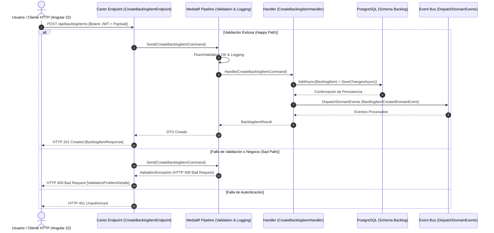

# ESPECIFICACIÓN TÉCNICA DE HISTORIA DE USUARIO: Registro de Elementos en Backlog Multitipo

## 1. METADATOS FORMALES
- **Feature ID:** FEAT-001
- **Story ID:** HU-001
- **Épica:** [P1] Planificación y Control de Sprints con Backlog Multitipo
- **Tipo:** Feature
- **Prioridad:** Alta
- **Tags:** [backlog, multitipo, estimacion-rol, sprint-planning]
- **Consumo SDD:** `/speckit.specify documents/business-analyst/001-registro-elementos-backlog-multitipo.md`

---

## 2. ESPECIFICACIÓN FUNCIONAL Y ESCENARIOS GHERKIN (BDD)

### 2.1. Descripción de la Capacidad
**Como** Líder Técnico o Miembro del Equipo de Desarrollo/QA autenticado  
**Quiero** invocar el endpoint de creación de elementos en el Backlog proporcionando datos tipificados (tipo de ítem, título, descripción, criterios de aceptación, aplicación vinculada y estimaciones desacopladas por rol técnico para Desarrollo y QA)  
**Para** garantizar la persistencia ordenada, validada y auditable de los elementos de trabajo que nutrirán la planificación de los Sprints de 2 semanas, asegurando la trazabilidad de esfuerzo diferenciado por disciplina técnica.

### 2.2. Escenarios Formales en Sintaxis Gherkin Pura

```gherkin
Feature: Registro de Elementos en Backlog Multitipo
  Como Líder Técnico o Miembro del Equipo de Desarrollo/QA autenticado
  Quiero registrar elementos de trabajo en el backlog multitipo con estimación independiente por rol
  Para centralizar el catálogo de requerimientos y alimentar la planificación de Sprints con esfuerzo desacoplado

  Scenario: SC-01 [Happy Path] Registro exitoso de elemento tipo Historia de Usuario con estimaciones completas por rol
    Given que el usuario cuenta con un token JWT válido con rol técnico autorizado
    And existe la aplicación de software identificada con "app-id-101" en el catálogo
    When el cliente envía una solicitud POST a "/api/backlog/items" con el siguiente payload:
      """json
      {
        "title": "Implementar autenticación OIDC con Keycloak",
        "type": "UserStory",
        "description": "Configurar middleware Bearer JWT en el gateway modular",
        "acceptanceCriteria": "El token JWT debe validarse contra el realm configurado",
        "priority": "High",
        "devPoints": 5.0,
        "qaPoints": 3.0,
        "applicationId": "app-id-101"
      }
      """
    Then el sistema responde con código de estado HTTP 201 Created
    And el cuerpo de respuesta contiene el identificador único del ítem "id", el estado inicial "Backlog" y las estimaciones "devPoints" igual a 5.0 y "qaPoints" igual a 3.0
    And el registro se persiste en el schema de backlog en PostgreSQL con metadatos de auditoría "CreatedAt" y "CreatedBy"
    And se publica internamente el evento de dominio "BacklogItemCreatedDomainEvent"

  Scenario: SC-02 [Happy Path] Registro exitoso de elemento técnico alternativo con estimación parcial o nula
    Given que el usuario autenticado requiere registrar una investigación técnica preliminar
    When el cliente envía una solicitud POST a "/api/backlog/items" con el siguiente payload:
      """json
      {
        "title": "Spike sobre latencia de réplica en PostgreSQL",
        "type": "Spike",
        "description": "Evaluar tiempo de respuesta en consultas de lectura pesada",
        "priority": "Medium",
        "devPoints": 2.0,
        "qaPoints": null,
        "applicationId": null
      }
      """
    Then el sistema responde con código de estado HTTP 201 Created
    And el cuerpo de respuesta confirma la persistencia del ítem de tipo "Spike" con estado inicial "Backlog"
    And el campo "qaPoints" se almacena como nulo sin forzar valor numérico

  Scenario: SC-03 [Sad Path] Rechazo de creación por omisión de título requerido
    Given que el usuario envía una solicitud de creación al endpoint "/api/backlog/items"
    When el payload contiene un título vacío o nulo:
      """json
      {
        "title": "",
        "type": "Bug",
        "priority": "High"
      }
      """
    Then el sistema interrumpe el pipeline en la etapa de validación y responde con código HTTP 400 Bad Request
    And el cuerpo de respuesta detalla el error de validación indicando que el título es un campo obligatorio
    And ningún registro es persistido en la base de datos

  Scenario: SC-04 [Sad Path] Rechazo de creación por tipo de ítem no reconocido en el catálogo
    Given que el usuario intenta registrar un tipo de elemento inexistente
    When el cliente envía una solicitud POST con el tipo "EpicGlobalInvalida":
      """json
      {
        "title": "Migración general de base de datos",
        "type": "EpicGlobalInvalida",
        "priority": "Medium"
      }
      """
    Then el sistema rechaza la solicitud con código HTTP 400 Bad Request
    And la respuesta contiene el error indicando que el tipo de elemento no pertenece al catálogo permitido: [UserStory, Bug, TechEvolution, TechRequirement, TechDebt, Research, Spike]
    And el estado de la base de datos permanece inalterado

  Scenario: SC-05 [Sad Path] Rechazo de creación por estimación numérica negativa
    Given que el usuario ingresa datos con una estimación de esfuerzo inconsistente
    When el cliente envía una solicitud POST con "devPoints" o "qaPoints" con valor negativo:
      """json
      {
        "title": "Corrección de concurrencia en checkout",
        "type": "Bug",
        "devPoints": -3.0,
        "qaPoints": 1.0
      }
      """
    Then el sistema responde con código HTTP 400 Bad Request
    And la respuesta tipada de validación especifica que los puntos de estimación deben ser mayores o iguales a cero
    And no se dispara ningún evento de dominio

  Scenario: SC-06 [Sad Path] Rechazo por solicitud no autenticada sin token Bearer
    Given que una solicitud HTTP es enviada sin cabecera Authorization o con token JWT expirado
    When se realiza una petición POST a "/api/backlog/items"
    Then el pipeline de seguridad rechaza la llamada con código HTTP 401 Unauthorized
    And la solicitud es detenida antes de alcanzar los módulos de lógica de aplicación
```

---

## 3. MATRIZ DE CASOS BORDE Y EXCEPCIONES

| ID | Condición Límite / Error | Tipo de Evento | Comportamiento Esperado | Código / Tipo de Respuesta |
|---|---|---|---|---|
| CB-01 | Título excede la longitud máxima permitida (ej. > 200 caracteres ⚠️ [PROPUESTO]) | Validación de Esquema (FluentValidation) | Rechazo inmediato con mensaje explicativo de longitud de campo excedida | HTTP 400 / ValidationException |
| CB-02 | Tipo de ítem no reconocido en el catálogo oficial | Validación de Catálogo de Negocio | Rechazo con listado de tipos válidos soportados | HTTP 400 / ValidationException |
| CB-03 | Valor de estimación de Dev o QA negativo (< 0) | Validación de Rango de Datos | Rechazo con mensaje indicando que el esfuerzo no puede ser negativo | HTTP 400 / ValidationException |
| CB-04 | `applicationId` provisto con identificador inexistente en el catálogo de aplicaciones | Integración y Validación Referencial | Rechazo indicando que la aplicación referenciada no existe | HTTP 400 / NotFoundException ⚠️ [PROPUESTO] |
| CB-05 | Inconsistencia o caída de conexión en PostgreSQL durante la transacción | Falla de Persistencia / Transaccional | Rollback completo de la transacción sin persistencia parcial de entidades ni eventos | HTTP 500 / InternalServerException |
| CB-06 | Petición sin cabecera de autorización o token JWT vencido | Seguridad e Identidad (Keycloak) | Rechazo inmediato en middleware de autenticación sin delegar a MediatR | HTTP 401 / Unauthorized |

---

## 4. PRECONDICIONES Y POSTCONDICIONES VERIFICABLES

### 4.1. Precondiciones del Sistema
- **Autenticación:** El emisor de la petición debe disponer de un token JWT válido y firmado por Keycloak, transmitido mediante la cabecera `Authorization: Bearer {token}`.
- **Configuración del Módulo:** El endpoint de Minimal APIs (`ICarterModule`) para `/api/backlog/items` debe estar registrado en el contenedor de dependencias del Bootstrapper.
- **Disponibilidad de Datos Relacionados:** Si el payload incluye `applicationId`, dicho registro debe existir previamente en el catálogo de aplicaciones para preservar la integridad referencial.
- **Infraestructura de Datos:** El schema de base de datos correspondiente al módulo en PostgreSQL debe estar aprovisionado y accesible con la tabla de persistencia `BacklogItems`.

### 4.2. Postcondiciones y Mutaciones
- **Persistencia de Entidad:** Se genera un nuevo registro en la tabla de items de backlog en PostgreSQL con un identificador único global (UUID/Guid).
- **Asignación de Estado:** El estado operativo inicial se fija de forma invariable en `Backlog` (`BacklogItemStatus.Backlog`) ⚠️ [PROPUESTO].
- **Auditoría Automática:** El `AuditableEntityInterceptor` de EF Core inyecta `CreatedAt = DateTime.UtcNow` y `CreatedBy = Sub del JWT`.
- **Desacoplamiento de Estimaciones:** Las columnas `DevPoints` y `QAPoints` quedan almacenadas como valores independientes sin agregación forzada.
- **Emisión de Eventos:** El interceptor `DispatchDomainEventsInterceptor` publica en el mediador en memoria el evento de dominio `BacklogItemCreatedDomainEvent`.
- **Respuesta al Cliente:** El cliente HTTP recibe un código 201 Created con el DTO del ítem registrado en formato JSON.

---

## 5. 📊 DIAGRAMA DE SECUENCIA / ESTADOS


---

## 6. DEFINITION OF DONE (TÉCNICA)
- [ ] La especificación contiene todos los metadatos requeridos para Spec Kit (`FEAT-001`, `HU-001`, `/speckit.specify`).
- [ ] Todos los escenarios BDD están escritos en sintaxis pura Gherkin (`Feature`, `Scenario`, `Given`, `When`, `Then`, `And`).
- [ ] La matriz de casos borde cubre validación de esquema, límites de campos, tipado de errores, referencias y persistencia.
- [ ] Las precondiciones y postcondiciones son verificables mediante pruebas automatizadas (unitarias y de integración).
- [ ] El diagrama de secuencia refleja con fidelidad el flujo de Happy y Sad Path a través de Carter, MediatR y PostgreSQL.
- [ ] Ausencia de supuestos no tipificados (cualquier inferencia está marcada explícitamente como ⚠️ [PROPUESTO]).
- [ ] La funcionalidad respeta las reglas de negocio y restricciones del ecosistema preexistente documentado en `.specify/memory/constitution.md`.

---
> **Origen:** `pb-tech-work-hub.md` (Sección 4.1 Módulo 2, Sección 5) y `mvp-tech-work-hub.md` (Épica [P1]).
> Todo contenido generado que no esté explícito en la fuente se marca como `⚠️ [PROPUESTO]`.

## 7. ORDEN DE DELEGACIÓN PARA EL QA
@QA: La Historia de Usuario Técnica Registro de Elementos en Backlog Multitipo está lista en el archivo 001-registro-elementos-backlog-multitipo.md (y su versión de stakeholders en documents/business-analyst/HUs-stakeholders/001-registro-elementos-backlog-multitipo.md). Por favor, procede con la auditoría documental contra el Product Brief para asegurar que la historia cumple con los requerimientos originales.
