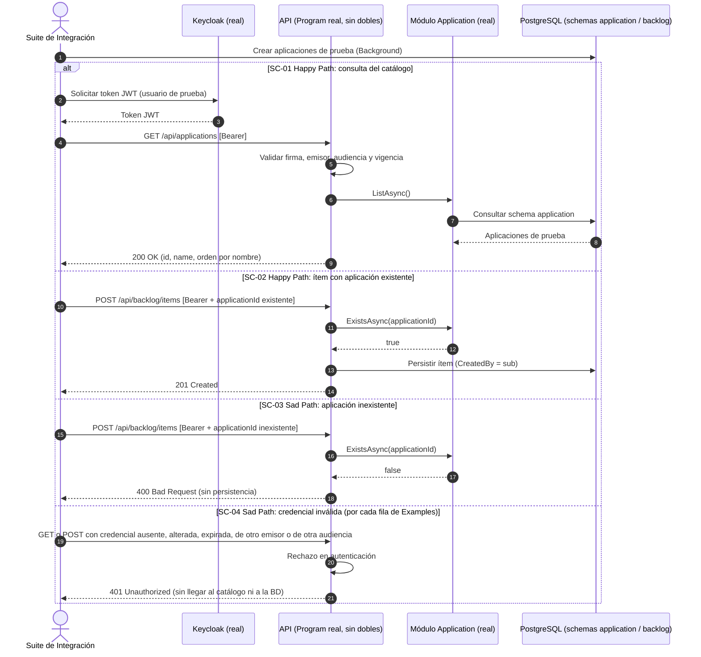

# ESPECIFICACIÓN TÉCNICA DE HISTORIA DE USUARIO: Pruebas de Integración contra Keycloak Real y Catálogo Real del Módulo Application

## 1. METADATOS FORMALES
- **Feature ID:** FEAT-002
- **Story ID:** HU-002
- **Épica:** [P1] Planificación y Control de Sprints con Backlog Multitipo (historia derivada del riesgo residual aceptado en HU-001; no figura como épica propia en `mvp-tech-work-hub.md` ⚠️ [PROPUESTO])
- **Tipo:** Enhancement ⚠️ [PROPUESTO]
- **Prioridad:** Media ⚠️ [PROPUESTO]
- **Tags:** [integracion, keycloak, jwt, catalogo-aplicaciones, riesgo-residual-hu-001]
- **Dependencia:** HU-001 (`001-registro-elementos-backlog-multitipo`), fusionada en dev. Su comportamiento no se modifica; esta HU solo añade verificación.
- **Alcance (subsanación H-01):** una única capacidad: verificar sin dobles de prueba que la validación de identidad (Keycloak) y el catálogo del módulo Application funcionan en los puntos de HU-001 que los consumen. La **semilla reproducible del catálogo** como capacidad propia (contenido, idempotencia, alcance test vs. entornos reales) queda **fuera** de esta HU y se deriva al Product Manager (ver §6, Puntos Abiertos). Aquí las aplicaciones que los escenarios necesitan son datos de prueba creados por la propia suite ⚠️ [PROPUESTO].
- **Consumo SDD:** `/speckit.specify documents/business-analyst/002-pruebas-integracion-keycloak-y-catalogo-application.md`

---

## 2. ESPECIFICACIÓN FUNCIONAL Y ESCENARIOS GHERKIN (BDD)

### 2.1. Descripción de la Capacidad
**Como** Líder Técnico o Miembro del Equipo de Desarrollo/QA responsable de la calidad del backlog multitipo
**Quiero** que la suite de integración ejercite un servidor de identidad Keycloak real (emisión y validación de tokens JWT) y el catálogo real del módulo Application (`ApplicationModuleApi` y `GET /api/applications`, sin dobles de prueba)
**Para** cerrar el riesgo residual aceptado en HU-001 (Keycloak y catálogo simulados) y tener evidencia automatizada de que la autenticación y la referencia a aplicaciones funcionan de extremo a extremo.

> Fuente: riesgo residual y condición del humano registrados en `tracker_bmad.md` (Code Review 19:39:24 / HUMANO 19:51:57 / Product Manager 20:19:00) y `documents/qa-auto/qa-report.md` (Hotspots: "Keycloak real (no hay prueba contra un IdP)"). `VERIFIED`
> Actor: Líder Técnico, Desarrolladores y Analistas/Ingenieros de QA según `pb-tech-work-hub.md` §2. `VERIFIED`

### 2.2. Escenarios Formales en Sintaxis Gherkin Pura

```gherkin
Feature: Pruebas de integración contra Keycloak real y catálogo real del módulo Application
  Como responsable de la calidad del backlog multitipo
  Quiero verificar autenticación y catálogo de aplicaciones sin dobles de prueba
  Para cerrar el riesgo residual aceptado en HU-001

  Background:
    Given un servidor Keycloak real accesible por la suite de integración con un realm, un cliente y un usuario de prueba ❓ No documentado
    And la API hospedada con el esquema de autenticación Keycloak de producción (sin el esquema de prueba "Test")
    And el módulo Application real registrado (sin "FakeApplicationCatalog") sobre PostgreSQL con migraciones aplicadas

  Scenario: SC-01 [Happy Path] Consulta del catálogo con un token emitido por Keycloak real
    Given aplicaciones de prueba creadas por la suite en el schema "application" ⚠️ [PROPUESTO]
    And un token JWT válido emitido por el servidor Keycloak real para el usuario de prueba
    When el cliente solicita GET "/api/applications" con la cabecera Bearer
    Then el sistema responde HTTP 200 OK
    And el cuerpo contiene exactamente las aplicaciones creadas, cada una con "id" y "name", ordenadas por nombre
    And la respuesta proviene de la implementación real de "ApplicationModuleApi"

  Scenario: SC-02 [Happy Path] Registro de un ítem de backlog con una aplicación del catálogo real
    Given un token JWT válido emitido por Keycloak real
    And una aplicación de prueba existente en el catálogo con identificador conocido
    When el cliente envía POST "/api/backlog/items" con ese "applicationId" y un payload válido de HU-001
    Then el sistema responde HTTP 201 Created con el estado inicial "Backlog"
    And la existencia de la aplicación se resuelve contra el catálogo real del módulo Application
    And el ítem persistido conserva "CreatedBy" igual al claim "sub" del token emitido por Keycloak

  Scenario: SC-03 [Sad Path] Aplicación inexistente en el catálogo real
    Given un token JWT válido emitido por Keycloak real
    And un "applicationId" que no existe en el catálogo
    When el cliente envía POST "/api/backlog/items" con ese "applicationId"
    Then el sistema responde HTTP 400 Bad Request indicando que la aplicación referenciada no existe
    And no se persiste ningún ítem de backlog

  Scenario Outline: SC-04 [Sad Path] Rechazo de credenciales inválidas por Keycloak real
    Given la API configurada con la validación JWT de Keycloak real y "verify-token-audience" activado
    When el cliente envía <metodo> "<ruta>" con <credencial>
    Then el sistema responde HTTP 401 Unauthorized
    And la solicitud no alcanza el catálogo ni la persistencia del backlog

    Examples:
      | metodo | ruta               | credencial                                              |
      | GET    | /api/applications  | ninguna cabecera Authorization                          |
      | GET    | /api/applications  | un token con firma alterada                             |
      | GET    | /api/applications  | un token expirado                                       |
      | GET    | /api/applications  | un token de un emisor distinto al configurado           |
      | GET    | /api/applications  | un token emitido por Keycloak para otra audiencia       |
      | POST   | /api/backlog/items | ninguna cabecera Authorization                          |
      | POST   | /api/backlog/items | un token con firma alterada                             |
      | POST   | /api/backlog/items | un token expirado                                       |
      | POST   | /api/backlog/items | un token de un emisor distinto al configurado           |
      | POST   | /api/backlog/items | un token emitido por Keycloak para otra audiencia       |
```

> **Trazabilidad (H-04):** SC-01..SC-03 y la condición de "otra audiencia" derivan del riesgo residual y las preguntas del Code Review (fuente: `tracker_bmad.md`). `GET /api/applications` con `.RequireAuthorization()` y la respuesta con `id` y `name` ordenada por nombre se verifican contra código en `ListApplicationsEndpoint.cs` y `ApplicationModuleApi.cs` (`OrderBy(a => a.Name)` → `ApplicationSummary(Id, Name)`). `VERIFIED` (código, no Product Brief). `verify-token-audience: true` se verifica en `appsettings.json`. `VERIFIED`. La lista de condiciones de rechazo del Outline (firma, expiración, emisor) es ⚠️ [PROPUESTO] salvo el token ausente o expirado, que proviene de HU-001 SC-06.

---

## 3. MATRIZ DE CASOS BORDE Y EXCEPCIONES

| ID | Condición Límite / Error | Tipo de Evento | Comportamiento Esperado | Código / Tipo de Respuesta |
|---|---|---|---|---|
| CB-01 | Token expirado emitido por Keycloak real (SC-04) | Seguridad e Identidad | Rechazo en el middleware de autenticación sin alcanzar MediatR | HTTP 401 / Unauthorized |
| CB-02 | Token con firma inválida o emisor distinto al configurado (SC-04) | Seguridad e Identidad | Rechazo inmediato | HTTP 401 / Unauthorized |
| CB-03 | Token con audiencia no esperada (SC-04) | Seguridad e Identidad | Rechazo por verificación de audiencia | HTTP 401 / Unauthorized |
| CB-04 | `applicationId` inexistente en el catálogo real (SC-03) | Integración y Validación Referencial | Rechazo indicando que la aplicación no existe (comportamiento heredado de HU-001) | HTTP 400 / ValidationException |
| CB-05 | Servidor Keycloak no disponible al iniciar la suite | Falla de Dependencia Externa | ❓ No documentado: la política (fallo explícito de la suite, omisión marcada o reintento) no está definida en las fuentes. Sin escenario Gherkin hasta definirla. | ❓ No documentado |

---

## 4. PRECONDICIONES Y POSTCONDICIONES VERIFICABLES

### 4.1. Precondiciones del Sistema
- Un servidor Keycloak real disponible para la suite, con realm, cliente y usuarios de prueba. Los valores concretos (realm, clientes, usuarios, roles) son ❓ No documentado. El realm `techworkhub` y el recurso `techworkhub-api` de `appsettings.json` son la configuración actual de la API, no necesariamente la del entorno de pruebas.
- PostgreSQL con las migraciones de los módulos Application y Backlog aplicadas (ya cubierto por la infraestructura de Testcontainers de HU-001).
- Aplicaciones de prueba creadas por la suite antes de los escenarios que las requieren ⚠️ [PROPUESTO].
- La configuración de pruebas no sustituye el esquema de autenticación ni `IApplicationModuleApi` por dobles (en contraste con `BacklogApiFactory` de HU-001).

### 4.2. Postcondiciones y Mutaciones
- Los escenarios de lectura (SC-01, SC-04) no mutan datos.
- SC-02 persiste un único ítem de backlog con `CreatedBy` igual al `sub` del token real. SC-03 y SC-04 no persisten nada.
- No se modifica el comportamiento de producción de HU-001 (contratos HTTP, validaciones, estados).
- Las pruebas contra Keycloak real no dejan configuración persistente ni datos residuales entre ejecuciones ❓ No documentado (mecanismo de aislamiento del entorno).

---

## 5. 📊 DIAGRAMA DE SECUENCIA / ESTADOS
Cada rama `alt` corresponde a un escenario. CB-05 no se diagrama porque su comportamiento es ❓ No documentado.



---

## 6. DEFINITION OF DONE (TÉCNICA)
- [ ] La especificación contiene todos los metadatos requeridos para Spec Kit (`FEAT-002`, `HU-002`, `/speckit.specify`).
- [ ] Todos los escenarios BDD están escritos en sintaxis pura Gherkin.
- [ ] La matriz de casos borde cubre token inválido/expirado, emisor, audiencia y referencia inexistente.
- [ ] Las precondiciones y postcondiciones son verificables mediante pruebas automatizadas.
- [ ] El diagrama de secuencia refleja con fidelidad el flujo de Happy y Sad Path (una rama por escenario).
- [ ] Ausencia de supuestos no tipificados (cualquier inferencia está marcada como ⚠️ [PROPUESTO]).
- [ ] La funcionalidad respeta las reglas de negocio y restricciones del ecosistema preexistente documentado en `.specify/memory/constitution.md` (Keycloak v24+ con `Keycloak.AuthServices.Authentication`, schemas aislados por módulo, sin queries cross-schema).
- [ ] Ninguna prueba de esta HU usa `TestAuthHandler` ni `FakeApplicationCatalog`.

### Puntos Abiertos (❓ No documentado)
1. Realm, cliente(s), usuarios y roles de prueba del Keycloak real, y cómo se aprovisiona (contenedor efímero o instancia compartida).
2. Política ante Keycloak no disponible (CB-05).
3. Roles de Keycloak con permiso sobre el backlog: HU-001 solo exige un token válido con identidad (`sub`); no hay roles documentados.
4. **Semilla del catálogo (derivada por H-01):** el Ledger (`specs/README.md`, fila 002) la incluye en el alcance de esta HU. Esta HU la separa como capacidad propia (contenido de la semilla, idempotencia, alcance solo pruebas o también entornos reales). Se requiere que el product-manager decida si se registra una fila nueva en el Ledger o se ajusta la fila 002. Hasta entonces no se redacta su HU, en cumplimiento del Vertical Slicing de la Constitución.

---
> **Origen:** `tracker_bmad.md` (dictamen de Code Review y decisión del HUMANO sobre el riesgo residual de HU-001; handoff del Product Manager), `specs/README.md` (fila 002), `documents/qa-auto/qa-report.md`, `documents/business-analyst/001-registro-elementos-backlog-multitipo.md`, `app/backend/src/Bootstrapper/Api/appsettings.json`, `app/backend/src/Modules/Application/` (endpoint y `ApplicationModuleApi`), `pb-tech-work-hub.md` (§2 actores, Sección 5 integración con Keycloak y catálogo de aplicativos), `mvp-tech-work-hub.md` (Épica [P1]) y `documents/qa-documental/feedback-qa-002-pruebas-integracion-keycloak-y-catalogo-application.md`.
> Todo contenido generado que no esté explícito en la fuente se marca como `⚠️ [PROPUESTO]`.

## 7. ORDEN DE DELEGACIÓN PARA EL QA
@QA: La Historia de Usuario Técnica Pruebas de Integración contra Keycloak Real y Catálogo Real del Módulo Application está lista en el archivo 002-pruebas-integracion-keycloak-y-catalogo-application.md (y su versión de stakeholders en documents/business-analyst/HUs-stakeholders/002-pruebas-integracion-keycloak-y-catalogo-application.md). Por favor, procede con la auditoría documental contra el Product Brief para asegurar que la historia cumple con los requerimientos originales.
