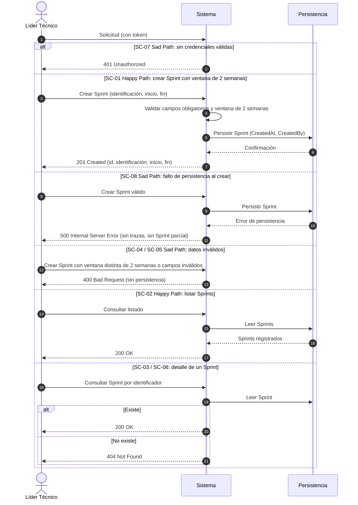

# ESPECIFICACIÓN TÉCNICA DE HISTORIA DE USUARIO: Gestión de Sprint de Dos Semanas (Crear y Consultar)

## 1. METADATOS FORMALES
- **Feature ID:** FEAT-003
- **Story ID:** HU-003
- **Épica:** [P1] Planificación y Control de Sprints con Backlog Multitipo
- **Tipo:** Feature ⚠️ [PROPUESTO]
- **Prioridad:** Alta ⚠️ [PROPUESTO] (la HU-004 depende de ella)
- **Tags:** [sprint, ventana-2-semanas, planificacion, p1]
- **Dependencias:** ninguna de otras épicas ni de otras historias. **La HU-004 (`004-asignacion-elementos-sprint`) depende de esta**: el Sprint debe existir antes de asignarle elementos.
- **Alcance (única capacidad):** crear un Sprint con identificación y fechas de inicio y fin acotadas estrictamente a una ventana de 2 semanas, y consultar los Sprints registrados. `VERIFIED` (handoff del Product Manager en `tracker_bmad.md` y fila 003 de `specs/README.md`).
- **Fuera de alcance de esta HU:**
  - **Ciclo de vida del Sprint (estados, apertura y cierre): PENDIENTE, bloqueado por ❓ "reglas de apertura, cierre y estados de un Sprint"** (`mvp-tech-work-hub.md` §5.2). No se define ningún estado, transición, apertura ni cierre. Ver §6.
  - Asignación de elementos del backlog al Sprint (HU-004). Esta HU **no introduce ninguna relación Sprint–tarjeta** (ver §6, punto 2).
  - Seguimiento del avance del Sprint (estados de tarjetas, puntos, retrasos, bloqueos): dependen de 004, 005 y siguientes.
  - Modificación, cancelación o eliminación de un Sprint: ❓ No documentado; no figuran en el alcance entregado por el Product Manager.
- **Consumo SDD:** `/speckit.specify documents/business-analyst/003-gestion-sprint-dos-semanas.md`

---

## 2. ESPECIFICACIÓN FUNCIONAL Y ESCENARIOS GHERKIN (BDD)

### 2.1. Descripción de la Capacidad
**Como** Líder Técnico autenticado (rol que, según el Product Brief §2.1, monitorea los Sprints; permiso exacto por rol ❓ No documentado)
**Quiero** crear un Sprint indicando su identificación y sus fechas de inicio y fin, y consultar los Sprints registrados, con la garantía de que cada Sprint abarca exactamente una ventana de 2 semanas
**Para** disponer de los ciclos de trabajo de 2 semanas sobre los que se planificará y controlará el trabajo del equipo (Product Brief §4.1 Módulo 3 y §5).

> Fuente: `pb-tech-work-hub.md` §4.1 Módulo 3 ("Configuración y seguimiento de ciclos de 2 semanas") y §5 ("Los Sprints deben estar acotados estrictamente a ventanas de 2 semanas de duración"); `mvp-tech-work-hub.md` Épica [P1], historia candidata 003. `VERIFIED`
> Actor: Líder Técnico según `pb-tech-work-hub.md` §2.1. Que sea el único rol con permiso de creación es `INFERRED` y requiere validación humana (§6, punto 7).

### 2.2. Escenarios Formales en Sintaxis Gherkin Pura

> **Regla de ventana (⚠️ [PROPUESTO], pendiente de confirmación, §6 punto 3):** el Product Brief fija solo la duración de "2 semanas". Para que los escenarios sean verificables se adopta, como supuesto de trabajo, que la ventana válida son **14 días calendario consecutivos con ambos extremos incluidos** (fecha de fin = fecha de inicio + 13 días). Las filas de límites de SC-04 dependen de este supuesto. `ASSUMED`

```gherkin
Feature: Gestión de Sprint de dos semanas (crear y consultar)
  Como Líder Técnico autenticado
  Quiero crear y consultar Sprints cuya duración es exactamente de 2 semanas
  Para contar con los ciclos de trabajo sobre los que se planificará el equipo

  Scenario: SC-01 [Happy Path] Creación de un Sprint con ventana válida de 2 semanas
    Given un usuario autenticado con un token válido
    And que no existe un Sprint registrado con la identificación "Sprint 2026-01" ⚠️ [PROPUESTO]
    When el usuario solicita crear un Sprint con identificación "Sprint 2026-01", fecha de inicio "2026-10-05" y fecha de fin "2026-10-18"
    Then el sistema responde HTTP 201 Created
    And la respuesta contiene el identificador único del Sprint, su identificación, su fecha de inicio "2026-10-05" y su fecha de fin "2026-10-18"
    And el Sprint queda persistido con metadatos de auditoría "CreatedAt" y "CreatedBy" igual al "sub" del token
    And no se crea ni se modifica ningún elemento del backlog

  Scenario: SC-02 [Happy Path] Consulta del listado de Sprints
    Given un usuario autenticado con un token válido
    And que existen Sprints registrados con ventana válida
    When el usuario solicita consultar los Sprints
    Then el sistema responde HTTP 200 OK
    And el cuerpo contiene exactamente los Sprints registrados, cada uno con identificador, identificación, fecha de inicio y fecha de fin
    And la consulta no modifica ningún dato

  Scenario: SC-03 [Happy Path] Consulta del detalle de un Sprint existente
    Given un usuario autenticado con un token válido
    And que existe un Sprint registrado con un identificador conocido
    When el usuario solicita consultar ese Sprint por su identificador
    Then el sistema responde HTTP 200 OK
    And el cuerpo contiene el identificador, la identificación, la fecha de inicio y la fecha de fin del Sprint

  Scenario Outline: SC-04 [Sad Path] Rechazo de un Sprint cuya ventana no es de 2 semanas
    Given un usuario autenticado con un token válido
    When el usuario solicita crear un Sprint con fecha de inicio "<inicio>" y fecha de fin "<fin>"
    Then el sistema responde HTTP 400 Bad Request indicando que el Sprint debe abarcar exactamente una ventana de 2 semanas
    And no se persiste ningún Sprint

    Examples:
      | inicio     | fin        | motivo                                   |
      | 2026-10-05 | 2026-10-11 | duración de 1 semana (7 días)            |
      | 2026-10-05 | 2026-10-25 | duración de 3 semanas (21 días)          |
      | 2026-10-05 | 2026-10-17 | un día menos (13 días)                   |
      | 2026-10-05 | 2026-10-19 | un día más (15 días)                     |
      | 2026-10-05 | 2026-10-04 | fecha de fin anterior a la de inicio     |
      | 2026-10-05 | 2026-10-05 | fecha de fin igual a la de inicio        |

  Scenario Outline: SC-05 [Sad Path] Rechazo de un Sprint con datos obligatorios ausentes o malformados
    Given un usuario autenticado con un token válido
    When el usuario solicita crear un Sprint con identificación "<identificacion>", fecha de inicio "<inicio>" y fecha de fin "<fin>"
    Then el sistema responde HTTP 400 Bad Request con el detalle de los campos inválidos
    And no se persiste ningún Sprint

    Examples:
      | identificacion | inicio      | fin        | motivo                               |
      |                | 2026-10-05  | 2026-10-18 | identificación vacía                 |
      | Sprint 2026-01 |             | 2026-10-18 | fecha de inicio ausente              |
      | Sprint 2026-01 | 2026-10-05  |            | fecha de fin ausente                 |
      | Sprint 2026-01 | no-es-fecha | 2026-10-18 | fecha de inicio con formato inválido |

  Scenario: SC-06 [Sad Path] Consulta de un Sprint inexistente
    Given un usuario autenticado con un token válido
    And que no existe ningún Sprint con el identificador solicitado
    When el usuario solicita consultar ese Sprint por su identificador
    Then el sistema responde HTTP 404 Not Found indicando que el Sprint no existe

  Scenario Outline: SC-07 [Sad Path] Acceso sin credenciales válidas
    Given una solicitud sin token o con un token inválido o expirado
    When el usuario intenta <operacion>
    Then el sistema responde HTTP 401 Unauthorized
    And no se lee ni se persiste ningún dato de Sprint

    Examples:
      | operacion                          |
      | crear un Sprint                    |
      | consultar el listado de Sprints    |
      | consultar el detalle de un Sprint  |

  Scenario: SC-08 [Sad Path] Fallo de persistencia al crear un Sprint ⚠️ [PROPUESTO]
    Given un usuario autenticado con un token válido
    And la persistencia no está disponible o falla al guardar
    When el usuario solicita crear un Sprint con identificación "Sprint 2026-01", fecha de inicio "2026-10-05" y fecha de fin "2026-10-18"
    Then el sistema responde HTTP 500 Internal Server Error sin exponer trazas internas
    And no queda registrado ningún Sprint parcial
```

> **Trazabilidad:** SC-01..SC-03 provienen del alcance entregado por el Product Manager (crear y consultar; identificación y fechas de inicio y fin). `VERIFIED`. La ventana de 2 semanas proviene de `pb-tech-work-hub.md` §5; su traducción a 14 días calendario inclusivos, los valores de las filas de SC-04, la validación de campos obligatorios (SC-05), el formato de la identificación de los ejemplos el escenario de fallo de persistencia SC-08 (respaldo de CB-07) y los códigos HTTP son ⚠️ [PROPUESTO]. Cada escenario declara su propia precondición de autenticación (no hay `Background`), de modo que SC-07 no hereda una sesión válida. Los códigos 400/404 siguen el manejo centralizado de excepciones y 401 la directiva `.RequireAuthorization()` de `.specify/memory/constitution.md` §2 y §5 (mismo patrón que HU-001 SC-06). `VERIFIED` (Constitución), no Product Brief.
> **No existen escenarios** para estados, apertura, cierre, unicidad de la identificación, solapamiento entre Sprints ni fechas de inicio en el pasado: ❓ No documentado (§6).

---

## 3. MATRIZ DE CASOS BORDE Y EXCEPCIONES

| ID | Condición Límite / Error | Tipo de Evento | Comportamiento Esperado | Código / Tipo de Respuesta |
|---|---|---|---|---|
| CB-01 | Duración distinta de la ventana de 2 semanas, por defecto o por exceso, incluidos los límites ±1 día (SC-04) | Validación de Negocio | Rechazo sin persistir (límites ⚠️ [PROPUESTO], §6 punto 3) | HTTP 400 / ValidationException |
| CB-02 | Fecha de fin anterior o igual a la de inicio (SC-04) | Validación de Negocio | Rechazo sin persistir | HTTP 400 / ValidationException |
| CB-03 | Identificación, fecha de inicio o fecha de fin ausentes (SC-05) | Validación de Esquema | Rechazo inmediato con lista de violaciones | HTTP 400 / ValidationException |
| CB-04 | Fecha con formato inválido (SC-05) ⚠️ [PROPUESTO] | Validación de Esquema | Rechazo inmediato | HTTP 400 / ValidationException |
| CB-05 | Sprint solicitado inexistente (SC-06) | Consulta | Notificación de recurso inexistente | HTTP 404 / NotFoundException |
| CB-06 | Solicitud sin token, token inválido o expirado (SC-07) | Seguridad e Identidad | Rechazo en autenticación | HTTP 401 / Unauthorized |
| CB-07 | Fallo de persistencia al crear el Sprint (SC-08) | Falla de Persistencia | No queda ningún Sprint parcial; el error no expone trazas internas ⚠️ [PROPUESTO] | HTTP 500 / InternalServerException |
| CB-08 | Identificación duplicada entre Sprints | Integridad | ❓ No documentado (unicidad y formato de la identificación). Sin escenario hasta definirla | ❓ No documentado |
| CB-09 | Solapamiento de la ventana con otro Sprint existente | Integridad | ❓ No documentado. Sin escenario hasta definirlo | ❓ No documentado |
| CB-10 | Fecha de inicio en el pasado | Validación de Negocio | ❓ No documentado. Sin escenario hasta definirlo | ❓ No documentado |
| CB-11 | Crear, abrir o cerrar un Sprint según su estado | Ciclo de Vida | ❓ **PENDIENTE**, bloqueado por las reglas de apertura, cierre y estados de un Sprint. No se especifica | ❓ No documentado |

---

## 4. PRECONDICIONES Y POSTCONDICIONES VERIFICABLES

### 4.1. Precondiciones del Sistema
- Usuario autenticado mediante token válido emitido por el servidor de identidad (Constitución §5).
- Para SC-02, SC-03: Sprints previamente registrados.
- ❓ No documentado: roles con permiso de creación y de consulta (HU-001 solo exige un token válido con identidad).

### 4.2. Postcondiciones y Mutaciones
- SC-01 persiste un único Sprint con identificación, fecha de inicio, fecha de fin y metadatos de auditoría (`CreatedAt`, `CreatedBy`).
- SC-02, SC-03, SC-06 y SC-07 no mutan datos; SC-04, SC-05, SC-07 y SC-08 no persisten nada.
- Todo Sprint persistido cumple la invariante de ventana de 2 semanas (regla ⚠️ [PROPUESTO] de §2.2).
- **El Sprint creado no tiene ciclo de vida definido**: la existencia, el nombre y los valores de un campo de estado son ❓ No documentado y no deben inferirse en el diseño técnico hasta resolver el punto abierto 1.
- **Esta HU no persiste ninguna relación entre Sprint y tarjetas** del backlog; el modelo no prejuzga si una tarjeta pertenece a uno o a varios Sprints (punto abierto 2). No se modifica el comportamiento de HU-001.
- Debe respetarse el aislamiento por schema de la Constitución §3: la HU-004 necesitará relacionar Sprint con elementos del backlog sin consultas cross-schema; la decisión de módulo y de mecanismo corresponde a Architecture (el Product Manager ya registra este riesgo en `mvp-tech-work-hub.md` §6).

---

## 5. 📊 DIAGRAMA DE SECUENCIA / ESTADOS
Cada rama `alt` corresponde a un escenario. No se incluye diagrama de estados del Sprint porque el ciclo de vida es ❓ No documentado.



---

## 6. DEFINITION OF DONE (TÉCNICA)
- [ ] La especificación contiene todos los metadatos requeridos para Spec Kit (`FEAT-003`, `HU-003`, `/speckit.specify`).
- [ ] Todos los escenarios BDD están escritos en sintaxis pura Gherkin.
- [ ] La matriz de casos borde cubre validación, límites de la ventana y fallo de persistencia.
- [ ] Las precondiciones y postcondiciones son verificables mediante pruebas automatizadas.
- [ ] El diagrama de secuencia refleja con fidelidad el flujo de Happy y Sad Path (una rama por escenario).
- [ ] Ausencia de supuestos no tipificados (cualquier inferencia está marcada como ⚠️ [PROPUESTO]).
- [ ] La funcionalidad respeta las reglas de negocio y restricciones del ecosistema preexistente documentado en `.specify/memory/constitution.md` (schemas aislados por módulo, sin queries cross-schema, endpoints con `.RequireAuthorization()`).
- [ ] El diseño no define ni persiste estados, apertura ni cierre de Sprint mientras el punto abierto 1 siga sin resolver.
- [ ] El diseño no introduce relación Sprint–tarjeta ni asume su cardinalidad (punto abierto 2).

### Puntos Abiertos (❓ No documentado)
1. **Reglas de apertura, cierre y estados de un Sprint (bloqueante del ciclo de vida).** El Product Brief solo fija la duración de 2 semanas. Queda **pendiente**: qué estados existen, qué significan apertura y cierre, quién los ejecuta y qué transiciones se permiten. Se desbloquea con decisión de negocio; mientras tanto esta HU solo cubre crear y consultar. Fuente: `mvp-tech-work-hub.md` §5.2 y handoff del Product Manager.
2. **Pregunta abierta 9 del Product Brief:** ¿una tarjeta puede pertenecer a más de un Sprint o debe existir una única pertenencia histórica? **No se asume respuesta.** No afecta a esta HU porque no relaciona Sprints con tarjetas, pero **condiciona a la HU-004** (reglas de asignación, arrastre de tarjetas no terminadas) y puede condicionar el modelo de datos de Sprint; debe resolverse antes de refinar la HU-004.
3. **Interpretación exacta de "ventana de 2 semanas":** días calendario o hábiles, extremos inclusivos o no, si el Sprint debe iniciar un día de la semana determinado, y si el sistema calcula la fecha de fin a partir del inicio en lugar de recibirla. SC-04 y CB-01 usan 14 días calendario inclusivos como supuesto.
4. Formato y unicidad de la identificación del Sprint (nombre libre, número correlativo, etiqueta con fechas).
5. Si dos Sprints pueden solaparse o deben ser contiguos.
6. Si se permite crear un Sprint con fecha de inicio en el pasado.
7. Roles con permiso para crear y para consultar Sprints.
8. Modificación, cancelación o eliminación de un Sprint (posible relación con el ciclo de vida del punto 1).
9. Orden, filtros y paginación del listado de Sprints.

---
> **Origen:** `tracker_bmad.md` (handoff del Product Manager 04-10-2026 02:15:16), `specs/README.md` (fila 003), `pb-tech-work-hub.md` (§2.1 usuario principal, §4.1 Módulo 3, §5 restricciones, §8 pregunta abierta 9), `mvp-tech-work-hub.md` (Épica [P1], historia candidata 003, §5.2 ambigüedades de negocio, §6 riesgos Brownfield) y `.specify/memory/constitution.md`.
> Todo contenido generado que no esté explícito en la fuente se marca como `⚠️ [PROPUESTO]`.

## 7. ORDEN DE DELEGACIÓN PARA EL QA
@QA: La Historia de Usuario Técnica Gestión de Sprint de Dos Semanas (Crear y Consultar) está lista en el archivo 003-gestion-sprint-dos-semanas.md (y su versión de stakeholders en documents/business-analyst/HUs-stakeholders/003-gestion-sprint-dos-semanas.md). Por favor, procede con la auditoría documental contra el Product Brief para asegurar que la historia cumple con los requerimientos originales.
