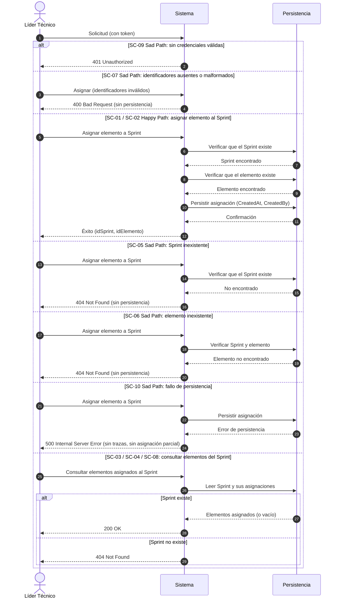

# ESPECIFICACIÓN TÉCNICA DE HISTORIA DE USUARIO: Asignación de Elementos del Backlog a un Sprint

## 1. METADATOS FORMALES
- **Feature ID:** FEAT-004
- **Story ID:** HU-004
- **Épica:** [P1] Planificación y Control de Sprints con Backlog Multitipo
- **Tipo:** Feature ⚠️ [PROPUESTO]
- **Prioridad:** Alta ⚠️ [PROPUESTO] (las HU-006 y HU-031 dependen de ella)
- **Tags:** [sprint, asignacion-backlog, planificacion, p1]
- **Dependencias:** HU-003 (`003-HU_gestion_sprint_dos_semanas`, estado `ACTIVE`: el Sprint debe existir) y HU-001 (`001-HU_registro_elementos_backlog_multitipo`, estado `ACTIVE`: el elemento debe existir en el backlog). Sin dependencias de otras épicas. `VERIFIED` (handoff del Product Manager en `tracker_bmad.md`, filas 001, 003 y 004 de `specs/README.md`).
- **Alcance (única capacidad):** asignar un elemento ya registrado del backlog a un Sprint ya existente, y poder consultar los elementos asignados a un Sprint. `VERIFIED` para la asignación (`mvp_tech_work_hub.md` historia candidata 004; `pb_tech_work_hub.md` §4.1 Módulo 3 "Asignación de tarjetas del Backlog al Sprint"). La consulta de los elementos asignados es ⚠️ [PROPUESTO]: se incluye únicamente para que la asignación sea verificable de forma observable (ver §2.2, SC-03).
- **Fuera de alcance de esta HU:**
  - Creación y consulta de Sprints (HU-003) y registro de elementos del backlog (HU-001): ya existen y no se modifican.
  - Desasignar, mover o reasignar un elemento de un Sprint a otro: ❓ No documentado; no figuran en el alcance entregado por el Product Manager.
  - Cambio de estado del elemento por el hecho de ser asignado: depende del catálogo de estados y transiciones (HU-005, bloqueada por ❓). Esta HU **no modifica el estado del elemento**.
  - Validación contra capacidad de personas o roles: bloqueada por ❓ modelo de cálculo de capacidad (HU-012/013).
  - Fechas de compromiso versus reales (HU-006), bloqueos (HU-007), retrasos y riesgo (HU-008, HU-009).
  - Ciclo de vida del Sprint (estados, apertura, cierre): ❓ No documentado (punto abierto 1 de la HU-003); esta HU no restringe la asignación por estado del Sprint.
- **Consumo SDD:** `/speckit.specify documents/business-analyst/004-HU_asignacion_elementos_sprint.md`

---

## 2. ESPECIFICACIÓN FUNCIONAL Y ESCENARIOS GHERKIN (BDD)

### 2.1. Descripción de la Capacidad
**Como** Líder Técnico autenticado (rol que, según el Product Brief §2.1, monitorea los Sprints y supervisa capacidad y puntajes; permiso exacto por rol ❓ No documentado)
**Quiero** asignar un elemento registrado del backlog a un Sprint de 2 semanas existente y consultar los elementos asignados a ese Sprint
**Para** definir qué trabajo planificado abarca cada ciclo de 2 semanas y habilitar su seguimiento posterior (Product Brief §4.1 Módulo 3 y §5).

> Fuente: `pb_tech_work_hub.md` §4.1 Módulo 3 ("Asignación de tarjetas del Backlog al Sprint"); `mvp_tech_work_hub.md` Épica [P1], historia candidata 004 ("Asignación de elementos del backlog a un Sprint de 2 semanas. Depende de 003; sin otros puntos abiertos"). `VERIFIED`
> Actor: Líder Técnico según `pb_tech_work_hub.md` §2.1. Que sea el único rol con permiso de asignar es `INFERRED` y requiere validación humana (§6, punto 6).

### 2.2. Escenarios Formales en Sintaxis Gherkin Pura

> **Regla de asignación mínima (⚠️ [PROPUESTO], `ASSUMED`):** cada solicitud asigna **un** elemento a **un** Sprint. La asignación en lote, la repetición de una misma asignación y la pertenencia de un elemento a más de un Sprint **no se especifican** porque dependen de la pregunta abierta 9 del Product Brief (§6, punto 1). Los escenarios no prejuzgan la cardinalidad: solo cubren la primera asignación de un elemento que aún no pertenece a ningún Sprint.

```gherkin
Feature: Asignación de elementos del backlog a un Sprint
  Como Líder Técnico autenticado
  Quiero asignar elementos del backlog a un Sprint de 2 semanas y consultar lo asignado
  Para definir el trabajo planificado de cada ciclo

  Scenario: SC-01 [Happy Path] Asignación de un elemento del backlog a un Sprint existente
    Given un usuario autenticado con un token válido
    And que existe un Sprint registrado con un identificador conocido
    And que existe un elemento del backlog registrado que no está asignado a ningún Sprint
    When el usuario solicita asignar ese elemento a ese Sprint
    Then el sistema confirma la asignación con un código de éxito ⚠️ [PROPUESTO]
    And la respuesta contiene el identificador del Sprint y el identificador del elemento asignado
    And la asignación queda persistida con metadatos de auditoría "CreatedAt" y "CreatedBy" igual al "sub" del token ⚠️ [PROPUESTO]
    And el elemento conserva sin cambios su título, tipo, estimaciones por rol y estado

  Scenario: SC-02 [Happy Path] Asignación de varios elementos distintos al mismo Sprint ⚠️ [PROPUESTO]
    Given un usuario autenticado con un token válido
    And que existe un Sprint registrado
    And que existen dos elementos del backlog distintos, ninguno asignado a un Sprint
    When el usuario asigna cada uno de los dos elementos al Sprint en solicitudes sucesivas
    Then ambas solicitudes se confirman con éxito
    And el Sprint queda con exactamente esos dos elementos asignados

  Scenario: SC-03 [Happy Path] Consulta de los elementos asignados a un Sprint ⚠️ [PROPUESTO]
    Given un usuario autenticado con un token válido
    And que existe un Sprint con elementos asignados
    When el usuario solicita consultar los elementos asignados a ese Sprint
    Then el sistema responde HTTP 200 OK
    And el cuerpo contiene exactamente los elementos asignados a ese Sprint, cada uno con su identificador, título, tipo y estimaciones por rol
    And la consulta no modifica ningún dato

  Scenario: SC-04 [Happy Path] Consulta de un Sprint sin elementos asignados ⚠️ [PROPUESTO]
    Given un usuario autenticado con un token válido
    And que existe un Sprint sin elementos asignados
    When el usuario solicita consultar los elementos asignados a ese Sprint
    Then el sistema responde HTTP 200 OK con una colección vacía

  Scenario: SC-05 [Sad Path] Asignación a un Sprint inexistente
    Given un usuario autenticado con un token válido
    And que existe un elemento del backlog registrado
    And que no existe ningún Sprint con el identificador solicitado
    When el usuario solicita asignar ese elemento a ese Sprint
    Then el sistema responde HTTP 404 Not Found indicando que el Sprint no existe
    And no se persiste ninguna asignación

  Scenario: SC-06 [Sad Path] Asignación de un elemento inexistente
    Given un usuario autenticado con un token válido
    And que existe un Sprint registrado
    And que no existe ningún elemento del backlog con el identificador solicitado
    When el usuario solicita asignar ese elemento a ese Sprint
    Then el sistema responde HTTP 404 Not Found indicando que el elemento del backlog no existe
    And no se persiste ninguna asignación

  Scenario Outline: SC-07 [Sad Path] Rechazo por identificadores ausentes o malformados
    Given un usuario autenticado con un token válido
    When el usuario solicita asignar con identificador de Sprint "<sprint>" e identificador de elemento "<elemento>"
    Then el sistema responde HTTP 400 Bad Request con el detalle de los campos inválidos
    And no se persiste ninguna asignación

    Examples:
      | sprint                               | elemento                             | motivo                                         |
      |                                      | 7b1c2d3e-0000-4000-8000-000000000001 | identificador de Sprint ausente                |
      | 7b1c2d3e-0000-4000-8000-000000000002 |                                      | identificador de elemento ausente              |
      | no-es-un-identificador               | 7b1c2d3e-0000-4000-8000-000000000001 | identificador de Sprint con formato inválido   |
      | 7b1c2d3e-0000-4000-8000-000000000002 | no-es-un-identificador               | identificador de elemento con formato inválido |

  Scenario: SC-08 [Sad Path] Consulta de los elementos de un Sprint inexistente ⚠️ [PROPUESTO]
    Given un usuario autenticado con un token válido
    And que no existe ningún Sprint con el identificador solicitado
    When el usuario solicita consultar los elementos asignados a ese Sprint
    Then el sistema responde HTTP 404 Not Found indicando que el Sprint no existe

  Scenario Outline: SC-09 [Sad Path] Acceso sin credenciales válidas
    Given una solicitud sin token o con un token inválido o expirado
    When el usuario intenta <operacion>
    Then el sistema responde HTTP 401 Unauthorized
    And no se lee ni se persiste ningún dato de asignación

    Examples:
      | operacion                                     |
      | asignar un elemento a un Sprint               |
      | consultar los elementos asignados a un Sprint |

  Scenario: SC-10 [Sad Path] Fallo de persistencia al asignar ⚠️ [PROPUESTO]
    Given un usuario autenticado con un token válido
    And que existen un Sprint y un elemento del backlog sin asignar
    And la persistencia no está disponible o falla al guardar
    When el usuario solicita asignar ese elemento a ese Sprint
    Then el sistema responde HTTP 500 Internal Server Error sin exponer trazas internas
    And no queda registrada ninguna asignación parcial
```

> **Trazabilidad:** SC-01 proviene del alcance entregado por el Product Manager (asignar elementos del backlog a un Sprint; el Sprint debe existir). `VERIFIED`. La existencia previa del elemento se deriva de HU-001 (`ACTIVE`). Los demás escenarios (SC-02..SC-10), los códigos HTTP, la auditoría de la asignación, la consulta de elementos asignados (SC-03, SC-04, SC-08) y el fallo de persistencia (SC-10) son ⚠️ [PROPUESTO]. Los códigos 400/404/500 siguen el manejo centralizado de excepciones y 401 la directiva `.RequireAuthorization()` de `.specify/memory/constitution.md` §2 y §5 (mismo patrón que HU-001 y HU-003). `VERIFIED` (Constitución), no Product Brief. Cada escenario declara su propia precondición de autenticación (no hay `Background`), de modo que SC-09 no hereda una sesión válida.
> **No existen escenarios** para: elemento ya asignado al mismo Sprint, elemento ya asignado a otro Sprint, asignación en lote, desasignación o movimiento, restricción por tipo o estado del elemento, restricción por estado o fecha del Sprint, ni validación de capacidad: ❓ No documentado (§3 y §6).

---

## 3. MATRIZ DE CASOS BORDE Y EXCEPCIONES

| ID | Condición Límite / Error | Tipo de Evento | Comportamiento Esperado | Código / Tipo de Respuesta |
|---|---|---|---|---|
| CB-01 | Sprint solicitado inexistente (SC-05, SC-08) | Validación Referencial | Rechazo sin persistir | HTTP 404 / NotFoundException |
| CB-02 | Elemento del backlog solicitado inexistente (SC-06) | Validación Referencial | Rechazo sin persistir | HTTP 404 / NotFoundException |
| CB-03 | Identificador de Sprint o de elemento ausente o con formato inválido (SC-07) ⚠️ [PROPUESTO] | Validación de Esquema | Rechazo inmediato con lista de violaciones | HTTP 400 / ValidationException |
| CB-04 | Solicitud sin token, token inválido o expirado (SC-09) | Seguridad e Identidad | Rechazo en autenticación | HTTP 401 / Unauthorized |
| CB-05 | Fallo de persistencia al asignar (SC-10) ⚠️ [PROPUESTO] | Falla de Persistencia | No queda ninguna asignación parcial; el error no expone trazas internas | HTTP 500 / InternalServerException |
| CB-06 | El elemento ya está asignado al mismo Sprint | Integridad | ❓ No documentado (rechazo, ignorar o confirmar de forma idempotente). Sin escenario hasta definirlo | ❓ No documentado |
| CB-07 | El elemento ya está asignado a otro Sprint | Integridad | ❓ **PENDIENTE**, bloqueado por la pregunta abierta 9 del Product Brief (pertenencia única o múltiple). Sin escenario hasta definirlo | ❓ No documentado |
| CB-08 | Asignar a un Sprint según su estado o fecha (ya iniciado, finalizado, futuro) | Ciclo de Vida | ❓ No documentado; depende del ciclo de vida del Sprint (punto abierto 1 de la HU-003). No se restringe | ❓ No documentado |
| CB-09 | Elemento no asignable por su tipo o estado | Validación de Negocio | ❓ No documentado; depende del catálogo de estados (HU-005). No se restringe | ❓ No documentado |
| CB-10 | Asignación simultánea del mismo elemento a dos Sprints (concurrencia) | Concurrencia | ❓ No documentado; depende de CB-07 | ❓ No documentado |
| CB-11 | Cantidad máxima de elementos o puntos por Sprint | Validación de Negocio | ❓ No documentado; depende del modelo de capacidad. No se restringe | ❓ No documentado |

---

## 4. PRECONDICIONES Y POSTCONDICIONES VERIFICABLES

### 4.1. Precondiciones del Sistema
- Usuario autenticado mediante token válido emitido por el servidor de identidad (Constitución §5).
- Existe el Sprint destino (HU-003) y existe el elemento del backlog (HU-001).
- ❓ No documentado: roles con permiso para asignar y para consultar lo asignado (HU-001 y HU-003 solo exigen un token válido con identidad).

### 4.2. Postcondiciones y Mutaciones
- SC-01 y SC-02 persisten una relación entre un Sprint y un elemento del backlog, con metadatos de auditoría ⚠️ [PROPUESTO].
- SC-03, SC-04, SC-08 y SC-09 no mutan datos; SC-05, SC-06, SC-07, SC-09 y SC-10 no persisten nada.
- La asignación **no altera** los datos del elemento (título, tipo, estimaciones por rol, estado) ni los del Sprint (identificación, fechas). No se modifica el comportamiento de HU-001 ni de HU-003.
- **Esta HU no prejuzga si un elemento pertenece a uno o a varios Sprints** (punto abierto 1): el diseño técnico no debe asumir ni imponer la cardinalidad hasta resolverlo.
- **No se define ni se cambia ningún estado del elemento ni del Sprint** al asignar (puntos abiertos 2 y 3).
- Debe respetarse el aislamiento por schema de la Constitución §3: Sprint y elemento del backlog pertenecen a módulos distintos y no se permiten consultas cross-schema. El mecanismo para validar la existencia del elemento y almacenar la relación corresponde a Architecture (riesgo ya registrado por el Product Manager en `mvp_tech_work_hub.md` §6 "Riesgo de acoplamiento transaccional").

---

## 5. 📊 DIAGRAMA DE SECUENCIA / ESTADOS
Cada rama `alt` corresponde a un escenario. No se incluye diagrama de estados porque el ciclo de vida del Sprint y el catálogo de estados del elemento son ❓ No documentado.



---

## 6. DEFINITION OF DONE (TÉCNICA)
- [ ] La especificación contiene todos los metadatos requeridos para Spec Kit (`FEAT-004`, `HU-004`, `/speckit.specify`).
- [ ] Todos los escenarios BDD están escritos en sintaxis pura Gherkin.
- [ ] La matriz de casos borde cubre validación, referencias inexistentes, seguridad y fallo de persistencia.
- [ ] Las precondiciones y postcondiciones son verificables mediante pruebas automatizadas.
- [ ] El diagrama de secuencia refleja con fidelidad el flujo de Happy y Sad Path (una rama por escenario).
- [ ] Ausencia de supuestos no tipificados (cualquier inferencia está marcada como ⚠️ [PROPUESTO]).
- [ ] La funcionalidad respeta las reglas de negocio y restricciones del ecosistema preexistente documentado en `.specify/memory/constitution.md` (schemas aislados por módulo, sin queries cross-schema, endpoints con `.RequireAuthorization()`).
- [ ] El diseño no impone ni asume la cardinalidad elemento–Sprint (punto abierto 1).
- [ ] El diseño no cambia el estado del elemento ni del Sprint al asignar (puntos abiertos 2 y 3).

### Puntos Abiertos (❓ No documentado)
1. **Pregunta abierta 9 del Product Brief: ¿una tarjeta puede pertenecer a más de un Sprint o debe existir una única pertenencia histórica?** **No se asume respuesta.** El Plan de Gestión declara la HU-004 "sin otros puntos abiertos", pero la HU-003 (punto abierto 2) ya registró que esta pregunta condiciona la HU-004. Determina: reasignación, asignación repetida, arrastre de tarjetas no terminadas, el modelo de la relación y los casos CB-06, CB-07 y CB-10. Los escenarios solo cubren la primera asignación.
2. **Efecto de la asignación sobre el estado del elemento:** si asignar a un Sprint cambia el estado inicial "Backlog" (fijado ⚠️ [PROPUESTO] en la HU-001). Depende del catálogo de estados y transiciones (HU-005, ❓).
3. **Restricciones por estado o fecha del Sprint** (ya iniciado, finalizado, futuro): depende del ciclo de vida del Sprint (punto abierto 1 de la HU-003).
4. **Elegibilidad del elemento** (tipo o estado que impidan su asignación) y **límites de carga** del Sprint (cantidad o puntos por rol): depende de HU-005 y del modelo de capacidad (❓).
5. Asignación en lote (varios elementos en una sola operación), y desasignación o movimiento entre Sprints.
6. Roles con permiso para asignar y para consultar lo asignado.
7. Formato de la consulta de elementos asignados (campos, orden, filtros, paginación).
8. Comportamiento ante asignación repetida del mismo elemento al mismo Sprint (CB-06).

---
> **Origen:** `tracker_bmad.md` (handoff del Product Manager 04-10-2026 10:14:40), `specs/README.md` (filas 001, 003, 004 y 006), `pb_tech_work_hub.md` (§2.1 usuario principal, §4.1 Módulos 2 y 3, §5 restricciones, §8 pregunta abierta 9), `mvp_tech_work_hub.md` (Épica [P1], historia candidata 004, §5.2 ambigüedades, §6 riesgos Brownfield), `003-HU_gestion_sprint_dos_semanas.md` (punto abierto 2), `001-HU_registro_elementos_backlog_multitipo.md` y `.specify/memory/constitution.md`.
> Todo contenido generado que no esté explícito en la fuente se marca como `⚠️ [PROPUESTO]`.

## 7. ORDEN DE DELEGACIÓN PARA EL QA
@QA: La Historia de Usuario Técnica Asignación de Elementos del Backlog a un Sprint está lista en el archivo 004-HU_asignacion_elementos_sprint.md (y su versión de stakeholders en documents/business-analyst/HUs-stakeholders/004-HU_asignacion_elementos_sprint.md). Por favor, procede con la auditoría documental contra el Product Brief para asegurar que la historia cumple con los requerimientos originales.
