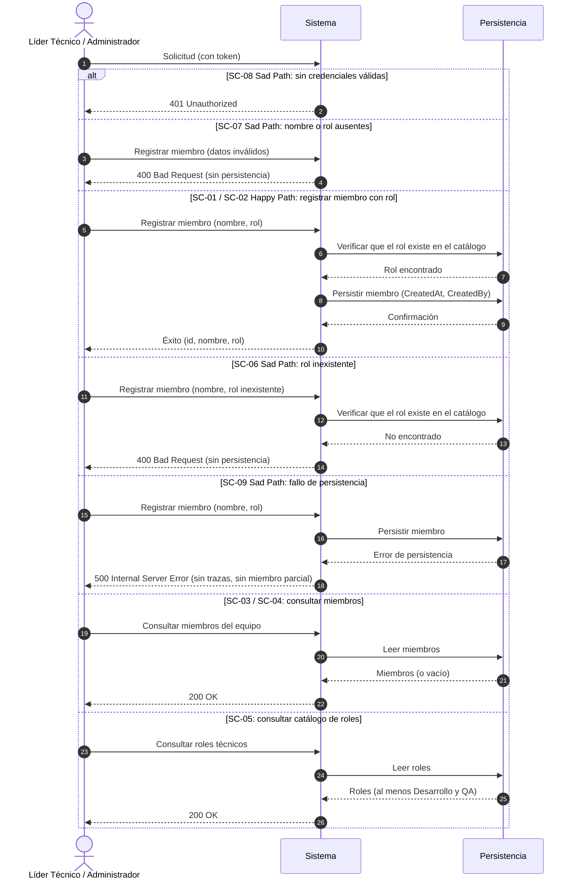

# ESPECIFICACIÓN TÉCNICA DE HISTORIA DE USUARIO: Miembros del Equipo y Roles Técnicos

## 1. METADATOS FORMALES
- **Feature ID:** FEAT-012
- **Story ID:** HU-012
- **Épica:** [P2] Gestión de Equipos y Roles Técnicos
- **Tipo:** Feature ⚠️ [PROPUESTO]
- **Prioridad:** Alta ⚠️ [PROPUESTO] (las HU-013, HU-014, HU-015, HU-021, HU-023 y HU-027 dependen de ella; P1 requiere sus datos para responsables y roles, `mvp_tech_work_hub.md` §4 y §6)
- **Tags:** [equipo, miembros, roles-tecnicos, datos-maestros, p2]
- **Requiere interfaz:** Sí ⚠️ [PROPUESTO] (ante la duda se declara `Sí`; el alta y la consulta de miembros son operaciones de un usuario humano. La definición visual corresponde a UX)
- **Dependencias:** Ninguna. `VERIFIED` (`mvp_tech_work_hub.md` Épica [P2], historia candidata 012: "Sin dependencia de puntos abiertos"; fila 012 de `specs/README.md`). Es dependencia de las HU-013, HU-014, HU-015, HU-021, HU-023 y HU-027.
- **Alcance (única capacidad):** registrar a un miembro del equipo técnico asignándole un rol técnico del catálogo de roles, y consultar los miembros registrados y el catálogo de roles técnicos disponibles. `VERIFIED` para el registro del miembro y la asignación de rol (`pb_tech_work_hub.md` §4.1 Módulo 1 "Administración de miembros del equipo técnico y asignación de roles (Desarrollo, QA, etc.)"; `mvp_tech_work_hub.md` historia candidata 012). La consulta de miembros y del catálogo de roles es ⚠️ [PROPUESTO]: se incluye para que el registro sea verificable de forma observable (ver §2.2, SC-03 a SC-05).
- **Fuera de alcance de esta HU:**
  - Capacidades y asignaciones de las personas: HU-013 (bloqueada por ❓ modelo de cálculo de capacidad).
  - Actividades y carga de trabajo por persona: HU-014. Relación entre personas, roles y elementos de trabajo: HU-015.
  - Modificar, desactivar o eliminar un miembro, y cambiar su rol: ❓ No documentado; no figuran en el alcance entregado por el Product Manager.
  - Alta, edición o baja de roles técnicos en el catálogo: ❓ No documentado (el Product Brief nombra "Desarrollo, QA, etc." sin cerrar el conjunto).
  - Vincular al miembro con un usuario de acceso del servidor de identidad, y los permisos por rol de acceso: ❓ No documentado (Product Brief §7 lo plantea solo como supuesto; Plan de Gestión §3.2 lo difiere a Architecture y análisis funcional).
  - Uso de los miembros como responsables de elementos del backlog (HU-010, HU-015): esta HU **no modifica** el backlog (HU-001), los Sprints (HU-003) ni las asignaciones (HU-004).
- **Consumo SDD:** `/speckit.specify documents/business-analyst/012-HU_miembros_equipo_y_roles_tecnicos.md`

---

## 2. ESPECIFICACIÓN FUNCIONAL Y ESCENARIOS GHERKIN (BDD)

### 2.1. Descripción de la Capacidad
**Como** Líder Técnico o Administrador de Plataforma autenticado (Product Brief §2.1 y §2.2; permiso exacto por rol ❓ No documentado)
**Quiero** registrar a los miembros del equipo técnico con su rol técnico (Desarrollo, QA u otro del catálogo) y consultar los miembros registrados y los roles disponibles
**Para** contar con los datos maestros de personas y roles que la planificación necesita para asignar responsables, roles y estimaciones (Plan de Gestión, Épica [P2] y §6 "Riesgo de dependencia entre P1 y P2").

> Fuente: `pb_tech_work_hub.md` §2.2 (Administrador de Plataforma "gestiona usuarios, asignación de roles técnicos y catálogos base del sistema"), §4.1 Módulo 1; `mvp_tech_work_hub.md` Épica [P2], historia candidata 012. `VERIFIED`
> Actores: Líder Técnico (§2.1) y Administrador de Plataforma (§2.2) según el Product Brief. Que ambos puedan registrar y consultar es `INFERRED` y requiere validación humana (§6, punto 6).

### 2.2. Escenarios Formales en Sintaxis Gherkin Pura

> **Regla de registro mínima (⚠️ [PROPUESTO], `ASSUMED`):** cada solicitud registra **un** miembro con **un** rol técnico. Que un miembro tenga varios roles a la vez, el registro en lote y la repetición de un mismo miembro **no se especifican** (§3 y §6). El miembro se identifica por un nombre; los demás datos de la persona (correo, usuario de acceso, etc.) son ❓ No documentado y no se exigen.

```gherkin
Feature: Miembros del equipo y roles técnicos
  Como Líder Técnico o Administrador de Plataforma autenticado
  Quiero registrar miembros del equipo técnico con su rol y consultar miembros y roles
  Para disponer de los datos maestros de personas y roles que usa la planificación

  Scenario: SC-01 [Happy Path] Registro de un miembro con el rol Desarrollo
    Given un usuario autenticado con un token válido
    And que el catálogo de roles técnicos contiene el rol "Desarrollo"
    When el usuario solicita registrar un miembro con nombre "Ana Torres" y rol "Desarrollo"
    Then el sistema confirma el registro con un código de éxito ⚠️ [PROPUESTO]
    And la respuesta contiene el identificador único del miembro, su nombre "Ana Torres" y su rol "Desarrollo"
    And el miembro queda persistido con metadatos de auditoría "CreatedAt" y "CreatedBy" igual al "sub" del token ⚠️ [PROPUESTO]
    And no se modifica ningún elemento del backlog, Sprint ni asignación existente

  Scenario: SC-02 [Happy Path] Registro de un miembro con el rol QA
    Given un usuario autenticado con un token válido
    And que el catálogo de roles técnicos contiene el rol "QA"
    When el usuario solicita registrar un miembro con nombre "Luis Rojas" y rol "QA"
    Then el sistema confirma el registro con un código de éxito ⚠️ [PROPUESTO]
    And la respuesta contiene el identificador único del miembro, su nombre "Luis Rojas" y su rol "QA"

  Scenario: SC-03 [Happy Path] Consulta de los miembros registrados ⚠️ [PROPUESTO]
    Given un usuario autenticado con un token válido
    And que existen miembros registrados
    When el usuario solicita consultar los miembros del equipo
    Then el sistema responde HTTP 200 OK
    And el cuerpo contiene exactamente los miembros registrados, cada uno con su identificador, nombre y rol
    And la consulta no modifica ningún dato

  Scenario: SC-04 [Happy Path] Consulta sin miembros registrados ⚠️ [PROPUESTO]
    Given un usuario autenticado con un token válido
    And que no existe ningún miembro registrado
    When el usuario solicita consultar los miembros del equipo
    Then el sistema responde HTTP 200 OK con una colección vacía

  Scenario: SC-05 [Happy Path] Consulta del catálogo de roles técnicos ⚠️ [PROPUESTO]
    Given un usuario autenticado con un token válido
    When el usuario solicita consultar los roles técnicos disponibles
    Then el sistema responde HTTP 200 OK
    And el cuerpo contiene al menos los roles "Desarrollo" y "QA", cada uno con su identificador y nombre
    And la consulta no modifica ningún dato

  Scenario: SC-06 [Sad Path] Registro con un rol inexistente en el catálogo ⚠️ [PROPUESTO]
    Given un usuario autenticado con un token válido
    And que el rol "Chef" no existe en el catálogo de roles técnicos
    When el usuario solicita registrar un miembro con nombre "Ana Torres" y rol "Chef"
    Then el sistema responde HTTP 400 Bad Request indicando que el rol no es válido
    And no se persiste ningún miembro

  Scenario Outline: SC-07 [Sad Path] Rechazo por datos obligatorios ausentes o vacíos
    Given un usuario autenticado con un token válido
    When el usuario solicita registrar un miembro con nombre "<nombre>" y rol "<rol>"
    Then el sistema responde HTTP 400 Bad Request con el detalle de los campos inválidos
    And no se persiste ningún miembro

    Examples:
      | nombre     | rol        | motivo                        |
      |            | Desarrollo | nombre ausente                |
      | "   "      | Desarrollo | nombre compuesto de espacios  |
      | Ana Torres |            | rol ausente                   |

  Scenario Outline: SC-08 [Sad Path] Acceso sin credenciales válidas
    Given una solicitud sin token o con un token inválido o expirado
    When el usuario intenta <operacion>
    Then el sistema responde HTTP 401 Unauthorized
    And no se lee ni se persiste ningún dato de miembros ni de roles

    Examples:
      | operacion                                |
      | registrar un miembro del equipo          |
      | consultar los miembros del equipo        |
      | consultar los roles técnicos disponibles |

  Scenario: SC-09 [Sad Path] Fallo de persistencia al registrar un miembro ⚠️ [PROPUESTO]
    Given un usuario autenticado con un token válido
    And que el rol "Desarrollo" existe en el catálogo de roles técnicos
    And la persistencia no está disponible o falla al guardar
    When el usuario solicita registrar un miembro con nombre "Ana Torres" y rol "Desarrollo"
    Then el sistema responde HTTP 500 Internal Server Error sin exponer trazas internas
    And no queda registrado ningún miembro parcial
```

> **Trazabilidad:** SC-01 y SC-02 provienen del alcance entregado por el Product Manager (administración de miembros del equipo técnico y asignación de roles Desarrollo y QA, Product Brief §4.1 Módulo 1 y §5). `VERIFIED`. Los demás escenarios (SC-03 a SC-09), los ejemplos de nombres, los códigos HTTP, la auditoría del alta, la consulta de miembros y del catálogo de roles (SC-03, SC-04, SC-05), el rechazo por rol inexistente (SC-06) y el fallo de persistencia (SC-09) son ⚠️ [PROPUESTO]. Los códigos 400/500 siguen el manejo centralizado de excepciones y 401 la directiva `.RequireAuthorization()` de `.specify/memory/constitution.md` §2 y §5 (mismo patrón que HU-001, HU-003 y HU-004). `VERIFIED` (Constitución), no Product Brief. Cada escenario declara su propia precondición de autenticación (no hay `Background`), de modo que SC-08 no hereda una sesión válida.
> **No existen escenarios** para: miembro duplicado, longitud máxima del nombre, varios roles por miembro, registro en lote, modificación, desactivación o eliminación de miembros, alta o edición de roles del catálogo, vínculo con un usuario del servidor de identidad ni permisos por rol de acceso: ❓ No documentado (§3 y §6).

---

## 3. MATRIZ DE CASOS BORDE Y EXCEPCIONES

| ID | Condición Límite / Error | Tipo de Evento | Comportamiento Esperado | Código / Tipo de Respuesta |
|---|---|---|---|---|
| CB-01 | Rol indicado inexistente en el catálogo (SC-06) ⚠️ [PROPUESTO] | Validación Referencial | Rechazo sin persistir | HTTP 400 / ValidationException |
| CB-02 | Nombre o rol ausente, vacío o compuesto solo de espacios (SC-07) ⚠️ [PROPUESTO] | Validación de Esquema | Rechazo inmediato con lista de violaciones | HTTP 400 / ValidationException |
| CB-03 | Solicitud sin token, token inválido o expirado (SC-08) | Seguridad e Identidad | Rechazo en autenticación | HTTP 401 / Unauthorized |
| CB-04 | Fallo de persistencia al registrar (SC-09) ⚠️ [PROPUESTO] | Falla de Persistencia | No queda ningún miembro parcial; el error no expone trazas internas | HTTP 500 / InternalServerException |
| CB-05 | Registro de un miembro cuyo nombre ya existe | Integridad | ❓ No documentado (rechazar, permitir homónimos o identificar por otro dato). Sin escenario hasta definirlo | ❓ No documentado |
| CB-06 | Longitud máxima y caracteres admitidos del nombre | Validación de Rango de Datos | ❓ No documentado. No se restringe | ❓ No documentado |
| CB-07 | Un miembro con más de un rol técnico a la vez | Integridad | ❓ No documentado (el Product Brief habla de "asignación de roles" sin fijar la cardinalidad). Sin escenario hasta definirlo | ❓ No documentado |
| CB-08 | Modificar, desactivar o eliminar un miembro con trabajo ya asignado | Ciclo de Vida | ❓ No documentado; fuera del alcance entregado. No se restringe | ❓ No documentado |
| CB-09 | Roles técnicos adicionales a Desarrollo y QA, y quién puede crearlos | Catálogo | ❓ No documentado ("Desarrollo, QA, etc."). Solo Desarrollo y QA están respaldados por la fuente | ❓ No documentado |
| CB-10 | Permisos por rol de acceso para registrar y consultar | Seguridad e Identidad | ❓ No documentado; las HU previas solo exigen un token válido con identidad | ❓ No documentado |

---

## 4. PRECONDICIONES Y POSTCONDICIONES VERIFICABLES

### 4.1. Precondiciones del Sistema
- Usuario autenticado mediante token válido emitido por el servidor de identidad (Constitución §5).
- Existe en el catálogo de roles técnicos el rol que se asigna al miembro (Desarrollo y QA respaldados por el Product Brief §4.1 y §5).
- ❓ No documentado: roles de acceso con permiso para registrar y para consultar (HU-001, HU-003 y HU-004 solo exigen un token válido con identidad).

### 4.2. Postcondiciones y Mutaciones
- SC-01 y SC-02 persisten un miembro con su nombre y su rol, con metadatos de auditoría ⚠️ [PROPUESTO].
- SC-03, SC-04, SC-05 y SC-08 no mutan datos; SC-06, SC-07, SC-08 y SC-09 no persisten nada.
- El registro **no altera** elementos del backlog, Sprints ni asignaciones, y no cambia el comportamiento de HU-001, HU-003 ni HU-004 (en particular las estimaciones por rol Dev y QA del backlog siguen siendo independientes de este catálogo en esta HU).
- **Esta HU no prejuzga** la cardinalidad miembro–rol (CB-07), la unicidad del miembro (CB-05) ni el ciclo de vida del miembro (CB-08): el diseño técnico no debe asumirlos ni imponerlos hasta resolverlos.
- Debe respetarse el aislamiento por schema de la Constitución §3: los datos de miembros y roles pertenecen a su propio módulo y no se permiten consultas cross-schema. Cómo P1 consumirá estos datos sin romper la segregación modular corresponde a Architecture (riesgo ya registrado por el Product Manager en `mvp_tech_work_hub.md` §6 "Riesgo de dependencia entre P1 y P2").

---

## 5. 📊 DIAGRAMA DE SECUENCIA / ESTADOS
Cada rama `alt` corresponde a un escenario. No se incluye diagrama de estados porque el ciclo de vida del miembro es ❓ No documentado.



---

## 6. DEFINITION OF DONE (TÉCNICA)
- [ ] La especificación contiene todos los metadatos requeridos para Spec Kit (`FEAT-012`, `HU-012`, `/speckit.specify`).
- [ ] Todos los escenarios BDD están escritos en sintaxis pura Gherkin.
- [ ] La matriz de casos borde cubre validación, referencias inexistentes, seguridad y fallo de persistencia.
- [ ] Las precondiciones y postcondiciones son verificables mediante pruebas automatizadas.
- [ ] El diagrama de secuencia refleja con fidelidad el flujo de Happy y Sad Path (una rama por escenario).
- [ ] Ausencia de supuestos no tipificados (cualquier inferencia está marcada como ⚠️ [PROPUESTO]).
- [ ] La funcionalidad respeta las reglas de negocio y restricciones del ecosistema preexistente documentado en `.specify/memory/constitution.md` (schemas aislados por módulo, sin queries cross-schema, endpoints con `.RequireAuthorization()`).
- [ ] El diseño no impone ni asume la cardinalidad miembro–rol, la unicidad del miembro ni su ciclo de vida (puntos abiertos 1, 2 y 3).
- [ ] No se modifica el comportamiento de HU-001, HU-003 ni HU-004 (no regresión).

### Puntos Abiertos (❓ No documentado)
1. **Cardinalidad miembro–rol:** ¿un miembro tiene un solo rol técnico o puede tener varios a la vez? El Product Brief habla de "asignación de roles (Desarrollo, QA, etc.)" sin fijarlo. Los escenarios cubren solo un rol por miembro y no se asume respuesta.
2. **Unicidad e identificación del miembro:** si se admiten homónimos o qué dato identifica a una persona (nombre, correo, usuario de acceso), y longitud máxima del nombre (CB-05, CB-06).
3. **Ciclo de vida del miembro:** modificar, desactivar o eliminar un miembro y cambiar su rol, y su efecto sobre el trabajo ya asignado (CB-08).
4. **Contenido del catálogo de roles:** el Product Brief fija "Desarrollo, QA, etc."; qué otros roles existen y quién puede crearlos o editarlos (CB-09). Esta HU solo garantiza Desarrollo y QA.
5. **Relación con el servidor de identidad:** si el miembro se vincula a un usuario de acceso y cómo se mapean los roles técnicos con los roles de acceso (Product Brief §7, supuesto; Plan de Gestión §3.2 y §6 "Riesgo de compatibilidad de roles").
6. **Roles de acceso con permiso para registrar y para consultar** (Líder Técnico, Administrador de Plataforma u otros) (CB-10).
7. **Formato de la consulta de miembros:** campos, orden, filtros por rol y paginación.
8. **Relación entre este catálogo de roles y las estimaciones Dev y QA** del backlog (HU-001): si se unifican en una próxima historia o permanecen independientes. Esta HU no los vincula.

---
> **Origen:** `tracker_bmad.md` (handoff del Product Manager 04-10-2026 18:25:45), `specs/README.md` (filas 012, 013, 014, 015, 021, 023 y 027), `pb_tech_work_hub.md` (§2.1 y §2.2 usuarios, §4.1 Módulo 1, §5 restricciones, §7 supuestos), `mvp_tech_work_hub.md` (Épica [P2], historia candidata 012, §3.2 Seguridad y Autorización, §5 y §6 riesgos), `004-HU_asignacion_elementos_sprint.md` y `001-HU_registro_elementos_backlog_multitipo.md` (patrón de manejo de errores) y `.specify/memory/constitution.md`.
> Todo contenido generado que no esté explícito en la fuente se marca como `⚠️ [PROPUESTO]`.

## 7. ORDEN DE DELEGACIÓN PARA EL QA
@QA: La Historia de Usuario Técnica Miembros del Equipo y Roles Técnicos está lista en el archivo 012-HU_miembros_equipo_y_roles_tecnicos.md (y su versión de stakeholders en documents/business-analyst/HUs-stakeholders/012-HU_miembros_equipo_y_roles_tecnicos.md). Por favor, procede con la auditoría documental contra el Product Brief para asegurar que la historia cumple con los requerimientos originales.
