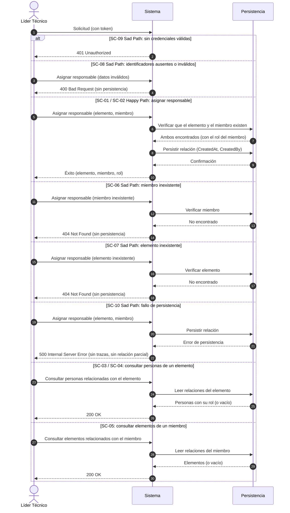

# ESPECIFICACIÓN TÉCNICA DE HISTORIA DE USUARIO: Relación entre Personas, Roles y Elementos de Trabajo

## 1. METADATOS FORMALES
- **Feature ID:** FEAT-015
- **Story ID:** HU-015
- **Épica:** [P2] Gestión de Equipos y Roles Técnicos
- **Tipo:** Feature ⚠️ [PROPUESTO]
- **Prioridad:** Media ⚠️ [PROPUESTO] (habilita el criterio de éxito "tarjetas consultables con responsable y rol", `pb_tech_work_hub.md` §6.1; es dato de entrada de HU-010 y de las vistas de carga por persona)
- **Tags:** [equipo, responsables, roles-tecnicos, backlog, relaciones, p2]
- **Requiere interfaz:** Sí ⚠️ [PROPUESTO] (ante la duda se declara `Sí`; asignar un responsable y consultar quién trabaja en una tarjeta son operaciones de un usuario humano. La definición visual corresponde a UX)
- **Dependencias:**
  - HU-012 (miembros del equipo y roles técnicos): `ACTIVE`. `VERIFIED` (`mvp_tech_work_hub.md` Épica [P2], historia candidata 015: "Depende de 012 y de P1"; fila 015 de `specs/README.md`).
  - HU-001 (registro de elementos del backlog): `ACTIVE`. `VERIFIED` (misma fuente: "P1"). El elemento de trabajo de esta HU es el elemento del backlog multitipo.
- **Alcance (única capacidad):** relacionar a un miembro del equipo (y, a través de él, su rol técnico) con un elemento del backlog como responsable, y consultar esa relación en ambos sentidos (personas y roles de una tarjeta; tarjetas de una persona). `VERIFIED` para la existencia de la relación (`mvp_tech_work_hub.md` Épica [P2] "Relación entre personas, roles y elementos de trabajo" e historia candidata 015; `pb_tech_work_hub.md` §4.1 Módulo 2 "Responsable(s)" y "Roles involucrados" de los elementos del backlog). Las operaciones concretas (asignar y las dos consultas) son ⚠️ [PROPUESTO]: se eligen para que la relación sea verificable de forma observable (ver §2.2).
- **Fuera de alcance de esta HU:**
  - Capacidad individual y por rol y su cálculo: HU-013 (bloqueada por ❓ modelo de cálculo de capacidad).
  - Carga de trabajo por persona y actividades operativas: HU-014 (depende de actividades de P4).
  - Relación de las tarjetas con actividades, reuniones, incidentes y aplicaciones: HU-010 (la parte "personas" de HU-010 queda cubierta por esta HU; ver Punto Abierto 8).
  - Responsables de actividades, incidentes y reuniones: HU-021, HU-023 y HU-027 (P4 y P5 aún no construidas).
  - Quitar o reemplazar a un responsable ya asignado, y el evento "cambio de responsable" del historial: ❓ No documentado (HU-011 y Punto Abierto 3).
  - Modificar las estimaciones Dev y QA de la tarjeta, su estado, su Sprint o cualquier otro dato del elemento: esta HU **no modifica** el comportamiento de HU-001, HU-003, HU-004 ni HU-012.
- **Consumo SDD:** `/speckit.specify documents/business-analyst/015-HU_relacion_personas_roles_elementos.md`

---

## 2. ESPECIFICACIÓN FUNCIONAL Y ESCENARIOS GHERKIN (BDD)

### 2.1. Descripción de la Capacidad
**Como** Líder Técnico autenticado (Product Brief §2.1; permiso exacto por rol de acceso ❓ No documentado)
**Quiero** asignar a miembros del equipo registrados como responsables de un elemento del backlog y consultar qué personas, con qué rol técnico, están relacionadas con cada elemento, y qué elementos tiene relacionados cada persona
**Para** poder consultar el trabajo técnico "junto con su responsable" y su rol, con trazabilidad entre personas, roles y tarjetas (Plan de Gestión §1 "Criterio de Éxito Rector"; Product Brief §6.1 "Trazabilidad de trabajo").

> Fuente: `pb_tech_work_hub.md` §2.1 (Líder Técnico: "controlar actividades propias y del equipo"), §4.1 Módulo 2 ("Responsable(s)", "Roles involucrados"), §6.1; `mvp_tech_work_hub.md` Épica [P2], historia candidata 015. `VERIFIED`
> Actor: que el Líder Técnico sea quien asigna es `INFERRED` (el Product Brief no cierra quién asigna responsables) y requiere validación humana (Punto Abierto 6). Que los Desarrolladores (§2.1, "registran y actualizan tarjetas asignadas") puedan autoasignarse o consultar es ❓ No documentado.

### 2.2. Escenarios Formales en Sintaxis Gherkin Pura

> **Regla de relación mínima (⚠️ [PROPUESTO], `ASSUMED`):** cada solicitud relaciona **un** miembro con **un** elemento del backlog. Un elemento admite **más de un** responsable (el Product Brief lo escribe en plural, "Responsable(s)", `VERIFIED`; el máximo es ❓ No documentado). El rol con el que la persona participa es el rol técnico que ya tiene registrado en HU-012 (`INFERRED`: el Product Brief habla de "Roles involucrados" sin indicar si se elige por asignación; Punto Abierto 2). La relación se identifica por el elemento y el miembro; no se especifica el reemplazo ni la baja.

```gherkin
Feature: Relación entre personas, roles y elementos de trabajo
  Como Líder Técnico autenticado
  Quiero asignar miembros del equipo como responsables de elementos del backlog y consultar la relación
  Para consultar el trabajo junto con su responsable y su rol

  Scenario: SC-01 [Happy Path] Asignar como responsable a un miembro con rol Desarrollo
    Given un usuario autenticado con un token válido
    And que existe un elemento del backlog con identificador "item-101"
    And que existe un miembro registrado "Ana Torres" con el rol "Desarrollo"
    When el usuario solicita asignar a "Ana Torres" como responsable de "item-101"
    Then el sistema confirma la asignación con un código de éxito ⚠️ [PROPUESTO]
    And la respuesta contiene el identificador del elemento, el identificador y el nombre del miembro y su rol "Desarrollo"
    And la relación queda persistida con metadatos de auditoría "CreatedAt" y "CreatedBy" igual al "sub" del token ⚠️ [PROPUESTO]
    And las estimaciones "devPoints" y "qaPoints", el estado y el Sprint del elemento permanecen sin cambios

  Scenario: SC-02 [Happy Path] Asignar un segundo responsable con rol QA al mismo elemento
    Given un usuario autenticado con un token válido
    And que el elemento "item-101" ya tiene como responsable a "Ana Torres" (rol "Desarrollo")
    And que existe un miembro registrado "Luis Rojas" con el rol "QA"
    When el usuario solicita asignar a "Luis Rojas" como responsable de "item-101"
    Then el sistema confirma la asignación con un código de éxito ⚠️ [PROPUESTO]
    And "item-101" queda relacionado con "Ana Torres" (Desarrollo) y con "Luis Rojas" (QA)
    And la relación previa con "Ana Torres" permanece intacta

  Scenario: SC-03 [Happy Path] Consultar las personas y roles relacionados con un elemento ⚠️ [PROPUESTO]
    Given un usuario autenticado con un token válido
    And que el elemento "item-101" tiene como responsables a "Ana Torres" (Desarrollo) y a "Luis Rojas" (QA)
    When el usuario solicita consultar las personas relacionadas con "item-101"
    Then el sistema responde HTTP 200 OK
    And el cuerpo contiene exactamente esas dos personas, cada una con su identificador, nombre y rol
    And la consulta no modifica ningún dato

  Scenario: SC-04 [Happy Path] Consultar un elemento sin responsables ⚠️ [PROPUESTO]
    Given un usuario autenticado con un token válido
    And que existe un elemento del backlog sin ningún responsable asignado
    When el usuario solicita consultar las personas relacionadas con ese elemento
    Then el sistema responde HTTP 200 OK con una colección vacía

  Scenario: SC-05 [Happy Path] Consultar los elementos relacionados con un miembro ⚠️ [PROPUESTO]
    Given un usuario autenticado con un token válido
    And que "Ana Torres" es responsable de "item-101" y de "item-102"
    When el usuario solicita consultar los elementos relacionados con "Ana Torres"
    Then el sistema responde HTTP 200 OK
    And el cuerpo contiene exactamente "item-101" y "item-102", cada uno con su identificador, título y tipo
    And la consulta no modifica ningún dato

  Scenario: SC-06 [Sad Path] Asignar a un miembro inexistente ⚠️ [PROPUESTO]
    Given un usuario autenticado con un token válido
    And que existe un elemento del backlog con identificador "item-101"
    And que no existe ningún miembro con el identificador solicitado
    When el usuario solicita asignar a ese miembro como responsable de "item-101"
    Then el sistema responde HTTP 404 Not Found indicando que el miembro no existe
    And no se persiste ninguna relación

  Scenario: SC-07 [Sad Path] Asignar un responsable a un elemento inexistente ⚠️ [PROPUESTO]
    Given un usuario autenticado con un token válido
    And que existe un miembro registrado "Ana Torres"
    And que no existe ningún elemento del backlog con el identificador solicitado
    When el usuario solicita asignar a "Ana Torres" como responsable de ese elemento
    Then el sistema responde HTTP 404 Not Found indicando que el elemento no existe
    And no se persiste ninguna relación

  Scenario Outline: SC-08 [Sad Path] Rechazo por identificadores ausentes o inválidos ⚠️ [PROPUESTO]
    Given un usuario autenticado con un token válido
    When el usuario solicita asignar un responsable con elemento "<elemento>" y miembro "<miembro>"
    Then el sistema responde HTTP 400 Bad Request con el detalle de los campos inválidos
    And no se persiste ninguna relación

    Examples:
      | elemento  | miembro   | motivo                          |
      |           | member-01 | elemento ausente                |
      | item-101  |           | miembro ausente                 |
      | no-es-id  | member-01 | elemento con formato inválido   |
      | item-101  | no-es-id  | miembro con formato inválido    |

  Scenario Outline: SC-09 [Sad Path] Acceso sin credenciales válidas
    Given una solicitud sin token o con un token inválido o expirado
    When el usuario intenta <operacion>
    Then el sistema responde HTTP 401 Unauthorized
    And no se lee ni se persiste ningún dato de relaciones, miembros ni elementos

    Examples:
      | operacion                                                |
      | asignar un responsable a un elemento del backlog         |
      | consultar las personas relacionadas con un elemento      |
      | consultar los elementos relacionados con un miembro      |

  Scenario: SC-10 [Sad Path] Fallo de persistencia al asignar un responsable ⚠️ [PROPUESTO]
    Given un usuario autenticado con un token válido
    And que existen el elemento "item-101" y el miembro "Ana Torres"
    And la persistencia no está disponible o falla al guardar
    When el usuario solicita asignar a "Ana Torres" como responsable de "item-101"
    Then el sistema responde HTTP 500 Internal Server Error sin exponer trazas internas
    And no queda registrada ninguna relación parcial
```

> **Trazabilidad:** SC-01 y SC-02 provienen del alcance entregado por el Product Manager (relación entre personas, roles y elementos de trabajo, Plan de Gestión Épica [P2] e historia candidata 015; "Responsable(s)" y "Roles involucrados" del backlog, Product Brief §4.1 Módulo 2). `VERIFIED` en cuanto a la existencia de la relación y la pluralidad de responsables. Los ejemplos de identificadores y nombres, los códigos HTTP, la auditoría de la relación, las consultas en ambos sentidos (SC-03 a SC-05), los rechazos de miembro o elemento inexistente (SC-06, SC-07), la validación de identificadores (SC-08) y el fallo de persistencia (SC-10) son ⚠️ [PROPUESTO]. Los códigos 400/404/500 siguen el manejo centralizado de excepciones y 401 la directiva `.RequireAuthorization()` de `.specify/memory/constitution.md` §2 y §5 (mismo patrón que HU-001, HU-004 y HU-012). `VERIFIED` (Constitución), no Product Brief. Si la referencia a miembro o elemento viaja en la ruta o en el cuerpo, y por tanto si su ausencia produce 400 o 404, lo decide el API Architect; SC-06 a SC-08 fijan el comportamiento observable, no la forma de la solicitud. Cada escenario declara su propia precondición de autenticación (no hay `Background`), de modo que SC-09 no hereda una sesión válida.
> **No existen escenarios** para: asignar dos veces al mismo miembro al mismo elemento, número máximo de responsables, quitar o reemplazar un responsable, restringir la asignación por rol técnico frente a las estimaciones de la tarjeta, restringir la asignación según el estado del elemento o su pertenencia a un Sprint, autoasignación por un Desarrollador, ni permisos por rol de acceso: ❓ No documentado (§3 y §6).

---

## 3. MATRIZ DE CASOS BORDE Y EXCEPCIONES

| ID | Condición Límite / Error | Tipo de Evento | Comportamiento Esperado | Código / Tipo de Respuesta |
|---|---|---|---|---|
| CB-01 | Miembro indicado inexistente (SC-06) ⚠️ [PROPUESTO] | Validación Referencial | Rechazo sin persistir | HTTP 404 / NotFoundException |
| CB-02 | Elemento del backlog indicado inexistente (SC-07) ⚠️ [PROPUESTO] | Validación Referencial | Rechazo sin persistir | HTTP 404 / NotFoundException |
| CB-03 | Identificador de elemento o de miembro ausente o con formato inválido (SC-08) ⚠️ [PROPUESTO] | Validación de Esquema | Rechazo inmediato con lista de violaciones | HTTP 400 / ValidationException |
| CB-04 | Solicitud sin token, token inválido o expirado (SC-09) | Seguridad e Identidad | Rechazo en autenticación | HTTP 401 / Unauthorized |
| CB-05 | Fallo de persistencia al asignar (SC-10) ⚠️ [PROPUESTO] | Falla de Persistencia | No queda ninguna relación parcial; el error no expone trazas internas | HTTP 500 / InternalServerException |
| CB-06 | Asignar al mismo miembro dos veces al mismo elemento | Integridad | ❓ No documentado (rechazar, tratar como idempotente o duplicar). Sin escenario hasta definirlo | ❓ No documentado |
| CB-07 | Número máximo de responsables por elemento | Validación de Rango de Datos | ❓ No documentado. No se restringe | ❓ No documentado |
| CB-08 | Quitar o reemplazar a un responsable ya asignado (incluye el evento "cambio de responsable") | Ciclo de Vida | ❓ No documentado; fuera del alcance entregado. No se restringe | ❓ No documentado |
| CB-09 | Asignar a un miembro cuyo rol técnico no coincide con las estimaciones del elemento (p. ej. miembro QA en un elemento con "qaPoints" nulo) | Regla de Negocio | ❓ No documentado (ver alcance de las estimaciones por rol para Bugs, Spikes y demás tipos, Plan de Gestión §5.2). No se restringe | ❓ No documentado |
| CB-10 | Asignar responsables a un elemento según su estado o su pertenencia a un Sprint | Regla de Negocio | ❓ No documentado (catálogo de estados bloqueado por HU-005). No se restringe | ❓ No documentado |
| CB-11 | Permisos por rol de acceso para asignar y consultar | Seguridad e Identidad | ❓ No documentado; las HU previas solo exigen un token válido con identidad | ❓ No documentado |

---

## 4. PRECONDICIONES Y POSTCONDICIONES VERIFICABLES

### 4.1. Precondiciones del Sistema
- Usuario autenticado mediante token válido emitido por el servidor de identidad (Constitución §5).
- Existe el elemento del backlog (HU-001) y existe el miembro del equipo con su rol técnico (HU-012) que se relacionan.
- ❓ No documentado: roles de acceso con permiso para asignar y para consultar (HU-001, HU-003, HU-004 y HU-012 solo exigen un token válido con identidad).

### 4.2. Postcondiciones y Mutaciones
- SC-01 y SC-02 persisten una relación entre un elemento y un miembro, con metadatos de auditoría ⚠️ [PROPUESTO]; la asignación de un segundo responsable no altera la relación del primero.
- SC-03, SC-04 y SC-05 no mutan datos; SC-06, SC-07, SC-08, SC-09 y SC-10 no persisten nada.
- La asignación **no altera** las estimaciones Dev y QA de la tarjeta (siguen siendo independientes y sin agregación forzada, Product Brief §5), ni su estado, ni su pertenencia a un Sprint, ni el registro del miembro ni su rol técnico. No cambia el comportamiento observable de HU-001, HU-003, HU-004 ni HU-012.
- **Esta HU no prejuzga** la idempotencia de la asignación (CB-06), el máximo de responsables (CB-07), la baja o reemplazo de un responsable (CB-08), ni reglas de coherencia entre rol del miembro y estimaciones del elemento (CB-09) ni con su estado (CB-10): el diseño técnico no debe asumirlos ni imponerlos hasta resolverlos.
- Debe respetarse el aislamiento por schema de la Constitución §3: los datos de miembros y roles pertenecen al módulo de equipos y los de elementos al módulo de backlog; no se permiten joins ni consultas cross-schema. Dónde reside la relación y cómo cada consulta obtiene los datos del otro módulo (llamada en proceso o proyección local) corresponde a Architecture (riesgo ya registrado por el Product Manager en `mvp_tech_work_hub.md` §6 "Riesgo de dependencia entre P1 y P2").

---

## 5. 📊 DIAGRAMA DE SECUENCIA / ESTADOS
Cada rama `alt` corresponde a un escenario. No se incluye diagrama de estados porque el ciclo de vida de la relación (baja, reemplazo) es ❓ No documentado.



---

## 6. DEFINITION OF DONE (TÉCNICA)
- [ ] La especificación contiene todos los metadatos requeridos para Spec Kit (`FEAT-015`, `HU-015`, `/speckit.specify`).
- [ ] Todos los escenarios BDD están escritos en sintaxis pura Gherkin.
- [ ] La matriz de casos borde cubre validación, referencias inexistentes, seguridad y fallo de persistencia.
- [ ] Las precondiciones y postcondiciones son verificables mediante pruebas automatizadas.
- [ ] El diagrama de secuencia refleja con fidelidad el flujo de Happy y Sad Path (una rama por escenario).
- [ ] Ausencia de supuestos no tipificados (cualquier inferencia está marcada como ⚠️ [PROPUESTO]).
- [ ] La funcionalidad respeta las reglas de negocio y restricciones del ecosistema preexistente documentado en `.specify/memory/constitution.md` (schemas aislados por módulo, sin queries cross-schema, endpoints con `.RequireAuthorization()`).
- [ ] El diseño no impone ni asume la idempotencia de la asignación, el máximo de responsables, la baja o reemplazo de un responsable ni reglas de coherencia con las estimaciones o el estado del elemento (puntos abiertos 1, 3, 4 y 5).
- [ ] No se modifica el comportamiento de HU-001, HU-003, HU-004 ni HU-012 (no regresión), en particular la independencia de las estimaciones Dev y QA.

### Puntos Abiertos (❓ No documentado)
1. **Duplicados y máximo de responsables:** ¿se rechaza, ignora o duplica la asignación repetida del mismo miembro al mismo elemento? ¿Existe un máximo de responsables por elemento? El Product Brief solo escribe "Responsable(s)" (CB-06, CB-07).
2. **Rol de la relación:** el rol mostrado es el rol técnico que el miembro ya tiene en HU-012 (`INFERRED`). ¿"Roles involucrados" es siempre ese rol o puede elegirse por asignación (p. ej. un miembro que trabaja un elemento como QA)? Depende además de la cardinalidad miembro–rol, abierta en HU-012.
3. **Ciclo de vida de la relación:** quitar o reemplazar un responsable y registrar el "cambio de responsable" (Product Brief §4.1 Módulo 8 lo cita como evento del historial); su efecto sobre HU-011 (CB-08).
4. **Coherencia con las estimaciones por rol:** si el rol del miembro debe corresponderse con una estimación presente en la tarjeta (Dev o QA) y qué ocurre con Bugs, Spikes, Deuda Técnica y demás tipos (CB-09; Plan de Gestión §5.2 "Alcance de las estimaciones por rol"; HU-012 punto 8).
5. **Coherencia con el estado y el Sprint:** si se puede asignar o cambiar responsables en cualquier estado de la tarjeta y con la tarjeta ya en un Sprint (CB-10; depende del catálogo de estados de HU-005).
6. **Permisos y actores:** qué perfiles pueden asignar (Líder Técnico, Administrador de Plataforma, el propio Desarrollador) y quiénes solo consultar (CB-11).
7. **Formato de las consultas:** campos, orden, filtros (por rol, por tipo o por Sprint) y paginación de ambas consultas.
8. **Solape con HU-010:** el Plan de Gestión asigna a HU-010 las "relaciones de las tarjetas con personas, actividades, reuniones, incidentes y aplicaciones". Esta HU entrega solo la relación persona–rol–elemento del backlog; el Product Manager debe confirmar que HU-010 no la duplica y se limita a las demás entidades, o ajustar su alcance.
9. **Otros elementos de trabajo:** actividades operativas, incidentes y reuniones también tendrán responsables (HU-021, HU-023 y HU-027). Esta HU solo cubre los elementos del backlog; si la relación debe ser un mecanismo común para todos los elementos es decisión de Architecture.

---
> **Origen:** `tracker_bmad.md` (handoff del Product Manager 04-10-2026 20:16:00), `specs/README.md` (filas 010, 012, 013, 014 y 015), `pb_tech_work_hub.md` (§2.1 usuarios, §4.1 Módulos 1, 2 y 8, §5 restricciones, §6.1 indicadores), `mvp_tech_work_hub.md` (Épica [P2], historia candidata 015, §1 Criterio de Éxito Rector, §3.4 Relaciones entre Entidades, §5.2 ambigüedades, §6 riesgos), `012-HU_miembros_equipo_y_roles_tecnicos.md` y `001-HU_registro_elementos_backlog_multitipo.md` (patrón de manejo de errores y datos preexistentes) y `.specify/memory/constitution.md`.
> Todo contenido generado que no esté explícito en la fuente se marca como `⚠️ [PROPUESTO]`.

## 7. ORDEN DE DELEGACIÓN PARA EL QA
@QA: La Historia de Usuario Técnica Relación entre Personas, Roles y Elementos de Trabajo está lista en el archivo 015-HU_relacion_personas_roles_elementos.md (y su versión de stakeholders en documents/business-analyst/HUs-stakeholders/015-HU_relacion_personas_roles_elementos.md). Por favor, procede con la auditoría documental contra el Product Brief para asegurar que la historia cumple con los requerimientos originales.
