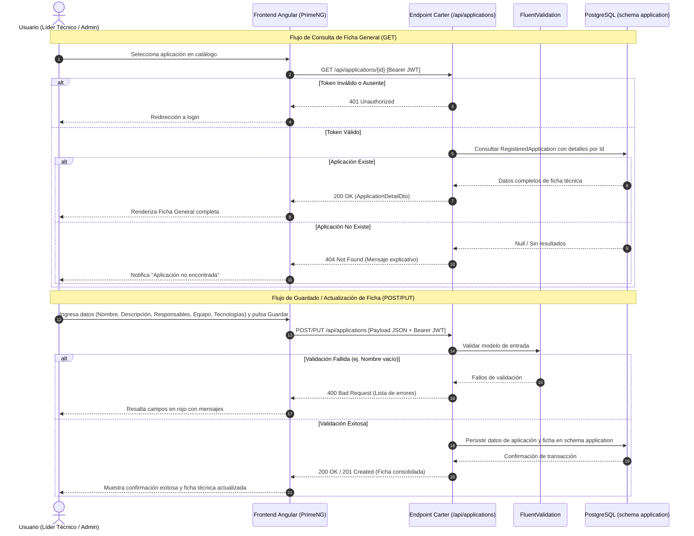

# ESPECIFICACIÓN TÉCNICA DE HISTORIA DE USUARIO: Ficha General de Aplicación

## 1. METADATOS FORMALES
- **Feature ID:** FEAT-016
- **Story ID:** HU-016
- **Épica:** [P3] Catálogo y Documentación de Aplicaciones
- **Tipo:** Feature ⚠️ [PROPUESTO]
- **Prioridad:** Alta ⚠️ [PROPUESTO] (entidad base de P3; las HU-017, HU-018, HU-019, HU-020, HU-022 y HU-023 dependen de la ficha general de aplicación)
- **Tags:** [aplicaciones, catalogo, ficha-tecnica, responsables, tecnologias, modulo-p3]
- **Requiere interfaz:** Sí ⚠️ [PROPUESTO] (la consulta y gestión de la ficha técnica de una aplicación es una capacidad operada por usuarios del sistema; requiere vistas de detalle y formulario en Angular/PrimeNG)
- **Dependencias:** HU-002 (`002-pruebas-integracion-keycloak-y-catalogo-application`, en estado `ACTIVE`, que estableció la base del catálogo en backend). Es precondición directa para HU-017, HU-018, HU-019, HU-020, HU-022 y HU-023.
- **Alcance (única capacidad):** registrar y consultar la información general de la aplicación, sus responsables (técnico y funcional/negocio), el equipo relacionado y las tecnologías utilizadas en la ficha del aplicativo. `VERIFIED` (`pb-tech-work-hub.md` §4.1 Módulo 6 "Centro de Documentación de Aplicativos"; `mvp-tech-work-hub.md` Épica [P3], historia candidata 016).
- **Fuera de alcance de esta HU:**
  - Ambientes, componentes de software e integraciones de la aplicación: HU-017 (`017-ambientes-componentes-integraciones`).
  - Referencias a repositorios y documentación externa o archivos: HU-018 (`018-referencias-repositorios-y-documentacion`).
  - Diagramas de arquitectura y adjuntos visuales: HU-019 (`019-diagramas-arquitectura-aplicacion`).
  - Vista consolidada de incidentes, actividades, tarjetas y reuniones vinculadas: HU-020 (`020-contexto-relacionado-aplicacion`).
  - Eliminación física o baja lógica destructiva de aplicativos con historial: ❓ No documentado.
- **Consumo SDD:** `/speckit.specify docs/business-analyst/016-ficha-general-aplicacion.md`

---

## 2. ESPECIFICACIÓN FUNCIONAL Y ESCENARIOS GHERKIN (BDD)

### 2.1. Descripción de la Capacidad
**Como** Líder Técnico o Administrador de Plataforma autenticado (según roles definidos en `pb-tech-work-hub.md` §2.1 y §2.2)
**Quiero** registrar y consultar la ficha general de cada aplicación con su nombre, descripción, responsables asignados, equipo técnico relacionado y tecnologías utilizadas
**Para** centralizar el contexto técnico del sistema y servir como ancla referencial fidedigna para las dependencias operativas, incidentes, actividades y documentación.

### 2.2. Escenarios Formales en Sintaxis Gherkin Pura

```gherkin
Feature: Ficha general de aplicación
  Como Líder Técnico o Administrador de Plataforma autenticado
  Quiero registrar y consultar la ficha general de una aplicación
  Para centralizar la información técnica, responsables, equipo y tecnologías del catálogo

  Scenario: SC-01 [Happy Path] Consulta de la ficha general de una aplicación existente
    Given un usuario autenticado con un token JWT válido
    And una aplicación registrada en el catálogo con identificador único "app-001"
    And dicha aplicación contiene descripción "Plataforma de Pagos", responsable técnico "Ana Torres", equipo "Core Backend" y tecnologías ["C#", "PostgreSQL", "Angular"]
    When el usuario solicita la ficha general mediante GET "/api/applications/app-001"
    Then el sistema responde HTTP 200 OK
    And el cuerpo de la respuesta contiene el identificador "app-001", nombre, descripción, responsables, equipo relacionado y listado de tecnologías
    And no se modifica ningún dato del catálogo ni del backlog

  Scenario: SC-02 [Happy Path] Registro o actualización de la ficha general con datos válidos
    Given un usuario autenticado con rol de Administrador o Líder Técnico con un token JWT válido
    When el usuario envía una solicitud de guardado de ficha general con nombre "Portal Clientes", descripción "Acceso web autogestión", responsable técnico "Carlos Mora", equipo "Frontend Web" y tecnologías ["TypeScript", "Angular", "Tailwind"]
    Then el sistema responde HTTP 200 OK o 201 Created con la confirmación de la ficha
    And los datos de la ficha general quedan persistidos en el schema "application"
    And los metadatos de auditoría registran la fecha y el usuario que realizó la operación
    And la aplicación queda disponible para consulta inmediata en el catálogo general

  Scenario: SC-03 [Sad Path] Consulta de una aplicación que no existe en el catálogo
    Given un usuario autenticado con un token JWT válido
    When el usuario solicita la ficha general de un identificador inexistente "app-999"
    Then el sistema responde HTTP 404 Not Found
    And el cuerpo de la respuesta contiene un mensaje estructurado indicando que la aplicación no fue encontrada
    And no se muta el estado de ninguna entidad persistida

  Scenario: SC-04 [Sad Path] Intento de guardado de ficha con campos obligatorios vacíos o inválidos
    Given un usuario autenticado con un token JWT válido
    When el usuario envía una solicitud de guardado con el nombre de la aplicación vacío o nulo
    Then el sistema rechaza la operación respondiendo HTTP 400 Bad Request
    And la respuesta detalla los errores de validación específicos por cada campo requerido omitido
    And la base de datos no registra ninguna modificación parcial ni inconsistente

  Scenario Outline: SC-05 [Sad Path] Petición sin autenticación válida o token revocado
    Given un cliente sin token JWT válido o con credenciales expiradas
    When el cliente solicita <metodo> "<ruta>"
    Then el sistema responde HTTP 401 Unauthorized
    And la solicitud es rechazada en la capa de seguridad sin acceder a los datos de la aplicación

    Examples:
      | metodo | ruta                          |
      | GET    | /api/applications/app-001     |
      | POST   | /api/applications             |
      | PUT    | /api/applications/app-001     |
```

---

## 3. MATRIZ DE CASOS BORDE Y EXCEPCIONES

| ID | Condición Límite / Error | Tipo de Evento | Comportamiento Esperado | Código / Tipo de Respuesta |
|---|---|---|---|---|
| CB-01 | Nombre de aplicación nulo o compuesto exclusivamente por espacios en blanco | Validación de Esquema / Dominio | Rechazo inmediato de la solicitud sin persistir datos | HTTP 400 / ValidationException |
| CB-02 | Nombre de aplicación que excede la longitud máxima permitida (200 caracteres según RegisteredApplication) | Validación de Límite | Rechazo con mensaje indicando longitud máxima superada | HTTP 400 / ValidationException |
| CB-03 | Identificador de aplicación con formato GUID/UUID no válido sintácticamente | Validación de Formato de Parámetro | Rechazo previo al procesamiento del dominio | HTTP 400 / ValidationException |
| CB-04 | Aplicación con identificador no existente en la base de datos (SC-03) | Consulta de Entidad | Notificación explícita de recurso no encontrado | HTTP 404 / NotFoundException |
| CB-05 | Lista de tecnologías vacía o nula al registrar ficha | Flexibilidad de Ficha Técnica ⚠️ [PROPUESTO] | Se permite el guardado registrando lista vacía sin fallar el proceso | HTTP 200/201 / Éxito con array vacío |
| CB-06 | Token de autenticación expirado, firma alterada o cabecera ausente (SC-05) | Seguridad e Identidad | Rechazo en middleware de autenticación sin tocar la capa de aplicación | HTTP 401 / Unauthorized |
| CB-07 | Indisponibilidad o fallo de conexión en base de datos PostgreSQL | Falla de Persistencia | Interrupción transaccional segura sin efectos parciales; notificación de error controlado | HTTP 500 / ServiceUnavailable |

---

## 4. PRECONDICIONES Y POSTCONDICIONES VERIFICABLES

### 4.1. Precondiciones del Sistema
- El usuario debe contar con un token JWT válido emitido por el servicio de identidad configurado (Keycloak).
- La base de datos debe tener el schema `application` inicializado y las migraciones de persistencia aplicadas.
- En caso de consulta o actualización (SC-01 / SC-02 sobre aplicación preexistente), el identificador de la aplicación debe corresponder a un registro existente en el catálogo.

### 4.2. Postcondiciones y Mutaciones
- La entidad de la aplicación persiste sus atributos enriquecidos: nombre, descripción, responsables, equipo relacionado y catálogo de tecnologías.
- Se preservan las auditorías automáticas (`CreatedAt`, `CreatedBy`, `LastModifiedAt`, `LastModifiedBy` ⚠️ [PROPUESTO]).
- La integridad de las tablas relacionadas del backlog, sprints y miembros de equipo permanece invariante y sin modificaciones colaterales.
- El catálogo de aplicaciones actualizado se encuentra disponible de forma reactiva e inmediata para consultas desde los módulos dependientes (Backlog, Incidentes, Actividades).

---

## 5. 📊 DIAGRAMA DE SECUENCIA / ESTADOS


---

## 6. DEFINITION OF DONE (TÉCNICA)
- [ ] La especificación contiene todos los metadatos requeridos para GitHub Spec Kit (`FEAT-016`, `HU-016`, tags, dependencias).
- [ ] Todos los escenarios BDD están escritos en sintaxis pura Gherkin sin ambigüedades.
- [ ] La matriz de casos borde cubre validación de esquemas, longitudes límite, recursos inexistentes y fallos de persistencia.
- [ ] Las precondiciones y postcondiciones son verificables mediante pruebas automatizadas de integración y unitarias.
- [ ] El diagrama de secuencia refleja con fidelidad el flujo de consulta y guardado tanto en Happy Path como en Sad Paths.
- [ ] Ausencia de supuestos no tipificados (toda inferencia de diseño funcional está marcada con ⚠️ [PROPUESTO]).
- [ ] La funcionalidad respeta las reglas de negocio y restricciones del ecosistema preexistente documentado en la Constitución Técnica (`.specify/memory/constitution.md`).

---
> **Origen:** `pb-tech-work-hub.md` (§1.1, §4.1 Módulo 6) y `mvp-tech-work-hub.md` (Épica [P3] Catálogo y Documentación de Aplicaciones, historia candidata 016).
> Todo contenido generado que no esté explícito en la fuente se marca como `⚠️ [PROPUESTO]`.

## 7. ORDEN DE DELEGACIÓN PARA EL QA
*(Generar como una sola línea de texto continuo, sin saltos de línea internos)*

@QA: La Historia de Usuario Técnica Ficha General de Aplicación está lista en el archivo 016-ficha-general-aplicacion.md (y su versión de stakeholders en docs/business-analyst/HUs-stakeholders/016-ficha-general-aplicacion.md). Por favor, procede con la auditoría documental contra el Product Brief para asegurar que la historia cumple con los requerimientos originales.
