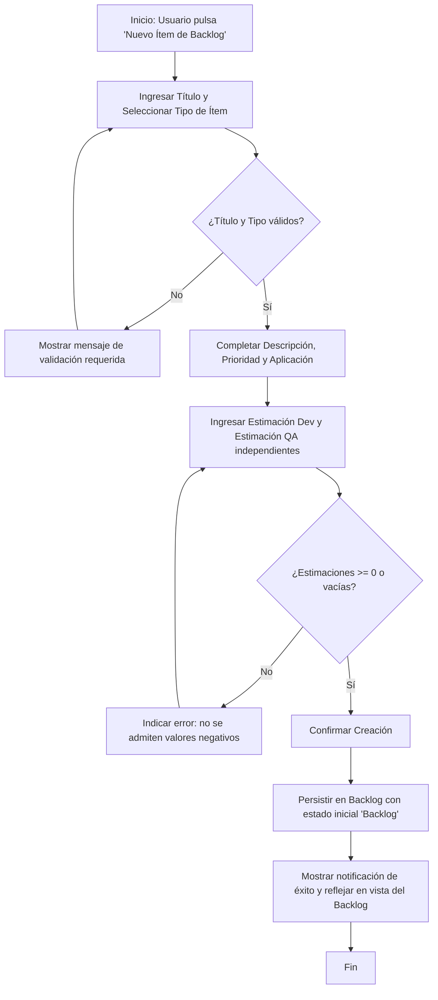

# HISTORIA DE USUARIO (STAKEHOLDERS): Registro de Elementos en Backlog Multitipo

- **ID de Historia:** 001-HU
- **Épica:** [P1] Planificación y Control de Sprints con Backlog Multitipo
- **Audiencia:** Stakeholders, Product Owner, Líder Técnico, Equipo de Desarrollo y QA

---

## 1. HISTORIA DE USUARIO
**Como** Líder Técnico o Miembro del Equipo de Desarrollo/QA  
**Quiero** registrar y clasificar diferentes tipos de elementos de trabajo en el backlog (Historias de Usuario, Bugs, Evoluciones Tecnológicas, Requerimientos Técnicos, Deuda Técnica, Investigaciones y Spikes) asignando estimaciones de esfuerzo independientes por rol técnico (Desarrollo y QA) y vinculándolos a las aplicaciones correspondientes  
**Para** centralizar el inventario de trabajo técnico previo a los Sprints de 2 semanas, evitando la dispersión de requerimientos y reflejando con exactitud la capacidad y carga diferenciada que cada especialidad debe asumir sin unificaciones arbitrarias de puntaje.

## 2. CRITERIOS DE ACEPTACIÓN FUNCIONALES
- **CA-01 — Registro exitoso de elemento con estimación diferenciada por rol (Happy Path):**
  - **Dado** que el Líder Técnico o integrante del equipo se encuentra en la vista de gestión del Backlog,
  - **Cuando** ingresa un título descriptivo obligatorio, selecciona un tipo válido (ej. "Historia de Usuario" o "Evolución Tecnológica"), define la prioridad, redacta la descripción/criterios de aceptación, ingresa los puntos estimados para Desarrollo (ej. 5 puntos) y para QA (ej. 3 puntos) de manera independiente, y selecciona la aplicación relacionada,
  - **Entonces** el sistema guarda el elemento en el Backlog con estado inicial "Backlog" ⚠️ [PROPUESTO], confirma el registro exitoso al usuario y muestra las estimaciones desglosadas por rol en la ficha y lista del ítem.

- **CA-02 — Registro exitoso de elemento con estimación parcial o sin estimación inmediata (Happy Path):**
  - **Dado** que un miembro del equipo necesita registrar una tarea exploratoria o incidente detectado (ej. tipo "Spike", "Investigación" o "Bug"),
  - **Cuando** completa el título y tipo de ítem, ingresa solo la estimación de Desarrollo (o solo la de QA, o deja ambas vacías para refinamiento posterior),
  - **Entonces** el sistema registra el elemento en el Backlog permitiendo valores nulos o cero en los roles no estimados, manteniendo el elemento disponible para posterior refinamiento y asignación a un Sprint.

- **CA-03 — Prevención de registro por datos requeridos faltantes (Sad Path):**
  - **Dado** que el usuario intenta crear un ítem en el Backlog,
  - **Cuando** omite el título o no selecciona un tipo de elemento de trabajo permitido,
  - **Entonces** el sistema bloquea el guardado, resalta los campos mandatorios incompletos y presenta mensajes de advertencia claros indicando qué información es obligatoria para continuar.

- **CA-04 — Validación de estimaciones no negativas (Sad Path):**
  - **Dado** que el usuario ingresa valores de estimación numérica en los campos de esfuerzo por rol,
  - **Cuando** ingresa un valor numérico negativo (ej. -2 puntos) en los puntos de Desarrollo o en los puntos de QA,
  - **Entonces** el sistema rechaza la operación, indica que las estimaciones deben ser números mayores o iguales a cero y conserva el formulario editable sin perder el contenido previamente escrito.

## 3. 📊 DIAGRAMAS DE LA HU

## 4. IMPACTO OPERATIVO Y BENEFICIO DE NEGOCIO
- **Valor Agregado:** Elimina la pérdida de visibilidad del trabajo técnico multitipo (Bugs, Spikes, Deuda Técnica) que habitualmente no cabe en plantillas rígidas de HUs comerciales. Asegura que la capacidad de QA y Desarrollo se planifique y mida de manera desacoplada, respetando las dinámicas reales de testing y desarrollo.
- **Métricas Clave:**
  - 100% de elementos del backlog tipificados y con trazabilidad a su aplicación.
  - Cero discrepancias en la asignación de puntajes por rol durante la planificación de Sprints.
  - Reducción del tiempo de captura y clasificación de requerimientos técnicos y deuda técnica.

## 5. DEFINITION OF DONE (STAKEHOLDER)
- [ ] La HU cumple con todos los Criterios de Aceptación declarados desde la perspectiva del usuario.
- [ ] El Happy Path y al menos un Sad Path están definidos en términos comprensibles.
- [ ] No incluye jerga técnica de implementación de bajo nivel ni detalles internos de infraestructura.
- [ ] Validado con los objetivos del Product Brief (`pb_tech_work_hub.md`) y el Plan de Gestión (`mvp_tech_work_hub.md`).
- [ ] La funcionalidad respeta las reglas de negocio del sistema preexistente documentado.

## Supuestos de Negocio
- ⚠️ **[PROPUESTO]** La escala de estimación recomendada para puntos de Dev y QA es numérica (enteros o decimales positivos, alineados a Fibonacci o escala acordada por el equipo durante el refinamiento).
- ⚠️ **[PROPUESTO]** El catálogo de tipos inicial contempla: Historia de Usuario, Bug, Evolución Tecnológica, Requerimiento Técnico, Deuda Técnica, Investigación y Spike; extensible a futuro.
- ⚠️ **[PROPUESTO]** El estado asignado automáticamente a los nuevos elementos es "Backlog".

## 🎨 REFERENCIA DE EXPERIENCIA VISUAL
- **Pantalla / Módulo:** Módulo 2 — Gestión del Backlog Multitipo (`/backlog`).
- **Comportamiento UX:**
  - Botón principal de acción "Nuevo Ítem" en la esquina superior derecha del panel de Backlog.
  - Diálogo modal o panel lateral responsivo con pestañas o secciones claras: Información Básica (Título, Tipo, Aplicación, Prioridad), Detalle (Descripción, Criterios), y Estimación por Rol (campos independientes para Puntos Dev y Puntos QA).
  - Componentes PrimeNG estándar (`p-dropdown`, `p-inputtext`, `p-inputnumber`, `p-editor` / `p-textarea`, `p-toast`).

---
> **Origen:** `pb_tech_work_hub.md` (Sección 4.1 Módulo 2, Sección 5) y `mvp_tech_work_hub.md` (Épica [P1]).
> Todo contenido generado que no esté explícito en la fuente se marca como `⚠️ [PROPUESTO]`.
