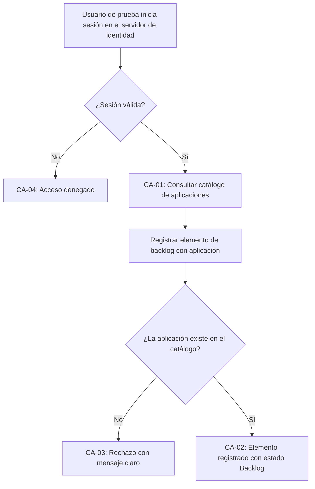

# HISTORIA DE USUARIO (STAKEHOLDERS): Confianza en el Acceso y el Catálogo de Aplicaciones del Backlog

- **ID de Historia:** 002-HU
- **Épica:** [P1] Planificación y Control de Sprints con Backlog Multitipo (historia derivada del riesgo residual de HU-001 ⚠️ [PROPUESTO])
- **Audiencia:** Stakeholders, Líder Técnico, Equipo de Desarrollo y QA

---

## 1. HISTORIA DE USUARIO
**Como** Líder Técnico o Miembro del Equipo de Desarrollo/QA responsable de la calidad del backlog multitipo
**Quiero** tener la seguridad comprobada de que el inicio de sesión corporativo (Keycloak) y el catálogo real de aplicaciones funcionan correctamente cuando se registran elementos en el backlog
**Para** cerrar el riesgo que aceptamos al aprobar el registro de elementos en el backlog (HU-001), donde estas dos piezas solo se habían verificado con simulaciones.

## 2. CRITERIOS DE ACEPTACIÓN FUNCIONALES
- **CA-01 — Consulta del catálogo con una sesión corporativa real (Happy Path):**
  - **Dado** que un usuario de prueba inicia sesión en el servidor de identidad real,
  - **Cuando** consulta la lista de aplicaciones,
  - **Entonces** el sistema muestra las aplicaciones del catálogo, ordenadas por nombre ⚠️ [PROPUESTO como regla de negocio; así se comporta hoy el sistema].

- **CA-02 — Registro de un elemento vinculado a una aplicación existente (Happy Path):**
  - **Dado** que el usuario ha iniciado sesión y elige una aplicación del catálogo,
  - **Cuando** registra un elemento de backlog vinculado a ella,
  - **Entonces** el sistema registra el elemento con estado "Backlog" y lo deja asociado al usuario que inició sesión.

- **CA-03 — Aplicación inexistente (Sad Path):**
  - **Dado** que el usuario ha iniciado sesión correctamente,
  - **Cuando** intenta registrar un elemento vinculado a una aplicación que no está en el catálogo,
  - **Entonces** el sistema rechaza el registro con un mensaje claro de que la aplicación no existe y no guarda el elemento.

- **CA-04 — Sesión no válida (Sad Path):**
  - **Dado** un usuario sin sesión, con una sesión vencida o con credenciales manipuladas, de otro emisor o emitidas para otro sistema,
  - **Cuando** intenta consultar aplicaciones o registrar un elemento,
  - **Entonces** el sistema deniega el acceso y no muestra ni guarda información.

## 3. 📊 DIAGRAMAS DE LA HU

## 4. IMPACTO OPERATIVO Y BENEFICIO DE NEGOCIO
- **Valor Agregado:** Convierte un riesgo aceptado en evidencia verificable: se confirma que el acceso seguro y la vinculación a aplicaciones funcionan con los componentes reales antes de seguir ampliando el backlog y la planificación de Sprints.
- **Métricas Clave:**
  - 100% de los casos de acceso (válido, ausente, vencido, manipulado, otro emisor, otra audiencia) verificados contra el servidor de identidad real.
  - 100% de las vinculaciones de elementos a aplicaciones verificadas contra el catálogo real.

## 5. DEFINITION OF DONE (STAKEHOLDER)
- [ ] La HU cumple con todos los Criterios de Aceptación declarados desde la perspectiva del usuario.
- [ ] El Happy Path y al menos un Sad Path están definidos en términos comprensibles.
- [ ] No incluye jerga técnica de implementación de bajo nivel.
- [ ] Validado con los objetivos del Product Brief (`pb-tech-work-hub.md`).
- [ ] La funcionalidad respeta las reglas de negocio del sistema preexistente documentado.

## Supuestos de Negocio
- ⚠️ **[PROPUESTO]** Esta historia no añade capacidades nuevas para el usuario final; verifica y respalda lo entregado en HU-001.
- ⚠️ **[PROPUESTO]** La carga de un catálogo inicial reproducible de aplicaciones queda fuera de esta historia y se trata aparte; aquí se usan aplicaciones de prueba.
- ❓ **No documentado:** qué usuarios y roles de prueba existen en el servidor de identidad.

## ❓ PREGUNTAS Y PUNTOS ABIERTOS
1. ¿Qué usuarios y roles de prueba se usarán en el servidor de identidad, y se levanta uno propio para las pruebas o se usa uno compartido?
2. ¿Qué debe ocurrir si el servidor de identidad no está disponible al ejecutar las pruebas?
3. ¿Se registra el catálogo inicial de aplicaciones como historia aparte? (decisión del product-manager)

---
> **Origen:** `tracker_bmad.md` (decisión del HUMANO sobre el riesgo residual de HU-001 y handoff del Product Manager), `specs/README.md` (fila 002) y `pb-tech-work-hub.md` (§2 actores, catálogo de aplicativos e integración con Keycloak).
> Todo contenido generado que no esté explícito en la fuente se marca como `⚠️ [PROPUESTO]`.
