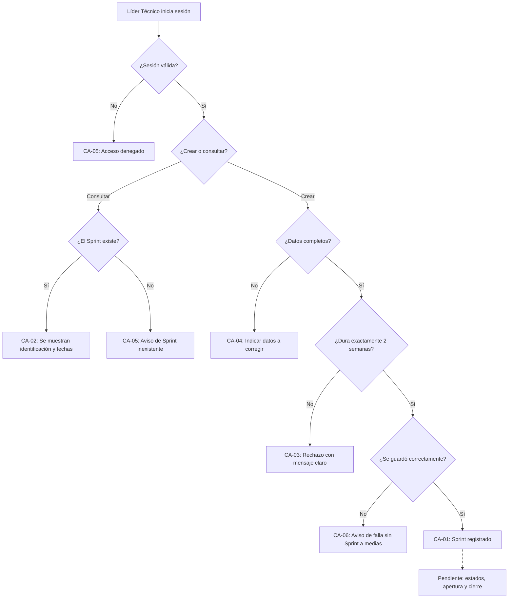

# HISTORIA DE USUARIO (STAKEHOLDERS): Crear y Consultar Sprints de Dos Semanas

- **ID de Historia:** 003-HU
- **Épica:** [P1] Planificación y Control de Sprints con Backlog Multitipo
- **Audiencia:** Stakeholders, Product Owner, Líder Técnico

---

## 1. HISTORIA DE USUARIO
**Como** Líder Técnico
**Quiero** crear Sprints indicando su identificación y sus fechas de inicio y fin, y consultar los Sprints registrados, con la seguridad de que cada Sprint dura exactamente 2 semanas
**Para** contar con los ciclos de trabajo sobre los que el equipo planificará y dará seguimiento a su trabajo.

## 2. CRITERIOS DE ACEPTACIÓN FUNCIONALES
- **CA-01 — Crear un Sprint de 2 semanas (Happy Path):**
  - **Dado** que el Líder Técnico ha iniciado sesión,
  - **Cuando** crea un Sprint con una identificación y fechas de inicio y fin que abarcan exactamente 2 semanas,
  - **Entonces** el sistema registra el Sprint y lo muestra con su identificación y sus fechas.

- **CA-02 — Consultar los Sprints (Happy Path):**
  - **Dado** que existen Sprints registrados,
  - **Cuando** el usuario consulta los Sprints o el detalle de uno de ellos,
  - **Entonces** el sistema muestra su identificación y sus fechas de inicio y fin.

- **CA-03 — Duración distinta de 2 semanas (Sad Path):**
  - **Dado** que el usuario indica fechas que abarcan menos o más de 2 semanas, o un fin anterior al inicio,
  - **Cuando** intenta crear el Sprint,
  - **Entonces** el sistema lo rechaza con un mensaje claro de que el Sprint debe durar exactamente 2 semanas y no lo guarda.

- **CA-04 — Datos incompletos (Sad Path):**
  - **Dado** que falta la identificación o alguna de las fechas, o una fecha no es válida,
  - **Cuando** intenta crear el Sprint,
  - **Entonces** el sistema indica qué datos corregir y no guarda el Sprint.

- **CA-05 — Sprint inexistente o sin sesión (Sad Path):**
  - **Dado** que el Sprint solicitado no existe, o que el usuario no tiene una sesión válida,
  - **Cuando** intenta consultarlo o crear un Sprint,
  - **Entonces** el sistema informa que el Sprint no existe o deniega el acceso, sin mostrar ni guardar información.

- **CA-06 — Fallo al guardar (Sad Path) ⚠️ [PROPUESTO]:**
  - **Dado** que el Líder Técnico ha iniciado sesión y envía un Sprint válido,
  - **Cuando** el sistema no logra guardarlo por una falla interna,
  - **Entonces** informa que no pudo completar la operación sin mostrar detalles técnicos y no deja ningún Sprint a medias.

## 3. 📊 DIAGRAMAS DE LA HU

## 4. IMPACTO OPERATIVO Y BENEFICIO DE NEGOCIO
- **Valor Agregado:** Establece el marco temporal de 2 semanas del que dependen la asignación de tarjetas (HU-004), el seguimiento del trabajo planificado y el dashboard del Sprint. Evita Sprints de duración arbitraria que distorsionen la lectura del trabajo.
- **Métricas Clave:** 100% de los Sprints registrados abarcan exactamente 2 semanas (Product Brief §5); apoya la visibilidad del Sprint que persigue el Product Brief §6.1.

## 5. DEFINITION OF DONE (STAKEHOLDER)
- [ ] La HU cumple con todos los Criterios de Aceptación declarados desde la perspectiva del usuario.
- [ ] El Happy Path y al menos un Sad Path están definidos en términos comprensibles.
- [ ] No incluye jerga técnica de implementación de bajo nivel.
- [ ] Validado con los objetivos del Product Brief (`pb_tech_work_hub.md`).
- [ ] La funcionalidad respeta las reglas de negocio del sistema preexistente documentado.

## Supuestos de Negocio
- ⚠️ **[PROPUESTO]** "2 semanas" se entiende como 14 días calendario consecutivos, con ambas fechas incluidas. Pendiente de confirmar.
- ⚠️ **[PROPUESTO]** El Líder Técnico es quien crea los Sprints; el permiso por rol no está documentado.
- ⚠️ **[PROPUESTO]** Esta historia no incluye modificar, cancelar ni eliminar un Sprint.

## ❓ PREGUNTAS Y PUNTOS ABIERTOS
1. **Pendiente (bloquea el ciclo de vida):** ¿Qué reglas de apertura, cierre y estados tiene un Sprint? Esta historia **no** los define; solo crea y consulta Sprints.
2. **Pregunta abierta 9 del Product Brief:** ¿Una tarjeta puede pertenecer a más de un Sprint o solo a uno? No se asume respuesta. No afecta a esta historia, pero se debe resolver antes de la historia 004 (asignación de elementos al Sprint), que depende de esta.
3. ¿"2 semanas" son días calendario o hábiles? ¿El Sprint debe empezar un día concreto de la semana?
4. ¿Cómo se identifica un Sprint (nombre libre, número, etiqueta) y no puede repetirse?
5. ¿Pueden solaparse dos Sprints? ¿Se puede crear un Sprint que ya empezó?
6. ¿Qué roles pueden crear y cuáles solo consultar Sprints?

---
> **Origen:** `tracker_bmad.md` (handoff del Product Manager), `specs/README.md` (fila 003), `pb_tech_work_hub.md` (§4.1 Módulo 3, §5, §8 pregunta 9) y `mvp_tech_work_hub.md` (Épica [P1], §5.2).
> Todo contenido generado que no esté explícito en la fuente se marca como `⚠️ [PROPUESTO]`.
