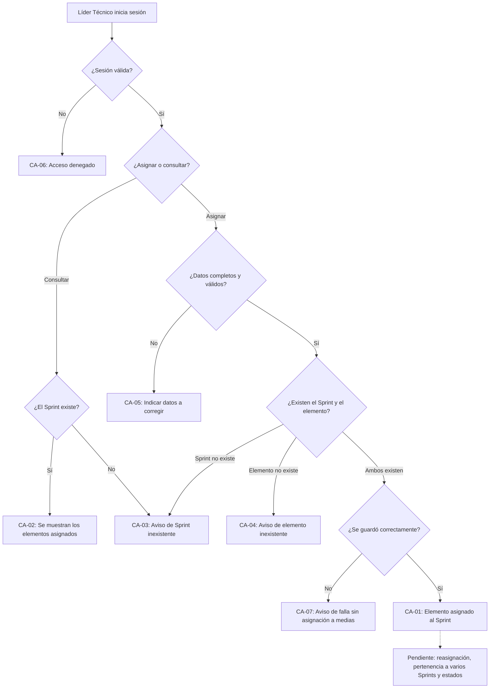

# HISTORIA DE USUARIO (STAKEHOLDERS): Asignar Elementos del Backlog a un Sprint

- **ID de Historia:** 004-HU
- **Épica:** [P1] Planificación y Control de Sprints con Backlog Multitipo
- **Audiencia:** Stakeholders, Product Owner, Líder Técnico

---

## 1. HISTORIA DE USUARIO
**Como** Líder Técnico
**Quiero** asignar elementos del backlog a un Sprint de 2 semanas y ver qué elementos tiene asignados cada Sprint
**Para** definir con claridad qué trabajo planificado abarca cada ciclo y poder darle seguimiento.

## 2. CRITERIOS DE ACEPTACIÓN FUNCIONALES
- **CA-01 — Asignar un elemento a un Sprint (Happy Path):**
  - **Dado** que el Líder Técnico ha iniciado sesión, existe un Sprint y existe un elemento del backlog que aún no está en ningún Sprint,
  - **Cuando** asigna ese elemento a ese Sprint,
  - **Entonces** el sistema confirma la asignación y el elemento conserva sus datos (título, tipo, estimaciones por rol y estado) sin cambios.

- **CA-02 — Ver los elementos de un Sprint (Happy Path) ⚠️ [PROPUESTO]:**
  - **Dado** que existe un Sprint con elementos asignados (o sin ninguno),
  - **Cuando** el usuario consulta los elementos de ese Sprint,
  - **Entonces** el sistema muestra exactamente los elementos asignados, con su título, tipo y estimaciones por rol, o indica que no tiene ninguno.

- **CA-03 — Sprint inexistente (Sad Path):**
  - **Dado** que el Sprint indicado no existe,
  - **Cuando** el usuario intenta asignarle un elemento o consultar sus elementos,
  - **Entonces** el sistema informa que el Sprint no existe y no guarda ninguna asignación.

- **CA-04 — Elemento inexistente (Sad Path):**
  - **Dado** que el elemento del backlog indicado no existe,
  - **Cuando** el usuario intenta asignarlo a un Sprint,
  - **Entonces** el sistema informa que el elemento no existe y no guarda ninguna asignación.

- **CA-05 — Datos incompletos o no válidos (Sad Path):**
  - **Dado** que falta el Sprint o el elemento, o alguno de los dos no tiene un formato válido,
  - **Cuando** el usuario intenta asignar,
  - **Entonces** el sistema indica qué datos corregir y no guarda ninguna asignación.

- **CA-06 — Sin sesión válida (Sad Path):**
  - **Dado** que el usuario no tiene una sesión válida,
  - **Cuando** intenta asignar o consultar elementos de un Sprint,
  - **Entonces** el sistema deniega el acceso sin mostrar ni guardar información.

- **CA-07 — Fallo al guardar (Sad Path) ⚠️ [PROPUESTO]:**
  - **Dado** que la asignación es válida,
  - **Cuando** el sistema no logra guardarla por una falla interna,
  - **Entonces** informa que no pudo completar la operación sin mostrar detalles técnicos y no deja ninguna asignación a medias.

## 3. 📊 DIAGRAMAS DE LA HU

## 4. IMPACTO OPERATIVO Y BENEFICIO DE NEGOCIO
- **Valor Agregado:** Permite definir qué trabajo planificado entra en cada ciclo de 2 semanas. Es la base de la que dependen las fechas de compromiso versus reales (HU-006) y el dashboard del estado del Sprint (HU-031), y apoya el objetivo de visibilidad del Sprint del Product Brief.
- **Métricas Clave:** 100% de las tarjetas del Sprint consultables con su información (Product Brief §6.1); el tiempo actual de preparación de reportes del Sprint requiere línea base antes de fijar metas (Product Brief §6.2; sin porcentaje de mejora asumido).

## 5. DEFINITION OF DONE (STAKEHOLDER)
- [ ] La HU cumple con todos los Criterios de Aceptación declarados desde la perspectiva del usuario.
- [ ] El Happy Path y al menos un Sad Path están definidos en términos comprensibles.
- [ ] No incluye jerga técnica de implementación de bajo nivel.
- [ ] Validado con los objetivos del Product Brief (`pb-tech-work-hub.md`).
- [ ] La funcionalidad respeta las reglas de negocio del sistema preexistente documentado.

## Supuestos de Negocio
- ⚠️ **[PROPUESTO]** Cada operación asigna un solo elemento a un solo Sprint; la asignación de varios elementos a la vez no está definida.
- ⚠️ **[PROPUESTO]** Asignar un elemento a un Sprint no cambia su estado ni sus estimaciones.
- ⚠️ **[PROPUESTO]** Esta historia no incluye quitar un elemento de un Sprint ni moverlo a otro.
- ⚠️ **[PROPUESTO]** El Líder Técnico es quien asigna; el permiso por rol no está documentado.

## ❓ PREGUNTAS Y PUNTOS ABIERTOS
1. **Pregunta abierta 9 del Product Brief (condiciona esta historia):** ¿Una tarjeta puede pertenecer a más de un Sprint o solo a uno? ¿Qué pasa con las tarjetas no terminadas al cerrar un Sprint? Esta historia **no** asume respuesta: solo cubre la primera asignación de un elemento que aún no está en ningún Sprint. El Plan de Gestión indica que la 004 no tiene puntos abiertos; conviene confirmarlo.
2. ¿Qué debe ocurrir si se asigna un elemento que ya está en el mismo Sprint o en otro?
3. ¿Se puede asignar a un Sprint que ya empezó, ya terminó o aún no comienza? (depende de las reglas de ciclo de vida del Sprint, aún no definidas)
4. ¿Hay elementos que no deban asignarse según su tipo o estado? ¿Existe un límite de carga por Sprint o por rol? (dependen del catálogo de estados y del modelo de capacidad)
5. ¿Se necesita asignar varios elementos a la vez, o quitarlos o moverlos de un Sprint?
6. ¿Qué roles pueden asignar y cuáles solo consultar?

---
> **Origen:** `tracker_bmad.md` (handoff del Product Manager), `specs/README.md` (fila 004), `pb-tech-work-hub.md` (§4.1 Módulo 3, §6, §8 pregunta 9) y `mvp-tech-work-hub.md` (Épica [P1], historia candidata 004).
> Todo contenido generado que no esté explícito en la fuente se marca como `⚠️ [PROPUESTO]`.
