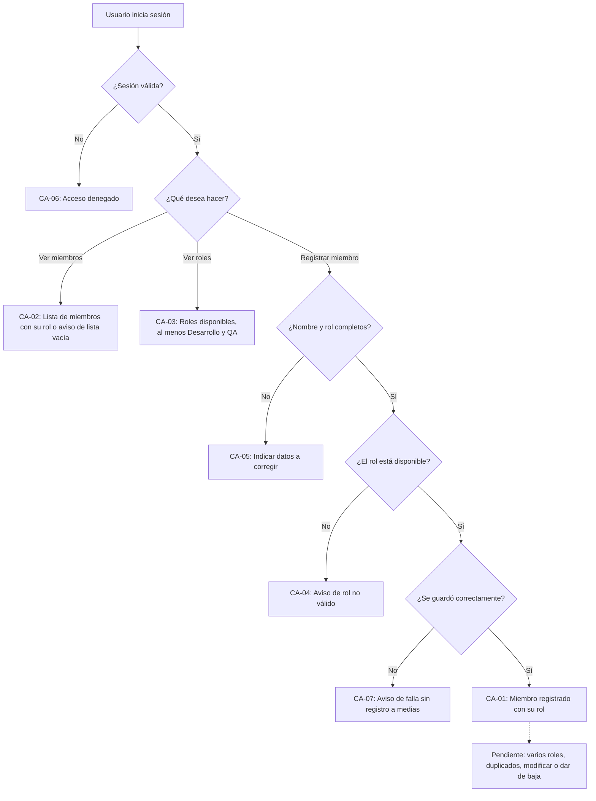

# HISTORIA DE USUARIO (STAKEHOLDERS): Miembros del Equipo y Roles Técnicos

- **ID de Historia:** 012-HU
- **Épica:** [P2] Gestión de Equipos y Roles Técnicos
- **Audiencia:** Stakeholders, Product Owner, Líder Técnico, Administrador de Plataforma

---

## 1. HISTORIA DE USUARIO
**Como** Líder Técnico o Administrador de Plataforma
**Quiero** registrar a los miembros del equipo técnico con su rol (Desarrollo, QA u otro disponible) y ver quiénes son y qué roles existen
**Para** tener un registro único de personas y roles que permita asignar responsables y estimaciones por rol en la planificación.

## 2. CRITERIOS DE ACEPTACIÓN FUNCIONALES
- **CA-01 — Registrar un miembro con su rol (Happy Path):**
  - **Dado** que el usuario ha iniciado sesión y el rol elegido (por ejemplo Desarrollo o QA) está disponible,
  - **Cuando** registra a un miembro con su nombre y ese rol,
  - **Entonces** el sistema confirma el registro y muestra el miembro con su nombre y su rol, sin alterar el backlog, los Sprints ni las asignaciones existentes.

- **CA-02 — Ver los miembros del equipo (Happy Path) ⚠️ [PROPUESTO]:**
  - **Dado** que hay miembros registrados (o ninguno),
  - **Cuando** el usuario consulta los miembros del equipo,
  - **Entonces** el sistema muestra exactamente los miembros registrados con su nombre y rol, o indica que todavía no hay ninguno.

- **CA-03 — Ver los roles técnicos disponibles (Happy Path) ⚠️ [PROPUESTO]:**
  - **Dado** que el usuario ha iniciado sesión,
  - **Cuando** consulta los roles técnicos,
  - **Entonces** el sistema muestra los roles disponibles, que incluyen al menos Desarrollo y QA.

- **CA-04 — Rol no disponible (Sad Path) ⚠️ [PROPUESTO]:**
  - **Dado** que el rol indicado no existe entre los roles técnicos,
  - **Cuando** el usuario intenta registrar un miembro con ese rol,
  - **Entonces** el sistema informa que el rol no es válido y no registra al miembro.

- **CA-05 — Datos incompletos (Sad Path) ⚠️ [PROPUESTO]:**
  - **Dado** que falta el nombre (o está vacío) o falta el rol,
  - **Cuando** el usuario intenta registrar al miembro,
  - **Entonces** el sistema indica qué datos corregir y no registra a nadie.

- **CA-06 — Sin sesión válida (Sad Path):**
  - **Dado** que el usuario no tiene una sesión válida,
  - **Cuando** intenta registrar o consultar miembros o roles,
  - **Entonces** el sistema deniega el acceso sin mostrar ni guardar información.

- **CA-07 — Fallo al guardar (Sad Path) ⚠️ [PROPUESTO]:**
  - **Dado** que los datos del miembro son válidos,
  - **Cuando** el sistema no logra guardarlos por una falla interna,
  - **Entonces** informa que no pudo completar la operación sin mostrar detalles técnicos y no deja un registro a medias.

## 3. 📊 DIAGRAMAS DE LA HU

## 4. IMPACTO OPERATIVO Y BENEFICIO DE NEGOCIO
- **Valor Agregado:** Crea el registro maestro de personas y roles técnicos del que dependen la asignación de responsables y estimaciones por rol en la planificación (épica P1), las capacidades y cargas por persona (HU-013, HU-014, HU-015) y los responsables de actividades, incidentes y reuniones (HU-021, HU-023, HU-027). Apoya el criterio de éxito de poder consultar el trabajo "junto con su responsable".
- **Métricas Clave:** 100% de las tarjetas del Sprint consultables con responsable y rol (Product Brief §6.1; requiere que las personas y roles estén registrados). No se asume ninguna mejora porcentual antes de contar con línea base (Product Brief §6.2).

## 5. DEFINITION OF DONE (STAKEHOLDER)
- [ ] La HU cumple con todos los Criterios de Aceptación declarados desde la perspectiva del usuario.
- [ ] El Happy Path y al menos un Sad Path están definidos en términos comprensibles.
- [ ] No incluye jerga técnica de implementación de bajo nivel.
- [ ] Validado con los objetivos del Product Brief (`pb_tech_work_hub.md`).
- [ ] La funcionalidad respeta las reglas de negocio del sistema preexistente documentado.

## Supuestos de Negocio
- ⚠️ **[PROPUESTO]** Cada miembro se registra con un solo rol técnico; que pueda tener varios no está definido.
- ⚠️ **[PROPUESTO]** Del conjunto de roles técnicos solo están respaldados por el Product Brief Desarrollo y QA ("Desarrollo, QA, etc.").
- ⚠️ **[PROPUESTO]** El miembro se identifica por su nombre; no se exigen otros datos personales.
- ⚠️ **[PROPUESTO]** Esta historia no incluye modificar, dar de baja ni cambiar el rol de un miembro, ni crear roles nuevos.
- ⚠️ **[PROPUESTO]** Tanto el Líder Técnico como el Administrador de Plataforma pueden registrar y consultar; el permiso por rol no está documentado.

## ❓ PREGUNTAS Y PUNTOS ABIERTOS
1. ¿Un miembro puede tener más de un rol técnico a la vez?
2. ¿Se permiten dos miembros con el mismo nombre? ¿Qué dato identifica a una persona?
3. ¿Se necesita modificar, dar de baja o cambiar de rol a un miembro? ¿Qué pasa con el trabajo que ya tenía asignado?
4. Además de Desarrollo y QA, ¿qué otros roles técnicos existen y quién puede crearlos o editarlos?
5. ¿Cada miembro debe vincularse con un usuario de acceso al sistema? ¿Cómo se relacionan los roles técnicos con los permisos de acceso?
6. ¿Qué perfiles pueden registrar miembros y cuáles solo consultarlos?
7. ¿Qué datos, orden, filtros y paginación debe tener la lista de miembros?

---
> **Origen:** `tracker_bmad.md` (handoff del Product Manager), `specs/README.md` (fila 012), `pb_tech_work_hub.md` (§2.1, §2.2, §4.1 Módulo 1, §6, §7) y `mvp_tech_work_hub.md` (Épica [P2], historia candidata 012).
> Todo contenido generado que no esté explícito en la fuente se marca como `⚠️ [PROPUESTO]`.
