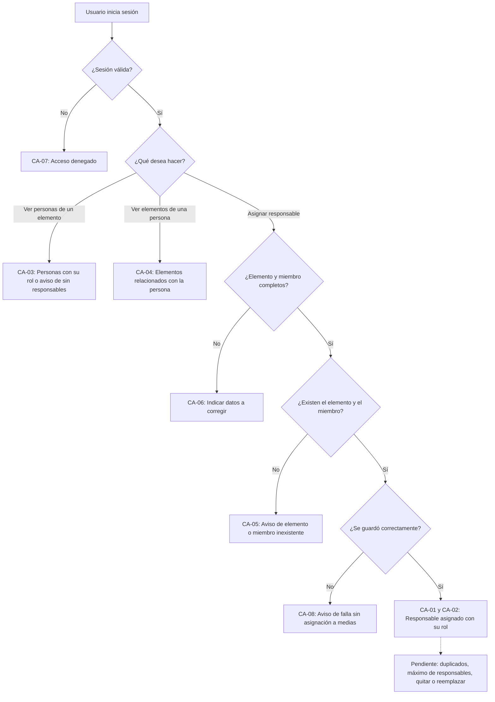

# HISTORIA DE USUARIO (STAKEHOLDERS): Relación entre Personas, Roles y Elementos de Trabajo

- **ID de Historia:** 015-HU
- **Épica:** [P2] Gestión de Equipos y Roles Técnicos
- **Audiencia:** Stakeholders, Product Owner, Líder Técnico

---

## 1. HISTORIA DE USUARIO
**Como** Líder Técnico
**Quiero** indicar qué miembros del equipo son responsables de cada elemento del backlog y ver, para cada elemento, quiénes trabajan en él y con qué rol, y para cada persona, en qué elementos participa
**Para** consultar el trabajo técnico junto con su responsable y su rol, y mantener trazabilidad entre personas, roles y tarjetas.

## 2. CRITERIOS DE ACEPTACIÓN FUNCIONALES
- **CA-01 — Asignar un responsable a un elemento (Happy Path):**
  - **Dado** que el usuario ha iniciado sesión, el elemento del backlog existe y el miembro está registrado con su rol (por ejemplo Desarrollo),
  - **Cuando** asigna a ese miembro como responsable del elemento,
  - **Entonces** el sistema confirma la asignación y muestra el elemento, la persona y su rol, sin cambiar las estimaciones, el estado ni el Sprint del elemento.

- **CA-02 — Varios responsables en un mismo elemento (Happy Path):**
  - **Dado** que un elemento ya tiene un responsable (por ejemplo de Desarrollo),
  - **Cuando** el usuario asigna a otro miembro (por ejemplo de QA),
  - **Entonces** el elemento queda relacionado con ambas personas, cada una con su rol, y la asignación anterior no se ve afectada.

- **CA-03 — Ver quién trabaja en un elemento (Happy Path) ⚠️ [PROPUESTO]:**
  - **Dado** que el elemento tiene responsables asignados (o ninguno),
  - **Cuando** el usuario consulta las personas relacionadas con el elemento,
  - **Entonces** el sistema muestra exactamente esas personas con su nombre y rol, o indica que todavía no tiene responsables.

- **CA-04 — Ver en qué elementos participa una persona (Happy Path) ⚠️ [PROPUESTO]:**
  - **Dado** que el miembro es responsable de uno o más elementos,
  - **Cuando** el usuario consulta los elementos relacionados con esa persona,
  - **Entonces** el sistema muestra exactamente esos elementos con su título y tipo.

- **CA-05 — Miembro o elemento inexistente (Sad Path) ⚠️ [PROPUESTO]:**
  - **Dado** que el miembro o el elemento indicado no existe,
  - **Cuando** el usuario intenta asignar el responsable,
  - **Entonces** el sistema informa cuál de los dos no existe y no registra ninguna asignación.

- **CA-06 — Datos incompletos o inválidos (Sad Path) ⚠️ [PROPUESTO]:**
  - **Dado** que falta el elemento o el miembro, o el dato no es válido,
  - **Cuando** el usuario intenta asignar el responsable,
  - **Entonces** el sistema indica qué datos corregir y no registra ninguna asignación.

- **CA-07 — Sin sesión válida (Sad Path):**
  - **Dado** que el usuario no tiene una sesión válida,
  - **Cuando** intenta asignar o consultar responsables,
  - **Entonces** el sistema deniega el acceso sin mostrar ni guardar información.

- **CA-08 — Fallo al guardar (Sad Path) ⚠️ [PROPUESTO]:**
  - **Dado** que los datos de la asignación son válidos,
  - **Cuando** el sistema no logra guardarlos por una falla interna,
  - **Entonces** informa que no pudo completar la operación sin mostrar detalles técnicos y no deja una asignación a medias.

## 3. 📊 DIAGRAMAS DE LA HU

## 4. IMPACTO OPERATIVO Y BENEFICIO DE NEGOCIO
- **Valor Agregado:** Conecta los datos maestros de personas y roles (HU-012) con el trabajo del backlog (HU-001), de modo que cada tarjeta pueda consultarse junto con su responsable y su rol. Es la base para ver la carga por persona (HU-014) y para las relaciones de las tarjetas con otras entidades (HU-010). Apoya el criterio de éxito de poder consultar el trabajo "junto con su responsable, estado, esfuerzo y contexto relacionado".
- **Métricas Clave:** 100% de las tarjetas del Sprint consultables con responsable y rol (Product Brief §6.1; requiere que las asignaciones estén registradas). No se asume ninguna mejora porcentual antes de contar con línea base (Product Brief §6.2).

## 5. DEFINITION OF DONE (STAKEHOLDER)
- [ ] La HU cumple con todos los Criterios de Aceptación declarados desde la perspectiva del usuario.
- [ ] El Happy Path y al menos un Sad Path están definidos en términos comprensibles.
- [ ] No incluye jerga técnica de implementación de bajo nivel.
- [ ] Validado con los objetivos del Product Brief (`pb_tech_work_hub.md`).
- [ ] La funcionalidad respeta las reglas de negocio del sistema preexistente documentado.

## Supuestos de Negocio
- ⚠️ **[PROPUESTO]** Un elemento admite más de un responsable (el Product Brief escribe "Responsable(s)"); el máximo no está definido.
- ⚠️ **[PROPUESTO]** El rol que se muestra para cada responsable es el rol técnico que ya tiene registrado; que pueda elegirse por asignación no está definido.
- ⚠️ **[PROPUESTO]** Esta historia solo cubre elementos del backlog; los responsables de actividades, incidentes y reuniones se tratan en sus propias historias.
- ⚠️ **[PROPUESTO]** Esta historia no incluye quitar ni reemplazar a un responsable, ni modifica estimaciones, estado o Sprint del elemento.
- ⚠️ **[PROPUESTO]** El Líder Técnico es quien asigna y consulta; el permiso por perfil no está documentado.

## ❓ PREGUNTAS Y PUNTOS ABIERTOS
1. ¿Se puede asignar a la misma persona dos veces al mismo elemento? ¿Hay un máximo de responsables por elemento?
2. ¿El rol de cada responsable es siempre el que la persona tiene registrado, o puede indicarse un rol distinto para cada asignación?
3. ¿Se necesita quitar o reemplazar a un responsable y dejar constancia del cambio en el historial de la tarjeta?
4. ¿Debe coincidir el rol de la persona con las estimaciones de la tarjeta (por ejemplo, un miembro de QA en una tarjeta sin estimación de QA)?
5. ¿Se puede asignar o cambiar responsables en cualquier estado de la tarjeta y cuando ya está en un Sprint?
6. ¿Qué perfiles pueden asignar responsables y cuáles solo consultarlos? ¿Un Desarrollador puede autoasignarse?
7. ¿Qué datos, orden, filtros y paginación deben tener las dos consultas?
8. ¿La historia 010 (relaciones de las tarjetas con entidades) debe limitarse a actividades, reuniones, incidentes y aplicaciones, ya que las personas quedan cubiertas aquí?

---
> **Origen:** `tracker_bmad.md` (handoff del Product Manager), `specs/README.md` (filas 010, 012 y 015), `pb_tech_work_hub.md` (§2.1, §4.1 Módulos 2 y 8, §6) y `mvp_tech_work_hub.md` (Épica [P2], historia candidata 015, §1 y §3.4).
> Todo contenido generado que no esté explícito en la fuente se marca como `⚠️ [PROPUESTO]`.
