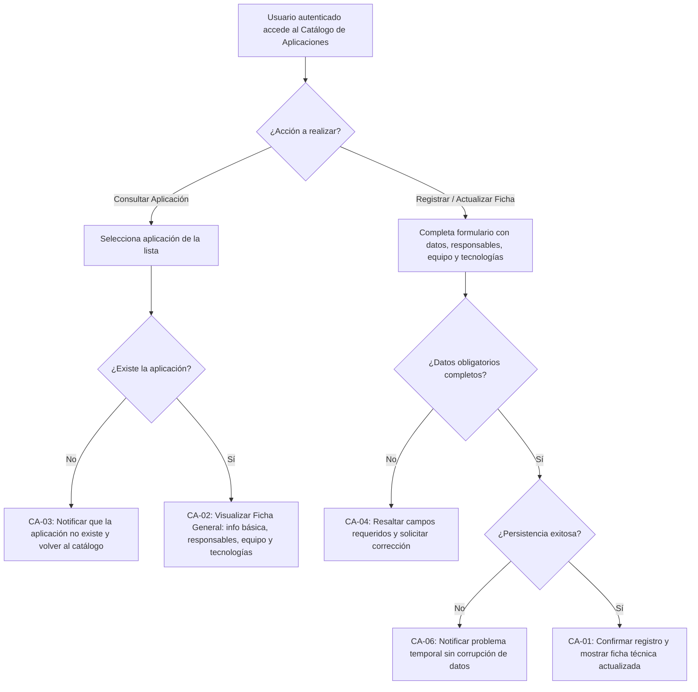

# HISTORIA DE USUARIO (STAKEHOLDERS): Ficha General de Aplicación

- **ID de Historia:** 016-HU
- **Épica:** [P3] Catálogo y Documentación de Aplicaciones
- **Audiencia:** Stakeholders, Product Owner, Líder Técnico, Administrador de Plataforma, Equipo de Desarrollo y QA

---

## 1. HISTORIA DE USUARIO
**Como** Líder Técnico o Administrador de Plataforma
**Quiero** registrar y consultar la ficha general de cada aplicativo del catálogo (con su información básica, responsables técnicos y de negocio, equipo relacionado y tecnologías utilizadas)
**Para** disponer de un punto centralizado y fidedigno del contexto técnico y operativo de los sistemas de la organización, facilitando la toma de decisiones, la incorporación de integrantes y el soporte sin depender de documentación dispersa.

## 2. CRITERIOS DE ACEPTACIÓN FUNCIONALES
- **CA-01 — Registrar o completar la ficha general de una aplicación (Happy Path):**
  - **Dado** que el usuario ha iniciado sesión con permisos válidos en la plataforma,
  - **Cuando** registra o actualiza la ficha de una aplicación proporcionando su nombre, descripción general, responsables (líder técnico / responsable de negocio), equipo asignado y tecnologías principales,
  - **Entonces** el sistema guarda la información de forma íntegra, confirma la operación exitosa y muestra la ficha general consolidada de la aplicación sin alterar otros registros del catálogo ni elementos del backlog.

- **CA-02 — Consultar el catálogo y la ficha general detallada de una aplicación (Happy Path):**
  - **Dado** que existen aplicaciones registradas en el catálogo corporativo,
  - **Cuando** el usuario accede al catálogo y selecciona una aplicación específica para ver su detalle,
  - **Entonces** el sistema presenta la ficha general completa mostrando su información básica, sus responsables identificados, el equipo técnico asociado y las tecnologías documentadas.

- **CA-03 — Consulta de aplicación inexistente o identificador inválido (Sad Path) ⚠️ [PROPUESTO]:**
  - **Dado** que el usuario consulta una aplicación mediante un identificador que no existe o fue dado de baja,
  - **Cuando** solicita acceder a su ficha técnica,
  - **Entonces** el sistema informa de manera clara y amigable que la aplicación no fue encontrada y permite regresar al catálogo general sin generar errores de sistema.

- **CA-04 — Datos obligatorios faltantes en la ficha general (Sad Path) ⚠️ [PROPUESTO]:**
  - **Dado** que el usuario intenta guardar o actualizar una ficha general omitiendo campos indispensables (por ejemplo, el nombre de la aplicación),
  - **Cuando** confirma la acción de guardado,
  - **Entonces** el sistema previene el registro, resalta los campos requeridos pendientes y mantiene los datos ingresados para que el usuario pueda corregirlos.

- **CA-05 — Intento de acceso sin autenticación válida (Sad Path):**
  - **Dado** que una persona no cuenta con una sesión activa o su token ha expirado,
  - **Cuando** intenta consultar o modificar la ficha general de una aplicación,
  - **Entonces** el sistema deniega el acceso, protege la confidencialidad de la información y redirige a la pantalla de inicio de sesión.

- **CA-06 — Falla temporal en el almacenamiento persistente (Sad Path) ⚠️ [PROPUESTO]:**
  - **Dado** que los datos ingresados son correctos pero ocurre una indisponibilidad momentánea en la base de datos,
  - **Cuando** se procesa la solicitud de guardado de la ficha,
  - **Entonces** el sistema notifica al usuario que no fue posible guardar los cambios en ese momento, preserva el estado previo sin registros parciales o corruptos y permite reintentar la operación.

## 3. 📊 DIAGRAMAS DE LA HU

## 4. IMPACTO OPERATIVO Y BENEFICIO DE NEGOCIO
- **Valor Agregado:** Elimina la dispersión de información técnica en discos locales y notas personales, reduciendo significativamente el tiempo necesario para localizar datos clave de los aplicativos (responsables, tecnologías y equipos) y acelerando el onboarding de nuevos miembros. Provee además la entidad base sobre la cual se vincularán posteriormente ambientes (HU-017), repositorios/documentación (HU-018), diagramas de arquitectura (HU-019), incidentes (HU-023) y actividades operativas (HU-022).
- **Métricas Clave:** 100% de los aplicativos activos registrados con ficha técnica y responsables asignados. Reducción a 0 de búsquedas no guiadas de responsables técnicos y stack tecnológico ante contingencias o incidentes operativos.

## 5. DEFINITION OF DONE (STAKEHOLDER)
- [ ] La HU cumple con todos los Criterios de Aceptación declarados desde la perspectiva del usuario y del negocio.
- [ ] El Happy Path y al menos un Sad Path están definidos en términos comprensibles y medibles.
- [ ] No incluye jerga técnica de implementación de bajo nivel (nombres de tablas, endpoints o código).
- [ ] Validado con los objetivos del Product Brief (`pb-tech-work-hub.md` §4.1 Módulo 6) y el Plan de Gestión MVP (`mvp-tech-work-hub.md` Épica P3).
- [ ] La funcionalidad respeta las reglas de negocio del sistema preexistente documentado.

## Supuestos de Negocio
- ⚠️ **[PROPUESTO]** Los responsables y miembros de equipo relacionados pueden referenciar a personas registradas en el módulo de equipos (HU-012/HU-015) o registrarse como nombres de referencia.
- ⚠️ **[PROPUESTO]** Las tecnologías utilizadas se registran como un listado estructurado de etiquetas o texto descriptivo del stack principal.

---
> **Origen:** `pb-tech-work-hub.md` (§1.1, §4.1 Módulo 6) y `mvp-tech-work-hub.md` (Épica [P3] Catálogo y Documentación de Aplicaciones, historia 016).
> Todo contenido generado que no esté explícito en la fuente se marca como `⚠️ [PROPUESTO]`.
