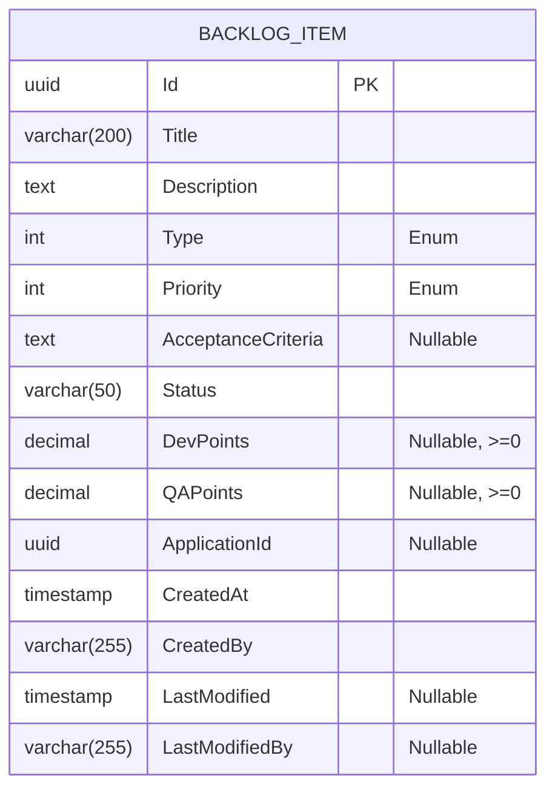

# DISEÑO DE PERSISTENCIA (MER): Registro de Elementos en Backlog Multitipo

- **Especificación SDD Base:** `spec.md` y `tasks.md` (Spec Kit)
- **Historias de Usuario Base:** `001-registro-elementos-backlog-multitipo.md`
- **Diseño Visual UX Auditado:** `ux-001-registro-elementos-backlog-multitipo.md`
- **Fecha de Diseño:** 03-10-2026
- **Data Architect:** Agente DA Senior BMAD

---

## 1. ARCHITECTURE DECISION RECORDS (ADR - Formato MADR)
*(Justificación técnica de las decisiones estructurales de persistencia derivadas de spec.md y constitution.md)*

### ADR-01: Motor de Persistencia y Aislamiento Lógico
- **Estado:** Aceptado (heredado)
- **Contexto:** La Constitución (`constitution.md`) establece el uso estricto de PostgreSQL bajo una arquitectura Modulith, donde cada módulo debe contar con su propio `DbContext` y un esquema (`schema`) de base de datos aislado.
- **Decisión:** El módulo "Backlog" definirá sus tablas dentro de un esquema físico exclusivo (`backlog`). Quedan terminantemente prohibidos los JOINs a nivel de base de datos con otras áreas funcionales (como el módulo de aplicaciones).
- **Consecuencias:**
  - ✅ **Ventajas / Impacto Positivo:** Independencia de datos total, lo cual facilita un futuro desacoplamiento físico a microservicios independientes sin fricciones de persistencia cruzada.
  - ⚠️ **Trade-off / Costo Real:** Para validar si `applicationId` existe, se debe realizar una invocación interna en proceso o consultar una proyección en caché, incurriendo en latencia adicional frente a un JOIN de llave foránea.

### ADR-02: Base de Agregado e Inyección Automática de Auditoría
- **Estado:** Aceptado (heredado)
- **Contexto:** Es necesario registrar las fechas y responsables de la creación o modificación de los elementos en el backlog, además de garantizar la correcta emisión de eventos de dominio (`BacklogItemCreatedDomainEvent`).
- **Decisión:** La entidad `BacklogItem` heredará de la clase base `Aggregate<Guid>`, empleando UUIDs (Guid) como identificadores principales de tipo PK. Las columnas de auditoría y la liberación de eventos de dominio serán resueltas y pobladas automáticamente mediante los interceptores preconfigurados `AuditableEntityInterceptor` y `DispatchDomainEventsInterceptor` provistos en `BuildingBlocks/Shared`.
- **Consecuencias:**
  - ✅ **Ventajas / Impacto Positivo:** Trazabilidad nativa, estandarización en toda la aplicación y simplificación en la lógica de dominio al omitir mutaciones explícitas de fechas o emisores.
  - ⚠️ **Trade-off / Costo Real:** Ligeramente mayor ocupación de espacio de almacenamiento para los UUID en comparación con IDs numéricos convencionales, y el ciclo de vida del guardado depende ineludiblemente de los interceptores de EF Core para ejecutar reglas de negocio colaterales (publicación asíncrona interna).

### ADR-03: Modelado Estructural de Estimaciones Opcionales
- **Estado:** Aceptado
- **Contexto:** Se requiere cuantificar el esfuerzo técnico segmentado (`DevPoints`, `QAPoints`). Según la historia de usuario, existen elementos (como los *Spikes*) que eximen de evaluación a QA.
- **Decisión:** Se mapearán `DevPoints` y `QAPoints` como tipos numéricos (decimales) permitiendo valores nulos (`NULL`) a nivel de base de datos. Se impondrán restricciones (`CHECK (DevPoints >= 0)`) para asegurar la lógica del negocio referida a métricas de esfuerzo válidas.
- **Alternativas Evaluadas (Obligatorio en decisiones nuevas):**
  - **Alternativa A:** Forzar el valor `0.0` por defecto en todos los escenarios en caso de no proveerse estimación. Descartada por romper con la semántica real: `0` indica "estimado pero insignificante", mientras que `NULL` indica "no aplicable" o "aún no estimado".
  - **Alternativa B:** Aislar las métricas en una sub-tabla transaccional de tipo `(BacklogItemId, Role, Points)`. Descartada ya que introduce latencia e instanciación superflua por tratarse únicamente de dos columnas explícitas fijadas en el diseño SDD.
- **Consecuencias:**
  - ✅ **Ventajas / Impacto Positivo:** El modelo refleja con absoluta fidelidad las variaciones semánticas del negocio frente a los elementos que aplican a perfiles puntuales de involucramiento, sin forzar normalizaciones costosas.
  - ⚠️ **Trade-off / Costo Real:** Obliga a los consumidores y mapeadores (incluyendo `Carter` endpoints o `DTOs`) a verificar el estado "HasValue" (NULL-safety) antes de computar cualquier agregación.

---

## 2. MODELO ENTIDAD-RELACIÓN (MER)

---

## 3. DICCIONARIO DE DATOS Y RESTRICCIONES
*(Mapeado estrictamente a las entidades definidas en spec.md y wireframes UX)*

### Tabla: `backlog.BacklogItems`
- `Id` (UUID): Llave primaria (PK). Generado secuencialmente.
- `Title` (VARCHAR 200): Obligatorio. Contiene el nombre descriptivo del elemento.
- `Description` (TEXT): Opcional o requerido según validación posterior. Descripción detallada del ítem.
- `Type` (INT): Obligatorio. Valor de la enumeración `BacklogItemType` (UserStory=1, Bug=2, TechEvolution=3, TechRequirement=4, TechDebt=5, Research=6, Spike=7).
- `Priority` (INT): Obligatorio. Valor de la enumeración `BacklogItemPriority` (ej. Low=1, Medium=2, High=3, Critical=4).
- `AcceptanceCriteria` (TEXT): Opcional (NULLable). Almacena los criterios de aceptación en formato de texto largo.
- `Status` (VARCHAR 50): Obligatorio. Estado actual de ejecución (por defecto, `Backlog`).
- `DevPoints` (DECIMAL / NUMERIC): Opcional (NULLable). Puntos de esfuerzo de desarrollo. Restricción `CHECK (DevPoints >= 0)`.
- `QAPoints` (DECIMAL / NUMERIC): Opcional (NULLable). Puntos de esfuerzo de calidad/pruebas. Restricción `CHECK (QAPoints >= 0)`.
- `ApplicationId` (UUID): Opcional (NULLable). Referencia (sin Foreign Key física estricta a nivel cruzado de DB si pertenece a otro schema) hacia el catálogo de aplicaciones.
- `CreatedAt` (TIMESTAMP WITH TIME ZONE): Obligatorio. Auditoría de creación controlada por interceptor.
- `CreatedBy` (VARCHAR 255): Obligatorio. UUID o username del creador originado desde claims de token.
- `LastModified` (TIMESTAMP WITH TIME ZONE): Opcional. Auditoría de modificación.
- `LastModifiedBy` (VARCHAR 255): Opcional. Autor de última modificación.

---

## 4. RIESGOS DE INTEGRIDAD Y ESCALABILIDAD
- `⚠️ RIESGO:` Al referenciar `ApplicationId` sin una restricción de clave foránea física (debido al aislamiento de schemas o módulos entre Backlog y Applications), se podría sufrir una pérdida de integridad relacional en el caso en que la aplicación de origen se elimine en "cascada lógica". Es necesario diseñar mecanismos compensatorios, como subscribir a eventos de eliminación de aplicaciones para nulificar el campo.

---

## 5. ORDEN DE DELEGACIÓN PARA EL TRACKER

@API: El modelo de datos (MER) y la persistencia han sido definidos a partir de spec.md y tasks.md. Por favor, diseña los contratos de integración (Endpoints/Payloads) basados en estas tablas.
