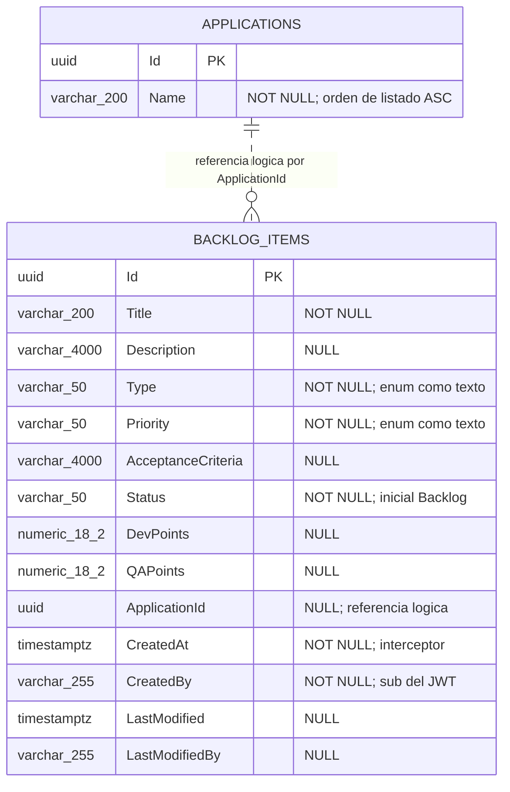

# DISEÑO DE PERSISTENCIA (MER): Pruebas de Integración contra Keycloak Real y Catálogo Real del Módulo Application

- **Especificación SDD Base:** `specs/002-pruebas-integracion-keycloak-y-catalogo-application/spec.md`, `plan.md`, `data-model.md` y `tasks.md` (Spec Kit)
- **Historias de Usuario Base:** `002-pruebas-integracion-keycloak-y-catalogo-application.md`
- **Diseño Visual UX Auditado:** `ux-002-pruebas-integracion-keycloak-y-catalogo-application.md` (dictamen: sin interfaz gráfica, cero wireframes; sin campos huérfanos posibles)
- **Fecha de Diseño:** 03-10-2026
- **Data Architect:** Agente DA Senior BMAD
- **Modo de gobernanza:** Brownfield (`.specify/memory/constitution.md` existe y prevalece)

> **Dictamen de alcance:** esta historia **no introduce ni modifica ninguna tabla, columna, índice ni migración** (FR-013; `app/backend/src/**` es de solo lectura). Este documento fija el modelo físico **vigente** que la suite lee y escribe, verificado contra las migraciones reales `20261003204834_InitialBacklogSchema` y `20261003204841_InitialApplicationSchema`, y el modelo de persistencia **efímero** del entorno de pruebas.

---

## 1. ARCHITECTURE DECISION RECORDS (ADR - Formato MADR)

### ADR-01: Motor de persistencia y aislamiento por schemas (sin cambios de esquema)
- **Estado:** Aceptado (heredado)
- **Contexto:** La Constitución (§3) impone PostgreSQL/Npgsql con EF Core Code-First, un `DbContext` por módulo y un schema por módulo, sin JOINs ni consultas cross-schema. FR-002 exige ejercitar el catálogo real sobre una base con migraciones aplicadas.
- **Decisión:** Se reutilizan sin cambios `application."Applications"` (`ApplicationDbContext`) y `backlog."BacklogItems"` (`BacklogDbContext`). La suite verifica cada schema solo con el `DbContext` de su módulo.
- **Consecuencias:**
  - ✅ **Ventajas / Impacto Positivo:** Cero migraciones nuevas; FR-013 verificable (`git diff --stat main -- app/backend/src` vacío).
  - ⚠️ **Trade-off / Costo Real:** Comprobar "sin efectos" (FR-010) exige dos consultas independientes (conteo en cada módulo) en vez de una sola consulta combinada.

### ADR-02: Auditoría `CreatedBy` = `sub` del JWT mediante interceptor existente
- **Estado:** Aceptado (heredado)
- **Contexto:** FR-007 y SC-004 exigen que `CreatedBy` iguale el `sub` de la credencial real emitida por Keycloak.
- **Decisión:** No se añaden columnas ni triggers. `CreatedBy` (`varchar(255)` NOT NULL) lo puebla `AuditableEntityInterceptor` de `Shared`, ya registrado en `BacklogDbContext`.
- **Consecuencias:**
  - ✅ **Ventajas / Impacto Positivo:** El `sub` de Keycloak (UUID de 36 caracteres) cabe con holgura en 255.
  - ⚠️ **Trade-off / Costo Real:** La corrección depende del interceptor y del claim; la prueba debe leer el ítem con un scope nuevo y `AsNoTracking()` para no leer estado en caché del `ChangeTracker`.

### ADR-03: Aislamiento de datos de prueba: una base de datos nueva por prueba
- **Estado:** Aceptado
- **Contexto:** FR-014 y SC-005 exigen ejecuciones repetibles sin datos residuales; la matriz de 10 combinaciones 401 exige poder afirmar "conteo sin cambios" (FR-010), lo que requiere un punto de partida conocido por caso.
- **Decisión:** Un contenedor `postgres:16-alpine` por suite (`ICollectionFixture`) y, dentro de él, una **base de datos física nueva y vacía por prueba**, con migraciones aplicadas por `Database:MigrateOnStartup=true`. Los schemas `application` y `backlog` conviven en esa misma base, como en producción (conexión única, constitución §3.2.1).
- **Alternativas Evaluadas:**
  - **Alternativa A:** Un contenedor PostgreSQL por prueba. Descartada: arranque de varios segundos por caso × ~19 casos, sin ganancia de aislamiento adicional respecto a una base nueva.
  - **Alternativa B:** Una sola base compartida con `TRUNCATE` entre pruebas (o transacción con *rollback*). Descartada: el `TRUNCATE` no ejercita el aplicado de migraciones sobre una base vacía, rompe el aislamiento si una prueba falla a mitad y vuelve ambiguo el conteo "sin cambios"; el rollback transaccional no es posible cuando el host real hace *commit* por su cuenta.
  - **Alternativa C:** Una base compartida con `Respawn`. Descartada: añade una dependencia nueva y gestionar el orden de borrado entre schemas independientes; ventaja marginal frente al coste de crear una base.
- **Consecuencias:**
  - ✅ **Ventajas / Impacto Positivo:** Aislamiento total; los conteos de FR-010/FR-011 son deterministas; idempotencia (SC-005) por construcción.
  - ⚠️ **Trade-off / Costo Real:** `CREATE DATABASE` + aplicación de dos migraciones por prueba (segundos); las pruebas deben ejecutarse en una única `[Collection]` (sin paralelismo contra el mismo Keycloak).

### ADR-04: Sin semilla permanente del catálogo; las aplicaciones de prueba las crea la suite
- **Estado:** Aceptado
- **Contexto:** La spec deja fuera de alcance la semilla reproducible como capacidad propia (derivada al Product Manager) y FR-004 exige que la suite cree por sí misma sus aplicaciones.
- **Decisión:** Las filas de `application."Applications"` se insertan **solo** por `RegisteredApplication.Create(Guid, string)` guardada con `ApplicationDbContext`, nunca por SQL, nunca desde el módulo Backlog, y nunca fuera de la base efímera de la prueba. No se añade `HasData`, ni script de semilla, ni migración de datos.
- **Alternativas Evaluadas:**
  - **Alternativa A:** `HasData` en la migración. Descartada: contaminaría producción con datos de prueba y violaría FR-013.
  - **Alternativa B:** `INSERT` SQL directo. Descartada: se saltaría el dominio (`Create`) y sus invariantes, y degrada la fidelidad de "catálogo real" (FR-002).
- **Consecuencias:**
  - ✅ **Ventajas / Impacto Positivo:** Producción intacta; el dominio real valida los datos sembrados.
  - ⚠️ **Trade-off / Costo Real:** El orden por nombre (FR-005) se prueba con nombres elegidos por la prueba; no hay un conjunto de referencia compartido entre suites.

### ADR-05: Estado de Keycloak efímero y fuera de PostgreSQL
- **Estado:** Aceptado
- **Contexto:** El servidor de identidad guarda su propio estado (realms, clientes, usuarios). La Constitución §3 limita los schemas de PostgreSQL a los módulos de dominio.
- **Decisión:** El estado de identidad vive exclusivamente en el contenedor Keycloak (realm importado desde JSON versionado en `Realm/`). **No se persiste identidad en `application` ni `backlog`**; el único vínculo es `BacklogItems.CreatedBy` = `sub` (cadena opaca, sin FK ni tabla de usuarios).
- **Alternativas Evaluadas:**
  - **Alternativa A:** Tabla local de usuarios en el schema `backlog` sincronizada con Keycloak. Descartada: duplica la fuente de verdad y excede el alcance.
  - **Alternativa B:** Keycloak con su almacén sobre la misma instancia PostgreSQL de la prueba. Descartada: acopla el ciclo de vida de identidad y de negocio y añadiría un schema ajeno a la constitución; el contenedor Keycloak usa su almacén interno y se destruye con la suite.
- **Consecuencias:**
  - ✅ **Ventajas / Impacto Positivo:** Cero acoplamiento de datos; destrucción total al terminar (FR-014).
  - ⚠️ **Trade-off / Costo Real:** El `sub` no es resoluble a un usuario desde la base de datos; solo es comparable con el claim del token.

---

## 2. MODELO ENTIDAD-RELACIÓN (MER)

**Entidades del entorno de pruebas (fuera de PostgreSQL, solo informativas):** realm `techworkhub` (clientes `techworkhub-api`, `techworkhub-tests`, `techworkhub-tests-noaud`, `techworkhub-tests-shortlived`; usuario `qa.user`) y realm `techworkhub-other` (cliente `techworkhub-tests`; usuario `qa.user`), todos en el contenedor Keycloak. Véase ADR-05.

---

## 3. DICCIONARIO DE DATOS Y RESTRICCIONES
*(Verificado contra las migraciones físicas; la historia no altera ninguna definición.)*

### Tabla: `application."Applications"` (`RegisteredApplication`)
- `Id` (`uuid`): Llave primaria (`PK_Applications`). La suite genera el valor (FR-004).
- `Name` (`character varying(200)`): NOT NULL. Criterio de orden ascendente del listado (FR-005). Sin restricción de unicidad.

**Uso en la suite:** escritura solo por `CatalogSeeder`/`ApplicationDbContext`; lectura de conteo por `ApplicationCountAsync()` (FR-010).

### Tabla: `backlog."BacklogItems"` (`BacklogItem`)
- `Id` (`uuid`): Llave primaria (`PK_BacklogItems`).
- `Title` (`character varying(200)`): NOT NULL.
- `Description` (`character varying(4000)`): NULL.
- `Type` (`character varying(50)`): NOT NULL. Enum persistido como texto (`UserStory`, `Bug`, `TechEvolution`, `TechRequirement`, `TechDebt`, `Research`, `Spike`).
- `Priority` (`character varying(50)`): NOT NULL. Enum como texto (`Low`, `Medium`, `High`, `Critical`).
- `AcceptanceCriteria` (`character varying(4000)`): NULL.
- `Status` (`character varying(50)`): NOT NULL. La suite espera `Backlog` (FR-006).
- `DevPoints` (`numeric(18,2)`): NULL. `QAPoints` (`numeric(18,2)`): NULL.
- `ApplicationId` (`uuid`): NULL. Referencia lógica a `application."Applications"."Id"`; sin FK ni JOIN (constitución §3.2.3). La suite afirma el valor sembrado (US2-2).
- `CreatedAt` (`timestamp with time zone`): NOT NULL, interceptor.
- `CreatedBy` (`character varying(255)`): NOT NULL. Debe igualar el `sub` del token real (FR-007, SC-004).
- `LastModified` (`timestamp with time zone`) y `LastModifiedBy` (`character varying(255)`): NULL.

**Uso en la suite:** escritura únicamente a través del endpoint real `POST /api/backlog/items`; lectura por `StoredItemsAsync()` (`BacklogDbContext`, `AsNoTracking()`, scope nuevo).

### Trazabilidad Spec → Datos (cero campos huérfanos)

| Requisito | Dato que lo sustenta |
|---|---|
| FR-004, FR-005 | `Applications.Id`, `Applications.Name` (orden ASC) |
| FR-006 | `BacklogItems.Status = 'Backlog'`, `BacklogItems.Id` |
| FR-007, SC-004 | `BacklogItems.CreatedBy` = `sub` |
| FR-006 / US2-2 | `BacklogItems.ApplicationId` = Id sembrado |
| FR-008 | Conteo de `BacklogItems` = 0 tras `applicationId` inexistente |
| FR-009, FR-010, SC-003 | Conteo de `Applications` y `BacklogItems` sin cambios tras cada uno de los 10 casos 401 |
| FR-011 | Lecturas/401 sin mutación; registro exitoso = exactamente 1 fila |
| FR-014, SC-005 | Base nueva por prueba (ADR-03); Keycloak y PostgreSQL destruidos al final |

Las entidades "Credencial de acceso" y "Entorno de pruebas de identidad" no requieren persistencia propia (ADR-05). Sin diseño visual (UX): no hay campos de interfaz que mapear.

---

## 4. RIESGOS DE INTEGRIDAD Y ESCALABILIDAD
- `⚠️ RIESGO (heredado, sin cambio):` `BacklogItems.ApplicationId` no tiene FK física por aislamiento entre schemas; una aplicación eliminada deja referencias huérfanas. Fuera del alcance de HU-002 (no hay baja de aplicaciones); mantiene el riesgo de `db-001`.
- `⚠️ RIESGO (deriva documental respecto a db-001):` `db-001` declara `Type` y `Priority` como `INT` y `Description`/`AcceptanceCriteria` como `TEXT`, y promete `CHECK (DevPoints >= 0)` / `CHECK (QAPoints >= 0)` (ADR-03 de `db-001`). El esquema físico real (migración `InitialBacklogSchema` y `specs/001-registro-elementos-backlog-multitipo/data-model.md`) usa **texto `varchar(50)`** para ambos enums, `varchar(4000)` para los textos largos y **no define ninguna restricción `CHECK`**: la no negatividad de los puntos solo la imponen FluentValidation y el dominio. Esta historia no lo cambia (FR-013); la fuente de verdad para esta suite es la migración física. Un `INSERT` directo podría saltarse la regla; la suite no inserta ítems por SQL.
- `⚠️ RIESGO:` Sin índice sobre `Applications.Name`; el `ORDER BY Name` es un escaneo secuencial. Irrelevante con las decenas de filas de la prueba; reevaluar si el catálogo real crece a miles de filas.
- `⚠️ RIESGO:` Sin índice sobre `BacklogItems.ApplicationId`; no afecta a esta historia (no se consulta por aplicación).
- `⚠️ RIESGO (duración de la suite):` Una sola `[Collection]` serializa las pruebas contra el mismo Keycloak; la duración total crece linealmente con el número de casos (~19). Mitigación: base nueva por prueba sin recrear contenedores y timeout de arranque configurable (`IDENTITY_TESTS_STARTUP_TIMEOUT_SECONDS`).
- `⚠️ RIESGO (entorno):` La suite requiere un demonio Docker; si no existe, falla de forma explícita (CB-05). Sin Docker no hay persistencia que verificar.

---

## 5. ORDEN DE DELEGACIÓN PARA EL TRACKER
El proyecto es `fullstack` y requiere comunicación externa (API REST). Esta historia no define endpoints nuevos: el api-architect debe limitarse a documentar los contratos ya existentes que la suite verifica (`GET /api/applications`, `POST /api/backlog/items`) conforme a `specs/002-pruebas-integracion-keycloak-y-catalogo-application/contracts/test-contract.md`, sin inventar rutas ni payloads.

`@API: El modelo de datos (MER) y la persistencia han sido definidos a partir de spec.md y tasks.md. Por favor, diseña los contratos de integración (Endpoints/Payloads) basados en estas tablas.`
