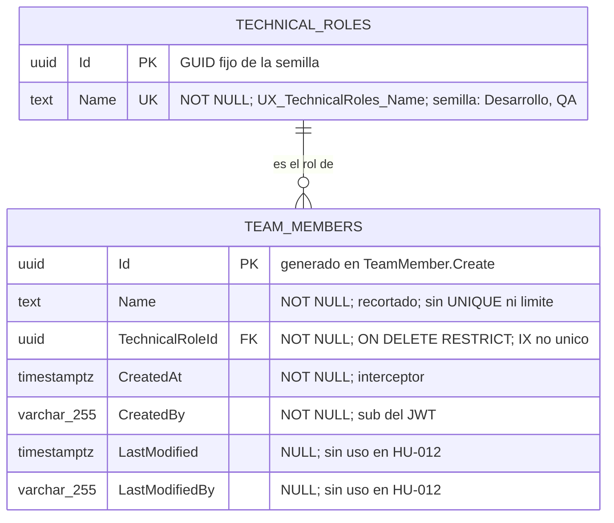

# DISEÑO DE PERSISTENCIA (MER): Miembros del Equipo y Roles Técnicos

- **Especificación SDD Base:** `specs/012-miembros-equipo-y-roles-tecnicos/spec.md`, `plan.md`, `research.md`, `data-model.md` y `tasks.md` (Spec Kit)
- **Historias de Usuario Base:** `012-miembros-equipo-y-roles-tecnicos.md`
- **Diseño Visual UX Auditado:** `ux-012-miembros-equipo-y-roles-tecnicos.md` (10 estados; los datos visibles —identificador, nombre y rol del miembro; identificador y nombre del rol— tienen columna; sin campos huérfanos)
- **Fecha de Diseño:** 04-10-2026
- **Data Architect:** Agente DA Senior BMAD
- **Modo de gobernanza:** Brownfield (`.specify/memory/constitution.md` existe y prevalece)

> **Dictamen de alcance:** la historia introduce **dos tablas nuevas**, `teams."TechnicalRoles"` y `teams."TeamMembers"`, en un **schema nuevo** `teams` con su propio `TeamsDbContext` y la migración `InitialTeamsSchema` (que además siembra los roles "Desarrollo" y "QA"). La FK entre ambas es **local** al schema (no cruza schemas). No modifica ninguna tabla de `backlog`, `application` ni `sprints`, no define FK hacia ellas y no impone cardinalidad miembro–rol, unicidad del miembro ni ciclo de vida (FR-014, FR-015).

---

## 1. ARCHITECTURE DECISION RECORDS (ADR - Formato MADR)

### ADR-01: Motor de persistencia, módulo propio y schema `teams`
- **Estado:** Aceptado (heredado)
- **Contexto:** La Constitución (§3) impone PostgreSQL/Npgsql con EF Core Code-First, un `DbContext` por módulo, un schema por módulo y conexión única (`ConnectionStrings:Database`). El SA fijó el módulo `Teams` (ADR-003 del SA).
- **Decisión:** Se crea el schema `teams` con `TeamsDbContext` (`HasDefaultSchema("teams")`) y su historial en `teams.__EFMigrationsHistory`. Tablas: `teams."TechnicalRoles"` y `teams."TeamMembers"`.
- **Consecuencias:**
  - ✅ **Ventajas / Impacto Positivo:** Aislamiento total frente a `backlog`, `application` y `sprints`; la migración solo toca `teams`; el módulo es extraíble.
  - ⚠️ **Trade-off / Costo Real:** Las HU-013/014/015 que consuman miembros desde otros módulos no podrán usar FK ni JOIN contra `teams`; la integridad será lógica y vía llamada in-process.

### ADR-02: Entidades `TechnicalRole` y `TeamMember` sobre la jerarquía de `Shared`
- **Estado:** Aceptado (heredado)
- **Contexto:** FR-003 exige `CreatedAt` y `CreatedBy` (= `sub` del token) en el miembro. La Constitución prohíbe columnas o triggers manuales de auditoría y obliga a `AuditableEntityInterceptor`. `Shared` solo ofrece `Aggregate<TId>` e `IAuditableEntity` (no existe `Entity<TId>`; R-04 del plan).
- **Decisión:** `TeamMember : Aggregate<Guid>, IAuditableEntity`: `CreatedAt`, `CreatedBy`, `LastModified`, `LastModifiedBy` los puebla el interceptor. `TechnicalRole : Aggregate<Guid>` **sin** `IAuditableEntity`: solo `Id` y `Name`. Ninguna emite eventos de dominio.
- **Consecuencias:**
  - ✅ **Ventajas / Impacto Positivo:** Cero lógica de auditoría propia; la semilla del catálogo no necesita fecha ni usuario "system"; el catálogo no arrastra columnas sin consumidor.
  - ⚠️ **Trade-off / Costo Real:** Los roles no tienen traza de quién ni cuándo los creó (solo la migración que los siembra). `LastModified`/`LastModifiedBy` de `TeamMember` quedan siempre `NULL` en esta HU (no existe modificar) pero se conservan por la interfaz `IAuditableEntity`.

### ADR-03: FK física local `TeamMembers.TechnicalRoleId → TechnicalRoles.Id` con `ON DELETE RESTRICT`
- **Estado:** Aceptado
- **Contexto:** FR-006 exige que todo miembro referencie un rol existente del catálogo. Ambas tablas viven en el mismo schema, por lo que la prohibición cross-schema (Constitución §3.2.3) no aplica.
- **Decisión:** `CONSTRAINT "FK_TeamMembers_TechnicalRoles_TechnicalRoleId" FOREIGN KEY ("TechnicalRoleId") REFERENCES teams."TechnicalRoles" ("Id") ON DELETE RESTRICT`, `TechnicalRoleId uuid NOT NULL`, más índice no único `IX_TeamMembers_TechnicalRoleId`.
- **Alternativas Evaluadas:**
  - **Alternativa A:** Referencia lógica sin FK (validar solo en handler). Descartada: no hay frontera de módulo que lo justifique; un `INSERT` directo o una migración de datos podrían dejar miembros con rol inexistente.
  - **Alternativa B:** `ON DELETE CASCADE`. Descartada: borrar un rol eliminaría miembros en silencio; la HU no define baja de roles ni de miembros y no debe habilitarla implícitamente.
  - **Alternativa C:** Guardar el nombre del rol como texto en `TeamMembers` (desnormalizado). Descartada: renombrar o ampliar el catálogo exigiría reescribir filas y no hay integridad referencial; además se pierde el "identificador" del rol que FR-004 exige.
- **Consecuencias:**
  - ✅ **Ventajas / Impacto Positivo:** Integridad garantizada por la BD (SQLSTATE 23503 ante rol inexistente); la lectura es un `JOIN` local con índice de apoyo.
  - ⚠️ **Trade-off / Costo Real:** Un rol con miembros no puede borrarse (por diseño, ahora irrelevante: no existe endpoint de baja). El índice `IX_TeamMembers_TechnicalRoleId` añade coste de escritura marginal e innecesario a 100 filas, aceptado por el patrón estándar de EF Core para FKs y por la futura HU-015.

### ADR-04: Catálogo de roles sembrado por migración con GUID fijos y nombre único
- **Estado:** Aceptado
- **Contexto:** FR-004 exige al menos "Desarrollo" y "QA" con identificador y nombre; el alta/edición de roles está fuera de alcance (punto abierto 4). La consulta del catálogo debe devolver identificadores estables (T053).
- **Decisión:** `InsertData` en `InitialTeamsSchema` con los GUID constantes de `TechnicalRoleSeed` (`DevelopmentId`, `QaId`). Índice ÚNICO `UX_TechnicalRoles_Name` sobre `Name`. Sin endpoint ni código de alta/edición/baja.
- **Alternativas Evaluadas:**
  - **Alternativa A:** Enum/constante en código sin tabla. Descartada: no entrega "identificador y nombre" ni permite FK; ampliar el catálogo exigiría recompilar.
  - **Alternativa B:** Siembra en arranque con `IHostedService`. Descartada: punto de fallo adicional y condición de carrera con varias instancias; la migración es atómica y versionada.
  - **Alternativa C:** Tabla vacía con alta de roles por API. Descartada: inventa administración del catálogo (punto abierto 4) y un permiso por rol de acceso no definido.
- **Consecuencias:**
  - ✅ **Ventajas / Impacto Positivo:** Catálogo reproducible y versionado con el esquema; el `UX_TechnicalRoles_Name` garantiza que resolver el rol por nombre devuelve a lo sumo una fila.
  - ⚠️ **Trade-off / Costo Real:** Los GUID quedan en el historial de migraciones y no pueden cambiarse sin migrar datos; añadir o renombrar un rol exige una migración nueva. La unicidad por `Name` es sensible a mayúsculas (collation por defecto): "qa" y "QA" podrían coexistir si se sembraran por SQL manual, mientras el handler solo acepta la grafía exacta.

### ADR-05: `Name` del miembro como `text NOT NULL`, sin unicidad ni límite de longitud
- **Estado:** Aceptado
- **Contexto:** Unicidad (homónimos), longitud máxima y caracteres admitidos del nombre son puntos abiertos 2 / CB-05 / CB-06; FR-015 prohíbe imponerlos de facto.
- **Decisión:** `TeamMembers."Name"` es `text NOT NULL` (el dominio guarda el valor ya recortado con `Trim()`). Sin índice único, sin `CHECK` de longitud. La no vacuidad se garantiza en validador y en `TeamMember.Create`.
- **Alternativas Evaluadas:**
  - **Alternativa A:** `varchar(100)` + índice único sobre `Name`. Descartada: impone dos reglas de negocio no confirmadas y convertiría un homónimo en un 500 sin mensaje definido.
  - **Alternativa B:** `CHECK (btrim("Name") <> '')`. Descartada para esta HU: duplicaría la regla ya aplicada por validador y factoría y su violación llegaría como 500; se deja como endurecimiento opcional si el negocio lo pide.
- **Consecuencias:**
  - ✅ **Ventajas / Impacto Positivo:** El modelo no prejuzga decisiones pendientes; imponer luego longitud o unicidad es una migración aditiva más un validador.
  - ⚠️ **Trade-off / Costo Real:** Se admiten homónimos y doble registro (doble clic o reintento crea dos filas). Un token válido puede enviar un nombre muy grande (límite de cuerpo de Kestrel). Añadir un índice único después exigirá depurar duplicados.

### ADR-06: Sin estado, sin tabla puente miembro–rol, sin Outbox ni caché
- **Estado:** Aceptado (heredado)
- **Contexto:** FR-010 y FR-015 prohíben datos extra de la persona, estado/ciclo de vida y cardinalidad impuesta. La Constitución exige `OutboxMessage` solo en flujos que publican eventos críticos; el SA descartó eventos (ADR-006 del SA).
- **Decisión:** `TeamMembers` guarda **un** `TechnicalRoleId` (columna FK), sin columna de estado, correo, usuario de acceso ni tabla `MemberRoles`. No se crea `OutboxMessage` en `teams` ni se emiten eventos.
- **Alternativas Evaluadas:**
  - **Alternativa A:** Tabla puente `TeamMemberRoles` (N:M) para anticipar varios roles. Descartada: anticipa el punto abierto 1 sin escenario que lo respalde y complica lectura y validación.
  - **Alternativa B:** Columna `IsActive`. Descartada: modela un ciclo de vida que la HU declara ❓ No documentado.
- **Consecuencias:**
  - ✅ **Ventajas / Impacto Positivo:** Esquema mínimo; el contrato es "1 miembro = 1 fila = 1 rol", con atomicidad trivial (un `INSERT`).
  - ⚠️ **Trade-off / Costo Real:** Si el negocio admite varios roles por miembro, habrá que migrar `TechnicalRoleId` a una tabla puente (copiando la columna actual como primera fila) y versionar el contrato de lectura.

---

## 2. MODELO ENTIDAD-RELACIÓN (MER)

---

## 3. DICCIONARIO DE DATOS Y RESTRICCIONES
*(Mapeado a `spec.md` (Key Entities Miembro del equipo y Rol técnico), `data-model.md`, `tasks.md` T007–T017 y a los estados visuales UX 1 a 6.)*

### Tabla: `teams."TechnicalRoles"` (`TechnicalRole : Aggregate<Guid>`)
- `Id` (`uuid`): Llave primaria (`PK_TechnicalRoles`). GUID fijo de `TechnicalRoleSeed`; nunca `Guid.NewGuid()`.
- `Name` (`text`): NOT NULL. Único (`UX_TechnicalRoles_Name`). Semilla: `Desarrollo` (`DevelopmentId`) y `QA` (`QaId`).

**Restricciones:** `PK_TechnicalRoles` (`Id`); `UX_TechnicalRoles_Name` (`Name`). Sin columnas de auditoría ni de estado.
**Semilla (`InsertData`):** exactamente dos filas, `Desarrollo` y `QA`.

### Tabla: `teams."TeamMembers"` (`TeamMember : Aggregate<Guid>, IAuditableEntity`)
- `Id` (`uuid`): Llave primaria (`PK_TeamMembers`). Lo genera el servidor en `TeamMember.Create` (FR-002).
- `Name` (`text`): NOT NULL, no vacío ni de solo espacios (validador + factoría). Se persiste con `Trim()`. Sin unicidad ni longitud máxima (ADR-05).
- `TechnicalRoleId` (`uuid`): NOT NULL. FK a `teams."TechnicalRoles"("Id")`, `ON DELETE RESTRICT` (ADR-03).
- `CreatedAt` (`timestamp with time zone`): NOT NULL. `AuditableEntityInterceptor` (FR-003).
- `CreatedBy` (`character varying(255)`): NOT NULL. `sub` del token vía `ICurrentUser`; nunca del cuerpo (FR-003).
- `LastModified` (`timestamp with time zone`): NULL. Sin uso en esta HU.
- `LastModifiedBy` (`character varying(255)`): NULL. Sin uso en esta HU.

**Restricciones:** `PK_TeamMembers` (`Id`); `FK_TeamMembers_TechnicalRoles_TechnicalRoleId` (`RESTRICT`). Sin `UNIQUE` sobre `Name`, sin columnas de estado, correo ni usuario de acceso.
**Índices:** `IX_TeamMembers_TechnicalRoleId` (no único, apoya la FK y el `JOIN` de la consulta).
**Migración:** `InitialTeamsSchema` en `app/backend/src/Modules/Teams/Data/Migrations/`; solo crea el schema `teams`, sus dos tablas, `__EFMigrationsHistory`, índices, la FK y la semilla.

### Trazabilidad Spec / UX → Datos (cero campos huérfanos)

| Requisito / Estado UX | Dato que lo sustenta |
|---|---|
| FR-001, FR-002; UX 4, 5, 6 | `TeamMembers."Id"`, `"Name"`, `"TechnicalRoleId"` (rol devuelto = `TechnicalRoles."Name"` por `JOIN`) |
| FR-003 | `TeamMembers."CreatedAt"`, `"CreatedBy"` (interceptor) |
| FR-004, FR-005; UX 3 | `TechnicalRoles."Id"`, `"Name"` + semilla `Desarrollo`/`QA` |
| FR-006; UX 7 | FK `RESTRICT` + `UX_TechnicalRoles_Name` (resolución por nombre sin ambigüedad); rechazo previo en handler (400) |
| FR-007; UX 8 | `Name` y `TechnicalRoleId` NOT NULL; no vacuidad en validador y `TeamMember.Create` |
| FR-008, FR-009; UX 1, 2 | Lectura `JOIN` de `TeamMembers` y `TechnicalRoles` (orden `CreatedAt`, `Id`); ausencia de filas = `[]` |
| FR-010 | Sin columnas de correo ni usuario de acceso |
| FR-011; UX 9 | Sin dato de persistencia (rechazo previo, 401) |
| FR-012, FR-013, SC-008; UX 10 | Una sola sentencia `INSERT` por `SaveChangesAsync` (transacción implícita): sin fila parcial |
| FR-014, SC-006 | Sin FK ni columnas hacia `backlog` / `application` / `sprints` |
| FR-015 | `TechnicalRoleId` único por fila sin tabla puente; `Name` sin `UNIQUE`; sin estado |
| FR-016 | Schema `teams`, `TeamsDbContext` propio, sin consultas cross-schema |
| UX D-09 | `CreatedAt`/`CreatedBy` persisten pero no se exponen en `TeamMemberResponse` |

---

## 4. RIESGOS DE INTEGRIDAD Y ESCALABILIDAD
- `⚠️ RIESGO (discrepancia con data-model.md/T014):` `data-model.md` y T014 definen `CreatedBy`/`LastModifiedBy` como `text`; `backlog."BacklogItems"`, `sprints."Sprints"` y `sprints."SprintItems"` los configuran `varchar(255)` mediante una constante `*Rules.UserMaxLength`. Este diseño fija `varchar(255)` por coherencia con el resto del Modulith (el `sub` de Keycloak son 36 caracteres). Debe reconciliarse en T011/T014 (p. ej. `TeamMemberRules.UserMaxLength = 255` y `HasMaxLength` en `TeamMemberConfiguration`); sin ello `teams` divergería de los demás schemas. Es el único punto donde este documento corrige a `data-model.md`.
- `⚠️ RIESGO (homónimos y doble registro):` Sin índice único ni idempotencia, un doble clic o un reintento crea miembros duplicados (ADR-05). Mitigación solo en UI (botón deshabilitado durante `isSubmitting()`). Puntos abiertos 2 / CB-05.
- `⚠️ RIESGO (nombre sin límite):` `text` sin longitud ni `CHECK` permite nombres arbitrariamente grandes (solo lo acota el límite de cuerpo de Kestrel) y caracteres no imprimibles. Si el negocio fija longitud, habrá que migrar a `varchar(n)` tras revisar filas existentes (CB-06).
- `⚠️ RIESGO (cardinalidad miembro–rol):` El modelo materializa un rol por miembro (columna FK). Si el punto abierto 1 resuelve "varios roles", se requiere migración a tabla puente; las HU-013/014/015 no deben cimentar supuestos sobre la columna `TechnicalRoleId`.
- `⚠️ RIESGO (consumo desde P1):` La referencia futura desde `backlog`/`sprints` a `teams."TeamMembers"."Id"` será lógica, sin FK (Constitución §3.2.3). Como el miembro no se puede eliminar en esta HU no habrá huérfanos, pero la integridad dependerá de la aplicación y de una API in-process aún no definida (ADR-004 del plan).
- `⚠️ RIESGO (semilla inmutable):` Los GUID de `TechnicalRoleSeed` quedan fijados en `InitialTeamsSchema`; cambiarlos o renombrar un rol sin migración de datos rompe la FK o el contrato por nombre (el rol se envía por nombre y se resuelve con comparación sensible a mayúsculas).
- `⚠️ RIESGO (error de FK / UNIQUE):` Una violación de `FK_TeamMembers_...` o `UX_TechnicalRoles_Name` llega como `DbUpdateException` y se traduce a HTTP 500, no 400. Es aceptable porque el handler resuelve el rol antes de insertar; solo se observa por rutas que lo omitan o por una carrera con una migración que elimine el rol.
- `⚠️ RIESGO (escalabilidad):` Consultas con `JOIN` local, `AsNoTracking()` y orden por `CreatedAt, Id` sin índice sobre `CreatedAt`: escaneo secuencial irrelevante hasta cientos de filas (SC-007 verifica 100). Reevaluar si el volumen crece a miles o se añade paginación.
- `⚠️ RIESGO (despliegue):` `MigrateTeamsModuleAsync` se ejecuta en el arranque junto con las migraciones de Backlog, Application y Sprints; un fallo en `teams` impediría iniciar el host si las migraciones se encadenan sin aislamiento de errores. La migración debe ser idempotente respecto a `teams` y verificarse con T021.
- `⚠️ RIESGO (datos personales):` `TeamMembers."Name"` es un dato personal en claro, sin cifrado ni política de retención; no existe baja de miembros en esta HU. Los logs no deben contenerlo (T060).

---

## 5. ORDEN DE DELEGACIÓN PARA EL TRACKER
El proyecto es `fullstack` y requiere comunicación externa (API REST). El contrato HTTP está preliminarmente fijado en `specs/012-miembros-equipo-y-roles-tecnicos/` (rutas `/api/team-members` y `/api/technical-roles`, `tasks.md` referencia `contracts/teams-api.openapi.yaml`, que aún no existe en disco); el api-architect debe formalizarlo sobre `teams."TeamMembers"` y `teams."TechnicalRoles"` sin exponer `CreatedAt`/`CreatedBy`, sin añadir estado, paginación ni alta/edición de roles.

`@API: El modelo de datos (MER) y la persistencia han sido definidos a partir de spec.md y tasks.md. Por favor, diseña los contratos de integración (Endpoints/Payloads) basados en estas tablas.`
