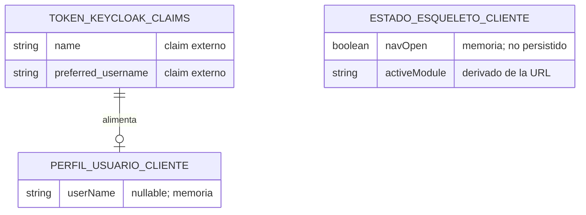

# DISEÑO DE PERSISTENCIA (MER): Refactorización de Esqueleto UI — Layout de Aplicación y Tipografía Global

- **Especificación SDD Base:** `specs/035-refactorizacion-esqueleto-ui/spec.md`, `plan.md`, `research.md`, `data-model.md`, `contracts/ui-shell-contract.md` y `tasks.md` (Spec Kit)
- **Historias de Usuario Base:** `035-refactorizacion-esqueleto-ui.md`
- **Diseño Visual UX Auditado:** `ux-035-refactorizacion-esqueleto-ui.md` (9 estados; ningún campo requiere persistencia; sin campos huérfanos)
- **Fecha de Diseño:** 05-10-2026
- **Data Architect:** Agente DA Senior BMAD
- **Modo de gobernanza:** Brownfield (`.specify/memory/constitution.md` existe y prevalece)

> **Dictamen de alcance:** esta historia es **exclusivamente de frontend** y **no introduce, modifica ni elimina ninguna tabla, columna, índice, FK, schema ni migración**. `spec.md` FR-012 prohíbe cambios en reglas de negocio, API y contratos de datos; `data-model.md` confirma que todo el estado es efímero y en memoria; ninguna tarea de `tasks.md` (T001–T032) toca `app/backend/**`, y T030 lo verifica con `git diff --stat`. No se genera esquema físico nuevo: este documento deja constancia formal del dictamen.

---

## 1. ARCHITECTURE DECISION RECORDS (ADR - Formato MADR)

### ADR-01: Sin cambios de persistencia (motor, schemas y migraciones intactos)
- **Estado:** Aceptado (heredado)
- **Contexto:** La Constitución (§3) fija PostgreSQL/Npgsql con EF Core Code-First, un `DbContext` y un schema por módulo. La HU 035 solo reorganiza el esqueleto visual (`app/frontend/src/app/core/layout/**`, `app.routes.ts`, `styles.css`, `lint-primeng.mjs`, ampliación aditiva de `AuthService`) y no declara entidades de negocio ni datos persistentes (spec.md, "Key Entities").
- **Decisión:** No se crea ninguna tabla ni migración; los schemas `backlog`, `sprints`, `application` y los demás permanecen sin modificar.
- **Consecuencias:**
  - ✅ **Ventajas / Impacto Positivo:** Cero riesgo de regresión de datos; ninguna migración que coordinar con el despliegue; la HU se cierra solo con `lint:primeng`, `build` y `test` del frontend.
  - ⚠️ **Trade-off / Costo Real:** Si una HU derivada pidiera recordar la preferencia de navegación entre recargas, habría que reabrir esta decisión (ver ADR-02).

### ADR-02: Estado de navegación y perfil de usuario solo en memoria del cliente
- **Estado:** Aceptado (heredado)
- **Contexto:** La resolución humana (Opción B, tracker 05-10-2026 08:52) fija que la elección manual de la navegación lateral **no se guarda tras recargar**. El nombre de usuario del perfil proviene del token de Keycloak (`tokenParsed.name` ⇒ `preferred_username` ⇒ `null`), no de la base de datos de la aplicación. `tasks.md` prohíbe `localStorage`/`sessionStorage`.
- **Decisión:** `navOpen`, `activeModule`, `userName` e `isWide` son señales de Angular en memoria; no existe tabla de preferencias de usuario ni caché persistente de perfil.
- **Consecuencias:**
  - ✅ **Ventajas / Impacto Positivo:** Sin datos personales nuevos almacenados; sin sincronización cliente-servidor; sin migración de datos de usuario.
  - ⚠️ **Trade-off / Costo Real:** La preferencia manual se pierde al recargar; una futura persistencia por usuario requeriría una tabla de preferencias y un contrato de API nuevos.

---

## 2. MODELO ENTIDAD-RELACIÓN (MER)

Sin entidades persistentes nuevas. El diagrama muestra únicamente los orígenes de datos **externos y efímeros** que consume el esqueleto; ninguno es una tabla de la aplicación.

---

## 3. DICCIONARIO DE DATOS Y RESTRICCIONES

**Sin tablas nuevas ni modificadas.** Auditoría de trazabilidad UI/Spec Kit → Data (cero campos huérfanos):

| Elemento UI / contrato (origen) | Dato | ¿Requiere columna? | Fuente real |
|---|---|---|---|
| Barra superior: nombre de la app, textos, pie | Constantes `LAYOUT_TEXTS` | No | Código (`layout.texts.ts`) |
| Barra superior: perfil de usuario (FR-002) | `userName` | No | Claims del token Keycloak, en memoria |
| Acción "Cerrar sesión" | `AuthService.logout()` | No | Keycloak (redirección) |
| Navegación lateral: 3 entradas (FR-003) | `NAV_ITEMS` | No | Código (`layout-nav.ts`) |
| Entrada activa por URL | `activeModule` | No | `Router` (primer segmento de URL) |
| Colapso/apertura manual | `navOpen` | No | Señal en memoria (Opción B, sin persistencia) |
| Ancho de ventana (FR-006) | `isWide` | No | `matchMedia('(min-width: 1024px)')` |
| Ruta inexistente | Mensaje informativo | No | Código (`LAYOUT_TEXTS`) |
| Contenedor `max-w-7xl mx-auto p-6` y tipografía (FR-007/008) | Estilos | No | Clases Tailwind / `styles.css` |
| Evidencia de cierre: 6 capturas (FR-014) | Archivos `evidence/*.png` | No | Sistema de archivos del repositorio |

**Tablas heredadas sin modificar:** `backlog."BacklogItems"`, `sprints."Sprints"`, `sprints."SprintItems"` y las tablas de `application` (miembros, roles y relaciones). Ninguna se altera.

---

## 4. RIESGOS DE INTEGRIDAD Y ESCALABILIDAD
- `⚠️ RIESGO:` Deriva de alcance: si durante la implementación se añadiera `localStorage`, una tabla de preferencias o un endpoint de perfil, se violarían FR-012 y la Opción B. Mitigación: T032 revisa que `core/layout/` no use `localStorage`/`sessionStorage` y T030 verifica que `app/backend/**` no cambie.
- `⚠️ RIESGO:` El nombre de perfil depende de que Keycloak emita `name` o `preferred_username`; si faltan ambos, la UI usa `LAYOUT_TEXTS.profileFallback`. Es un riesgo de presentación, no de integridad de datos.
- Sin riesgos de concurrencia, volumen ni límites del motor: no hay lecturas ni escrituras nuevas contra PostgreSQL.

---

## 5. ORDEN DE DELEGACIÓN PARA EL TRACKER
La HU 035 no define endpoints, payloads ni contratos de integración (solo frontend; `contracts/ui-shell-contract.md` es un contrato de rutas de UI, no una API). Se omite la capa de API y se delega a QA Tech.

`@QT: El modelo de datos de la HU 035 fue dictaminado sin cambios de persistencia (solo frontend, FR-012) a partir de spec.md y tasks.md. Al no requerir capa de API, procede directamente con la auditoría y compilación del Tech Design Document (TDD).`
