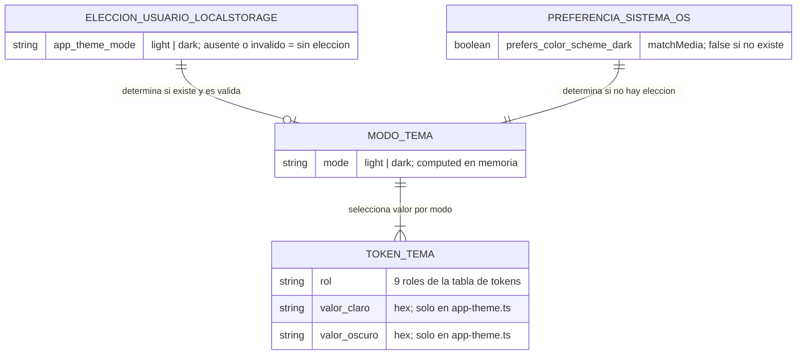

# DISEÑO DE PERSISTENCIA (MER): Theming de la Aplicación — Modo Claro y Oscuro

- **Especificación SDD Base:** `specs/036-theming-claro-oscuro-ui/spec.md`, `plan.md`, `research.md`, `data-model.md`, `contracts/` (`theme-service.md`, `lint-gobernanza.md`, `shell-conmutador.md`) y `tasks.md` (Spec Kit)
- **Historias de Usuario Base:** `036-theming-claro-oscuro-ui.md`
- **Diseño Visual UX Auditado:** `ux-036-theming-claro-oscuro-ui.md` (13 estados; ningún campo requiere persistencia en base de datos; sin campos huérfanos)
- **Fecha de Diseño:** 06-10-2026
- **Data Architect:** Agente DA Senior BMAD
- **Modo de gobernanza:** Brownfield (`.specify/memory/constitution.md` existe y prevalece)

> **Dictamen de alcance:** esta historia es **exclusivamente de frontend** y **no introduce, modifica ni elimina ninguna tabla, columna, índice, FK, schema ni migración** en PostgreSQL. `spec.md` FR-019 prohíbe modificar backend, APIs, contratos de datos y reglas de negocio; `data-model.md` declara "No hay entidades de base de datos" y modela únicamente estado de cliente (señales de Angular) y configuración de tema. La única persistencia es una preferencia por navegador en `localStorage['app-theme-mode']`. Ninguna tarea de `tasks.md` (T001–T045) toca `app/backend/**`; T040 lo verifica con `git diff --stat`. No se genera esquema físico nuevo: este documento deja constancia formal del dictamen.

---

## 1. ARCHITECTURE DECISION RECORDS (ADR - Formato MADR)

### ADR-01: Sin cambios de persistencia relacional (motor, schemas y migraciones intactos)
- **Estado:** Aceptado (heredado)
- **Contexto:** La Constitución (§3) fija PostgreSQL/Npgsql con EF Core Code-First, un `DbContext` y un schema por módulo. La HU 036 solo aplica una capa de tema sobre el shell de la HU 035 (`app/frontend/src/app/core/theme/**`, `core/layout/**`, `app.config.ts`, `styles.css`, `index.html`, `scripts/lint-primeng.mjs`) y no declara entidades de negocio ni datos persistentes de servidor (spec.md, "Key Entities").
- **Decisión:** No se crea ninguna tabla ni migración; los schemas `backlog`, `sprints`, `application` y los demás permanecen sin modificar.
- **Consecuencias:**
  - ✅ **Ventajas / Impacto Positivo:** Cero riesgo de regresión de datos; ninguna migración que coordinar con el despliegue; la HU se cierra con `lint:primeng`, `build` y `test` del frontend más las 6 capturas.
  - ⚠️ **Trade-off / Costo Real:** La preferencia de tema no viaja con la cuenta del usuario (ver ADR-02).

### ADR-02: La elección de tema se guarda en el navegador (`localStorage`), no en base de datos
- **Estado:** Aceptado
  > *Nota:* la Constitución (§ Theme Visual) describe esta clave como `⚠️ [PROPUESTO]`; no es una decisión heredada firme, por lo que se registra con alternativas reales. La spec la fija en FR-009 y en Assumptions ("por dispositivo, no por cuenta").
- **Contexto:** FR-009, FR-010 y FR-011 exigen recordar la elección, seguir al sistema operativo si no hay elección y tolerar almacenamiento inválido o no disponible. La decisión humana (Opción A del tracker) exige conocer el modo antes del primer pintado, lo cual excluye cualquier lectura asíncrona de servidor.
- **Decisión:** Persistir un único valor `light` | `dark` en `localStorage['app-theme-mode']` (constante `THEME_STORAGE_KEY`); valor ausente, inválido o inaccesible equivale a "sin elección" y no se borra ni se reporta error.
- **Alternativas Evaluadas:**
  - **Alternativa A — Tabla `application."UserPreferences"` (PostgreSQL) con endpoint:** descartada. Obliga a un contrato de API nuevo, contradice FR-019, y la lectura asíncrona impide aplicar el modo antes del primer pintado (parpadeo del modo equivocado) y antes de autenticar.
  - **Alternativa B — Atributo de usuario en Keycloak / claim del token:** descartada. Requiere escritura vía Admin API, acopla el tema al proveedor de identidad y no existe antes del login; además amplía el alcance a `core/auth/`, que `tasks.md` declara intocable.
  - **Alternativa C — Cookie del navegador:** descartada. Se envía en cada petición HTTP sin necesidad, añade superficie de privacidad y no ofrece ventaja sobre `localStorage` para un valor que solo lee el cliente.
- **Consecuencias:**
  - ✅ **Ventajas / Impacto Positivo:** Lectura síncrona compatible con el script anti-parpadeo de `index.html`; cero datos personales en servidor; sin migración ni endpoint; degradación segura ante almacenamiento bloqueado.
  - ⚠️ **Trade-off / Costo Real:** La preferencia es por navegador y dispositivo, sin sincronización entre dispositivos; borrar datos del sitio la pierde. Una futura persistencia por cuenta exigiría una tabla de preferencias y un contrato de API nuevos (reabrir esta decisión).

---

## 2. MODELO ENTIDAD-RELACIÓN (MER)

Sin entidades persistentes en PostgreSQL. El diagrama muestra únicamente el estado **de cliente** que consume el tema; ninguna entidad es una tabla de la aplicación.

---

## 3. DICCIONARIO DE DATOS Y RESTRICCIONES

**Sin tablas nuevas ni modificadas.** Auditoría de trazabilidad UI/Spec Kit → Data (cero campos huérfanos):

| Elemento UI / contrato (origen) | Dato | ¿Requiere columna? | Fuente real |
|---|---|---|---|
| Conmutador claro/oscuro en barra superior (FR-007, FR-008) | `ThemeMode` (`light` \| `dark`) | No | Señal `mode` en memoria (`ThemeService`), proyectada a clase `app-dark` y `style.colorScheme` de `<html>` |
| Recordar elección (FR-009) | `ThemeChoice` | No | `localStorage['app-theme-mode']`; valores `light` \| `dark`; cualquier otro = inválido, tratado como ausente |
| Preferencia del sistema (FR-010) | `systemDark` | No | `matchMedia('(prefers-color-scheme: dark)')`; sin `matchMedia` → claro |
| Almacenamiento inválido o bloqueado (FR-011) | Estado de error silencioso | No | `try/catch` sin mensaje; la elección queda en memoria durante la sesión |
| Paleta, radios y tabla de tokens (FR-001 a FR-006) | `ThemeToken` (9 roles × 2 modos) | No | Constante `appThemePreset` en `core/theme/app-theme.ts` |
| Contraste y excepciones E-01..E-09 (FR-012) | `ContrastPair` | No | Tabla de pruebas en `app-theme-contrast.spec.ts` |
| Anuncio accesible del cambio de modo | `themeAnnouncement` | No | Señal en memoria; textos en `layout.texts.ts` |
| Gobernanza de colores (FR-013 a FR-015) | Violaciones de lint | No | Salida de `scripts/lint-primeng.mjs` |
| Evidencia de cierre: 6 capturas (FR-020) | `EvidenceCapture` | No | Archivos `specs/036-theming-claro-oscuro-ui/evidence/{modulo}-{modo}.png` |

**Contrato del único dato persistido (cliente):**
- Clave: `app-theme-mode` (constante `THEME_STORAGE_KEY`).
- Dominio: `'light' | 'dark'`. Cualquier otro valor se ignora sin borrarse.
- Escritura: solo `toggle()`; fallo de escritura silencioso, sin excepción hacia la UI.
- Alcance: por navegador y dispositivo; sin datos personales.

**Tablas heredadas sin modificar:** `backlog."BacklogItems"`, `sprints."Sprints"`, `sprints."SprintItems"` y las tablas de `application` (miembros, roles y relaciones). Ninguna se altera.

---

## 4. RIESGOS DE INTEGRIDAD Y ESCALABILIDAD
- `⚠️ RIESGO:` Deriva de alcance: si durante la implementación se añadiera una tabla de preferencias, un endpoint de tema o un cambio en `app/backend/**`, se violaría FR-019. Mitigación: T040 verifica con `git diff --stat` que `app/backend`, `app/template-primeng` y `specs/evidences` no cambien.
- `⚠️ RIESGO:` Divergencia entre el script anti-parpadeo de `index.html` y `ThemeService`: ambos leen la misma clave y deben validar igual. Mitigación: T028 ejecuta el script en jsdom con la misma matriz que el servicio y exige resultado idéntico.
- `⚠️ RIESGO:` `localStorage` bloqueado, cuota llena o valor corrupto. Mitigación: lectura y escritura en `try/catch`, valor inválido tratado como ausente (T027, T029); es un riesgo de presentación, no de integridad de datos.
- Sin riesgos de concurrencia, volumen ni límites del motor: no hay lecturas ni escrituras nuevas contra PostgreSQL.

---

## 5. ORDEN DE DELEGACIÓN PARA EL TRACKER
La HU 036 no define endpoints, payloads ni contratos de integración (solo frontend; `contracts/` describe el servicio de tema, la gobernanza de lint y el conmutador del shell, no una API). Se omite la capa de API y se delega a QA Tech.

`@QT: El modelo de datos de la HU 036 fue dictaminado sin cambios de persistencia relacional (solo frontend, FR-019; la elección de tema vive en localStorage) a partir de spec.md y tasks.md. Al no requerir capa de API, procede directamente con la auditoría y compilación del Tech Design Document (TDD).`
