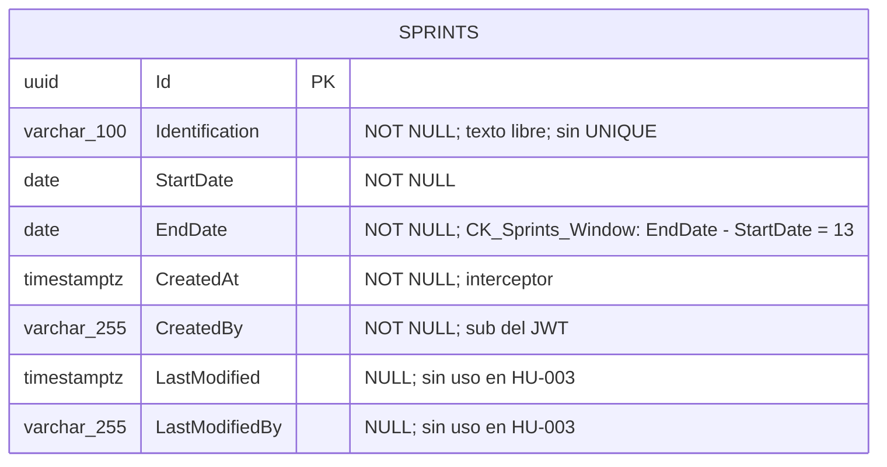

# DISEÑO DE PERSISTENCIA (MER): Gestión de Sprint de Dos Semanas (Crear y Consultar)

- **Especificación SDD Base:** `specs/003-HU_gestion_sprint_dos_semanas/spec.md`, `plan.md`, `research.md`, `data-model.md` y `tasks.md` (Spec Kit)
- **Historias de Usuario Base:** `003-HU_gestion_sprint_dos_semanas.md`
- **Diseño Visual UX Auditado:** `ux_003_gestion_sprint_dos_semanas.md` (10 estados; los cuatro datos funcionales del Sprint tienen columna; sin campos huérfanos)
- **Fecha de Diseño:** 04-10-2026
- **Data Architect:** Agente DA Senior BMAD
- **Modo de gobernanza:** Brownfield (`.specify/memory/constitution.md` existe y prevalece)

> **Dictamen de alcance:** esta historia introduce **una sola tabla nueva**, `sprints."Sprints"`, en un **schema nuevo** `sprints` con su propio `SprintsDbContext` y la migración `InitialSprintsSchema`. No modifica ninguna tabla de `backlog` ni de `application`, no define FK hacia ellos y no incorpora estado, apertura, cierre ni relación Sprint-tarjeta (FR-013, FR-014).

---

## 1. ARCHITECTURE DECISION RECORDS (ADR - Formato MADR)

### ADR-01: Motor de persistencia, módulo propio y schema `sprints`
- **Estado:** Aceptado (heredado)
- **Contexto:** La Constitución (§3) impone PostgreSQL/Npgsql con EF Core Code-First, un `DbContext` por módulo, un schema por módulo y conexión única (`ConnectionStrings:Database`). El SA ya fijó el módulo `Sprints` (ADR-003 del SA).
- **Decisión:** Se crea el schema `sprints` con `SprintsDbContext` (`HasDefaultSchema("sprints")`) y su historial de migraciones en `sprints.__EFMigrationsHistory`. La tabla es `sprints."Sprints"`.
- **Consecuencias:**
  - ✅ **Ventajas / Impacto Positivo:** Aislamiento total frente a `backlog` y `application`; la migración solo toca el schema `sprints` y el módulo es extraíble.
  - ⚠️ **Trade-off / Costo Real:** La HU-004 no podrá usar FK ni JOIN entre `sprints` y `backlog`; la integridad entre ambos será lógica y se resolverá in-process.

### ADR-02: Entidad `Sprint : Aggregate<Guid>` con auditoría por interceptor
- **Estado:** Aceptado (heredado)
- **Contexto:** FR-006 exige `CreatedAt` y `CreatedBy` (= `sub` del token). La Constitución prohíbe columnas o triggers manuales de auditoría y obliga a usar `AuditableEntityInterceptor`.
- **Decisión:** `Sprint` hereda de `Aggregate<Guid>` e implementa `IAuditableEntity`. `CreatedAt`, `CreatedBy`, `LastModified` y `LastModifiedBy` los puebla `AuditableEntityInterceptor`, registrado en `AddDbContext<SprintsDbContext>`. `CreatedBy` es `varchar(255)`, igual que `backlog."BacklogItems"."CreatedBy"` (el `sub` de Keycloak son 36 caracteres).
- **Consecuencias:**
  - ✅ **Ventajas / Impacto Positivo:** Cero lógica de auditoría propia; mismo comportamiento que HU-001.
  - ⚠️ **Trade-off / Costo Real:** `LastModified`/`LastModifiedBy` quedan siempre `NULL` en esta HU (el Sprint es inmutable) pero se conservan por exigencia de la jerarquía `Entity<TId>`. El `data-model.md` y T011 indican `varchar` sin longitud; este diseño fija 255 (ver Riesgos).

### ADR-03: Fechas como `date` (`DateOnly`) sin zona horaria
- **Estado:** Aceptado
- **Contexto:** La ventana de 2 semanas se mide en días calendario inclusivos (supuesto de la HU, punto abierto 3). Los límites ±1 día deben ser deterministas.
- **Decisión:** `StartDate` y `EndDate` son `date NOT NULL` mapeados a `DateOnly`. No se almacena hora ni huso.
- **Alternativas Evaluadas:**
  - **Alternativa A:** `timestamptz` (`DateTime`). Descartada: introduce conversión de huso y hora que el negocio no definió; un Sprint creado desde otro huso podría desplazar la fecha un día y romper la aritmética de 14 días.
  - **Alternativa B:** `timestamp without time zone`. Descartada: arrastra una hora sin significado de negocio y exige normalizarla a medianoche para que el `CHECK` sea exacto.
- **Consecuencias:**
  - ✅ **Ventajas / Impacto Positivo:** `"EndDate" - "StartDate"` es un entero de días exacto en PostgreSQL; el `CHECK` es trivial y no depende de la configuración regional.
  - ⚠️ **Trade-off / Costo Real:** Si el negocio pasa a ventanas con hora (p. ej. cierre a las 18:00) hará falta una migración de tipo de columna y de la restricción.

### ADR-04: Invariante de ventana con `CHECK` en base de datos (`CK_Sprints_Window`)
- **Estado:** Aceptado
- **Contexto:** FR-015 y SC-003 exigen que el 100 % de los Sprints persistidos cumpla la ventana de 14 días, incluso si una ruta futura omite el validador.
- **Decisión:** `CONSTRAINT "CK_Sprints_Window" CHECK (("EndDate" - "StartDate") = 13)`. El valor 13 se deriva de `SprintRules.WindowDays - 1`; es la tercera capa tras `CreateSprintValidator` y `Sprint.Create`.
- **Alternativas Evaluadas:**
  - **Alternativa A:** Solo validación en aplicación. Descartada: no ofrece garantía ante un `INSERT` directo, una migración de datos o la futura HU-004.
  - **Alternativa B:** Trigger `BEFORE INSERT`. Descartada: lógica oculta fuera de las migraciones EF y contraria a la directriz de no reinventar mecanismos; un `CHECK` declarativo basta.
  - **Alternativa C:** Columna calculada/generada con la duración. Descartada: añade una columna sin consumidor (ningún FR la lee).
- **Consecuencias:**
  - ✅ **Ventajas / Impacto Positivo:** La invariante es verificable con SQL (T017) y no puede violarse por ninguna vía.
  - ⚠️ **Trade-off / Costo Real:** Si el negocio redefine la ventana (punto abierto 3), hay que reemplazar el `CHECK` mediante migración y validar las filas existentes. Un fallo del `CHECK` llega como `DbUpdateException` (500), no como 400; el mensaje de negocio depende del validador.

### ADR-05: Sin unicidad, sin solapamiento y sin índices secundarios
- **Estado:** Aceptado
- **Contexto:** Formato y unicidad de la identificación, y solapamiento entre Sprints (puntos abiertos 4 y 5) no están definidos; la spec prohíbe inventar comportamiento ante ellos (CB-08, CB-09).
- **Decisión:** `Identification` es `varchar(100) NOT NULL` sin índice único; no hay restricción de exclusión por rango (`EXCLUDE USING gist`); no hay índices más allá de la PK.
- **Alternativas Evaluadas:**
  - **Alternativa A:** Índice único sobre `Identification`. Descartada: impondría una regla de negocio no confirmada y produciría un 500 al violarse, porque no existe escenario ni mensaje de duplicado.
  - **Alternativa B:** `EXCLUDE USING gist (daterange("StartDate","EndDate",'[]') WITH &&)` para impedir solapamientos. Descartada: requiere la extensión `btree_gist` y fija una regla sin definición de negocio.
  - **Alternativa C:** Índice sobre `StartDate` para el `ORDER BY`. Descartada: SC-005 se mide hasta 100 filas; un escaneo secuencial cumple de sobra y el índice solo añade coste de escritura.
- **Consecuencias:**
  - ✅ **Ventajas / Impacto Positivo:** Esquema mínimo que no prejuzga decisiones de negocio pendientes; las reglas futuras se añaden por migración aditiva.
  - ⚠️ **Trade-off / Costo Real:** Dos envíos idénticos (doble clic, reintento) crean dos Sprints con la misma identificación y fechas. Añadir luego un índice único exigirá depurar duplicados previos.

### ADR-06: Sin estado, sin relación Sprint-tarjeta, sin Outbox
- **Estado:** Aceptado (heredado)
- **Contexto:** FR-013 y FR-014 prohíben estado, apertura, cierre y relación con tarjetas; el punto abierto 2 (cardinalidad tarjeta-Sprint) condiciona a la HU-004. La Constitución exige `OutboxMessage` solo en flujos que publican eventos críticos; el SA descartó eventos (ADR-007 del SA).
- **Decisión:** `sprints."Sprints"` no incluye columna de estado ni FK a `backlog`/`application`. No se crea `OutboxMessage` en el schema `sprints` ni se emiten eventos de dominio.
- **Consecuencias:**
  - ✅ **Ventajas / Impacto Positivo:** El modelo no asume cardinalidad alguna; la HU-004 podrá elegir entre pertenencia única o múltiple sin deshacer esta tabla.
  - ⚠️ **Trade-off / Costo Real:** Cuando se defina el ciclo de vida o la asignación, se añadirán columnas/tablas por migración y habrá que poblar valores por defecto para los Sprints ya creados.

---

## 2. MODELO ENTIDAD-RELACIÓN (MER)

---

## 3. DICCIONARIO DE DATOS Y RESTRICCIONES
*(Mapeado a `spec.md` (Key Entity Sprint), `data-model.md`, `tasks.md` T011 y a los estados visuales UX 1, 3 y 5.)*

### Tabla: `sprints."Sprints"` (`Sprint : Aggregate<Guid>, IAuditableEntity`)
- `Id` (`uuid`): Llave primaria (`PK_Sprints`). Lo genera el servidor (FR-002).
- `Identification` (`character varying(100)`): NOT NULL, no vacía. Texto libre; sin unicidad (ADR-05). Longitud máxima = `SprintRules.IdentificationMaxLength`.
- `StartDate` (`date`): NOT NULL. Entrada `yyyy-MM-dd`.
- `EndDate` (`date`): NOT NULL. Restringida por `CK_Sprints_Window`.
- `CreatedAt` (`timestamp with time zone`): NOT NULL. `AuditableEntityInterceptor` (FR-006).
- `CreatedBy` (`character varying(255)`): NOT NULL. `sub` del token vía `ICurrentUser`; nunca del cuerpo (FR-006).
- `LastModified` (`timestamp with time zone`): NULL. Sin uso en esta HU.
- `LastModifiedBy` (`character varying(255)`): NULL. Sin uso en esta HU.

**Restricciones:** `PK_Sprints` (`Id`); `CK_Sprints_Window` (`("EndDate" - "StartDate") = 13`). Sin `UNIQUE`, sin FK, sin columnas de estado.
**Migración:** `InitialSprintsSchema` en `app/backend/src/Modules/Sprints/Data/Migrations/`; solo crea el schema `sprints`, la tabla y el `CHECK`.

### Trazabilidad Spec / UX → Datos (cero campos huérfanos)

| Requisito / Estado UX | Dato que lo sustenta |
|---|---|
| FR-001, FR-002; UX 1, 2 | `Id`, `Identification`, `StartDate`, `EndDate` |
| FR-003, FR-004, FR-015, SC-002, SC-003; UX 6 | `CK_Sprints_Window` + validador + `Sprint.Create` |
| FR-005; UX 7 | `Identification` NOT NULL (≤ 100), `StartDate`/`EndDate` NOT NULL |
| FR-006 | `CreatedAt`, `CreatedBy` |
| FR-007, FR-008; UX 3, 5 | Lectura de `Id`, `Identification`, `StartDate`, `EndDate` (orden `StartDate` asc, `Id`) |
| FR-009; UX 8 | Ausencia de fila para el `Id` solicitado |
| FR-011, FR-012; UX 10 | Una sola sentencia `INSERT` por `SaveChangesAsync` (transacción implícita): sin fila parcial |
| FR-013, SC-006 | Sin FK ni columnas hacia `backlog` / `application` |
| FR-014 | Sin columnas de estado, apertura ni cierre |
| FR-010; UX 9 | Sin dato de persistencia (rechazo previo, 401) |

Los metadatos de auditoría (`CreatedAt`, `CreatedBy`) se persisten pero no se muestran en ninguna pantalla (UX Estado 5), por decisión del contrato de respuesta y no por falta de columna.

---

## 4. RIESGOS DE INTEGRIDAD Y ESCALABILIDAD
- `⚠️ RIESGO (discrepancia con data-model.md/T011):` `data-model.md` y T011 definen `CreatedBy`/`LastModifiedBy` como `varchar` sin longitud; la entidad Backlog usa `varchar(255)` (`BacklogItemRules.UserMaxLength`). Este diseño fija `varchar(255)` por coherencia con HU-001. Debe reconciliarse en la implementación de T011 (p. ej. constante `SprintRules.UserMaxLength = 255`); sin ello el schema divergería del resto del Modulith.
- `⚠️ RIESGO (duplicados):` Sin índice único ni idempotencia, un doble envío o un reintento crea Sprints duplicados (ADR-05). Mitigación únicamente en UI (botón deshabilitado durante el envío). Punto abierto 4 de la HU.
- `⚠️ RIESGO (solapamiento / pasado):` Nada en base de datos impide Sprints solapados ni con inicio en el pasado (puntos abiertos 5 y 6). Si el negocio los prohíbe, se requerirá limpieza de datos antes de añadir restricciones.
- `⚠️ RIESGO (supuesto de ventana):` El `CHECK` codifica "14 días inclusivos", que es un supuesto pendiente de confirmación (punto abierto 3). Un cambio de regla exige una migración que elimine y recree `CK_Sprints_Window` y que revise las filas ya persistidas.
- `⚠️ RIESGO (HU-004):` La referencia futura desde `backlog` a `sprints."Sprints"."Id"` será lógica, sin FK (constitución §3.2.3); un Sprint no se puede eliminar en esta HU, por lo que no habrá huérfanos, pero la integridad dependerá de la aplicación. La pertenencia única o múltiple (pregunta abierta 9 del Product Brief) debe resolverse antes de modelarla.
- `⚠️ RIESGO (error del CHECK):` Una violación de `CK_Sprints_Window` llega como `DbUpdateException` y se traduce a HTTP 500, no 400. Es aceptable porque el validador intercepta antes cualquier ventana inválida; solo se ve por rutas que lo omitan.
- `⚠️ RIESGO (escalabilidad):` Sin índice sobre `StartDate`, el `ORDER BY` es un escaneo secuencial; irrelevante hasta cientos de filas (SC-005 verifica 100). Reevaluar si el volumen crece a miles.
- `⚠️ RIESGO (despliegue):` `MigrateSprintsModuleAsync` se ejecuta en el arranque junto con las migraciones de Backlog y Application; un fallo en `sprints` impediría iniciar el host si las migraciones se encadenan sin aislamiento de errores.

---

## 5. ORDEN DE DELEGACIÓN PARA EL TRACKER
El proyecto es `fullstack` y requiere comunicación externa (API REST). El contrato ya está preliminarmente fijado en `specs/003-HU_gestion_sprint_dos_semanas/contracts/sprints-api.openapi.yaml`; el api-architect debe formalizarlo sobre `sprints."Sprints"` sin exponer `CreatedAt`/`CreatedBy` ni añadir estado, paginación o relación con tarjetas.

`@API: El modelo de datos (MER) y la persistencia han sido definidos a partir de spec.md y tasks.md. Por favor, diseña los contratos de integración (Endpoints/Payloads) basados en estas tablas.`
