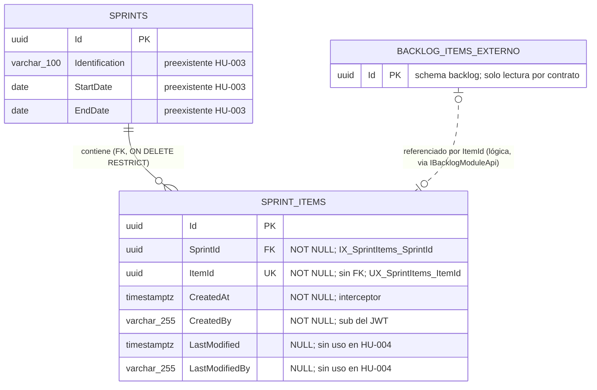

# DISEÑO DE PERSISTENCIA (MER): Asignación de Elementos del Backlog a un Sprint

- **Especificación SDD Base:** `specs/004-HU_asignacion_elementos_sprint/spec.md`, `plan.md`, `research.md`, `data-model.md`, `contracts/` y `tasks.md` (Spec Kit)
- **Historias de Usuario Base:** `004-HU_asignacion_elementos_sprint.md`
- **Diseño Visual UX Auditado:** `ux_004_asignacion_elementos_sprint.md` (12 estados; todos los campos visibles tienen origen de datos; sin campos huérfanos)
- **Fecha de Diseño:** 04-10-2026
- **Data Architect:** Agente DA Senior BMAD
- **Modo de gobernanza:** Brownfield (`.specify/memory/constitution.md` existe y prevalece)

> **Dictamen de alcance:** esta historia introduce **una sola tabla nueva**, `sprints."SprintItems"`, en el schema existente `sprints` (`SprintsDbContext`), mediante la migración aditiva `AddSprintItems`. No modifica `sprints."Sprints"`, `backlog."BacklogItems"` ni el schema `application`. Define **una FK real** (`SprintId` → `sprints."Sprints"`) y **ninguna FK cross-schema** (`ItemId` es referencia lógica).
>
> **Reconciliación vinculante:** la resolución humana A (tracker 04-10-2026 10:32) y la guía del SA fijan que un elemento pertenece a **un solo Sprint**; `spec.md` FR-015 queda sin efecto (así lo declaran `plan.md` y `tasks.md`). Este modelo materializa esa regla con un índice único.

---

## 1. ARCHITECTURE DECISION RECORDS (ADR - Formato MADR)

### ADR-01: Motor, módulo y schema (reutiliza `sprints`)
- **Estado:** Aceptado (heredado)
- **Contexto:** La Constitución (§3) impone PostgreSQL/Npgsql con EF Core Code-First, un `DbContext` por módulo y un schema por módulo. El SA (ADR-003) ubica la asignación en el módulo existente `Sprints`; el Sprint es el lado "uno" y el consumidor del dato.
- **Decisión:** La tabla es `sprints."SprintItems"` y se mapea en `SprintsDbContext` (`DbSet<SprintItem> SprintItems`); su historial queda en `sprints.__EFMigrationsHistory`.
- **Consecuencias:**
  - ✅ **Ventajas / Impacto Positivo:** Cero schemas nuevos; la migración solo toca `sprints`; no se modifica `BacklogItem` (FR-013).
  - ⚠️ **Trade-off / Costo Real:** El módulo `Sprints` queda acoplado funcionalmente a Backlog vía contrato in-process; la integridad hacia `backlog` es lógica (ver ADR-03).

### ADR-02: `SprintItem : Aggregate<Guid>` con auditoría por interceptor y sin estado ni orden
- **Estado:** Aceptado (heredado)
- **Contexto:** FR-003 exige `CreatedAt` y `CreatedBy` (= `sub` del token). La Constitución prohíbe columnas o triggers manuales de auditoría y obliga a `AuditableEntityInterceptor`. FR-014 prohíbe definir o cambiar estados.
- **Decisión:** `SprintItem` hereda de `Aggregate<Guid>` e implementa `IAuditableEntity`; `CreatedAt`, `CreatedBy`, `LastModified` y `LastModifiedBy` los puebla el interceptor ya registrado en `SprintsDbContext`. No hay columna de estado, de orden ni de posición. `CreatedBy` y `LastModifiedBy` son `varchar(255)` (constante `SprintRules.UserMaxLength`, igual que `sprints."Sprints"` y `backlog."BacklogItems"`).
- **Consecuencias:**
  - ✅ **Ventajas / Impacto Positivo:** Mismo comportamiento de auditoría que HU-001 y HU-003; sin lógica propia.
  - ⚠️ **Trade-off / Costo Real:** `LastModified`/`LastModifiedBy` quedan siempre `NULL` (no existe desasignar ni mover) pero se conservan por la jerarquía `Entity<TId>`. `data-model.md` indica `varchar` sin longitud; este diseño fija 255 (ver Riesgos).

### ADR-03: `ItemId` sin FK (referencia lógica cross-schema) y `SprintId` con FK `ON DELETE RESTRICT`
- **Estado:** Aceptado (heredado)
- **Contexto:** La Constitución §3.2.3 prohíbe joins y consultas cross-schema. El elemento vive en `backlog`; el Sprint vive en `sprints`.
- **Decisión:** `ItemId` es `uuid NOT NULL` **sin FK**; su existencia se verifica en el handler por `IBacklogModuleApi.ExistsAsync` y sus datos de lectura se obtienen por `GetSummariesAsync` (una sola consulta de lote). `SprintId` es `uuid NOT NULL` con FK `FK_SprintItems_Sprints_SprintId` a `sprints."Sprints"("Id")` `ON DELETE RESTRICT` (mismo schema, integridad física permitida).
- **Consecuencias:**
  - ✅ **Ventajas / Impacto Positivo:** Cumple el aislamiento por schema; impide asignaciones huérfanas hacia Sprints inexistentes incluso con `INSERT` directo; el módulo `Sprints` es extraíble.
  - ⚠️ **Trade-off / Costo Real:** La BD no impide un `ItemId` huérfano si otra vía escribe sin pasar por el handler; `RESTRICT` bloqueará un futuro borrado de Sprint con elementos (hoy no existe borrado).

### ADR-04: Unicidad de `ItemId` (`UX_SprintItems_ItemId`) como invariante "un elemento, un Sprint"
- **Estado:** Aceptado
- **Contexto:** La resolución humana A exige 409 al reasignar un elemento ya asignado (mismo u otro Sprint) y exactamente un 201 ante solicitudes concurrentes del mismo elemento (`tasks.md` T019).
- **Decisión:** Índice **único** `UX_SprintItems_ItemId` sobre `ItemId` (columna única, no compuesta). La violación (`SQLSTATE 23505` con `ConstraintName = UX_SprintItems_ItemId`) se traduce a `ConflictException`. El nombre es la constante pública `SprintItemRules.ItemIdUniqueIndexName`.
- **Alternativas Evaluadas:**
  - **Alternativa A:** Índice único compuesto `(SprintId, ItemId)`. Descartada: permitiría el mismo elemento en dos Sprints distintos, contradiciendo la regla humana A.
  - **Alternativa B:** Solo verificación `AnyAsync` en la aplicación. Descartada: dos solicitudes simultáneas pasarían ambas la lectura y persistirían dos filas (carrera).
  - **Alternativa C:** Aislamiento `SERIALIZABLE` o `pg_advisory_lock` por `ItemId`. Descartada: complejidad y contención innecesarias cuando un índice declarativo resuelve la carrera de forma atómica.
- **Consecuencias:**
  - ✅ **Ventajas / Impacto Positivo:** La concurrencia se resuelve en el motor; la invariante no puede violarse por ninguna vía; el índice sirve también de búsqueda por `ItemId`.
  - ⚠️ **Trade-off / Costo Real:** Distinguir 409 de 500 depende del **nombre** del índice; renombrarlo sin actualizar la constante convertiría el conflicto en 500. Si el negocio admite luego varios Sprints por elemento, habrá que eliminar el índice por migración y rediseñar la relación.

### ADR-05: Índice no único `IX_SprintItems_SprintId` para la consulta por Sprint
- **Estado:** Aceptado
- **Contexto:** `GET /api/sprints/{sprintId}/items` filtra por `SprintId` y debe responder en menos de 2 s con hasta 100 elementos (SC-006). El índice único sobre `ItemId` no sirve ese predicado, y PostgreSQL no indexa automáticamente las columnas de FK.
- **Decisión:** Índice B-tree no único sobre `SprintId`. El orden de lectura (`CreatedAt`, `Id`) se resuelve en memoria sobre un conjunto pequeño; no se crea índice compuesto.
- **Alternativas Evaluadas:**
  - **Alternativa A:** Sin índice (escaneo secuencial). Descartada: la FK sin índice degrada la comprobación de `RESTRICT` y la consulta crece linealmente con toda la tabla.
  - **Alternativa B:** Índice compuesto `(SprintId, CreatedAt, Id)`. Descartada: el volumen por Sprint es ≤ 100 y el orden es solo de estabilidad (⚠️ [PROPUESTO], no contrato); añade coste de escritura sin beneficio medible.
- **Consecuencias:**
  - ✅ **Ventajas / Impacto Positivo:** Consulta por Sprint con búsqueda por índice; la verificación de la FK no escanea la tabla.
  - ⚠️ **Trade-off / Costo Real:** Un segundo índice a mantener en cada `INSERT`; costo despreciable al ser una escritura por solicitud.

### ADR-06: Sin eventos, sin Outbox, sin caché ni proyección local de datos del elemento
- **Estado:** Aceptado (heredado)
- **Contexto:** La Constitución exige `OutboxMessage` solo en flujos que publican eventos críticos; el SA (ADR-006) descartó eventos, Redis y MassTransit en esta HU. Los datos del elemento (título, tipo, estimaciones) pertenecen a `backlog`.
- **Decisión:** No se crea `OutboxMessage` en `sprints`, no se emiten eventos de dominio y no se duplican columnas del elemento en `SprintItems` (sin `Title`, `Type`, `DevPoints`, `QAPoints`). La lectura los obtiene en vivo por contrato in-process.
- **Consecuencias:**
  - ✅ **Ventajas / Impacto Positivo:** Fuente única de verdad del elemento; sin desincronización ni consistencia eventual.
  - ⚠️ **Trade-off / Costo Real:** Cada consulta depende de la disponibilidad de `Backlog` en proceso; si HU-006/HU-031 requieren reaccionar a asignaciones habrá que añadir Outbox por migración aditiva.

---

## 2. MODELO ENTIDAD-RELACIÓN (MER)

---

## 3. DICCIONARIO DE DATOS Y RESTRICCIONES
*(Mapeado a `spec.md` (Key Entity Asignación Sprint–Elemento), `data-model.md`, `tasks.md` T006–T011 y a los estados visuales UX 1–12.)*

### Tabla: `sprints."SprintItems"` (`SprintItem : Aggregate<Guid>, IAuditableEntity`)
- `Id` (`uuid`): Llave primaria (`PK_SprintItems`). Generado en `SprintItem.Create`.
- `SprintId` (`uuid`): NOT NULL. FK `FK_SprintItems_Sprints_SprintId` → `sprints."Sprints"("Id")` `ON DELETE RESTRICT`. Índice no único `IX_SprintItems_SprintId`.
- `ItemId` (`uuid`): NOT NULL. **Sin FK** (el elemento vive en `backlog`). Índice **único** `UX_SprintItems_ItemId`.
- `CreatedAt` (`timestamp with time zone`): NOT NULL. `AuditableEntityInterceptor` (FR-003).
- `CreatedBy` (`character varying(255)`): NOT NULL. `sub` del token vía `ICurrentUser`; nunca del cuerpo (FR-003).
- `LastModified` (`timestamp with time zone`): NULL. Sin uso en esta HU.
- `LastModifiedBy` (`character varying(255)`): NULL. Sin uso en esta HU.

**Restricciones:** `PK_SprintItems` (`Id`); `FK_SprintItems_Sprints_SprintId` (`RESTRICT`); `UX_SprintItems_ItemId` (`UNIQUE`, `ItemId`); `IX_SprintItems_SprintId`. Sin `CHECK`, sin columnas de estado, orden ni descripción.
**Migración:** `AddSprintItems` en `app/backend/src/Modules/Sprints/Data/Migrations/`; solo crea `sprints."SprintItems"` con sus índices y la FK (verificado por T011 y T014).
**Validación `Guid.Empty`:** se rechaza en dominio (`SprintItem.Create`) y en el validador; no se codifica `CHECK` en BD (la existencia real del Sprint la garantiza la FK; la del elemento, el contrato).

### Proyección de lectura (no persistida): `BacklogItemSummary`
`(Id, Title, Type, DevPoints, QAPoints)` proviene de `backlog` por `IBacklogModuleApi.GetSummariesAsync`; no tiene columna en `sprints` (ADR-06).

### Trazabilidad Spec / UX → Datos (cero campos huérfanos)

| Requisito / Estado UX | Dato que lo sustenta |
|---|---|
| FR-001, FR-002; UX 3, 4 | `SprintId`, `ItemId` (respuesta `{ sprintId, itemId }`) |
| FR-003; (auditoría no se muestra en UX) | `CreatedAt`, `CreatedBy` por interceptor |
| FR-004; UX 5 | Varias filas con mismo `SprintId` e `ItemId` distintos (índice único solo sobre `ItemId`) |
| Resolución A / 409; UX 12 | `UX_SprintItems_ItemId` |
| FR-005; UX 6, 9 | FK `SprintId` + ausencia de fila en `sprints."Sprints"` |
| FR-006; UX 7 | Verificación por contrato (sin dato local; `ItemId` sin FK) |
| FR-007; UX 8 | `SprintId`/`ItemId` NOT NULL; validación `Guid` en aplicación |
| FR-008, FR-009; UX 1, 2 | `SprintId` → `ItemId` en `SprintItems` + `Title`, `Type`, `DevPoints`, `QAPoints` desde `backlog` (contrato) |
| FR-010; UX 10 | Sin dato de persistencia (rechazo previo, 401) |
| FR-011, FR-012, SC-007; UX 11 | Una fila por solicitud, un único `SaveChangesAsync` (transacción implícita): sin fila parcial |
| FR-013, FR-014 | Sin columnas de estado ni cambios en `Sprints`/`BacklogItems` |
| FR-016 | Schema `sprints`, sin queries cross-schema, sin Outbox |
| SC-006 | `IX_SprintItems_SprintId` + una llamada de lote al contrato |

---

## 4. RIESGOS DE INTEGRIDAD Y ESCALABILIDAD
- `⚠️ RIESGO (tipo de dato de las estimaciones):` `BacklogItem.DevPoints` y `QAPoints` son `decimal?` (`Modules/Backlog/Domain/BacklogItems/BacklogItem.cs`), pero `tasks.md` T005 define `BacklogItemSummary(..., int DevPoints, int QAPoints)`. Un valor decimal se truncaría y un `NULL` (p. ej. QA de un ítem técnico, que la UX muestra como `--`) rompería la proyección o se falsearía como `0`. Debe reconciliarse antes de implementar: `decimal?` en `BacklogItemSummary`, `SprintItemResponse` y el modelo TypeScript (`T005`, `T036`, `T041`), y probar un elemento con QA nulo.
- `⚠️ RIESGO (discrepancia de longitud):` `data-model.md` y T010 indican `CreatedBy`/`LastModifiedBy` como `varchar` sin longitud; `sprints."Sprints"` y `backlog` usan `varchar(255)` (`SprintRules.UserMaxLength`). Este diseño fija 255; T010 debe usar la constante para que el schema no diverja.
- `⚠️ RIESGO (referencia huérfana lógica):` Sin FK a `backlog`, un `ItemId` inexistente podría persistirse si se escribe por una vía que omita el handler. La mitigación es aplicativa (`ExistsAsync`) y de pruebas. Un futuro borrado de elementos de `backlog` (hoy inexistente) dejaría `SprintItems` huérfanos y exigiría un evento de integración.
- `⚠️ RIESGO (acoplamiento al nombre del índice):` La traducción 409 vs 500 depende de `ConstraintName = UX_SprintItems_ItemId`. Un renombrado por migración debe actualizar `SprintItemRules.ItemIdUniqueIndexName`; T014 y T018 cubren la regresión.
- `⚠️ RIESGO (filtración del Sprint dueño):` El 409 no debe revelar a qué Sprint pertenece el elemento (T054); la fila persistida sí lo contiene, por lo que ningún endpoint futuro debe exponer la búsqueda inversa `ItemId → SprintId` sin definir permisos (punto abierto 6 de la HU).
- `⚠️ RIESGO (cardinalidad cerrada):` `UX_SprintItems_ItemId` fija pertenencia única. Cuando el negocio resuelva la pregunta 9 del Product Brief (arrastre de elementos no terminados al siguiente Sprint, historial) habrá que migrar a una relación con vigencia (`AssignedAt`/`UnassignedAt`) y recrear el índice como parcial. No existe desasignar ni mover en esta HU, por lo que las filas son inmutables.
- `⚠️ RIESGO (FK RESTRICT):` `ON DELETE RESTRICT` impedirá eliminar un Sprint con elementos asignados. Es el comportamiento deseado hoy (no hay borrado de Sprints); cualquier HU futura de eliminación deberá definir si cascada o bloquea.
- `⚠️ RIESGO (concurrencia y orden):` Ante N solicitudes simultáneas del mismo elemento, una gana y las demás reciben 409; el orden de ganancia no es determinista. El orden `CreatedAt, Id` de la consulta es solo de estabilidad (⚠️ [PROPUESTO]), no un contrato.
- `⚠️ RIESGO (consistencia de lectura):` `GetSummariesAsync` omite ids no devueltos por `backlog` (se registra `LogWarning`); la consulta puede devolver menos elementos que filas en `SprintItems` si un elemento deja de existir, contradiciendo SC-004 en ese caso límite.
- `⚠️ RIESGO (escalabilidad):` Sin paginación; aceptable hasta 100 elementos por Sprint (SC-006). Con miles por Sprint, la cláusula `ANY(...)` del contrato y la respuesta completa requerirán paginación y revisión de índices.
- `⚠️ RIESGO (despliegue):` `AddSprintItems` se aplica en el arranque junto con las migraciones de `backlog`, `application` y `sprints`; un fallo en `sprints` podría impedir iniciar el host si no se aíslan los errores de migración.

---

## 5. ORDEN DE DELEGACIÓN PARA EL TRACKER
El proyecto es `fullstack` y requiere comunicación externa (API REST). Los contratos HTTP ya están preliminarmente fijados en `specs/004-HU_asignacion_elementos_sprint/contracts/sprint-items-api.openapi.yaml`; el api-architect debe formalizarlos sobre `sprints."SprintItems"`, sin exponer `CreatedAt`/`CreatedBy` ni estado, y con 409 sin revelar el Sprint dueño.

`@API: El modelo de datos (MER) y la persistencia han sido definidos a partir de spec.md y tasks.md. Por favor, diseña los contratos de integración (Endpoints/Payloads) basados en estas tablas.`
