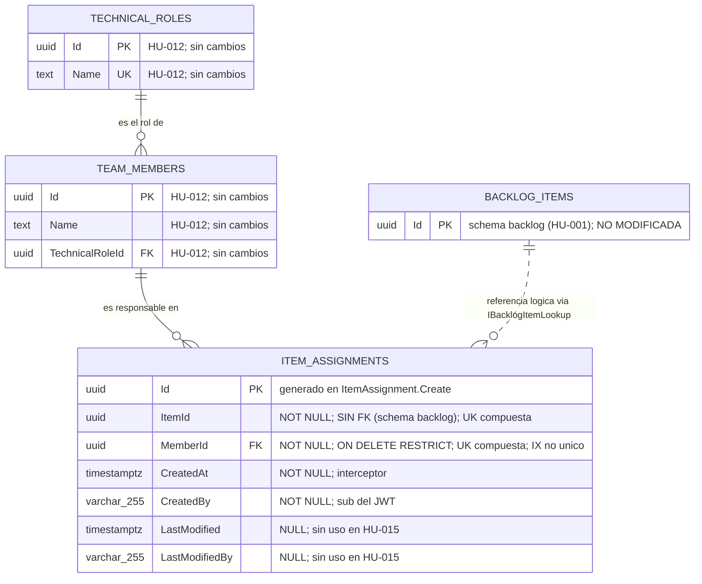

# DISEÑO DE PERSISTENCIA (MER): Relación entre Personas, Roles y Elementos de Trabajo

- **Especificación SDD Base:** `specs/015-HU_relacion_personas_roles_elementos/spec.md`, `plan.md`, `research.md`, `data-model.md` y `tasks.md` (Spec Kit)
- **Historias de Usuario Base:** `015-HU_relacion_personas_roles_elementos.md`
- **Diseño Visual UX Auditado:** `ux_015_relacion_personas_roles_elementos.md` (12 estados; los datos visibles —identificador, nombre y rol de la persona; identificador, título y tipo del elemento— tienen origen en columna o en el contrato in-process; sin campos huérfanos)
- **Fecha de Diseño:** 04-10-2026
- **Data Architect:** Agente DA Senior BMAD
- **Modo de gobernanza:** Brownfield (`.specify/memory/constitution.md` existe y prevalece)

> **Dictamen de alcance:** la historia introduce **una tabla nueva**, `teams."ItemAssignments"`, en el schema existente `teams` (`TeamsDbContext`), mediante la migración aditiva `AddItemAssignments`. La FK `MemberId → teams."TeamMembers"("Id")` es **local** al schema. `ItemId` es una **referencia lógica sin FK** hacia `backlog."BacklogItems"` porque la Constitución (§3.2.3) prohíbe FK, JOIN y consultas cross-schema. No se modifica ninguna tabla existente (`backlog`, `sprints`, `application`, `TeamMembers`, `TechnicalRoles`) ni se persiste el rol (FR-005, FR-013, FR-014).

---

## 1. ARCHITECTURE DECISION RECORDS (ADR - Formato MADR)

### ADR-01: Motor, schema y `DbContext` de la relación
- **Estado:** Aceptado (heredado)
- **Contexto:** La Constitución (§3) impone PostgreSQL/Npgsql con EF Core Code-First, un `DbContext` y un schema por módulo y migraciones aisladas. El SA (ADR-003) ubicó la relación en el módulo existente `Teams`.
- **Decisión:** La tabla `teams."ItemAssignments"` se añade a `TeamsDbContext` (`HasDefaultSchema("teams")`) con la migración `AddItemAssignments` y su historial en `teams.__EFMigrationsHistory`.
- **Consecuencias:**
  - ✅ **Ventajas / Impacto Positivo:** La migración solo toca `teams`; `BacklogItem` queda intacto (FR-013) y el módulo conserva su frontera.
  - ⚠️ **Trade-off / Costo Real:** El módulo `Teams` conoce un identificador de elemento que no puede validar con FK; la integridad del elemento es lógica (ADR-03).

### ADR-02: `ItemAssignment` sobre la jerarquía de `Shared`, sin eventos ni Outbox
- **Estado:** Aceptado (heredado)
- **Contexto:** FR-004 exige `CreatedAt` y `CreatedBy` (= `sub`). La Constitución prohíbe columnas o triggers manuales de auditoría y obliga a `AuditableEntityInterceptor`; `OutboxMessage` solo se exige donde se publican eventos críticos y el SA descartó eventos (ADR-007 del SA).
- **Decisión:** `ItemAssignment : Aggregate<Guid>, IAuditableEntity`. `CreatedAt`, `CreatedBy`, `LastModified` y `LastModifiedBy` los puebla el interceptor. No emite eventos de dominio ni se crea `OutboxMessage` en `teams`.
- **Consecuencias:**
  - ✅ **Ventajas / Impacto Positivo:** Cero lógica de auditoría propia; escritura de una sola fila con un único `SaveChangesAsync`.
  - ⚠️ **Trade-off / Costo Real:** HU-010 y HU-014 tendrán que añadir el evento de "cambio de responsable" cuando existan consumidores; hoy no hay traza de eventos. `LastModified`/`LastModifiedBy` quedan siempre `NULL` (no existe modificar) pero se conservan por la interfaz `IAuditableEntity`.

### ADR-03: `ItemId` como referencia lógica sin FK; `MemberId` con FK local `ON DELETE RESTRICT`
- **Estado:** Aceptado (heredado)
- **Contexto:** El elemento reside en el schema `backlog` y el miembro en `teams`. Constitución §3.2.3: prohibido todo JOIN, FK o consulta cross-schema; los datos de otro módulo se obtienen por llamada in-process. FR-014 lo reitera.
- **Decisión:** `ItemId uuid NOT NULL` **sin** constraint FK; su existencia se verifica por el contrato `Teams.Contracts.IBacklogItemLookup` antes de insertar. `MemberId uuid NOT NULL` con `FK_ItemAssignments_TeamMembers_MemberId` → `teams."TeamMembers"("Id")` `ON DELETE RESTRICT`.
- **Consecuencias:**
  - ✅ **Ventajas / Impacto Positivo:** Respeta el aislamiento por schema y mantiene el módulo extraíble; la BD garantiza que no existan relaciones con miembros inexistentes (SQLSTATE 23503).
  - ⚠️ **Trade-off / Costo Real:** La BD no impide un `ItemId` huérfano si se inserta por SQL directo o si en el futuro se habilita el borrado de elementos. Hoy no existe baja de elementos ni de miembros; HU futuras que la introduzcan deberán limpiar relaciones por contrato o evento.

### ADR-04: Unicidad del par `(ItemId, MemberId)` por índice único (asignación idempotente)
- **Estado:** Aceptado
- **Contexto:** Resolución humana B del tracker: asignar dos veces al mismo miembro al mismo elemento es idempotente (200, sin nueva fila ni cambio de auditoría). `spec.md` aún lo trata como "no documentado" (FR-015); es vinculante la decisión del SA (ADR-004) y la resolución humana. Debe resistir solicitudes concurrentes.
- **Decisión:** Índice ÚNICO `UX_ItemAssignments_ItemId_MemberId` sobre `("ItemId", "MemberId")`. El handler lee el par antes de insertar (optimización) y, si el `INSERT` falla con `PostgresException` `SqlState = 23505` **y** `ConstraintName = UX_ItemAssignments_ItemId_MemberId`, relee la fila ganadora y responde 200. Cualquier otro fallo termina en 500.
- **Alternativas Evaluadas:**
  - **Alternativa A:** Solo validación en handler (lectura previa sin índice). Descartada: dos solicitudes simultáneas leen "no existe" e insertan ambas; la unicidad debe ser invariante de datos, no de aplicación.
  - **Alternativa B:** `INSERT ... ON CONFLICT DO NOTHING` por SQL crudo. Descartada: evade `AuditableEntityInterceptor` (el `CreatedBy` no se poblaría) y rompe la regla de no reinventar auditoría.
  - **Alternativa C:** `SERIALIZABLE` o advisory lock por par. Descartada: complejidad y contención innecesarias para una fila de dos columnas que el índice único ya protege sin bloqueos.
  - **Alternativa D:** Respuesta 409 ante duplicado. Descartada por la resolución humana B.
- **Consecuencias:**
  - ✅ **Ventajas / Impacto Positivo:** Exactamente una solicitud inserta aunque lleguen N simultáneas; el índice cubre también la consulta por `ItemId` (prefijo del índice compuesto), por lo que no se crea un índice adicional sobre `ItemId`.
  - ⚠️ **Trade-off / Costo Real:** El filtrado de la excepción por nombre de constraint acopla el handler al nombre del índice (constante `ItemAssignmentRules.PairUniqueIndexName`); renombrarlo sin actualizar la constante convertiría la carrera en un 500. Una vez creado, añadir reglas como "máximo de responsables" o "baja" exigirá revisar este índice (p. ej. índice parcial si se introduce borrado lógico).

### ADR-05: El rol no se persiste; se deriva del miembro con JOIN local
- **Estado:** Aceptado
- **Contexto:** FR-005: el rol mostrado es el rol técnico ya registrado del miembro, sin elegir otro por asignación.
- **Decisión:** `ItemAssignments` no tiene columna de rol, estado ni orden. `role` y `memberName` se obtienen en cada lectura con JOIN **local** `ItemAssignments` ↔ `TeamMembers` ↔ `TechnicalRoles` (mismo schema `teams`).
- **Alternativas Evaluadas:**
  - **Alternativa A:** Columna `TechnicalRoleId` o `Role` copiada en la relación. Descartada: dato duplicado que diverge si HU-012 cambiara el rol del miembro, y habilitaría de facto la elección de rol por asignación (punto abierto).
  - **Alternativa B:** Copiar el nombre del miembro (`MemberName`). Descartada: misma divergencia y sin integridad referencial.
- **Consecuencias:**
  - ✅ **Ventajas / Impacto Positivo:** Una sola fuente de verdad; el esquema no prejuzga puntos abiertos (FR-015).
  - ⚠️ **Trade-off / Costo Real:** Cada consulta paga dos JOIN locales; con cientos de filas es irrelevante. Si el rol de un miembro cambia, el historial de "con qué rol se asignó" no se conserva (no es requisito hoy).

### ADR-06: Índice no único sobre `MemberId` para la consulta persona→elementos
- **Estado:** Aceptado
- **Contexto:** FR-007 consulta los elementos de un miembro; el índice único compuesto empieza por `ItemId` y no sirve búsquedas por `MemberId`.
- **Decisión:** `IX_ItemAssignments_MemberId` sobre `("MemberId")`; además apoya la FK.
- **Alternativas Evaluadas:**
  - **Alternativa A:** Invertir el orden del índice único a `(MemberId, ItemId)`. Descartada: dejaría la consulta elemento→personas (FR-006, la principal) sin índice por prefijo.
  - **Alternativa B:** Sin índice adicional. Descartada: escaneo secuencial en la consulta de SC-007 al crecer la tabla.
- **Consecuencias:**
  - ✅ **Ventajas / Impacto Positivo:** Ambas direcciones de consulta quedan cubiertas por índice.
  - ⚠️ **Trade-off / Costo Real:** Un índice más de escritura por inserción; marginal para el volumen esperado.

---

## 2. MODELO ENTIDAD-RELACIÓN (MER)

---

## 3. DICCIONARIO DE DATOS Y RESTRICCIONES
*(Mapeado a `spec.md` (Key Entities Relación de responsabilidad, Miembro, Elemento, Rol técnico), `data-model.md`, `tasks.md` T005–T014 y T023–T055, y a los estados visuales UX 1 a 12.)*

### Tabla: `teams."ItemAssignments"` (`ItemAssignment : Aggregate<Guid>, IAuditableEntity`) — NUEVA
- `Id` (`uuid`): Llave primaria (`PK_ItemAssignments`). Lo genera el servidor en `ItemAssignment.Create`.
- `ItemId` (`uuid`): NOT NULL. Identificador del elemento del backlog. **Sin FK** (ADR-03). Verificado por `IBacklogItemLookup.ExistsAsync` antes de insertar; `Guid.Empty` rechazado por validador y factoría.
- `MemberId` (`uuid`): NOT NULL. FK `FK_ItemAssignments_TeamMembers_MemberId` → `teams."TeamMembers"("Id")` `ON DELETE RESTRICT`.
- `CreatedAt` (`timestamp with time zone`): NOT NULL. `AuditableEntityInterceptor` (FR-004).
- `CreatedBy` (`character varying(255)`): NOT NULL. `sub` del token vía `ICurrentUser`; nunca del cuerpo (FR-004).
- `LastModified` (`timestamp with time zone`): NULL. Sin uso en esta HU.
- `LastModifiedBy` (`character varying(255)`): NULL. Sin uso en esta HU.

**Restricciones:** `PK_ItemAssignments` (`Id`); `FK_ItemAssignments_TeamMembers_MemberId` (`RESTRICT`); `UX_ItemAssignments_ItemId_MemberId` (UNIQUE `ItemId`, `MemberId`). Sin columnas de rol, estado, orden ni `CHECK` de coherencia rol/estimaciones (FR-015).
**Índices:** `UX_ItemAssignments_ItemId_MemberId` (único; sirve consulta por `ItemId`); `IX_ItemAssignments_MemberId` (no único; consulta por miembro y apoyo de la FK).
**Migración:** `AddItemAssignments` en `app/backend/src/Modules/Teams/Data/Migrations/`; `Up` solo crea la tabla, la FK y los dos índices; `Down` los elimina.

### Tablas existentes (solo lectura, sin cambios)
- `teams."TeamMembers"` (`Id`, `Name`, `TechnicalRoleId`): aportan `memberName` y, vía `TechnicalRoles."Name"`, el `role`.
- `teams."TechnicalRoles"` (`Id`, `Name`): semilla `Desarrollo`, `QA`.
- `backlog."BacklogItems"`: **inaccesible desde `Teams`**; solo se ve `Id`, `Title`, `Type` mediante `BacklogItemRef` (contrato in-process; sin estimaciones, estado ni Sprint).

### Trazabilidad Spec / UX → Datos (cero campos huérfanos)

| Requisito / Estado UX | Dato que lo sustenta |
|---|---|
| FR-001, FR-002; UX 4, 5, 6 | Una fila `ItemAssignments` por par; el índice único admite varios `MemberId` por `ItemId` y varios `ItemId` por `MemberId` |
| FR-003; UX 5 | Respuesta `{ itemId, memberId, memberName, role }`: `ItemId`, `MemberId` de la fila; `memberName` = `TeamMembers."Name"`; `role` = `TechnicalRoles."Name"` (JOIN local) |
| FR-004 | `ItemAssignments."CreatedAt"`, `"CreatedBy"` (interceptor); no se exponen en la API ni en UX |
| FR-005; UX 4 (rol solo lectura) | Sin columna de rol (ADR-05); derivado de `TeamMembers.TechnicalRoleId` |
| FR-006; UX 1, 2 | `ItemAssignments` filtrado por `ItemId` + JOIN a `TeamMembers`/`TechnicalRoles` → `id`, `name`, `role`; ausencia de filas = `[]` |
| FR-007; UX 3 | `ItemAssignments."ItemId"` por `MemberId` → lote a `IBacklogItemLookup.GetItemsAsync` → `id`, `title`, `type` (no persistidos en `teams`) |
| FR-008 | Sin escritura en consultas |
| FR-009; UX 8, 9 | Verificación previa miembro (`TeamMembers`) y elemento (contrato); FK `RESTRICT` como red de seguridad del miembro; sin fila si falla |
| FR-010; UX 10 | Validador previo (`itemId`, `memberId`); `Guid.Empty` impedido en factoría; NOT NULL |
| FR-011; UX 11 | Sin dato de persistencia (rechazo previo, 401) |
| FR-012, SC-006; UX 12 | Una sola fila y un único `SaveChangesAsync` (transacción implícita): sin estado parcial |
| FR-013, SC-005 | Ninguna columna ni navegación añadida a `BacklogItem`, `TeamMember` o `TechnicalRole` |
| FR-014 | Schema `teams`, `TeamsDbContext` propio; `ItemId` sin FK; el elemento se lee por contrato |
| FR-015 | Sin tope de responsables, sin baja, sin estado, sin coherencia rol/estimaciones (ninguna restricción modelada) |
| Resolución humana B; UX 7 | `UX_ItemAssignments_ItemId_MemberId` + relectura ante 23505 → 200 sin alterar auditoría |

---

## 4. RIESGOS DE INTEGRIDAD Y ESCALABILIDAD
- `⚠️ RIESGO (discrepancia con data-model.md/T010):` `data-model.md` define `CreatedBy`/`LastModifiedBy` como `varchar` sin longitud. `backlog."BacklogItems"`, `sprints."Sprints"` y `sprints."SprintItems"` los configuran `varchar(255)` mediante una constante `*Rules.UserMaxLength`. Este diseño fija `varchar(255)` por coherencia con el Modulith (el `sub` de Keycloak son 36 caracteres); debe reconciliarse en T008/T010 (p. ej. `ItemAssignmentRules.UserMaxLength = 255` y `HasMaxLength` en `ItemAssignmentConfiguration`). Nota de brownfield: `TeamMemberConfiguration` (HU-012) hoy deja estas columnas sin longitud (`text`); no se modifica aquí (FR-013), por lo que `teams` quedará con tipos mixtos hasta que se unifique en otra HU.
- `⚠️ RIESGO (ItemId huérfano sin FK):` La BD no impide un `ItemId` inexistente en inserciones fuera del handler (SQL directo, scripts). Mitigación: verificación por `IBacklogItemLookup` antes de persistir y ausencia de borrado de elementos. Si una HU futura permite eliminar elementos, deberá definir limpieza por contrato o evento (ADR-03).
- `⚠️ RIESGO (consumo de datos de Backlog en lectura):` `ListMemberItems` omite con `LogWarning` los elementos que el contrato ya no devuelve (D8); la relación puede apuntar a un elemento inexistente sin que la BD lo detecte. No es un error para el usuario, pero no hay reconciliación.
- `⚠️ RIESGO (acoplamiento al nombre del índice único):` El manejo de la carrera depende de `ItemAssignmentRules.PairUniqueIndexName` e inspecciona `PostgresException.ConstraintName`. Renombrar el índice sin actualizar la constante degrada el idempotente a 500 bajo concurrencia; T012 y T018 deben cubrirlo.
- `⚠️ RIESGO (FK/UNIQUE como 500):` Una violación de `FK_ItemAssignments_TeamMembers_MemberId` (miembro eliminado entre la lectura y el insert; hoy imposible por no existir baja) llega como `DbUpdateException` y se traduce a 500. Es aceptable porque el handler valida el miembro antes de insertar.
- `⚠️ RIESGO (cardinalidad abierta):` Sin tope de responsables ni de elementos por miembro (FR-015). Si el negocio define un máximo, será validación de handler (no restricción de BD) o un trigger/`CHECK` imposible en columna única; revisar antes de cimentar HU-014 (carga por persona).
- `⚠️ RIESGO (baja/reemplazo futuros):` La tabla no tiene borrado lógico ni columna de estado. Si HU-010 introduce "cambio de responsable", habrá que decidir entre `DELETE` físico (pierde historial) o añadir `IsActive`/`EndedAt` y convertir `UX_ItemAssignments_ItemId_MemberId` en índice único parcial (migración con depuración).
- `⚠️ RIESGO (rol derivado, sin historial):` Al no persistir el rol, un cambio futuro del rol técnico del miembro altera retroactivamente lo que muestran las relaciones existentes. Aceptado por FR-005; reevaluar si el negocio exige "rol vigente al asignar".
- `⚠️ RIESGO (escalabilidad):` Consultas con JOIN local, `AsNoTracking()`, sin paginación (supuesto de `spec.md`). Ambas direcciones tienen índice; reevaluar con miles de relaciones o al añadir orden/paginación. `ListMemberItems` hace una única llamada de lote al contrato con una lista de ids sin tope: un miembro con miles de elementos produciría una consulta `IN` grande en `Backlog`.
- `⚠️ RIESGO (despliegue):` `MigrateTeamsModuleAsync` se ejecuta en el arranque junto con las migraciones de los demás módulos; `AddItemAssignments` es aditiva y reversible (`Down`), pero un fallo impediría iniciar el host si las migraciones se encadenan sin aislamiento de errores. Verificar con T012.
- `⚠️ RIESGO (identidad en auditoría):` `CreatedBy` depende de `ICurrentUser`; sin identidad el handler responde 401 antes de persistir (no se escribe `CreatedBy` vacío). Los logs no deben contener el nombre del miembro (T060).

---

## 5. ORDEN DE DELEGACIÓN PARA EL TRACKER
El proyecto es `fullstack` y requiere comunicación externa (API REST). El contrato HTTP está preliminarmente fijado por el SA y el plan en `specs/015-HU_relacion_personas_roles_elementos/` (`POST` y `GET /api/backlog-items/{itemId}/assignees`, `GET /api/team-members/{memberId}/items`, más la consulta aditiva `GET /api/backlog-items`); `tasks.md` referencia `contracts/item-assignments-api.openapi.yaml`, que aún no existe en disco. El api-architect debe formalizarlo sobre `teams."ItemAssignments"` sin exponer `CreatedAt`/`CreatedBy`, sin devolver estimaciones, estado ni Sprint del elemento, con 201 (creada) / 200 (ya existente) para el `POST`, y sin añadir baja, reemplazo, paginación ni tope de responsables.

`@API: El modelo de datos (MER) y la persistencia han sido definidos a partir de spec.md y tasks.md. Por favor, diseña los contratos de integración (Endpoints/Payloads) basados en estas tablas.`
