# 🏗️ ARQUITECTURA BACKEND VIVA

- **Sistema:** TechWorkHub (Modulith .NET 8, PostgreSQL)
- **Última actualización:** 2026-10-06 (HU-036 sin cambios de backend, arquitectura vigente; ver sección 16. Antes: HU-035, sección 15. Último cambio funcional: HU-015, sección 14)
- **HU vigente:** 015 – Relación entre Personas, Roles y Elementos de Trabajo, sobre 012 – Miembros del Equipo y Roles Técnicos, sobre 004 – Asignación de Elementos del Backlog a un Sprint, sobre 003 – Gestión de Sprint de Dos Semanas (Crear y Consultar), sobre 001 – Registro de Elementos en Backlog Multitipo y 002 – Pruebas de Integración contra Keycloak Real
- **Fuente de verdad:** `specs/003-HU_gestion_sprint_dos_semanas/` (`plan.md`, `data-model.md`, `contracts/sprints-api.openapi.yaml`, `tasks.md`), `documents/qa-tech/tech-design_003_gestion_sprint_dos_semanas.md`, `specs/002-pruebas-integracion-keycloak-catalogo/` y `specs/001-registro-backlog-multitipo/`

> Renderizado selectivo: solo se documenta lo alterado en esta iteración (host, `Shared`, módulos `Backlog`/`Application`, persistencia, pipeline, errores). Lo no tocado queda como "sin cambios".

## 1. Contexto y Contenedores (C4)

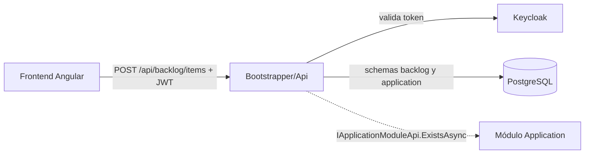

Contenedores (ALTERADO: antes no existía host ni `Shared`; el código vivía en `src/Modules/Backlog` y ahora está bajo `app/backend/` según la constitución):

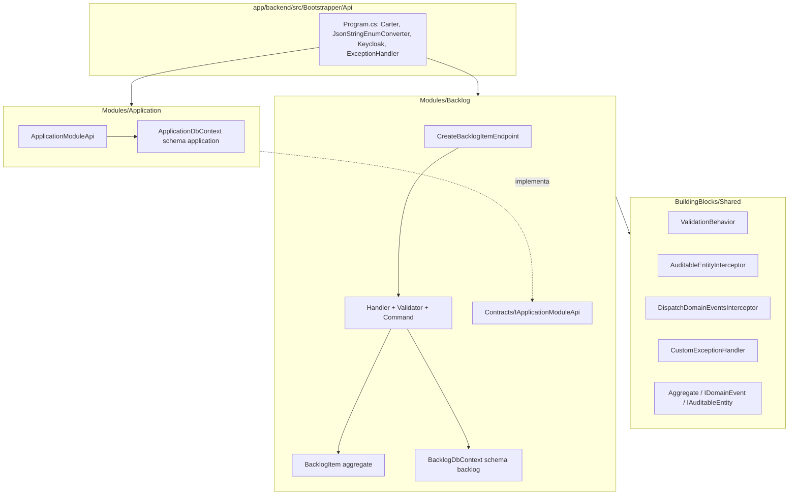

## 2. Arquitectura de Capas y Módulos

```text
app/backend/
├── TechWorkHub.sln
├── src/
│   ├── Bootstrapper/Api/            Program.cs, Api.csproj, appsettings*.json     (NUEVO)
│   ├── BuildingBlocks/Shared/       Aggregate<T>, IDomainEvent, IAuditableEntity, ICurrentUser,
│   │                                ValidationBehavior, AuditableEntityInterceptor,
│   │                                DispatchDomainEventsInterceptor, CustomExceptionHandler,
│   │                                BadRequest/NotFound exceptions                (NUEVO)
│   └── Modules/
│       ├── Backlog/                 (movido desde src/Modules/Backlog)
│       │   ├── BacklogModule.cs     AddBacklogModule + MigrateBacklogModuleAsync   (NUEVO)
│       │   ├── Contracts/IApplicationModuleApi.cs                                  (NUEVO)
│       │   ├── Domain/BacklogItems/ BacklogItem, Type(+IsTechnical), Priority, Status, BacklogItemRules, Events/
│       │   ├── Data/                BacklogDbContext, IBacklogDbContext, Configurations/, Migrations/  (NUEVO)
│       │   └── Features/BacklogItems/CreateBacklogItem/  Endpoint, Command, Handler, Validator
│       └── Application/             Módulo mínimo que implementa IApplicationModuleApi (NUEVO)
└── tests/
    ├── Unit/Backlog/                61 pruebas
    └── Integration/Backlog/         22 pruebas sobre el Program real (WebApplicationFactory)
```

Se eliminaron el `Aggregate` local y el `AuditableEntityInterceptor` vacío del módulo: ahora se reutiliza `Shared`.

## 3. Modelo de Datos y Persistencia

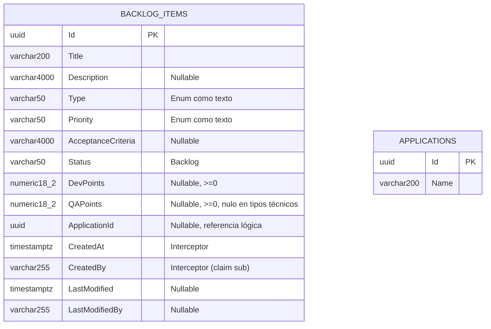

- Tabla `backlog."BacklogItems"` (schema `backlog` en minúscula) y `application."Applications"`; no hay FK ni joins entre schemas (`ApplicationId` es referencia lógica).
- **Alterado:** `Type` y `Priority` pasan de `int` a `varchar(50)` (texto, alineado con `data-model.md`); `Description`/`AcceptanceCriteria` ahora `varchar(4000)`.
- Migraciones Code-First: `Backlog/Data/Migrations/20261003204834_InitialBacklogSchema` y `Application/Data/Migrations/20261003204841_InitialApplicationSchema`, con historial `__EFMigrationsHistory` por schema.

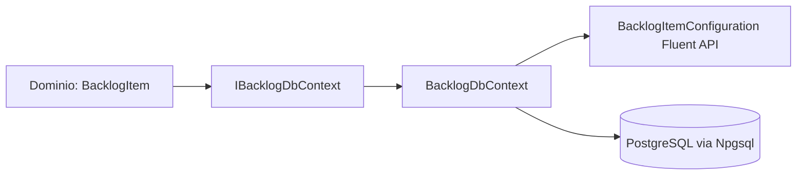

## 4. Flujo de Petición y Secuencias Críticas

```mermaid
sequenceDiagram
    actor U as Cliente
    participant A as Auth (Keycloak JWT)
    participant E as CreateBacklogItemEndpoint
    participant V as ValidationBehavior + Validator
    participant H as Handler
    participant AP as IApplicationModuleApi
    participant D as BacklogItem.Create
    participant DB as BacklogDbContext
    participant X as CustomExceptionHandler
    U->>A: POST /api/backlog/items (Bearer)
    A-->>U: 401 sin token o inválido
    A->>E: (command, CancellationToken de la solicitud)
    E->>V: Send(command, ct)
    V-->>X: ValidationException (Title/Type/Priority/puntos/longitudes)
    V->>H: command válido
    H->>H: Enum.TryParse de Type
    opt ApplicationId informado
        H->>AP: ExistsAsync(id, ct)
        AP-->>H: false → ValidationException(ApplicationId)
    end
    H->>D: Create(...)
    D-->>X: BadRequestException(QAPoints) si tipo técnico con qaPoints
    H->>DB: Add + SaveChangesAsync(ct)
    DB->>DB: AuditableEntityInterceptor (CreatedAt/CreatedBy; sin claim → 401)
    DB->>DB: DispatchDomainEventsInterceptor publica BacklogItemCreatedDomainEvent
    DB-->>H: commit
    H-->>E: Guid
    E-->>U: 201 Created { id } + Location
    X-->>U: 400 ProblemDetails con errors{} / 401 / 500
```

Cambios de comportamiento: la regla "tipo técnico ⇒ `qaPoints` nulo" vive en el agregado y **rechaza** (400) en lugar de anular en silencio (FR-008); el endpoint propaga el `CancellationToken`; `priority` y `type` viajan como texto (`JsonStringEnumConverter` global).

## 5. Seguridad y Manejo de Errores

- `POST /api/backlog/items` exige `.RequireAuthorization()` con JWT Keycloak (`Keycloak.AuthServices.Authentication`). El claim `sub` (o `NameIdentifier`) alimenta `CreatedBy`; sin claim → 401.

| Excepción | HTTP | Cuerpo |
|---|---|---|
| `ValidationException` (FluentValidation, incluye `ApplicationId` inexistente) | 400 | `ValidationProblemDetails` con `errors{Propiedad:[mensajes]}` |
| `BadRequestException` (regla de dominio, p. ej. `QAPoints` en tipo técnico) | 400 | `errors{Campo:[mensaje]}` |
| `BadHttpRequestException` (JSON malformado) | 400 | `errors{Request:[mensaje]}` |
| `UnauthorizedAccessException` (sin claim de identidad) | 401 | `ProblemDetails` |
| `NotFoundException` | 404 | `ProblemDetails` |
| `OperationCanceledException` con solicitud abortada | 499 | sin cuerpo |
| Cualquier otra | 500 | `ProblemDetails` genérico (sin detalles internos) |

## 6. ADRs

- **ADR-05 (heredado):** puntos de esfuerzo como `decimal?` (`numeric(18,2)`, `>= 0`). Se mantiene `decimal` en vez del `int?` antiguo de `data-model.md`; el documento se alineó.
- **ADR-06 (esta iteración):** `Shared` no existía en el repositorio; se creó con el mínimo que exigen la constitución y el plan (ValidationBehavior, interceptores, ExceptionHandler, Aggregate). Consecuencia: si el starter kit oficial `backend-modulith-template` se incorpora, debe reemplazar este proyecto conservando los contratos.
- **ADR-07 (esta iteración):** `IApplicationModuleApi` vive en `Backlog.Contracts` y lo implementa un módulo `Application` mínimo con su propio schema; así Backlog nunca consulta tablas de otro schema. El módulo Application real, cuando exista, debe sustituir `ApplicationModuleApi`.
- **ADR-08 (esta iteración):** `applicationId` inexistente se resuelve con `ValidationException` (clave `ApplicationId`) en el handler, que el `CustomExceptionHandler` mapea a 400; `NotFoundException` queda reservada al 404 general.
- **ADR-09 (esta iteración):** `Type` y `Priority` se persisten como texto para legibilidad y para que reordenar el enum no corrompa datos.

## 7. Cambios de esta ejecución (2026-10-03, speckit-implement backend — retrabajo)

Tareas cerradas: T013, T014, T018, T019 (con evidencia de pruebas), T020–T031 (servidor). Hallazgos: DEF-01, DEF-02 (confirmado y commiteado), DEF-03, DEF-04, DEF-05, DEF-06, `CancellationToken`, `JsonStringEnumConverter`, regla QAPoints al dominio, límites de longitud, `TryParse`, migración y schema `backlog`.

Verificación: `dotnet test TechWorkHub.sln` → 61 unitarias + 22 de integración correctas.

## 8. Cambios iteración 2/2 (hallazgos #16, #18, #19) — renderizado selectivo

Tareas cerradas (servidor): T038 (#16), T040 y T041 (#18), T042 (#19). Sin cambios: dominio, validadores, `Shared`, esquema de datos.

### 8.1 #16 — `GET /api/applications` (ALTERADO)

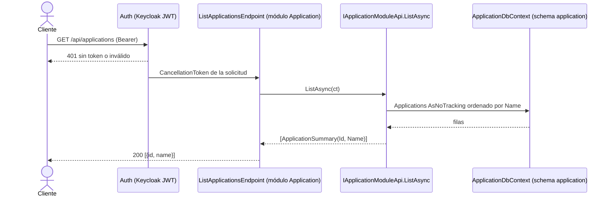

- Slice `Application/Features/Applications/ListApplications/ListApplicationsEndpoint.cs` (Carter, `.RequireAuthorization()`, `CancellationToken`).
- `IApplicationModuleApi` gana `ListAsync` y el record `ApplicationSummary(Guid Id, string Name)` (en `Backlog.Contracts`); `ApplicationModuleApi` lo implementa solo sobre el schema `application`.
- `Application.csproj` añade `FrameworkReference Microsoft.AspNetCore.App` y `Carter`; Carter descubre el endpoint entre ensamblados.

### 8.2 #19 — identidad antes del catálogo (ALTERADO)

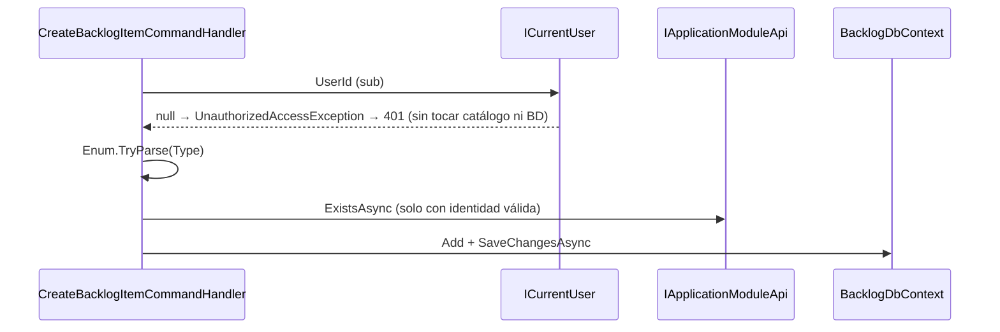

El interceptor de auditoría conserva su comprobación como defensa en profundidad.

### 8.3 #18 — Keycloak por entorno y migraciones (ALTERADO)

| Clave `Keycloak` | `appsettings.json` (base) | `appsettings.Development.json` |
|---|---|---|
| `ssl-required` | `external` | `none` |
| `verify-token-audience` | `true` (audiencia = `resource`) | `false` |
| `auth-server-url` | `https://keycloak.invalid/` (marcador; se inyecta `Keycloak__auth-server-url`) | `http://localhost:8080/` |

- Sin secretos versionados: URL real y credenciales llegan por variables de entorno.
- Migraciones: la API no migra fuera de Development (`Database:MigrateOnStartup=false` en la base). El despliegue ejecuta `app/backend/scripts/apply-migrations.sh|.ps1`, que generan y corren un bundle EF por módulo (`Application`, `Backlog`) con `ConnectionStrings__Database`.

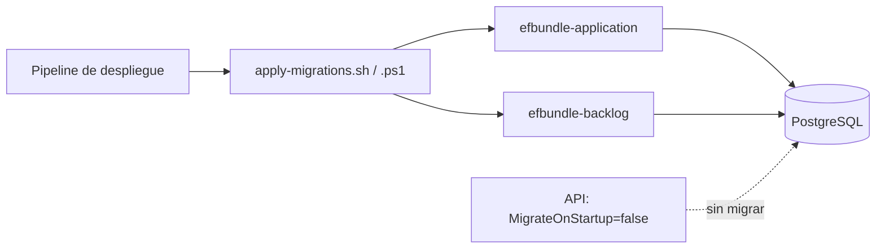

### 8.4 Verificación

`dotnet test TechWorkHub.sln`: 62 unitarias y 29 de integración correctas. Nuevas: `ListApplicationsTests` (200 con token, 401 sin token y sin consultar el catálogo, 401 sin `sub` sin consultar el catálogo), `KeycloakConfigurationTests` (la base falla si queda insegura) y `MigrationsPostgresTests` (migraciones sobre PostgreSQL 16 real con Testcontainers, incluida idempotencia).

## 10. HU-002 — Pruebas de integración con Keycloak y catálogo reales (renderizado selectivo)

Alterado: solo se añade el proyecto de pruebas `app/backend/tests/Integration/Identity` (`Identity.IntegrationTests`, registrado en `TechWorkHub.sln`) y `app/backend/README.md`. **Sin cambios** en `app/backend/src/**` (producción), en el esquema de datos ni en los contratos HTTP de HU-001.

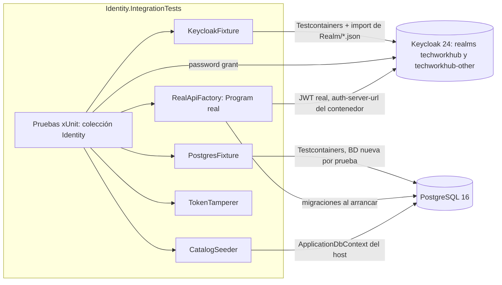

```mermaid
sequenceDiagram
    participant T as Prueba
    participant K as Keycloak real
    participant A as Program real (Api)
    participant C as ApplicationModuleApi real
    participant P as PostgreSQL real
    T->>P: CatalogSeeder crea aplicaciones (schema application)
    T->>K: password grant (cliente techworkhub-tests, audience techworkhub-api)
    K-->>T: access token
    T->>A: GET /api/applications o POST /api/backlog/items (Bearer)
    A->>K: metadata/claves (auth-server-url del contenedor)
    A->>C: ListAsync / ExistsAsync
    C->>P: consulta schema application
    A-->>T: 200/201 (token válido) o 401 (ausente, firma alterada, expirada, otro emisor, otra audiencia)
    T->>P: verifica filas (sin efectos en 401; CreatedBy == sub en 201)
```

| Pieza | Responsabilidad |
|---|---|
| `Fixtures/KeycloakFixture` | Keycloak real por suite, `BaseAddress` única, `GetTokenAsync(TokenVariant)`, primer token con reintento acotado, fallo explícito que nombra "Keycloak" |
| `Fixtures/PostgresFixture` | PostgreSQL por suite, BD nueva por prueba; fallo explícito que nombra "PostgreSQL/Docker" |
| `Fixtures/RealApiFactory` | Hospeda el `Program` real; solo inyecta cadena de conexión, `MigrateOnStartup`, `Keycloak:auth-server-url` y `Keycloak:ssl-required=none`; sin sustituir servicios |
| `Realm/*.json` | Realms `techworkhub` (clientes `techworkhub-tests`, `-noaud`, `-shortlived`) y `techworkhub-other`; usuario `qa.user` |
| `Support/CatalogSeeder`, `TokenTamperer`, `ItemPayload` | Siembra del catálogo real, alteración de firma, payload válido de HU-001 |

- **Resultado del spike T008 (excepción acotada, para revisión de QA-Tech / T030):** con `Keycloak:ssl-required=external` el host lanza "The MetadataAddress or Authority must use HTTPS" ante el Keycloak HTTP del contenedor. La única relajación es `ssl-required=none` en la fábrica de la suite; `verify-token-audience=true`, `realm=techworkhub` y `resource=techworkhub-api` se mantienen y los protege `ProductionConfigGuardTests`. El entorno de la fábrica es `Testing` para no cargar `appsettings.Development.json` (que desactiva la audiencia).
- **Cobertura:** 19 casos = US1 (3) + US2 (3) + US3 (10: 5 credenciales × 2 rutas) + guardias (2) + idempotencia (1).
- **Verificación (2026-10-03):** `dotnet test TechWorkHub.sln` → 62 unitarias, 31 de integración de Backlog y 19 de Identity, todas correctas. `git diff main -- app/backend/src` sin cambios de código fuente (solo artefactos `bin/obj` ya rastreados). Anti-tautología: sin el *audience mapper* en `techworkhub-tests`, las pruebas de camino feliz devuelven 401; el realm se restauró.
- Primera ejecución: descarga de imágenes; usar `IDENTITY_TESTS_STARTUP_TIMEOUT_SECONDS=400`.

## 11. HU-003 — Módulo `Sprints`: crear y consultar Sprints de 2 semanas (renderizado selectivo)

Alterado: nuevo módulo `Modules/Sprints` (schema `sprints`, `SprintsDbContext` propio), tres endpoints en Vertical Slice, migración `InitialSprintsSchema`, registro en `Api.csproj`/`Program.cs`/`TechWorkHub.sln` y en los scripts `apply-migrations`. **Sin cambios** en `Shared`, `Backlog` ni `Application`. El frontend (T005, T038–T048, T052) queda fuera de esta ejecución (alcance solo backend).

### 11.1 Contenedores y estructura

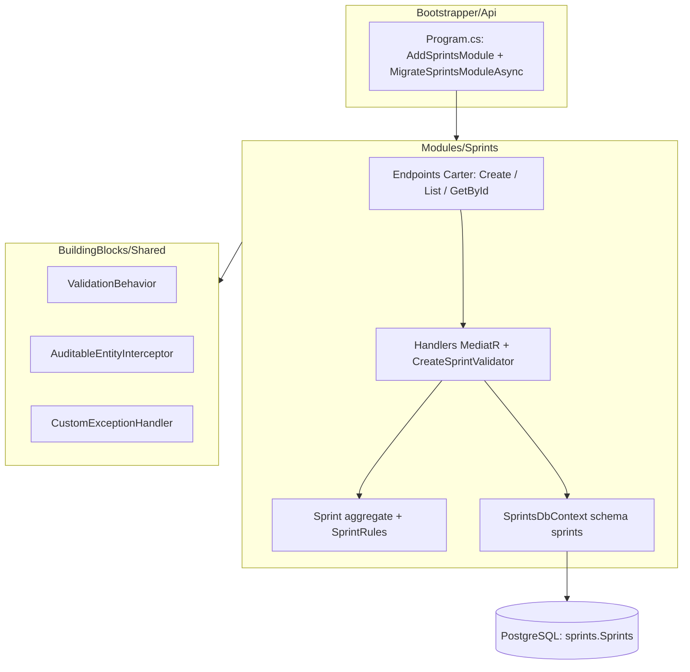

```text
app/backend/src/Modules/Sprints/
├── Sprints.csproj
├── SprintsModule.cs                          AddSprintsModule + MigrateSprintsModuleAsync (NUEVO)
├── Domain/Sprints/                           Sprint (Aggregate<Guid>, IAuditableEntity), SprintRules
├── Data/                                     ISprintsDbContext, SprintsDbContext, SprintsDbContextFactory,
│   │                                         Configurations/SprintConfiguration, Migrations/InitialSprintsSchema
└── Features/Sprints/
    ├── SprintResponse.cs                     Id, Identification, StartDate, EndDate (compartido)
    ├── CreateSprint/                         Command · Validator · Handler · Endpoint
    ├── ListSprints/                          Query · Handler · Endpoint
    └── GetSprintById/                        Query · Handler · Endpoint
tests/Unit/Sprints/                           43 pruebas (dominio, validador, handlers)
tests/Integration/Sprints/                    46 pruebas sobre el Program real y PostgreSQL real (Testcontainers)
```

### 11.2 Modelo de datos

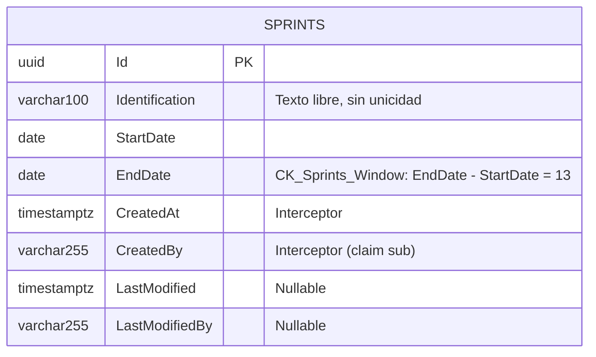

Tabla `sprints."Sprints"` sin FK ni navegación hacia `backlog`/`application`, sin estado y sin índice único. La regla de ventana (14 días calendario inclusivos, `fin = inicio + 13`) tiene fuente única `SprintRules.WindowDays` y se aplica en tres capas: validador (400 por campo), `Sprint.Create` (`BadRequestException`) y la restricción `CK_Sprints_Window`.

### 11.3 Contrato HTTP

| Método y ruta | Éxito | Errores |
|---|---|---|
| `POST /api/sprints` `{identification, startDate, endDate}` | 201 + `Location: /api/sprints/{id}` y `{id, identification, startDate, endDate}` | 400 (`errors` por campo camelCase), 401, 500 |
| `GET /api/sprints` | 200, arreglo ordenado por `startDate` y `id` | 401 |
| `GET /api/sprints/{id:guid}` | 200 `SprintResponse` | 401, 404 (un id que no es GUID no coincide con la ruta) |

Los tres exigen `.RequireAuthorization()` y propagan el `CancellationToken` hasta EF Core.

### 11.4 Secuencia: crear Sprint

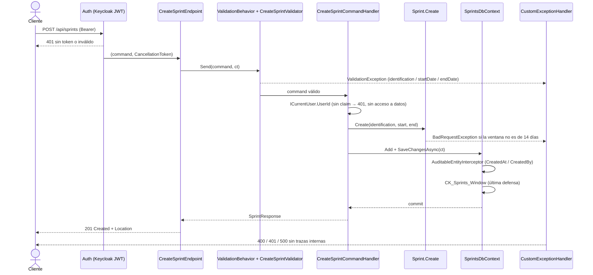

### 11.5 Errores específicos

| Origen | HTTP | Campo en `errors` |
|---|---|---|
| Identificación vacía o > 100 caracteres | 400 | `identification` |
| Fecha ausente o con formato distinto de `yyyy-MM-dd` | 400 | `startDate` / `endDate` |
| Fin ≤ inicio, o ventana ≠ 14 días | 400 | `endDate` |
| Sprint inexistente | 404 | — |
| Fallo de persistencia | 500 | `ProblemDetails` genérico |

### 11.6 Decisiones de esta iteración

- **ADR-10 — claves de error en camelCase:** el `CustomExceptionHandler` de `Shared` usa el nombre de propiedad tal cual (PascalCase en Backlog). El contrato OpenAPI de HU-003 exige camelCase, así que el validador usa `OverridePropertyName` y `BadRequestException` recibe constantes camelCase de `SprintRules`, sin modificar `Shared`. Consecuencia: Sprints y Backlog difieren en el casing de `errors`; unificarlo requiere tocar `Shared` y es decisión del equipo.
- **ADR-11 — sin Mapster en este módulo:** `tasks.md` (T001/T021) mencionaba Mapster, pero ningún módulo del repositorio lo referencia y `SprintResponse` es un record de cuatro campos. Se proyecta con el constructor del record (`Select(s => new SprintResponse(...))`), sin mapeadores ni librerías nuevas.
- **ADR-12 — scripts de despliegue:** `apply-migrations.sh|.ps1` solo migraban `Application` y `Backlog`; se añadió `Sprints` para que el schema se cree fuera de Development. Es un cambio fuera de la lista de ficheros permitidos de `tasks.md`, necesario para que el despliegue no omita el módulo.
- **ADR-13 — pruebas de lectura con proveedor en memoria:** los handlers de listado y detalle se prueban unitariamente sobre el `SprintsDbContext` real con `Microsoft.EntityFrameworkCore.InMemory` (solo en el proyecto de pruebas); la verificación contra PostgreSQL real la hacen las pruebas de integración.

### 11.7 Verificación

`dotnet test app/backend/TechWorkHub.sln` (2026-10-04): `Sprints.UnitTests` 43, `Sprints.IntegrationTests` 46, `Backlog.UnitTests` 62, `Backlog.IntegrationTests` 31 e `Identity.IntegrationTests` 19, todas correctas. Se instaló `dotnet-ef` 8.0.11 (global) para generar la migración; los scripts de bundle siguen sin ejecutarse.

## 12. HU-004 — Asignación de elementos del Backlog a un Sprint (renderizado selectivo)

Fuente: `specs/004-HU_asignacion_elementos_sprint/` (`plan.md`, `data-model.md`, `contracts/`, `tasks.md`). Alcance de esta pasada: solo backend; las tareas de frontend (T002, T041–T049, T051) no se ejecutaron.

**Reconciliación vinculante:** un elemento pertenece a **un solo Sprint**. Repetir la asignación (mismo u otro Sprint) responde **409 Conflict** por el índice único `UX_SprintItems_ItemId`; FR-015 de `spec.md` queda sin efecto.

### 12.1 Componentes nuevos o alterados

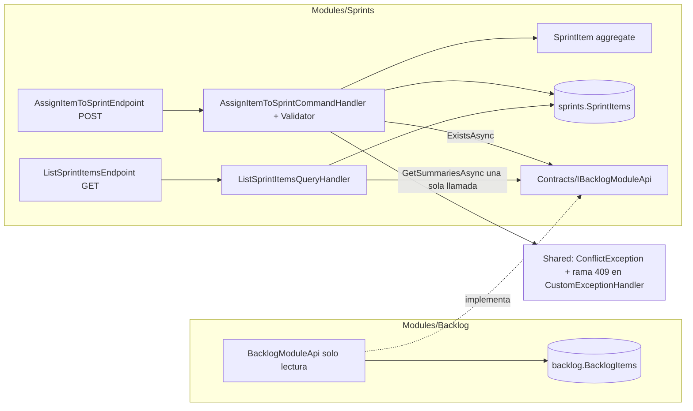

| Elemento | Ubicación | Nota |
|---|---|---|
| `ConflictException` + rama 409 | `BuildingBlocks/Shared/Exceptions/` | Aditivo; 400/404/500 sin cambios |
| `IBacklogModuleApi`, `BacklogItemSummary` | `Sprints/Contracts/` | `Type` viaja como `string`; sin FKs ni consultas cross-schema |
| `BacklogModuleApi` | `Backlog/BacklogModuleApi.cs` | `AsNoTracking`, una consulta por lote; `Backlog.csproj` referencia `Sprints.csproj`; registrado en `BacklogModule.cs` |
| `SprintItem`, `SprintItemRules` | `Sprints/Domain/SprintItems/` | `Aggregate<Guid>, IAuditableEntity`; sin estado ni eventos |
| `SprintItemConfiguration` + migración `AddSprintItems` | `Sprints/Data/` | Fluent API; solo crea `sprints."SprintItems"` |
| `AssignItemToSprint` / `ListSprintItems` | `Sprints/Features/SprintItems/` | Co-localizados (VSA): comando/consulta, validador, handler, endpoint Carter |

### 12.2 Modelo de datos

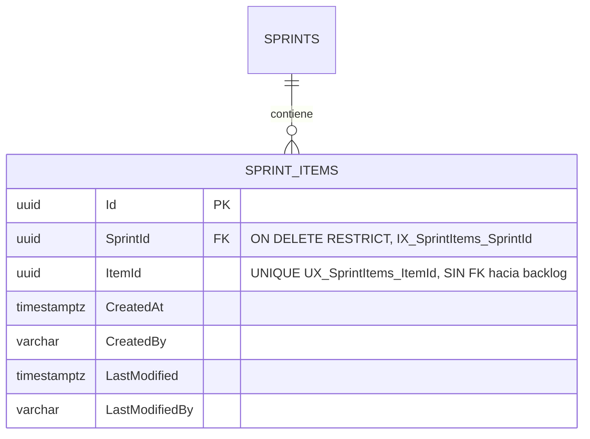

### 12.3 API

| Método y ruta | Respuestas |
|---|---|
| `POST /api/sprints/{sprintId}/items` cuerpo `{ itemId }` | 201 `{ sprintId, itemId }` + `Location`; 400 por campo (`sprintId`/`itemId`); 401; 404 Sprint o elemento (gana el del Sprint); 409 ya asignado (sin revelar a qué Sprint); 500 |
| `GET /api/sprints/{sprintId}/items` | 200 `[{ id, title, type, devPoints, qaPoints }]` con `devPoints`/`qaPoints` decimales o `null` (vacío si no hay), orden `CreatedAt` luego `Id`; 401; 404 (también si `sprintId` no es GUID) |

### 12.4 Secuencia de asignación

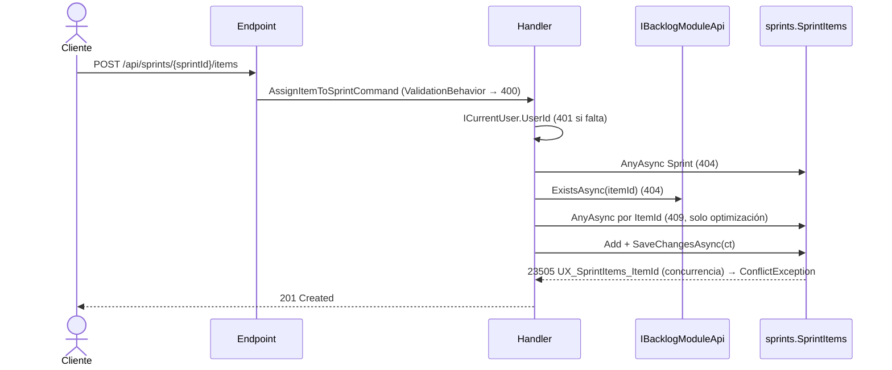

Otro `DbUpdateException` (distinta restricción) no se traduce y termina en 500 sin traza.

### 12.5 Verificación (2026-10-04)

`dotnet test app/backend/TechWorkHub.sln`: `Sprints.UnitTests` 86, `Sprints.IntegrationTests` 85, `Backlog.UnitTests` 62, `Backlog.IntegrationTests` 31, `Identity.IntegrationTests` 19, todas correctas. Incluye 409 bajo concurrencia, 401 sin lectura/escritura, 500 sin traza ni fila parcial y 100 elementos listados en < 2 s. Único ajuste a una prueba previa: `MigrationsPostgresTests` ahora espera también `sprints.SprintItems`. `git status` confirma que no se tocaron `Sprint`, `SprintRules`, `InitialSprintsSchema`, `BacklogItem`, `BacklogDbContext` ni `Modules/Application`.

### 12.6 Retrabajo iteración 1/2 — DEF-01 (fidelidad de estimaciones) y DEF-02 (trazabilidad del 409)

Alcance: solo backend (T055–T058, T061, T062). Las tareas de interfaz T059 y T060 quedan pendientes para el agente frontend.

**DEF-01 (FR-018).** `DevPoints`/`QAPoints` viajan como `decimal?` de extremo a extremo, sin redondeo ni conversión de `null` a 0. Se eliminó `ToWholePoints` de `BacklogModuleApi`. No hay cambio de esquema ni migración (las columnas ya son `numeric(18,2)` nullable).

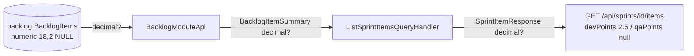

| Contrato | Antes | Ahora |
|---|---|---|
| `BacklogItemSummary.DevPoints` / `QAPoints` | `int` (redondeado, `null` → 0) | `decimal?` |
| `SprintItemResponse.DevPoints` / `QAPoints` | `int` | `decimal?` |

**DEF-02.** `spec.md` ya declaraba FR-015 reemplazado por FR-017 (409) y FR-018. Se alinearon la trazabilidad de las pruebas (`AssignItemToSprintTests`, `MigrationsPostgresTests`) y `quickstart.md` (escenarios 8 y 9 → FR-017, nuevo escenario 11 → FR-018).

**Verificación:** `SprintItemsEstimationFidelityTests` 2/2 en verde. Nuevas pruebas: `BacklogModuleApiTests` (2.5 sin redondear y QA nulo) y `ListSprintItemsTests` (JSON con `devPoints` 2.5 y `qaPoints` null). `Sprints.UnitTests` 86, `Sprints.IntegrationTests` 89, `Backlog.UnitTests` 62, `Backlog.IntegrationTests` 31, todas correctas.

## 13. HU-012 — Módulo `Teams`: miembros del equipo y roles técnicos (renderizado selectivo)

Fuente: `specs/012-HU_miembros_equipo_y_roles_tecnicos/` (`plan.md`, `data-model.md`, `contracts/teams-api.openapi.yaml`, `tasks.md`). Alcance de esta pasada: solo backend; las tareas de frontend (T006, T023–T025, T029, T033, T037, T039, T042, T044, T047, T050, T051, T054, T056, T058) no se ejecutaron.

### 13.1 Componentes nuevos

Módulo nuevo `Modules/Teams` (schema `teams`). Fuera de él solo se tocaron `TechWorkHub.sln`, `Api.csproj` y `Program.cs` (registro del módulo y migración al arrancar). Sin eventos de dominio, Outbox, caché ni consultas hacia otros schemas.

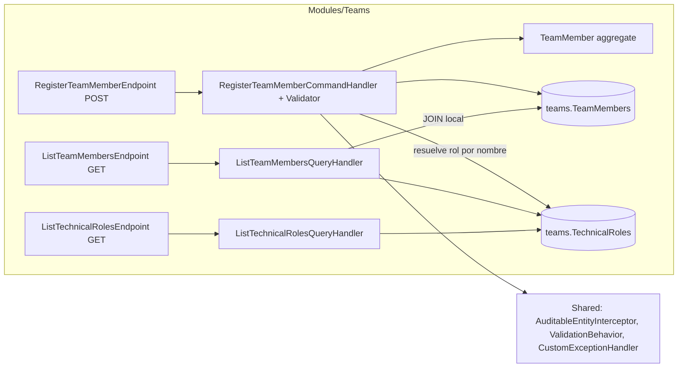

### 13.2 Modelo de datos (migración `InitialTeamsSchema`)

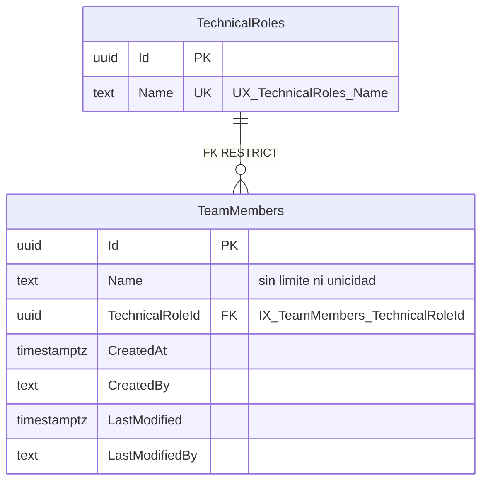

El catálogo se siembra con `HasData` (`Desarrollo` y `QA`, GUID fijos en `TechnicalRoleSeed`); no existe alta, edición ni baja de roles.

### 13.3 Registro de un miembro

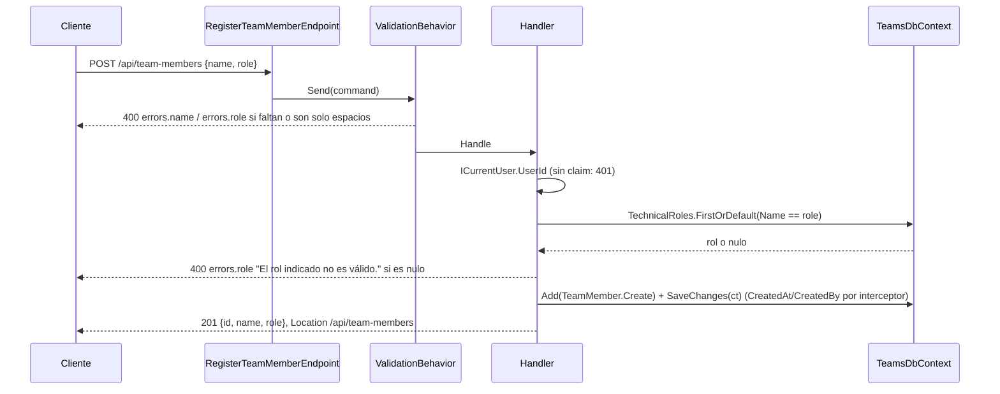

### 13.4 Endpoints

| Método y ruta | Respuesta | Notas |
|---|---|---|
| `POST /api/team-members` | 201 `{ id, name, role }` | `role` es el NOMBRE del rol (sensible a mayúsculas); 400 si rol inexistente o nombre/rol vacíos; 401; 500 |
| `GET /api/team-members` | 200 `[{ id, name, role }]` | Orden `CreatedAt`, `Id`; `[]` si no hay miembros |
| `GET /api/technical-roles` | 200 `[{ id, name }]` | Orden por `Name` |

Todos exigen JWT. **Desviación respecto de `tasks.md` (T031/T036):** el 400 por rol inexistente viaja como `errors.role = ["El rol indicado no es válido."]` (formato único de `CustomExceptionHandler`, que no se puede modificar por FR-014), no como `detail`. El frontend debe leer `errors.role`.

### 13.5 Verificación

`Teams.UnitTests` 27 y `Teams.IntegrationTests` 38 (PostgreSQL 16 real por Testcontainers) en verde: migración solo en `teams`, semilla, `UX_TechnicalRoles_Name` (23505), FK (23503), 201/400/401/500, auditoría desde el claim `sub`, no regresión en `backlog` y `sprints`, y consultas con 100 miembros en < 2 s.

## 14. HU-015 — Relación entre personas, roles y elementos de trabajo (renderizado selectivo)

Fuente: `specs/015-HU_relacion_personas_roles_elementos/` (`plan.md`, `data-model.md`, `contracts/item-assignments-api.openapi.yaml`, `tasks.md`). Alcance de esta pasada: solo backend; las tareas de frontend (T004, T015, T021, T022, T031, T032, T037, T045, T048–T050, T053, T056–T058, T062) y el recorrido manual del quickstart (T063) no se ejecutaron. Sin cambios en `Shared`, `Application`, `Sprints`, `BacklogItem`, `BacklogDbContext`, `TeamMember`, `TechnicalRole` ni en la migración `InitialTeamsSchema`.

**Decisión vinculante (ADR-004 del SA):** repetir el par `(itemId, memberId)` es **idempotente**: 200 con la relación existente, sin nueva fila. No hay 409. Pendiente del BA reconciliar `spec.md` (Edge Case y FR-015).

### 14.1 Componentes nuevos o alterados

```mermaid
flowchart LR
    subgraph TM[Modules/Teams]
        EP1[AssignMemberToItemEndpoint POST] --> H1[AssignMemberToItemCommandHandler + Validator]
        EP2[ListItemAssigneesEndpoint GET] --> H2[ListItemAssigneesQueryHandler]
        EP3[ListMemberItemsEndpoint GET] --> H3[ListMemberItemsQueryHandler]
        H1 --> IA[ItemAssignment aggregate]
        H1 --> DB[(teams.ItemAssignments)]
        H2 -->|JOIN local| DB
        H3 --> DB
        C[Contracts/IBacklogItemLookup]
    end
    subgraph BL[Modules/Backlog]
        LK[BacklogItemLookup solo lectura] --> BDB[(backlog.BacklogItems)]
        EP4[ListBacklogItemsEndpoint GET]
    end
    H1 -->|ExistsAsync| C
    H3 -->|GetItemsAsync una sola llamada de lote| C
    LK -.implementa.-> C
    BL -->|ProjectReference| TM
```

| Elemento | Ubicación | Nota |
|---|---|---|
| `IBacklogItemLookup`, `BacklogItemRef(Id, Title, Type)` | `Teams/Contracts/` | `Type` viaja como `string`; no expone estimaciones, estado ni Sprint |
| `BacklogItemLookup` | `Backlog/BacklogItemLookup.cs` | `AsNoTracking`, una consulta por lote; registrado en `BacklogModule.cs`; `Backlog.csproj` referencia `Teams.csproj` (Teams no referencia Backlog) |
| `ItemAssignment`, `ItemAssignmentRules` | `Teams/Domain/ItemAssignments/` | `Aggregate<Guid>, IAuditableEntity`; sin rol, estado ni eventos |
| `ItemAssignmentConfiguration` + migración `AddItemAssignments` | `Teams/Data/` | Fluent API; solo crea `teams."ItemAssignments"` |
| `AssignMemberToItem`, `ListItemAssignees`, `ListMemberItems` | `Teams/Features/ItemAssignments/` | Co-localizados (VSA): comando/consulta, validador, handler, endpoint Carter |
| `ListBacklogItems` | `Backlog/Features/BacklogItems/ListBacklogItems/` | Consulta aditiva `GET /api/backlog-items` para el selector del UX (ADR-006) |

### 14.2 Modelo de datos

```mermaid
erDiagram
    TeamMembers ||--o{ ItemAssignments : "FK RESTRICT"
    ItemAssignments {
        uuid Id PK
        uuid ItemId "SIN FK hacia backlog; UNIQUE (ItemId, MemberId) UX_ItemAssignments_ItemId_MemberId"
        uuid MemberId FK "IX_ItemAssignments_MemberId"
        timestamptz CreatedAt
        varchar CreatedBy
        timestamptz LastModified
        varchar LastModifiedBy
    }
```

El rol NO se almacena: sale del rol técnico vigente del miembro (JOIN local con `TechnicalRoles`).

### 14.3 API

| Método y ruta | Respuestas |
|---|---|
| `POST /api/backlog-items/{itemId}/assignees` cuerpo `{ memberId }` | 201 `{ itemId, memberId, memberName, role }` + `Location: /api/backlog-items/{itemId}/assignees`; 200 mismo cuerpo si el par ya existía; 400 por campo (`itemId`/`memberId`); 401; 404 miembro o elemento (gana el miembro); 500 |
| `GET /api/backlog-items/{itemId:guid}/assignees` | 200 `[{ id, name, role }]` o `[]` (también para un elemento inexistente); 401 |
| `GET /api/team-members/{memberId:guid}/items` | 200 `[{ id, title, type }]` o `[]`; 401 |
| `GET /api/backlog-items` | 200 `[{ id, title, type }]` (sin paginación); 401 |

### 14.4 Secuencia de asignación

```mermaid
sequenceDiagram
    actor U as Cliente
    participant E as AssignMemberToItemEndpoint
    participant H as Handler
    participant B as IBacklogItemLookup
    participant DB as teams.ItemAssignments
    U->>E: POST /api/backlog-items/{itemId}/assignees {memberId}
    E->>H: AssignMemberToItemCommand (ValidationBehavior → 400 por campo)
    H->>H: ICurrentUser.UserId (401 si falta)
    H->>DB: Miembro + rol (JOIN local) (404 miembro)
    H->>B: ExistsAsync(itemId, ct) (404 elemento)
    H->>DB: AnyAsync por par (si existe → 200 sin escribir)
    H->>DB: Add + SaveChangesAsync(ct)
    DB-->>H: 23505 UX_ItemAssignments_ItemId_MemberId (carrera) → relee la fila ganadora → 200
    H-->>U: 201 Created + Location
```

Otro `DbUpdateException` (distinta restricción o código) se relanza y termina en 500 sin traza.

### 14.5 Verificación (2026-10-05)

`Teams.UnitTests` 57 y `Teams.IntegrationTests` 70 (PostgreSQL 16 real por Testcontainers) en verde, además de `Backlog.UnitTests` 62, `Backlog.IntegrationTests` 34, `Sprints.*` 86/89 e `Identity.IntegrationTests` 19. Cubren 201/200 idempotente, auditoría desde `sub`, concurrencia (un solo 201 y una fila), 400/404 con mensajes exactos, 401 sin lectura ni escritura, 500 sin traza ni fila parcial, no regresión en `backlog`/`sprints`/`teams`, y las consultas de lectura con una sola llamada de lote al contrato. Ajuste a una prueba previa: `TeamsMigrationTests` ahora espera también `teams.ItemAssignments`. Desviación respecto de `tasks.md`: T019 y T020 (pruebas de `BacklogItemLookup` y `GET /api/backlog-items`) se cubren como pruebas de integración sobre PostgreSQL real (`ListBacklogItemsTests`), sin añadir EF InMemory a `Backlog.UnitTests`.

## 15. HU-035 — Refactorización de esqueleto UI (sin cambios de backend)

Fuente: `specs/035-HU_refactorizacion_esqueleto_ui/` (`tasks.md`, `plan.md`, `contracts/ui-shell-contract.md`). Las 32 tareas (T001–T032) afectan solo a `app/frontend/` (layout de aplicación, rutas, tipografía global, lint). `tasks.md` prohíbe expresamente tocar `app/backend/**`, por lo que con alcance solo backend **no hay tareas que ejecutar**.

**Arquitectura backend vigente, sin cambios:** módulos `Backlog`, `Application`, `Sprints` y `Teams`, `Shared`, esquemas de datos, migraciones, contratos HTTP y pruebas descritos en las secciones 1–14 siguen siendo válidos. No se añadieron endpoints, tablas, lógica de dominio ni integraciones.

```mermaid
flowchart LR
    FE[Frontend Angular: shell, rutas, tipografía - HU-035] -->|mismos contratos HTTP + JWT| API[Bootstrapper/Api sin cambios]
    API --> PG[(PostgreSQL sin cambios)]
```

Verificación: no se ejecutaron ni modificaron pruebas de backend; `app/backend/README.md` sigue vigente y no requirió cambios.

## 16. HU-036 — Theming claro/oscuro de la UI (sin cambios de backend)

Fuente: `specs/036-HU_theming_claro_oscuro_ui/` (`tasks.md`, `plan.md`, `contracts/`). Las 45 tareas (T001–T045) afectan solo a `app/frontend/` (preset de tema, `ThemeService`, conmutador del shell, script anti-parpadeo en `index.html`, `lint:primeng`). `tasks.md` prohíbe expresamente tocar `app/backend/`, por lo que con alcance solo backend **no hay tareas que ejecutar** y no se modificó código.

**Arquitectura backend vigente, sin cambios:** módulos `Backlog`, `Application`, `Sprints` y `Teams`, `Shared`, esquemas, migraciones, contratos HTTP y pruebas descritos en las secciones 1–14 siguen siendo válidos. No se añadieron endpoints, tablas, lógica de dominio ni integraciones. La preferencia de tema vive solo en `localStorage` del navegador; no se persiste en el servidor.

```mermaid
flowchart LR
    FE[Frontend Angular: tema claro/oscuro, conmutador - HU-036] -->|mismos contratos HTTP + JWT| API[Bootstrapper/Api sin cambios]
    API --> PG[(PostgreSQL sin cambios)]
```

Verificación: no se ejecutaron ni modificaron pruebas de backend; `app/backend/README.md` sigue vigente y no requirió cambios.

## 9. Puntos abiertos

- HU-036: el theming (T001–T045) corresponde al agente frontend; el backend no requiere trabajo.

- HU-035: el esqueleto de UI (T001–T032) corresponde al agente frontend; el backend no requiere trabajo.

- HU-015: el frontend (pestaña `Responsables`, diálogo de asignación, vistas por elemento y por miembro, rutas e i18n) y el recorrido manual del quickstart (T063) no se ejecutaron en esta pasada, por alcance solo backend. `spec.md` aún dice "no documentado" para la asignación duplicada; es vinculante el 200 idempotente (ADR-004) y su actualización corresponde al BA. `scripts/apply-migrations.sh|.ps1` siguen sin incluir `Teams`.

- HU-004: frontend (T002, T041–T049, T051) y recorrido manual del quickstart (T052) no se ejecutaron en esta pasada, por alcance solo backend.

- HU-003: el frontend (páginas `sprint-form`, `sprint-list`, `sprint-detail`, rutas e i18n) y T052/T053 (escenario de UI del quickstart) no se ejecutaron en esta pasada, por alcance solo backend. El supuesto de ventana de 14 días inclusivos sigue pendiente de confirmación de negocio (punto abierto 3 de la HU).

- El resto de pruebas de integración sigue con SQLite en memoria; T037/T043 (INT-01..INT-10 sobre PostgreSQL) quedan para QA.
- Los scripts `apply-migrations` no se ejecutaron: `dotnet-ef` no está instalado en este entorno, así que la generación del bundle no está verificada (sí lo está la migración sobre PostgreSQL).
- `auth-server-url` base es un marcador: debe fijarse por entorno antes de desplegar.
- T017 (quickstart por cURL), T018, T025 y T032 siguen abiertas a la espera de evidencia de QA (T043). T039 y T032 son de interfaz, fuera de este alcance.

- HU-012: el frontend (página `/equipos`, diálogo de alta, pestaña de roles, rutas e i18n; T006, T023–T025, T029, T033, T037, T039, T042, T044, T047, T050, T051, T054, T056, T058) y el recorrido del quickstart (T061) no se ejecutaron en esta pasada, por alcance solo backend. `scripts/apply-migrations.sh|.ps1` no incluyen el módulo `Teams` (fuera de las rutas permitidas por FR-014); en desarrollo y pruebas lo cubre `Database:MigrateOnStartup`.
