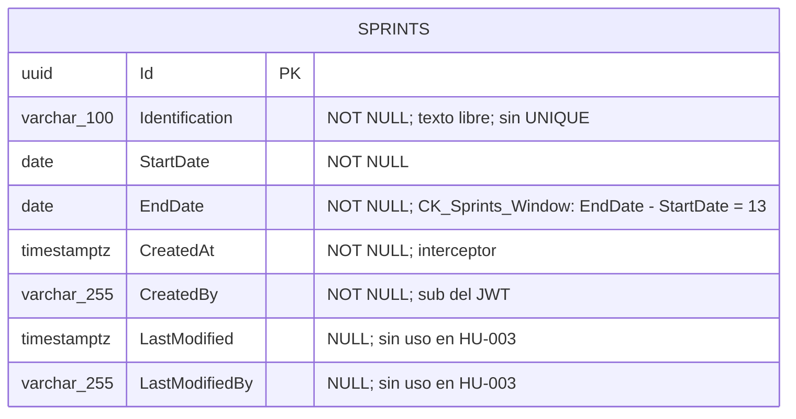
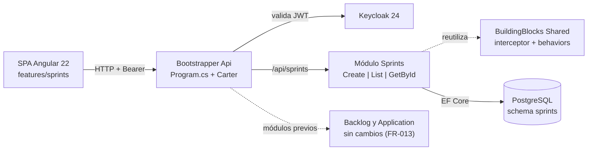
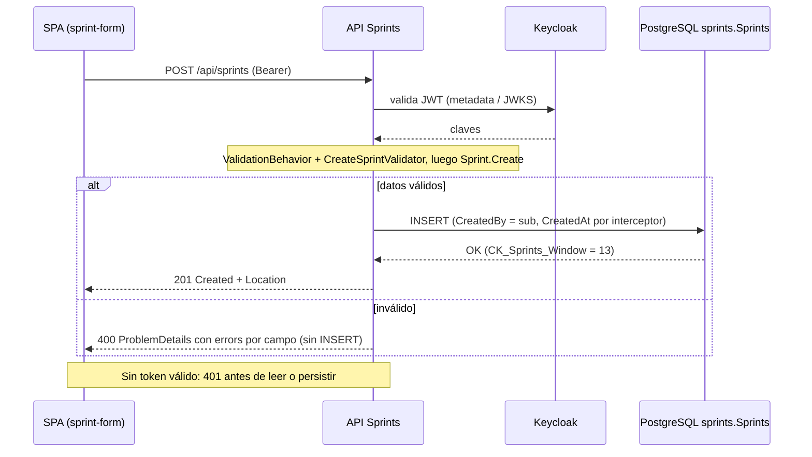
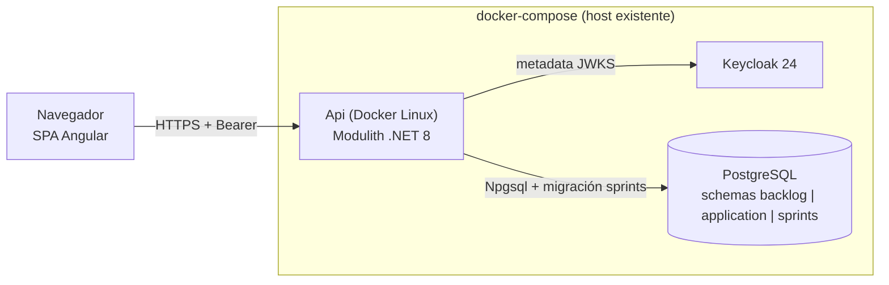

# TECH-DESIGN: Gestión de Sprint de Dos Semanas (Crear y Consultar)

- **Fecha de Compilación:** 04-10-2026
- **Auditor y Consolidador:** Agente QT Senior BMAD
- **Fuente SDD:** `specs/003-gestion-sprint-dos-semanas/spec.md`, `plan.md`, `tasks.md`, `data-model.md` y `contracts/sprints-api.openapi.yaml` (GitHub Spec Kit)
- **Insumos auditados:** `documents/solutions-architect/003-gestion-sprint-dos-semanas.md` (guía técnica del SA), `documents/data-architect/db-003-gestion-sprint-dos-semanas.md`, `documents/api-architect/api-003-gestion-sprint-dos-semanas.md`, `documents/designer-ux/ux-003-gestion-sprint-dos-semanas.md`
- **Modo de gobernanza:** Brownfield (`.specify/memory/constitution.md` prevalece; sin Cláusula de Excepción física)
- **Estado:** ✅ AUDITADO Y APROBADO (Auditoría Adversarial Exitosa: 0 hallazgos críticos, 6 advertencias vinculantes para Fase D)

---

## 1. Architecture Overview

HU-003 añade el **módulo nuevo `Sprints`** al Modulith .NET 8 (VSA, Carter, MediatR, FluentValidation, Mapster) con schema PostgreSQL propio `sprints` y `SprintsDbContext` independiente. Expone tres endpoints autenticados (`POST /api/sprints`, `GET /api/sprints`, `GET /api/sprints/{id}`) y tres páginas Angular 22 Zoneless (`sprint-form`, `sprint-list`, `sprint-detail`). Un Sprint tiene cuatro datos funcionales (`id`, `identification`, `startDate`, `endDate`) más auditoría persistida y no expuesta. La invariante "ventana de 14 días calendario inclusivos" se impone en tres capas con fuente única `SprintRules.WindowDays`.

- **Patrón principal:** Modular Monolith + VSA, CQRS intra-proceso, CRUD de una sola tabla sin eventos, Outbox ni caché (proporcional a SC-005, 100 Sprints).
- **Restricción dura:** no se modifica `Modules/Backlog`, `Modules/Application`, `BuildingBlocks/Shared`, `core/auth` ni `features/backlog`. Cambios permitidos fuera del módulo: `Api.csproj`, `Program.cs`, `TechWorkHub.sln`, `app.routes.ts`.
- **Validación cruzada contra `spec.md`/`tasks.md`:** los 16 FR, los 6 SC y las tareas T001–T054 tienen soporte en `db-003` y `api-003`.

### 1.1. Auditoría Cruzada (resultado)

| Eje | Resultado | Evidencia verificada |
|---|---|---|
| DB vs API vs Spec Kit | ✅ Sin discrepancias bloqueantes | Mapeo payload→columnas 1:1 (`id`, `identification`, `startDate`, `endDate`); `CreatedAt`/`CreatedBy` persistidos y no expuestos; FR-001..FR-015 cubiertos por la matriz Spec→Contrato; T011 coincide con `db-003` salvo la longitud de `CreatedBy` (ver D-01) |
| UI → Data (campos huérfanos) | ✅ Cero huérfanos | Los 10 estados de `ux-003` solo muestran `Id`, `Identification`, `StartDate`, `EndDate`; todos tienen columna. No hay estado, filtros, paginación ni tarjetas en UI |
| ADRs (alternativas/trade-offs falsos) | ✅ con reservas | Los ADR no heredados (SA-004..007, DA-03..05, API-03, 05, 06) incluyen alternativas viables (`timestamptz`, `EXCLUDE gist`, `Idempotency-Key`, paginación) y costos reales (migración del `CHECK`, duplicados, cambio incompatible de contrato). Reservas en D-03 |
| Gobernanza / Anti-Sycophancy | ✅ | Ninguna tecnología ajena a la constitución; ninguna decisión justificada por el tracker; ADR impuestos marcados `Aceptado (heredado)` sin alternativas artificiales |
| Proporcionalidad | ✅ | Una tabla, un schema, sin RabbitMQ/Redis/Outbox; la defensa de ventana en 3 capas es proporcionada a SC-003/FR-015 |
| Código `Shared` (afirmaciones del API) | ✅ Verificado | `CustomExceptionHandler` emite `ProblemDetails` con `errors` por campo para `ValidationException`, mapea `UnauthorizedAccessException`→401 y `NotFoundException`→404; `AuditableEntityInterceptor` lanza `UnauthorizedAccessException` sin claim; `BacklogItemRules.UserMaxLength = 255` |

---

## 2. Components

| Componente | Responsabilidad | Tareas |
|---|---|---|
| `Modules/Sprints/Sprints.csproj`, `SprintsModule.cs` | Proyecto nuevo; `AddSprintsModule()` y `MigrateSprintsModuleAsync()` | T001, T004, T014, T015 |
| `Domain/Sprints/Sprint.cs`, `SprintRules.cs` | Agregado `Sprint : Aggregate<Guid>, IAuditableEntity`; fuente única de la regla (`WindowDays = 14`, `IdentificationMaxLength = 100`, `DateFormat`) | T006–T008 |
| `Data/SprintsDbContext`, `SprintConfiguration`, `Migrations/InitialSprintsSchema` | Schema `sprints`, tabla `Sprints`, `CK_Sprints_Window` | T009–T013 |
| `Features/Sprints/CreateSprint/` | Command, validador, handler y endpoint `POST /api/sprints` | T020–T022, T026 |
| `Features/Sprints/ListSprints/` | Query, handler y endpoint `GET /api/sprints` | T030–T032 |
| `Features/Sprints/GetSprintById/` | Query, handler y endpoint `GET /api/sprints/{id:guid}` | T035–T037 |
| `Features/Sprints/SprintResponse.cs` | DTO compartido de cuatro campos | T020 |
| `tests/Unit/Sprints`, `tests/Integration/Sprints` | xUnit + FluentAssertions + Testcontainers PostgreSQL | T002, T003, T007, T016–T019, T024, T025, T028, T029, T033, T034 |
| `app/frontend/src/app/features/sprints/` | `sprint-form`, `sprint-list`, `sprint-detail`, `sprint-api.service.ts`, `sprint.models.ts`, rutas lazy | T005, T038–T048 |
| Módulos `Backlog`, `Application`, `Shared`, `core/auth` | Solo lectura: se reutilizan interceptores, behaviors, excepciones, `ICurrentUser`, guard e interceptor Bearer | — |

---

## 3. Data Model

*(Contenido íntegro de `db-003-gestion-sprint-dos-semanas.md`: MER, Diccionario de Datos, trazabilidad y riesgos. Verificado: una sola tabla nueva, cero campos huérfanos frente a `ux-003`, sin FK ni JOIN cross-schema.)*

### 2. MODELO ENTIDAD-RELACIÓN (MER)



---

### 3. DICCIONARIO DE DATOS Y RESTRICCIONES
*(Mapeado a `spec.md` (Key Entity Sprint), `data-model.md`, `tasks.md` T011 y a los estados visuales UX 1, 3 y 5.)*

### Tabla: `sprints."Sprints"` (`Sprint : Aggregate<Guid>, IAuditableEntity`)
- `Id` (`uuid`): Llave primaria (`PK_Sprints`). Lo genera el servidor (FR-002).
- `Identification` (`character varying(100)`): NOT NULL, no vacía. Texto libre; sin unicidad (ADR-05). Longitud máxima = `SprintRules.IdentificationMaxLength`.
- `StartDate` (`date`): NOT NULL. Entrada `yyyy-MM-dd`.
- `EndDate` (`date`): NOT NULL. Restringida por `CK_Sprints_Window`.
- `CreatedAt` (`timestamp with time zone`): NOT NULL. `AuditableEntityInterceptor` (FR-006).
- `CreatedBy` (`character varying(255)`): NOT NULL. `sub` del token vía `ICurrentUser`; nunca del cuerpo (FR-006).
- `LastModified` (`timestamp with time zone`): NULL. Sin uso en esta HU.
- `LastModifiedBy` (`character varying(255)`): NULL. Sin uso en esta HU.

**Restricciones:** `PK_Sprints` (`Id`); `CK_Sprints_Window` (`("EndDate" - "StartDate") = 13`). Sin `UNIQUE`, sin FK, sin columnas de estado.
**Migración:** `InitialSprintsSchema` en `app/backend/src/Modules/Sprints/Data/Migrations/`; solo crea el schema `sprints`, la tabla y el `CHECK`.

### Trazabilidad Spec / UX → Datos (cero campos huérfanos)

| Requisito / Estado UX | Dato que lo sustenta |
|---|---|
| FR-001, FR-002; UX 1, 2 | `Id`, `Identification`, `StartDate`, `EndDate` |
| FR-003, FR-004, FR-015, SC-002, SC-003; UX 6 | `CK_Sprints_Window` + validador + `Sprint.Create` |
| FR-005; UX 7 | `Identification` NOT NULL (≤ 100), `StartDate`/`EndDate` NOT NULL |
| FR-006 | `CreatedAt`, `CreatedBy` |
| FR-007, FR-008; UX 3, 5 | Lectura de `Id`, `Identification`, `StartDate`, `EndDate` (orden `StartDate` asc, `Id`) |
| FR-009; UX 8 | Ausencia de fila para el `Id` solicitado |
| FR-011, FR-012; UX 10 | Una sola sentencia `INSERT` por `SaveChangesAsync` (transacción implícita): sin fila parcial |
| FR-013, SC-006 | Sin FK ni columnas hacia `backlog` / `application` |
| FR-014 | Sin columnas de estado, apertura ni cierre |
| FR-010; UX 9 | Sin dato de persistencia (rechazo previo, 401) |

Los metadatos de auditoría (`CreatedAt`, `CreatedBy`) se persisten pero no se muestran en ninguna pantalla (UX Estado 5), por decisión del contrato de respuesta y no por falta de columna.

---

### 4. RIESGOS DE INTEGRIDAD Y ESCALABILIDAD
- `⚠️ RIESGO (discrepancia con data-model.md/T011):` `data-model.md` y T011 definen `CreatedBy`/`LastModifiedBy` como `varchar` sin longitud; la entidad Backlog usa `varchar(255)` (`BacklogItemRules.UserMaxLength`). Este diseño fija `varchar(255)` por coherencia con HU-001. Debe reconciliarse en la implementación de T011 (p. ej. constante `SprintRules.UserMaxLength = 255`); sin ello el schema divergería del resto del Modulith.
- `⚠️ RIESGO (duplicados):` Sin índice único ni idempotencia, un doble envío o un reintento crea Sprints duplicados (ADR-05). Mitigación únicamente en UI (botón deshabilitado durante el envío). Punto abierto 4 de la HU.
- `⚠️ RIESGO (solapamiento / pasado):` Nada en base de datos impide Sprints solapados ni con inicio en el pasado (puntos abiertos 5 y 6). Si el negocio los prohíbe, se requerirá limpieza de datos antes de añadir restricciones.
- `⚠️ RIESGO (supuesto de ventana):` El `CHECK` codifica "14 días inclusivos", que es un supuesto pendiente de confirmación (punto abierto 3). Un cambio de regla exige una migración que elimine y recree `CK_Sprints_Window` y que revise las filas ya persistidas.
- `⚠️ RIESGO (HU-004):` La referencia futura desde `backlog` a `sprints."Sprints"."Id"` será lógica, sin FK (constitución §3.2.3); un Sprint no se puede eliminar en esta HU, por lo que no habrá huérfanos, pero la integridad dependerá de la aplicación. La pertenencia única o múltiple (pregunta abierta 9 del Product Brief) debe resolverse antes de modelarla.
- `⚠️ RIESGO (error del CHECK):` Una violación de `CK_Sprints_Window` llega como `DbUpdateException` y se traduce a HTTP 500, no 400. Es aceptable porque el validador intercepta antes cualquier ventana inválida; solo se ve por rutas que lo omitan.
- `⚠️ RIESGO (escalabilidad):` Sin índice sobre `StartDate`, el `ORDER BY` es un escaneo secuencial; irrelevante hasta cientos de filas (SC-005 verifica 100). Reevaluar si el volumen crece a miles.
- `⚠️ RIESGO (despliegue):` `MigrateSprintsModuleAsync` se ejecuta en el arranque junto con las migraciones de Backlog y Application; un fallo en `sprints` impediría iniciar el host si las migraciones se encadenan sin aislamiento de errores.

---

## 4. Integrations

*(Contenido íntegro de `api-003-gestion-sprint-dos-semanas.md`: especificaciones globales, esquemas, mapeo, endpoints y matriz de trazabilidad. Modo Brownfield: la integración con el sistema preexistente es el mismo host `Bootstrapper/Api`, la misma autenticación Keycloak (`Keycloak.AuthServices.Authentication`), el mismo `CustomExceptionHandler` de `Shared` y la misma conexión `ConnectionStrings:Database`. No hay adaptadores ni protocolos nuevos; la única integración futura es la lectura de `GET /api/sprints/{id}` o de un contrato in-process desde la HU-004.)*

### 2. ESPECIFICACIONES GLOBALES
- **Autenticación:** JWT en `Authorization: Bearer <token>` (Keycloak). Todas las operaciones.
- **Base URL:** `/api/sprints`
- **Content-Type de error:** `application/problem+json`
- **Formato de fecha (entrada y salida):** `yyyy-MM-dd`, sin hora ni huso.
- **Nomenclatura JSON:** camelCase.
- **Regla de ventana:** `endDate = startDate + 13 días` (14 días calendario inclusivos). Fuente única: `SprintRules.WindowDays`.

### Esquemas
| Esquema | Campos |
|---|---|
| `CreateSprintRequest` | `identification` (`string?`, ≤ 100), `startDate` (`string?`, `yyyy-MM-dd`), `endDate` (`string?`, `yyyy-MM-dd`) |
| `SprintResponse` | `id` (`uuid`), `identification` (`string`), `startDate` (`date`), `endDate` (`date`) |
| `ValidationProblem` | `title`, `status`, `detail`, `errors` (`{ campo: string[] }`) |
| `Problem` | `title`, `status`, `detail` |

### Mapeo payload → columnas (`db-003`)
| Campo JSON | Columna `sprints."Sprints"` | Nota |
|---|---|---|
| `id` | `Id` (`uuid`) | Generado por el servidor; no se acepta en el request |
| `identification` | `Identification` (`varchar(100)`) | NOT NULL, sin UNIQUE |
| `startDate` | `StartDate` (`date`) | NOT NULL |
| `endDate` | `EndDate` (`date`) | NOT NULL; `CK_Sprints_Window` |
| *(no expuesto)* | `CreatedAt`, `CreatedBy` | Interceptor; `CreatedBy` = `sub` |
| *(no expuesto)* | `LastModified`, `LastModifiedBy` | Siempre `NULL` en esta HU |

---

### 3. ENDPOINTS DEFINIDOS

### Endpoint: `POST /api/sprints`
- **Tarea Spec Kit:** T020, T021, T022, T026 (US1, US2); pruebas T018, T019, T024, T025
- **Propósito Funcional:** Crear un Sprint con ventana exacta de 2 semanas (FR-001..FR-006, FR-011..FR-015).
- **Request Headers:**
  - `Content-Type`: `application/json`
  - `Authorization`: `Bearer <token>`
- **Request Body (Payload JSON):**
```json
{
    "identification": "Sprint 2026-01",
    "startDate": "2026-10-05",
    "endDate": "2026-10-18"
}
```
- **Respuestas (Status Codes):**
  - ✅ **201 Created** (Happy Path). Header `Location: /api/sprints/3fa85f64-5717-4562-b3fc-2c963f66afa6`:
  ```json
  {
      "id": "3fa85f64-5717-4562-b3fc-2c963f66afa6",
      "identification": "Sprint 2026-01",
      "startDate": "2026-10-05",
      "endDate": "2026-10-18"
  }
  ```
  - ❌ **400 Bad Request** (Sad Path - Ventana distinta de 2 semanas: 7, 13, 15 o 21 días; FR-003):
  ```json
  {
      "title": "One or more validation errors occurred.",
      "status": 400,
      "detail": "Validation failed",
      "errors": {
          "endDate": ["El Sprint debe abarcar exactamente una ventana de 2 semanas."]
      }
  }
  ```
  - ❌ **400 Bad Request** (Sad Path - Fin anterior o igual al inicio; FR-004):
  ```json
  {
      "title": "One or more validation errors occurred.",
      "status": 400,
      "detail": "Validation failed",
      "errors": {
          "endDate": ["La fecha de fin debe ser posterior a la fecha de inicio."]
      }
  }
  ```
  - ❌ **400 Bad Request** (Sad Path - Campos obligatorios ausentes o formato inválido; FR-005):
  ```json
  {
      "title": "One or more validation errors occurred.",
      "status": 400,
      "detail": "Validation failed",
      "errors": {
          "identification": ["La identificación del Sprint es obligatoria."],
          "startDate": ["La fecha de inicio debe tener el formato yyyy-MM-dd."]
      }
  }
  ```
  - ❌ **401 Unauthorized** (Sad Path - Sin token, inválido o expirado; FR-010). Sin cuerpo; emitido por el middleware de autenticación. No se persiste nada.
  - ❌ **500 Internal Server Error** (Sad Path - Fallo de persistencia; FR-011). Sin trazas internas ni Sprint parcial:
  ```json
  {
      "title": "An error occurred while processing your request.",
      "status": 500,
      "detail": "Ha ocurrido un error inesperado al procesar la solicitud."
  }
  ```
- **Notas:** Los textos exactos de los mensajes los fija `SprintRules` (T006); los aquí mostrados son ilustrativos y el contrato vinculante es el código de estado y la clave de campo. La regla de ventana se evalúa solo si ambas fechas parsean. No hay 403, 404 ni 409 en este endpoint.

### Endpoint: `GET /api/sprints`
- **Tarea Spec Kit:** T030, T031, T032 (US3); pruebas T028, T029
- **Propósito Funcional:** Listar todos los Sprints registrados (FR-007, SC-005). Solo lectura (`AsNoTracking`).
- **Request Headers:**
  - `Authorization`: `Bearer <token>`
- **Request Body:** Ninguno. Sin parámetros de consulta (sin paginación ni filtros).
- **Respuestas (Status Codes):**
  - ✅ **200 OK** (Happy Path), ordenado por `startDate` asc y luego `id`:
  ```json
  [
      {
          "id": "3fa85f64-5717-4562-b3fc-2c963f66afa6",
          "identification": "Sprint 2026-01",
          "startDate": "2026-10-05",
          "endDate": "2026-10-18"
      },
      {
          "id": "9b2f6c1e-1d4a-4e0b-8a57-3c1f2d7e9a10",
          "identification": "Sprint 2026-02",
          "startDate": "2026-10-19",
          "endDate": "2026-11-01"
      }
  ]
  ```
  - ✅ **200 OK** (sin Sprints registrados): `[]`
  - ❌ **401 Unauthorized** (Sad Path; FR-010). Sin cuerpo; no se lee ningún dato de Sprint.

### Endpoint: `GET /api/sprints/{id}`
- **Tarea Spec Kit:** T035, T036, T037 (US4); pruebas T033, T034
- **Propósito Funcional:** Consultar un Sprint por identificador (FR-008, FR-009). Solo lectura.
- **Request Headers:**
  - `Authorization`: `Bearer <token>`
- **Parámetro de ruta:** `id` (`uuid`, restricción `{id:guid}`).
- **Respuestas (Status Codes):**
  - ✅ **200 OK** (Happy Path):
  ```json
  {
      "id": "3fa85f64-5717-4562-b3fc-2c963f66afa6",
      "identification": "Sprint 2026-01",
      "startDate": "2026-10-05",
      "endDate": "2026-10-18"
  }
  ```
  - ❌ **401 Unauthorized** (Sad Path; FR-010). Sin cuerpo.
  - ❌ **404 Not Found** (Sad Path - Sprint inexistente; FR-009):
  ```json
  {
      "title": "Not Found",
      "status": 404,
      "detail": "El Sprint no existe."
  }
  ```
- **Notas:** Un `id` que no es GUID no coincide con la ruta por la restricción `{id:guid}` y no entra en este endpoint (404 del enrutador, sin cuerpo `ProblemDetails` garantizado).

### Matriz de trazabilidad Spec → Contrato

| Requisito | Endpoint | Código |
|---|---|---|
| FR-001, FR-002, FR-006 | `POST /api/sprints` | 201 |
| FR-003, FR-004, FR-005, FR-015 | `POST /api/sprints` | 400 |
| FR-007 | `GET /api/sprints` | 200 |
| FR-008 | `GET /api/sprints/{id}` | 200 |
| FR-009 | `GET /api/sprints/{id}` | 404 |
| FR-010 | Los tres | 401 |
| FR-011, FR-012 | `POST /api/sprints` | 500 |
| FR-013, FR-014 | Ausencia de endpoints PUT/PATCH/DELETE y de campos de estado o tarjeta | n/a |

---

### 4. DEPENDENCIAS BLOQUEANTES
- `⚠️ BLOQUEO:` Ninguno. `db-003-gestion-sprint-dos-semanas.md` cubre los cuatro campos expuestos y la auditoría.
- `⚠️ RIESGO (formato de errores):` `CustomExceptionHandler` (en `Shared`, no modificable en esta HU) debe emitir `errors` por campo en camelCase y mapear `UnauthorizedAccessException`→401. Las tareas T023 y T027 solo verifican y documentan; si falta el mapeo queda como punto abierto, no como cambio en `Shared`.
- `⚠️ RIESGO (500 por CHECK):` Una violación de `CK_Sprints_Window` llega como `DbUpdateException` (500), no 400. Es inalcanzable por la API mientras `CreateSprintValidator` y `Sprint.Create` estén activos.
- `⚠️ RIESGO (supuestos de negocio):` Ventana de 14 días inclusivos (punto abierto 3), unicidad (4), solapamiento (5), fecha pasada (6), roles (7), modificación/eliminación (8) y paginación/orden (9) siguen sin definir; un cambio de cualquiera altera este contrato.
- `⚠️ RIESGO (HU-004):` La asignación de tarjetas a Sprint consumirá `GET /api/sprints/{id}` o un contrato in-process; no se define aquí ninguna interfaz `ISprintModuleApi` (fuera de alcance).

---

## 5. DIAGRAMAS DE ARQUITECTURA (Componentes, Secuencia, Despliegue)

*(Escenario A: skill `archify` disponible. Cada diagrama se entrega en HTML interactivo + JSON fuente + bloque `mermaid`. Todos representan la convivencia con los módulos preexistentes y no contradicen los ADR.)*

### 5.1. Componentes del módulo Sprints (`component`)
- 🌐 **Visor Interactivo HTML:** [`diagrams/hu-003-componentes.html`](diagrams/hu-003-componentes.html)
- 📄 **Especificación Fuente JSON:** [`diagrams/hu-003-componentes.component.json`](diagrams/hu-003-componentes.component.json)
- **Estado de Validación:** ✅ *Showcase Pass (9/9 checks)*



### 5.2. Secuencia de creación de un Sprint (`sequence`)
- 🌐 **Visor Interactivo HTML:** [`diagrams/hu-003-secuencia-crear.html`](diagrams/hu-003-secuencia-crear.html)
- 📄 **Especificación Fuente JSON:** [`diagrams/hu-003-secuencia-crear.sequence.json`](diagrams/hu-003-secuencia-crear.sequence.json)
- **Estado de Validación:** ✅ *Showcase Pass (9/9 checks)*



### 5.3. Despliegue sobre la infraestructura existente (`component`)
- 🌐 **Visor Interactivo HTML:** [`diagrams/hu-003-despliegue.html`](diagrams/hu-003-despliegue.html)
- 📄 **Especificación Fuente JSON:** [`diagrams/hu-003-despliegue.component.json`](diagrams/hu-003-despliegue.component.json)
- **Estado de Validación:** ✅ *Showcase Pass (9/9 checks)*



*Nota: los visores HTML se generaron y validaron con `archify deliver --quality showcase` (9/9 checks, 0 errores, 0 advertencias). No se ejecutó `visual-check` en navegador; la revisión perceptual queda pendiente.*

---

## 6. Technology Stack

| Capa | Tecnología | Origen |
|---|---|---|
| Runtime | .NET 8 (`net8.0`, C# 12) | Constitución §2 (heredado) |
| API | Carter 8.1.0, MediatR 12.4.1, FluentValidation 11.9.2, Mapster 7.4.0 | Constitución §2 (heredado) |
| Identidad | Keycloak 24 + `Keycloak.AuthServices.Authentication` 2.5.2 | Constitución §5 (heredado) |
| Persistencia | PostgreSQL, EF Core Npgsql 8.0.11 Code-First, schema `sprints`, tipo `date`/`DateOnly` | Constitución §3 (heredado) |
| Frontend | Angular 22.2 Zoneless + Signals, PrimeNG ^22.1.2 tema neutral, i18n nativo | Constitución §1 (heredado) |
| Pruebas | xUnit, FluentAssertions, Testcontainers PostgreSQL; Jest | Mismas versiones que `Backlog.IntegrationTests` |
| Logging | Serilog vía `ILogger<T>` | Constitución §6 (heredado) |
| Fuera de alcance | RabbitMQ/MassTransit, Redis, Outbox, `ISprintModuleApi`, eventos de dominio | Sin consumidor ni requisito (SA-ADR-007, DA-ADR-06) |

---

## 7. Architecture Decisions (ADRs - Matriz Consolidada MADR)

*(Numeración consolidada con prefijo de origen para evitar colisiones: `SA-ADR-001..007` = guía del SA; `DA-ADR-01..06` = `db-003`; `API-ADR-01..06` = `api-003`.)*

| ID | Título de la Decisión | Área | Estado | Trade-off / Costo Admitido |
|:---:|---|:---:|:---:|---|
| **SA-ADR-001** | Carter, MediatR y VSA | Arquitectura (SA) | Aceptado (heredado) | Tres carpetas por tres casos de uso; endpoint extraíble pero código repetido por slice |
| **SA-ADR-002** | PostgreSQL con schema aislado por módulo | Datos (SA) | Aceptado (heredado) | Sin JOIN entre Sprint y tarjetas; HU-004 usará llamada in-process o proyección |
| **SA-ADR-003** | Módulo propio `Sprints` con schema `sprints` | Arquitectura (SA) | Aceptado | Un proyecto más y, en HU-004, integridad referencial solo lógica |
| **SA-ADR-004** | Fechas `DateOnly`/`date`, entrada texto `yyyy-MM-dd` | Datos/API (SA) | Aceptado | Parseo manual y contrato con fechas como texto |
| **SA-ADR-005** | Invariante de ventana en tres capas | Dominio (SA) | Aceptado | Regla en tres sitios; un cambio exige constante, validador y migración del `CHECK` |
| **SA-ADR-006** | Creación no idempotente ni única | Dominio (SA) | Aceptado | Doble envío o reintento crea Sprints duplicados |
| **SA-ADR-007** | Sin eventos, Outbox ni caché | Infraestructura (SA) | Aceptado | Si otro módulo reacciona después, habrá que añadir evento y Outbox |
| **DA-ADR-01** | Motor, módulo propio y schema `sprints` | Datos (DA) | Aceptado (heredado) | Integridad con `backlog` solo lógica y resuelta in-process |
| **DA-ADR-02** | `Sprint : Aggregate<Guid>` con auditoría por interceptor | Datos (DA) | Aceptado (heredado) | `LastModified*` siempre NULL; `CreatedBy` fijado en 255 (ver D-01) |
| **DA-ADR-03** | Fechas como `date` sin huso | Datos (DA) | Aceptado | Ventanas con hora exigirían migración de tipo y restricción |
| **DA-ADR-04** | `CHECK` `CK_Sprints_Window` | Datos (DA) | Aceptado | Cambio de regla exige reemplazar el `CHECK` y validar filas; su fallo llega como 500 |
| **DA-ADR-05** | Sin unicidad, sin solapamiento, sin índices secundarios | Datos (DA) | Aceptado | Duplicados posibles; un índice único futuro exigirá depuración |
| **DA-ADR-06** | Sin estado, sin relación Sprint-tarjeta, sin Outbox | Datos (DA) | Aceptado (heredado) | Migración aditiva con valores por defecto cuando se defina el ciclo de vida |
| **API-ADR-01** | Carter Minimal APIs y VSA | APIs (API) | Aceptado (heredado) | `SprintResponse` compartido acopla levemente los tres slices |
| **API-ADR-02** | Bearer JWT Keycloak sin política por rol | APIs (API) | Aceptado (heredado) | Cualquier autenticado crea Sprints; los roles añadirán un 403 al contrato |
| **API-ADR-03** | Fechas `yyyy-MM-dd` como string y validación en pipeline | APIs (API) | Aceptado | Tipado débil en el contrato; número JSON en fecha da 400 de binding sin campo |
| **API-ADR-04** | Errores `ProblemDetails` con `errors` camelCase | APIs (API) | Aceptado (heredado) | Formato distinto del documento `api-001`; el frontend de Sprints parsea `errors` |
| **API-ADR-05** | Listado sin paginación, orden `startDate`, `id` | APIs (API) | Aceptado | Respuesta lineal; paginar luego rompe la forma del contrato |
| **API-ADR-06** | Sin idempotencia ni 409 en `POST` | APIs (API) | Aceptado | Duplicados por reintento; añadir 409 luego es respuesta nueva visible |

### Detalle de ADRs del Solutions Architect

### SA-ADR-001: Carter, MediatR y Vertical Slice Architecture
- **Estado:** Aceptado (heredado)
- **Contexto:** FR-016 exige respetar la constitución. Hay tres casos de uso: crear, listar y obtener por id.
- **Decisión:** Un endpoint `ICarterModule` por caso de uso, con `ISender`, `.RequireAuthorization()`, `.Produces<T>()` y `.ProducesProblem()`, organizado en `Features/Sprints/{CreateSprint|ListSprints|GetSprintById}/` con Command/Query, Validador y Handler co-ubicados.
- **Consecuencias:**
  - ✅ **Impacto Positivo:** cada caso de uso es auditable en una carpeta y se alinea 1:1 con SC-01..SC-08.
  - ⚠️ **Trade-off / Costo Real:** tres carpetas con varios ficheros para un modelo de cuatro campos; es el costo fijo de VSA.

### SA-ADR-002: PostgreSQL con schema aislado por módulo
- **Estado:** Aceptado (heredado)
- **Contexto:** La constitución §3 obliga a un `DbContext` y un schema por módulo y prohíbe consultas cross-schema.
- **Decisión:** `SprintsDbContext` con `HasDefaultSchema("sprints")`, tabla de historial de migraciones en el mismo schema y cadena de conexión `ConnectionStrings:Database`.
- **Consecuencias:**
  - ✅ **Impacto Positivo:** el módulo es extraíble sin migrar datos de otros módulos.
  - ⚠️ **Trade-off / Costo Real:** la HU-004 no podrá hacer `JOIN` entre Sprint y tarjetas; deberá resolverlo con llamada in-process o proyección (ver ADR-003).

### SA-ADR-003: Módulo propio `Sprints` con schema `sprints`
- **Estado:** Aceptado
- **Contexto:** El Sprint es una entidad nueva con ciclo de vida propio (que la HU-004 y posteriores ampliarán). El Product Manager registró el riesgo de relacionar Sprint con backlog sin consultas cross-schema (`mvp-tech-work-hub.md` §6) y delegó la decisión de módulo a Architecture.
- **Decisión:** Crear el módulo `Sprints` (schema `sprints`, `SprintsDbContext`). Se nombra en plural para que el namespace `Sprints` no colisione con el tipo `Sprint` (mismo criterio que `Application`/`RegisteredApplication`). Cuando la HU-004 necesite validar la existencia de un Sprint, se expondrá un contrato in-process (`ISprintModuleApi`) siguiendo el patrón `IApplicationModuleApi`; **no se crea en esta HU** (YAGNI).
- **Alternativas Consideradas:**
  - **Alternativa A (Sprint dentro del módulo `Backlog`, schema `backlog`):** permitiría una FK real a `BacklogItems` en la HU-004 y evita un proyecto. Se descarta porque mezcla dos agregados con ciclos de vida distintos, hace crecer el módulo de HU-001 y contradice la regla de la constitución de dar schema propio a cada nuevo módulo. La FK sería cómoda hoy y un obstáculo cuando se extraiga el módulo.
  - **Alternativa B (Sprint dentro del módulo `Application`):** inviable. `Application` es el catálogo de aplicaciones; Sprint no pertenece a ese dominio.
  - **Alternativa C (servicio físico separado):** prohibida por la constitución (§7, microservicios de entrada).
- **Consecuencias:**
  - ✅ **Impacto Positivo:** aislamiento limpio, migraciones independientes y camino directo al Strangler Fig.
  - ⚠️ **Trade-off / Costo Real:** un proyecto más en la solución y, en la HU-004, integridad referencial solo lógica (sin FK) entre `sprints` y `backlog`, con la latencia de una llamada in-process o el costo de mantener una proyección.

### SA-ADR-004: Fechas como `DateOnly` en `date`, entrada como texto `yyyy-MM-dd`
- **Estado:** Aceptado
- **Contexto:** El Sprint se define por días calendario, sin hora (spec, Assumptions). SC-05 exige HTTP 400 "con el detalle de los campos inválidos" ante una fecha malformada. El `CustomExceptionHandler` solo produce errores por campo para `ValidationException` y `BadRequestException`; un fallo de binding JSON llega como `BadHttpRequestException` y se reporta bajo la clave general, sin identificar el campo.
- **Decisión:** `Sprint.StartDate` y `Sprint.EndDate` son `DateOnly` mapeados a `date` de PostgreSQL. `CreateSprintCommand` recibe `string? Identification, string? StartDate, string? EndDate`; el `AbstractValidator` comprueba presencia y formato exacto `yyyy-MM-dd` (`DateOnly.TryParseExact`, `InvariantCulture`) y la ventana, y el handler parsea ya validado. Las respuestas serializan `DateOnly` como `yyyy-MM-dd`.
- **Alternativas Consideradas:**
  - **Alternativa A (`DateOnly?` en el command y dejar al binder fallar):** código más corto. Se descarta porque un `"no-es-fecha"` produce 400 bajo la clave general y no cumple "detalle de campos inválidos" (SC-05, UX Estado 7 espera el error en el campo de inicio).
  - **Alternativa B (`DateTime`/`timestamptz`):** introduce zona horaria y hora que el negocio no define, y hace que "14 días inclusivos" dependa del huso del cliente. Se descarta por riesgo de errores de un día en los límites de SC-04.
- **Consecuencias:**
  - ✅ **Impacto Positivo:** los límites ±1 día son deterministas, sin ambigüedad de huso, y cada campo inválido se reporta con su nombre.
  - ⚠️ **Trade-off / Costo Real:** el contrato acepta fechas como texto y hay que parsear a mano; si el negocio acepta más formatos (punto abierto 3), se amplía el validador.

### SA-ADR-005: Invariante de ventana en tres capas (validador, dominio y restricción en BD)
- **Estado:** Aceptado
- **Contexto:** FR-003 y FR-015 exigen que el 100 % de los Sprints persistidos cumpla la ventana (SC-003). La interpretación (14 días calendario inclusivos) es un supuesto ⚠️ [PROPUESTO] aún no confirmado (punto abierto 3).
- **Decisión:** (1) `CreateSprintValidator` produce los 400 por campo: fin ≤ inicio con el mensaje de FR-004 y ventana ≠ 14 días con el mensaje "el Sprint debe abarcar exactamente una ventana de 2 semanas" (FR-003), ambos sobre `EndDate`. (2) `Sprint.Create` vuelve a comprobar la invariante y lanza `BadRequestException` ante una violación, para que ninguna otra ruta de código cree Sprints inválidos. (3) `SprintConfiguration` define una `CHECK` constraint `("EndDate" - "StartDate") = 13`, nombrada `CK_Sprints_Window`. Todas leen `SprintRules.WindowDays`.
- **Alternativas Consideradas:**
  - **Alternativa A (solo validador FluentValidation):** es lo mínimo y suficiente para el API actual. Se descarta porque la garantía "100 % de los Sprints" quedaría sujeta a que cada futura ruta (importaciones, HU de edición) pase por el validador.
  - **Alternativa B (solo restricción CHECK en BD):** garantía fuerte, pero el error llegaría como excepción de persistencia (500), no como 400 con mensaje de negocio. Se descarta como única defensa.
- **Consecuencias:**
  - ✅ **Impacto Positivo:** la invariante no puede violarse ni por el API ni por SQL directo, y el mensaje de negocio sigue llegando como 400.
  - ⚠️ **Trade-off / Costo Real:** la regla está en tres sitios; si el negocio cambia la interpretación (inicio en día fijo, días hábiles, fin calculado) hay que cambiar la constante, el validador y **una migración** que reemplace el `CHECK`. Se acepta porque `SprintRules` concentra la regla y las pruebas cubren las tres capas.

### SA-ADR-006: La creación no es idempotente ni única por identificación
- **Estado:** Aceptado
- **Contexto:** El formato y la unicidad de la identificación, y el solapamiento entre Sprints, están ❓ No documentados (puntos abiertos 4 y 5; CB-08, CB-09). La spec prohíbe inventar escenarios para ellos.
- **Decisión:** No se crea índice único sobre `Identification`, no se comprueban duplicados ni solapamientos y no se admite cabecera de idempotencia. La identificación es texto libre, obligatorio, con una longitud máxima técnica (`SprintRules.IdentificationMaxLength = 100`, ⚠️ [PROPUESTO], necesario para la columna `varchar`).
- **Alternativas Consideradas:**
  - **Alternativa A (índice único sobre `Identification`):** evitaría duplicados accidentales por doble envío. Se descarta porque impone una regla de negocio no confirmada y, de estar mal, obliga a una migración que podría fallar sobre datos existentes.
  - **Alternativa B (validar solapamiento de ventanas):** se descarta por el mismo motivo y porque añade un escenario que la HU declara sin definir.
- **Consecuencias:**
  - ✅ **Impacto Positivo:** el diseño respeta exactamente el alcance aprobado y no bloquea las decisiones de negocio pendientes.
  - ⚠️ **Trade-off / Costo Real:** un doble clic o un reintento tras un 500 ambiguo puede crear Sprints duplicados. Se mitiga solo en UI (botón deshabilitado durante el envío). Debe revisarse en cuanto se resuelvan los puntos abiertos 4 y 5.

### SA-ADR-007: Sin eventos de integración, Outbox ni caché
- **Estado:** Aceptado
- **Contexto:** Ningún requisito de la spec notifica a otros módulos ni exige caché; el listado está acotado a 100 Sprints (SC-005).
- **Decisión:** No se publican Domain Events ni Integration Events, no se crea tabla `OutboxMessage` y no se decora ningún repositorio con Redis. `Sprint` hereda de `Aggregate<Guid>` por la jerarquía estándar, pero no emite eventos.
- **Alternativas Consideradas:**
  - **Alternativa A (emitir `SprintCreatedDomainEvent` por si la HU-004 lo necesita):** se descarta porque no hay consumidor y el diseño debe nacer de un requisito. Si surge, el interceptor de `Shared` ya lo despacha sin cambios de infraestructura.
  - **Alternativa B (decorador Redis para el listado):** se descarta porque la tabla es pequeña y una caché añadiría invalidación sin necesidad medida.
- **Consecuencias:**
  - ✅ **Impacto Positivo:** cero infraestructura nueva y ningún punto de fallo adicional.
  - ⚠️ **Trade-off / Costo Real:** si más adelante otro módulo necesita reaccionar a la creación de Sprints, habrá que añadir el evento y, si es crítico, el Outbox (obligatorio por constitución §4).

### Detalle de ADRs del Data Architect

### DA-ADR-01: Motor de persistencia, módulo propio y schema `sprints`
- **Estado:** Aceptado (heredado)
- **Contexto:** La Constitución (§3) impone PostgreSQL/Npgsql con EF Core Code-First, un `DbContext` por módulo, un schema por módulo y conexión única (`ConnectionStrings:Database`). El SA ya fijó el módulo `Sprints` (ADR-003 del SA).
- **Decisión:** Se crea el schema `sprints` con `SprintsDbContext` (`HasDefaultSchema("sprints")`) y su historial de migraciones en `sprints.__EFMigrationsHistory`. La tabla es `sprints."Sprints"`.
- **Consecuencias:**
  - ✅ **Ventajas / Impacto Positivo:** Aislamiento total frente a `backlog` y `application`; la migración solo toca el schema `sprints` y el módulo es extraíble.
  - ⚠️ **Trade-off / Costo Real:** La HU-004 no podrá usar FK ni JOIN entre `sprints` y `backlog`; la integridad entre ambos será lógica y se resolverá in-process.

### DA-ADR-02: Entidad `Sprint : Aggregate<Guid>` con auditoría por interceptor
- **Estado:** Aceptado (heredado)
- **Contexto:** FR-006 exige `CreatedAt` y `CreatedBy` (= `sub` del token). La Constitución prohíbe columnas o triggers manuales de auditoría y obliga a usar `AuditableEntityInterceptor`.
- **Decisión:** `Sprint` hereda de `Aggregate<Guid>` e implementa `IAuditableEntity`. `CreatedAt`, `CreatedBy`, `LastModified` y `LastModifiedBy` los puebla `AuditableEntityInterceptor`, registrado en `AddDbContext<SprintsDbContext>`. `CreatedBy` es `varchar(255)`, igual que `backlog."BacklogItems"."CreatedBy"` (el `sub` de Keycloak son 36 caracteres).
- **Consecuencias:**
  - ✅ **Ventajas / Impacto Positivo:** Cero lógica de auditoría propia; mismo comportamiento que HU-001.
  - ⚠️ **Trade-off / Costo Real:** `LastModified`/`LastModifiedBy` quedan siempre `NULL` en esta HU (el Sprint es inmutable) pero se conservan por exigencia de la jerarquía `Entity<TId>`. El `data-model.md` y T011 indican `varchar` sin longitud; este diseño fija 255 (ver Riesgos).

### DA-ADR-03: Fechas como `date` (`DateOnly`) sin zona horaria
- **Estado:** Aceptado
- **Contexto:** La ventana de 2 semanas se mide en días calendario inclusivos (supuesto de la HU, punto abierto 3). Los límites ±1 día deben ser deterministas.
- **Decisión:** `StartDate` y `EndDate` son `date NOT NULL` mapeados a `DateOnly`. No se almacena hora ni huso.
- **Alternativas Evaluadas:**
  - **Alternativa A:** `timestamptz` (`DateTime`). Descartada: introduce conversión de huso y hora que el negocio no definió; un Sprint creado desde otro huso podría desplazar la fecha un día y romper la aritmética de 14 días.
  - **Alternativa B:** `timestamp without time zone`. Descartada: arrastra una hora sin significado de negocio y exige normalizarla a medianoche para que el `CHECK` sea exacto.
- **Consecuencias:**
  - ✅ **Ventajas / Impacto Positivo:** `"EndDate" - "StartDate"` es un entero de días exacto en PostgreSQL; el `CHECK` es trivial y no depende de la configuración regional.
  - ⚠️ **Trade-off / Costo Real:** Si el negocio pasa a ventanas con hora (p. ej. cierre a las 18:00) hará falta una migración de tipo de columna y de la restricción.

### DA-ADR-04: Invariante de ventana con `CHECK` en base de datos (`CK_Sprints_Window`)
- **Estado:** Aceptado
- **Contexto:** FR-015 y SC-003 exigen que el 100 % de los Sprints persistidos cumpla la ventana de 14 días, incluso si una ruta futura omite el validador.
- **Decisión:** `CONSTRAINT "CK_Sprints_Window" CHECK (("EndDate" - "StartDate") = 13)`. El valor 13 se deriva de `SprintRules.WindowDays - 1`; es la tercera capa tras `CreateSprintValidator` y `Sprint.Create`.
- **Alternativas Evaluadas:**
  - **Alternativa A:** Solo validación en aplicación. Descartada: no ofrece garantía ante un `INSERT` directo, una migración de datos o la futura HU-004.
  - **Alternativa B:** Trigger `BEFORE INSERT`. Descartada: lógica oculta fuera de las migraciones EF y contraria a la directriz de no reinventar mecanismos; un `CHECK` declarativo basta.
  - **Alternativa C:** Columna calculada/generada con la duración. Descartada: añade una columna sin consumidor (ningún FR la lee).
- **Consecuencias:**
  - ✅ **Ventajas / Impacto Positivo:** La invariante es verificable con SQL (T017) y no puede violarse por ninguna vía.
  - ⚠️ **Trade-off / Costo Real:** Si el negocio redefine la ventana (punto abierto 3), hay que reemplazar el `CHECK` mediante migración y validar las filas existentes. Un fallo del `CHECK` llega como `DbUpdateException` (500), no como 400; el mensaje de negocio depende del validador.

### DA-ADR-05: Sin unicidad, sin solapamiento y sin índices secundarios
- **Estado:** Aceptado
- **Contexto:** Formato y unicidad de la identificación, y solapamiento entre Sprints (puntos abiertos 4 y 5) no están definidos; la spec prohíbe inventar comportamiento ante ellos (CB-08, CB-09).
- **Decisión:** `Identification` es `varchar(100) NOT NULL` sin índice único; no hay restricción de exclusión por rango (`EXCLUDE USING gist`); no hay índices más allá de la PK.
- **Alternativas Evaluadas:**
  - **Alternativa A:** Índice único sobre `Identification`. Descartada: impondría una regla de negocio no confirmada y produciría un 500 al violarse, porque no existe escenario ni mensaje de duplicado.
  - **Alternativa B:** `EXCLUDE USING gist (daterange("StartDate","EndDate",'[]') WITH &&)` para impedir solapamientos. Descartada: requiere la extensión `btree_gist` y fija una regla sin definición de negocio.
  - **Alternativa C:** Índice sobre `StartDate` para el `ORDER BY`. Descartada: SC-005 se mide hasta 100 filas; un escaneo secuencial cumple de sobra y el índice solo añade coste de escritura.
- **Consecuencias:**
  - ✅ **Ventajas / Impacto Positivo:** Esquema mínimo que no prejuzga decisiones de negocio pendientes; las reglas futuras se añaden por migración aditiva.
  - ⚠️ **Trade-off / Costo Real:** Dos envíos idénticos (doble clic, reintento) crean dos Sprints con la misma identificación y fechas. Añadir luego un índice único exigirá depurar duplicados previos.

### DA-ADR-06: Sin estado, sin relación Sprint-tarjeta, sin Outbox
- **Estado:** Aceptado (heredado)
- **Contexto:** FR-013 y FR-014 prohíben estado, apertura, cierre y relación con tarjetas; el punto abierto 2 (cardinalidad tarjeta-Sprint) condiciona a la HU-004. La Constitución exige `OutboxMessage` solo en flujos que publican eventos críticos; el SA descartó eventos (ADR-007 del SA).
- **Decisión:** `sprints."Sprints"` no incluye columna de estado ni FK a `backlog`/`application`. No se crea `OutboxMessage` en el schema `sprints` ni se emiten eventos de dominio.
- **Consecuencias:**
  - ✅ **Ventajas / Impacto Positivo:** El modelo no asume cardinalidad alguna; la HU-004 podrá elegir entre pertenencia única o múltiple sin deshacer esta tabla.
  - ⚠️ **Trade-off / Costo Real:** Cuando se defina el ciclo de vida o la asignación, se añadirán columnas/tablas por migración y habrá que poblar valores por defecto para los Sprints ya creados.

### Detalle de ADRs del API Architect

### API-ADR-01: Protocolo y capa de interfaz (Carter Minimal APIs, VSA)
- **Estado:** Aceptado (heredado)
- **Contexto:** La Constitución (§2 y §7) exige Carter `ICarterModule`, MediatR, FluentValidation y Mapster, con Endpoint, Handler y Validador co-localizados por feature.
- **Decisión:** Tres features en `app/backend/src/Modules/Sprints/Features/Sprints/`: `CreateSprint/`, `ListSprints/` y `GetSprintById/`, cada una con su `*Endpoint.cs` (Carter) y su handler. `SprintResponse` es compartido en `Features/Sprints/`. Sin `[ApiController]` ni carpetas horizontales.
- **Consecuencias:**
  - ✅ **Beneficio / Impacto Positivo:** Mismo patrón que el módulo `Backlog`; cada endpoint es extraíble sin tocar los demás.
  - ⚠️ **Trade-off / Costo Real:** `SprintResponse` compartido por tres features crea un acoplamiento leve entre slices; un cambio en él afecta a los tres endpoints.

### API-ADR-02: Autenticación y autorización (Bearer JWT / Keycloak)
- **Estado:** Aceptado (heredado)
- **Contexto:** FR-010 y la Constitución (§5) exigen `.RequireAuthorization()` en toda ruta no pública. Los permisos por rol no están documentados (punto abierto 7 de la HU).
- **Decisión:** Los tres endpoints exigen `Authorization: Bearer <JWT>` validado por `Keycloak.AuthServices.Authentication`, con `.RequireAuthorization()` sin política por rol: basta un token válido con identidad. El `CreatedBy` se toma del claim `sub` vía `ICurrentUser`, nunca del cuerpo.
- **Consecuencias:**
  - ✅ **Beneficio / Impacto Positivo:** Cualquier intento anónimo recibe 401 antes de leer o persistir datos (SC-004).
  - ⚠️ **Trade-off / Costo Real:** Cualquier usuario autenticado puede crear Sprints; al definirse roles habrá que añadir políticas y esto cambiaría el contrato con un nuevo 403.

### API-ADR-03: Fechas como cadenas `yyyy-MM-dd` en el request y validación en el pipeline
- **Estado:** Aceptado
- **Contexto:** FR-005 exige reportar por campo las fechas ausentes o mal formadas. Si el DTO tipara las fechas como `DateOnly`, un formato inválido fallaría en el binding JSON con un error genérico, sin detalle por campo.
- **Decisión:** `CreateSprintRequest` y `CreateSprintCommand` reciben `identification`, `startDate` y `endDate` como `string?`. `CreateSprintValidator` valida formato exacto `yyyy-MM-dd` (`DateOnly.TryParseExact`, `InvariantCulture`), fin ≤ inicio y ventana = 14 días. Los errores de ventana se asocian a `endDate`. El response devuelve las fechas como `date` ISO (`yyyy-MM-dd`).
- **Alternativas Evaluadas:**
  - **Alternativa A:** `DateOnly` directo en el request. Descartada: un `"05/10/2026"` produciría un error de deserialización no atribuible a un campo concreto, incumpliendo FR-005.
  - **Alternativa B:** `DateTime`/`DateTimeOffset` ISO 8601. Descartada: introduce hora y huso que el negocio no definió y puede desplazar la fecha un día, rompiendo la aritmética de 14 días (ver ADR-03 del DA).
- **Consecuencias:**
  - ✅ **Beneficio / Impacto Positivo:** Mensajes de error por campo deterministas y límites de ±1 día exactos.
  - ⚠️ **Trade-off / Costo Real:** El contrato tipa como `string` lo que semánticamente es una fecha; el OpenAPI no lo valida por esquema y los clientes deben respetar el formato. Un cliente que envíe un número JSON en una fecha recibirá un 400 de binding no estructurado por campo.

### API-ADR-04: Formato de errores `ProblemDetails` (`application/problem+json`)
- **Estado:** Aceptado (heredado)
- **Contexto:** El `CustomExceptionHandler` de `Shared` traduce `ValidationException`→400 con lista de errores, `NotFoundException`→404 y excepciones no controladas→500 sin trazas internas. El OpenAPI de la HU fija `application/problem+json`.
- **Decisión:** Todo error 400/404/500 se emite como `ProblemDetails` (`title`, `status`, `detail`), y el 400 de validación añade `errors` como objeto `{ campoCamelCase: [mensajes] }`. Se adopta este formato y **no** el sobre `{ "error", "message" }` de la plantilla genérica ni de `api-001`. El 401 lo emite el middleware de autenticación sin cuerpo definido.
- **Consecuencias:**
  - ✅ **Beneficio / Impacto Positivo:** Estándar RFC 9457, errores atribuibles a cada campo y reutilización del handler existente sin modificar `Shared`.
  - ⚠️ **Trade-off / Costo Real:** El formato difiere del de `api-001` (`error`/`message`/`errors[]`); el frontend de Sprints necesita su propio parseo. Si `Shared` no emite `errors` en camelCase, la T027 debe registrarlo como hallazgo.

### API-ADR-05: Listado sin paginación, orden determinista
- **Estado:** Aceptado
- **Contexto:** Orden, filtros y paginación no están definidos (punto abierto 9); SC-005 se mide hasta 100 Sprints.
- **Decisión:** `GET /api/sprints` devuelve un arreglo JSON plano con **todos** los Sprints, ordenados por `startDate` ascendente y luego `id`. Sin parámetros de consulta.
- **Alternativas Evaluadas:**
  - **Alternativa A:** Paginación (`page`, `pageSize`) con sobre `{ items, total }`. Descartada: no está requerida, añade un contrato que la HU-004 tendría que respetar y rompería la forma de arreglo del OpenAPI.
  - **Alternativa B:** Orden por `CreatedAt` desc. Descartada: expondría un dato de auditoría como criterio implícito y no está definido por el negocio.
- **Consecuencias:**
  - ✅ **Beneficio / Impacto Positivo:** Contrato mínimo y orden estable y testeable.
  - ⚠️ **Trade-off / Costo Real:** El tamaño de la respuesta crece linealmente con los Sprints; con miles de filas habrá que introducir paginación, lo que sería un cambio incompatible de la forma de respuesta (arreglo → sobre) o requeriría un parámetro opcional.

### API-ADR-06: Sin idempotencia ni control de duplicados en `POST`
- **Estado:** Aceptado
- **Contexto:** Unicidad de la identificación y solapamiento están sin definir (puntos abiertos 4 y 5); no existe escenario ni mensaje de duplicado y el DA no creó índice único (ADR-05 del DA).
- **Decisión:** `POST /api/sprints` no usa `Idempotency-Key` ni responde 409. Dos solicitudes idénticas crean dos Sprints.
- **Alternativas Evaluadas:**
  - **Alternativa A:** 409 Conflict por identificación duplicada. Descartada: inventaría una regla de negocio no confirmada.
  - **Alternativa B:** Cabecera `Idempotency-Key`. Descartada: requiere almacenar claves, fuera del esquema aprobado por el DA.
- **Consecuencias:**
  - ✅ **Beneficio / Impacto Positivo:** Contrato sin reglas inventadas; la futura regla se añade de forma aditiva.
  - ⚠️ **Trade-off / Costo Real:** Un doble clic o reintento de red duplica el Sprint; la única mitigación es el botón deshabilitado en UI (T039). Añadir 409 después sería una respuesta nueva visible para clientes existentes.

---

### Deuda técnica y advertencias vinculantes para Fase D

| ID | Severidad | Hallazgo | Directiva obligatoria para Fase D |
|---|:---:|---|---|
| **D-01** | 🟡 | `CreatedBy`/`LastModifiedBy`: `data-model.md` y T011 indican `varchar` sin longitud; `db-003` fija `varchar(255)` igual que `backlog."BacklogItems"` (`BacklogItemRules.UserMaxLength = 255`, verificado en código). | `SprintConfiguration` DEBE usar `HasMaxLength(255)` mediante una constante (`SprintRules.UserMaxLength = 255`). Prevalece `db-003`. La migración `InitialSprintsSchema` debe generar `character varying(255)`. |
| **D-02** | 🟡 | El diseño UX da por existente el shell (topbar, sidebar con entrada "Sprints"); el SA confirma que `app.routes.ts` solo expone `backlog/nuevo` y `tasks.md` no incluye una tarea de shell. | `@DEV-FRONT` entrega las tres páginas y sus rutas lazy (T044–T047) sin inventar el shell; si la navegación es indispensable para validar el quickstart #11, escalar como punto abierto en el tracker en vez de ampliar el alcance. |
| **D-03** | 🟡 | Trade-offs parcialmente cosméticos en ADR heredados (SA-ADR-001: "tres carpetas con varios ficheros" es costo de esfuerzo, no de infraestructura). No bloquea porque son ADR impuestos por la constitución (`Aceptado (heredado)`). | Sin cambio de diseño. El costo real a registrar es el acoplamiento por `SprintResponse` compartido (API-ADR-01). |
| **D-04** | 🟡 | Divergencia de formato de error con `api-001` (`error`/`message`). El código de `Shared` emite `ProblemDetails` con `errors`, por lo que `api-001` es el documento desactualizado (deriva ya registrada en HU-002, D-04). | El frontend de Sprints DEBE parsear `errors` de `ProblemDetails` (patrón de `features/backlog`). Prohibido modificar `Shared`. T023 y T027 solo verifican y documentan. |
| **D-05** | 🟡 | `CK_Sprints_Window` llega como `DbUpdateException` (500); duplicados por doble envío (sin unicidad); `MigrateSprintsModuleAsync` encadenado puede impedir el arranque del host si falla. | Mantener el botón deshabilitado durante el envío (T039). Invocar `MigrateSprintsModuleAsync` después de Application y Backlog (SA §4). No añadir unicidad ni idempotencia sin decisión de negocio (puntos abiertos 4 y 5). |
| **D-06** | 🟡 | Textos UX del Estado 6 ("La ventana es de 15 días; debe ser de 14 días") exceden el mensaje genérico del contrato (el contrato vinculante es el código de estado y la clave de campo, `api-003` §3). | El frontend usa el mensaje de `errors.endDate` del servidor; no calcula días en cliente (UX D-05). |
| **S-01** | 🟢 | La constitución cita Npgsql 8.0.4; el SA y `tasks.md` usan 8.0.11 (misma versión que `Backlog`). | Mantener 8.0.11 por coherencia con los módulos existentes; corregir la constitución en una enmienda de mantenimiento. |
| **S-02** | 🟢 | Puntos abiertos de negocio sin resolver: 1 (ciclo de vida), 3 (ventana), 4, 5, 6, 7, 8, 9. | Registrar para el product-manager; cualquier cambio altera `CK_Sprints_Window`, el validador y el contrato. |

> **Constitución (`context`):** modo Brownfield. La HU añade un módulo con schema propio, patrón ya previsto por la constitución (§3.2 "Nuevo Módulo → schema `[nuevo_modulo]`"); no introduce bases de datos, patrones ni ADR globales nuevos. Por la regla de destilación, **se aborta la escritura** de `.specify/memory/constitution.md`; no se modificó.

---

## 8. ORDEN DE DELEGACIÓN PARA EL TRACKER

Alcance de la HU: **Full-Stack** (módulo backend `Sprints` y tres páginas Angular). Por directiva del rol QT se despacha directamente a la Fase D y no se invoca a `@SPEC-KIT:` ni al humano. La macro `GITOPS-MERGE-CLOSE` no se emite: la rama prolongada aloja el código de Fase D y se cierra solo con el dictamen final.

```markdown
@DEV-BACK: La arquitectura técnica ha sido validada. Inicia la implementación del Backend.
@DEV-FRONT: La arquitectura técnica ha sido validada. Inicia la implementación del Frontend.
```
