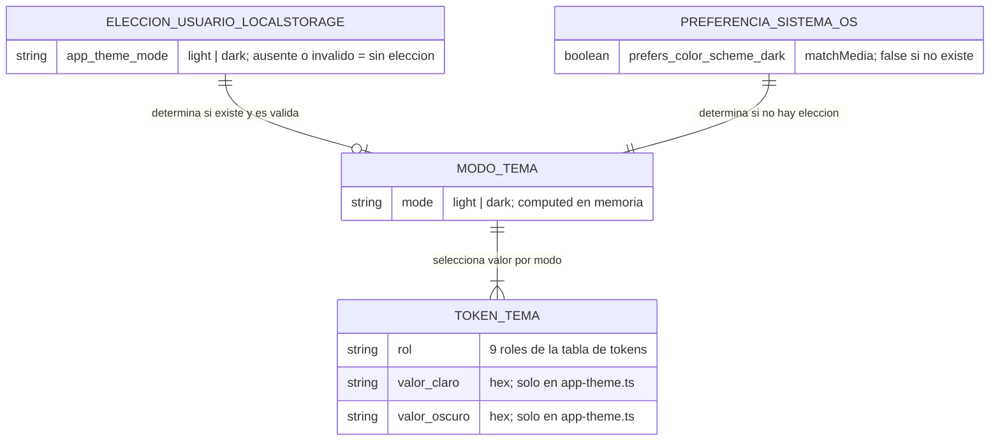
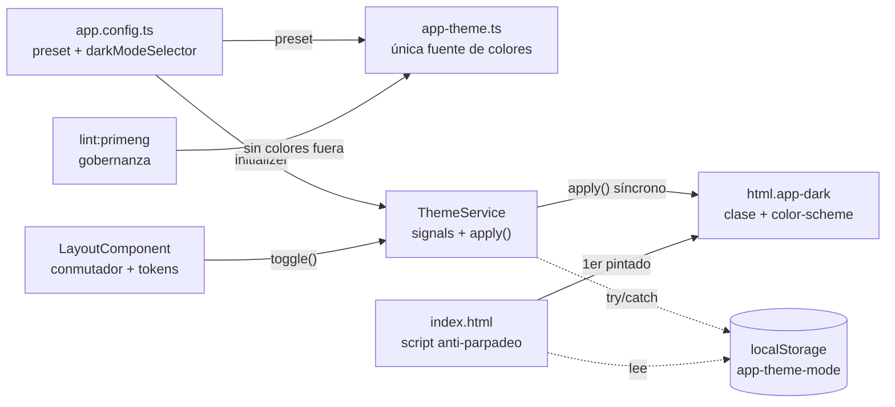
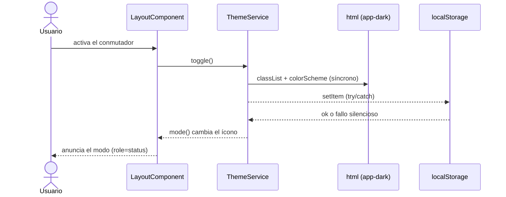
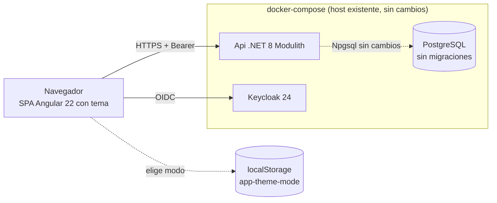

# TECH-DESIGN: Theming de la Aplicación — Modo Claro y Oscuro (HU-036)

- **Fecha de Compilación:** 06-10-2026
- **Auditor y Consolidador:** Agente QT Senior BMAD
- **Fuente SDD:** `specs/036-theming-claro-oscuro-ui/spec.md`, `plan.md`, `tasks.md` (T001–T045), `research.md`, `data-model.md` y `contracts/` (`theme-service.md`, `lint-gobernanza.md`, `shell-conmutador.md`) (GitHub Spec Kit)
- **Modo de gobernanza:** Brownfield (`.specify/memory/constitution.md` prevalece)
- **Estado:** ✅ AUDITADO Y APROBADO (Auditoría Adversarial Exitosa tras 3 rondas: 0 hallazgos críticos, advertencias vinculantes en la sección 7.4)

**Resultado de la auditoría adversarial (6 ejes):**

| Eje | Resultado |
|---|---|
| 1. DB vs API vs Spec Kit | ✅ HU solo frontend (FR-019): `db-036` dictamina cero cambios de persistencia y no existe `api-036` (no hay endpoints; `contracts/` describe un servicio de cliente, la gobernanza de lint y el conmutador del shell). FR-001..FR-020 y SC-001..SC-007 tienen tarea en `tasks.md`: FR-001..006 → T005–T012; FR-007/008 → T017, T021–T025; FR-009..011 → T027–T030; FR-012 → T003, T004, T032, T033; FR-013..015 → T034–T036; FR-016 → T011, T044; FR-017 → T037–T039; FR-018 → T044; FR-019 → T040; FR-020 → T041–T043. |
| 2. UI → Data | ✅ Los 13 estados de `ux-036` solo requieren estado de cliente: `ThemeMode` (signal), `ThemeChoice` (`localStorage['app-theme-mode']`), `systemDark` (`matchMedia`), tokens (`app-theme.ts`) y anuncio accesible (signal). Cero campos huérfanos. |
| 3. Mentiras en ADR | ✅ ADR-001/002/004 `Aceptado (heredado)` sin alternativas inventadas. ADR-003, 005, 006, 007, 008, 009, 010, 011, 012 y DA ADR-02 traen alternativas viables y trade-offs reales (duplicación de lógica, CSP, ancho de barra a 768 px, regex con falsos positivos, mantenimiento de escalas a mano, borde de campo más marcado). Las alternativas débiles de ADR-009 y ADR-011 detectadas en la ronda 1 fueron reemplazadas. |
| 4. Lex Superior / Sycophancy | ✅ Ninguna tecnología ajena a la Constitución (cero paquetes nuevos). Las excepciones de contraste E-03 a E-09 y las utilidades `text-color` y `sr-only` estaban respaldadas solo por el tracker en las rondas 1 y 2 (🔴, rechazo); el humano aprobó la Opción B y la enmienda física quedó aplicada en `constitution.md` (Theme Visual, "Contraste") con cita de respaldo. |
| 5. Proporcionalidad | ✅ Un preset, un servicio de tema con signals, un script mínimo en `index.html`, un conmutador y reglas de lint; sin backend, red, caché ni librerías nuevas. Sincronización entre pestañas, tercer modo "sistema" y almacenamiento en servidor quedan descartados como sobre-ingeniería. |
| 6. Severidad | 🔴 0 · 🟡 8 (sección 7.4) · 🟢 2 |

**Historial de rondas:** Ronda 1 RECHAZADA (regla 3 de lint rechazaba `style.colorScheme`; E-03..E-09 sin enmienda física). Ronda 2 RECHAZADA (SDD sin regenerar; enmienda pendiente, turno devuelto al humano). Ronda 3 APROBADA (SDD regenerado y verificado en disco; enmienda aplicada).

---

## 1. Architecture Overview
SPA Angular 22 Zoneless con Signals. Capa de presentación pura: se reemplaza el preset Aura sin personalizar por `appThemePreset = definePreset(Aura, …)` (única fuente de colores y radios, `core/theme/app-theme.ts`), con paleta y radios de las maquetas en modo claro y oscuro; `ThemeService` (signals) proyecta el modo efectivo a la clase `app-dark` y a `color-scheme` de `<html>` de forma síncrona; la elección se persiste en `localStorage['app-theme-mode']` y, sin elección, se sigue `prefers-color-scheme`; un script clásico mínimo en `<head>` de `index.html` aplica el modo antes del primer pintado (resolución humana, Opción A); un `p-button` de ícono en la barra superior conmuta el modo; y `lint:primeng` incorpora reglas que rechazan colores fuera de `app-theme.ts`, con `archivo:línea`.

Patrón principal: preset de tema con valores explícitos + estado de cliente efímero, sin red. Backend, base de datos, API, rutas, `core/auth/` y `features/**` no cambian (salvo 2 clases de color retiradas, ADR-010). Convive con el shell de HU-035 y con las pantallas de HU-001, HU-003/004 y HU-012/015.

**Afirmaciones verificadas contra el código y los artefactos:** `index.html` no tiene CSP ni script previo y `AuthService.init()` bloquea el arranque (R-06); `scripts/lint-primeng.mjs` ya cubre formularios y reglas de HU-035 y tiene `stripComments` (R-09); `p-datatable-row-selected` existe en `primeng@22.1.2` (R-10); `contracts/lint-gobernanza.md` y `tasks.md` T008, T018, T033–T035 y T043 reflejan el diseño corregido (regla 3 por propiedades concretas con `colorScheme` fuera, regla 1 con límite de palabra, ADR-012 explícito, aserción de código real en T043).

---

## 2. Components

| Componente | Ruta física | Responsabilidad | Tareas |
|---|---|---|---|
| Preset de tema | `app/frontend/src/app/core/theme/app-theme.ts` | **Único** archivo con colores: escalas explícitas cyan, red y surface (Tailwind v4), tokens claro/oscuro, radios, botón de peligro contorneado, enlace, borde de campo ≥ 3:1 | T005, T008, T009, T018 |
| Contraste | `app/frontend/src/app/core/theme/contrast.ts` | `contrastRatio(fg, bg)` puro (luminancia WCAG 2.1), sin colores | T003, T004 |
| Servicio de tema | `app/frontend/src/app/core/theme/theme.service.ts` | `choice`, `systemDark`, `mode` (computed), `toggle()`, `apply()` síncrono, `try/catch`, `DestroyRef` | T016, T021, T027, T029 |
| Pruebas del tema | `app/frontend/src/app/core/theme/*.spec.ts` | `app-theme`, `contrast`, `app-theme-contrast` (tabla independiente de 9 excepciones), `theme.service`, `index-html`, `lint-gobernanza` | T003, T006, T007, T015, T016, T027, T028, T032, T034 |
| Configuración | `app/frontend/src/app/app.config.ts` | `appThemePreset`, `darkModeSelector: '.app-dark'`, `cssLayer` conservado, initializer del tema antes del de Auth | T010, T019, T022 |
| Variante Tailwind | `app/frontend/src/styles.css` | Solo se añade `@custom-variant dark (&:where(.app-dark, .app-dark *));` | T020 |
| Anti-parpadeo | `app/frontend/src/index.html` | `<meta name="color-scheme">` y `<script>` clásico síncrono en `<head>`, sin colores | T028, T030 |
| Shell | `app/frontend/src/app/core/layout/layout.component.{ts,html}`, `layout.texts.ts`, `layout-nav.ts` | Superficies con tokens y `dark:`, entrada activa, conmutador `p-button`, región `role="status"` | T011–T013, T017, T023–T025 |
| Gobernanza | `app/frontend/scripts/lint-primeng.mjs` | Reglas 1–5 del tema, `LINT_ROOT`, salida `archivo:línea` | T034, T035, T036 |
| Limpieza ADR-010 | `app/frontend/src/app/features/teams/components/item-assignees-view/item-assignees-view.component.html`, `app/frontend/src/app/features/backlog/components/create-backlog-item/create-backlog-item.component.html` | Retirar `bg-surface-100` (→ `p-datatable-row-selected`) y `text-muted-color` | T037–T039 |
| Evidencia | `specs/036-theming-claro-oscuro-ui/evidence/` | 6 capturas `{modulo}-{modo}.png` a 1920 px | T002, T041, T042 |

**Restricción de alcance (T040):** no se tocan `app/backend/**`, `app/template-primeng/**`, `specs/evidences/**`, `app.routes.ts`, `core/auth/**` ni `ViewportService`.

---

## 3. Data Model

*(Contenido íntegro de `documents/data-architect/db-036-theming-claro-oscuro-ui.md`.)*

**Dictamen de alcance:** esta historia es **exclusivamente de frontend** y **no introduce, modifica ni elimina ninguna tabla, columna, índice, FK, schema ni migración** en PostgreSQL. `spec.md` FR-019 prohíbe modificar backend, APIs, contratos de datos y reglas de negocio; `data-model.md` declara "No hay entidades de base de datos" y modela únicamente estado de cliente. La única persistencia es una preferencia por navegador en `localStorage['app-theme-mode']`. Ninguna tarea de `tasks.md` (T001–T045) toca `app/backend/**`; T040 lo verifica con `git diff --stat`.

### 3.1. Modelo Entidad-Relación (MER)

Sin entidades persistentes en PostgreSQL. El diagrama muestra únicamente el estado **de cliente** que consume el tema.



### 3.2. Diccionario de datos y trazabilidad UI/Spec Kit → Data (cero campos huérfanos)

| Elemento UI / contrato (origen) | Dato | ¿Requiere columna? | Fuente real |
|---|---|---|---|
| Conmutador claro/oscuro en barra superior (FR-007, FR-008) | `ThemeMode` (`light` \| `dark`) | No | Señal `mode` en memoria (`ThemeService`), proyectada a clase `app-dark` y `style.colorScheme` de `<html>` |
| Recordar elección (FR-009) | `ThemeChoice` | No | `localStorage['app-theme-mode']`; valores `light` \| `dark`; cualquier otro = inválido, tratado como ausente |
| Preferencia del sistema (FR-010) | `systemDark` | No | `matchMedia('(prefers-color-scheme: dark)')`; sin `matchMedia` → claro |
| Almacenamiento inválido o bloqueado (FR-011) | Estado de error silencioso | No | `try/catch` sin mensaje; la elección queda en memoria durante la sesión |
| Paleta, radios y tabla de tokens (FR-001 a FR-006) | `ThemeToken` (9 roles × 2 modos) | No | Constante `appThemePreset` en `core/theme/app-theme.ts` |
| Contraste y excepciones E-01..E-09 (FR-012) | `ContrastPair` | No | Tabla de pruebas en `app-theme-contrast.spec.ts` |
| Anuncio accesible del cambio de modo | `themeAnnouncement` | No | Señal en memoria; textos en `layout.texts.ts` |
| Gobernanza de colores (FR-013 a FR-015) | Violaciones de lint | No | Salida de `scripts/lint-primeng.mjs` |
| Evidencia de cierre: 6 capturas (FR-020) | `EvidenceCapture` | No | `specs/036-theming-claro-oscuro-ui/evidence/{modulo}-{modo}.png` |

**Contrato del único dato persistido (cliente):** clave `app-theme-mode` (`THEME_STORAGE_KEY`); dominio `'light' | 'dark'` (cualquier otro valor se ignora sin borrarse); escritura solo en `toggle()` con fallo silencioso; por navegador y dispositivo, sin datos personales.

**Tablas heredadas sin modificar:** `backlog."BacklogItems"`, `sprints."Sprints"`, `sprints."SprintItems"` y las tablas de `application` (miembros, roles y relaciones).

### 3.3. Riesgos de integridad y escalabilidad
- `⚠️ RIESGO:` Deriva de alcance (tabla de preferencias, endpoint de tema o cambio en `app/backend/**` violaría FR-019). Mitigación: T040.
- `⚠️ RIESGO:` Divergencia entre el script de `index.html` y `ThemeService`. Mitigación: T028 ejecuta el script en jsdom con la misma matriz que el servicio.
- `⚠️ RIESGO:` `localStorage` bloqueado, cuota llena o valor corrupto. Mitigación: `try/catch` y valor inválido tratado como ausente (T027, T029); riesgo de presentación, no de integridad.
- Sin riesgos de concurrencia ni volumen: no hay lecturas ni escrituras nuevas contra PostgreSQL.

---

## 4. Integrations

La HU **no define endpoints REST ni GraphQL** (no existe `api_036_*.md`; FR-019). Las integraciones son contratos internos de cliente y de herramienta, todos en `specs/036-theming-claro-oscuro-ui/contracts/`:

| Contrato | Superficie | Resumen |
|---|---|---|
| `theme-service.md` | `ThemeService` + script de `index.html` | Constantes `THEME_STORAGE_KEY = 'app-theme-mode'` y `THEME_MODES`; API `mode` (computed de solo lectura) y `toggle()`; `apply()` escribe `classList.toggle('app-dark', …)` y `style.colorScheme`; matriz obligatoria (almacenamiento ausente / `light` / `dark` / inválido / `getItem` lanza / `setItem` lanza × sistema claro / oscuro / sin `matchMedia`); el evento `change` se ignora con elección válida; listener liberado con `DestroyRef`; initializer declarado antes del de `AuthService`; el script debe producir el mismo modo que el servicio |
| `shell-conmutador.md` | `LayoutComponent` | `p-button` de ícono (`pi-moon`/`pi-sun`) en `#end` antes del perfil, `ariaLabel` = acción siguiente, sin `aria-pressed`, región `role="status"` `sr-only` vacía al cargar; superficies solo con tokens semánticos y `dark:`; `main` exactamente `max-w-7xl mx-auto p-6` |
| `lint-gobernanza.md` | `scripts/lint-primeng.mjs` | Reglas 1–5 (literales de color con límite de palabra, clases de paleta, estilos de color en línea por propiedades concretas con `colorScheme` fuera, `.scss`/`.css` con color/borde/sombra, utilidades de color/radio fuera del shell) y 6 (reglas heredadas); `LINT_ROOT`; cada violación imprime `archivo:línea` y `process.exit(1)` |

**Convivencia con el sistema preexistente (Brownfield):** sin cambios en Keycloak 24, la API Modulith .NET ni PostgreSQL; el tema se sirve con la SPA y no añade llamadas de red. El conmutador convive con la barra superior de HU-035 (acciones de usuario y perfil) sin remontar el shell ni el `router-outlet`.

---

## 5. DIAGRAMAS DE ARQUITECTURA (Componentes, Secuencia, Despliegue)

Skill `archify` disponible: se aplica el **Escenario A (Modo Dual Enriquecido)**; los tres diagramas pasaron `deliver --quality showcase` (9/9 checks, 0 errores, 0 advertencias). Las especificaciones y los HTML residen en `documents/qa-tech/diagrams/`.

### 5.1. Componentes del tema (`component`)
- 🌐 **Visor Interactivo HTML:** [`diagrams/hu-036-componentes.html`](diagrams/hu-036-componentes.html)
- 📄 **Especificación Fuente JSON:** [`diagrams/hu-036-componentes.component.json`](diagrams/hu-036-componentes.component.json)
- **Estado de Validación:** ✅ *Showcase Pass (9/9 checks)*



### 5.2. Secuencia del conmutador de modo (`sequence`)
- 🌐 **Visor Interactivo HTML:** [`diagrams/hu-036-secuencia-conmutador.html`](diagrams/hu-036-secuencia-conmutador.html)
- 📄 **Especificación Fuente JSON:** [`diagrams/hu-036-secuencia-conmutador.sequence.json`](diagrams/hu-036-secuencia-conmutador.sequence.json)
- **Estado de Validación:** ✅ *Showcase Pass (9/9 checks)*



### 5.3. Despliegue sobre el sistema existente (`component`)
- 🌐 **Visor Interactivo HTML:** [`diagrams/hu-036-despliegue.html`](diagrams/hu-036-despliegue.html)
- 📄 **Especificación Fuente JSON:** [`diagrams/hu-036-despliegue.component.json`](diagrams/hu-036-despliegue.component.json)
- **Estado de Validación:** ✅ *Showcase Pass (9/9 checks)*



---

## 6. Technology Stack
- **Runtime / Framework:** Angular 22.2 Zoneless con Signals, TypeScript ~6.0 (heredado).
- **UI:** PrimeNG ^22.1.2 con `@primeuix/themes` ^3.0.1 (`definePreset(Aura, …)`); Tailwind CSS v4 + `tailwindcss-primeui` (tokens semánticos solo en el shell); PrimeIcons (`pi-moon`, `pi-sun`).
- **Persistencia:** `localStorage` del navegador (clave `app-theme-mode`); PostgreSQL sin cambios.
- **Pruebas y calidad:** Jest 30 + `jest-preset-angular` (zoneless), jsdom; `npm run lint:primeng`, `npm run build`, `npm test`; 6 capturas a 1920 px.
- **Dependencias nuevas:** ninguna (sin ESLint/Stylelint, sin fuentes externas).

---

## 7. Architecture Decisions (ADRs - Matriz Consolidada MADR)

| ID | Título de la Decisión | Área | Estado | Trade-off / Costo Admitido |
|:---:|---|:---:|:---:|---|
| **ADR-001** | Frontend Angular 22 Zoneless con Signals | Arquitectura (SA) | Aceptado (heredado) | Listener de `matchMedia` fuera del ciclo de Angular: debe escribir en un signal |
| **ADR-002** | PrimeNG 22 + Tailwind v4 bajo la enmienda Theme Visual | Arquitectura (SA) | Aceptado (heredado) | Todo cambio de paleta, radios o modo exige nueva enmienda |
| **ADR-003** | Preset con valores explícitos, sin referencias a paletas de Aura | Infraestructura de tema (SA) | Aceptado | Mantener 3 escalas completas a mano y revisar al actualizar `@primeuix/themes`; el modo oscuro desplaza la jerarquía de Aura |
| **ADR-004** | Modo oscuro por clase `app-dark` y variante `dark` de Tailwind | Arquitectura (SA) | Aceptado (heredado) | Overlays teleportados a `<body>` heredan el modo pero no el color del contenedor |
| **ADR-005** | `ThemeService` con signals, lectura defensiva y escritura síncrona | Estado (SA) | Aceptado | Sin sincronización entre pestañas |
| **ADR-006** | Anti-parpadeo con script síncrono mínimo en `<head>` | Rendimiento percibido (SA) | Aceptado (resolución humana, Opción A) | Lógica duplicada y script en línea que una CSP futura bloquearía |
| **ADR-007** | Color de página y texto base en la raíz de `LayoutComponent` | UI (SA) | Aceptado | Lo renderizado fuera del shell no tendría fondo |
| **ADR-008** | Conmutador como `p-button` con ícono y región de anuncio | UI/Accesibilidad (SA) | Aceptado | Textos en `LAYOUT_TEXTS` (sin i18n); verificar 768 px; `sr-only` acotado |
| **ADR-009** | Compuertas de gobernanza del tema en `lint:primeng` | Calidad (SA) | Aceptado | Regex con falsos positivos posibles; script más grande con su propia spec |
| **ADR-010** | Limpieza de dos estilos propios hallados en la auditoría | Pantallas existentes (SA) | Aceptado | La nota de Backlog pierde su tono secundario |
| **ADR-011** | Contraste verificado por prueba con tabla independiente | Calidad (SA) | Aceptado | La tabla de la spec duplica valores de la HU a propósito |
| **ADR-012** | Borde de campo ≥ 3:1, distinto del borde decorativo | Accesibilidad (SA) | Aceptado ⚠️ | Campos más marcados que en las maquetas; desviación del wireframe |
| **ADR-D01** | Sin cambios de persistencia relacional | Datos (DA) | Aceptado (heredado) | La preferencia no viaja con la cuenta |
| **ADR-D02** | Elección de tema en `localStorage`, no en base de datos | Datos (DA) | Aceptado | Por navegador y dispositivo; borrar datos del sitio la pierde |

### 7.1. ADRs del Solutions Architect (resumen fiel de `documents/solutions-architect/036-theming-claro-oscuro-ui.md`)

#### ADR-001: Frontend Angular 22 Zoneless con Signals
- **Estado:** Aceptado (heredado)
- **Contexto:** Constitución §1, Stack Frontend.
- **Decisión:** `ThemeService` `providedIn: 'root'` con signals; el cambio de modo se refleja por CSS sobre `<html>`, sin Zone ni `ChangeDetectorRef` manual.
- **Alternativas Evaluadas:** No aplica (heredado).
- **Consecuencias (Beneficios y Costos Reales):** ✅ Estado del tema trivial de probar. ⚠️ El listener de `matchMedia` corre fuera del ciclo de Angular; debe escribir en un signal para que la plantilla del conmutador se actualice.

#### ADR-002: PrimeNG 22 + Tailwind v4 bajo la enmienda Theme Visual
- **Estado:** Aceptado (heredado)
- **Contexto:** Constitución §1, "Skeleton vs. Theme" con la excepción acotada "Theme Visual (HU-036)" y "Shell de Aplicación (HU-035)".
- **Decisión:** Se implementa la enmienda tal como está escrita; la HU no la modifica (la única edición posterior, la ratificación del apartado "Contraste", la aplicó QA Tech por autorización humana).
- **Alternativas Evaluadas:** No aplica (heredado).
- **Consecuencias (Beneficios y Costos Reales):** ✅ Look and feel 100 % del preset; cero deuda de estilos. ⚠️ Cualquier cambio futuro de paleta, radios o modo oscuro exige una nueva enmienda.

#### ADR-003: Preset con valores explícitos, sin referencias a las paletas primitivas de Aura
- **Estado:** Aceptado
- **Contexto:** La Constitución fija valores de Tailwind v4 (`#0092b8`, `#00b8db`, `#007595`, `#1e2939`, `#101828`, `#364153`, `#6a7282`, `#99a1af`, `#fb2c36`). Las paletas `cyan`, `gray` y `red` de `@primeuix/themes@3.0.1` son de otra generación (`cyan.600` = `#0891b2`, `red.500` = `#ef4444`); un `{cyan.600}` compilaría y pintaría un color distinto (R-01, verificado).
- **Decisión:** `app-theme.ts` exporta `appThemePreset = definePreset(Aura, {...})` y declara escalas completas explícitas `primitive.cyan`, `primitive.red` y `semantic.colorScheme.{light,dark}.surface` con valores de Tailwind v4 (únicos literales permitidos). Mapeo de roles: primario `{primary.600}`/`{primary.500}` con `contrastColor` `#ffffff`; enlace y texto de acción `{primary.700}` claro / `{primary.500}` oscuro; tarjeta/navegación/barra/pie `{surface.0}`/`{surface.800}`; borde `{surface.200}`/`{surface.700}`; texto `{surface.800}`/`{surface.200}`, secundario `{surface.500}`/`{surface.400}`; peligro `outlined.danger` `{red.500}`; marcador de posición `{surface.400}`. Radios: `0.5rem` controles y botones, `0.75rem` contenedores y modal, `0` en `menubar` y `menu`.
- **Alternativas Evaluadas:** (A) Referenciar `{cyan.600}`, `{gray.500}`, `{red.500}` de Aura: descartada, pinta colores distintos a los de la tabla. (B) Hojas CSS con variables `--p-*`: descartada, colores fuera de `app-theme.ts`, requiere `!important` u orden de capas.
- **Consecuencias (Beneficios y Costos Reales):** ✅ Cada valor de la tabla es auditable en un solo archivo y verificable por prueba. ⚠️ 11 peldaños × 3 escalas a mano y revisión al actualizar `@primeuix/themes`; el modo oscuro desplaza la jerarquía de Aura (página `surface.900`, tarjeta `surface.800`), por lo que cada token de Aura que apunte a esos peldaños debe sobrescribirse.

#### ADR-004: Modo oscuro por clase `app-dark` en `<html>` y variante `dark` de Tailwind
- **Estado:** Aceptado (heredado)
- **Contexto:** Constitución, Theme Visual: `darkModeSelector: '.app-dark'`; `@custom-variant dark (&:where(.app-dark, .app-dark *));`.
- **Decisión:** `providePrimeNG` con `preset: appThemePreset`, `darkModeSelector: '.app-dark'` y `cssLayer` conservado; `styles.css` solo añade el `@custom-variant`.
- **Alternativas Evaluadas:** No aplica (heredado).
- **Consecuencias (Beneficios y Costos Reales):** ✅ PrimeNG y Tailwind conmutan con la misma clase. ⚠️ Los overlays teleportados a `<body>` heredan el modo pero no el color del contenedor; el color de texto lo definen los tokens del preset.

#### ADR-005: `ThemeService` con signals, lectura defensiva y escritura síncrona al DOM
- **Estado:** Aceptado
- **Contexto:** CA-02.1..CA-02.4: valor inicial por sistema, elección en `localStorage`, tolerancia a fallos, cambio inmediato sin perder datos.
- **Decisión:** `mode` (computed de solo lectura) y `toggle()`; `choice` (`readStored()` devuelve `null` ante valor inválido o excepción), `systemDark` con listener liberado en `DestroyRef`, `toggle()` guarda en `try/catch` y llama `apply()` síncrono; `apply()` hace `classList.toggle('app-dark', …)` y `style.colorScheme`; se instancia en un `provideAppInitializer` previo al de Auth; constantes exportadas `THEME_STORAGE_KEY` y `THEME_MODES`.
- **Alternativas Evaluadas:** (A) Aplicar la clase con `effect()`: descartada, en zoneless se programa con la detección de cambios y no es síncrono con el clic. (B) Tres modos (claro, oscuro, sistema): descartada, fuera de la HU (D-02 del UX).
- **Consecuencias (Beneficios y Costos Reales):** ✅ Un punto de verdad con lógica pura; el conmutador no remonta nada. ⚠️ La elección vive por navegador y no se sincroniza entre pestañas abiertas.

#### ADR-006: Anti-parpadeo con un script síncrono mínimo en `<head>` de `index.html`
- **Estado:** Aceptado (aplica la resolución humana del 06-10-2026, Opción A)
- **Contexto:** Estados 9 y 10 del UX: modo aplicado antes del primer pintado; Angular arranca tras descargar el bundle y `AuthService.init()` bloquea el arranque.
- **Decisión:** `<script>` clásico (sin `async`, `defer` ni `type="module"`) en `<head>` antes de cualquier hoja de estilos, que replica la lógica del servicio, más `<meta name="color-scheme" content="light dark">`; sin colores literales; paridad verificada por spec en jsdom con la misma matriz.
- **Alternativas Evaluadas:** (A) Solo `provideAppInitializer(ThemeService)`: descartada, ocurre tras el primer pintado. (B) `prefers-color-scheme` por CSS y Angular ajusta después: descartada, ignora la elección manual. (C) Cookie legible por servidor: descartada, no hay SSR.
- **Consecuencias (Beneficios y Costos Reales):** ✅ Modo correcto aplicado al primer pintado, incluida la pantalla previa a la autenticación. ⚠️ Lógica duplicada en dos lugares y script en línea que una futura CSP `script-src` bloquearía (hoy no hay CSP); el lienzo previo usa el color nativo del agente de usuario para `color-scheme: dark`, no `#101828`.

#### ADR-007: Color de página y de texto base en la raíz de `LayoutComponent`, solo con tokens
- **Estado:** Aceptado
- **Contexto:** El fondo de página y el color de texto de elementos nativos no son tokens que PrimeNG pinte; `styles.css` y las páginas no pueden declararlos.
- **Decisión:** El `div` raíz suma `bg-surface-50 dark:bg-surface-900 text-color`; pie y contenedores del shell usan `bg-surface-0 dark:bg-surface-800` y `border-surface-200 dark:border-surface-700`; `main` queda exactamente `max-w-7xl mx-auto p-6`.
- **Alternativas Evaluadas:** (A) `background`/`color` de `body` en `styles.css`: descartada, contradice la enmienda. (B) Raíz en `app-root`: descartada, duplica la raíz y deja sin fondo lo externo al shell.
- **Consecuencias (Beneficios y Costos Reales):** ✅ Un solo lugar pinta la página; las pantallas nuevas lo heredan. ⚠️ Lo que se renderice fuera del shell no tendría fondo; una pantalla pública futura requeriría otra enmienda.

#### ADR-008: Conmutador como `p-button` con ícono, etiqueta que describe la acción siguiente y región de anuncio
- **Estado:** Aceptado
- **Contexto:** RT-05, D-01..D-05 del UX: control binario entre las acciones y el perfil, operable por teclado, con anuncio del cambio de estado.
- **Decisión:** `p-button` icon-only (`severity="secondary"`, `[text]="true"`, `pi-moon`/`pi-sun`) en `#end`, `[ariaLabel]` = acción siguiente, sin `aria-pressed`; región `role="status"` `sr-only` que se llena solo tras una activación; sin transición de color.
- **Alternativas Evaluadas:** (A) `p-toggleswitch` con `<label>`: descartada, más ancho a 768 px y exige etiqueta asociada. (B) Menú desplegable de modos: descartada, añade una tercera opción y un paso extra (SC-002).
- **Consecuencias (Beneficios y Costos Reales):** ✅ Control mínimo, accesible por teclado y sin CSS propio. ⚠️ Textos nuevos en `LAYOUT_TEXTS` (sin i18n); probar a 768 px que la barra no desborde; `sr-only` acotado a esta región (ratificado en la Constitución).

#### ADR-009: Compuertas de gobernanza del tema en `lint:primeng`
- **Estado:** Aceptado
- **Contexto:** CA-04, CA-04.1, FR-013..FR-015, RT-06, RT-07.
- **Decisión:** `lint-primeng.mjs` añade, sobre `src/` sin `*.spec.ts` y sin comentarios: (1) literales de color con límite de palabra (`(?<![\w$.-])(?:rgba?|hsla?|hwb|lab|lch|oklab|oklch|color)\(` y hexadecimal con `\b`) salvo `app-theme.ts`; (2) clases de paleta de Tailwind; (3) estilos de color en línea por **propiedades concretas**, con `color-scheme`/`style.colorScheme` fuera de la regla; (4) `.scss`/`.css` distinto de `styles.css` con color, borde o sombra; (5) utilidades de color/radio fuera de `core/layout/`; conserva `::ng-deep`, `!important`, `ed-grid`, imports retirados y la declaración tipográfica única; admite `LINT_ROOT`.
- **Alternativas Evaluadas:** (A) ESLint (`@angular-eslint`) y Stylelint: viable, descartada, añade dos toolchains y no cubre `index.html` ni clases en atributos Angular sin plugins; RT-07 fija `lint:primeng`. (B) Prueba Jest de escaneo estático: viable, descartada, mezcla política con comportamiento y no entrega `archivo:línea` en un comando independiente (CA-04.1).
- **Consecuencias (Beneficios y Costos Reales):** ✅ El tema es obligatorio e inmutable para toda HU posterior, verificable en CI. ⚠️ Posibles falsos positivos de regex (se corrigen reescribiendo el literal, no relajando la regla); el script crece y necesita su propia spec de violación inyectada.

#### ADR-010: Limpieza de dos estilos propios hallados en la auditoría
- **Estado:** Aceptado
- **Contexto:** CA-05.1/CB-06: la auditoría de `app/frontend/src` halló solo `item-assignees-view.component.html:46` (`bg-surface-100`, ilegible en oscuro) y `create-backlog-item.component.html:82` (`text-muted-color` en una página).
- **Decisión:** Reemplazar el resaltado por `p-datatable-row-selected` (existe en `primeng@22.1.2`) y retirar `text-muted-color` conservando `block`; no se tocan los 5 `[style]="{ width }"` ni `[rounded]="true"`.
- **Alternativas Evaluadas:** (A) Permitir tokens semánticos en páginas: descartada, contradice la enmienda. (B) Quitar el resaltado: descartada, cambia comportamiento visible (FR-017). (C) `p-message severity="secondary"` para el punto 2: descartada por ahora, cambia el DOM.
- **Consecuencias (Beneficios y Costos Reales):** ✅ Pantallas existentes pasan la regla 5 y se ven bien en ambos modos. ⚠️ La nota de Backlog pierde su tono secundario; si el nombre de clase difiere, usar `pSelectableRow` y, si no sirve, devolver el turno al SA.

#### ADR-011: Contraste de pares verificado por prueba, con tabla de expectativas independiente
- **Estado:** Aceptado
- **Contexto:** CA-03, CA-03.1, FR-012, RT-08.
- **Decisión:** `contrast.ts` (`contrastRatio`) y una tabla de pares escrita en la spec desde la HU; la prueba resuelve los tokens del preset real y exige umbral (4.5 texto / 3 componente) o ratio declarado (±0.01) y que la tabla cubra todos los roles.
- **Alternativas Evaluadas:** (A) Script Node de CI sobre las variables `--p-*` compiladas: viable, descartada, exige compilar antes de medir y no corre en el ciclo rojo-verde. (B) Auditoría manual con extensión de navegador: descartada, no es repetible ni bloquea el cierre.
- **Consecuencias (Beneficios y Costos Reales):** ✅ Un cambio que rompa el contraste falla en CI con el nombre del par. ⚠️ La tabla duplica valores de la HU a propósito y debe actualizarse con cualquier enmienda.

#### ADR-012: El borde de los campos de formulario cumple 3:1; no usa el borde decorativo
- **Estado:** Aceptado ⚠️ (desviación informativa del wireframe del UX)
- **Contexto:** El UX anota `#e5e7eb` en campos (1.24:1), pero E-08/E-09 no aplican a bordes que sean el único indicador de un control y FR-012 exige ≥ 3:1.
- **Decisión:** `formField.borderColor` y `hoverBorderColor` = `{surface.500}` (`#6a7282`, 4.83:1) en claro y `{surface.400}` (`#99a1af`, 5.63:1) en oscuro, fijados explícitamente en T008 y T018; el foco sigue en `primary.color`; `content.borderColor` conserva los bordes decorativos.
- **Alternativas Evaluadas:** (A) Respetar el wireframe: descartada, incumple FR-012. (B) Ampliar la tabla de excepciones: descartada, es decisión humana y degrada la accesibilidad.
- **Consecuencias (Beneficios y Costos Reales):** ✅ Controles visibles para baja visión (WCAG 1.4.11). ⚠️ Campos más marcados que en las maquetas; la comparación de CA-06 no incluye el borde de campo.

### 7.2. ADRs del Data Architect (texto íntegro de `db-036-theming-claro-oscuro-ui.md`)

#### ADR-D01 (ADR-01 del DA): Sin cambios de persistencia relacional (motor, schemas y migraciones intactos)
- **Estado:** Aceptado (heredado)
- **Contexto:** La Constitución (§3) fija PostgreSQL/Npgsql con EF Core Code-First, un `DbContext` y un schema por módulo. La HU solo aplica una capa de tema sobre el shell y no declara entidades ni datos persistentes de servidor.
- **Decisión:** No se crea ninguna tabla ni migración; los schemas `backlog`, `sprints`, `application` y los demás permanecen sin modificar.
- **Alternativas Evaluadas:** No aplica (heredado).
- **Consecuencias (Beneficios y Costos Reales):** ✅ Cero riesgo de regresión de datos; ninguna migración que coordinar. ⚠️ La preferencia de tema no viaja con la cuenta (ADR-D02).

#### ADR-D02 (ADR-02 del DA): La elección de tema se guarda en el navegador (`localStorage`), no en base de datos
- **Estado:** Aceptado (la Constitución marca la clave como `⚠️ [PROPUESTO]`, por lo que no es heredado firme)
- **Contexto:** FR-009, FR-010 y FR-011; la Opción A exige conocer el modo antes del primer pintado, lo que excluye lecturas asíncronas de servidor.
- **Decisión:** Un único valor `light` | `dark` en `localStorage['app-theme-mode']`; ausente, inválido o inaccesible equivale a "sin elección", sin borrar ni reportar error.
- **Alternativas Evaluadas:** (A) Tabla `application."UserPreferences"` con endpoint: descartada, contrato de API nuevo (contradice FR-019) y lectura asíncrona que impide el modo previo al primer pintado. (B) Atributo de usuario o claim en Keycloak: descartada, escritura vía Admin API, acopla el tema al proveedor de identidad, no existe antes del login y toca `core/auth/`. (C) Cookie: descartada, se envía en cada petición sin necesidad y añade superficie de privacidad.
- **Consecuencias (Beneficios y Costos Reales):** ✅ Lectura síncrona compatible con el script anti-parpadeo; sin datos personales en servidor; degradación segura. ⚠️ Preferencia por navegador y dispositivo, sin sincronización; borrar datos del sitio la pierde; una persistencia por cuenta exigiría tabla y API nuevas (reabrir esta decisión).

### 7.3. ADRs del API Architect
No aplica: la HU no define endpoints ni contratos de API (no existe `api_036_*.md`).

### 7.4. Advertencias Vinculantes para Fase D (Deuda Técnica)

| ID | Severidad | Advertencia | Acción exigida |
|---|:---:|---|---|
| V-01 | 🟡 | **ADR-006:** script en línea y lógica duplicada con `ThemeService`; una CSP `script-src` futura lo bloquearía. | Mantener T028 (paridad) en verde; si se adopta CSP, usar `nonce` o hash. |
| V-02 | 🟡 | **ADR-012:** el borde de campo (`{surface.500}`/`{surface.400}`) se aparta del `#e5e7eb` del wireframe y no figura en la enmienda constitucional (cumple FR-012, ya vigente). | Implementar tal cual en T008/T018; confirmación visual del humano en las capturas. |
| V-03 | 🟡 | Fondo del campo oscuro asumido `#1e2939` (punto abierto 8 de la HU). | Si el humano define otro, cambia un token y el par de contraste de ADR-011. |
| V-04 | 🟡 | `p-menubar`/`p-menu` pintan borde en los cuatro lados; el wireframe, en uno. | Aceptado como desviación decorativa; si el revisor visual la rechaza, devolver al SA (sin CSS propio). |
| V-05 | 🟡 | **Entrada activa de navegación (T012):** si `p-menu` no admite el fondo con esquinas de `0.5rem` sin CSS propio. | Detenerse y devolver el turno al SA; prohibido `::ng-deep` y `.scss`. |
| V-06 | 🟡 | Verificación manual obligatoria (T041): barra superior a 768 px con el conmutador, ausencia de destello en recarga con modo oscuro guardado, diálogos y `p-toast` legibles en ambos modos. | Registrar resultado junto con las 6 capturas (T042). |
| V-07 | 🟡 | **ADR-003:** un token de Aura con nombre inexistente se ignora en silencio. | La spec de valores (T006/T007/T015) es la defensa; verificar nombres contra `primeng@22.1.2` y `@primeuix/themes@3.0.1` instalados. |
| V-08 | 🟡 | i18n: textos del conmutador en `LAYOUT_TEXTS`; sin soporte i18n global (deuda de plataforma de HU-035). Sin sincronización entre pestañas (fuera de alcance). ADR-010 punto 2 retira el tono secundario de una nota. | Deuda registrada; sin acción en esta HU. |
| V-09 | 🟢 | Añadir a T005/T006 una aserción de inventario de que ningún token de Aura que referencie `surface.*`/`primary.*`/`red.*` quede con valores de la generación anterior. | Sugerencia. |
| V-10 | 🟢 | Documentar en la spec de `ThemeService` que, ante valor inválido, el script y el servicio coinciden y el valor persiste hasta el primer `toggle()`. | Sugerencia. |

**Enmienda constitucional aplicada en esta compilación:** en `.specify/memory/constitution.md`, Theme Visual, punto "Contraste", se ratificaron las excepciones E-01 a E-09 (E-08/E-09 solo decorativas) y las utilidades `text-color` y `sr-only` en `LayoutComponent`, por autorización humana expresa del 06-10-2026 (Opción B; respaldo H-01 y H-04 opción A). Texto aplicado exactamente el propuesto en `feedback-tech-036-theming-claro-oscuro-ui.md` §4. El color de enlace `#007595` ya figuraba en la paleta de la Constitución. No se modificó nada más.

---

## 8. ORDEN DE DELEGACIÓN PARA EL TRACKER

El dictamen es `AUDITADO Y APROBADO`. La HU es **estrictamente visual / solo frontend** (sin backend, API ni base de datos), por lo que se despacha directamente a la Fase D únicamente al desarrollador frontend, sin invocar a `@SPEC-KIT:` ni al `@HUMANO:`:

```markdown
@DEV-FRONT: La arquitectura técnica ha sido validada. Inicia la implementación del Frontend.
```

**Gestión de la constitución (destilación de contexto):** el TDD no introduce invariantes estructurales nuevas más allá de la enmienda "Theme Visual (HU-036)" ya vigente en la Constitución; se **aborta** la inyección adicional (Escenario B, sin cambios estructurales). Única edición realizada: la ratificación del punto "Contraste" descrita en 7.4, por autorización humana.

**Pendiente de gobierno (fuera del alcance de esta compilación):** `specs/README.md` **no** se modificó en esta ejecución por restricción expresa de la autorización humana; el cambio de estado de la HU-036 a `READY-FOR-DEV` queda para la instrucción que lo autorice.
