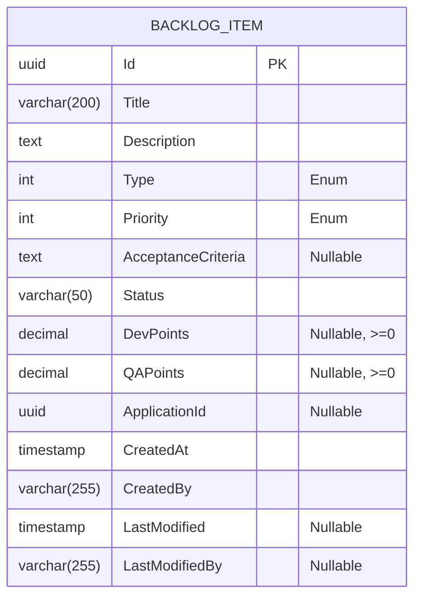
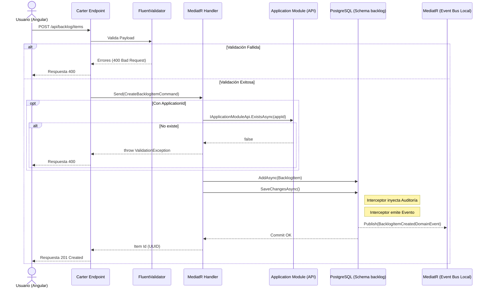

# TECH-DESIGN: Registro de Elementos en Backlog Multitipo

- **Fecha de Compilación:** 2026-10-03
- **Auditor y Consolidador:** Agente QT Senior BMAD
- **Fuente SDD:** `spec.md` y `tasks.md` (GitHub Spec Kit)
- **Estado:** ✅ AUDITADO Y APROBADO (Auditoría Adversarial Exitosa)

---

## 1. Architecture Overview
El sistema implementa el caso de uso de registro de elementos en un backlog ágil mediante una arquitectura **Modular Monolith** (Modulith) en .NET 8/10, siguiendo los principios de **Vertical Slice Architecture (VSA)**. La arquitectura consolida las interacciones a través de Minimal APIs con la librería Carter, garantizando el aislamiento de datos (schema físico independiente `backlog` en PostgreSQL) y la comunicación intra-proceso e inter-módulo mediada por CQRS (MediatR) y eventos de dominio (RabbitMQ/MassTransit). Todo acceso está protegido perimetralmente mediante tokens OIDC administrados por Keycloak. La interfaz gráfica se delega al frontend en Angular 22 Zoneless.

---

## 2. Components
Los componentes lógicos identificados para este caso de uso son:
- **API Gateway / Endpoint (Carter):** Expone la ruta `POST /api/backlog/items` para recibir y validar payloads bajo un esquema seguro (Bearer JWT).
- **Application Core (MediatR & FluentValidation):** Contiene el feature folder `CreateBacklogItem` con el Command, Handler y las reglas de validación (ej. puntajes mayores o iguales a 0).
- **Domain Model:** Raíz de agregado `BacklogItem` con interceptores de EF Core para trazabilidad de auditoría (`AuditableEntityInterceptor`) y despacho asíncrono de eventos de dominio (`DispatchDomainEventsInterceptor`).
- **Data Persistence:** `BacklogDbContext` con configuración específica por entidad para PostgreSQL, apuntando al schema asilado `backlog`.
- **Identity Provider (Keycloak):** Servicio transversal de autenticación OIDC.

---

## 3. Data Model
*(Extraído de `db_001_registro_elementos_backlog_multitipo.md` tras verificación de alineación UI -> Data)*

### Modelo Entidad-Relación (MER)



### Diccionario de Datos y Restricciones
- `Id` (UUID): Llave primaria (PK). Generado secuencialmente.
- `Title` (VARCHAR 200): Obligatorio. Contiene el nombre descriptivo del elemento.
- `Description` (TEXT): Opcional o requerido según validación posterior. Descripción detallada del ítem.
- `Type` (INT): Obligatorio. Valor de la enumeración `BacklogItemType` (UserStory=1, Bug=2, TechEvolution=3, TechRequirement=4, TechDebt=5, Research=6, Spike=7).
- `Priority` (INT): Obligatorio. Valor de la enumeración `BacklogItemPriority` (Low=1, Medium=2, High=3, Critical=4).
- `AcceptanceCriteria` (TEXT): Opcional (NULLable). Almacena los criterios de aceptación en formato de texto largo.
- `Status` (VARCHAR 50): Obligatorio. Estado actual de ejecución (por defecto, `Backlog`).
- `DevPoints` (DECIMAL / NUMERIC): Opcional (NULLable). Puntos de esfuerzo de desarrollo. Restricción `CHECK (DevPoints >= 0)`.
- `QAPoints` (DECIMAL / NUMERIC): Opcional (NULLable). Puntos de esfuerzo de calidad/pruebas. Restricción `CHECK (QAPoints >= 0)`.
- `ApplicationId` (UUID): Opcional (NULLable). Referencia hacia el catálogo de aplicaciones.
- `CreatedAt` (TIMESTAMP WITH TIME ZONE): Obligatorio. Auditoría de creación.
- `CreatedBy` (VARCHAR 255): Obligatorio. UUID o username del creador.
- `LastModified` (TIMESTAMP WITH TIME ZONE): Opcional. Auditoría de modificación.
- `LastModifiedBy` (VARCHAR 255): Opcional. Autor de última modificación.

---

## 4. Integrations
*(Extraído de `api_001_registro_elementos_backlog_multitipo.md`)*

### Endpoint: `POST /api/backlog/items`
- **Propósito Funcional:** Registrar un elemento con estimaciones correspondientes y publicarlo en el backlog.
- **Request Headers:**
  - `Content-Type`: `application/json`
  - `Authorization`: `Bearer <token>`
- **Request Body (Payload JSON):**
```json
{
    "title": "Registro completo de Historia de Usuario",
    "description": "Como Líder Técnico quiero registrar un elemento...",
    "type": "UserStory",
    "priority": 3,
    "acceptanceCriteria": "Dado que... Cuando... Entonces...",
    "devPoints": 5.0,
    "qaPoints": 3.0,
    "applicationId": "f47ac10b-58cc-4372-a567-0e02b2c3d479"
}
```
- **Respuestas (Status Codes):**
  - ✅ **201 Created**:
    ```json
    { "id": "3fa85f64-5717-4562-b3fc-2c963f66afa6" }
    ```
  - ❌ **401 Unauthorized**:
    ```json
    { "error": "UNAUTHORIZED", "message": "Token faltante o inválido" }
    ```
  - ❌ **400 Bad Request** (Reglas de validación):
    ```json
    { 
        "error": "BAD_REQUEST", 
        "message": "Validation failed",
        "errors": [
            "El campo Title no puede estar vacío.",
            "DevPoints debe ser mayor o igual a 0."
        ]
    }
    ```
  - ❌ **400 Bad Request** (Integridad):
    ```json
    { "error": "BAD_REQUEST", "message": "La aplicación referenciada no existe." }
    ```
  - ❌ **500 Internal Server Error**:
    ```json
    { "error": "INTERNAL_SERVER_ERROR", "message": "Ha ocurrido un error inesperado al procesar la solicitud." }
    ```

---

## 5. DIAGRAMAS DE ARQUITECTURA (Componentes, Secuencia, Despliegue)

### 5.1. Secuencia de Transacción (`sequence`)


> *Nota de Arquitectura: Diagrama generado exclusivamente con Mermaid por ausencia de dependencias externas. Para habilitar visores HTML interactivos, instale la skill en la raíz del proyecto (`npx skills add tt-a1i/archify -g`) y solicite la actualización de esta sección.*

---

## 6. Technology Stack
- **Runtime:** .NET 8 / 10
- **Capa API:** Carter (Minimal APIs)
- **Capa de Lógica:** MediatR, FluentValidation, Mapster
- **Persistencia de Datos:** PostgreSQL (Npgsql, Entity Framework Core)
- **Autenticación:** Keycloak OIDC (JWT Bearer tokens)
- **Mensajería Interna/Externa:** MassTransit / RabbitMQ (Event Driven)
- **Frontend:** Angular 22 Zoneless con PrimeNG

---

## 7. Architecture Decisions (ADRs - Matriz Consolidada MADR)

| ID | Título de la Decisión | Área | Estado | Trade-off / Costo Admitido |
|:---:|---|:---:|:---:|---|
| **ADR-001** | Framework de API y Patrón de Arquitectura (Carter / VSA) | Arquitectura (SA/API) | Aceptado (heredado) | Curva de aprendizaje para modelar estrictamente bajo VSA. |
| **ADR-002** | Base de Datos y Aislamiento por Schema | Datos (DA/SA) | Aceptado (heredado) | Validaciones cross-schema añaden latencia al resolver FKs lógicamente. |
| **ADR-003** | Comunicación Asíncrona (Domain Events) | Arquitectura (SA) | Aceptado (heredado) | Implementación obligatoria de Transactional Outbox si los eventos trascienden módulos. |
| **ADR-004** | Base de Agregado e Inyección de Auditoría | Datos (DA) | Aceptado (heredado) | Ciclo de vida depende de interceptores de EF Core, acoplando emisión de eventos. |
| **ADR-005** | Estimaciones Opcionales (Nullable Dev/QA Points) | Datos (DA) | Aceptado | Clientes y DTOs deben verificar `HasValue` (NULL-safety). |
| **ADR-006** | Seguridad y Autenticación del Endpoint | APIs (API) | Aceptado (heredado) | Clientes administran la expiración/refresh del token Bearer. |

### ADR-005: Modelado Estructural de Estimaciones Opcionales
- **Estado:** Aceptado
- **Contexto:** Cuantificación técnica del esfuerzo (`DevPoints`, `QAPoints`). Existen elementos (Spikes) que eximen a QA.
- **Decisión:** Mapear los puntos numéricos como nulos a nivel de base de datos (`NULL`), con validación `CHECK >= 0`.
- **Alternativas Evaluadas:** Forzar `0.0` por defecto. Aislar métricas en sub-tabla.
- **Consecuencias:** Refleja la semántica real del negocio, pero obliga a los servicios intermedios y consumidores (DTOs, UI) a mitigar potenciales excepciones por valores nulos (NULL-safety).
