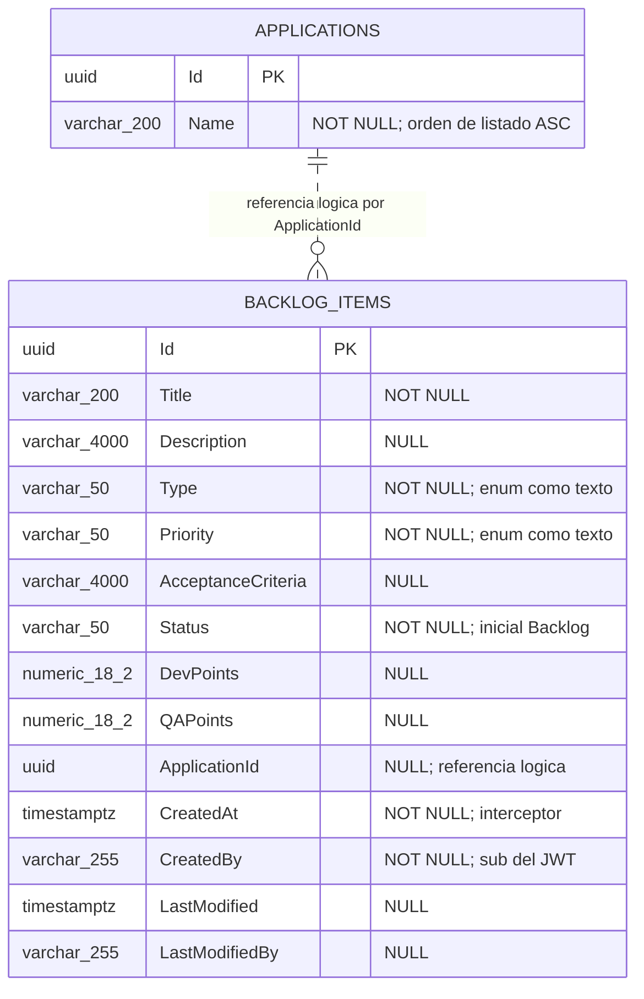
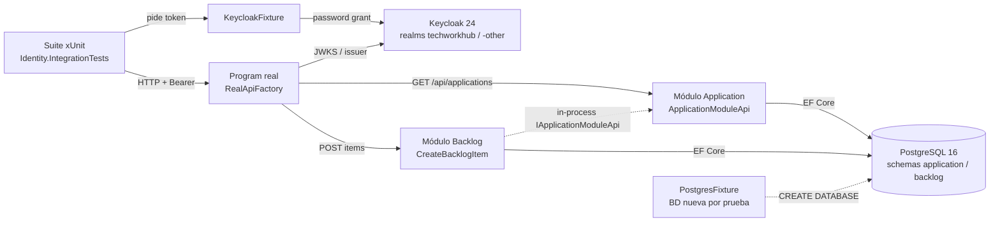
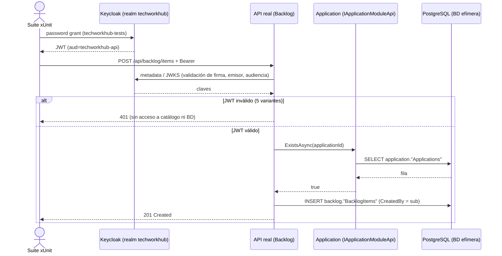
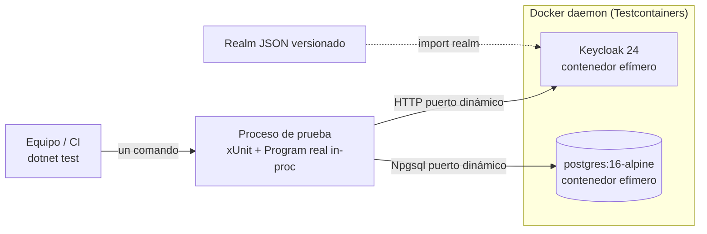

# TECH-DESIGN: Pruebas de Integración contra Keycloak Real y Catálogo Real del Módulo Application

- **Fecha de Compilación:** 03-10-2026
- **Auditor y Consolidador:** Agente QT Senior BMAD
- **Fuente SDD:** `specs/002-pruebas-integracion-keycloak-catalogo/spec.md`, `plan.md`, `tasks.md` y `contracts/test-contract.md` (GitHub Spec Kit)
- **Insumos auditados:** `documents/solutions-architect/002-HU_pruebas_integracion_keycloak_y_catalogo_application.md` (guía técnica del SA), `documents/data-architect/db_002_...md`, `documents/api-architect/api_002_...md`, `documents/designer-ux/ux_002_...md` (sin interfaz)
- **Modo de gobernanza:** Brownfield (`.specify/memory/constitution.md` prevalece; sin Cláusula de Excepción física)
- **Estado:** ✅ AUDITADO Y APROBADO (Auditoría Adversarial Exitosa: 0 hallazgos críticos, 5 advertencias vinculantes para Fase D)

---

## 1. Architecture Overview

HU-002 **no añade funcionalidad de producto**: añade el proyecto de pruebas `Identity.IntegrationTests` (`app/backend/tests/Integration/Identity/`) que hospeda el `Program` real del Bootstrapper con la configuración de producción (audiencia verificada) frente a un **Keycloak 24 real y efímero** y un **PostgreSQL 16 real** con migraciones aplicadas (Testcontainers). Verifica de extremo a extremo `GET /api/applications` y `POST /api/backlog/items` con JWT reales, el origen de `CreatedBy` (= `sub`) y la matriz 5 credenciales inválidas × 2 rutas (HTTP 401).

- **Patrón principal:** Modular Monolith .NET 8 + VSA, con pruebas de integración de caja negra sobre el host real, sin dobles (FR-012).
- **Restricción dura:** `app/backend/src/**` es solo lectura (FR-013). Cero endpoints, tablas, columnas o migraciones nuevas.
- **Validación cruzada contra `plan.md`/`tasks.md`:** los 14 FR, los 6 SC y las tareas T001–T029 tienen soporte; T030 (registro de la excepción `ssl-required`) queda asignada a Fase D.

### 1.1. Auditoría Cruzada (resultado)

| Eje | Resultado | Evidencia verificada contra el código |
|---|---|---|
| DB vs API vs Spec Kit | ✅ Sin discrepancias | `ListApplicationsEndpoint.cs` (`MapGet`, `.RequireAuthorization()`, `Produces(401)`), `CreateBacklogItemEndpoint.cs` (201/400/401/500), `ApplicationModuleApi.cs` (`OrderBy(a => a.Name)`); tablas y columnas de `api_002` mapeadas 1:1 a `db_002` |
| UI → Data (campos huérfanos) | ✅ N/A | `ux_002` dictamina cero wireframes; sin elementos visuales que persistir |
| ADRs (alternativas/trade-offs falsos) | ✅ | Los ADR nuevos (004, 005, 008, 009, 010, 013) incluyen alternativas viables y costos de infraestructura/latencia/acoplamiento |
| Gobernanza / Anti-Sycophancy | ✅ | Ninguna tecnología ajena a la constitución; Testcontainers/xUnit son herramientas de prueba, no stack de producción; sin invocación del tracker como derogación |
| Proporcionalidad | ✅ | Un proyecto, un contenedor por servicio y suite; sin orquestación propia. Las pruebas de guardia e idempotencia (T022–T024) son proporcionadas al riesgo |

---

## 2. Components

| Componente | Responsabilidad | Tareas |
|---|---|---|
| `Identity.IntegrationTests.csproj` + `Realm/*.json` | Proyecto de pruebas aislado de `Backlog.IntegrationTests`; realms versionados `techworkhub` y `techworkhub-other` | T001–T005 |
| `KeycloakFixture` | Contenedor `quay.io/keycloak/keycloak:24.0`, importa realms, `BaseAddress` única, `GetTokenAsync(variante)` | T007 |
| `PostgresFixture` | Contenedor `postgres:16-alpine`, `CreateDatabaseAsync()` → BD nueva por prueba | T006 |
| `RealApiFactory` | `WebApplicationFactory<Program>` real; solo sobrescribe conexión, `MigrateOnStartup`, `auth-server-url` (y `ssl-required` si T008 lo exige) | T008, T009 |
| `CatalogSeeder`, `TokenTamperer` | Siembra vía `RegisteredApplication.Create` + `ApplicationDbContext`; firma alterada | T010, T011 |
| `IdentityCollection` | Colección única, ejecución secuencial contra el mismo Keycloak | T012 |
| `ListApplicationsRealTests` (US1) · `CreateBacklogItemRealTests` (US2) · `InvalidCredentialsTests` (US3) | Casos de aceptación | T013–T021 |
| `ProductionConfigGuardTests`, `IdempotencyTests` | Guardias FR-003/FR-012 e idempotencia FR-014/SC-005 | T022–T024 |
| Módulos de producción bajo prueba (solo lectura) | `Application` (`GET /api/applications`, `IApplicationModuleApi`), `Backlog` (`POST /api/backlog/items`) | — |

---

## 3. Data Model

*(Contenido íntegro de `db_002_pruebas_integracion_keycloak_y_catalogo_application.md`, secciones MER y Diccionario de Datos. Verificado: sin tablas, columnas ni migraciones nuevas; la historia no tiene UI, por lo que no existen campos huérfanos.)*



**Entidades del entorno de pruebas (fuera de PostgreSQL, solo informativas):** realm `techworkhub` (clientes `techworkhub-api`, `techworkhub-tests`, `techworkhub-tests-noaud`, `techworkhub-tests-shortlived`; usuario `qa.user`) y realm `techworkhub-other` (cliente `techworkhub-tests`; usuario `qa.user`), todos en el contenedor Keycloak (ADR-010).

### Diccionario de Datos y Restricciones

#### Tabla: `application."Applications"` (`RegisteredApplication`)
- `Id` (`uuid`): Llave primaria (`PK_Applications`). La suite genera el valor (FR-004).
- `Name` (`character varying(200)`): NOT NULL. Criterio de orden ascendente del listado (FR-005). Sin restricción de unicidad.
- **Uso en la suite:** escritura solo por `CatalogSeeder`/`ApplicationDbContext`; lectura de conteo por `ApplicationCountAsync()` (FR-010).

#### Tabla: `backlog."BacklogItems"` (`BacklogItem`)
- `Id` (`uuid`): Llave primaria (`PK_BacklogItems`).
- `Title` (`character varying(200)`): NOT NULL.
- `Description` (`character varying(4000)`): NULL.
- `Type` (`character varying(50)`): NOT NULL. Enum como texto (`UserStory`, `Bug`, `TechEvolution`, `TechRequirement`, `TechDebt`, `Research`, `Spike`).
- `Priority` (`character varying(50)`): NOT NULL. Enum como texto (`Low`, `Medium`, `High`, `Critical`).
- `AcceptanceCriteria` (`character varying(4000)`): NULL.
- `Status` (`character varying(50)`): NOT NULL. La suite espera `Backlog` (FR-006).
- `DevPoints` (`numeric(18,2)`): NULL. `QAPoints` (`numeric(18,2)`): NULL.
- `ApplicationId` (`uuid`): NULL. Referencia lógica a `application."Applications"."Id"`; sin FK ni JOIN (constitución §3.2.3).
- `CreatedAt` (`timestamp with time zone`): NOT NULL, interceptor.
- `CreatedBy` (`character varying(255)`): NOT NULL. Debe igualar el `sub` del token real (FR-007, SC-004).
- `LastModified` (`timestamp with time zone`) y `LastModifiedBy` (`character varying(255)`): NULL.
- **Uso en la suite:** escritura únicamente a través de `POST /api/backlog/items`; lectura por `StoredItemsAsync()` (`BacklogDbContext`, `AsNoTracking()`, scope nuevo).

#### Trazabilidad Spec → Datos (cero campos huérfanos)

| Requisito | Dato que lo sustenta |
|---|---|
| FR-004, FR-005 | `Applications.Id`, `Applications.Name` (orden ASC) |
| FR-006 | `BacklogItems.Status = 'Backlog'`, `BacklogItems.Id` |
| FR-007, SC-004 | `BacklogItems.CreatedBy` = `sub` |
| FR-006 / US2-2 | `BacklogItems.ApplicationId` = Id sembrado |
| FR-008 | Conteo de `BacklogItems` = 0 tras `applicationId` inexistente |
| FR-009, FR-010, SC-003 | Conteo de `Applications` y `BacklogItems` sin cambios tras cada uno de los 10 casos 401 |
| FR-011 | Lecturas/401 sin mutación; registro exitoso = exactamente 1 fila |
| FR-014, SC-005 | Base nueva por prueba (ADR-008); Keycloak y PostgreSQL destruidos al final |

### Riesgos de integridad (heredados de `db_002`)
- `⚠️ RIESGO (heredado):` `BacklogItems.ApplicationId` sin FK física; una aplicación eliminada deja referencias huérfanas. Sin baja de aplicaciones en esta HU.
- `⚠️ RIESGO (deriva documental db_001):` `db_001` declara `Type`/`Priority` como `INT`, textos como `TEXT` y promete `CHECK (>= 0)`; el esquema físico usa `varchar(50)`/`varchar(4000)` y **no define CHECK** (la no negatividad la imponen FluentValidation y el dominio). Fuente de verdad: migración `InitialBacklogSchema`.
- `⚠️ RIESGO:` Sin índices sobre `Applications.Name` ni `BacklogItems.ApplicationId`; irrelevante a la escala de la prueba.
- `⚠️ RIESGO (duración):` una sola `[Collection]` serializa las pruebas (~19 casos); timeout configurable `IDENTITY_TESTS_STARTUP_TIMEOUT_SECONDS`.
- `⚠️ RIESGO (entorno):` requiere demonio Docker; sin él la suite falla de forma explícita (CB-05).

---

## 4. Integrations

*(Contenido íntegro de `api_002_pruebas_integracion_keycloak_y_catalogo_application.md`. Brownfield: sin endpoints nuevos (FR-013); se contratan los dos endpoints Carter ya existentes. Convivencia con el sistema preexistente: el host real de HU-001 es el objeto de prueba y Keycloak es el proveedor de identidad impuesto por la constitución §5.)*

### Especificaciones globales
- **Autenticación:** JWT Bearer, emisor Keycloak realm `techworkhub`, audiencia `techworkhub-api`, claim `sub` obligatorio.
- **Base URL:** `/api`. **Content-Type:** `application/json`; errores 400 en `application/problem+json`.
- **Códigos no aplicables:** `403`, `404`, `409` no se contratan (sin roles, sin recurso por id, sin conflicto de negocio).

### Endpoint: `GET /api/applications`
- **Tareas:** T013–T015 (US1); T019–T021 (US3, rutas GET).
- **Propósito:** listar el catálogo real (FR-005). Tabla: `application."Applications"`.
- **Headers:** `Authorization: Bearer <token>`. **Body:** ninguno.
- ✅ **200 OK:** lista `{ id, name }` solo de las aplicaciones creadas por la suite, ordenada ascendentemente por `name`; catálogo vacío devuelve `[]`.
```json
[
  { "id": "3fa85f64-5717-4562-b3fc-2c963f66afa6", "name": "Alfa" },
  { "id": "9b2c1d7e-4a1f-4c63-8e0a-52f1d9a3b7c4", "name": "Beta" }
]
```
- ❌ **401 Unauthorized:** credencial ausente, firma alterada, expirada, otro emisor u otra audiencia; sin cuerpo de negocio; no se consulta el catálogo.

| Campo respuesta | Tipo | Columna `db_002` |
|---|---|---|
| `id` | `string (UUID)` | `Applications.Id` |
| `name` | `string` (≤ 200) | `Applications.Name` (orden ASC) |

### Endpoint: `POST /api/backlog/items`
- **Tareas:** T016–T018 (US2); T019–T021 (US3, rutas POST).
- **Propósito:** registrar un ítem referenciando una aplicación del catálogo real y conservar `CreatedBy` = `sub` (FR-006 a FR-008).
- **Headers:** `Content-Type: application/json`, `Authorization: Bearer <token>`.
- **Payload de referencia:**
```json
{
    "title": "Ítem de prueba de integración",
    "type": "UserStory",
    "priority": "High",
    "devPoints": 5.0,
    "qaPoints": 3.0,
    "applicationId": "3fa85f64-5717-4562-b3fc-2c963f66afa6"
}
```

| Campo | Tipo | Requerido | Columna `db_002` / Restricción |
|---|---|---|---|
| `title` | `string` | Sí | `Title` varchar(200) NOT NULL |
| `description` | `string` | No | `Description` varchar(4000) |
| `type` | `string` | Sí | `Type` varchar(50): `UserStory`, `Bug`, `TechEvolution`, `TechRequirement`, `TechDebt`, `Research`, `Spike` |
| `priority` | `string` | Sí | `Priority` varchar(50): `Low`, `Medium`, `High`, `Critical` |
| `acceptanceCriteria` | `string` | No | `AcceptanceCriteria` varchar(4000) |
| `devPoints` | `number` | No | `DevPoints` numeric(18,2), ≥ 0 |
| `qaPoints` | `number` | No | `QAPoints` numeric(18,2), ≥ 0; nulo en tipos técnicos |
| `applicationId` | `string (UUID)` | No | `ApplicationId` (referencia lógica, sin FK) |

No enviables por el cliente: `status` (siempre `Backlog`), `createdAt`, `createdBy` (= `sub`, lo asigna `AuditableEntityInterceptor`).

- ✅ **201 Created**, `Location: /api/backlog/items/{id}`; exactamente 1 fila con `Status=Backlog`, `ApplicationId` sembrado y `CreatedBy == sub`: `{ "id": "123e4567-e89b-12d3-a456-426614174000" }`
- ❌ **400 Bad Request** (`applicationId` inexistente, FR-008; clave `ApplicationId`; cero ítems persistidos):
```json
{
  "type": "https://tools.ietf.org/html/rfc7231#section-6.5.1",
  "title": "One or more validation errors occurred.",
  "status": 400,
  "errors": { "ApplicationId": [ "The specified Application does not exist." ] }
}
```
- ❌ **401 Unauthorized:** mismas cinco credenciales; sin cuerpo de negocio; cero ítems; catálogo no consultado.
- ❌ **500:** heredado de HU-001 (`ProblemDetails` sin trazas); fuera de la matriz de esta historia.

### Matriz de rechazo 401 (US3, SC-003)

| # | Credencial | Construcción en la suite | `GET /api/applications` | `POST /api/backlog/items` |
|---|---|---|:---:|:---:|
| 1 | Ausente | Sin header `Authorization` | 401 | 401 |
| 2 | Firma alterada | `TokenTamperer` sobre token válido | 401 | 401 |
| 3 | Expirada | Cliente `techworkhub-tests-shortlived`, espera hasta `exp` pasado | 401 | 401 |
| 4 | Otro emisor | Realm `techworkhub-other` | 401 | 401 |
| 5 | Otra audiencia | Cliente `techworkhub-tests-noaud` | 401 | 401 |

Total: 10 combinaciones, sin efectos sobre `application."Applications"` ni `backlog."BacklogItems"`. **Atención al caso #3: ver Deuda Técnica D-02.**

---

## 5. DIAGRAMAS DE ARQUITECTURA (Componentes, Secuencia, Despliegue)

*(Escenario A — skill `archify` disponible: artefactos interactivos generados en `documents/qa-tech/diagrams/` más bloque `mermaid` equivalente. Los tres diagramas representan la convivencia entre la suite nueva y el sistema preexistente (host real de HU-001, Keycloak y PostgreSQL) y no contradicen ningún ADR.)*

### 5.1. Componentes de la suite de integración (`component`)
- 🌐 **Visor Interactivo HTML:** [`diagrams/hu002_componentes.html`](diagrams/hu002_componentes.html)
- 📄 **Especificación Fuente JSON:** [`diagrams/hu002_componentes.component.json`](diagrams/hu002_componentes.component.json)
- **Estado de Validación:** ✅ *Showcase Pass (9/9 checks)*



### 5.2. Secuencia de registro con identidad real (`sequence`)
- 🌐 **Visor Interactivo HTML:** [`diagrams/hu002_secuencia_e2e.html`](diagrams/hu002_secuencia_e2e.html)
- 📄 **Especificación Fuente JSON:** [`diagrams/hu002_secuencia_e2e.sequence.json`](diagrams/hu002_secuencia_e2e.sequence.json)
- **Estado de Validación:** ✅ *Showcase Pass (9/9 checks)*



### 5.3. Despliegue efímero de la suite (`component`)
- 🌐 **Visor Interactivo HTML:** [`diagrams/hu002_despliegue.html`](diagrams/hu002_despliegue.html)
- 📄 **Especificación Fuente JSON:** [`diagrams/hu002_despliegue.component.json`](diagrams/hu002_despliegue.component.json)
- **Estado de Validación:** ✅ *Showcase Pass (9/9 checks)*



*Nota: los visores HTML se generaron y validaron con `archify deliver --quality showcase` (9/9 checks, 0 errores, 0 advertencias). No se ejecutó `visual-check` en navegador; la revisión perceptual queda pendiente.*

---

## 6. Technology Stack

| Capa | Tecnología | Origen |
|---|---|---|
| Runtime | .NET 8 (`net8.0`, C# 12) | Constitución §2 (heredado) |
| API bajo prueba | Carter 8.1.0, MediatR, FluentValidation, Mapster | Constitución §2 (solo lectura) |
| Identidad | Keycloak 24 (`quay.io/keycloak/keycloak:24.0`) + `Keycloak.AuthServices.Authentication` 2.5.2 | Constitución §5 (heredado) |
| Persistencia | PostgreSQL 16 (`postgres:16-alpine`), EF Core/Npgsql, schemas `application` y `backlog` | Constitución §3 (heredado) |
| Pruebas | xUnit 2.9.2, FluentAssertions 6.12.2, `Microsoft.AspNetCore.Mvc.Testing` 8.0.11, `Testcontainers.PostgreSql` 4.1.0, `Testcontainers.Keycloak` 4.1.0, `Microsoft.IdentityModel.JsonWebTokens` | Herramientas de prueba; no alteran el stack de producción |
| Infraestructura de ejecución | Docker (demonio activo) | Requisito único |
| Fuera de alcance | Redis, RabbitMQ/MassTransit, Outbox, frontend Angular | No los usa la HU |

---

## 7. Architecture Decisions (ADRs - Matriz Consolidada MADR)

*(Numeración consolidada. Equivalencias de origen: ADR-001..005 = SA ADR-001..005; ADR-006..010 = DA ADR-01..05; ADR-011..013 = API ADR-01..03.)*

| ID | Título de la Decisión | Área | Estado | Trade-off / Costo Admitido |
|:---:|---|:---:|:---:|---|
| **ADR-001** | Keycloak como proveedor de identidad y validación JWT del host | Seguridad (SA) | Aceptado (heredado) | Dependencia de disponibilidad y arranque de Keycloak (decenas de segundos por suite) |
| **ADR-002** | PostgreSQL con schemas aislados, sin consultas cross-schema | Datos (SA) | Aceptado (heredado) | Verificar fronteras de módulo exige contextos EF separados |
| **ADR-003** | Testcontainers para PostgreSQL con una BD por prueba | Pruebas (SA) | Aceptado (heredado de HU-001) | Dos fixtures casi idénticas a mantener (~30 líneas duplicadas) |
| **ADR-004** | Keycloak efímero por Testcontainers con realm importado | Infraestructura (SA) | Aceptado | Arranque lento (~20-60 s), imagen grande en la 1.ª ejecución; `iss` depende de la URL del contenedor |
| **ADR-005** | Proyecto de pruebas separado y fallo explícito sin infraestructura | Pruebas (SA) | Aceptado | Un entorno sin Docker no puede pasar `dotnet test` de la solución completa |
| **ADR-006** | Motor de persistencia y aislamiento por schemas sin cambios | Datos (DA) | Aceptado (heredado) | "Sin efectos" exige dos conteos independientes, uno por módulo |
| **ADR-007** | `CreatedBy` = `sub` mediante `AuditableEntityInterceptor` existente | Datos (DA) | Aceptado (heredado) | Corrección dependiente del interceptor y del claim; lectura con scope nuevo y `AsNoTracking()` |
| **ADR-008** | Una base de datos nueva por prueba | Datos (DA) | Aceptado | `CREATE DATABASE` + 2 migraciones por prueba (segundos); ejecución secuencial |
| **ADR-009** | Sin semilla permanente; la suite crea las aplicaciones | Datos (DA) | Aceptado | Sin conjunto de referencia compartido entre suites |
| **ADR-010** | Estado de Keycloak efímero y fuera de PostgreSQL | Datos (DA) | Aceptado | El `sub` no es resoluble a usuario desde la BD |
| **ADR-011** | Protocolo y capa de interfaz sin rutas nuevas | APIs (API) | Aceptado (heredado) | Suite acoplada a los contratos de HU-001 por diseño |
| **ADR-012** | JWT de Keycloak con verificación de audiencia activa | APIs (API) | Aceptado (heredado) | Sin roles: cualquier usuario autenticado del realm puede registrar ítems |
| **ADR-013** | Rechazo 401 uniforme sin cuerpo de negocio | APIs (API) | Aceptado | La suite no distingue el motivo del 401; mitigado con camino feliz y T029 |

### ADR-001: Keycloak como proveedor de identidad y validación JWT del host
- **Estado:** Aceptado (heredado)
- **Contexto:** FR-001 y FR-003 exigen un servidor de identidad real con la configuración de producción. La constitución fija Keycloak v24+ y `Keycloak.AuthServices.Authentication` 2.5.2.
- **Decisión:** Se mantiene sin cambios `AddKeycloakWebApiAuthentication()` y `.RequireAuthorization()`; la suite se adapta al host.
- **Alternativas Evaluadas:** Exento (decisión impuesta por la constitución).
- **Consecuencias:** ✅ Evidencia sobre el mismo código de autenticación de producción. ⚠️ Pruebas dependientes de la disponibilidad y el arranque de Keycloak.

### ADR-002: PostgreSQL con schemas aislados y sin consultas cross-schema
- **Estado:** Aceptado (heredado)
- **Contexto:** `application` y `backlog` comparten base física pero no pueden cruzarse (constitución §3).
- **Decisión:** Siembra por `ApplicationDbContext`, verificación por `BacklogDbContext`; `applicationId` se resuelve por `IApplicationModuleApi`.
- **Alternativas Evaluadas:** Exento (heredado).
- **Consecuencias:** ✅ Se verifica también el respeto de fronteras. ⚠️ Requiere acceso al `ApplicationDbContext` (verificado `public`; sin `InternalsVisibleTo`).

### ADR-003: Testcontainers para PostgreSQL con una BD por prueba
- **Estado:** Aceptado (heredado de HU-001)
- **Contexto:** HU-001 (T043) migró la integración a PostgreSQL 16 con Testcontainers; FR-002 y FR-014 la reutilizan.
- **Decisión:** Se replica el patrón `PostgresFixture` sin referenciar `Backlog.IntegrationTests`.
- **Alternativas Evaluadas:** Exento (heredado de HU-001; nota: Testcontainers es herramienta de prueba, no figura en la constitución).
- **Consecuencias:** ✅ Idempotencia (FR-014, SC-005). ⚠️ Duplicación deliberada de ~30 líneas frente a un proyecto compartido de utilidades.

### ADR-004: Keycloak efímero por Testcontainers con realm importado
- **Estado:** Aceptado
- **Contexto:** La spec asume un servidor de identidad de prueba sin intervención manual; realm, clientes y usuario se definen en planificación.
- **Decisión:** `Testcontainers.Keycloak` con `quay.io/keycloak/keycloak:24.0` e importación de `techworkhub-test-realm.json` y `techworkhub-other-realm.json`, con *Audience mapper* a `techworkhub-api` (Keycloak emite `aud=account` por defecto), cliente sin mapper (otra audiencia), cliente de vida corta (expirada) y segundo realm (otro emisor).
- **Alternativas Evaluadas:** (A) Keycloak de `docker-compose`: viable y más rápido, pero estado manual compartido que viola FR-014/SC-005. (B) JWT firmados con clave local: reintroduce la simulación (FR-001, FR-012). (C) Aprovisionar por Admin API: más código imperativo y puntos de fallo.
- **Consecuencias:** ✅ Evidencia real, repetible y sin pasos manuales. ⚠️ Arranque de ~20-60 s, descarga de imagen grande, `iss` atado a la URL base del contenedor.

### ADR-005: Proyecto de pruebas separado y política de fallo explícito
- **Estado:** Aceptado
- **Contexto:** FR-012 prohíbe reutilizar `TestAuthHandler` y `FakeApplicationCatalog`, que viven en `Backlog.IntegrationTests`; CB-05 fue resuelto por el humano (fallar explícitamente).
- **Decisión:** Proyecto `Identity.IntegrationTests` añadido a la solución; fixtures sin captura de excepciones de arranque; sin `Skip`/`SkippableFact`.
- **Alternativas Evaluadas:** (A) Ampliar `Backlog.IntegrationTests`: mezcla suite rápida con lenta y compromete SC-002. (B) Omitir si no hay Keycloak: descartada por decisión humana.
- **Consecuencias:** ✅ `dotnet test` verde equivale a riesgo residual cerrado. ⚠️ Los equipos sin Docker no pueden obtener la evidencia.

### ADR-006: Motor de persistencia y aislamiento por schemas (sin cambios de esquema)
- **Estado:** Aceptado (heredado)
- **Contexto:** Constitución §3: PostgreSQL/Npgsql, EF Core Code-First, un `DbContext` y un schema por módulo; FR-002 exige catálogo real sobre base migrada.
- **Decisión:** Se reutilizan `application."Applications"` y `backlog."BacklogItems"`; cada schema se verifica solo con el `DbContext` de su módulo.
- **Alternativas Evaluadas:** Exento (heredado).
- **Consecuencias:** ✅ Cero migraciones (FR-013 verificable con `git diff --stat main -- app/backend/src`). ⚠️ "Sin efectos" exige dos consultas independientes.

### ADR-007: Auditoría `CreatedBy` = `sub` del JWT mediante interceptor existente
- **Estado:** Aceptado (heredado)
- **Contexto:** FR-007 y SC-004. Verificado: `AuditableEntityInterceptor` registrado en `BacklogModule.cs`.
- **Decisión:** Sin columnas ni triggers nuevos; `CreatedBy` (`varchar(255)` NOT NULL) lo puebla el interceptor.
- **Alternativas Evaluadas:** Exento (heredado).
- **Consecuencias:** ✅ El `sub` (UUID de 36 caracteres) cabe con holgura. ⚠️ Lectura con scope nuevo y `AsNoTracking()` para no leer el `ChangeTracker`.

### ADR-008: Aislamiento de datos de prueba: una base de datos nueva por prueba
- **Estado:** Aceptado
- **Contexto:** FR-014, SC-005 y FR-010 requieren un punto de partida conocido por caso.
- **Decisión:** Un contenedor `postgres:16-alpine` por suite y una BD física nueva y vacía por prueba, con `Database:MigrateOnStartup=true`; ambos schemas conviven en la misma BD (conexión única).
- **Alternativas Evaluadas:** (A) Contenedor por prueba: arranque de segundos × ~19 casos sin ganancia de aislamiento. (B) BD compartida con `TRUNCATE`/rollback: no ejercita migraciones, aislamiento frágil y rollback imposible con commit del host real. (C) `Respawn`: nueva dependencia y orden de borrado entre schemas.
- **Consecuencias:** ✅ Conteos deterministas e idempotencia por construcción. ⚠️ `CREATE DATABASE` + 2 migraciones por prueba; una única `[Collection]`.

### ADR-009: Sin semilla permanente del catálogo; las aplicaciones las crea la suite
- **Estado:** Aceptado
- **Contexto:** La semilla reproducible está fuera de alcance (derivada al PM); FR-004.
- **Decisión:** Inserción solo con `RegisteredApplication.Create(Guid, string)` y `ApplicationDbContext`, dentro de la BD efímera; sin `HasData`, scripts ni migración de datos.
- **Alternativas Evaluadas:** (A) `HasData`: contaminaría producción y violaría FR-013. (B) `INSERT` SQL: saltaría las invariantes del dominio y degrada la fidelidad de "catálogo real".
- **Consecuencias:** ✅ Producción intacta. ⚠️ Sin conjunto de referencia compartido entre suites.

### ADR-010: Estado de Keycloak efímero y fuera de PostgreSQL
- **Estado:** Aceptado
- **Contexto:** El estado de identidad es de Keycloak; la constitución limita los schemas a módulos de dominio.
- **Decisión:** Identidad solo en el contenedor Keycloak (realm importado); el único vínculo es `BacklogItems.CreatedBy` = `sub`.
- **Alternativas Evaluadas:** (A) Tabla local de usuarios sincronizada: duplica la fuente de verdad. (B) Almacén de Keycloak sobre el mismo PostgreSQL: acopla ciclos de vida y añade un schema ajeno.
- **Consecuencias:** ✅ Cero acoplamiento de datos; destrucción total al terminar. ⚠️ El `sub` no es resoluble a un usuario desde la BD.

### ADR-011: Protocolo y capa de interfaz (sin rutas nuevas)
- **Estado:** Aceptado (heredado)
- **Contexto:** Constitución §2 impone Carter y prohíbe Controllers; FR-013 prohíbe modificar contratos de HU-001.
- **Decisión:** Se documentan sin cambios `GET /api/applications` y `POST /api/backlog/items`; el módulo Backlog resuelve `applicationId` vía `IApplicationModuleApi` in-process.
- **Alternativas Evaluadas:** Exento (heredado).
- **Consecuencias:** ✅ El contrato probado es el de producción. ⚠️ Cualquier cambio futuro de ruta o payload rompe la suite por diseño.

### ADR-012: Autenticación JWT de Keycloak con verificación de audiencia activa
- **Estado:** Aceptado (heredado)
- **Contexto:** Constitución §5; FR-003 exige `verify-token-audience=true`.
- **Decisión:** Bearer JWT del realm `techworkhub` para la audiencia `techworkhub-api`; solo se verifica identidad (`sub`), no roles.
- **Alternativas Evaluadas:** Exento (heredado).
- **Consecuencias:** ✅ Token de otro emisor, audiencia, expirado o con firma alterada no alcanza el handler. ⚠️ Sin roles, cualquier usuario autenticado del realm registra ítems (punto abierto de negocio).

### ADR-013: Contrato uniforme de rechazo 401 sin cuerpo de negocio
- **Estado:** Aceptado
- **Contexto:** FR-009/FR-010; los endpoints declaran `Produces(401)` sin tipo.
- **Decisión:** Todo rechazo es 401 sin cuerpo; la suite afirma solo el código y la ausencia de efectos.
- **Alternativas Evaluadas:** (A) `ProblemDetails` diferenciado: no existe en producción y expone el motivo al atacante. (B) Afirmar `WWW-Authenticate`: frágil ante actualizaciones de `Keycloak.AuthServices` 2.5.2.
- **Consecuencias:** ✅ Contrato mínimo y estable que no filtra información. ⚠️ Un 401 por causa equivocada pasaría la prueba; mitigado por camino feliz con el mismo token y por T029.

### 7.1. Deuda Técnica y Advertencias Vinculantes (🟡)

| ID | Severidad | Hallazgo | Directiva obligatoria para Fase D |
|---|:---:|---|---|
| **D-01** | 🟡 | `T009` no fija el entorno del host. `WebApplicationFactory` usa por defecto `Development`, y `appsettings.Development.json` fija `verify-token-audience=false` y `ssl-required=none`; eso anularía FR-003. `BacklogApiFactory` evita el problema con `UseEnvironment("Testing")`. | `RealApiFactory` DEBE llamar `builder.UseEnvironment("Testing")`. La guardia T022 debe fallar si `verify-token-audience` ≠ `true`. Prohibido sobrescribir `verify-token-audience` para hacer pasar una prueba. |
| **D-02** | 🟡 | Credencial **expirada** (T020/R6): se espera solo hasta que `exp` esté en el pasado. La validación JWT de .NET aplica por defecto un `ClockSkew` de 5 minutos y ningún artefacto del repositorio lo configura (sin coincidencias de `ClockSkew`); el token podría seguir aceptándose (200) tras `exp`. No pude confirmar el valor efectivo de `Keycloak.AuthServices` 2.5.2. | Confirmar en el spike T008 el `ClockSkew` efectivo. Si es > 0, esperar `exp + ClockSkew` (una única espera compartida, iniciada en la fixture y solapada con otras pruebas). Prohibido fijar `ClockSkew` con `ConfigureTestServices`/`PostConfigure` (FR-012) ni modificar `src/**` (FR-013). Si resulta inviable, escalar al tracker como defecto de capa PLAN, sin relajar la prueba. |
| **D-03** | 🟡 | Excepción `ssl-required=none`: `test-contract.md` §2 la declara incondicional; `tasks.md` T008/T009 la condicionan al spike. La constitución no contiene Cláusula de Excepción para ella, pero tampoco fija `ssl-required` (no es tecnología ajena al stack). | Prevalece `tasks.md`: aplicar solo si T008 demuestra que es necesaria, acotada al host de prueba, sin relajar audiencia ni emisor, y registrada en el PR (T030) para revisión de QA-Tech. Actualizar `test-contract.md` §2 en consecuencia. |
| **D-04** | 🟡 | Deriva documental previa: `db_001` (INT, TEXT, `CHECK`) y `api_001` (`priority` entero) no reflejan el esquema físico ni los contratos de `specs/001`. | Fuente de verdad: migraciones y `specs/001-.../contracts/api.md`. Corregir `db_001`/`api_001` en una HU de mantenimiento documental; la no negatividad de puntos solo la imponen FluentValidation y el dominio (sin `CHECK`). |
| **D-05** | 🟡 | Inconsistencia de conteo: `plan.md` dice ~16 casos; `db_002` y `tasks.md` T025 suman 19 (3 + 3 + 10 + 3). Además, el ADR-003 del SA usa "heredado de HU-001" para una decisión que la constitución no impone (herramienta de prueba). | Tomar 19 como referencia en T025. Sin impacto de diseño. |
| **S-01** | 🟢 | `IdempotencyTests` (T024) duplica en parte el aislamiento ya garantizado por ADR-008. | Mantener; reevaluar si la duración de la suite supera el presupuesto. |
| **S-02** | 🟢 | Sin roles en el realm ni verificación de roles. | Registrar como punto abierto de negocio para el Product Manager. |

> **Constitución (`context`):** modo Brownfield. Esta HU es de verificación (sin cambios estructurales, sin nuevos ADR globales de producción): por la regla de destilación, **se aborta la escritura** de `.specify/memory/constitution.md`; no se modificó.

---

## 8. ORDEN DE DELEGACIÓN PARA EL TRACKER

Alcance de la HU: **Headless / solo backend** (proyecto de pruebas en `app/backend/tests/Integration/Identity/`; sin UI). Por directiva del rol QT, se despacha directamente a la Fase D y no se invoca a `@SPEC-KIT:` ni al humano. La macro `GITOPS-MERGE-CLOSE` no se emite: por la regla de Feature Branch Prolongada, la rama aloja el código de Fase D y se cierra solo con el dictamen final.

```markdown
@DEV-BACK: La arquitectura técnica ha sido validada. Inicia la implementación del Backend.
```
