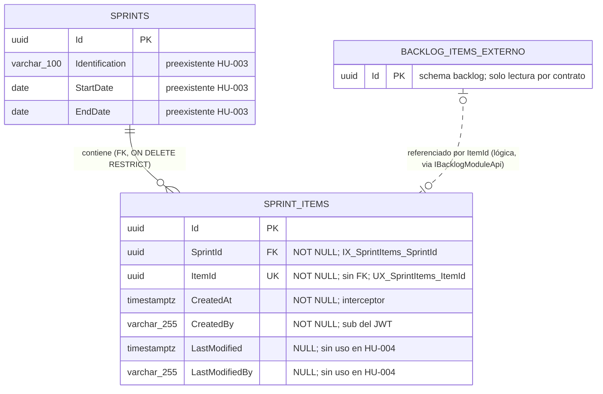
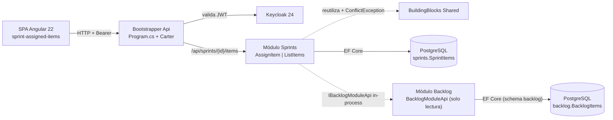
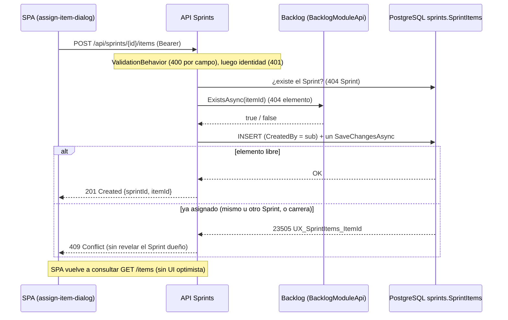
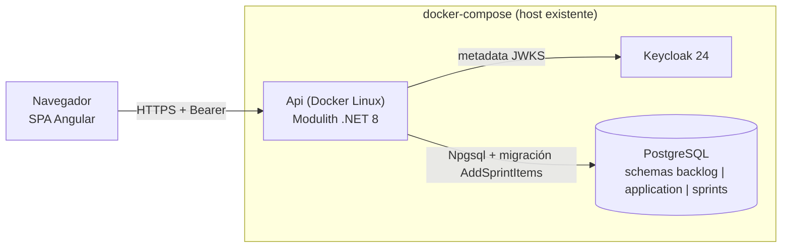

# TECH-DESIGN: Asignación de Elementos del Backlog a un Sprint

- **Fecha de Compilación:** 04-10-2026
- **Auditor y Consolidador:** Agente QT Senior BMAD
- **Fuente SDD:** `specs/004-HU_asignacion_elementos_sprint/spec.md`, `plan.md`, `tasks.md`, `data-model.md` y `contracts/` (GitHub Spec Kit)
- **Insumos auditados:** `documents/solutions-architect/004-HU_asignacion_elementos_sprint.md` (guía técnica del SA), `documents/data-architect/db_004_asignacion_elementos_sprint.md`, `documents/api-architect/api_004_asignacion_elementos_sprint.md`, `documents/designer-ux/ux_004_asignacion_elementos_sprint.md`
- **Modo de gobernanza:** Brownfield (`.specify/memory/constitution.md` prevalece; sin Cláusula de Excepción física)
- **Estado:** ✅ AUDITADO Y APROBADO (Auditoría Adversarial Exitosa: 0 hallazgos críticos, 7 advertencias vinculantes para Fase D)

---

## 1. Architecture Overview

HU-004 **amplía el módulo existente `Sprints`** (sin módulo nuevo) con la relación Sprint–Elemento: una tabla `sprints."SprintItems"`, dos endpoints autenticados (`POST` y `GET /api/sprints/{sprintId}/items`) y dos componentes Angular 22 Zoneless (`sprint-assigned-items`, `assign-item-dialog`) más la ruta `sprints/:id/elementos`. La existencia y los datos del elemento se leen por el contrato in-process `Sprints.Contracts.IBacklogModuleApi`, implementado por `Backlog` (sin FK, JOIN ni consulta cross-schema). La regla humana A (un elemento pertenece a un solo Sprint; repetir la asignación responde 409) se materializa con el índice único `UX_SprintItems_ItemId`, que también resuelve la concurrencia.

- **Patrón principal:** Modular Monolith + VSA, CQRS intra-proceso, una fila por solicitud con un único `SaveChangesAsync`, sin eventos, Outbox ni caché (proporcional a SC-006, 100 elementos).
- **Orden de evaluación fijo (POST):** validador 400 → identidad 401 → Sprint 404 → elemento 404 → conflicto 409 → INSERT (201).
- **Cambios fuera del módulo `Sprints` (únicos):** `ConflictException` + rama 409 en `Shared`; `Backlog.csproj` (referencia a `Sprints`), `BacklogModule.cs` y `BacklogModuleApi.cs`; `app.routes.ts`; botón en `sprint-detail`.
- **Validación cruzada contra `spec.md`/`tasks.md`:** FR-001..FR-014 y FR-016, SC-001..SC-007 y las tareas T001–T054 tienen soporte en `db_004` y `api_004`. FR-015 de `spec.md` queda sin efecto por la resolución humana A (ver W-02).

### 1.1. Auditoría Cruzada (resultado)

| Eje | Resultado | Evidencia verificada |
|---|---|---|
| DB vs API vs Spec Kit | ✅ Sin discrepancias bloqueantes | Mapeo 1:1 `sprintId`/`itemId` ↔ `SprintId`/`ItemId`; `id,title,type,devPoints,qaPoints` provienen de `BacklogItemSummary` (sin columna en `sprints`); `CreatedAt`/`CreatedBy` persistidos y no expuestos; T001–T054 cubiertas. Única discrepancia: tipo entero de T005/T036/T041 y del OpenAPI frente a `decimal?` (W-01) |
| UI → Data (campos huérfanos) | ✅ Cero huérfanos de datos | Columnas de la grilla (id, título, tipo, Dev, QA) ← contrato; cabecera del Sprint (identificación, fechas) ← `GET /api/sprints/{id}` de HU-003 (W-04); toast ← `{ sprintId, itemId }`. Acción "Ver elemento" sin destino (W-03) |
| ADRs (alternativas/trade-offs falsos) | ✅ con reservas | ADR no heredados (SA-003..007, DA-04..05, API-03..08) con alternativas viables (módulo `SprintPlanning`, `SERIALIZABLE`/advisory lock, índice compuesto, `Idempotency-Key`, paginación) y costos reales (acoplamiento `Backlog→Sprints`, dependencia del nombre del índice, cambio en `Shared`). Reservas en W-06 |
| Gobernanza / Anti-Sycophancy | ✅ | La resolución humana A es regla de negocio (cardinalidad), no tecnología: no contradice ninguna invariante de la constitución. Ninguna tecnología ajena al stack; ADR impuestos marcados `Aceptado (heredado)` |
| Proporcionalidad | ✅ | Una tabla, dos índices, un contrato in-process; sin RabbitMQ/Redis/Outbox; el índice único es el mínimo que garantiza la invariante bajo concurrencia |
| Código (afirmaciones del SA/DA/API) | ✅ Verificado | `BacklogItem.DevPoints/QAPoints` son `decimal?`; `CustomExceptionHandler` no mapea 409 y `ConflictException` no existe (cambio aditivo real); `Sprints.csproj` solo referencia `Shared` y `Application.csproj` referencia `Backlog` (patrón del contrato idéntico, **sin ciclo** con `Backlog→Sprints`); `SprintRules.UserMaxLength = 255`; `MigrateSprintsModuleAsync` ya se invoca en `Program.cs`; `IBacklogDbContext` existe; los comandos usan `IRequest<T>` como HU-003 y `ValidationBehavior` aplica a todo request |

---

## 2. Components

| Componente | Responsabilidad | Tareas |
|---|---|---|
| `Modules/Sprints/Contracts/IBacklogModuleApi.cs` | Contrato in-process (`ExistsAsync`, `GetSummariesAsync`, `BacklogItemSummary`) | T005 |
| `Domain/SprintItems/SprintItem.cs`, `SprintItemRules.cs` | Agregado `SprintItem : Aggregate<Guid>, IAuditableEntity`; constantes y mensajes (única fuente) | T006–T008 |
| `Data/` (`ISprintsDbContext`, `SprintsDbContext`, `SprintItemConfiguration`, `Migrations/AddSprintItems`) | Tabla, FK local, `UX_SprintItems_ItemId`, `IX_SprintItems_SprintId` | T009–T011 |
| `Features/SprintItems/AssignItemToSprint/` | Command, validador, handler y endpoint `POST /api/sprints/{sprintId}/items` | T020–T023, T028 |
| `Features/SprintItems/ListSprintItems/` | Query, handler y endpoint `GET /api/sprints/{sprintId:guid}/items` | T036–T039 |
| `Modules/Backlog/BacklogModuleApi.cs`, `Backlog.csproj`, `BacklogModule.cs` | Implementa el contrato (solo lectura del schema `backlog`) y lo registra | T012, T013 |
| `BuildingBlocks/Shared/Exceptions/` | `ConflictException` y rama 409 (aditivo) | T003, T004 |
| `tests/Unit/Sprints`, `tests/Integration/Sprints` | xUnit + FluentAssertions + Testcontainers; doble manual del contrato | T007, T014–T019, T025–T027, T030–T032, T034, T035 |
| `app/frontend/src/app/features/sprints/` | `sprint-assigned-items`, `assign-item-dialog`, ampliación de `sprint-api.service.ts` y `sprint.models.ts`, botón en `sprint-detail`, ruta `sprints/:id/elementos` | T041–T049 |
| `Modules/Application`, entidad `Sprint`, `BacklogItem`, `core/auth`, `features/backlog` | Intactos (FR-013, FR-014) | T053 |

---

## 3. Data Model

*(Contenido íntegro de `db_004_asignacion_elementos_sprint.md`: MER, Diccionario de Datos, trazabilidad y riesgos. Verificado: una sola tabla nueva, una FK local, ninguna FK ni JOIN cross-schema, cero campos huérfanos frente a `ux_004` y `spec.md`.)*

## 2. MODELO ENTIDAD-RELACIÓN (MER)



---

## 3. DICCIONARIO DE DATOS Y RESTRICCIONES
*(Mapeado a `spec.md` (Key Entity Asignación Sprint–Elemento), `data-model.md`, `tasks.md` T006–T011 y a los estados visuales UX 1–12.)*

### Tabla: `sprints."SprintItems"` (`SprintItem : Aggregate<Guid>, IAuditableEntity`)
- `Id` (`uuid`): Llave primaria (`PK_SprintItems`). Generado en `SprintItem.Create`.
- `SprintId` (`uuid`): NOT NULL. FK `FK_SprintItems_Sprints_SprintId` → `sprints."Sprints"("Id")` `ON DELETE RESTRICT`. Índice no único `IX_SprintItems_SprintId`.
- `ItemId` (`uuid`): NOT NULL. **Sin FK** (el elemento vive en `backlog`). Índice **único** `UX_SprintItems_ItemId`.
- `CreatedAt` (`timestamp with time zone`): NOT NULL. `AuditableEntityInterceptor` (FR-003).
- `CreatedBy` (`character varying(255)`): NOT NULL. `sub` del token vía `ICurrentUser`; nunca del cuerpo (FR-003).
- `LastModified` (`timestamp with time zone`): NULL. Sin uso en esta HU.
- `LastModifiedBy` (`character varying(255)`): NULL. Sin uso en esta HU.

**Restricciones:** `PK_SprintItems` (`Id`); `FK_SprintItems_Sprints_SprintId` (`RESTRICT`); `UX_SprintItems_ItemId` (`UNIQUE`, `ItemId`); `IX_SprintItems_SprintId`. Sin `CHECK`, sin columnas de estado, orden ni descripción.
**Migración:** `AddSprintItems` en `app/backend/src/Modules/Sprints/Data/Migrations/`; solo crea `sprints."SprintItems"` con sus índices y la FK (verificado por T011 y T014).
**Validación `Guid.Empty`:** se rechaza en dominio (`SprintItem.Create`) y en el validador; no se codifica `CHECK` en BD (la existencia real del Sprint la garantiza la FK; la del elemento, el contrato).

### Proyección de lectura (no persistida): `BacklogItemSummary`
`(Id, Title, Type, DevPoints, QAPoints)` proviene de `backlog` por `IBacklogModuleApi.GetSummariesAsync`; no tiene columna en `sprints` (ADR-06).

### Trazabilidad Spec / UX → Datos (cero campos huérfanos)

| Requisito / Estado UX | Dato que lo sustenta |
|---|---|
| FR-001, FR-002; UX 3, 4 | `SprintId`, `ItemId` (respuesta `{ sprintId, itemId }`) |
| FR-003; (auditoría no se muestra en UX) | `CreatedAt`, `CreatedBy` por interceptor |
| FR-004; UX 5 | Varias filas con mismo `SprintId` e `ItemId` distintos (índice único solo sobre `ItemId`) |
| Resolución A / 409; UX 12 | `UX_SprintItems_ItemId` |
| FR-005; UX 6, 9 | FK `SprintId` + ausencia de fila en `sprints."Sprints"` |
| FR-006; UX 7 | Verificación por contrato (sin dato local; `ItemId` sin FK) |
| FR-007; UX 8 | `SprintId`/`ItemId` NOT NULL; validación `Guid` en aplicación |
| FR-008, FR-009; UX 1, 2 | `SprintId` → `ItemId` en `SprintItems` + `Title`, `Type`, `DevPoints`, `QAPoints` desde `backlog` (contrato) |
| FR-010; UX 10 | Sin dato de persistencia (rechazo previo, 401) |
| FR-011, FR-012, SC-007; UX 11 | Una fila por solicitud, un único `SaveChangesAsync` (transacción implícita): sin fila parcial |
| FR-013, FR-014 | Sin columnas de estado ni cambios en `Sprints`/`BacklogItems` |
| FR-016 | Schema `sprints`, sin queries cross-schema, sin Outbox |
| SC-006 | `IX_SprintItems_SprintId` + una llamada de lote al contrato |

---

## 4. RIESGOS DE INTEGRIDAD Y ESCALABILIDAD
- `⚠️ RIESGO (tipo de dato de las estimaciones):` `BacklogItem.DevPoints` y `QAPoints` son `decimal?` (`Modules/Backlog/Domain/BacklogItems/BacklogItem.cs`), pero `tasks.md` T005 define `BacklogItemSummary(..., int DevPoints, int QAPoints)`. Un valor decimal se truncaría y un `NULL` (p. ej. QA de un ítem técnico, que la UX muestra como `--`) rompería la proyección o se falsearía como `0`. Debe reconciliarse antes de implementar: `decimal?` en `BacklogItemSummary`, `SprintItemResponse` y el modelo TypeScript (`T005`, `T036`, `T041`), y probar un elemento con QA nulo.
- `⚠️ RIESGO (discrepancia de longitud):` `data-model.md` y T010 indican `CreatedBy`/`LastModifiedBy` como `varchar` sin longitud; `sprints."Sprints"` y `backlog` usan `varchar(255)` (`SprintRules.UserMaxLength`). Este diseño fija 255; T010 debe usar la constante para que el schema no diverja.
- `⚠️ RIESGO (referencia huérfana lógica):` Sin FK a `backlog`, un `ItemId` inexistente podría persistirse si se escribe por una vía que omita el handler. La mitigación es aplicativa (`ExistsAsync`) y de pruebas. Un futuro borrado de elementos de `backlog` (hoy inexistente) dejaría `SprintItems` huérfanos y exigiría un evento de integración.
- `⚠️ RIESGO (acoplamiento al nombre del índice):` La traducción 409 vs 500 depende de `ConstraintName = UX_SprintItems_ItemId`. Un renombrado por migración debe actualizar `SprintItemRules.ItemIdUniqueIndexName`; T014 y T018 cubren la regresión.
- `⚠️ RIESGO (filtración del Sprint dueño):` El 409 no debe revelar a qué Sprint pertenece el elemento (T054); la fila persistida sí lo contiene, por lo que ningún endpoint futuro debe exponer la búsqueda inversa `ItemId → SprintId` sin definir permisos (punto abierto 6 de la HU).
- `⚠️ RIESGO (cardinalidad cerrada):` `UX_SprintItems_ItemId` fija pertenencia única. Cuando el negocio resuelva la pregunta 9 del Product Brief (arrastre de elementos no terminados al siguiente Sprint, historial) habrá que migrar a una relación con vigencia (`AssignedAt`/`UnassignedAt`) y recrear el índice como parcial. No existe desasignar ni mover en esta HU, por lo que las filas son inmutables.
- `⚠️ RIESGO (FK RESTRICT):` `ON DELETE RESTRICT` impedirá eliminar un Sprint con elementos asignados. Es el comportamiento deseado hoy (no hay borrado de Sprints); cualquier HU futura de eliminación deberá definir si cascada o bloquea.
- `⚠️ RIESGO (concurrencia y orden):` Ante N solicitudes simultáneas del mismo elemento, una gana y las demás reciben 409; el orden de ganancia no es determinista. El orden `CreatedAt, Id` de la consulta es solo de estabilidad (⚠️ [PROPUESTO]), no un contrato.
- `⚠️ RIESGO (consistencia de lectura):` `GetSummariesAsync` omite ids no devueltos por `backlog` (se registra `LogWarning`); la consulta puede devolver menos elementos que filas en `SprintItems` si un elemento deja de existir, contradiciendo SC-004 en ese caso límite.
- `⚠️ RIESGO (escalabilidad):` Sin paginación; aceptable hasta 100 elementos por Sprint (SC-006). Con miles por Sprint, la cláusula `ANY(...)` del contrato y la respuesta completa requerirán paginación y revisión de índices.
- `⚠️ RIESGO (despliegue):` `AddSprintItems` se aplica en el arranque junto con las migraciones de `backlog`, `application` y `sprints`; un fallo en `sprints` podría impedir iniciar el host si no se aíslan los errores de migración.


---

## 4. Integrations

*(Contenido íntegro de `api_004_asignacion_elementos_sprint.md`: especificaciones globales, endpoints, matriz de trazabilidad y dependencias. Integración con el sistema preexistente: el contrato HTTP convive con `/api/sprints` de HU-003 y el acceso a Backlog es **in-process** vía `IBacklogModuleApi`, nunca HTTP ni SQL cross-schema.)*

## 2. ESPECIFICACIONES GLOBALES
- **Autenticación:** JWT en `Authorization: Bearer <token>` (Keycloak). Todas las operaciones.
- **Base URL:** `/api/sprints/{sprintId}/items`
- **Content-Type de error:** `application/problem+json`
- **Nomenclatura JSON:** camelCase.
- **Identificadores:** GUID en texto (`xxxxxxxx-xxxx-xxxx-xxxx-xxxxxxxxxxxx`), distintos de `Guid.Empty`.

### Esquemas
| Esquema | Campos |
|---|---|
| `AssignItemRequest` | `itemId` (`string?`, GUID, obligatorio) |
| `AssignedItemResponse` | `sprintId` (`uuid`), `itemId` (`uuid`) |
| `SprintItemResponse` | `id` (`uuid`), `title` (`string`), `type` (`string`), `devPoints` (`number?`), `qaPoints` (`number?`) |
| `ValidationProblem` | `title`, `status`, `detail`, `errors` (`{ campo: string[] }`) |
| `Problem` | `title`, `status`, `detail` |

### Mapeo payload → columnas / fuentes (`db_004`)
| Campo JSON | Origen | Nota |
|---|---|---|
| `sprintId` (ruta y respuesta) | `sprints."SprintItems"."SprintId"` (FK a `sprints."Sprints"`) | Verificado por `AnyAsync` sobre `Sprints` y por la FK |
| `itemId` (request y respuesta) | `sprints."SprintItems"."ItemId"` (sin FK, `UX_SprintItems_ItemId`) | Existencia verificada por `IBacklogModuleApi.ExistsAsync` |
| `id` (`SprintItemResponse`) | `BacklogItemSummary.Id` (= `ItemId`) | Origen `backlog`, vía contrato in-process |
| `title`, `type`, `devPoints`, `qaPoints` | `BacklogItemSummary` (schema `backlog`) | Sin columna en `sprints` (ADR-06 del DA); `type` como texto |
| *(no expuesto)* | `Id`, `CreatedAt`, `CreatedBy`, `LastModified`, `LastModifiedBy` | `CreatedBy` = `sub`; `LastModified*` siempre `NULL` |

---

## 3. ENDPOINTS DEFINIDOS

### Endpoint: `POST /api/sprints/{sprintId}/items`
- **Tarea Spec Kit:** T020, T021, T022, T023, T028 (US1, US3, US4); pruebas T018, T019, T025–T027, T030–T032
- **Propósito Funcional:** Asignar un elemento registrado del backlog a un Sprint existente, un elemento por solicitud (FR-001..FR-004, FR-006, FR-007, FR-010..FR-012).
- **Parámetro de ruta:** `sprintId` (`string`, GUID; sin restricción `:guid`, ADR-03).
- **Request Headers:**
  - `Content-Type`: `application/json`
  - `Authorization`: `Bearer <token>`
- **Request Body (Payload JSON):**
```json
{
    "itemId": "7c9e6679-7425-40de-944b-e07fc1f90ae7"
}
```
- **Respuestas (Status Codes):**
  - ✅ **201 Created** (Happy Path; FR-001, FR-002, FR-003). Header `Location: /api/sprints/3fa85f64-5717-4562-b3fc-2c963f66afa6/items`:
  ```json
  {
      "sprintId": "3fa85f64-5717-4562-b3fc-2c963f66afa6",
      "itemId": "7c9e6679-7425-40de-944b-e07fc1f90ae7"
  }
  ```
  - ❌ **400 Bad Request** (Sad Path - `itemId` ausente, vacío, no-GUID o `Guid.Empty`; FR-007):
  ```json
  {
      "title": "One or more validation errors occurred.",
      "status": 400,
      "detail": "Validation failed",
      "errors": {
          "itemId": ["El identificador del elemento es obligatorio."]
      }
  }
  ```
  - ❌ **400 Bad Request** (Sad Path - `sprintId` de ruta malformado o `Guid.Empty`; FR-007):
  ```json
  {
      "title": "One or more validation errors occurred.",
      "status": 400,
      "detail": "Validation failed",
      "errors": {
          "sprintId": ["El identificador del Sprint tiene un formato inválido."]
      }
  }
  ```
  - ❌ **401 Unauthorized** (Sad Path - Sin token, inválido o expirado; FR-010). Sin cuerpo definido; emitido por el middleware de autenticación. No se lee ni persiste nada.
  - ❌ **404 Not Found** (Sad Path - Sprint inexistente; FR-005). Gana si no existen ni el Sprint ni el elemento:
  ```json
  {
      "title": "Not Found",
      "status": 404,
      "detail": "El Sprint no existe."
  }
  ```
  - ❌ **404 Not Found** (Sad Path - Elemento inexistente; FR-006):
  ```json
  {
      "title": "Not Found",
      "status": 404,
      "detail": "El elemento no existe."
  }
  ```
  - ❌ **409 Conflict** (Sad Path - Regla de negocio: el elemento ya está asignado a un Sprint, el mismo u otro; resolución humana A). No revela cuál:
  ```json
  {
      "title": "Conflict",
      "status": 409,
      "detail": "El elemento ya está asignado a un Sprint."
  }
  ```
  - ❌ **500 Internal Server Error** (Sad Path - Fallo de persistencia o de otra restricción; FR-012). Sin trazas ni asignación parcial:
  ```json
  {
      "title": "An error occurred while processing your request.",
      "status": 500,
      "detail": "Ha ocurrido un error inesperado al procesar la solicitud."
  }
  ```
- **Notas:** El contrato vinculante es el código de estado y la clave de campo; los textos exactos los fija `SprintItemRules` (T006). No hay 403. Un solo `SaveChangesAsync` por solicitud garantiza ausencia de filas parciales.

### Endpoint: `GET /api/sprints/{sprintId}/items`
- **Tarea Spec Kit:** T036, T037, T038, T039 (US2); pruebas T034, T035, T030
- **Propósito Funcional:** Consultar exactamente los elementos asignados a un Sprint (FR-008, FR-009, FR-005, SC-004, SC-006). ⚠️ PROPUESTO por la HU; solo lectura (`AsNoTracking`).
- **Parámetro de ruta:** `sprintId` (`uuid`, restricción `{sprintId:guid}`).
- **Request Headers:**
  - `Authorization`: `Bearer <token>`
- **Request Body:** Ninguno. Sin parámetros de consulta (sin paginación ni filtros).
- **Respuestas (Status Codes):**
  - ✅ **200 OK** (Happy Path; FR-008), ordenado por `CreatedAt` y luego `Id`. Sin `status` ni auditoría; `qaPoints` es `null` para un elemento técnico:
  ```json
  [
      {
          "id": "7c9e6679-7425-40de-944b-e07fc1f90ae7",
          "title": "Registrar historia de usuario",
          "type": "UserStory",
          "devPoints": 5,
          "qaPoints": 2.5
      },
      {
          "id": "0b8f3c52-9a41-4d7e-bd13-6a2c1f4e8b77",
          "title": "Migrar esquema de catálogo",
          "type": "Technical",
          "devPoints": 3,
          "qaPoints": null
      }
  ]
  ```
  - ✅ **200 OK** (Sprint sin elementos; FR-009): `[]`
  - ❌ **401 Unauthorized** (Sad Path; FR-010). Sin cuerpo; no se lee ningún dato de asignación.
  - ❌ **404 Not Found** (Sad Path - Sprint inexistente; FR-005):
  ```json
  {
      "title": "Not Found",
      "status": 404,
      "detail": "El Sprint no existe."
  }
  ```
- **Notas:** Un `sprintId` que no es GUID no coincide con la ruta por `{sprintId:guid}` y produce un 404 del enrutador sin `ProblemDetails` garantizado. Los valores de `type` son los nombres del enum de Backlog como texto (los ejemplos son ilustrativos).

### Matriz de trazabilidad Spec → Contrato

| Requisito | Endpoint | Código |
|---|---|---|
| FR-001, FR-002, FR-003, FR-004 | `POST /api/sprints/{sprintId}/items` | 201 |
| FR-005 | `POST` y `GET` | 404 (Sprint) |
| FR-006 | `POST` | 404 (elemento) |
| FR-007 | `POST` | 400 |
| Resolución humana A (reemplaza FR-015) | `POST` | 409 |
| FR-008, FR-009 | `GET /api/sprints/{sprintId}/items` | 200 |
| FR-010 | Ambos | 401 |
| FR-011, FR-012 | `POST` | 400/401/404/409/500 sin persistencia; 500 sin traza |
| FR-013, FR-014 | Ausencia de `PUT`/`PATCH`/`DELETE` y de campos de estado | n/a |
| FR-016 | Carter, `.RequireAuthorization()`, `CustomExceptionHandler` | n/a |

---

## 4. DEPENDENCIAS BLOQUEANTES
- `⚠️ BLOQUEO:` Ninguno respecto a `db_004_asignacion_elementos_sprint.md`: cubre `SprintId`, `ItemId`, el índice único del 409 y la auditoría. Las proyecciones `title`, `type`, `devPoints` y `qaPoints` provienen de `backlog` por contrato in-process, sin tabla adicional.
- `⚠️ DISCREPANCIA (tipo de estimaciones):` `contracts/sprint-items-api.openapi.yaml`, `tasks.md` T005, T036 y T041 tipan `devPoints`/`qaPoints` como entero; `BacklogItem` los define `decimal?`. Debe reconciliarse a `decimal?` / `number | null` antes de implementar (ADR-04) y añadirse una prueba con QA nulo y un valor decimal.
- `⚠️ RIESGO (409 y Shared):` El 409 exige `ConflictException` y su rama en `CustomExceptionHandler` (T003/T004); un cambio no aditivo rompería los formatos 400/404/500 de HU-001..003 (T030 cubre la regresión).
- `⚠️ RIESGO (acoplamiento al nombre del índice):` La traducción 409 vs 500 depende de `ConstraintName = UX_SprintItems_ItemId`; renombrarlo sin actualizar `SprintItemRules.ItemIdUniqueIndexName` degradaría el conflicto a 500.
- `⚠️ RIESGO (reintento tras 201 perdido):` El segundo `POST` idéntico recibe 409; sin `Idempotency-Key` el cliente no distingue su propia asignación de otra.
- `⚠️ RIESGO (permisos y fuga de información):` Sin roles definidos (punto abierto 6), cualquier usuario autenticado asigna y consulta. El 409 no revela el Sprint dueño; ningún endpoint futuro debe exponer `ItemId → SprintId` sin definir permisos.
- `⚠️ RIESGO (consistencia de lectura y escala):` El `GET` puede devolver menos filas que `SprintItems` si Backlog omite ids (SC-004), y no pagina (válido hasta 100 elementos, SC-006).
- `⚠️ RIESGO (binding):` Un cuerpo con JSON roto o `itemId` no textual falla en el binding con un 400 sin errores por campo.
- `⚠️ RIESGO (spec obsoleta):` `spec.md` aún conserva FR-015 y trata el reasignado como no documentado; el 409 de este contrato depende de la reconciliación vinculante de `tasks.md`.


---

## 5. DIAGRAMAS DE ARQUITECTURA (Componentes, Secuencia, Despliegue)

*(Escenario A: skill `archify` disponible. Cada diagrama se entrega en HTML interactivo + JSON fuente + bloque `mermaid`. Todos representan la convivencia con los módulos preexistentes y no contradicen los ADR.)*

### 5.1. Componentes: Sprints, Backlog y Shared (`component`)
- 🌐 **Visor Interactivo HTML:** [`diagrams/hu004_componentes.html`](diagrams/hu004_componentes.html)
- 📄 **Especificación Fuente JSON:** [`diagrams/hu004_componentes.component.json`](diagrams/hu004_componentes.component.json)
- **Estado de Validación:** ✅ *Showcase Pass (9/9 checks)*



### 5.2. Secuencia de asignación de un elemento (`sequence`)
- 🌐 **Visor Interactivo HTML:** [`diagrams/hu004_secuencia_asignar.html`](diagrams/hu004_secuencia_asignar.html)
- 📄 **Especificación Fuente JSON:** [`diagrams/hu004_secuencia_asignar.sequence.json`](diagrams/hu004_secuencia_asignar.sequence.json)
- **Estado de Validación:** ✅ *Showcase Pass (9/9 checks)*



### 5.3. Despliegue sobre la infraestructura existente (`component`)
- 🌐 **Visor Interactivo HTML:** [`diagrams/hu004_despliegue.html`](diagrams/hu004_despliegue.html)
- 📄 **Especificación Fuente JSON:** [`diagrams/hu004_despliegue.component.json`](diagrams/hu004_despliegue.component.json)
- **Estado de Validación:** ✅ *Showcase Pass (9/9 checks)*



*Nota: los visores HTML se generaron y validaron con `archify deliver --quality showcase` (9/9 checks, 0 errores, 0 advertencias). No se ejecutó `visual-check` en navegador; la revisión perceptual queda pendiente.*

---

## 6. Technology Stack

| Capa | Tecnología | Origen |
|---|---|---|
| Runtime | .NET 8 (`net8.0`, C# 12) | Constitución §2 (heredado) |
| API | Carter 8.1.0, MediatR 12.4.1, FluentValidation 11.9.2, Mapster 7.4.0 | Constitución §2 (heredado) |
| Identidad | Keycloak 24 + `Keycloak.AuthServices.Authentication` 2.5.2 | Constitución §5 (heredado) |
| Persistencia | PostgreSQL, EF Core Npgsql 8.0.11 Code-First, schema `sprints`, índice único + FK local | Constitución §3 (heredado) |
| Frontend | Angular 22.2 Zoneless + Signals, PrimeNG ^22.1.2 tema neutral, i18n nativo | Constitución §1 (heredado) |
| Pruebas | xUnit, FluentAssertions, Testcontainers PostgreSQL; Jest | Mismas versiones que HU-003 |
| Logging | Serilog vía `ILogger<T>` | Constitución §6 (heredado) |
| Fuera de alcance | RabbitMQ/MassTransit, Redis, Outbox, eventos de dominio o integración, paquetes NuGet nuevos | Sin consumidor ni requisito (SA-ADR-006, DA-ADR-06) |

---

## 7. Architecture Decisions (ADRs - Matriz Consolidada MADR)

*(Numeración con prefijo de origen: `SA-ADR-001..007` = guía del SA; `DA-ADR-01..06` = `db_004`; `API-ADR-01..08` = `api_004`.)*

| ID | Título de la Decisión | Área | Estado | Trade-off / Costo Admitido |
|:---:|---|:---:|:---:|---|
| **SA-ADR-001** | Carter, MediatR y VSA | Arquitectura (SA) | Aceptado (heredado) | Varios ficheros por un modelo de dos campos |
| **SA-ADR-002** | PostgreSQL con schema aislado, sin consultas cross-schema | Datos (SA) | Aceptado (heredado) | La BD no impide un `ItemId` huérfano si se escribe por otra vía |
| **SA-ADR-003** | Asignación en `Sprints`; elemento por contrato in-process | Arquitectura (SA) | Aceptado | `Backlog.csproj` referencia `Sprints`; dobles del contrato en pruebas; latencia remota al extraer |
| **SA-ADR-004** | Un elemento, un Sprint por índice único; 409 desde `23505` | Datos (SA) | Aceptado | Dependencia del nombre del índice; cambiar la cardinalidad exige migración y revisar HU-006/031 |
| **SA-ADR-005** | `ConflictException` y mapeo 409 en `Shared` | Arquitectura (SA) | Aceptado | Se toca un building block compartido por todos los módulos |
| **SA-ADR-006** | Sin eventos, Outbox ni caché | Infraestructura (SA) | Aceptado | HU-006/031 deberán añadir evento y Outbox si reaccionan |
| **SA-ADR-007** | Identificadores como texto validados por campo | API (SA) | Aceptado | Parseo manual; plantillas distintas POST/GET |
| **DA-ADR-01** | Motor, módulo y schema `sprints` reutilizado | Datos (DA) | Aceptado (heredado) | Integridad hacia `backlog` solo lógica |
| **DA-ADR-02** | `SprintItem : Aggregate<Guid>` con auditoría por interceptor | Datos (DA) | Aceptado (heredado) | `LastModified*` siempre NULL |
| **DA-ADR-03** | `ItemId` sin FK; `SprintId` con FK `RESTRICT` | Datos (DA) | Aceptado (heredado) | `ItemId` huérfano posible por vía externa; `RESTRICT` bloquea borrar Sprints |
| **DA-ADR-04** | `UX_SprintItems_ItemId` (invariante) | Datos (DA) | Aceptado | Renombrar el índice degrada 409 a 500 |
| **DA-ADR-05** | Índice `IX_SprintItems_SprintId` | Datos (DA) | Aceptado | Segundo índice en cada INSERT |
| **DA-ADR-06** | Sin eventos, Outbox, caché ni proyección local | Datos (DA) | Aceptado (heredado) | Cada consulta depende de `Backlog` en proceso |
| **API-ADR-01** | Carter, VSA y recurso anidado | APIs (API) | Aceptado (heredado) | Dos DTO distintos que el frontend debe mapear |
| **API-ADR-02** | Bearer JWT Keycloak sin política por rol | APIs (API) | Aceptado (heredado) | Cualquier autenticado asigna; roles añadirán 403 |
| **API-ADR-03** | Errores y 400 por campo con identificadores como texto | APIs (API) | Aceptado | Asimetría POST (texto) / GET (`guid`); binding roto da 400 sin campo |
| **API-ADR-04** | `devPoints`/`qaPoints` como `number \| null` | APIs (API) | Aceptado | Cambia T005/T036/T041 y el OpenAPI; precisión decimal en clientes `double` |
| **API-ADR-05** | 201 Created con `Location` a la colección | APIs (API) | Aceptado | `Location` no apunta a un recurso individual |
| **API-ADR-06** | 409 por pertenencia única sin revelar el dueño | APIs (API) | Aceptado | Reintento tras 201 perdido recibe 409 (sin idempotencia) |
| **API-ADR-07** | `ProblemDetails` (`application/problem+json`) | APIs (API) | Aceptado (heredado) | 404 Sprint/elemento solo distinguible por `detail` |
| **API-ADR-08** | Consulta sin paginación, orden estable, proyección en vivo | APIs (API) | Aceptado | Menos elementos que filas si Backlog omite ids; paginar luego rompe la forma |

### Detalle de ADRs del Solutions Architect
*(Fuente: guía del SA, sección 5.3. Los ADR se citan como `SA-ADR-00X`.)*

#### SA-ADR-001: Carter, MediatR y Vertical Slice Architecture
- **Estado:** Aceptado (heredado)
- **Contexto:** FR-016 exige respetar la constitución. Hay dos casos de uso: asignar y consultar.
- **Decisión:** Un endpoint `ICarterModule` por caso de uso, con `ISender`, `.RequireAuthorization()`, `.Produces<T>()` y `.ProducesProblem()`, en `Features/SprintItems/{AssignItemToSprint|ListSprintItems}/` con Command/Query, Validador y Handler co-ubicados.
- **Consecuencias:**
  - ✅ **Impacto Positivo:** cada carpeta se audita contra US1/US3/US4 y US2 respectivamente.
  - ⚠️ **Trade-off / Costo Real:** varios ficheros por un modelo de dos campos; es el costo fijo de VSA.

#### SA-ADR-002: PostgreSQL con schema aislado por módulo y sin consultas cross-schema
- **Estado:** Aceptado (heredado)
- **Contexto:** La constitución §3 prohíbe `JOIN` y consultas cross-schema; la asignación necesita datos del Sprint (`sprints`) y del elemento (`backlog`).
- **Decisión:** `SprintItems` vive en el schema `sprints` con FK real a `sprints."Sprints"`. La relación con el elemento es **solo lógica** (columna `ItemId uuid` sin FK); su existencia y sus datos se obtienen por el contrato in-process (ADR-003).
- **Consecuencias:**
  - ✅ **Impacto Positivo:** el módulo sigue siendo extraíble; ninguna migración toca `backlog`.
  - ⚠️ **Trade-off / Costo Real:** la base de datos no impide un `ItemId` huérfano si otro camino de código escribe sin pasar por el handler, ni protege contra el borrado de un elemento (no existe borrado de elementos hoy). La integridad depende de verificar por contrato antes de persistir.

#### SA-ADR-003: La asignación vive en el módulo `Sprints`; el elemento se lee por contrato in-process
- **Estado:** Aceptado
- **Contexto:** El módulo propietario de la relación y la forma de validar la existencia del elemento "respetando el aislamiento por schema" corresponde a Architecture (spec, Dependencias). HU-003 (ADR-003) dejó anunciado el patrón: contrato in-process siguiendo el de `IApplicationModuleApi`.
- **Decisión:** La tabla `SprintItems` y sus features viven en `Sprints` (el Sprint es el lado "uno" y el consumidor del dato). `Sprints` define `Sprints.Contracts.IBacklogModuleApi` con `ExistsAsync(Guid itemId, CancellationToken)` y `GetSummariesAsync(IReadOnlyCollection<Guid> itemIds, CancellationToken)` que devuelve `BacklogItemSummary(Id, Title, Type, DevPoints, QAPoints)`; `Backlog` lo implementa en `BacklogModuleApi` consultando solo el schema `backlog` (mismo sentido de dependencia que `Application → Backlog`: el implementador referencia al módulo que define el contrato). `Type` se transfiere como `string` con el nombre del enum para que `Sprints` no referencie tipos de `Backlog`.
- **Alternativas Consideradas:**
  - **Alternativa A (asignación dentro del módulo `Backlog`, con `SprintId` en el elemento o tabla en `backlog`):** permitiría un `JOIN` y una FK a elementos. Se descarta porque obliga a `Backlog` a conocer Sprints (o a consultar el schema `sprints`, prohibido), modifica el agregado `BacklogItem` que FR-013 declara intocable y rompe el aislamiento de HU-001.
  - **Alternativa B (módulo nuevo `SprintPlanning` con proyecciones locales de Sprint y elemento vía Integration Events):** máximo desacoplamiento. Se descarta por desproporcionada: exige Outbox, RabbitMQ y consistencia eventual para una validación de existencia que hoy es una llamada en proceso; además permitiría asignar a un elemento recién creado que aún no llegó a la proyección.
  - **Alternativa C (el handler lee `BacklogDbContext` directamente):** simple, pero es exactamente la consulta cross-schema que la constitución prohíbe y acopla `Sprints` a un `DbContext` ajeno.
- **Consecuencias:**
  - ✅ **Impacto Positivo:** cero cambios en entidades existentes, cero infraestructura nueva y verificación de existencia con consistencia fuerte.
  - ⚠️ **Trade-off / Costo Real:** `Backlog.csproj` pasa a referenciar `Sprints.csproj` (acoplamiento de compilación en el sentido contrato→implementador) y `Sprints` depende en ejecución de que `Backlog` registre su implementación: las pruebas del módulo `Sprints` necesitan un doble del contrato en unitarias y la implementación real en integración. Al extraer `Sprints` como servicio, el contrato pasará a ser una llamada remota con su latencia y modos de fallo.

#### SA-ADR-004: "Un elemento, un Sprint" garantizado por índice único; el 409 se traduce desde la violación de unicidad
- **Estado:** Aceptado
- **Contexto:** La resolución humana A fija que un elemento pertenece a un solo Sprint y que repetir la asignación (mismo Sprint u otro) responde 409. Las asignaciones concurrentes del mismo elemento estaban sin definir; con esta regla se resuelven sin inventar comportamiento.
- **Decisión:** Índice único `UX_SprintItems_ItemId` sobre `ItemId` (solo esa columna, no el par `SprintId, ItemId`). El handler **no** comprueba "¿ya está asignado?" con una lectura previa como mecanismo de garantía: intenta insertar y traduce la `PostgresException` 23505 de **ese** índice a `ConflictException`. Se mantiene una lectura previa opcional (`AnyAsync` por `ItemId`) únicamente para evitar el viaje al contrato cuando el conflicto es evidente; no sustituye al índice.
- **Alternativas Consideradas:**
  - **Alternativa A (solo comprobación en el handler con `AnyAsync` y sin índice):** sencilla y suficiente para un solo usuario. Se descarta porque la lectura y la escritura no son atómicas: dos solicitudes simultáneas pasan ambas la comprobación y el elemento queda en dos Sprints, violando la invariante.
  - **Alternativa B (índice único compuesto `SprintId, ItemId`):** impediría duplicar la misma pareja, pero permitiría asignar el mismo elemento a otro Sprint, contradiciendo la opción A del humano.
  - **Alternativa C (`SERIALIZABLE` o bloqueo asesor `pg_advisory_xact_lock`):** también cierra la carrera. Se descarta por añadir complejidad y reintentos para algo que un índice único resuelve de forma declarativa.
- **Consecuencias:**
  - ✅ **Impacto Positivo:** la invariante vale también para SQL directo y para cualquier futura ruta de código; la concurrencia queda resuelta sin bloqueos.
  - ⚠️ **Trade-off / Costo Real:** el código depende del nombre de constraint de Npgsql (`ConstraintName`) para distinguir el 409 de un 500; si se renombra el índice hay que actualizar la constante `SprintItemRules.ItemIdUniqueIndexName` (cubierto por una prueba de integración). Si negocio decide que un elemento pueda estar en varios Sprints (pregunta 9 del Product Brief), habrá que **reemplazar el índice por una migración** y revisar la HU-006 y la HU-031.

#### SA-ADR-005: `ConflictException` y mapeo 409 en `Shared` (cambio aditivo)
- **Estado:** Aceptado
- **Contexto:** `Shared.Exceptions` solo mapea 400, 401, 404 y 500; no existe 409. La constitución obliga al manejo centralizado de excepciones (`CustomExceptionHandler`).
- **Decisión:** Añadir `ConflictException(string message)` en `Shared/Exceptions` y una rama `ConflictException => ProblemDetails { Status = 409, Title = "Conflict", Detail = message }` en `CustomExceptionHandler`. El mensaje no revela a qué Sprint pertenece el elemento (UX Estado 12). Es el único cambio permitido en `Shared` y no modifica el comportamiento de ninguna excepción existente.
- **Alternativas Consideradas:**
  - **Alternativa A (endpoint que devuelve `Results.Problem(409)` desde un resultado tipado del handler):** evita tocar `Shared`. Se descarta porque rompe el modelo del proyecto (handlers que lanzan excepciones semánticas) y obligaría a cada futuro 409 a repetir ese patrón.
  - **Alternativa B (reutilizar `BadRequestException` y devolver 400):** contradice la decisión humana (409) y los criterios de aceptación.
- **Consecuencias:**
  - ✅ **Impacto Positivo:** el 409 es reutilizable por HU futuras con el mismo formato ProblemDetails.
  - ⚠️ **Trade-off / Costo Real:** se toca un building block compartido por todos los módulos; exige añadir una prueba al handler y verificar que las suites de HU-001, 002 y 003 siguen en verde.

#### SA-ADR-006: Sin eventos de dominio ni de integración, Outbox ni caché
- **Estado:** Aceptado
- **Contexto:** Ningún requisito notifica a otros módulos al asignar, y la consulta está acotada a 100 elementos (SC-006). La HU-006 y la HU-031 consumirán la asignación pero hoy no existen.
- **Decisión:** `SprintItem` hereda de `Aggregate<Guid>` por la jerarquía estándar pero no emite eventos. Sin tabla `OutboxMessage`, sin MassTransit y sin decorador Redis.
- **Alternativas Consideradas:**
  - **Alternativa A (emitir `ItemAssignedToSprintIntegrationEvent` para la HU-006):** anticiparía la integración. Se descarta porque no hay consumidor y el diseño debe nacer de un requisito; añadirlo después no cambia la tabla.
  - **Alternativa B (decorador Redis para la consulta):** se descarta por no existir un cuello de botella medido y por añadir invalidación al asignar.
- **Consecuencias:**
  - ✅ **Impacto Positivo:** ningún punto de fallo adicional.
  - ⚠️ **Trade-off / Costo Real:** si la HU-006 o la HU-031 necesitan reaccionar a la asignación, deberán añadir el evento y, por ser crítico, el Outbox (constitución §4).

#### SA-ADR-007: Identificadores recibidos como texto y validados por campo; ausente incluye `Guid.Empty`
- **Estado:** Aceptado
- **Contexto:** FR-007 y SC-007 exigen 400 "con el detalle de los campos inválidos" para Sprint o elemento ausente o con formato inválido. Un `{sprintId:guid}` en la ruta o un `Guid` en el cuerpo producirían 404 o un 400 general (`BadHttpRequestException`) sin identificar el campo (mismo problema que HU-003, ADR-004).
- **Decisión:** `POST /api/sprints/{sprintId}/items` declara `sprintId` como `string` (sin restricción `:guid`) y el cuerpo `{ itemId }` como `string?`. `AssignItemToSprintCommand(string? SprintId, string? ItemId)`; el validador exige presencia, `Guid.TryParse` y que no sea `Guid.Empty`, con errores bajo las claves `sprintId` e `itemId`; el handler parsea ya validado. `GET /api/sprints/{sprintId:guid}/items` conserva `:guid` (como HU-003): un id malformado en la consulta responde 404, aceptable porque la HU solo define 404 para Sprint inexistente al consultar.
- **Alternativas Consideradas:**
  - **Alternativa A (`Guid` tipado en ruta y cuerpo):** menos código. Se descarta porque un Sprint malformado daría 404 y un elemento malformado un 400 sin campo, incumpliendo FR-007.
  - **Alternativa B (`Guid?` en el cuerpo y dejar fallar el binder):** mismo defecto de reporte por campo.
- **Consecuencias:**
  - ✅ **Impacto Positivo:** los cuatro casos de SC-07 se reportan por campo y `errors` del ProblemDetails alimenta los mensajes en línea del UX (Estado 8).
  - ⚠️ **Trade-off / Costo Real:** parseo manual y rutas POST y GET con plantillas distintas para el mismo segmento; hay que documentarlo en el contrato del API Architect.


### Detalle de ADRs del Data Architect
*(Fuente: `db_004`, sección 1. Los ADR se citan como `DA-ADR-0X`; en la fuente aparecen como `ADR-0X`.)*

### DA-ADR-01: Motor, módulo y schema (reutiliza `sprints`)
- **Estado:** Aceptado (heredado)
- **Contexto:** La Constitución (§3) impone PostgreSQL/Npgsql con EF Core Code-First, un `DbContext` por módulo y un schema por módulo. El SA (ADR-003) ubica la asignación en el módulo existente `Sprints`; el Sprint es el lado "uno" y el consumidor del dato.
- **Decisión:** La tabla es `sprints."SprintItems"` y se mapea en `SprintsDbContext` (`DbSet<SprintItem> SprintItems`); su historial queda en `sprints.__EFMigrationsHistory`.
- **Consecuencias:**
  - ✅ **Ventajas / Impacto Positivo:** Cero schemas nuevos; la migración solo toca `sprints`; no se modifica `BacklogItem` (FR-013).
  - ⚠️ **Trade-off / Costo Real:** El módulo `Sprints` queda acoplado funcionalmente a Backlog vía contrato in-process; la integridad hacia `backlog` es lógica (ver ADR-03).

### DA-ADR-02: `SprintItem : Aggregate<Guid>` con auditoría por interceptor y sin estado ni orden
- **Estado:** Aceptado (heredado)
- **Contexto:** FR-003 exige `CreatedAt` y `CreatedBy` (= `sub` del token). La Constitución prohíbe columnas o triggers manuales de auditoría y obliga a `AuditableEntityInterceptor`. FR-014 prohíbe definir o cambiar estados.
- **Decisión:** `SprintItem` hereda de `Aggregate<Guid>` e implementa `IAuditableEntity`; `CreatedAt`, `CreatedBy`, `LastModified` y `LastModifiedBy` los puebla el interceptor ya registrado en `SprintsDbContext`. No hay columna de estado, de orden ni de posición. `CreatedBy` y `LastModifiedBy` son `varchar(255)` (constante `SprintRules.UserMaxLength`, igual que `sprints."Sprints"` y `backlog."BacklogItems"`).
- **Consecuencias:**
  - ✅ **Ventajas / Impacto Positivo:** Mismo comportamiento de auditoría que HU-001 y HU-003; sin lógica propia.
  - ⚠️ **Trade-off / Costo Real:** `LastModified`/`LastModifiedBy` quedan siempre `NULL` (no existe desasignar ni mover) pero se conservan por la jerarquía `Entity<TId>`. `data-model.md` indica `varchar` sin longitud; este diseño fija 255 (ver Riesgos).

### DA-ADR-03: `ItemId` sin FK (referencia lógica cross-schema) y `SprintId` con FK `ON DELETE RESTRICT`
- **Estado:** Aceptado (heredado)
- **Contexto:** La Constitución §3.2.3 prohíbe joins y consultas cross-schema. El elemento vive en `backlog`; el Sprint vive en `sprints`.
- **Decisión:** `ItemId` es `uuid NOT NULL` **sin FK**; su existencia se verifica en el handler por `IBacklogModuleApi.ExistsAsync` y sus datos de lectura se obtienen por `GetSummariesAsync` (una sola consulta de lote). `SprintId` es `uuid NOT NULL` con FK `FK_SprintItems_Sprints_SprintId` a `sprints."Sprints"("Id")` `ON DELETE RESTRICT` (mismo schema, integridad física permitida).
- **Consecuencias:**
  - ✅ **Ventajas / Impacto Positivo:** Cumple el aislamiento por schema; impide asignaciones huérfanas hacia Sprints inexistentes incluso con `INSERT` directo; el módulo `Sprints` es extraíble.
  - ⚠️ **Trade-off / Costo Real:** La BD no impide un `ItemId` huérfano si otra vía escribe sin pasar por el handler; `RESTRICT` bloqueará un futuro borrado de Sprint con elementos (hoy no existe borrado).

### DA-ADR-04: Unicidad de `ItemId` (`UX_SprintItems_ItemId`) como invariante "un elemento, un Sprint"
- **Estado:** Aceptado
- **Contexto:** La resolución humana A exige 409 al reasignar un elemento ya asignado (mismo u otro Sprint) y exactamente un 201 ante solicitudes concurrentes del mismo elemento (`tasks.md` T019).
- **Decisión:** Índice **único** `UX_SprintItems_ItemId` sobre `ItemId` (columna única, no compuesta). La violación (`SQLSTATE 23505` con `ConstraintName = UX_SprintItems_ItemId`) se traduce a `ConflictException`. El nombre es la constante pública `SprintItemRules.ItemIdUniqueIndexName`.
- **Alternativas Evaluadas:**
  - **Alternativa A:** Índice único compuesto `(SprintId, ItemId)`. Descartada: permitiría el mismo elemento en dos Sprints distintos, contradiciendo la regla humana A.
  - **Alternativa B:** Solo verificación `AnyAsync` en la aplicación. Descartada: dos solicitudes simultáneas pasarían ambas la lectura y persistirían dos filas (carrera).
  - **Alternativa C:** Aislamiento `SERIALIZABLE` o `pg_advisory_lock` por `ItemId`. Descartada: complejidad y contención innecesarias cuando un índice declarativo resuelve la carrera de forma atómica.
- **Consecuencias:**
  - ✅ **Ventajas / Impacto Positivo:** La concurrencia se resuelve en el motor; la invariante no puede violarse por ninguna vía; el índice sirve también de búsqueda por `ItemId`.
  - ⚠️ **Trade-off / Costo Real:** Distinguir 409 de 500 depende del **nombre** del índice; renombrarlo sin actualizar la constante convertiría el conflicto en 500. Si el negocio admite luego varios Sprints por elemento, habrá que eliminar el índice por migración y rediseñar la relación.

### DA-ADR-05: Índice no único `IX_SprintItems_SprintId` para la consulta por Sprint
- **Estado:** Aceptado
- **Contexto:** `GET /api/sprints/{sprintId}/items` filtra por `SprintId` y debe responder en menos de 2 s con hasta 100 elementos (SC-006). El índice único sobre `ItemId` no sirve ese predicado, y PostgreSQL no indexa automáticamente las columnas de FK.
- **Decisión:** Índice B-tree no único sobre `SprintId`. El orden de lectura (`CreatedAt`, `Id`) se resuelve en memoria sobre un conjunto pequeño; no se crea índice compuesto.
- **Alternativas Evaluadas:**
  - **Alternativa A:** Sin índice (escaneo secuencial). Descartada: la FK sin índice degrada la comprobación de `RESTRICT` y la consulta crece linealmente con toda la tabla.
  - **Alternativa B:** Índice compuesto `(SprintId, CreatedAt, Id)`. Descartada: el volumen por Sprint es ≤ 100 y el orden es solo de estabilidad (⚠️ [PROPUESTO], no contrato); añade coste de escritura sin beneficio medible.
- **Consecuencias:**
  - ✅ **Ventajas / Impacto Positivo:** Consulta por Sprint con búsqueda por índice; la verificación de la FK no escanea la tabla.
  - ⚠️ **Trade-off / Costo Real:** Un segundo índice a mantener en cada `INSERT`; costo despreciable al ser una escritura por solicitud.

### DA-ADR-06: Sin eventos, sin Outbox, sin caché ni proyección local de datos del elemento
- **Estado:** Aceptado (heredado)
- **Contexto:** La Constitución exige `OutboxMessage` solo en flujos que publican eventos críticos; el SA (ADR-006) descartó eventos, Redis y MassTransit en esta HU. Los datos del elemento (título, tipo, estimaciones) pertenecen a `backlog`.
- **Decisión:** No se crea `OutboxMessage` en `sprints`, no se emiten eventos de dominio y no se duplican columnas del elemento en `SprintItems` (sin `Title`, `Type`, `DevPoints`, `QAPoints`). La lectura los obtiene en vivo por contrato in-process.
- **Consecuencias:**
  - ✅ **Ventajas / Impacto Positivo:** Fuente única de verdad del elemento; sin desincronización ni consistencia eventual.
  - ⚠️ **Trade-off / Costo Real:** Cada consulta depende de la disponibilidad de `Backlog` en proceso; si HU-006/HU-031 requieren reaccionar a asignaciones habrá que añadir Outbox por migración aditiva.


### Detalle de ADRs del API Architect
*(Fuente: `api_004`, sección 1. Los ADR se citan como `API-ADR-0X`; en la fuente aparecen como `ADR-0X`.)*

### API-ADR-01: Protocolo y capa de interfaz (Carter Minimal APIs, VSA, recurso anidado)
- **Estado:** Aceptado (heredado)
- **Contexto:** La Constitución (§2 y §7) exige Carter `ICarterModule`, MediatR, FluentValidation y Mapster con Endpoint, Handler y Validador co-localizados por feature, sin Controllers ni carpetas horizontales.
- **Decisión:** Dos features en `app/backend/src/Modules/Sprints/Features/SprintItems/`: `AssignItemToSprint/` y `ListSprintItems/`, cada una con su `*Endpoint.cs` (Carter), comando o consulta, handler y, en la asignación, `AssignItemToSprintValidator`. Los DTOs `AssignedItemResponse` y `SprintItemResponse` viven en `Features/SprintItems/`. La asignación se modela como subrecurso del Sprint (`/api/sprints/{sprintId}/items`), alineado con la jerarquía `SPRINTS ||--o{ SPRINT_ITEMS` del MER.
- **Consecuencias:**
  - ✅ **Beneficio / Impacto Positivo:** Mismo patrón que HU-003; el `sprintId` en la ruta deja la relación explícita y el cuerpo solo lleva el `itemId`.
  - ⚠️ **Trade-off / Costo Real:** `SprintItemResponse` (ítem con sus puntos) y `AssignedItemResponse` (par de ids) son tipos distintos con rutas de código distintas; el frontend debe mapear ambos.

### API-ADR-02: Autenticación y autorización (Bearer JWT / Keycloak)
- **Estado:** Aceptado (heredado)
- **Contexto:** FR-010 y la Constitución (§5) exigen `.RequireAuthorization()` en toda ruta no pública. Los permisos por rol no están documentados (punto abierto 6 de la HU).
- **Decisión:** Ambos endpoints exigen `Authorization: Bearer <JWT>` (`Keycloak.AuthServices.Authentication`) con `.RequireAuthorization()` sin política por rol. `CreatedBy` se toma del claim `sub` vía `ICurrentUser`, nunca del cuerpo.
- **Consecuencias:**
  - ✅ **Beneficio / Impacto Positivo:** Un intento anónimo recibe 401 antes de leer o persistir datos (SC-003).
  - ⚠️ **Trade-off / Costo Real:** Cualquier usuario autenticado puede asignar cualquier elemento a cualquier Sprint; al definirse roles se añadirá un 403 que cambiará el contrato.

### API-ADR-03: Evaluación de errores y identificadores como texto (400 por campo)
- **Estado:** Aceptado
- **Contexto:** FR-007 exige 400 con detalle por campo cuando `sprintId` o `itemId` faltan o están malformados. Con `{sprintId:guid}` en la ruta, un valor no-GUID no llegaría al handler y produciría un 404 de enrutador sin detalle (así ocurre en HU-003 `GET /{id}`).
- **Decisión:** En el `POST`, `sprintId` se declara `string` en la ruta e `itemId` es `string?` en el cuerpo; `AssignItemToSprintValidator` valida no vacío, formato GUID y distinto de `Guid.Empty`, con claves de error `sprintId` e `itemId`. Orden de evaluación fijo: **400 → 401 (identidad) → 404 Sprint → 404 elemento → 409 → 201**. Si faltan ambos recursos gana el 404 del Sprint y el contrato `IBacklogModuleApi` no se invoca. En el `GET` se mantiene `{sprintId:guid}` (FR-005 solo exige 404 y no hay campo que detallar).
- **Alternativas Evaluadas:**
  - **Alternativa A:** `{sprintId:guid}` también en el `POST`. Descartada: un `sprintId` malformado respondería 404 sin cuerpo, incumpliendo el 400 por campo de FR-007 y el escenario de identificadores malformados.
  - **Alternativa B:** `sprintId` e `itemId` en el cuerpo (`POST /api/sprint-items`). Descartada: rompe la jerarquía del recurso y obliga a validar dos campos de cuerpo en lugar de un recurso en la ruta.
- **Consecuencias:**
  - ✅ **Beneficio / Impacto Positivo:** Detalle por campo determinista para ambos identificadores.
  - ⚠️ **Trade-off / Costo Real:** Asimetría `POST` (ruta texto) / `GET` (ruta `guid`); el OpenAPI no valida el formato por esquema. Un cuerpo con `itemId` numérico o JSON roto falla en el binding con un 400 no estructurado por campo.

### API-ADR-04: `devPoints` y `qaPoints` como `number | null` (decimal anulable)
- **Estado:** Aceptado
- **Contexto:** `BacklogItem.DevPoints` y `QAPoints` son `decimal?` (`Modules/Backlog/Domain/BacklogItems/BacklogItem.cs`); un elemento técnico no tiene QA (la UX lo muestra como `--`). El OpenAPI y `tasks.md` T005/T036/T041 los tipan `integer`/`int`, lo que truncaría decimales y falsearía el nulo como `0` (riesgo ya señalado por el DA).
- **Decisión:** `SprintItemResponse.devPoints` y `qaPoints` son `number` con `nullable: true`, serializados tal como los entrega Backlog (`null` si no hay estimación, nunca `0` sustituto). `BacklogItemSummary`, `SprintItemResponse` y el modelo TypeScript deben usar `decimal?` / `number | null`.
- **Alternativas Evaluadas:**
  - **Alternativa A:** `integer` y redondear/truncar. Descartada: altera el dato del elemento visible al usuario y contradice SC-004 y FR-013 (la asignación no debe alterar datos).
  - **Alternativa B:** Omitir el campo cuando es nulo. Descartada: el cliente debe distinguir ausencia de estimación de campo no enviado; un contrato de forma fija es más simple de tipar.
- **Consecuencias:**
  - ✅ **Beneficio / Impacto Positivo:** El dato mostrado coincide con el registrado en HU-001; el nulo se representa con fidelidad.
  - ⚠️ **Trade-off / Costo Real:** Exige cambiar `T005`, `T036`, `T041` y el OpenAPI antes de implementar, y el frontend debe manejar `null` (`--`). Los decimales JSON pueden perder precisión en clientes con `double`.

### API-ADR-05: 201 Created con `Location` hacia la colección y cuerpo mínimo
- **Estado:** Aceptado
- **Contexto:** FR-002 exige un código de éxito con los ids del Sprint y del elemento. La asignación no tiene identificador público propio ni endpoint de detalle.
- **Decisión:** `POST` responde **201 Created** (⚠️ PROPUESTO por el SA) con `{ "sprintId", "itemId" }` y `Location: /api/sprints/{sprintId}/items` (la colección, la única consulta disponible). No se devuelve el `Id` de `SprintItems` ni auditoría.
- **Alternativas Evaluadas:**
  - **Alternativa A:** 200 OK. Descartada: crear una relación persistente es semánticamente una creación y alinea con HU-001 y HU-003.
  - **Alternativa B:** 204 No Content. Descartada: FR-002 exige devolver ambos identificadores.
- **Consecuencias:**
  - ✅ **Beneficio / Impacto Positivo:** Código coherente con el resto de la API y cuerpo suficiente para refrescar la vista.
  - ⚠️ **Trade-off / Costo Real:** `Location` apunta a una colección y no a un recurso individual; si luego se permite desasignar habrá que exponer un identificador de asignación (cambio aditivo en el cuerpo).

### API-ADR-06: 409 Conflict por pertenencia única, sin revelar el Sprint dueño
- **Estado:** Aceptado
- **Contexto:** La resolución humana A exige 409 al reasignar un elemento (mismo u otro Sprint) y un único 201 bajo concurrencia; el DA lo materializa con `UX_SprintItems_ItemId` (ADR-04 del DA). Revelar a qué Sprint pertenece el elemento expone una búsqueda inversa sin permisos definidos.
- **Decisión:** Toda asignación de un elemento ya asignado responde **409 Conflict** (`ProblemDetails`, `Title = "Conflict"`) con el mismo mensaje genérico ("el elemento ya está asignado a un Sprint") tanto si es el mismo Sprint como otro y tanto si lo detecta la lectura previa como la violación `23505` del índice. Requiere `ConflictException` aditiva en `Shared` (T003/T004). No hay idempotencia: repetir el mismo `POST` no devuelve 201 ni 200.
- **Alternativas Evaluadas:**
  - **Alternativa A:** 200/201 idempotente si el elemento ya está en el mismo Sprint. Descartada: la regla humana A pide 409 también para el mismo Sprint y distinguir los casos revelaría información del dueño.
  - **Alternativa B:** 422 Unprocessable Entity. Descartada: el estado del recurso en conflicto se expresa con 409 y es lo decidido por el humano y por el SA.
- **Consecuencias:**
  - ✅ **Beneficio / Impacto Positivo:** Respuesta uniforme y sin fuga del Sprint dueño; la concurrencia se resuelve en el motor.
  - ⚠️ **Trade-off / Costo Real:** Un reintento de red tras un 201 perdido recibe 409 y el cliente no puede saber si fue su propia asignación; el usuario debe consultar el listado. Es un cambio en `Shared` (aditivo) que debe conservar los formatos 400/404/500.

### API-ADR-07: Formato de errores `ProblemDetails` (`application/problem+json`)
- **Estado:** Aceptado (heredado)
- **Contexto:** `CustomExceptionHandler` de `Shared` traduce `ValidationException`→400 con `errors`, `NotFoundException`→404 y excepciones no controladas→500 sin trazas. HU-003 ya adoptó este formato (ADR-04 de `api_003`).
- **Decisión:** Todo 400/404/409/500 se emite como `ProblemDetails` (`title`, `status`, `detail`); el 400 de validación añade `errors` como `{ campoCamelCase: [mensajes] }`. No se usa el sobre `{ "error", "message" }` de la plantilla genérica. El 401 lo emite el middleware sin cuerpo definido.
- **Consecuencias:**
  - ✅ **Beneficio / Impacto Positivo:** Formato único con HU-003 y reutilización del handler existente.
  - ⚠️ **Trade-off / Costo Real:** Difiere del formato de `api_001`; el 404 diferenciado Sprint/elemento solo se distingue por el texto de `detail` (no por un código de máquina), por lo que los clientes no deberían parsear el texto.

### API-ADR-08: Consulta sin paginación, orden estable y proyección en vivo desde Backlog
- **Estado:** Aceptado
- **Contexto:** Formato, orden y paginación no están definidos (punto abierto 7); SC-006 se mide hasta 100 elementos. Título, tipo y puntos pertenecen a `backlog` y no se duplican (ADR-06 del DA).
- **Decisión:** `GET` devuelve un arreglo plano con todos los elementos asignados, ordenado por `CreatedAt` y luego `Id` (⚠️ PROPUESTO; solo estabilidad, no contrato de negocio), sin parámetros de consulta. Los datos se obtienen con una sola llamada de lote `IBacklogModuleApi.GetSummariesAsync`. Los ids que Backlog no devuelva se omiten con `LogWarning`.
- **Alternativas Evaluadas:**
  - **Alternativa A:** Paginación `page`/`pageSize` con sobre `{ items, total }`. Descartada: no requerida y cambiaría la forma de arreglo del OpenAPI.
  - **Alternativa B:** Copiar título, tipo y puntos a `SprintItems`. Descartada: duplica datos de otro schema y puede desincronizarse (ADR-06 del DA).
- **Consecuencias:**
  - ✅ **Beneficio / Impacto Positivo:** Contrato mínimo, sin N+1, dato siempre vigente.
  - ⚠️ **Trade-off / Costo Real:** Si un elemento deja de existir en Backlog, la respuesta trae menos elementos que filas, contradiciendo SC-004 en ese caso límite; con miles de elementos se requerirá paginación (cambio incompatible de forma).


---

## 7.1. Advertencias Vinculantes para Fase D (Deuda Técnica)

| ID | Severidad | Advertencia | Directiva vinculante |
|:---:|:---:|---|---|
| **W-01** | 🟡 | `tasks.md` T005, T036 y T041 y `contracts/sprint-items-api.openapi.yaml` tipan `devPoints`/`qaPoints` como entero; `BacklogItem` los define `decimal?` (verificado en código). Truncaría decimales y fallaría o falsearía como `0` el QA nulo. | **Este TDD (API-ADR-04) prevalece sobre las tareas citadas:** `BacklogItemSummary`, `SprintItemResponse` y el modelo TypeScript usan `decimal?` / `number \| null`. Prueba obligatoria con QA nulo y un valor decimal (T015, T035, T044); la UI muestra `--` para `null`. |
| **W-02** | 🟡 | `spec.md` y las HU técnica y de stakeholders conservan FR-015 y tratan como no documentado el elemento ya asignado (CB-06, CB-07, CB-10), contradiciendo la resolución humana A. | `plan.md`, `tasks.md`, SA, DA, API y este TDD son vinculantes (un elemento, un Sprint, 409). BA/Spec Kit deben reconciliar `spec.md` (nuevo escenario 409, nuevo FR de unicidad, retiro de FR-015). Un `/speckit.analyze` puede reportarlo hasta entonces. |
| **W-03** | 🟡 | UX Estado 1 define la acción por fila "Ver elemento" hacia el módulo Backlog, pero el frontend solo tiene la ruta `backlog/nuevo` (no existe detalle de elemento) y ninguna tarea la cubre. | No implementar navegación inexistente: omitir la columna de acciones (o no mostrar la acción) hasta que exista una ruta de detalle. UX/SA deben reconciliar. No se añaden rutas en `features/backlog`. |
| **W-04** | 🟡 | La cabecera del UX (identificación y fechas del Sprint, nombre en el diálogo y el breadcrumb) no la provee ningún endpoint de HU-004; T044/T045 no lo mencionan. | Consumir `SprintApiService.getById` existente (HU-003, `GET /api/sprints/{id}`) en `sprint-assigned-items`; no ampliar `SprintItemResponse` ni el GET de items. Un 404 de cualquiera de las dos llamadas lleva al Estado 9. |
| **W-05** | 🟡 | El 404 de Sprint vs. elemento solo se distingue por el texto de `detail` (UX Estados 6 y 7); es frágil ante cambios de texto e i18n. | Los mensajes viven como constantes en `SprintItemRules` y las pruebas los referencian. El frontend los compara contra una constante compartida, no contra literales dispersos. Si se necesita contrato de máquina, es un cambio de contrato (nuevo ADR), no un ajuste local. |
| **W-06** | 🟡 | Trade-offs cosméticos en ADR heredados (SA-ADR-001 "varios ficheros", DA-ADR-02 columnas siempre NULL, API-ADR-01 dos DTO) y DA-ADR-05 Alternativa A equivale a "no hacer nada" (la Alternativa B sí es real). SA-ADR-004 describe la lectura previa opcional "para evitar el viaje al contrato", lo que contradice el orden fijo de la sección 5 de la guía y de T022. | No bloquean (heredados o con otra alternativa real). **Orden vinculante: contrato `ExistsAsync` antes de la lectura previa por `ItemId`** (T022). La lectura previa nunca sustituye al índice. |
| **W-07** | 🟡 | Riesgos operativos ya documentados: `GET` puede devolver menos elementos que filas (SC-004, `LogWarning`); sin idempotencia (reintento tras 201 perdido recibe 409); sin paginación (válido hasta 100); migraciones encadenadas al arranque (fallo en `sprints` frena el host); `CreatedBy` `varchar(255)` frente a T010 sin longitud; shell de navegación inexistente y Node >= 22.22.3 heredados. | Registrados como deuda técnica. T010 usa `SprintRules.UserMaxLength`. |

**Sugerencias 🟢:** (a) los ejemplos del contrato usan `"type": "Technical"`, valor que no existe: el enum real es `UserStory`, `Bug`, `TechEvolution`, `TechRequirement`, `TechDebt`, `Research`, `Spike`. (b) Ningún endpoint futuro debe exponer `ItemId → SprintId` sin definir permisos. (c) Añadir `Idempotency-Key` solo si negocio lo requiere.

---

## 8. ORDEN DE DELEGACIÓN PARA EL TRACKER

El dictamen es `AUDITADO Y APROBADO` y `specs/README.md` pasa la HU-004 a `READY-FOR-DEV`. La HU es **Full-Stack** (endpoints y componentes Angular), por lo que se despacha directamente a la Fase D, sin invocar a `@SPEC-KIT:` ni al `@HUMANO:`:

```markdown
@DEV-BACK: La arquitectura técnica ha sido validada. Inicia la implementación del Backend.
@DEV-FRONT: La arquitectura técnica ha sido validada. Inicia la implementación del Frontend.
```
