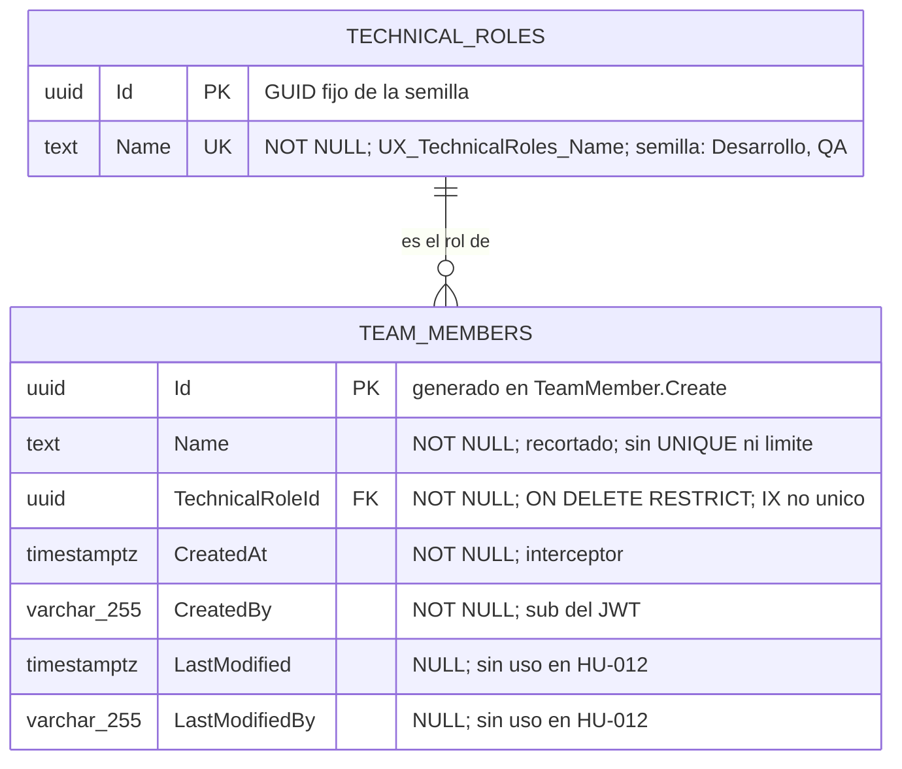
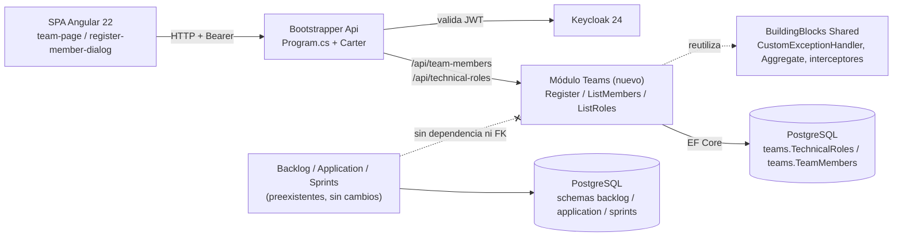
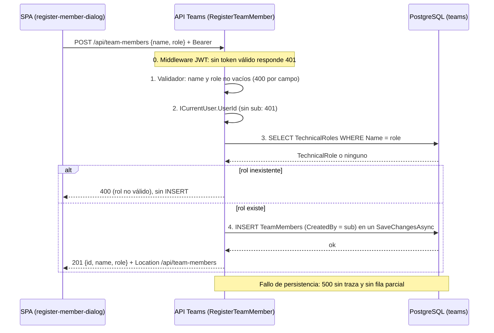
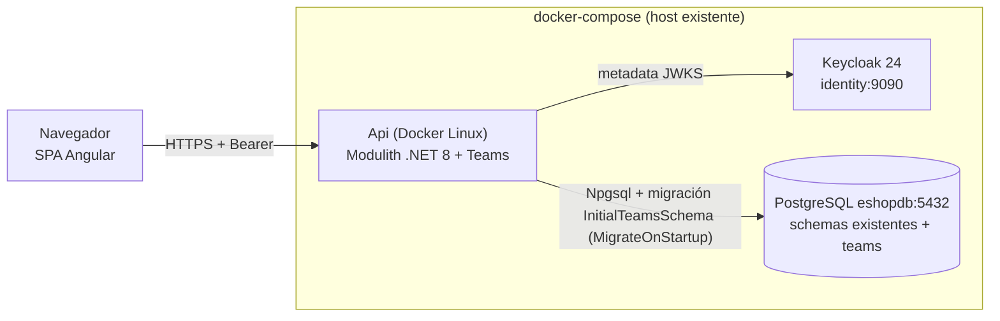

# TECH-DESIGN: Miembros del Equipo y Roles Técnicos (HU-012)

- **Fecha de Compilación:** 04-10-2026
- **Auditor y Consolidador:** Agente QT Senior BMAD
- **Fuente SDD:** `specs/012-HU_miembros_equipo_y_roles_tecnicos/spec.md`, `plan.md`, `tasks.md`, `data-model.md` y `contracts/teams-api.openapi.yaml` (GitHub Spec Kit)
- **Modo de gobernanza:** Brownfield (`.specify/memory/constitution.md` prevalece)
- **Estado:** ✅ AUDITADO Y APROBADO (Auditoría Adversarial Exitosa: 0 hallazgos críticos, 9 advertencias vinculantes en la sección 7.4)

---

## 1. Architecture Overview
Se añade el módulo nuevo `Teams` al Modulith .NET 8 (Vertical Slice Architecture, Carter, MediatR, FluentValidation, Mapster) con schema PostgreSQL propio `teams` y `TeamsDbContext` independiente. Entrega los datos maestros de personas: registrar un miembro con un rol técnico (`POST /api/team-members`), consultar miembros (`GET /api/team-members`) y consultar el catálogo de roles (`GET /api/technical-roles`). Frontend: feature nueva `features/teams` (Angular 22 Zoneless, Signals, PrimeNG tema neutral) con una página de dos pestañas y un diálogo de registro.

Patrón principal: CQRS intra-proceso, un caso de uso por carpeta, FK **local** `TeamMembers.TechnicalRoleId → TechnicalRoles.Id`, catálogo sembrado por la migración `InitialTeamsSchema` con GUID fijos, rol enviado por nombre, auditoría por `AuditableEntityInterceptor`. Sin eventos, Outbox, RabbitMQ, Redis ni paquetes nuevos. Convive con `Backlog`, `Application` y `Sprints` sin modificarlos (FR-014).

**Resultado de la auditoría adversarial (6 ejes):**

| Eje | Resultado |
|---|---|
| 1. DB vs API vs Spec Kit | ✅ Los 3 endpoints de `tasks.md` y `openapi.yaml` están en `api_012`; cada campo expuesto (`id`, `name`, `role`, `TechnicalRoleResponse`) mapea a una columna de `db_012`. Sin endpoints sobre campos inexistentes. |
| 2. UI → Data | ✅ Identificador, nombre y rol del miembro; identificador y nombre del rol: todos tienen columna. `CreatedAt`/`CreatedBy` persisten sin exponerse (UX D-09). Cero campos huérfanos. |
| 3. Mentiras en ADR | ✅ Los ADR con decisión impuesta están `Aceptado (heredado)` sin alternativas inventadas; los demás traen alternativas viables (tabla puente, `varchar(n)`, `roleId`, 409, paginación, Outbox). Trade-offs cosméticos puntuales: ver A-06. |
| 4. Lex Superior / Sycophancy | ✅ Ningún entregable adopta tecnología ajena a la constitución. Las decisiones "PROPUESTAS" (201, orden, estado de error de lectura) están dentro del stack. |
| 5. Proporcionalidad | ✅ Dos tablas, cero infraestructura nueva. La ausencia de límite de nombre, unicidad e idempotencia es riesgo aceptado, porque FR-015 prohíbe inventar esas reglas. |
| 6. Severidad | 🔴 0 · 🟡 9 (sección 7.4) · 🟢 3 |

**Afirmaciones verificadas contra el código de `app/backend/src/BuildingBlocks/Shared`:** `Aggregate<TId>` e `IAuditableEntity` existen y `Entity<TId>` **no** (la constitución lo cita; `TechnicalRole : Aggregate<Guid>`, como fija el plan). `CustomExceptionHandler` mapea `ValidationException` y `BadRequestException` a `ValidationProblemDetails` con `errors`, `UnauthorizedAccessException` a 401 con `detail`, y el resto a 500 con título fijo y sin `detail`: **distinto del formato descrito en `api_012`** (ver A-01).

---

## 2. Components

| Componente | Ruta física | Responsabilidad | Tareas |
|---|---|---|---|
| Módulo `Teams` | `app/backend/src/Modules/Teams/` | `TeamsModule.cs` (`AddTeamsModule`, `MigrateTeamsModuleAsync`), `Teams.csproj` | T001, T016 |
| Dominio | `Teams/Domain/` | `TeamMember : Aggregate<Guid>, IAuditableEntity`, `TeamMemberRules`, `TechnicalRole : Aggregate<Guid>`, `TechnicalRoleSeed` | T007–T011 |
| Persistencia | `Teams/Data/` | `TeamsDbContext` (schema `teams`), configuraciones, `TeamsDbContextFactory`, migración `InitialTeamsSchema` | T012–T017 |
| Feature Registrar | `Teams/Features/TeamMembers/RegisterTeamMember/` | Command, Validator, Handler, Endpoint `POST /api/team-members` | T030–T032, T038 |
| Feature Listar miembros | `Teams/Features/TeamMembers/ListTeamMembers/` | Query, Handler, Endpoint `GET /api/team-members` | T048–T049 |
| Feature Listar roles | `Teams/Features/TechnicalRoles/ListTechnicalRoles/` | Query, Handler, Endpoint `GET /api/technical-roles` | T055 |
| DTO | `Teams/Features/**/TeamMemberResponse.cs`, `TechnicalRoleResponse.cs` | `{ id, name, role }` y `{ id, name }` | T022 |
| Registro en el host | `Bootstrapper/Api/Api.csproj`, `Program.cs`, `TechWorkHub.sln` | Único cambio fuera del módulo, junto con `app.routes.ts` | T004, T005, T018 |
| Pruebas | `app/backend/tests/Unit/Teams/`, `app/backend/tests/Integration/Teams/` | xUnit, Testcontainers PostgreSQL | T002, T003, T019–T021 |
| Frontend | `app/frontend/src/app/features/teams/` | `team-page` (pestañas Miembros y Roles técnicos), `register-member-dialog`, `team-api.service.ts`, `team.models.ts`; rutas `equipos` y `equipos/roles` | T006, T023–T025, T033, T050, T051, T056 |
| Preexistentes (sin cambios) | `Modules/Backlog`, `Modules/Application`, `Modules/Sprints`, `BuildingBlocks/Shared`, `core/auth` | Convivencia pasiva; `Teams` no depende de ellos | T059 |

---

## 3. Data Model
*(Contenido íntegro de `db_012_miembros_equipo_y_roles_tecnicos.md`: MER, diccionario de datos, trazabilidad Spec/UX → datos y riesgos. Validación de no-orfandad frente a `ux_012` y `spec.md`: cumplida. Modo Brownfield: dos tablas nuevas en el schema `teams`, FK local, sin tocar `backlog`, `application` ni `sprints`.)*

### 2. MODELO ENTIDAD-RELACIÓN (MER)



---

### 3. DICCIONARIO DE DATOS Y RESTRICCIONES
*(Mapeado a `spec.md` (Key Entities Miembro del equipo y Rol técnico), `data-model.md`, `tasks.md` T007–T017 y a los estados visuales UX 1 a 6.)*

#### Tabla: `teams."TechnicalRoles"` (`TechnicalRole : Aggregate<Guid>`)
- `Id` (`uuid`): Llave primaria (`PK_TechnicalRoles`). GUID fijo de `TechnicalRoleSeed`; nunca `Guid.NewGuid()`.
- `Name` (`text`): NOT NULL. Único (`UX_TechnicalRoles_Name`). Semilla: `Desarrollo` (`DevelopmentId`) y `QA` (`QaId`).

**Restricciones:** `PK_TechnicalRoles` (`Id`); `UX_TechnicalRoles_Name` (`Name`). Sin columnas de auditoría ni de estado.
**Semilla (`InsertData`):** exactamente dos filas, `Desarrollo` y `QA`.

#### Tabla: `teams."TeamMembers"` (`TeamMember : Aggregate<Guid>, IAuditableEntity`)
- `Id` (`uuid`): Llave primaria (`PK_TeamMembers`). Lo genera el servidor en `TeamMember.Create` (FR-002).
- `Name` (`text`): NOT NULL, no vacío ni de solo espacios (validador + factoría). Se persiste con `Trim()`. Sin unicidad ni longitud máxima (ADR-05).
- `TechnicalRoleId` (`uuid`): NOT NULL. FK a `teams."TechnicalRoles"("Id")`, `ON DELETE RESTRICT` (ADR-03).
- `CreatedAt` (`timestamp with time zone`): NOT NULL. `AuditableEntityInterceptor` (FR-003).
- `CreatedBy` (`character varying(255)`): NOT NULL. `sub` del token vía `ICurrentUser`; nunca del cuerpo (FR-003).
- `LastModified` (`timestamp with time zone`): NULL. Sin uso en esta HU.
- `LastModifiedBy` (`character varying(255)`): NULL. Sin uso en esta HU.

**Restricciones:** `PK_TeamMembers` (`Id`); `FK_TeamMembers_TechnicalRoles_TechnicalRoleId` (`RESTRICT`). Sin `UNIQUE` sobre `Name`, sin columnas de estado, correo ni usuario de acceso.
**Índices:** `IX_TeamMembers_TechnicalRoleId` (no único, apoya la FK y el `JOIN` de la consulta).
**Migración:** `InitialTeamsSchema` en `app/backend/src/Modules/Teams/Data/Migrations/`; solo crea el schema `teams`, sus dos tablas, `__EFMigrationsHistory`, índices, la FK y la semilla.

#### Trazabilidad Spec / UX → Datos (cero campos huérfanos)

| Requisito / Estado UX | Dato que lo sustenta |
|---|---|
| FR-001, FR-002; UX 4, 5, 6 | `TeamMembers."Id"`, `"Name"`, `"TechnicalRoleId"` (rol devuelto = `TechnicalRoles."Name"` por `JOIN`) |
| FR-003 | `TeamMembers."CreatedAt"`, `"CreatedBy"` (interceptor) |
| FR-004, FR-005; UX 3 | `TechnicalRoles."Id"`, `"Name"` + semilla `Desarrollo`/`QA` |
| FR-006; UX 7 | FK `RESTRICT` + `UX_TechnicalRoles_Name` (resolución por nombre sin ambigüedad); rechazo previo en handler (400) |
| FR-007; UX 8 | `Name` y `TechnicalRoleId` NOT NULL; no vacuidad en validador y `TeamMember.Create` |
| FR-008, FR-009; UX 1, 2 | Lectura `JOIN` de `TeamMembers` y `TechnicalRoles` (orden `CreatedAt`, `Id`); ausencia de filas = `[]` |
| FR-010 | Sin columnas de correo ni usuario de acceso |
| FR-011; UX 9 | Sin dato de persistencia (rechazo previo, 401) |
| FR-012, FR-013, SC-008; UX 10 | Una sola sentencia `INSERT` por `SaveChangesAsync` (transacción implícita): sin fila parcial |
| FR-014, SC-006 | Sin FK ni columnas hacia `backlog` / `application` / `sprints` |
| FR-015 | `TechnicalRoleId` único por fila sin tabla puente; `Name` sin `UNIQUE`; sin estado |
| FR-016 | Schema `teams`, `TeamsDbContext` propio, sin consultas cross-schema |
| UX D-09 | `CreatedAt`/`CreatedBy` persisten pero no se exponen en `TeamMemberResponse` |

---

### 4. RIESGOS DE INTEGRIDAD Y ESCALABILIDAD
- `⚠️ RIESGO (discrepancia con data-model.md/T014):` `data-model.md` y T014 definen `CreatedBy`/`LastModifiedBy` como `text`; `backlog."BacklogItems"`, `sprints."Sprints"` y `sprints."SprintItems"` los configuran `varchar(255)` mediante una constante `*Rules.UserMaxLength`. Este diseño fija `varchar(255)` por coherencia con el resto del Modulith (el `sub` de Keycloak son 36 caracteres). Debe reconciliarse en T011/T014 (p. ej. `TeamMemberRules.UserMaxLength = 255` y `HasMaxLength` en `TeamMemberConfiguration`); sin ello `teams` divergería de los demás schemas. Es el único punto donde este documento corrige a `data-model.md`.
- `⚠️ RIESGO (homónimos y doble registro):` Sin índice único ni idempotencia, un doble clic o un reintento crea miembros duplicados (ADR-05). Mitigación solo en UI (botón deshabilitado durante `isSubmitting()`). Puntos abiertos 2 / CB-05.
- `⚠️ RIESGO (nombre sin límite):` `text` sin longitud ni `CHECK` permite nombres arbitrariamente grandes (solo lo acota el límite de cuerpo de Kestrel) y caracteres no imprimibles. Si el negocio fija longitud, habrá que migrar a `varchar(n)` tras revisar filas existentes (CB-06).
- `⚠️ RIESGO (cardinalidad miembro–rol):` El modelo materializa un rol por miembro (columna FK). Si el punto abierto 1 resuelve "varios roles", se requiere migración a tabla puente; las HU-013/014/015 no deben cimentar supuestos sobre la columna `TechnicalRoleId`.
- `⚠️ RIESGO (consumo desde P1):` La referencia futura desde `backlog`/`sprints` a `teams."TeamMembers"."Id"` será lógica, sin FK (Constitución §3.2.3). Como el miembro no se puede eliminar en esta HU no habrá huérfanos, pero la integridad dependerá de la aplicación y de una API in-process aún no definida (ADR-004 del plan).
- `⚠️ RIESGO (semilla inmutable):` Los GUID de `TechnicalRoleSeed` quedan fijados en `InitialTeamsSchema`; cambiarlos o renombrar un rol sin migración de datos rompe la FK o el contrato por nombre (el rol se envía por nombre y se resuelve con comparación sensible a mayúsculas).
- `⚠️ RIESGO (error de FK / UNIQUE):` Una violación de `FK_TeamMembers_...` o `UX_TechnicalRoles_Name` llega como `DbUpdateException` y se traduce a HTTP 500, no 400. Es aceptable porque el handler resuelve el rol antes de insertar; solo se observa por rutas que lo omitan o por una carrera con una migración que elimine el rol.
- `⚠️ RIESGO (escalabilidad):` Consultas con `JOIN` local, `AsNoTracking()` y orden por `CreatedAt, Id` sin índice sobre `CreatedAt`: escaneo secuencial irrelevante hasta cientos de filas (SC-007 verifica 100). Reevaluar si el volumen crece a miles o se añade paginación.
- `⚠️ RIESGO (despliegue):` `MigrateTeamsModuleAsync` se ejecuta en el arranque junto con las migraciones de Backlog, Application y Sprints; un fallo en `teams` impediría iniciar el host si las migraciones se encadenan sin aislamiento de errores. La migración debe ser idempotente respecto a `teams` y verificarse con T021.
- `⚠️ RIESGO (datos personales):` `TeamMembers."Name"` es un dato personal en claro, sin cifrado ni política de retención; no existe baja de miembros en esta HU. Los logs no deben contenerlo (T060).

> **Prevalece sobre este documento (ver A-02 y A-03):** `CreatedBy` y `LastModifiedBy` son `varchar(255)` (el `data-model.md` y T014 indican `text`); `TechnicalRole : Aggregate<Guid>` sin auditoría.

---

## 4. Integrations
*(Contenido íntegro de `api_012_miembros_equipo_y_roles_tecnicos.md`: especificaciones globales, esquemas, mapeo payload → columnas, endpoints y riesgos. Integración con el sistema preexistente: mismo host, mismo `CustomExceptionHandler`, mismo esquema de autenticación Keycloak; no hay integración con `Backlog`, `Application` ni `Sprints`, ni contrato in-process, ni mensajería.)*

> **Prevalece sobre los cuerpos de error de este contrato (ver A-01):** rige el formato real de `CustomExceptionHandler` de `Shared`. El contrato vinculante es el código de estado y las claves de campo.

### 2. ESPECIFICACIONES GLOBALES
- **Autenticación:** JWT en `Authorization: Bearer <token>` (Keycloak). Todas las operaciones.
- **Base URL:** `/api/team-members` y `/api/technical-roles` (rutas de API independientes de las rutas de UI `/equipos`).
- **Content-Type de error:** `application/problem+json` (400 y 500); el 401 no define cuerpo.
- **Nomenclatura JSON:** camelCase.
- **Idioma de mensajes:** español; los textos exactos los fija `TeamMemberRules`. El contrato vinculante es el código de estado y la clave de campo.

#### Esquemas
| Esquema | Campos |
|---|---|
| `RegisterTeamMemberRequest` | `name` (`string?`, obligatorio, no vacío ni solo espacios, sin longitud máxima), `role` (`string?`, nombre de un rol del catálogo, obligatorio, no vacío ni solo espacios) |
| `TeamMemberResponse` | `id` (`uuid`), `name` (`string`), `role` (`string`, nombre del rol) |
| `TechnicalRoleResponse` | `id` (`uuid`), `name` (`string`) |
| `ValidationProblem` | `title`, `status`, `detail`, `errors` (`{ campo: string[] }`) |
| `Problem` | `title`, `status`, `detail` |

#### Mapeo payload → columnas (`db_012`)
| Campo JSON | Columna | Nota |
|---|---|---|
| `TeamMemberResponse.id` | `teams."TeamMembers"."Id"` (`uuid`) | Generado por el servidor en `TeamMember.Create`; no se acepta en el request |
| `RegisterTeamMemberRequest.name` / `TeamMemberResponse.name` | `teams."TeamMembers"."Name"` (`text NOT NULL`) | Se persiste con `Trim()`; sin UNIQUE ni límite (ADR-05 del DA) |
| `RegisterTeamMemberRequest.role` | `teams."TechnicalRoles"."Name"` → `TeamMembers."TechnicalRoleId"` | El handler resuelve el nombre contra `UX_TechnicalRoles_Name` y guarda el `Id` en la FK |
| `TeamMemberResponse.role` | `teams."TechnicalRoles"."Name"` | Por `JOIN` local con `IX_TeamMembers_TechnicalRoleId` |
| `TechnicalRoleResponse.id` | `teams."TechnicalRoles"."Id"` (`uuid`) | GUID fijo de `TechnicalRoleSeed` |
| `TechnicalRoleResponse.name` | `teams."TechnicalRoles"."Name"` (`text NOT NULL`, único) | Semilla: `Desarrollo`, `QA` |
| *(no expuesto)* | `TeamMembers."CreatedAt"`, `"CreatedBy"` | Interceptor; `CreatedBy` = `sub` del token |
| *(no expuesto)* | `TeamMembers."LastModified"`, `"LastModifiedBy"` | Siempre `NULL` en esta HU |

---

### 3. ENDPOINTS DEFINIDOS

#### Endpoint: `POST /api/team-members`
- **Tarea Spec Kit:** T030, T031, T032, T038 (US1, US4, US5); pruebas T026, T027, T028, T034, T035, T036, T040, T041
- **Propósito Funcional:** Registrar un miembro del equipo técnico con un rol del catálogo (FR-001 a FR-003, FR-006, FR-007, FR-011 a FR-014). Un miembro y un rol por solicitud.
- **Request Headers:**
  - `Content-Type`: `application/json`
  - `Authorization`: `Bearer <token>`
- **Request Body (Payload JSON):**
```json
{
    "name": "Ana Torres",
    "role": "Desarrollo"
}
```
- **Respuestas (Status Codes):**
  - ✅ **201 Created** (Happy Path; SC-01 y SC-02). Header `Location: /api/team-members`:
  ```json
  {
      "id": "3fa85f64-5717-4562-b3fc-2c963f66afa6",
      "name": "Ana Torres",
      "role": "Desarrollo"
  }
  ```
  - ❌ **400 Bad Request** (Sad Path - Nombre ausente, vacío o solo espacios; FR-007):
  ```json
  {
      "title": "One or more validation errors occurred.",
      "status": 400,
      "detail": "Validation failed",
      "errors": {
          "name": ["El nombre del miembro es obligatorio."]
      }
  }
  ```
  - ❌ **400 Bad Request** (Sad Path - Rol ausente, vacío o solo espacios; FR-007):
  ```json
  {
      "title": "One or more validation errors occurred.",
      "status": 400,
      "detail": "Validation failed",
      "errors": {
          "role": ["El rol técnico es obligatorio."]
      }
  }
  ```
  - ❌ **400 Bad Request** (Sad Path - Ambos campos inválidos a la vez; FR-007). Se reportan los dos campos en la misma respuesta:
  ```json
  {
      "title": "One or more validation errors occurred.",
      "status": 400,
      "detail": "Validation failed",
      "errors": {
          "name": ["El nombre del miembro es obligatorio."],
          "role": ["El rol técnico es obligatorio."]
      }
  }
  ```
  - ❌ **400 Bad Request** (Sad Path - Rol inexistente en el catálogo, p. ej. "Chef"; FR-006). Sin `errors`:
  ```json
  {
      "title": "Bad Request",
      "status": 400,
      "detail": "El rol indicado no es válido."
  }
  ```
  - ❌ **401 Unauthorized** (Sad Path - Sin token, inválido o expirado, o token sin claim `sub`; FR-011). Sin cuerpo definido; emitido por el middleware de autenticación o por `CustomExceptionHandler`. No se lee ni persiste nada.
  - ❌ **500 Internal Server Error** (Sad Path - Fallo de persistencia; FR-013). Sin trazas internas ni miembro parcial:
  ```json
  {
      "title": "An error occurred while processing your request.",
      "status": 500,
      "detail": "Ha ocurrido un error inesperado al procesar la solicitud."
  }
  ```
- **Notas:**
  - Orden de evaluación (ADR-06): 401 de middleware → 400 de validador → 401 por falta de `sub` → 400 de rol inexistente → persistencia. Con nombre inválido y rol "Chef" a la vez, la respuesta es el 400 de validador por campo `name`.
  - `name` se guarda recortado: `"  Ana Torres  "` responde y persiste `"Ana Torres"`. La respuesta refleja el valor persistido.
  - `id` y `createdBy` enviados en el cuerpo se ignoran (el DTO no los define). `CreatedBy` proviene del `sub`.
  - Los textos de mensaje son ilustrativos (los fija `TeamMemberRules`, salvo `InvalidRoleMessage` = "El rol indicado no es válido." que sí es literal de la spec); el contrato vinculante es el código de estado y las claves `name`/`role`.
  - Un cuerpo no-JSON, un tipo JSON distinto de string en `name`/`role` o un `Content-Type` ausente produce el 400/415 de binding de ASP.NET, sin atribución por campo (no cubierto por la HU).

#### Endpoint: `GET /api/team-members`
- **Tarea Spec Kit:** T048, T049 (US2); pruebas T045, T046, T040
- **Propósito Funcional:** Consultar los miembros registrados y verificar quién forma parte del equipo y con qué rol (FR-008, FR-009, SC-004, SC-007). Solo lectura (`AsNoTracking`).
- **Request Headers:**
  - `Authorization`: `Bearer <token>`
- **Request Body:** Ninguno. Sin parámetros de consulta (sin paginación ni filtros).
- **Respuestas (Status Codes):**
  - ✅ **200 OK** (Happy Path), ordenado por `CreatedAt` y luego `Id` (no contractual):
  ```json
  [
      {
          "id": "3fa85f64-5717-4562-b3fc-2c963f66afa6",
          "name": "Ana Torres",
          "role": "Desarrollo"
      },
      {
          "id": "9b2f6c1e-1d4a-4e0b-8a57-3c1f2d7e9a10",
          "name": "Luis Rojas",
          "role": "QA"
      }
  ]
  ```
  - ✅ **200 OK** (sin miembros registrados; FR-009): `[]`
  - ❌ **401 Unauthorized** (Sad Path; FR-011). Sin cuerpo; no se lee ningún dato de miembros ni de roles.
  - ❌ **500 Internal Server Error** (Sad Path - Fallo de lectura). Sin trazas internas:
  ```json
  {
      "title": "An error occurred while processing your request.",
      "status": 500,
      "detail": "Ha ocurrido un error inesperado al procesar la solicitud."
  }
  ```
- **Notas:** Una sola consulta con `JOIN` local a `TechnicalRoles` y proyección directa a `TeamMemberResponse`. La respuesta nunca incluye `createdAt`, `createdBy` ni estado. No hay 400 (sin parámetros) ni 404.

#### Endpoint: `GET /api/technical-roles`
- **Tarea Spec Kit:** T055 (US3); pruebas T052, T053, T040
- **Propósito Funcional:** Consultar el catálogo de roles técnicos disponibles para saber qué valor de `role` es válido al registrar (FR-004, FR-005, SC-005). Solo lectura (`AsNoTracking`).
- **Request Headers:**
  - `Authorization`: `Bearer <token>`
- **Request Body:** Ninguno. Sin parámetros de consulta.
- **Respuestas (Status Codes):**
  - ✅ **200 OK** (Happy Path), ordenado por `name` (no contractual). Contiene como mínimo "Desarrollo" y "QA" con los GUID fijos de `TechnicalRoleSeed`; los valores de `id` mostrados son ilustrativos:
  ```json
  [
      {
          "id": "11111111-1111-1111-1111-111111111111",
          "name": "Desarrollo"
      },
      {
          "id": "22222222-2222-2222-2222-222222222222",
          "name": "QA"
      }
  ]
  ```
  - ❌ **401 Unauthorized** (Sad Path; FR-011). Sin cuerpo; no se lee ningún dato.
  - ❌ **500 Internal Server Error** (Sad Path - Fallo de lectura). Sin trazas internas:
  ```json
  {
      "title": "An error occurred while processing your request.",
      "status": 500,
      "detail": "Ha ocurrido un error inesperado al procesar la solicitud."
  }
  ```
- **Notas:** El catálogo es de solo lectura. No existen `POST`, `PUT`, `PATCH` ni `DELETE` sobre `/api/technical-roles`; responden 404/405 del enrutador (T053). El `id` del rol es informativo para el cliente: **no** se usa en el request de registro (ADR-03). Un catálogo vacío no es alcanzable (la migración siembra dos filas); si ocurriera, respondería `200 []`.

#### Matriz de trazabilidad Spec → Contrato

| Requisito | Endpoint | Código |
|---|---|---|
| FR-001, FR-002, FR-003, FR-010, FR-014 | `POST /api/team-members` | 201 |
| FR-006 | `POST /api/team-members` | 400 (`detail`, sin `errors`) |
| FR-007 | `POST /api/team-members` | 400 (`errors.name` / `errors.role`) |
| FR-011 | Los tres | 401 |
| FR-012, FR-013 | `POST /api/team-members` | 500 (sin fila parcial) |
| FR-008 | `GET /api/team-members` | 200 |
| FR-009 | `GET /api/team-members` | 200 `[]` |
| FR-004, FR-005 | `GET /api/technical-roles` | 200 |
| FR-015 | Ausencia de endpoints PUT/PATCH/DELETE, de `GET /{id}`, de alta de roles y de campos de estado, correo o varios roles | n/a |
| FR-016 | Los tres: Carter, `.RequireAuthorization()`, `CustomExceptionHandler`, schema `teams` | n/a |
| SC-007 | `GET /api/team-members`, `GET /api/technical-roles` | 200 en < 2 s con hasta 100 miembros |

---

### 4. DEPENDENCIAS BLOQUEANTES
- `⚠️ BLOQUEO:` Ninguno. `db_012_miembros_equipo_y_roles_tecnicos.md` cubre los tres campos expuestos del miembro (`Id`, `Name`, rol por `JOIN`), los dos del rol y la auditoría no expuesta.
- `⚠️ RIESGO (contrato OpenAPI ya existente):` `specs/012-HU_miembros_equipo_y_roles_tecnicos/contracts/teams-api.openapi.yaml` existe en disco y es coherente con este contrato, pero no define ejemplos de error ni distingue las variantes de 400. Debe mantenerse sincronizado con este documento (T062). El DA lo reportó como inexistente; la discrepancia es solo documental.
- `⚠️ RIESGO (formato de errores):` `CustomExceptionHandler` (en `Shared`, no modificable en esta HU) debe emitir `errors` por campo en camelCase para `ValidationException`, mapear `BadRequestException` a 400 con `detail` y `UnauthorizedAccessException` a 401. T043 y T040 solo verifican; si falta algún mapeo se registra como punto abierto, no como cambio en `Shared`.
- `⚠️ RIESGO (FK / UNIQUE llegan como 500):` Una violación de `FK_TeamMembers_TechnicalRoles_TechnicalRoleId` o de `UX_TechnicalRoles_Name` llega como `DbUpdateException` (500), no como 400. Es inalcanzable por la API mientras el handler resuelva el rol antes de insertar; solo se observaría por una carrera con una migración que elimine el rol.
- `⚠️ RIESGO (nombre sin límite):` Sin longitud máxima, un token válido puede enviar un nombre muy grande hasta el límite de cuerpo de Kestrel (30 MB por defecto). La API no impone límite adicional porque FR-015 prohíbe inventarlo; si el negocio lo fija, se añade validador (400) y migración, y el contrato gana una regla visible (CB-06).
- `⚠️ RIESGO (doble registro):` Sin idempotencia ni unicidad, un reintento tras timeout duplica al miembro (ADR-08). Mitigación solo en UI.
- `⚠️ RIESGO (comparación de rol sensible a mayúsculas):` "desarrollo" o "qa" se rechazan con 400 (ADR-03). Un consumidor de API distinto de la UI debe consultar `GET /api/technical-roles` y reutilizar la grafía exacta.
- `⚠️ RIESGO (cardinalidad miembro–rol):` El contrato materializa un rol por miembro (`role: string`). Si el punto abierto 1 resuelve "varios roles", `role` pasaría a arreglo: cambio incompatible que exigiría versionar (`/api/v2/...`) o un campo nuevo. Las HU-013/014/015 no deben cimentar supuestos sobre la forma escalar de `role`.
- `⚠️ RIESGO (consumo desde otros módulos):` No se define `ITeamsModuleApi` ni contrato in-process (ADR-004 del SA); la primera HU consumidora (013, 014, 021, 023 o 027) deberá definirlo. Esta API HTTP no es el mecanismo de integración entre módulos (Constitución §4).
- `⚠️ RIESGO (código 201 y Location PROPUESTOS):` El 201 y el `Location` hacia la colección no están en la HU (ADR-04); si el BA confirma otro código, cambia el contrato y las pruebas T027.
- `⚠️ RIESGO (supuestos de negocio):` Cardinalidad (1), unicidad (2), ciclo de vida (3), administración del catálogo (4), vínculo con Keycloak (5), permisos por rol (6), formato de consultas (7) y relación con estimaciones Dev/QA (8) siguen sin definir; un cambio de cualquiera altera este contrato.
- `⚠️ RIESGO (error de lectura en UI):` El estado de error de lectura distinto de 401 (SA §5.2) es PROPUESTO y depende de que los dos `GET` respondan 500 con `ProblemDetails` genérico; la UI no debe mostrar el cuerpo.

---

## 5. DIAGRAMAS DE ARQUITECTURA (Componentes, Secuencia, Despliegue)

### 5.1. Componentes: módulo Teams junto a los módulos preexistentes



> *Nota de Arquitectura: Diagrama generado exclusivamente con Mermaid por ausencia de dependencias externas (Node.js no está instalado en este entorno y la skill `archify` no pudo ejecutarse). Para habilitar visores HTML interactivos, instale la skill en la raíz del proyecto (`npx skills add tt-a1i/archify -g`) y solicite la actualización de esta sección.*

### 5.2. Secuencia: registro de un miembro



> *Nota de Arquitectura: Diagrama generado exclusivamente con Mermaid por ausencia de dependencias externas. Para habilitar visores HTML interactivos, instale la skill en la raíz del proyecto (`npx skills add tt-a1i/archify -g`) y solicite la actualización de esta sección.*

### 5.3. Despliegue sobre la infraestructura existente



> *Nota de Arquitectura: Diagrama generado exclusivamente con Mermaid por ausencia de dependencias externas. Para habilitar visores HTML interactivos, instale la skill en la raíz del proyecto (`npx skills add tt-a1i/archify -g`) y solicite la actualización de esta sección.*

---

## 6. Technology Stack
- **Backend:** .NET 8 (`net8.0`, C# 12), Carter 8.1.0, MediatR 12.4.1 (`ValidationBehavior`), FluentValidation 11.9.2, Mapster 7.4.0, Serilog. *(Aceptado heredado)*
- **Persistencia:** PostgreSQL con EF Core Npgsql 8.0.11, Code-First, `TeamsDbContext` con schema `teams`, migración `InitialTeamsSchema` con semilla. *(Aceptado heredado)*
- **Identidad:** Keycloak 24 con `Keycloak.AuthServices.Authentication` 2.5.2, `.RequireAuthorization()` sin política por rol.
- **Frontend:** Angular 22.2 Zoneless con Signals, PrimeNG ^22.1.2 (`p-tabs`, `p-table`, `p-dialog`, `p-select`, `p-inputtext`, `p-message`, `p-toast`, `p-button`, `p-breadcrumb`), tema neutral, i18n nativo.
- **Pruebas:** xUnit, FluentAssertions, NSubstitute, EF InMemory (solo unitarias), Testcontainers PostgreSQL (integración), Jest (frontend).
- **No se usan:** RabbitMQ, MassTransit, Redis, Outbox, ni paquetes NuGet o npm nuevos.

---

## 7. Architecture Decisions (ADRs - Matriz Consolidada MADR)
*(Los IDs se prefijan por autor porque SA, DA y API numeran por separado: `SA-ADR-0xx`, `DA-ADR-0x`, `API-ADR-0x`.)*

| ID | Título de la Decisión | Área | Estado | Trade-off / Costo Admitido |
|:---:|---|:---:|:---:|---|
| **SA-ADR-001** | Carter, MediatR y VSA | Arquitectura (SA) | Aceptado (heredado) | Varios ficheros por un modelo de dos campos |
| **SA-ADR-002** | Schema aislado `teams`, DbContext propio, sin cross-schema | Arquitectura (SA) | Aceptado (heredado) | HU 013/014/021/023/027 no pueden hacer JOIN con `teams`: necesitan un contrato in-process aún no definido |
| **SA-ADR-003** | Módulo nuevo `Teams` con roles y miembros juntos | Arquitectura (SA) | Aceptado | Un módulo más que registrar; reemplazo completo si las personas pasan a otro sistema |
| **SA-ADR-004** | Catálogo sembrado por migración, sin alta/edición ni contrato público | Datos (SA) | Aceptado | Añadir un rol exige migración y despliegue; GUID inmutables |
| **SA-ADR-005** | Rol enviado por nombre y resuelto en servidor | Arquitectura (SA) | Aceptado | Renombrar roles obliga a migrar a `roleId` con API versionada; comparación sensible a mayúsculas |
| **SA-ADR-006** | Sin eventos, Outbox ni caché | Arquitectura (SA) | Aceptado | Una HU que necesite reaccionar al registro añadirá evento y Outbox |
| **SA-ADR-007** | Nombre sin longitud ni unicidad, `text`, recortado | Arquitectura (SA) | Aceptado | Nombre hasta el límite de cuerpo de Kestrel; homónimos y doble registro |
| **DA-ADR-01** | Motor, módulo propio y schema `teams` | Datos (DA) | Aceptado (heredado) | Integridad entre módulos solo lógica |
| **DA-ADR-02** | Entidades sobre la jerarquía de `Shared` (`TechnicalRole` sin auditoría) | Datos (DA) | Aceptado (heredado) | Roles sin traza de autoría; `LastModified*` siempre `NULL` |
| **DA-ADR-03** | FK local `ON DELETE RESTRICT` con índice | Datos (DA) | Aceptado | Un rol con miembros no se puede borrar; coste de escritura marginal del índice |
| **DA-ADR-04** | Catálogo sembrado con GUID fijos y nombre único | Datos (DA) | Aceptado | GUID inmutables; unicidad sensible a mayúsculas |
| **DA-ADR-05** | `Name` como `text NOT NULL`, sin unicidad ni límite | Datos (DA) | Aceptado | Homónimos, doble registro, nombres muy grandes |
| **DA-ADR-06** | Sin estado, tabla puente, Outbox ni caché | Datos (DA) | Aceptado (heredado) | Migración a tabla puente si el negocio admite varios roles |
| **API-ADR-01** | Carter Minimal APIs en VSA | APIs (API) | Aceptado (heredado) | `TeamMemberResponse` compartido por registrar y listar: acoplamiento de forma |
| **API-ADR-02** | Bearer JWT / Keycloak sin política por rol | APIs (API) | Aceptado (heredado) | Cualquier usuario autenticado registra; futuro 403 visible |
| **API-ADR-03** | Rol por nombre (`role`) y no por identificador | APIs (API) | Aceptado | Cliente directo sufre la sensibilidad a mayúsculas; cambio versionado si se renombra |
| **API-ADR-04** | 201 Created con `Location` hacia la colección | APIs (API) | Aceptado | `Location` no es el URI del recurso (RFC 9110); cambiará si se añade `GET /{id}` |
| **API-ADR-05** | Errores `ProblemDetails` | APIs (API) | Aceptado (heredado) | Distinguir "rol inexistente" depende del texto (ver A-01) |
| **API-ADR-06** | Orden determinista: validador, identidad, rol | APIs (API) | Aceptado | Dos intentos para ver ambos errores; token sin `sub` con cuerpo inválido da 400 |
| **API-ADR-07** | Colecciones como arreglo plano, sin paginación | APIs (API) | Aceptado | Respuesta lineal; paginar luego es incompatible o paramétrico |
| **API-ADR-08** | Sin idempotencia ni control de duplicados | APIs (API) | Aceptado | Un reintento tras timeout duplica al miembro |

### 7.1. ADRs del Solutions Architect (texto íntegro)

#### ADR-001: Carter, MediatR y Vertical Slice Architecture
- **Estado:** Aceptado (heredado)
- **Contexto:** FR-016 exige respetar la constitución. Hay tres casos de uso: registrar miembro, consultar miembros y consultar roles.
- **Decisión:** Un endpoint `ICarterModule` por caso de uso, con `ISender`, `.RequireAuthorization()`, `.Produces<T>()` y `.ProducesProblem()`, en `Features/TeamMembers/{RegisterTeamMember|ListTeamMembers}/` y `Features/TechnicalRoles/ListTechnicalRoles/`, con Command/Query, Validador y Handler co-ubicados.
- **Consecuencias:**
  - ✅ **Impacto Positivo:** cada carpeta se audita contra una historia de usuario de la spec (US1, US2, US3 y US4).
  - ⚠️ **Trade-off / Costo Real:** varios ficheros por un modelo de dos campos; es el costo fijo de VSA.

#### ADR-002: PostgreSQL con schema aislado `teams`, DbContext propio y sin consultas cross-schema
- **Estado:** Aceptado (heredado)
- **Contexto:** La constitución §3 exige un `DbContext` y un schema por módulo y prohíbe `JOIN`/consultas cross-schema (FR-016). Miembros y roles se consultan siempre juntos.
- **Decisión:** `TeamsDbContext` con schema `teams` y las dos tablas dentro de él. La FK de `TeamMembers` a `TechnicalRoles` es local y real. Auditoría por `AuditableEntityInterceptor` de `Shared` (registrado en `AddTeamsModule`, igual que `SprintsModule`); `TeamMember` hereda de `Aggregate<Guid>` y `TechnicalRole` de `Entity<Guid>`.
- **Consecuencias:**
  - ✅ **Impacto Positivo:** integridad referencial garantizada por la base de datos y ninguna migración toca otros schemas.
  - ⚠️ **Trade-off / Costo Real:** HU futuras de otros módulos (013, 014, 021, 023, 027) no podrán hacer `JOIN` con `teams`: deberán consumir un contrato in-process que esta HU **no** define (ADR-004) o guardar el `MemberId` sin FK, como `SprintItems.ItemId`.

#### ADR-003: Módulo nuevo `Teams` con roles y miembros juntos
- **Estado:** Aceptado
- **Contexto:** Hay que decidir dónde viven los datos maestros de personas y roles. La épica P2 (HU-012 a HU-015) y varias HU de P4 y P5 los consumen. Ningún módulo existente (`Backlog`, `Application`, `Sprints`) es su dueño natural.
- **Decisión:** Crear el módulo `Teams` (schema `teams`) y alojar en él tanto el catálogo de roles como los miembros. Se nombra por el dominio (equipos y roles) y no por la HU, para que HU-013 a HU-015 lo extiendan.
- **Alternativas Consideradas:**
  - **Alternativa A (añadir `TeamMember` al módulo `Backlog` o `Sprints`):** evitaría registrar un módulo. Se descarta porque obligaría a modificar un módulo `ACTIVE` ajeno al dominio (FR-014), mezclaría personas con planificación y haría imposible extraer el módulo después.
  - **Alternativa B (dos módulos, `Members` y `Roles`):** máxima separación. Se descarta por desproporcionada: el rol solo tiene sentido como atributo del miembro, ambos se consultan en un mismo `JOIN` y separarlos exigiría un contrato in-process o consistencia eventual para validar el rol en cada registro.
  - **Alternativa C (guardar la persona en Keycloak y no tener tabla):** descartada por la HU (FR-010, punto abierto 5): el miembro no es un usuario de acceso y no se vincula con el servidor de identidad.
- **Consecuencias:**
  - ✅ **Impacto Positivo:** cero cambios en módulos existentes; un lugar único para las HU 013 a 015 de P2.
  - ⚠️ **Trade-off / Costo Real:** un módulo más para registrar (proyecto, referencia en `Api.csproj`, solución, dos proyectos de pruebas y una línea de arranque en `Program.cs`) por un modelo pequeño. Si el negocio decide más adelante que las personas viven en otro sistema, el módulo completo se reemplaza.

#### ADR-004: Catálogo de roles sembrado por la migración, sin alta ni edición, y sin contrato público todavía
- **Estado:** Aceptado
- **Contexto:** FR-004 exige un catálogo con al menos "Desarrollo" y "QA"; el alta o edición de roles y el conjunto completo ("etc.") quedan fuera de alcance (punto abierto 4). QA documental dejó para Architecture el origen de los datos del catálogo. Las HU futuras necesitarán consultar miembros y roles desde otros módulos.
- **Decisión:** Los dos roles se insertan en la migración `InitialTeamsSchema` mediante `InsertData` con **identificadores fijos** (GUID constantes en `TechnicalRoleSeed`, referenciados por las pruebas). No existe endpoint de alta o edición de roles ni borrado. La tabla `TechnicalRoles` tiene índice único `UX_TechnicalRoles_Name`. **No** se define ahora `ITeamsModuleApi` ni ningún contrato in-process: no hay consumidor en esta HU; lo definirá la primera HU que lo necesite (013, 014, 021, 023 o 027) siguiendo el patrón de `IApplicationModuleApi`.
- **Alternativas Consideradas:**
  - **Alternativa A (enum de C# con los dos roles, sin tabla):** más simple. Se descarta porque la HU exige "identificador y nombre" por rol, un catálogo consultable y la posibilidad de ampliarlo sin recompilar; un enum obligaría a un cambio de código por cada rol nuevo y a otra migración de datos al migrar a tabla.
  - **Alternativa B (sembrar en el arranque desde un `IHostedService` o desde configuración):** permite ajustar el catálogo por entorno. Se descarta por añadir un punto de fallo y de carrera en el arranque (varias instancias), y por la configuración extra sin un requisito que la pida.
  - **Alternativa C (tabla vacía y endpoint de alta de roles):** inventa la administración del catálogo, que es un punto abierto fuera de alcance.
- **Consecuencias:**
  - ✅ **Impacto Positivo:** el catálogo es reproducible y versionado con el esquema; todo entorno que migre tiene exactamente "Desarrollo" y "QA" con los mismos identificadores; las pruebas pueden fijarlos.
  - ⚠️ **Trade-off / Costo Real:** añadir un rol hoy exige una **migración nueva** (cambio de código y despliegue), y los GUID de la semilla quedan en el historial de migraciones y no pueden cambiarse sin migrar datos. Cuando el negocio defina quién administra el catálogo (punto abierto 4), habrá que añadir los casos de uso de alta y edición.

#### ADR-005: El rol se envía por nombre y el servidor lo resuelve contra el catálogo
- **Estado:** Aceptado
- **Contexto:** Los escenarios de la spec expresan el rol como nombre ("Desarrollo", "QA", "Chef") y exigen HTTP 400 "indicando que el rol no es válido" cuando no existe (FR-006), distinto del 400 por campo ausente (FR-007). El UX alimenta el selector con la consulta del catálogo (D-02).
- **Decisión:** `POST /api/team-members` recibe `{ "name": string?, "role": string? }`, donde `role` es el **nombre** del rol del catálogo. El validador exige `name` y `role` presentes, no vacíos y no compuestos solo de espacios (errores bajo las claves `name` y `role`); el handler recorta (`Trim`) el nombre antes de persistir, busca el rol por nombre exacto (`TechnicalRoles.FirstOrDefaultAsync(r => r.Name == role)`, comparación sensible a mayúsculas, la de PostgreSQL por defecto) y, si no existe, lanza `BadRequestException` con `TeamMemberRules.InvalidRoleMessage` (400 `Bad Request`, no 404). La respuesta devuelve el nombre del rol, no su identificador, en el campo `role`; el identificador del rol solo aparece en el catálogo (`GET /api/technical-roles`).
- **Alternativas Consideradas:**
  - **Alternativa A (enviar `roleId` GUID):** referencia más robusta a renombrados. Se descarta porque "Chef" (SC-06) no es un identificador y habría que traducir un GUID malformado a "rol no válido", y porque obliga al cliente de pruebas y al de la UI a conocer GUID que la HU no menciona; además, el nombre es único por índice, por lo que identifica sin ambigüedad.
  - **Alternativa B (aceptar nombre o identificador indistintamente):** más flexible. Se descarta por ambigüedad de contrato y de pruebas sin ningún requisito que la pida.
  - **Alternativa C (404 para el rol inexistente):** la spec fija explícitamente 400 (FR-006).
- **Consecuencias:**
  - ✅ **Impacto Positivo:** el contrato coincide literalmente con los escenarios de negocio y el 400 por rol se distingue del 400 por campo ausente por su mensaje.
  - ⚠️ **Trade-off / Costo Real:** si en el futuro se permite renombrar roles (punto abierto 4), los clientes que envían el nombre se romperían y el contrato debería migrar a `roleId` (cambio de API versionado). La comparación sensible a mayúsculas rechaza "desarrollo" en minúsculas; es el comportamiento de lista cerrada que el UX asegura con el selector.

#### ADR-006: Sin eventos de dominio ni de integración, Outbox ni caché
- **Estado:** Aceptado
- **Contexto:** Ningún requisito notifica a otros módulos al registrar un miembro, y las consultas están acotadas a 100 miembros (SC-007).
- **Decisión:** `TeamMember` hereda de `Aggregate<Guid>` por la jerarquía estándar pero no emite eventos. Sin tabla `OutboxMessage`, sin MassTransit y sin decorador Redis.
- **Alternativas Consideradas:**
  - **Alternativa A (emitir `TeamMemberRegisteredIntegrationEvent` para HU-013, 014 y 015):** anticiparía la integración. Se descarta porque no hay consumidor y el diseño debe nacer de un requisito.
  - **Alternativa B (decorador Redis para el catálogo de roles):** se descarta por no existir un cuello de botella medido y por añadir invalidación a un dato que solo cambia con una migración.
- **Consecuencias:**
  - ✅ **Impacto Positivo:** ningún punto de fallo adicional.
  - ⚠️ **Trade-off / Costo Real:** si una HU posterior necesita reaccionar al registro, deberá añadir el evento y, por ser crítico, el Outbox (constitución §4).

#### ADR-007: Nombre sin restricción de longitud ni unicidad, almacenado como `text` y recortado
- **Estado:** Aceptado
- **Contexto:** La unicidad, la longitud máxima y los caracteres admitidos del nombre no están definidos (puntos abiertos 2 y CB-05, CB-06). Una columna `varchar(n)` o un índice único los impondrían de facto (FR-015). Para la vista, un nombre con espacios al inicio o fin se considera el mismo texto.
- **Decisión:** `TeamMembers.Name` es `text NOT NULL`, sin índice único, y el handler guarda `name.Trim()`. El validador solo comprueba presencia y que no sea vacío ni solo espacios (FR-007). No se aplican límites de longitud ni filtro de caracteres.
- **Alternativas Consideradas:**
  - **Alternativa A (`varchar(100)` con validación de longitud):** cierra un vector de abuso y evita nombres gigantes. Se descarta porque inventa una regla de negocio que la HU deja explícitamente sin definir.
  - **Alternativa B (índice único sobre `Name`):** evitaría homónimos accidentales. Se descarta por la misma razón y porque impediría registrar a dos personas con el mismo nombre, que el negocio no ha descartado.
- **Consecuencias:**
  - ✅ **Impacto Positivo:** el diseño no contradice ninguna de las respuestas posibles del negocio; añadir un límite o una unicidad después es un cambio de migración y validador, no de modelo.
  - ⚠️ **Trade-off / Costo Real:** sin límite de longitud, un cliente con un token válido puede enviar un nombre muy grande y se acepta hasta el límite de cuerpo de ASP.NET (30 MB por defecto en Kestrel), y no se evitan homónimos ni el doble registro accidental. Es un riesgo aceptado hasta que el negocio defina las reglas.

### 7.2. ADRs del Data Architect (texto íntegro)


#### ADR-01: Motor de persistencia, módulo propio y schema `teams`
- **Estado:** Aceptado (heredado)
- **Contexto:** La Constitución (§3) impone PostgreSQL/Npgsql con EF Core Code-First, un `DbContext` por módulo, un schema por módulo y conexión única (`ConnectionStrings:Database`). El SA fijó el módulo `Teams` (ADR-003 del SA).
- **Decisión:** Se crea el schema `teams` con `TeamsDbContext` (`HasDefaultSchema("teams")`) y su historial en `teams.__EFMigrationsHistory`. Tablas: `teams."TechnicalRoles"` y `teams."TeamMembers"`.
- **Consecuencias:**
  - ✅ **Ventajas / Impacto Positivo:** Aislamiento total frente a `backlog`, `application` y `sprints`; la migración solo toca `teams`; el módulo es extraíble.
  - ⚠️ **Trade-off / Costo Real:** Las HU-013/014/015 que consuman miembros desde otros módulos no podrán usar FK ni JOIN contra `teams`; la integridad será lógica y vía llamada in-process.

#### ADR-02: Entidades `TechnicalRole` y `TeamMember` sobre la jerarquía de `Shared`
- **Estado:** Aceptado (heredado)
- **Contexto:** FR-003 exige `CreatedAt` y `CreatedBy` (= `sub` del token) en el miembro. La Constitución prohíbe columnas o triggers manuales de auditoría y obliga a `AuditableEntityInterceptor`. `Shared` solo ofrece `Aggregate<TId>` e `IAuditableEntity` (no existe `Entity<TId>`; R-04 del plan).
- **Decisión:** `TeamMember : Aggregate<Guid>, IAuditableEntity`: `CreatedAt`, `CreatedBy`, `LastModified`, `LastModifiedBy` los puebla el interceptor. `TechnicalRole : Aggregate<Guid>` **sin** `IAuditableEntity`: solo `Id` y `Name`. Ninguna emite eventos de dominio.
- **Consecuencias:**
  - ✅ **Ventajas / Impacto Positivo:** Cero lógica de auditoría propia; la semilla del catálogo no necesita fecha ni usuario "system"; el catálogo no arrastra columnas sin consumidor.
  - ⚠️ **Trade-off / Costo Real:** Los roles no tienen traza de quién ni cuándo los creó (solo la migración que los siembra). `LastModified`/`LastModifiedBy` de `TeamMember` quedan siempre `NULL` en esta HU (no existe modificar) pero se conservan por la interfaz `IAuditableEntity`.

#### ADR-03: FK física local `TeamMembers.TechnicalRoleId → TechnicalRoles.Id` con `ON DELETE RESTRICT`
- **Estado:** Aceptado
- **Contexto:** FR-006 exige que todo miembro referencie un rol existente del catálogo. Ambas tablas viven en el mismo schema, por lo que la prohibición cross-schema (Constitución §3.2.3) no aplica.
- **Decisión:** `CONSTRAINT "FK_TeamMembers_TechnicalRoles_TechnicalRoleId" FOREIGN KEY ("TechnicalRoleId") REFERENCES teams."TechnicalRoles" ("Id") ON DELETE RESTRICT`, `TechnicalRoleId uuid NOT NULL`, más índice no único `IX_TeamMembers_TechnicalRoleId`.
- **Alternativas Evaluadas:**
  - **Alternativa A:** Referencia lógica sin FK (validar solo en handler). Descartada: no hay frontera de módulo que lo justifique; un `INSERT` directo o una migración de datos podrían dejar miembros con rol inexistente.
  - **Alternativa B:** `ON DELETE CASCADE`. Descartada: borrar un rol eliminaría miembros en silencio; la HU no define baja de roles ni de miembros y no debe habilitarla implícitamente.
  - **Alternativa C:** Guardar el nombre del rol como texto en `TeamMembers` (desnormalizado). Descartada: renombrar o ampliar el catálogo exigiría reescribir filas y no hay integridad referencial; además se pierde el "identificador" del rol que FR-004 exige.
- **Consecuencias:**
  - ✅ **Ventajas / Impacto Positivo:** Integridad garantizada por la BD (SQLSTATE 23503 ante rol inexistente); la lectura es un `JOIN` local con índice de apoyo.
  - ⚠️ **Trade-off / Costo Real:** Un rol con miembros no puede borrarse (por diseño, ahora irrelevante: no existe endpoint de baja). El índice `IX_TeamMembers_TechnicalRoleId` añade coste de escritura marginal e innecesario a 100 filas, aceptado por el patrón estándar de EF Core para FKs y por la futura HU-015.

#### ADR-04: Catálogo de roles sembrado por migración con GUID fijos y nombre único
- **Estado:** Aceptado
- **Contexto:** FR-004 exige al menos "Desarrollo" y "QA" con identificador y nombre; el alta/edición de roles está fuera de alcance (punto abierto 4). La consulta del catálogo debe devolver identificadores estables (T053).
- **Decisión:** `InsertData` en `InitialTeamsSchema` con los GUID constantes de `TechnicalRoleSeed` (`DevelopmentId`, `QaId`). Índice ÚNICO `UX_TechnicalRoles_Name` sobre `Name`. Sin endpoint ni código de alta/edición/baja.
- **Alternativas Evaluadas:**
  - **Alternativa A:** Enum/constante en código sin tabla. Descartada: no entrega "identificador y nombre" ni permite FK; ampliar el catálogo exigiría recompilar.
  - **Alternativa B:** Siembra en arranque con `IHostedService`. Descartada: punto de fallo adicional y condición de carrera con varias instancias; la migración es atómica y versionada.
  - **Alternativa C:** Tabla vacía con alta de roles por API. Descartada: inventa administración del catálogo (punto abierto 4) y un permiso por rol de acceso no definido.
- **Consecuencias:**
  - ✅ **Ventajas / Impacto Positivo:** Catálogo reproducible y versionado con el esquema; el `UX_TechnicalRoles_Name` garantiza que resolver el rol por nombre devuelve a lo sumo una fila.
  - ⚠️ **Trade-off / Costo Real:** Los GUID quedan en el historial de migraciones y no pueden cambiarse sin migrar datos; añadir o renombrar un rol exige una migración nueva. La unicidad por `Name` es sensible a mayúsculas (collation por defecto): "qa" y "QA" podrían coexistir si se sembraran por SQL manual, mientras el handler solo acepta la grafía exacta.

#### ADR-05: `Name` del miembro como `text NOT NULL`, sin unicidad ni límite de longitud
- **Estado:** Aceptado
- **Contexto:** Unicidad (homónimos), longitud máxima y caracteres admitidos del nombre son puntos abiertos 2 / CB-05 / CB-06; FR-015 prohíbe imponerlos de facto.
- **Decisión:** `TeamMembers."Name"` es `text NOT NULL` (el dominio guarda el valor ya recortado con `Trim()`). Sin índice único, sin `CHECK` de longitud. La no vacuidad se garantiza en validador y en `TeamMember.Create`.
- **Alternativas Evaluadas:**
  - **Alternativa A:** `varchar(100)` + índice único sobre `Name`. Descartada: impone dos reglas de negocio no confirmadas y convertiría un homónimo en un 500 sin mensaje definido.
  - **Alternativa B:** `CHECK (btrim("Name") <> '')`. Descartada para esta HU: duplicaría la regla ya aplicada por validador y factoría y su violación llegaría como 500; se deja como endurecimiento opcional si el negocio lo pide.
- **Consecuencias:**
  - ✅ **Ventajas / Impacto Positivo:** El modelo no prejuzga decisiones pendientes; imponer luego longitud o unicidad es una migración aditiva más un validador.
  - ⚠️ **Trade-off / Costo Real:** Se admiten homónimos y doble registro (doble clic o reintento crea dos filas). Un token válido puede enviar un nombre muy grande (límite de cuerpo de Kestrel). Añadir un índice único después exigirá depurar duplicados.

#### ADR-06: Sin estado, sin tabla puente miembro–rol, sin Outbox ni caché
- **Estado:** Aceptado (heredado)
- **Contexto:** FR-010 y FR-015 prohíben datos extra de la persona, estado/ciclo de vida y cardinalidad impuesta. La Constitución exige `OutboxMessage` solo en flujos que publican eventos críticos; el SA descartó eventos (ADR-006 del SA).
- **Decisión:** `TeamMembers` guarda **un** `TechnicalRoleId` (columna FK), sin columna de estado, correo, usuario de acceso ni tabla `MemberRoles`. No se crea `OutboxMessage` en `teams` ni se emiten eventos.
- **Alternativas Evaluadas:**
  - **Alternativa A:** Tabla puente `TeamMemberRoles` (N:M) para anticipar varios roles. Descartada: anticipa el punto abierto 1 sin escenario que lo respalde y complica lectura y validación.
  - **Alternativa B:** Columna `IsActive`. Descartada: modela un ciclo de vida que la HU declara ❓ No documentado.
- **Consecuencias:**
  - ✅ **Ventajas / Impacto Positivo:** Esquema mínimo; el contrato es "1 miembro = 1 fila = 1 rol", con atomicidad trivial (un `INSERT`).
  - ⚠️ **Trade-off / Costo Real:** Si el negocio admite varios roles por miembro, habrá que migrar `TechnicalRoleId` a una tabla puente (copiando la columna actual como primera fila) y versionar el contrato de lectura.

### 7.3. ADRs del API Architect (texto íntegro)


#### ADR-01: Protocolo y capa de interfaz (Carter Minimal APIs, VSA)
- **Estado:** Aceptado (heredado)
- **Contexto:** La Constitución (§2 y §7) exige Carter `ICarterModule`, MediatR, FluentValidation y Mapster, con Endpoint, Handler y Validador co-localizados por feature, y prohíbe `[ApiController]` y carpetas horizontales.
- **Decisión:** Tres features en el módulo `Teams`: `Features/TeamMembers/RegisterTeamMember/`, `Features/TeamMembers/ListTeamMembers/` y `Features/TechnicalRoles/ListTechnicalRoles/`, cada una con su `*Endpoint.cs` (Carter), Command/Query, Validador (solo en registrar) y Handler. `TeamMemberResponse` y `TechnicalRoleResponse` son DTO compartidos dentro de su carpeta de agregado. Request → Command con `request.Adapt<T>()` (Mapster).
- **Consecuencias:**
  - ✅ **Beneficio / Impacto Positivo:** Mismo patrón que `Sprints`; cada endpoint se audita contra una historia de usuario (US1 a US5).
  - ⚠️ **Trade-off / Costo Real:** `TeamMemberResponse` lo comparten registrar y listar: un cambio de forma afecta a ambos endpoints y a la grilla del frontend. Varios ficheros por un modelo de dos campos (costo fijo de VSA).

#### ADR-02: Autenticación y autorización (Bearer JWT / Keycloak)
- **Estado:** Aceptado (heredado)
- **Contexto:** FR-011 y la Constitución (§5) exigen `.RequireAuthorization()` en toda ruta no pública. Los permisos por rol de acceso no están documentados (punto abierto 6).
- **Decisión:** Los tres endpoints exigen `Authorization: Bearer <JWT>` validado por `Keycloak.AuthServices.Authentication`, con `.RequireAuthorization()` sin política por rol: basta un token válido con identidad. `CreatedBy` sale del claim `sub` vía `ICurrentUser`, nunca del cuerpo.
- **Consecuencias:**
  - ✅ **Beneficio / Impacto Positivo:** Cualquier intento anónimo, inválido o expirado recibe 401 antes de leer o persistir datos (SC-003).
  - ⚠️ **Trade-off / Costo Real:** Cualquier usuario autenticado puede registrar miembros. Al definirse roles de acceso habrá que añadir políticas y el contrato ganaría un 403 visible para clientes existentes.

#### ADR-03: El rol se envía por nombre (`role`) y no por identificador
- **Estado:** Aceptado
- **Contexto:** Los escenarios de la spec expresan el rol como nombre ("Desarrollo", "QA", "Chef") y fijan 400 "rol no válido" (FR-006) distinto del 400 por campo ausente (FR-007). El SA lo fijó en su ADR-005.
- **Decisión:** `POST /api/team-members` recibe `{ "name": string?, "role": string? }`, con `role` = **nombre exacto** del rol del catálogo (comparación sensible a mayúsculas). La respuesta devuelve `role` como nombre; el `id` del rol solo aparece en `GET /api/technical-roles`. El rol inexistente se responde 400 con `detail` = "El rol indicado no es válido." (no 404).
- **Alternativas Evaluadas:**
  - **Alternativa A:** `roleId` (GUID) en el request. Descartada: "Chef" (SC-07) no es un identificador, un GUID malformado exigiría traducirse a "rol no válido" y la UI/pruebas deberían conocer GUID que la HU no menciona; el nombre ya es único por `UX_TechnicalRoles_Name`.
  - **Alternativa B:** Aceptar nombre o identificador indistintamente. Descartada: contrato ambiguo y superficie de pruebas duplicada sin requisito que lo pida.
  - **Alternativa C:** 404 por rol inexistente. Descartada: la spec fija explícitamente 400 (FR-006) y el rol es un valor del cuerpo, no un recurso de la ruta.
- **Consecuencias:**
  - ✅ **Beneficio / Impacto Positivo:** El contrato coincide literalmente con los escenarios de negocio; el 400 por rol se distingue del 400 por campo por la presencia de `errors` frente a solo `detail`.
  - ⚠️ **Trade-off / Costo Real:** Si se permite renombrar roles (punto abierto 4), todo cliente que envíe el nombre se rompe y habrá que migrar a `roleId` con cambio de API versionado. "desarrollo" en minúsculas se rechaza; el selector de la UI evita el caso, un cliente de API directo lo sufre. La respuesta no incluye `roleId`, por lo que un consumidor que necesite el identificador debe cruzar con el catálogo por nombre.

#### ADR-04: Código 201 Created con `Location` hacia la colección
- **Estado:** Aceptado
- **Contexto:** La HU solo dice "código de éxito" (FR-002). No existe `GET /api/team-members/{id}` (no hay consulta por identificador en alcance), por lo que no hay URL canónica del recurso individual. Es un valor ⚠️ [PROPUESTO] (research R-08).
- **Decisión:** `POST` responde **201 Created** con cuerpo `{ id, name, role }` y `Location: /api/team-members` (la colección), mediante `Results.Created("/api/team-members", response)`.
- **Alternativas Evaluadas:**
  - **Alternativa A:** 200 OK. Descartada: el registro crea un recurso; 201 es el código semántico estándar y es la práctica de `api_001` y `api_003`.
  - **Alternativa B:** Crear `GET /api/team-members/{id}` solo para poblar `Location`. Descartada: inventa un endpoint sin escenario ni US que lo respalde (alcance mínimo, FR-015).
- **Consecuencias:**
  - ✅ **Beneficio / Impacto Positivo:** Semántica HTTP correcta sin ampliar la superficie de la API.
  - ⚠️ **Trade-off / Costo Real:** `Location` apunta a la colección y no al recurso creado, lo que no cumple la lectura estricta de RFC 9110 §10.2.2 (URI del recurso). Si más adelante se añade `GET /{id}`, el valor de `Location` cambiará y las pruebas que lo fijan (T027) deberán actualizarse.

#### ADR-05: Formato de errores `ProblemDetails` (`application/problem+json`)
- **Estado:** Aceptado (heredado)
- **Contexto:** El `CustomExceptionHandler` de `Shared` traduce `ValidationException`→400 con `errors`, `BadRequestException`→400 con `detail`, `UnauthorizedAccessException`→401 y excepciones no controladas→500 sin trazas. El OpenAPI de la HU fija `application/problem+json`.
- **Decisión:** Todo 400/500 se emite como `ProblemDetails` (`title`, `status`, `detail`); el 400 de validación añade `errors` como `{ campoCamelCase: [mensajes] }` bajo las claves `name` y `role` (`TeamMemberRules.NameField`/`RoleField`). El 400 por rol inexistente lleva solo `detail`. Se adopta este formato y **no** el sobre `{ "error", "message" }` de la plantilla genérica ni de `api_001`. El 401 lo emite el middleware sin cuerpo definido.
- **Consecuencias:**
  - ✅ **Beneficio / Impacto Positivo:** Estándar RFC 9457, errores atribuibles a cada campo, reutilización de `Shared` sin modificarlo y mismo formato que `api_003`.
  - ⚠️ **Trade-off / Costo Real:** Difiere del formato de `api_001`; el frontend de Teams parsea `errors.name`/`errors.role` y `detail` por separado. Para distinguir "rol inexistente" de "campo inválido" el cliente depende de la ausencia de `errors` y del texto de `detail`, no de un código de error máquina-legible.

#### ADR-06: Orden de evaluación determinista del `POST` (400 validador → 401 identidad → 400 rol)
- **Estado:** Aceptado
- **Contexto:** Un mismo request puede incumplir varias reglas (nombre vacío y rol "Chef"). El SA (§5) y el OpenAPI fijan una única secuencia. FR-011 exige 401 sin leer datos.
- **Decisión:** (0) El middleware de autenticación rechaza token ausente/inválido/expirado con 401 antes de MediatR. (1) `RegisterTeamMemberValidator` (400 por campo `name`/`role`, `ValidationBehavior`). (2) El handler resuelve `ICurrentUser.UserId`; sin claim `sub` ⇒ `UnauthorizedAccessException` (401). (3) El handler busca el rol por nombre; si no existe ⇒ `BadRequestException` (400, "El rol indicado no es válido."). (4) Un único `SaveChangesAsync`. Con nombre inválido **y** rol inexistente gana el 400 del validador: no se consulta la BD con datos ya inválidos.
- **Alternativas Evaluadas:**
  - **Alternativa A:** Resolver el rol antes de validar el nombre. Descartada: consulta la BD con un request ya inválido y mezcla dos clases de 400 en una sola respuesta.
  - **Alternativa B:** Acumular todos los errores (campo + rol) en un único 400. Descartada: exige consulta previa a la BD durante la validación y contradice el orden fijado por el SA.
- **Consecuencias:**
  - ✅ **Beneficio / Impacto Positivo:** Respuesta predecible y testeable (T036); cero lecturas de BD ante entradas inválidas.
  - ⚠️ **Trade-off / Costo Real:** Un cliente con dos errores necesita dos intentos para ver ambos: primero el de campo y luego el de rol. Que el 401 por falta de `sub` llegue después del validador significa que un token sin `sub` pero con cuerpo inválido recibe 400 y no 401; es un caso límite aceptado (el token pasó la autenticación del middleware).

#### ADR-07: Colecciones como arreglo JSON plano, sin paginación, filtros ni orden configurable
- **Estado:** Aceptado
- **Contexto:** Formato de consulta, orden, filtros y paginación no están definidos (punto abierto 7); SC-007 se mide hasta 100 miembros.
- **Decisión:** `GET /api/team-members` y `GET /api/technical-roles` devuelven un arreglo JSON plano con **todo** lo registrado, sin parámetros de consulta. Orden ⚠️ [PROPUESTO] y **no contractual**: miembros por `CreatedAt` y `Id`; roles por `Name`. Sin registros ⇒ `200 []` (nunca 404).
- **Alternativas Evaluadas:**
  - **Alternativa A:** Paginación (`page`, `pageSize`) con sobre `{ items, total }`. Descartada: no está requerida y rompe la forma de arreglo del OpenAPI.
  - **Alternativa B:** Filtro opcional `?role=`. Descartada: invento fuera de alcance (punto abierto 7).
- **Consecuencias:**
  - ✅ **Beneficio / Impacto Positivo:** Contrato mínimo; la grilla pinta lo recibido sin lógica adicional.
  - ⚠️ **Trade-off / Costo Real:** El tamaño de la respuesta crece linealmente; a miles de miembros habrá que paginar, y pasar de arreglo a sobre sería un cambio incompatible (o un parámetro opcional que mantenga el arreglo por defecto). Como el orden no es contractual, los clientes no deben depender de él.

#### ADR-08: Sin idempotencia ni control de duplicados en `POST`
- **Estado:** Aceptado
- **Contexto:** La unicidad del miembro (homónimos) no está definida (punto abierto 2) y el DA no creó índice único sobre `Name` (ADR-05 del DA).
- **Decisión:** `POST /api/team-members` no usa `Idempotency-Key` ni responde 409. Dos solicitudes idénticas crean dos miembros distintos.
- **Alternativas Evaluadas:**
  - **Alternativa A:** 409 Conflict por nombre duplicado. Descartada: inventaría una regla de negocio no confirmada y prohibiría homónimos legítimos.
  - **Alternativa B:** Cabecera `Idempotency-Key`. Descartada: requiere almacenar claves, fuera del esquema aprobado por el DA.
- **Consecuencias:**
  - ✅ **Beneficio / Impacto Positivo:** Sin reglas inventadas; añadir unicidad después es aditivo.
  - ⚠️ **Trade-off / Costo Real:** Un doble clic o un reintento de red tras un timeout duplica al miembro; la única mitigación es el botón deshabilitado durante `isSubmitting()`. Añadir 409 más tarde sería una respuesta nueva para clientes existentes.

### 7.4. Advertencias Vinculantes para Fase D (Deuda Técnica)
*(Ninguna es bloqueante. Donde un artefacto contradice a otro, esta tabla indica cuál prevalece. `@DEV-BACK` y `@DEV-FRONT` deben leerla antes de implementar.)*

| ID | Sev. | Hallazgo | Resolución vinculante |
|:---:|:---:|---|---|
| **A-01** | 🟡 | `api_012` (ADR-05, §3 y §4) y T036/T041 describen el 400 de rol inexistente como `ProblemDetails` con `detail` y **sin** `errors`, y el 500 con `detail` "Ha ocurrido un error inesperado…". El `CustomExceptionHandler` real de `Shared` (no modificable) hace otra cosa: `BadRequestException(message, field)` produce `ValidationProblemDetails` con `errors: { <field>: [message] }` (`field` por defecto `"Request"`) y sin `detail`; el 500 devuelve título `An unexpected error occurred.` sin `detail`. | El handler del registro DEBE lanzar `new BadRequestException(TeamMemberRules.InvalidRoleMessage, TeamMemberRules.RoleField)`: el 400 llega como `errors.role = ["El rol indicado no es válido."]`. T036 aserta esa forma (y no `detail`) y T041 aserta 500 sin traza (sin exigir un `detail` concreto). Se distingue el rol inexistente del rol ausente por el texto de `errors.role[0]`. La UI (UX Estado 7) pinta el mensaje bajo el campo `role` y el banner con el literal de `InvalidRoleMessage`. **Prohibido modificar `Shared`.** Si T040 falla porque el 401 no trae cuerpo o título distinto, se ajusta la prueba, no `Shared`. |
| **A-02** | 🟡 | `CreatedBy` y `LastModifiedBy`: `data-model.md` y T014 indican `text`; `db_012` fija `varchar(255)` por coherencia con `backlog` y `sprints`. | Prevalece `db_012`: `varchar(255)` con `HasMaxLength(255)` vía constante `TeamMemberRules.UserMaxLength = 255` en T011/T014. |
| **A-03** | 🟡 | El SA (§2, ADR-002, §9) habla de `Entity<Guid>` y de auditoría `system` en la semilla; `Entity<TId>` no existe en `Shared`. | Prevalecen plan, `db_012` y T010: `TechnicalRole : Aggregate<Guid>` sin `IAuditableEntity` y sin columnas de auditoría; la semilla solo informa `Id` y `Name`. |
| **A-04** | 🟡 | UX (Estado 8, disparadores) menciona "validación del cliente"; UX D-05, SA §6 y T029 prohíben duplicar reglas de negocio en el cliente. UX también afirma que la entrada `Equipos y Roles` ya existe en el sidebar; el SA indica que el shell no existe en el repositorio. | Prevalece el SA: ninguna validación de negocio en el cliente (los errores 400 se pintan desde `errors.name` y `errors.role`); no se crea ni modifica el sidebar. |
| **A-05** | 🟡 | Rol por nombre sensible a mayúsculas, sin límite de nombre (hasta 30 MB de cuerpo), sin unicidad ni idempotencia: un doble clic o reintento duplica al miembro. | Riesgo aceptado (FR-015 prohíbe inventar reglas). Mitigación solo en UI: botón deshabilitado durante `isSubmitting()`. Prohibido añadir `MaximumLength`, índice único o 409. |
| **A-06** | 🟡 | Trade-offs parcialmente cosméticos: SA-ADR-001 y API-ADR-01 ("varios ficheros por un modelo de dos campos"), SA-ADR-003 ("un módulo más para registrar"). Los costos reales de acoplamiento y de reemplazo del módulo sí están declarados en los mismos ADR. | Sin acción de re-trabajo; se registra como deuda de calidad documental. |
| **A-07** | 🟡 | Los 201 y `Location: /api/team-members` son PROPUESTOS; `Location` no apunta al recurso creado (RFC 9110). Los órdenes de consulta (`CreatedAt`, `Id` y `Name`) tampoco son contractuales. | T027 fija 201 y `Location` = `/api/team-members`; ningún cliente debe depender del orden. Si el BA confirma otro código, se cambia el contrato y T027. |
| **A-08** | 🟡 | Una violación de FK o de `UX_TechnicalRoles_Name` llega como `DbUpdateException` (500). Un fallo de `MigrateTeamsModuleAsync` puede impedir el arranque del host si se encadena con las demás migraciones. Los GUID de `TechnicalRoleSeed` son inmutables. | Inalcanzable por la API mientras el handler resuelva el rol antes de insertar. T021 verifica la migración; `MigrateTeamsModuleAsync` se añade junto a las llamadas existentes sin alterarlas (T018). |
| **A-09** | 🟡 | La cardinalidad miembro–rol (un rol escalar), la ausencia de contrato in-process (`ITeamsModuleApi`) y los puntos abiertos 1 a 8 de la HU siguen sin definir. | Las HU-013/014/015/021/023/027 no deben cimentar supuestos sobre `role: string` ni sobre la columna `TechnicalRoleId`; la primera HU consumidora define el contrato in-process. |
| **S-01** | 🟢 | El OpenAPI que el DA daba por inexistente ya existe en disco; discrepancia solo documental. | Mantener `teams-api.openapi.yaml` sincronizado con A-01 (T062): `400` documentado con `errors.role` para el rol inexistente. |
| **S-02** | 🟢 | Estado de error de lectura distinto de 401 (`Reintentar`) PROPUESTO por el SA y no cubierto por la HU. | Implementar como indica SA §5.2; confirmar con el BA. |
| **S-03** | 🟢 | `visual-check` y diagramas interactivos no disponibles (sin Node.js). | Instalar `archify` si se desea el visor HTML. |

**Constitución:** `constitution.md` **no se modifica**. El módulo `Teams` aplica el mismo stack y los mismos patrones ya vigentes (schema por módulo, Carter, MediatR, interceptores); no introduce base de datos, patrón arquitectónico ni ADR global nuevos, por lo que rige la regla de ABORTAR la escritura en escenario Brownfield.

---

## 8. ORDEN DE DELEGACIÓN PARA EL TRACKER

El dictamen es `AUDITADO Y APROBADO` y `specs/README.md` pasa la HU-012 a `READY-FOR-DEV`. La HU es **Full-Stack** (endpoints y componentes Angular), por lo que se despacha directamente a la Fase D, sin invocar a `@SPEC-KIT:` ni al `@HUMANO:`:

```markdown
@DEV-BACK: La arquitectura técnica ha sido validada. Inicia la implementación del Backend.
@DEV-FRONT: La arquitectura técnica ha sido validada. Inicia la implementación del Frontend.
```
