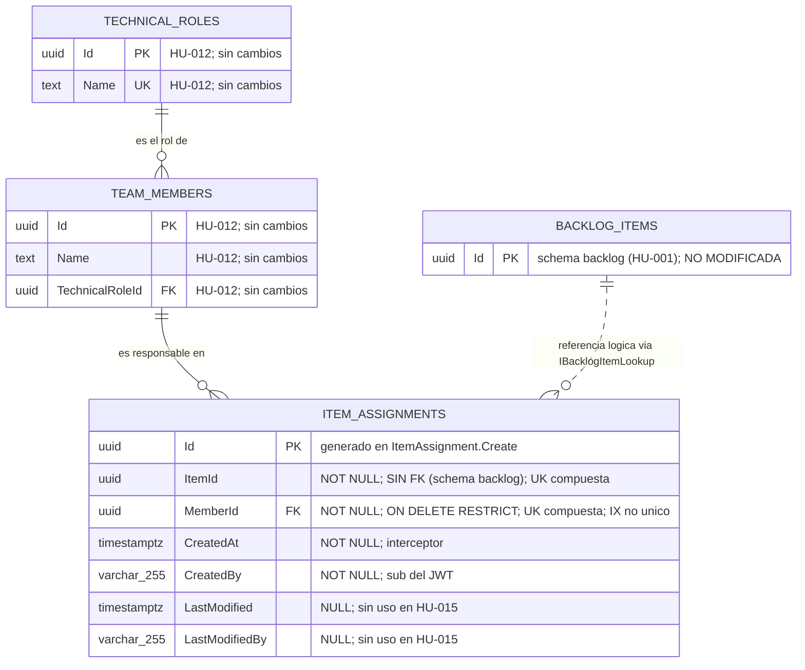
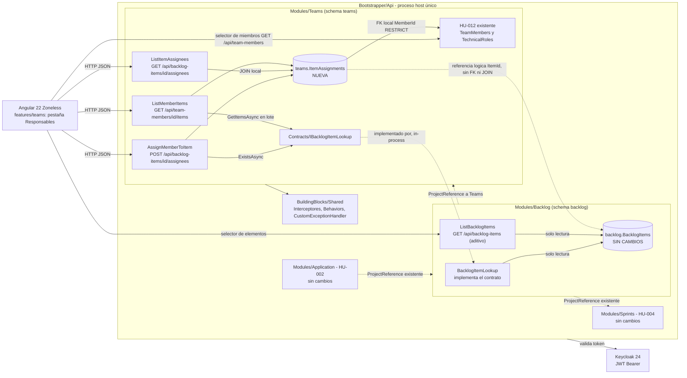
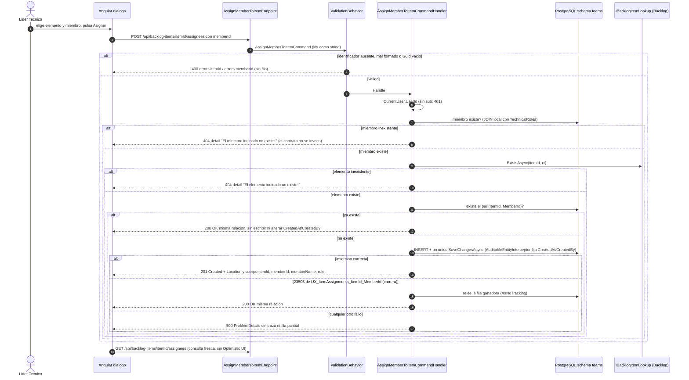
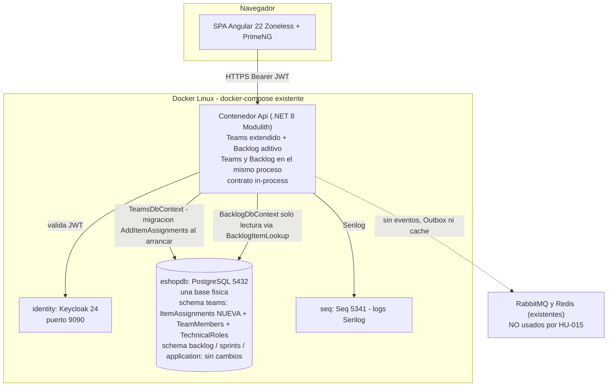

# TECH-DESIGN: Relación entre Personas, Roles y Elementos de Trabajo (HU-015)

- **Fecha de Compilación:** 04-10-2026
- **Auditor y Consolidador:** Agente QT Senior BMAD
- **Fuente SDD:** `specs/015-HU_relacion_personas_roles_elementos/spec.md`, `plan.md`, `tasks.md`, `data-model.md` y `contracts/item-assignments-api.openapi.yaml` (GitHub Spec Kit)
- **Modo de gobernanza:** Brownfield (`.specify/memory/constitution.md` prevalece)
- **Estado:** ✅ AUDITADO Y APROBADO (Auditoría Adversarial Exitosa: 0 hallazgos críticos, 12 advertencias vinculantes en la sección 7.4)

---

## 1. Architecture Overview
Se añade al módulo **existente** `Teams` (schema `teams`, `TeamsDbContext`) la relación Persona–Elemento: la tabla `teams."ItemAssignments"` (una fila por par elemento–miembro) y tres casos de uso en Vertical Slice: asignar un miembro como responsable de un elemento (`POST /api/backlog-items/{itemId}/assignees`), consultar las personas de un elemento (`GET /api/backlog-items/{itemId}/assignees`) y consultar los elementos de un miembro (`GET /api/team-members/{memberId}/items`). El módulo `Backlog` recibe únicamente cambios aditivos: implementa el contrato in-process `Teams.Contracts.IBacklogItemLookup` (`BacklogItemLookup`) y expone la consulta de solo lectura `GET /api/backlog-items` para el selector del UX. Frontend: pestaña `Responsables` en `features/teams` (Angular 22 Zoneless, Signals, PrimeNG tema neutral) con dos vistas de consulta y un diálogo de asignación.

Patrón principal: CQRS intra-proceso (Carter + MediatR + FluentValidation + Mapster), FK **local** `ItemAssignments.MemberId → TeamMembers.Id` (`RESTRICT`), `ItemId` como referencia lógica **sin FK** hacia `backlog` (la existencia y los datos del elemento se leen por contrato in-process, nunca por JOIN cross-schema), unicidad del par por índice único y **asignación idempotente** (201 al crear, 200 si ya existía, sin 409), rol derivado del miembro y no persistido, auditoría por `AuditableEntityInterceptor`. Sin eventos, Outbox, RabbitMQ, Redis ni paquetes nuevos. Convive con `Backlog`, `Sprints`, `Application` y con HU-012 sin alterar sus datos ni su comportamiento (FR-013).

**Resultado de la auditoría adversarial (6 ejes):**

| Eje | Resultado |
|---|---|
| 1. DB vs API vs Spec Kit | ✅ Los 4 endpoints de `api_015` coinciden con `item-assignments-api.openapi.yaml` y con las tareas T016–T058 de `tasks.md`. Cada campo expuesto (`itemId`, `memberId`, `memberName`, `role`, `id`, `name`, `title`, `type`) tiene origen en una columna de `db_015` (`ItemAssignments`, `TeamMembers`, `TechnicalRoles`) o en `BacklogItemRef` del contrato in-process. Ningún endpoint toca tablas o campos inexistentes en el MER. Todas las entidades y FR-001..FR-015 de `spec.md` están cubiertos. |
| 2. UI → Data | ✅ Los 12 estados de `ux_015` muestran únicamente identificador, nombre y rol (persona) e identificador, título y tipo (elemento), más selectores de miembros (HU-012) y elementos (`GET /api/backlog-items`). `CreatedAt`/`CreatedBy` persisten sin exponerse (UX D-03). Cero campos huérfanos. |
| 3. Mentiras en ADR | ✅ Los ADR impuestos por la constitución están `Aceptado (heredado)` sin alternativas inventadas; los demás traen alternativas viables (relación en `Backlog`, módulo `Assignments` con proyecciones, rol copiado, lectura de `BacklogDbContext`, `ON CONFLICT`, `SERIALIZABLE`, 409, bandera `alreadyAssigned`, paginación). Trade-offs reales (acoplamiento de compilación `Backlog → Teams`, dependencia del nombre del índice, `ItemId` sin FK, lote sin tope). Alternativas/trade-offs cosméticos puntuales: ver A-04. |
| 4. Lex Superior / Sycophancy | ✅ Ningún entregable adopta tecnología ajena a la constitución. La decisión humana B (asignación duplicada idempotente) es una **regla de negocio** que no contradice ningún artículo de `constitution.md`, por lo que no requiere Cláusula de Excepción. Los códigos 201/200, el orden de consultas y el 200 vacío para ids inexistentes son decisiones PROPUESTAS dentro del stack. |
| 5. Proporcionalidad | ✅ Una tabla, una interfaz in-process, un endpoint de lectura aditivo y cero infraestructura nueva. La ausencia de paginación, tope de responsables, baja o reemplazo es riesgo aceptado porque FR-015 prohíbe inventar esas reglas. No hay sobre-ingeniería (se descartó Outbox/eventos/caché) ni sub-ingeniería (la unicidad es invariante de datos, no solo validación). |
| 6. Severidad | 🔴 0 · 🟡 12 (sección 7.4) · 🟢 3 |

**Afirmaciones verificadas contra el código de `app/backend/src`:** `NotFoundException(string)` y `ICurrentUser.UserId` (`string?`) existen en `Shared`; `CustomExceptionHandler` emite 404 con `title` "Not Found" y `detail` = mensaje (así se distinguen miembro y elemento), y 500 sin `detail`; `ValidationBehavior<TRequest,TResponse>` valida **cualquier** `IRequest` (por eso `AssignMemberToItemCommand : IRequest<…>` ejecuta su validador, igual que `AssignItemToSprintCommand` de HU-004); `TeamMemberResponse(Guid Id, string Name, string Role)` ya expone el rol que usa el selector del UX; `Backlog` solo tiene hoy `MapPost` (`CreateBacklogItem`), de modo que `GET /api/backlog-items` **no** colisiona con una ruta existente; el grafo de proyectos queda acíclico (`Application → Backlog → {Sprints, Teams} → Shared`; `Teams` no referencia `Backlog`).

---

## 2. Components

| Componente | Ruta física | Responsabilidad | Tareas |
|---|---|---|---|
| Contrato in-process | `app/backend/src/Modules/Teams/Contracts/IBacklogItemLookup.cs` | `ExistsAsync`, `GetItemsAsync` y `BacklogItemRef(Id, Title, Type)`; solo lo que FR-007 expone | T005 |
| Dominio | `app/backend/src/Modules/Teams/Domain/ItemAssignments/` | `ItemAssignment : Aggregate<Guid>, IAuditableEntity` con `Create(itemId, memberId)`; `ItemAssignmentRules` (campos, mensajes, `PairUniqueIndexName`, `UserMaxLength`) | T006–T008 |
| Persistencia | `app/backend/src/Modules/Teams/Data/` | `DbSet<ItemAssignment>` en `ITeamsDbContext`/`TeamsDbContext`, `ItemAssignmentConfiguration`, migración `AddItemAssignments` | T009–T011 |
| Feature Asignar | `app/backend/src/Modules/Teams/Features/ItemAssignments/AssignMemberToItem/` | Command (ids como `string`), Validator, Handler (orden determinista, idempotencia, carrera 23505), Endpoint `POST` | T027–T030, T035–T036, T041–T042 |
| Feature Personas de un elemento | `app/backend/src/Modules/Teams/Features/ItemAssignments/ListItemAssignees/` | Query, Handler (JOIN local), Endpoint `GET /api/backlog-items/{itemId:guid}/assignees` | T046–T047 |
| Feature Elementos de un miembro | `app/backend/src/Modules/Teams/Features/ItemAssignments/ListMemberItems/` | Query, Handler (una llamada de lote al contrato), Endpoint `GET /api/team-members/{memberId:guid}/items` | T054–T055 |
| DTOs de respuesta | `app/backend/src/Modules/Teams/Features/ItemAssignments/` | `ItemAssigneeResponse`, `AssigneeResponse`, `MemberItemResponse` | T026, T046, T054 |
| Implementación del contrato | `app/backend/src/Modules/Backlog/BacklogItemLookup.cs`, `BacklogModule.cs`, `Backlog.csproj` | Implementa `IBacklogItemLookup` leyendo solo el schema `backlog`; registro DI; `ProjectReference` a `Teams` | T002, T023, T024 |
| Consulta aditiva de Backlog | `app/backend/src/Modules/Backlog/Features/BacklogItems/ListBacklogItems/` | `GET /api/backlog-items` → `[{ id, title, type }]` | T025 |
| Frontend | `app/frontend/src/app/features/teams/` | `item-assignees-view`, `member-items-view`, `assign-assignee-dialog`; ampliación de `team-page`, `team-api.service.ts`, `team.models.ts`; dos rutas hijas de `equipos` en `app.routes.ts` | T015, T021–T022, T031–T032, T037, T045, T048–T050, T053, T056–T058 |
| Pruebas | `app/backend/tests/{Unit,Integration}/{Teams,Backlog}/` y `*.spec.ts` | Unitarias con doble escrito a mano de `IBacklogItemLookup`; integración con Testcontainers PostgreSQL (carrera, migración, no regresión) | T007, T012–T014, T016–T020, T033–T034, T038–T040, T043–T045, T051–T053 |

**Restricción de alcance (T059):** fuera de `Modules/Teams` y `features/teams` solo se permite tocar `Backlog.csproj`, `BacklogModule.cs`, `BacklogItemLookup.cs`, `Features/BacklogItems/ListBacklogItems/` y `app.routes.ts`. Prohibido modificar `Shared`, `Application`, `Sprints`, `core/auth`, `BacklogItem`, `BacklogDbContext`, `TeamMember`, `TechnicalRole` y la migración `InitialTeamsSchema`.

---

## 3. Data Model
*(Contenido íntegro de `db_015_relacion_personas_roles_elementos.md`: MER, diccionario de datos con su trazabilidad Spec/UX → Datos (validación de no-orfandad) y riesgos. Los ADR del DA se consolidan en 7.2.)*

### 2. MODELO ENTIDAD-RELACIÓN (MER)




### 3. DICCIONARIO DE DATOS Y RESTRICCIONES
*(Mapeado a `spec.md` (Key Entities Relación de responsabilidad, Miembro, Elemento, Rol técnico), `data-model.md`, `tasks.md` T005–T014 y T023–T055, y a los estados visuales UX 1 a 12.)*

#### Tabla: `teams."ItemAssignments"` (`ItemAssignment : Aggregate<Guid>, IAuditableEntity`) — NUEVA
- `Id` (`uuid`): Llave primaria (`PK_ItemAssignments`). Lo genera el servidor en `ItemAssignment.Create`.
- `ItemId` (`uuid`): NOT NULL. Identificador del elemento del backlog. **Sin FK** (ADR-03). Verificado por `IBacklogItemLookup.ExistsAsync` antes de insertar; `Guid.Empty` rechazado por validador y factoría.
- `MemberId` (`uuid`): NOT NULL. FK `FK_ItemAssignments_TeamMembers_MemberId` → `teams."TeamMembers"("Id")` `ON DELETE RESTRICT`.
- `CreatedAt` (`timestamp with time zone`): NOT NULL. `AuditableEntityInterceptor` (FR-004).
- `CreatedBy` (`character varying(255)`): NOT NULL. `sub` del token vía `ICurrentUser`; nunca del cuerpo (FR-004).
- `LastModified` (`timestamp with time zone`): NULL. Sin uso en esta HU.
- `LastModifiedBy` (`character varying(255)`): NULL. Sin uso en esta HU.

**Restricciones:** `PK_ItemAssignments` (`Id`); `FK_ItemAssignments_TeamMembers_MemberId` (`RESTRICT`); `UX_ItemAssignments_ItemId_MemberId` (UNIQUE `ItemId`, `MemberId`). Sin columnas de rol, estado, orden ni `CHECK` de coherencia rol/estimaciones (FR-015).
**Índices:** `UX_ItemAssignments_ItemId_MemberId` (único; sirve consulta por `ItemId`); `IX_ItemAssignments_MemberId` (no único; consulta por miembro y apoyo de la FK).
**Migración:** `AddItemAssignments` en `app/backend/src/Modules/Teams/Data/Migrations/`; `Up` solo crea la tabla, la FK y los dos índices; `Down` los elimina.

#### Tablas existentes (solo lectura, sin cambios)
- `teams."TeamMembers"` (`Id`, `Name`, `TechnicalRoleId`): aportan `memberName` y, vía `TechnicalRoles."Name"`, el `role`.
- `teams."TechnicalRoles"` (`Id`, `Name`): semilla `Desarrollo`, `QA`.
- `backlog."BacklogItems"`: **inaccesible desde `Teams`**; solo se ve `Id`, `Title`, `Type` mediante `BacklogItemRef` (contrato in-process; sin estimaciones, estado ni Sprint).

### Trazabilidad Spec / UX → Datos (cero campos huérfanos)

| Requisito / Estado UX | Dato que lo sustenta |
|---|---|
| FR-001, FR-002; UX 4, 5, 6 | Una fila `ItemAssignments` por par; el índice único admite varios `MemberId` por `ItemId` y varios `ItemId` por `MemberId` |
| FR-003; UX 5 | Respuesta `{ itemId, memberId, memberName, role }`: `ItemId`, `MemberId` de la fila; `memberName` = `TeamMembers."Name"`; `role` = `TechnicalRoles."Name"` (JOIN local) |
| FR-004 | `ItemAssignments."CreatedAt"`, `"CreatedBy"` (interceptor); no se exponen en la API ni en UX |
| FR-005; UX 4 (rol solo lectura) | Sin columna de rol (ADR-05); derivado de `TeamMembers.TechnicalRoleId` |
| FR-006; UX 1, 2 | `ItemAssignments` filtrado por `ItemId` + JOIN a `TeamMembers`/`TechnicalRoles` → `id`, `name`, `role`; ausencia de filas = `[]` |
| FR-007; UX 3 | `ItemAssignments."ItemId"` por `MemberId` → lote a `IBacklogItemLookup.GetItemsAsync` → `id`, `title`, `type` (no persistidos en `teams`) |
| FR-008 | Sin escritura en consultas |
| FR-009; UX 8, 9 | Verificación previa miembro (`TeamMembers`) y elemento (contrato); FK `RESTRICT` como red de seguridad del miembro; sin fila si falla |
| FR-010; UX 10 | Validador previo (`itemId`, `memberId`); `Guid.Empty` impedido en factoría; NOT NULL |
| FR-011; UX 11 | Sin dato de persistencia (rechazo previo, 401) |
| FR-012, SC-006; UX 12 | Una sola fila y un único `SaveChangesAsync` (transacción implícita): sin estado parcial |
| FR-013, SC-005 | Ninguna columna ni navegación añadida a `BacklogItem`, `TeamMember` o `TechnicalRole` |
| FR-014 | Schema `teams`, `TeamsDbContext` propio; `ItemId` sin FK; el elemento se lee por contrato |
| FR-015 | Sin tope de responsables, sin baja, sin estado, sin coherencia rol/estimaciones (ninguna restricción modelada) |
| Resolución humana B; UX 7 | `UX_ItemAssignments_ItemId_MemberId` + relectura ante 23505 → 200 sin alterar auditoría |


### 4. RIESGOS DE INTEGRIDAD Y ESCALABILIDAD
- `⚠️ RIESGO (discrepancia con data-model.md/T010):` `data-model.md` define `CreatedBy`/`LastModifiedBy` como `varchar` sin longitud. `backlog."BacklogItems"`, `sprints."Sprints"` y `sprints."SprintItems"` los configuran `varchar(255)` mediante una constante `*Rules.UserMaxLength`. Este diseño fija `varchar(255)` por coherencia con el Modulith (el `sub` de Keycloak son 36 caracteres); debe reconciliarse en T008/T010 (p. ej. `ItemAssignmentRules.UserMaxLength = 255` y `HasMaxLength` en `ItemAssignmentConfiguration`). Nota de brownfield: `TeamMemberConfiguration` (HU-012) hoy deja estas columnas sin longitud (`text`); no se modifica aquí (FR-013), por lo que `teams` quedará con tipos mixtos hasta que se unifique en otra HU.
- `⚠️ RIESGO (ItemId huérfano sin FK):` La BD no impide un `ItemId` inexistente en inserciones fuera del handler (SQL directo, scripts). Mitigación: verificación por `IBacklogItemLookup` antes de persistir y ausencia de borrado de elementos. Si una HU futura permite eliminar elementos, deberá definir limpieza por contrato o evento (ADR-03).
- `⚠️ RIESGO (consumo de datos de Backlog en lectura):` `ListMemberItems` omite con `LogWarning` los elementos que el contrato ya no devuelve (D8); la relación puede apuntar a un elemento inexistente sin que la BD lo detecte. No es un error para el usuario, pero no hay reconciliación.
- `⚠️ RIESGO (acoplamiento al nombre del índice único):` El manejo de la carrera depende de `ItemAssignmentRules.PairUniqueIndexName` e inspecciona `PostgresException.ConstraintName`. Renombrar el índice sin actualizar la constante degrada el idempotente a 500 bajo concurrencia; T012 y T018 deben cubrirlo.
- `⚠️ RIESGO (FK/UNIQUE como 500):` Una violación de `FK_ItemAssignments_TeamMembers_MemberId` (miembro eliminado entre la lectura y el insert; hoy imposible por no existir baja) llega como `DbUpdateException` y se traduce a 500. Es aceptable porque el handler valida el miembro antes de insertar.
- `⚠️ RIESGO (cardinalidad abierta):` Sin tope de responsables ni de elementos por miembro (FR-015). Si el negocio define un máximo, será validación de handler (no restricción de BD) o un trigger/`CHECK` imposible en columna única; revisar antes de cimentar HU-014 (carga por persona).
- `⚠️ RIESGO (baja/reemplazo futuros):` La tabla no tiene borrado lógico ni columna de estado. Si HU-010 introduce "cambio de responsable", habrá que decidir entre `DELETE` físico (pierde historial) o añadir `IsActive`/`EndedAt` y convertir `UX_ItemAssignments_ItemId_MemberId` en índice único parcial (migración con depuración).
- `⚠️ RIESGO (rol derivado, sin historial):` Al no persistir el rol, un cambio futuro del rol técnico del miembro altera retroactivamente lo que muestran las relaciones existentes. Aceptado por FR-005; reevaluar si el negocio exige "rol vigente al asignar".
- `⚠️ RIESGO (escalabilidad):` Consultas con JOIN local, `AsNoTracking()`, sin paginación (supuesto de `spec.md`). Ambas direcciones tienen índice; reevaluar con miles de relaciones o al añadir orden/paginación. `ListMemberItems` hace una única llamada de lote al contrato con una lista de ids sin tope: un miembro con miles de elementos produciría una consulta `IN` grande en `Backlog`.
- `⚠️ RIESGO (despliegue):` `MigrateTeamsModuleAsync` se ejecuta en el arranque junto con las migraciones de los demás módulos; `AddItemAssignments` es aditiva y reversible (`Down`), pero un fallo impediría iniciar el host si las migraciones se encadenan sin aislamiento de errores. Verificar con T012.
- `⚠️ RIESGO (identidad en auditoría):` `CreatedBy` depende de `ICurrentUser`; sin identidad el handler responde 401 antes de persistir (no se escribe `CreatedBy` vacío). Los logs no deben contener el nombre del miembro (T060).


---

## 4. Integrations
*(Contenido íntegro de `api_015_relacion_personas_roles_elementos.md`: especificaciones globales, contratos REST y dependencias bloqueantes. Contrato complementario en `specs/015-HU_relacion_personas_roles_elementos/contracts/item-assignments-api.openapi.yaml`. Los ADR del API Architect se consolidan en 7.3. Convivencia con el sistema preexistente: los endpoints de `Teams` cuelgan de `/api/backlog-items/...` junto a `POST /api/backlog-items` de HU-001, y el elemento se lee solo por el contrato in-process `IBacklogItemLookup`.)*

### 2. ESPECIFICACIONES GLOBALES
- **Autenticación:** JWT en `Authorization: Bearer <token>` (Keycloak). Todas las operaciones.
- **Base URL:** `/api/backlog-items` (asignación y consulta por elemento; listado de elementos) y `/api/team-members` (consulta por miembro). Rutas de API independientes de las rutas de UI `/equipos/responsables` y `/equipos/responsables/miembro`.
- **Content-Type de error:** `application/problem+json` (400, 404 y 500 y el 401 emitido por el handler); el 401 del middleware no define cuerpo.
- **Nomenclatura JSON:** camelCase.
- **Idioma de mensajes:** español en los mensajes de dominio (`ItemAssignmentRules`). El contrato vinculante es el código de estado, la clave de campo en `errors` y, para el 404, el texto literal de `detail`.

#### Esquemas
| Esquema | Campos |
|---|---|
| `AssignMemberRequest` | `memberId` (`string?`, obligatorio; GUID en texto, distinto de `00000000-0000-0000-0000-000000000000`) |
| `ItemAssigneeResponse` | `itemId` (`uuid`), `memberId` (`uuid`), `memberName` (`string`), `role` (`string`, nombre del rol técnico vigente del miembro) |
| `AssigneeResponse` | `id` (`uuid`, del miembro), `name` (`string`), `role` (`string`) |
| `MemberItemResponse` | `id` (`uuid`, del elemento), `title` (`string`), `type` (`string`, nombre del enum de `BacklogItem`) |
| `BacklogItemSummaryResponse` | `id` (`uuid`), `title` (`string`), `type` (`string`) |
| `ValidationProblem` | `type`, `title`, `status`, `errors` (`{ campo: string[] }`) |
| `Problem` | `title`, `status`, `detail` (ausente en el 500) |

#### Mapeo payload → columnas (`db_015`)
| Campo JSON | Origen | Nota |
|---|---|---|
| `{itemId}` (ruta del `POST`) → `ItemAssigneeResponse.itemId` | `teams."ItemAssignments"."ItemId"` (`uuid NOT NULL`, **sin FK**) | Verificado por `IBacklogItemLookup.ExistsAsync` antes de insertar; `Guid.Empty` rechazado por validador y factoría |
| `AssignMemberRequest.memberId` → `ItemAssigneeResponse.memberId` | `teams."ItemAssignments"."MemberId"` (`uuid NOT NULL`, FK `RESTRICT` a `TeamMembers."Id"`) | Debe existir en `TeamMembers` |
| `ItemAssigneeResponse.memberName`, `AssigneeResponse.name` | `teams."TeamMembers"."Name"` | JOIN local; no se persiste en la relación (ADR-05 del DA) |
| `ItemAssigneeResponse.role`, `AssigneeResponse.role` | `teams."TechnicalRoles"."Name"` vía `TeamMembers."TechnicalRoleId"` | JOIN local; **sin columna de rol** en `ItemAssignments`; el cliente no puede elegirlo (FR-005) |
| `AssigneeResponse.id` | `teams."TeamMembers"."Id"` (a través de `ItemAssignments."MemberId"`) | |
| `MemberItemResponse.id` | `teams."ItemAssignments"."ItemId"` | Filtro por `MemberId` con `IX_ItemAssignments_MemberId` |
| `MemberItemResponse.title`, `.type` | `backlog."BacklogItems"."Title"`, `."Type"` **solo vía** `IBacklogItemLookup.GetItemsAsync` → `BacklogItemRef` | Inaccesible por SQL desde `Teams` (FR-014); una llamada de lote |
| `BacklogItemSummaryResponse.*` | `backlog."BacklogItems"."Id"`, `."Title"`, `."Type"` | Lectura propia de `Backlog` (`AsNoTracking`) |
| *(no expuesto)* | `ItemAssignments."CreatedAt"`, `"CreatedBy"` | Interceptor; `CreatedBy` = `sub` del token (FR-004) |
| *(no expuesto)* | `ItemAssignments."LastModified"`, `"LastModifiedBy"` | Siempre `NULL` en esta HU |
| *(no expuesto)* | `BacklogItems."DevPoints"`, `"QaPoints"`, estado, Sprint | Intocables (FR-013) |


### 3. ENDPOINTS DEFINIDOS

#### Endpoint: `POST /api/backlog-items/{itemId}/assignees`
- **Tarea Spec Kit:** T027, T028, T029, T035, T036, T041, T042 (US1, US4, US5); pruebas T016 a T018, T033, T034, T038, T039, T040
- **Propósito Funcional:** Asignar un miembro del equipo como responsable de un elemento del backlog (SC-01, SC-02, FR-001 a FR-005). Un miembro y un elemento por solicitud; varios responsables por elemento mediante solicitudes sucesivas (FR-002). Idempotente (ADR-04).
- **Request Headers:**
  - `Content-Type`: `application/json`
  - `Authorization`: `Bearer <token>`
- **Parámetro de ruta:** `itemId` (`string`; GUID en texto, ADR-03).
- **Request Body (Payload JSON):**
```json
{
    "memberId": "3fa85f64-5717-4562-b3fc-2c963f66afa6"
}
```
- **Respuestas (Status Codes):**
  - ✅ **201 Created** (Happy Path; SC-01 y SC-02, fila nueva). Header `Location: /api/backlog-items/{itemId}/assignees`:
  ```json
  {
      "itemId": "7c9e6679-7425-40de-944b-e07fc1f90ae7",
      "memberId": "3fa85f64-5717-4562-b3fc-2c963f66afa6",
      "memberName": "Ana Torres",
      "role": "Desarrollo"
  }
  ```
  - ✅ **200 OK** (Happy Path idempotente; el par ya existía o carrera perdida). Mismo cuerpo, **sin** `Location` obligatorio, sin nueva fila ni cambio de auditoría:
  ```json
  {
      "itemId": "7c9e6679-7425-40de-944b-e07fc1f90ae7",
      "memberId": "3fa85f64-5717-4562-b3fc-2c963f66afa6",
      "memberName": "Ana Torres",
      "role": "Desarrollo"
  }
  ```
  - ❌ **400 Bad Request** (Sad Path - `memberId` ausente, vacío, solo espacios, no GUID o `Guid.Empty`; SC-08, FR-010):
  ```json
  {
      "type": "https://tools.ietf.org/html/rfc7231#section-6.5.1",
      "title": "One or more validation errors occurred.",
      "status": 400,
      "errors": {
          "memberId": ["El identificador del miembro es obligatorio."]
      }
  }
  ```
  - ❌ **400 Bad Request** (Sad Path - `itemId` de ruta no GUID o `Guid.Empty`, p. ej. `no-es-id`; SC-08). Clave `itemId`:
  ```json
  {
      "type": "https://tools.ietf.org/html/rfc7231#section-6.5.1",
      "title": "One or more validation errors occurred.",
      "status": 400,
      "errors": {
          "itemId": ["El identificador del elemento no tiene un formato válido."]
      }
  }
  ```
  - ❌ **400 Bad Request** (Sad Path - ambos identificadores inválidos a la vez; el validador reporta los dos campos):
  ```json
  {
      "type": "https://tools.ietf.org/html/rfc7231#section-6.5.1",
      "title": "One or more validation errors occurred.",
      "status": 400,
      "errors": {
          "itemId": ["El identificador del elemento no tiene un formato válido."],
          "memberId": ["El identificador del miembro es obligatorio."]
      }
  }
  ```
  - ❌ **401 Unauthorized** (Sad Path - Sin token, inválido o expirado, o token sin claim `sub`; SC-09, FR-011). Del middleware: sin cuerpo definido. Del handler (sin `sub`): `ProblemDetails` con `title` "Unauthorized". No se lee ni persiste nada.
  - ❌ **404 Not Found** (Sad Path - Miembro inexistente; SC-06, FR-009). También cuando faltan miembro **y** elemento:
  ```json
  {
      "title": "Not Found",
      "status": 404,
      "detail": "El miembro indicado no existe."
  }
  ```
  - ❌ **404 Not Found** (Sad Path - Elemento inexistente con miembro existente; SC-07, FR-009):
  ```json
  {
      "title": "Not Found",
      "status": 404,
      "detail": "El elemento indicado no existe."
  }
  ```
  - ❌ **500 Internal Server Error** (Sad Path - Fallo de persistencia; SC-10, FR-012). Sin trazas, sin `detail`, sin relación parcial (un único `SaveChangesAsync`):
  ```json
  {
      "title": "An unexpected error occurred.",
      "status": 500
  }
  ```
- **Notas:**
  - Orden de evaluación (ADR-06): 401 middleware → 400 validador → 401 sin `sub` → 404 miembro → 404 elemento → 200 existente → 201 nuevo. Con identificadores malformados **no** se consulta la BD ni el contrato.
  - El rol de la respuesta es el rol técnico **vigente** del miembro (JOIN local). Cualquier `role`, `createdBy`, `createdAt` o `id` enviado en el cuerpo se ignora (el DTO solo define `memberId`).
  - Un cuerpo ausente o no-JSON, un `memberId` de tipo JSON distinto de string o un `Content-Type` ausente produce el 400 de binding (`errors.general`) o el 415 de ASP.NET, sin atribución de campo (no cubierto por la HU). Un cuerpo `{}` o `{ "memberId": null }` sí llega al validador y da `errors.memberId`.
  - Los textos de `errors` son ilustrativos (los fija `ItemAssignmentRules`); los literales de `detail` del 404 sí son contractuales (ADR-05). El contrato vinculante de 400 es el código de estado y las claves `itemId`/`memberId`.
  - La asignación **no** modifica `devPoints`, `qaPoints`, estado, Sprint, registro del miembro ni su rol (FR-013).

#### Endpoint: `GET /api/backlog-items/{itemId}/assignees`
- **Tarea Spec Kit:** T046, T047 (US2); pruebas T043, T044, T038, T040
- **Propósito Funcional:** Consultar las personas, con su rol técnico, relacionadas con un elemento (SC-03, SC-04, FR-006, FR-008). Solo lectura (`AsNoTracking`).
- **Request Headers:**
  - `Authorization`: `Bearer <token>`
- **Parámetro de ruta:** `itemId` (`uuid`, restricción `:guid`, ADR-03).
- **Request Body:** Ninguno. Sin parámetros de consulta.
- **Respuestas (Status Codes):**
  - ✅ **200 OK** (Happy Path; SC-03), exactamente las personas relacionadas, orden no contractual:
  ```json
  [
      {
          "id": "3fa85f64-5717-4562-b3fc-2c963f66afa6",
          "name": "Ana Torres",
          "role": "Desarrollo"
      },
      {
          "id": "9b2f6c1e-1d4a-4e0b-8a57-3c1f2d7e9a10",
          "name": "Luis Rojas",
          "role": "QA"
      }
  ]
  ```
  - ✅ **200 OK** (elemento sin responsables, o `itemId` bien formado pero inexistente; SC-04, D7): `[]`
  - ❌ **401 Unauthorized** (Sad Path; SC-09). Sin cuerpo; no se lee ningún dato.
  - ❌ **404 Not Found** (sin cuerpo de aplicación): únicamente cuando `itemId` no es un GUID (la ruta no enruta). No es un 404 de negocio.
  - ❌ **500 Internal Server Error** (Sad Path - Fallo de lectura). Sin trazas:
  ```json
  {
      "title": "An unexpected error occurred.",
      "status": 500
  }
  ```
- **Notas:** Una sola consulta con JOIN local `ItemAssignments` ↔ `TeamMembers` ↔ `TechnicalRoles` y proyección directa a `AssigneeResponse`. **No** invoca `IBacklogItemLookup` (T043). La respuesta nunca incluye `itemId`, `createdAt` ni `createdBy`. No hay 400.

#### Endpoint: `GET /api/team-members/{memberId}/items`
- **Tarea Spec Kit:** T054, T055 (US3); pruebas T051, T052, T038, T040
- **Propósito Funcional:** Consultar los elementos del backlog relacionados con un miembro (SC-05, FR-007, FR-008). Solo lectura.
- **Request Headers:**
  - `Authorization`: `Bearer <token>`
- **Parámetro de ruta:** `memberId` (`uuid`, restricción `:guid`).
- **Request Body:** Ninguno. Sin parámetros de consulta.
- **Respuestas (Status Codes):**
  - ✅ **200 OK** (Happy Path; SC-05), exactamente los elementos relacionados, orden no contractual:
  ```json
  [
      {
          "id": "7c9e6679-7425-40de-944b-e07fc1f90ae7",
          "title": "Registrar usuarios",
          "type": "Story"
      },
      {
          "id": "0f8fad5b-d9cb-469f-a165-70867728950e",
          "title": "Corregir cálculo de puntos",
          "type": "Bug"
      }
  ]
  ```
  - ✅ **200 OK** (miembro sin elementos, o `memberId` bien formado pero inexistente; D7): `[]`
  - ❌ **401 Unauthorized** (Sad Path; SC-09). Sin cuerpo; no se lee ningún dato.
  - ❌ **404 Not Found** (sin cuerpo de aplicación): únicamente cuando `memberId` no es un GUID.
  - ❌ **500 Internal Server Error** (Sad Path - Fallo de lectura o del contrato). Sin trazas:
  ```json
  {
      "title": "An unexpected error occurred.",
      "status": 500
  }
  ```
- **Notas:**
  - Una sola lectura de `ItemId` por `MemberId` y **una única** llamada de lote a `IBacklogItemLookup.GetItemsAsync(ids, ct)` (sin N+1). Con cero relaciones **no** se llama al contrato.
  - Elementos que el contrato ya no devuelve se omiten con `LogWarning` (ADR-08).
  - Los valores de `type` mostrados son ilustrativos; los literales son los nombres del enum de `BacklogItem` (HU-001), que `Teams` trata como `string` opaco.

#### Endpoint: `GET /api/backlog-items`
- **Tarea Spec Kit:** T025 (US1, aditivo); pruebas T020
- **Propósito Funcional:** Alimentar el selector de elementos del diálogo de asignación (UX, ADR-09). No es una capacidad de la HU: es una consulta de soporte de solo lectura en `Backlog`.
- **Request Headers:**
  - `Authorization`: `Bearer <token>`
- **Request Body:** Ninguno. Sin parámetros de consulta.
- **Respuestas (Status Codes):**
  - ✅ **200 OK** (Happy Path; quickstart 12), sin estimaciones, estado ni Sprint:
  ```json
  [
      {
          "id": "7c9e6679-7425-40de-944b-e07fc1f90ae7",
          "title": "Registrar usuarios",
          "type": "Story"
      }
  ]
  ```
  - ✅ **200 OK** (sin elementos): `[]`
  - ❌ **401 Unauthorized** (Sad Path). Sin cuerpo; no se lee ningún dato.
  - ❌ **500 Internal Server Error** (Sad Path - Fallo de lectura). Sin trazas:
  ```json
  {
      "title": "An unexpected error occurred.",
      "status": 500
  }
  ```
- **Notas:** `GET /api/backlog-items` coexiste con el `POST /api/backlog-items` de HU-001 en la misma ruta base; no lo altera (T020 verifica no regresión). Sin paginación ni filtros.

#### Matriz de trazabilidad Spec → Contrato

| Requisito | Endpoint | Código |
|---|---|---|
| FR-001, FR-002, FR-003, FR-004, FR-005 | `POST /api/backlog-items/{itemId}/assignees` | 201 |
| Resolución humana B (duplicado idempotente) | `POST /api/backlog-items/{itemId}/assignees` | 200 |
| FR-009 | `POST /api/backlog-items/{itemId}/assignees` | 404 (`detail` miembro / elemento) |
| FR-010 | `POST /api/backlog-items/{itemId}/assignees` | 400 (`errors.itemId` / `errors.memberId`) |
| FR-012 | `POST /api/backlog-items/{itemId}/assignees` | 500 (sin fila parcial) |
| FR-006 | `GET /api/backlog-items/{itemId}/assignees` | 200 (con datos o `[]`) |
| FR-007 | `GET /api/team-members/{memberId}/items` | 200 |
| FR-008 | Los dos `GET` de la HU | 200 sin escritura |
| FR-011 | Los cuatro | 401 |
| FR-013 | Los cuatro: sin campos de estimación, estado ni Sprint en ninguna respuesta; ninguna escritura sobre `BacklogItem`/`TeamMember` | n/a |
| FR-014 | `GET /api/team-members/{memberId}/items`, `POST` | Datos del elemento solo vía `IBacklogItemLookup` |
| FR-015 | Ausencia de `PUT`/`PATCH`/`DELETE`, de tope de responsables, de paginación y de reglas rol/estimación/estado | n/a |
| SC-001, SC-007 | `POST` + dos `GET` | Visibilidad inmediata en ambos sentidos |
| SC-003 | `POST` | 400/404 sin fila |
| SC-004 | Los cuatro | 401 |
| SC-006 | `POST` | 500 sin fila parcial |


### 4. DEPENDENCIAS BLOQUEANTES
- `⚠️ BLOQUEO:` Ninguno. `db_015_relacion_personas_roles_elementos.md` cubre todos los campos expuestos: `ItemId` y `MemberId` de la fila, `memberName` y `role` por JOIN local, y `title`/`type` por el contrato in-process (no persistidos en `teams`). La auditoría no se expone.
- `⚠️ RIESGO (OpenAPI inexistente):` `specs/015-.../contracts/item-assignments-api.openapi.yaml` es referenciado por `plan.md`, `quickstart.md` y `tasks.md` (encabezado "Prerequisites") y **no existe**. Este documento es la única definición HTTP. Debe generarse/sincronizarse desde aquí antes de implementar (el QA Técnico debe exigirlo o registrar la desviación); declarar `itemId` como `string` en el `POST` y `string/uuid` en los `GET` (ADR-03).
- `⚠️ RIESGO (formato de errores documentado en api_012):` `api_012` describe un 500 con `detail` y `title` distinto; el código real de `CustomExceptionHandler` emite `title` "An unexpected error occurred." sin `detail`. Pruebas o clientes escritos contra `api_012` fallarán. Este contrato sigue el código.
- `⚠️ RIESGO (distinción miembro/elemento por texto):` El cliente separa los dos 404 solo por `detail` (ADR-05). Cambiar la redacción de `ItemAssignmentRules.MemberNotFoundMessage`/`ItemNotFoundMessage` rompe la UI (Estados 8 y 9).
- `⚠️ RIESGO (cliente debe leer 201 vs 200):` Un cliente que ignore el código pierde la distinción "asignado" / "ya era responsable" (ADR-04).
- `⚠️ RIESGO (Backlog depende de Teams en compilación):` `IBacklogItemLookup` vive en `Teams.Contracts` y `Backlog` lo implementa (T002); si `BacklogModule` no registra `BacklogItemLookup` (T024), toda asignación y `ListMemberItems` fallarían en ejecución con error de resolución de DI (500), no en compilación.
- `⚠️ RIESGO (colisión de rutas entre módulos):` `Teams` y `Backlog` registran ambos rutas bajo `/api/backlog-items`. Un `MapGet`/`MapPost` duplicado exacto se detectaría solo al arrancar. Verificar con T061/T063.
- `⚠️ RIESGO (consulta de ids inexistentes indistinguible de vacío):` `200 []` para elemento o miembro inexistente (ADR-07) oculta errores de cliente (un GUID equivocado parece "sin responsables").
- `⚠️ RIESGO (ListMemberItems sin tope y con huérfanos):` Un lote `IN` ilimitado hacia `Backlog` y omisión silenciosa de elementos no encontrados (ADR-08).
- `⚠️ RIESGO (enumeración de datos sin permisos por rol):` Sin autorización por rol, cualquier token válido consulta la carga de cualquier persona y lista todos los elementos (CB-11, ADR-02).
- `⚠️ RIESGO (identificadores en logs):` El `LogWarning` de ADR-08 y los logs del `LoggingBehavior` no deben incluir `memberName` (T060).
- `⚠️ RIESGO (supuestos de negocio abiertos):` Máximo de responsables, baja o reemplazo, coherencia rol/estimaciones, restricciones por estado o Sprint, rol elegible por asignación y formato de consultas (puntos abiertos 1 a 7 de la HU) siguen sin definir; resolver cualquiera altera este contrato (p. ej. un `DELETE` o un `role` en el request). El rol derivado puede cambiar retroactivamente si HU-012 permite cambiar el rol de un miembro.


---

## 5. DIAGRAMAS DE ARQUITECTURA (Componentes, Secuencia, Despliegue)

*(Escenario B: la skill `archify` está listada pero no es ejecutable, porque Node.js no está instalado en este entorno. Se aplica degradación elegante: diagramas únicamente en sintaxis nativa `mermaid`. Todos representan la convivencia con los módulos preexistentes y no contradicen los ADR.)*

### 5.1. Componentes: `Teams` extendido junto a `Backlog` y los módulos preexistentes (`component`)



> *Nota de Arquitectura: Diagrama generado exclusivamente con Mermaid por ausencia de dependencias externas. Para habilitar visores HTML interactivos, instale la skill en la raíz del proyecto (`npx skills add tt-a1i/archify -g`) y solicite la actualización de esta sección.*

### 5.2. Secuencia: asignar un responsable (idempotente, con carrera) (`sequence`)



> *Nota de Arquitectura: Diagrama generado exclusivamente con Mermaid por ausencia de dependencias externas. Para habilitar visores HTML interactivos, instale la skill en la raíz del proyecto (`npx skills add tt-a1i/archify -g`) y solicite la actualización de esta sección.*

### 5.3. Despliegue sobre la infraestructura existente (`component`)



> *Nota de Arquitectura: Diagrama generado exclusivamente con Mermaid por ausencia de dependencias externas. Para habilitar visores HTML interactivos, instale la skill en la raíz del proyecto (`npx skills add tt-a1i/archify -g`) y solicite la actualización de esta sección.*

---

## 6. Technology Stack
- **Backend:** .NET 8 (`net8.0`, C# 12), Modular Monolith con Vertical Slice Architecture; Carter 8.1.0 (`ICarterModule`), MediatR 12.4.1 con `ValidationBehavior` y `LoggingBehavior`, FluentValidation 11.9.2, Mapster 7.4.0. Sin paquetes nuevos.
- **Persistencia:** PostgreSQL (una base física, schema `teams` con `TeamsDbContext` existente), EF Core Npgsql 8.0.11 Code-First, migración `AddItemAssignments` solo aditiva, `AuditableEntityInterceptor` de `Shared`. Índice único `UX_ItemAssignments_ItemId_MemberId`, FK local `RESTRICT`, índice `IX_ItemAssignments_MemberId`.
- **Integración entre módulos:** contrato síncrono in-process `Teams.Contracts.IBacklogItemLookup` implementado por `Backlog`. Sin RabbitMQ, MassTransit, Redis ni Outbox (SA-ADR-007).
- **Seguridad e identidad:** Keycloak 24 con `Keycloak.AuthServices.Authentication` 2.5.2; `.RequireAuthorization()` en los cuatro endpoints; `CreatedBy` = `sub`.
- **Observabilidad:** Serilog 8.0.1 con sink Seq; sin `Console.WriteLine`; sin nombres de miembro en logs.
- **Frontend:** Angular 22.2 Zoneless con Signals, componentes standalone OnPush, PrimeNG ^22.1.2 tema neutral, i18n nativo.
- **Testing:** xUnit + FluentAssertions + Testcontainers PostgreSQL (backend; doble escrito a mano del contrato), Jest (frontend). TDD y pruebas no tautológicas.
- **Infraestructura:** Docker (docker-compose existente: PostgreSQL y Keycloak).

---

## 7. Architecture Decisions (ADRs - Matriz Consolidada MADR)
*(Consolidados los 23 ADR de SA, DA y API. Prefijos `SA-`, `DA-` y `API-` para evitar la colisión de numeración entre los tres autores. Los ADR impuestos por la constitución figuran como `Aceptado (heredado)` sin alternativas inventadas.)*

| ID | Título de la Decisión | Área | Estado | Trade-off / Costo Admitido |
|:---:|---|:---:|:---:|---|
| **SA-ADR-001** | Carter, MediatR y Vertical Slice Architecture | Arquitectura (SA) | Aceptado (heredado) | Varios ficheros por un modelo de dos campos (costo fijo de VSA) |
| **SA-ADR-002** | PostgreSQL con schema aislado y sin consultas cross-schema | Datos (SA) | Aceptado (heredado) | La BD no impide un `ItemId` huérfano; la integridad depende de verificar por contrato antes de persistir |
| **SA-ADR-003** | Relación en `Teams`; elemento por contrato in-process; rol derivado del miembro | Arquitectura (SA) | Aceptado | `Backlog.csproj` referencia `Teams.csproj`; `Teams` depende en ejecución del registro DI de `Backlog`; al extraer el módulo el contrato pasa a llamada remota |
| **SA-ADR-004** | Unicidad del par por índice único; asignación duplicada idempotente | Datos (SA) | Aceptado | Dependencia del nombre del índice en el manejo de la carrera; segunda lectura en la rama de error |
| **SA-ADR-005** | Códigos de éxito 201/200 sin bandera en el cuerpo | APIs (SA) | Aceptado | El cliente debe leer el código HTTP (`observe: 'response'`) |
| **SA-ADR-006** | Selectores del UX: miembros de HU-012 y `GET /api/backlog-items` aditivo | APIs (SA) | Aceptado | Nueva superficie pública en HU-001 sin paginación; crece sin cota |
| **SA-ADR-007** | Sin eventos de dominio ni de integración, Outbox ni caché | Arquitectura (SA) | Aceptado | HU-010/HU-014/HU-011 deberán añadir evento y Outbox si necesitan reaccionar |
| **SA-ADR-008** | Identificadores como texto validados por campo; `Guid.Empty` ausente | APIs (SA) | Aceptado | Parseo manual y tratamiento asimétrico POST/GET |
| **DA-ADR-01** | Motor, schema y `DbContext` de la relación | Datos (DA) | Aceptado (heredado) | `Teams` conoce un identificador de elemento que no puede validar con FK |
| **DA-ADR-02** | `ItemAssignment` sobre la jerarquía de `Shared`, sin eventos ni Outbox | Datos (DA) | Aceptado (heredado) | Sin traza de eventos; `LastModified*` siempre `NULL` |
| **DA-ADR-03** | `ItemId` lógico sin FK; `MemberId` con FK local `RESTRICT` | Datos (DA) | Aceptado (heredado) | `ItemId` huérfano posible por SQL directo o futuro borrado de elementos |
| **DA-ADR-04** | Índice único `(ItemId, MemberId)` y relectura ante 23505 | Datos (DA) | Aceptado | Acoplamiento al nombre del constraint; revisar el índice si llega "máximo" o "baja" |
| **DA-ADR-05** | El rol no se persiste; JOIN local | Datos (DA) | Aceptado | Dos JOIN locales por consulta; cambio de rol altera retroactivamente lo mostrado |
| **DA-ADR-06** | Índice no único sobre `MemberId` | Datos (DA) | Aceptado | Un índice más de escritura por inserción |
| **API-ADR-01** | Protocolo y capa de interfaz (Carter, VSA) | APIs (API) | Aceptado (heredado) | Rutas `/api/backlog-items/...` compartidas entre módulos; colisión solo detectable al arrancar |
| **API-ADR-02** | Autenticación y autorización (Bearer JWT / Keycloak) | Seguridad (API) | Aceptado (heredado) | Cualquier autenticado asigna y consulta; un 403 futuro será visible para clientes |
| **API-ADR-03** | Ids como `string` en el `POST`; `:guid` en las consultas | APIs (API) | Aceptado | Malformado: 400 en `POST` y 404 sin cuerpo en `GET`; un generador de clientes puede unificar tipos y romper la validación por campo |
| **API-ADR-04** | `POST` idempotente: 201 al crear, 200 si ya existía | APIs (API) | Aceptado | Un cliente que solo mire `2xx` pierde la distinción; `Location` apunta a la colección |
| **API-ADR-05** | Formato de errores `ProblemDetails` tal como lo emite `Shared` | APIs (API) | Aceptado (heredado) | Sin código máquina-legible: el 404 miembro/elemento se distingue por el texto de `detail` |
| **API-ADR-06** | Orden de evaluación determinista del `POST` | APIs (API) | Aceptado | Con ambos ids inexistentes solo se ve el 404 del miembro; token sin `sub` + cuerpo inválido da 400 |
| **API-ADR-07** | Consultas como arreglo plano y `200 []` para ids inexistentes | APIs (API) | Aceptado | `[]` no distingue "sin responsables" de "no existe"; pasar a paginación sería incompatible |
| **API-ADR-08** | Omisión con `LogWarning` de elementos huérfanos en `ListMemberItems` | APIs (API) | Aceptado | Respuesta con menos elementos que filas, sin que el cliente lo sepa |
| **API-ADR-09** | Endpoint aditivo `GET /api/backlog-items` en `Backlog` | APIs (API) | Aceptado | Amplía la superficie pública de HU-001 sin paginar; enumeración de títulos por cualquier autenticado |

### 7.1. ADRs del Solutions Architect (texto íntegro)

#### SA-ADR-001: Carter, MediatR y Vertical Slice Architecture
- **Estado:** Aceptado (heredado)
- **Contexto:** La constitución obliga a Carter, MediatR, FluentValidation y VSA con co-locación de feature. Hay tres casos de uso: asignar, consultar personas de un elemento y consultar elementos de un miembro.
- **Decisión:** Un endpoint `ICarterModule` por caso de uso, con `ISender`, `.RequireAuthorization()`, `.Produces<T>()` y `.ProducesProblem()`, en `Features/ItemAssignments/{AssignMemberToItem|ListItemAssignees|ListMemberItems}/` con Command/Query, Validador y Handler co-ubicados.
- **Consecuencias:**
  - ✅ **Impacto Positivo:** cada carpeta se audita contra US1, US2/US3 y US4/US5.
  - ⚠️ **Trade-off / Costo Real:** varios ficheros por un modelo de dos campos; es el costo fijo de VSA.

#### SA-ADR-002: PostgreSQL con schema aislado por módulo y sin consultas cross-schema
- **Estado:** Aceptado (heredado)
- **Contexto:** La constitución §3 prohíbe `JOIN` y consultas cross-schema; la relación necesita datos del miembro (`teams`) y del elemento (`backlog`). FR-014 lo exige.
- **Decisión:** `ItemAssignments` vive en el schema `teams` con FK real a `teams."TeamMembers"`. La relación con el elemento es **solo lógica** (columna `ItemId uuid` sin FK); su existencia y sus datos se obtienen por el contrato in-process (ADR-003).
- **Consecuencias:**
  - ✅ **Impacto Positivo:** el módulo sigue siendo extraíble; ninguna migración toca `backlog`.
  - ⚠️ **Trade-off / Costo Real:** la base de datos no impide un `ItemId` huérfano si otro camino de código escribe sin pasar por el handler, ni protege contra el borrado de un elemento (no existe borrado hoy). La integridad depende de verificar por contrato antes de persistir.

#### SA-ADR-003: La relación vive en el módulo `Teams`; el elemento se lee por contrato in-process y el rol se deriva del miembro
- **Estado:** Aceptado
- **Contexto:** La spec delega a Architecture "dónde reside la relación y cómo cada consulta obtiene datos del otro módulo (llamada en proceso o proyección local)". El rol mostrado es el rol técnico registrado del miembro (FR-005). HU-004 ya fijó el patrón: tabla en el módulo del lado "uno" y contrato in-process hacia Backlog implementado por Backlog.
- **Decisión:** La tabla `ItemAssignments` y sus features viven en `Teams`: el nombre y el rol del miembro se obtienen con un `JOIN` **local** (`teams."TeamMembers"` ↔ `teams."TechnicalRoles"`) y el elemento se lee por `Teams.Contracts.IBacklogItemLookup` con `ExistsAsync(Guid itemId, CancellationToken)` y `GetItemsAsync(IReadOnlyCollection<Guid> itemIds, CancellationToken)` que devuelve `BacklogItemRef(Id, Title, Type)` (solo lo que FR-007 expone; sin estimaciones, estado ni Sprint). `Backlog` lo implementa en `BacklogItemLookup` consultando solo el schema `backlog`. `Type` viaja como `string` con el nombre del enum para que `Teams` no referencie tipos de `Backlog`. El rol **no se copia** a la relación: se lee del miembro en cada consulta.
- **Alternativas Consideradas:**
  - **Alternativa A (relación en `Backlog`, con un `AssigneeIds` en el elemento o tabla en `backlog`):** permitiría un `JOIN` con elementos. Se descarta porque modifica el agregado `BacklogItem` que FR-013 declara intocable, obliga a `Backlog` a conocer miembros (o a consultar el schema `teams`, prohibido) y rompe el aislamiento de HU-001.
  - **Alternativa B (módulo nuevo `Assignments` con proyecciones locales de miembro y elemento vía Integration Events):** máximo desacoplamiento, y es el lugar natural si HU-010 extiende la relación a actividades, reuniones e incidentes. Se descarta ahora por desproporcionada: exige Outbox, RabbitMQ y consistencia eventual para validaciones de existencia que hoy son llamadas en proceso, y permitiría asignar a un elemento recién creado que aún no llegó a la proyección. La extracción posterior es barata porque la tabla ya está aislada.
  - **Alternativa C (almacenar el rol en la fila de la relación):** evita el JOIN. Se descarta porque FR-005 dice que se muestra el rol que el miembro **ya tiene registrado**; copiarlo crearía un dato duplicado que divergiría si HU-012 permitiera cambiarlo, y la relación no define un rol propio.
  - **Alternativa D (el handler lee `BacklogDbContext` directamente):** simple, pero es exactamente la consulta cross-schema que la constitución prohíbe y acopla `Teams` a un `DbContext` ajeno.
- **Consecuencias:**
  - ✅ **Impacto Positivo:** cero cambios en entidades existentes, cero infraestructura nueva, verificación de existencia con consistencia fuerte y rol siempre coherente con HU-012.
  - ⚠️ **Trade-off / Costo Real:** `Backlog.csproj` pasa a referenciar `Teams.csproj` (acoplamiento de compilación en el sentido contrato→implementador, además del que ya tiene con `Sprints`), y `Teams` depende en ejecución de que `Backlog` registre su implementación: las pruebas unitarias de `Teams` necesitan un doble del contrato y las de integración la implementación real. Al extraer `Teams` como servicio el contrato pasará a ser una llamada remota con su latencia y modos de fallo. Si en el futuro HU-012 permitiera cambiar el rol de un miembro, la relación mostraría el rol nuevo (comportamiento aceptado, hoy inexistente).

#### SA-ADR-004: Unicidad (elemento, miembro) por índice único; la asignación duplicada es idempotente
- **Estado:** Aceptado
- **Contexto:** La resolución humana B fija que asignar dos veces al mismo miembro al mismo elemento responde éxito con la relación existente, sin crear otra ni alterar su auditoría. Las solicitudes concurrentes del mismo par estaban sin definir.
- **Decisión:** Índice único `UX_ItemAssignments_ItemId_MemberId` sobre `(ItemId, MemberId)`. El handler lee primero si el par existe (optimización: responde 200 sin escribir, sin tocar `CreatedAt`/`CreatedBy`); si no existe inserta. Si el `SaveChanges` falla con `PostgresException` 23505 **de ese índice** (carrera), relee la fila ganadora y responde 200. La garantía real es el índice, no la lectura previa. Un elemento **puede** tener varios miembros y un miembro varios elementos (FR-002): la unicidad es del par, no de `ItemId` ni de `MemberId`.
- **Alternativas Consideradas:**
  - **Alternativa A (solo comprobación en el handler, sin índice):** suficiente para un único usuario. Se descarta porque lectura y escritura no son atómicas: dos solicitudes simultáneas pasan ambas la comprobación y quedaría el par duplicado, que la decisión humana prohíbe.
  - **Alternativa B (`INSERT ... ON CONFLICT DO NOTHING` con SQL crudo):** atómico y sin excepción. Se descarta porque evade el `AuditableEntityInterceptor` (que fija `CreatedAt`/`CreatedBy`, FR-004) y obliga a SQL manual fuera de EF.
  - **Alternativa C (`SERIALIZABLE` o `pg_advisory_xact_lock`):** también cierra la carrera. Se descarta por añadir complejidad y reintentos para algo que un índice único resuelve de forma declarativa.
  - **Alternativa D (responder 409 al duplicado):** es la opción A del humano, descartada por su decisión (opción B).
- **Consecuencias:**
  - ✅ **Impacto Positivo:** la invariante vale también para SQL directo y para cualquier ruta futura; la concurrencia queda resuelta sin bloqueos y los reintentos del cliente son seguros.
  - ⚠️ **Trade-off / Costo Real:** el código depende del nombre de constraint de Npgsql (`ConstraintName`) para distinguir la carrera de un 500; si se renombra el índice hay que actualizar `ItemAssignmentRules.PairUniqueIndexName` (cubierto por una prueba de integración). El camino de carrera hace una segunda lectura en la rama de error. Si negocio decide después restringir duplicados con 409 o impone un máximo de responsables, habrá que cambiar el handler y, en el segundo caso, añadir lógica de conteo con su propia carrera.

#### SA-ADR-005: Códigos de éxito 201/200 y respuesta sin bandera
- **Estado:** Aceptado
- **Contexto:** La spec solo dice "un código de éxito" (FR-003) y el UX necesita distinguir la asignación nueva (Estados 5 y 6, toast de éxito) de la repetida (Estado 7, toast informativo, B-01).
- **Decisión:** `POST` responde **201 Created** (⚠️ [PROPUESTO]) con `Location` hacia `GET /api/backlog-items/{itemId}/assignees` cuando inserta, y **200 OK** con el mismo cuerpo cuando el par ya existía. El cuerpo es `{ itemId, memberId, memberName, role }`, sin bandera `alreadyAssigned`, sin `CreatedAt`/`CreatedBy` (UX D-03) y sin datos del elemento más allá de su identificador (FR-013).
- **Alternativas Consideradas:**
  - **Alternativa A (siempre 200 con bandera `alreadyAssigned` en el cuerpo):** un solo camino de éxito. Se descarta porque ensucia el contrato de FR-003 con un campo que la HU no pide y pierde la semántica HTTP de "creado frente a ya existente".
  - **Alternativa B (siempre 201):** ignora que no se creó nada y haría que un cliente HTTP genérico crea haber creado un recurso en cada reintento.
- **Consecuencias:**
  - ✅ **Impacto Positivo:** contrato mínimo y semántico; el frontend decide el toast por el código HTTP.
  - ⚠️ **Trade-off / Costo Real:** el cliente debe leer `HttpResponse.status` y no solo el cuerpo (el servicio Angular usa `observe: 'response'`); el contrato final lo fija el API Architect y debe documentar ambos códigos.

#### SA-ADR-006: Fuente de los selectores del UX: miembros de HU-012 y consulta de solo lectura de elementos añadida a Backlog
- **Estado:** Aceptado
- **Contexto:** El UX (D-02, B-04) eligió selectores en lugar de capturar identificadores y delega al SA la fuente de cada lista. Los miembros ya salen de `GET /api/team-members` (HU-012). No existe ninguna consulta de elementos en `Backlog`: solo `CreateBacklogItem` (HU-001). HU-004 resolvió lo mismo capturando el identificador como texto (su B-02).
- **Decisión:** Añadir en `Backlog` la feature `ListBacklogItems` (`GET /api/backlog-items` → `[{ id, title, type }]`, orden por `CreatedAt` e `Id` solo por estabilidad, `AsNoTracking`, `.RequireAuthorization()`), ⚠️ [PROPUESTO], estrictamente aditiva: no toca el agregado, el `DbContext`, las configuraciones ni la migración, y no devuelve estimaciones, estado ni Sprint. El selector de miembros reutiliza `GET /api/team-members`.
- **Alternativas Consideradas:**
  - **Alternativa A (campo de texto para el identificador del elemento, como HU-004):** cero cambios en `Backlog`. Se descarta porque el UX de esta HU ya diseñó un selector y capturar GUID a mano induciría justo los errores de los Estados 8 a 10.
  - **Alternativa B (exponer la lista desde el contrato `IBacklogItemLookup` y un endpoint en `Teams`):** evita tocar `Backlog` en HTTP. Se descarta porque un endpoint de `Teams` que lista elementos del backlog sirve datos que no son del módulo y duplicaría una consulta que HU-004 y las vistas de HU-010 también necesitarán.
  - **Alternativa C (paginar, filtrar y ordenar la lista de elementos):** más escalable. Se descarta por prematura: el formato de las consultas no está definido (D-04) y no hay volumen medido.
- **Consecuencias:**
  - ✅ **Impacto Positivo:** el selector del UX es posible sin duplicar datos y la consulta sirve a futuras HUs.
  - ⚠️ **Trade-off / Costo Real:** `HU-001` gana una superficie pública nueva sin haberse definido en su spec (cambio aditivo que debe validarse como no regresión de HU-001) y la lista sin paginación puede crecer sin cota; si el backlog supera unos cientos de elementos habrá que paginar y buscar en servidor. Debe confirmarlo el API Architect y registrarse en `plan.md`.

#### SA-ADR-007: Sin eventos de dominio ni de integración, Outbox ni caché
- **Estado:** Aceptado
- **Contexto:** Ningún requisito notifica a otros módulos al asignar, y HU-010/HU-014 consumirán la relación pero hoy no existen.
- **Decisión:** `ItemAssignment` hereda de `Aggregate<Guid>` por la jerarquía estándar pero no emite eventos. Sin tabla `OutboxMessage`, sin MassTransit y sin decorador Redis.
- **Alternativas Consideradas:**
  - **Alternativa A (emitir `ItemAssigneeAssignedIntegrationEvent` para la carga por persona de HU-014):** anticiparía la integración. Se descarta porque no hay consumidor y el diseño debe nacer de un requisito; añadirlo después no cambia la tabla.
  - **Alternativa B (decorador Redis para las consultas):** se descarta por no existir un cuello de botella medido y por añadir invalidación al asignar.
- **Consecuencias:**
  - ✅ **Impacto Positivo:** ningún punto de fallo adicional.
  - ⚠️ **Trade-off / Costo Real:** si HU-014 o el historial de HU-011 necesitan reaccionar a la asignación, deberán añadir el evento y, por ser crítico, el Outbox (constitución §4).

#### SA-ADR-008: Identificadores recibidos como texto y validados por campo; ausente incluye `Guid.Empty`
- **Estado:** Aceptado
- **Contexto:** FR-010 y SC-003 exigen 400 "con el detalle de los campos inválidos" para elemento o miembro ausente o con formato inválido. Un `{itemId:guid}` en la ruta o un `Guid` en el cuerpo producirían 404 o un 400 general sin identificar el campo (mismo problema que HU-003 y HU-004, ADR-007 de esta última).
- **Decisión:** `POST /api/backlog-items/{itemId}/assignees` declara `itemId` como `string` (sin restricción `:guid`) y el cuerpo `{ memberId }` como `string?`. `AssignMemberToItemCommand(string? ItemId, string? MemberId)`; el validador exige presencia, `Guid.TryParse` y que no sea `Guid.Empty`, con errores bajo las claves `itemId` y `memberId`; el handler vuelve a parsear (defensa en profundidad). Las consultas `GET /api/backlog-items/{itemId:guid}/assignees` y `GET /api/team-members/{memberId:guid}/items` conservan `:guid`: un identificador malformado en una consulta responde 404, aceptable porque la HU solo define el 400 para la asignación. Las consultas con un identificador bien formado pero inexistente responden **200 con colección vacía**: la HU solo define 200 para las consultas y los selectores impiden el caso (⚠️ [PROPUESTO], ver §11).
- **Alternativas Consideradas:**
  - **Alternativa A (`Guid` tipado en ruta y cuerpo):** menos código. Se descarta porque un elemento malformado daría 404 y un miembro malformado un 400 sin campo, incumpliendo FR-010.
  - **Alternativa B (`Guid?` en el cuerpo y dejar fallar el binder):** mismo defecto de reporte por campo.
- **Consecuencias:**
  - ✅ **Impacto Positivo:** los cuatro casos de SC-003 se reportan por campo y `errors` del ProblemDetails alimenta los mensajes en línea del UX (Estado 10).
  - ⚠️ **Trade-off / Costo Real:** parseo manual y plantillas distintas para el mismo segmento en POST y GET; hay que documentarlo en el contrato del API Architect.


### 7.2. ADRs del Data Architect (texto íntegro)

#### DA-ADR-01: Motor, schema y `DbContext` de la relación
- **Estado:** Aceptado (heredado)
- **Contexto:** La Constitución (§3) impone PostgreSQL/Npgsql con EF Core Code-First, un `DbContext` y un schema por módulo y migraciones aisladas. El SA (ADR-003) ubicó la relación en el módulo existente `Teams`.
- **Decisión:** La tabla `teams."ItemAssignments"` se añade a `TeamsDbContext` (`HasDefaultSchema("teams")`) con la migración `AddItemAssignments` y su historial en `teams.__EFMigrationsHistory`.
- **Consecuencias:**
  - ✅ **Ventajas / Impacto Positivo:** La migración solo toca `teams`; `BacklogItem` queda intacto (FR-013) y el módulo conserva su frontera.
  - ⚠️ **Trade-off / Costo Real:** El módulo `Teams` conoce un identificador de elemento que no puede validar con FK; la integridad del elemento es lógica (ADR-03).

#### DA-ADR-02: `ItemAssignment` sobre la jerarquía de `Shared`, sin eventos ni Outbox
- **Estado:** Aceptado (heredado)
- **Contexto:** FR-004 exige `CreatedAt` y `CreatedBy` (= `sub`). La Constitución prohíbe columnas o triggers manuales de auditoría y obliga a `AuditableEntityInterceptor`; `OutboxMessage` solo se exige donde se publican eventos críticos y el SA descartó eventos (ADR-007 del SA).
- **Decisión:** `ItemAssignment : Aggregate<Guid>, IAuditableEntity`. `CreatedAt`, `CreatedBy`, `LastModified` y `LastModifiedBy` los puebla el interceptor. No emite eventos de dominio ni se crea `OutboxMessage` en `teams`.
- **Consecuencias:**
  - ✅ **Ventajas / Impacto Positivo:** Cero lógica de auditoría propia; escritura de una sola fila con un único `SaveChangesAsync`.
  - ⚠️ **Trade-off / Costo Real:** HU-010 y HU-014 tendrán que añadir el evento de "cambio de responsable" cuando existan consumidores; hoy no hay traza de eventos. `LastModified`/`LastModifiedBy` quedan siempre `NULL` (no existe modificar) pero se conservan por la interfaz `IAuditableEntity`.

#### DA-ADR-03: `ItemId` como referencia lógica sin FK; `MemberId` con FK local `ON DELETE RESTRICT`
- **Estado:** Aceptado (heredado)
- **Contexto:** El elemento reside en el schema `backlog` y el miembro en `teams`. Constitución §3.2.3: prohibido todo JOIN, FK o consulta cross-schema; los datos de otro módulo se obtienen por llamada in-process. FR-014 lo reitera.
- **Decisión:** `ItemId uuid NOT NULL` **sin** constraint FK; su existencia se verifica por el contrato `Teams.Contracts.IBacklogItemLookup` antes de insertar. `MemberId uuid NOT NULL` con `FK_ItemAssignments_TeamMembers_MemberId` → `teams."TeamMembers"("Id")` `ON DELETE RESTRICT`.
- **Consecuencias:**
  - ✅ **Ventajas / Impacto Positivo:** Respeta el aislamiento por schema y mantiene el módulo extraíble; la BD garantiza que no existan relaciones con miembros inexistentes (SQLSTATE 23503).
  - ⚠️ **Trade-off / Costo Real:** La BD no impide un `ItemId` huérfano si se inserta por SQL directo o si en el futuro se habilita el borrado de elementos. Hoy no existe baja de elementos ni de miembros; HU futuras que la introduzcan deberán limpiar relaciones por contrato o evento.

#### DA-ADR-04: Unicidad del par `(ItemId, MemberId)` por índice único (asignación idempotente)
- **Estado:** Aceptado
- **Contexto:** Resolución humana B del tracker: asignar dos veces al mismo miembro al mismo elemento es idempotente (200, sin nueva fila ni cambio de auditoría). `spec.md` aún lo trata como "no documentado" (FR-015); es vinculante la decisión del SA (ADR-004) y la resolución humana. Debe resistir solicitudes concurrentes.
- **Decisión:** Índice ÚNICO `UX_ItemAssignments_ItemId_MemberId` sobre `("ItemId", "MemberId")`. El handler lee el par antes de insertar (optimización) y, si el `INSERT` falla con `PostgresException` `SqlState = 23505` **y** `ConstraintName = UX_ItemAssignments_ItemId_MemberId`, relee la fila ganadora y responde 200. Cualquier otro fallo termina en 500.
- **Alternativas Evaluadas:**
  - **Alternativa A:** Solo validación en handler (lectura previa sin índice). Descartada: dos solicitudes simultáneas leen "no existe" e insertan ambas; la unicidad debe ser invariante de datos, no de aplicación.
  - **Alternativa B:** `INSERT ... ON CONFLICT DO NOTHING` por SQL crudo. Descartada: evade `AuditableEntityInterceptor` (el `CreatedBy` no se poblaría) y rompe la regla de no reinventar auditoría.
  - **Alternativa C:** `SERIALIZABLE` o advisory lock por par. Descartada: complejidad y contención innecesarias para una fila de dos columnas que el índice único ya protege sin bloqueos.
  - **Alternativa D:** Respuesta 409 ante duplicado. Descartada por la resolución humana B.
- **Consecuencias:**
  - ✅ **Ventajas / Impacto Positivo:** Exactamente una solicitud inserta aunque lleguen N simultáneas; el índice cubre también la consulta por `ItemId` (prefijo del índice compuesto), por lo que no se crea un índice adicional sobre `ItemId`.
  - ⚠️ **Trade-off / Costo Real:** El filtrado de la excepción por nombre de constraint acopla el handler al nombre del índice (constante `ItemAssignmentRules.PairUniqueIndexName`); renombrarlo sin actualizar la constante convertiría la carrera en un 500. Una vez creado, añadir reglas como "máximo de responsables" o "baja" exigirá revisar este índice (p. ej. índice parcial si se introduce borrado lógico).

#### DA-ADR-05: El rol no se persiste; se deriva del miembro con JOIN local
- **Estado:** Aceptado
- **Contexto:** FR-005: el rol mostrado es el rol técnico ya registrado del miembro, sin elegir otro por asignación.
- **Decisión:** `ItemAssignments` no tiene columna de rol, estado ni orden. `role` y `memberName` se obtienen en cada lectura con JOIN **local** `ItemAssignments` ↔ `TeamMembers` ↔ `TechnicalRoles` (mismo schema `teams`).
- **Alternativas Evaluadas:**
  - **Alternativa A:** Columna `TechnicalRoleId` o `Role` copiada en la relación. Descartada: dato duplicado que diverge si HU-012 cambiara el rol del miembro, y habilitaría de facto la elección de rol por asignación (punto abierto).
  - **Alternativa B:** Copiar el nombre del miembro (`MemberName`). Descartada: misma divergencia y sin integridad referencial.
- **Consecuencias:**
  - ✅ **Ventajas / Impacto Positivo:** Una sola fuente de verdad; el esquema no prejuzga puntos abiertos (FR-015).
  - ⚠️ **Trade-off / Costo Real:** Cada consulta paga dos JOIN locales; con cientos de filas es irrelevante. Si el rol de un miembro cambia, el historial de "con qué rol se asignó" no se conserva (no es requisito hoy).

#### DA-ADR-06: Índice no único sobre `MemberId` para la consulta persona→elementos
- **Estado:** Aceptado
- **Contexto:** FR-007 consulta los elementos de un miembro; el índice único compuesto empieza por `ItemId` y no sirve búsquedas por `MemberId`.
- **Decisión:** `IX_ItemAssignments_MemberId` sobre `("MemberId")`; además apoya la FK.
- **Alternativas Evaluadas:**
  - **Alternativa A:** Invertir el orden del índice único a `(MemberId, ItemId)`. Descartada: dejaría la consulta elemento→personas (FR-006, la principal) sin índice por prefijo.
  - **Alternativa B:** Sin índice adicional. Descartada: escaneo secuencial en la consulta de SC-007 al crecer la tabla.
- **Consecuencias:**
  - ✅ **Ventajas / Impacto Positivo:** Ambas direcciones de consulta quedan cubiertas por índice.
  - ⚠️ **Trade-off / Costo Real:** Un índice más de escritura por inserción; marginal para el volumen esperado.


### 7.3. ADRs del API Architect (texto íntegro)

#### API-ADR-01: Protocolo y capa de interfaz (Carter Minimal APIs, VSA)
- **Estado:** Aceptado (heredado)
- **Contexto:** La Constitución (§2 y §7) exige Carter `ICarterModule`, MediatR, FluentValidation y Mapster, con Endpoint, Handler y Validador co-localizados por feature, y prohíbe `[ApiController]` y carpetas horizontales.
- **Decisión:** Tres features en `Teams` bajo `Features/ItemAssignments/` (`AssignMemberToItem/`, `ListItemAssignees/`, `ListMemberItems/`) y una en `Backlog` (`Features/BacklogItems/ListBacklogItems/`), cada una con su `*Endpoint.cs`. Los tres DTO de respuesta (`ItemAssigneeResponse`, `AssigneeResponse`, `MemberItemResponse`) viven en `Features/ItemAssignments/`. Request → Command con `request.Adapt<T>()` (Mapster) donde aplique.
- **Consecuencias:**
  - ✅ **Beneficio / Impacto Positivo:** Mismo patrón que HU-012; cada endpoint se audita contra una historia de usuario.
  - ⚠️ **Trade-off / Costo Real:** Varios ficheros por modelos de dos a cuatro campos (costo fijo de VSA). Los endpoints de `Teams` cuelgan de rutas `/api/backlog-items/...`, prefijo que en otras features pertenece a `Backlog`: una colisión de rutas entre módulos sería un error de arranque, no de compilación.

#### API-ADR-02: Autenticación y autorización (Bearer JWT / Keycloak)
- **Estado:** Aceptado (heredado)
- **Contexto:** FR-011 y la Constitución (§5) exigen `.RequireAuthorization()` en toda ruta no pública. Los permisos por rol de acceso no están documentados (CB-11).
- **Decisión:** Los cuatro endpoints exigen `Authorization: Bearer <JWT>` validado por `Keycloak.AuthServices.Authentication`, con `.RequireAuthorization()` sin política por rol. `CreatedBy` sale del claim `sub` vía `ICurrentUser`, nunca del cuerpo.
- **Consecuencias:**
  - ✅ **Beneficio / Impacto Positivo:** Todo intento anónimo, inválido o expirado recibe 401 antes de leer o persistir (SC-004), incluido `GET /api/backlog-items`.
  - ⚠️ **Trade-off / Costo Real:** Cualquier usuario autenticado puede asignar a cualquiera a cualquier elemento y consultar la carga de cualquier miembro. Al definirse roles de acceso se añadirá un 403 visible para clientes existentes.

#### API-ADR-03: Identificadores como `string` en el `POST`; `:guid` en las consultas
- **Estado:** Aceptado
- **Contexto:** FR-010 exige 400 con detalle **por campo** ante identificador ausente o con formato inválido (SC-08: "no-es-id"). Un `Guid` tipado en la ruta o en el cuerpo produciría 404 de enrutador o un 400 de binding sin atribución de campo. SA ADR-008 lo fija.
- **Decisión:** En el `POST`, `itemId` (ruta) y `memberId` (cuerpo) se reciben como `string`; el validador exige presencia, `Guid.TryParse` exitoso y distinto de `Guid.Empty`, con errores bajo las claves `itemId` y `memberId`. En los dos `GET` con parámetro de ruta se usa la restricción `:guid`: un identificador malformado **no enruta** (404 del enrutador, sin `ProblemDetails`).
- **Alternativas Evaluadas:**
  - **Alternativa A:** `Guid` tipado también en el `POST`. Descartada: el 400 por campo de SC-08 sería inalcanzable; un valor "no-es-id" daría 404 o un 400 genérico de binding.
  - **Alternativa B:** `string` + validación también en los `GET`. Descartada: la HU no define 400 para consultas (solo 200/401) y los selectores de la UI impiden el caso.
- **Consecuencias:**
  - ✅ **Beneficio / Impacto Positivo:** El contrato de `POST` cumple SC-08 literalmente y los `GET` quedan sin rama de validación.
  - ⚠️ **Trade-off / Costo Real:** Tratamiento asimétrico del mismo identificador: malformado ⇒ 400 en `POST` y 404 sin cuerpo en `GET`. El OpenAPI futuro debe declarar `itemId` como `string` en `POST` y `string/uuid` en `GET`; un generador de clientes que unifique ambos tipos rompería la validación por campo.

#### API-ADR-04: `POST` idempotente: 201 Created al crear, 200 OK si el par ya existía
- **Estado:** Aceptado
- **Contexto:** Resolución humana B del tracker: asignar dos veces el mismo miembro al mismo elemento no es error ni duplica. FR-003 solo exige "código de éxito"; la UX distingue "asignado" de "ya era responsable". Debe resistir solicitudes concurrentes (índice único del DA, ADR-04 del DA).
- **Decisión:** `POST` responde **201 Created** con cabecera `Location: /api/backlog-items/{itemId}/assignees` cuando inserta una fila, y **200 OK** con **el mismo cuerpo** `{ itemId, memberId, memberName, role }` cuando el par ya existía o cuando perdió la carrera contra una solicitud simultánea. No hay bandera en el cuerpo: el cliente lee el código HTTP. Un duplicado no escribe, no altera `CreatedAt`/`CreatedBy` y no devuelve 409.
- **Alternativas Evaluadas:**
  - **Alternativa A:** 409 Conflict ante duplicado. Descartada por la resolución humana B; además convertiría un reintento de red seguro en un error visible.
  - **Alternativa B:** Siempre 200 y bandera `created: true|false` en el cuerpo. Descartada: pierde la semántica HTTP de creación (`Location`) y mete metadatos de operación en el recurso; el 201/200 ya los transporta.
  - **Alternativa C:** Siempre 201. Descartada: la UX no podría distinguir "ya era responsable" y se afirmaría una creación que no ocurrió.
- **Consecuencias:**
  - ✅ **Beneficio / Impacto Positivo:** Reintentos y doble clic son seguros: exactamente una de N solicitudes simultáneas obtiene 201 y las demás 200 con una sola fila (quickstart 11).
  - ⚠️ **Trade-off / Costo Real:** El cliente debe leer `observe: 'response'` para ver el código; un cliente que solo mire `2xx` perderá la distinción. Si se añade luego baja/reemplazo de responsables, el 200 "ya existe" deberá revisarse (un par dado de baja ¿se reactiva?). `Location` apunta a la colección de responsables del elemento, no a un recurso individual (no existe `GET` por par), lo que no cumple la lectura estricta de RFC 9110 §10.2.2.

#### API-ADR-05: Formato de errores `ProblemDetails` (`application/problem+json`) tal como lo emite `Shared`
- **Estado:** Aceptado (heredado)
- **Contexto:** `CustomExceptionHandler` (en `Shared`, no modificable, FR-013) traduce: `ValidationException` → 400 con `errors`; `BadRequestException` → 400 con `errors { campo: [mensaje] }`; `BadHttpRequestException` → 400 con `errors { general: [mensaje] }`; `UnauthorizedAccessException` → 401 con `title` "Unauthorized" y `detail`; `NotFoundException` → 404 con `title` "Not Found" y `detail`; cualquier otra → 500 con `title` "An unexpected error occurred." y **sin `detail`** ni traza.
- **Decisión:** Todo 400/401(del handler)/404/500 se emite como `ProblemDetails`. El 404 distingue miembro de elemento **solo por `detail`** (textos literales de `ItemAssignmentRules`: "El miembro indicado no existe." / "El elemento indicado no existe."). El 400 de validación lleva `errors` con clave `itemId` o `memberId`. Se adopta este formato y **no** el sobre `{ "error", "message" }` de la plantilla genérica.
- **Consecuencias:**
  - ✅ **Beneficio / Impacto Positivo:** Cero cambios en `Shared`; errores atribuibles a cada campo; mismo formato que HU-012 y HU-004.
  - ⚠️ **Trade-off / Costo Real:** No hay código máquina-legible: el cliente distingue "miembro inexistente" de "elemento inexistente" comparando el texto de `detail`, que es frágil ante cambios de redacción o i18n del backend. El `detail` literal es parte del contrato (lo fija `ItemAssignmentRules` y lo prueban T034/T036). `api_012` documenta un 500 con `detail` y un `title` distinto; ese documento está desactualizado respecto del código.

#### API-ADR-06: Orden de evaluación determinista del `POST`
- **Estado:** Aceptado
- **Contexto:** Un mismo request puede incumplir varias reglas (ambos ids inexistentes, un id malformado y el otro inexistente). SA ADR-008 y `research.md` D6 fijan una única secuencia.
- **Decisión:** (0) middleware de autenticación: token ausente/inválido/expirado ⇒ 401 sin cuerpo definido. (1) `AssignMemberToItemValidator` (`ValidationBehavior`): 400 por campo. (2) El handler exige identidad (`ICurrentUser.UserId`); sin `sub` ⇒ 401. (3) Miembro inexistente ⇒ 404 "El miembro indicado no existe." (4) Elemento inexistente vía `IBacklogItemLookup.ExistsAsync` ⇒ 404 "El elemento indicado no existe." (5) Par ya existente ⇒ 200 sin escribir. (6) Un único `SaveChangesAsync` ⇒ 201; ante `DbUpdateException` 23505 del índice `UX_ItemAssignments_ItemId_MemberId` se relee la fila ganadora ⇒ 200; cualquier otro fallo ⇒ 500. Si faltan miembro y elemento, **gana el 404 del miembro**.
- **Alternativas Evaluadas:**
  - **Alternativa A:** Verificar el elemento antes que el miembro. Descartada: el miembro es una consulta local barata y evita llamar al contrato cross-módulo cuando el request ya es inválido.
  - **Alternativa B:** Acumular ambos 404 en una sola respuesta. Descartada: obligaría a invocar siempre el contrato y a inventar un cuerpo de error compuesto que la HU no define (SC-06/SC-07 los tratan por separado).
- **Consecuencias:**
  - ✅ **Beneficio / Impacto Positivo:** Respuesta predecible y testeable; el contrato in-process no se invoca ante miembro inexistente.
  - ⚠️ **Trade-off / Costo Real:** Un cliente con ambos ids inexistentes ve solo el 404 del miembro y necesita un segundo intento para descubrir el del elemento. Un token sin `sub` con cuerpo inválido recibe 400 y no 401 (el token ya pasó el middleware); caso límite aceptado.

#### API-ADR-07: Consultas como arreglo JSON plano, sin 404 para ids inexistentes
- **Estado:** Aceptado
- **Contexto:** La HU solo define 200 (con contenido o vacío) y 401 para las consultas; formato, orden, filtros y paginación están sin definir (punto abierto 7). D7 de `research.md` propone 200 `[]` para identificadores bien formados pero inexistentes.
- **Decisión:** `GET .../assignees`, `GET /api/team-members/{memberId}/items` y `GET /api/backlog-items` devuelven un arreglo JSON plano con **todo** lo existente, sin parámetros de consulta. Orden ⚠️ [PROPUESTO] y **no contractual**. Un elemento o miembro bien formado pero inexistente responde `200 []`, no 404. Sin relaciones ⇒ `200 []`.
- **Alternativas Evaluadas:**
  - **Alternativa A:** 404 si el elemento/miembro no existe. Descartada: exigiría que `ListItemAssignees` invoque el contrato (o `ListMemberItems` consulte `TeamMembers`), y la HU no define ese código; los selectores impiden el caso.
  - **Alternativa B:** Paginación con sobre `{ items, total }`. Descartada: no requerida y rompe la forma de arreglo.
- **Consecuencias:**
  - ✅ **Beneficio / Impacto Positivo:** Contrato mínimo, sin llamadas cross-módulo en `ListItemAssignees`; la UI pinta lo recibido.
  - ⚠️ **Trade-off / Costo Real:** Un cliente de API directo no puede distinguir "elemento sin responsables" de "elemento que no existe": ambos devuelven `[]`. El tamaño crece linealmente y pasar a paginación sería incompatible; `ListMemberItems` envía todos los `ItemId` en un lote sin tope al contrato.

#### API-ADR-08: Integridad de elementos huérfanos en `GET /api/team-members/{memberId}/items`
- **Estado:** Aceptado
- **Contexto:** `ItemId` no tiene FK (la Constitución §3.2.3 lo prohíbe); el título y el tipo viven en `backlog` y se obtienen con una única llamada de lote a `IBacklogItemLookup.GetItemsAsync`.
- **Decisión:** Si el contrato no devuelve algún `ItemId` de la relación, **se omite** del resultado y se registra `LogWarning` (sin nombre del miembro); nunca se inventa un título. La respuesta es la intersección entre las relaciones del miembro y los elementos que `Backlog` conoce.
- **Alternativas Evaluadas:**
  - **Alternativa A:** Devolver `{ id, title: null, type: null }` para el huérfano. Descartada: viola el esquema `string` no nulo y expone un estado inconsistente.
  - **Alternativa B:** Responder 500 ante el huérfano. Descartada: un dato residual de otro módulo no debe romper la consulta de toda la lista.
- **Consecuencias:**
  - ✅ **Beneficio / Impacto Positivo:** La consulta es robusta ante datos residuales y respeta el aislamiento de schemas.
  - ⚠️ **Trade-off / Costo Real:** La respuesta puede tener menos elementos que filas en `ItemAssignments` sin que el cliente lo sepa; viola silenciosamente SC-007 ("conjunto exacto") si algún día se borran elementos. Hoy es inalcanzable porque no existe baja de elementos.

#### API-ADR-09: Endpoint aditivo `GET /api/backlog-items` en el módulo `Backlog`
- **Estado:** Aceptado
- **Contexto:** El UX requiere un selector de elementos; `Teams` no puede listarlos (FR-014) y un campo de texto con GUID induce errores. SA ADR-006.
- **Decisión:** Se añade `GET /api/backlog-items` en `Backlog` que devuelve `[{ id, title, type }]` (`type` = nombre del enum como `string`), sin estimaciones, estado, Sprint, descripción ni criterios de aceptación, sin paginación ni filtros, con `.RequireAuthorization()`.
- **Alternativas Evaluadas:**
  - **Alternativa A:** Endpoint de listado en `Teams`. Descartada: serviría datos ajenos y exigiría exponer el contrato `IBacklogItemLookup` con un método de listado total.
  - **Alternativa B:** Reutilizar un listado existente de `features/backlog`. Descartada: la inspección del plan indica que no existe un `GET` de colección en HU-001.
- **Consecuencias:**
  - ✅ **Beneficio / Impacto Positivo:** El selector queda alimentado por una consulta mínima sin filtrar datos de planificación.
  - ⚠️ **Trade-off / Costo Real:** Amplía la superficie pública de HU-001 sin paginar: con miles de elementos el selector cargará todo. Cualquier usuario autenticado enumera todos los títulos del backlog. La compatibilidad con el `POST /api/backlog-items` existente depende de la prueba de no regresión T020.


### 7.4. Advertencias Vinculantes para Fase D (Deuda Técnica)
*(Ninguna es bloqueante. Donde un artefacto contradice a otro, esta tabla indica cuál prevalece. `@DEV-BACK` y `@DEV-FRONT` deben leerla antes de implementar.)*

| ID | Sev. | Hallazgo | Resolución vinculante |
|:---:|:---:|---|---|
| **A-01** | 🟡 | `data-model.md` y T008/T010 definen `CreatedBy`/`LastModifiedBy` como `varchar` sin longitud; `db_015` fija `varchar(255)` por coherencia con `backlog` y `sprints` (`TeamMemberConfiguration` de HU-012 los deja en `text`). | Prevalece `db_015`: `ItemAssignmentRules.UserMaxLength = 255` y `HasMaxLength(255)` en `ItemAssignmentConfiguration` (T006/T010). No se modifica `TeamMemberConfiguration` (FR-013). |
| **A-02** | 🟡 | `api_015` §4 y `db_015` §4 afirman que `contracts/item-assignments-api.openapi.yaml` no existe; **sí existe** en disco (verificado). Además documenta `GET /api/backlog-items` reutilizando el esquema `MemberItemResponse` en lugar de `BacklogItemSummaryResponse`, y no incluye el 404 sin cuerpo de los `GET` con id no GUID ni el literal de `detail`. | Prevalece `api_015` para el contrato; el OpenAPI debe sincronizarse en T063 (esquema `BacklogItemSummaryResponse`, `detail` literal del 404). Los dos esquemas son estructuralmente idénticos: no bloquea. |
| **A-03** | 🟡 | `spec.md` (Edge Case "asignar dos veces" y FR-015) sigue diciendo "no documentado"; la resolución humana B (200 idempotente) solo consta en tracker, SA, DA, API y UX. `tasks.md` ya lo reconoce en su cabecera. | Vinculantes: resolución humana B + SA-ADR-004 + API-ADR-04. Prohibido implementar 409. El BA debe añadir el escenario idempotente y un FR de unicidad del par, y retirar "duplicados" de FR-015; hasta entonces `/speckit.analyze` puede reportar esta divergencia como esperada. |
| **A-04** | 🟡 | Alternativas/trade-offs parcialmente cosméticos: DA-ADR-06 Alt. B ("sin índice adicional") equivale a "no hacer nada"; API-ADR-09 Alt. B (listado existente que no existe) y API-ADR-08 Alt. B (500 ante dato residual) son poco viables; SA-ADR-001 y API-ADR-01 admiten como costo "varios ficheros por un modelo de dos campos". Los costos reales de acoplamiento, nombre de índice y `ItemId` sin FK sí están declarados en los mismos ADR. | Sin re-trabajo; deuda de calidad documental. Las alternativas viables (A de DA-ADR-06, A/C/D de SA-ADR-004, A–D de SA-ADR-003) sostienen cada decisión. |
| **A-05** | 🟡 | La unicidad y la carrera dependen de `PostgresException.ConstraintName`. EF Core InMemory (pruebas unitarias) **no** aplica índices únicos ni emite 23505: una prueba unitaria no puede demostrar la idempotencia bajo concurrencia. | La garantía se prueba **solo** con PostgreSQL real (T012, T018, T039: 23505 de otro constraint ⇒ 500). Prohibido dar por cubierta la carrera con InMemory. `ItemAssignmentRules.PairUniqueIndexName` es la única fuente del nombre. |
| **A-06** | 🟡 | Acoplamiento de compilación `Backlog → Teams` y dependencia en ejecución: si `BacklogModule` no registra `IBacklogItemLookup` (T024), toda asignación y `ListMemberItems` fallan con error de resolución de DI (500), no en compilación. Las pruebas de `Teams` usan un doble y no lo detectarían. | Añadir a las pruebas de integración de `Backlog` (T020) o del host una verificación de que `IBacklogItemLookup` se resuelve desde el contenedor real; T061/T063 arrancan el host completo. `Teams` NO puede referenciar `Backlog` (T059). |
| **A-07** | 🟡 | `Teams` y `Backlog` registran rutas bajo `/api/backlog-items` (`GET /api/backlog-items`, `POST /api/backlog-items`, `POST`/`GET /api/backlog-items/{itemId}/assignees`). No hay duplicado exacto hoy (verificado), pero un `MapGet`/`MapPost` repetido solo se detectaría al arrancar. `{itemId}` (string) en el `POST` y `{itemId:guid}` en el `GET` son plantillas distintas para el mismo segmento. | T061 debe arrancar el host con ambos módulos y ejercitar las cuatro rutas y `POST /api/backlog-items` de HU-001. No unificar los tipos del segmento (API-ADR-03). |
| **A-08** | 🟡 | `Location` del 201 apunta a la colección de responsables (`/api/backlog-items/{itemId}/assignees`), no a un recurso individual (no existe `GET` por par; RFC 9110 §10.2.2). Los códigos 201/200 y el orden de las consultas (`CreatedAt`, `Id`) son PROPUESTOS y no contractuales. | T029 fija 201 con `Location` = colección y 200 sin `Location` obligatorio. Ningún cliente debe depender del orden. Si el BA confirma otro código, se cambia el contrato y T029. |
| **A-09** | 🟡 | Sin tope ni paginación: `GET /api/backlog-items` devuelve todo el backlog y `ListMemberItems` envía todos los `ItemId` en un lote `IN` ilimitado a `Backlog`; con cientos o miles de elementos degrada selector y consulta. | Riesgo aceptado (FR-015, UX D-04). Prohibido añadir paginación, filtros o tope sin una HU que defina el formato (cambio incompatible). Medir antes de optimizar. |
| **A-10** | 🟡 | Dos 404 se distinguen **solo por el texto de `detail`** (`ItemAssignmentRules.MemberNotFoundMessage`/`ItemNotFoundMessage`); cambiar la redacción rompe la UI (Estados 8 y 9). Además los `GET` con id no GUID responden 404 sin `ProblemDetails`, y las consultas de ids inexistentes bien formados devuelven `200 []`, indistinguible de "sin datos". | Los literales son contractuales y los fija T006/T034. En frontend un 404 de un `GET` se trata como error de lectura genérico (los selectores impiden el caso). |
| **A-11** | 🟡 | Integridad lógica de `ItemId`: la BD no impide huérfanos (SQL directo, scripts o futuro borrado de elementos); `ListMemberItems` omite con `LogWarning` los elementos que el contrato no devuelve y violaría en silencio SC-007 ("conjunto exacto"). Hoy es inalcanzable porque no existe baja de elementos. | Cualquier HU que introduzca borrado de elementos o miembros debe definir limpieza por contrato o evento. El `LogWarning` no debe contener `memberName` (T060). |
| **A-12** | 🟡 | Sin permisos por rol de acceso (CB-11): cualquier token válido asigna a cualquiera, consulta la carga de cualquier miembro y enumera todos los títulos del backlog. Rol derivado sin historial: un cambio futuro de rol en HU-012 altera retroactivamente lo mostrado. `MigrateTeamsModuleAsync` se ejecuta en el arranque; un fallo de la migración puede impedir iniciar el host. | Riesgo aceptado: al definirse roles de acceso se añadirá un 403 (cambio visible). HU-010/011/014 no deben cimentar supuestos sobre el rol histórico. T012 y T061 verifican la migración aditiva y reversible (`Down`). |
| **S-01** | 🟢 | Los valores reales de `type` son los nombres del enum `BacklogItemType` (`UserStory`, `Bug`, `TechEvolution`, `TechRequirement`, `TechDebt`, `Research`, `Spike`); los ejemplos del contrato usan "Story" y el UX "Historia". | Las pruebas deben usar los literales reales; el frontend mapea el nombre del enum a una etiqueta localizada (i18n) y no muestra el literal crudo si existe etiqueta. |
| **S-02** | 🟢 | Estado de error de lectura distinto de 401 (UX B-03) PROPUESTO por el SA y no cubierto por la HU; hoy HU-015 sigue sin shell de navegación (topbar/sidebar) en el repositorio. | Implementar mensaje genérico con `Reintentar` sin datos parciales; confirmar con el BA. La HU entrega pestaña y rutas, no el shell. |
| **S-03** | 🟢 | `visual-check` y los visores HTML interactivos de `archify` no se generaron (Node.js no instalado). | Instalar `archify` si se desea el visor interactivo. |

**Constitución:** `constitution.md` **no se modifica**. La HU añade una tabla al módulo existente `Teams` y un contrato in-process con el mismo patrón ya vigente (`IBacklogModuleApi` de HU-004); no introduce base de datos, motor, patrón arquitectónico ni ADR global nuevos, por lo que rige la regla de ABORTAR la escritura en escenario Brownfield.

---

## 8. ORDEN DE DELEGACIÓN PARA EL TRACKER

El dictamen es `AUDITADO Y APROBADO` y `specs/README.md` pasa la HU-015 a `READY-FOR-DEV`. La HU es **Full-Stack** (endpoints en `Teams` y `Backlog` y componentes Angular), por lo que se despacha directamente a la Fase D, sin invocar a `@SPEC-KIT:` ni al `@HUMANO:`:

```markdown
@DEV-BACK: La arquitectura técnica ha sido validada. Inicia la implementación del Backend.
@DEV-FRONT: La arquitectura técnica ha sido validada. Inicia la implementación del Frontend.
```
