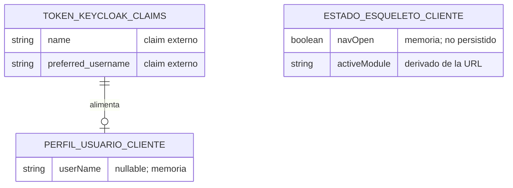
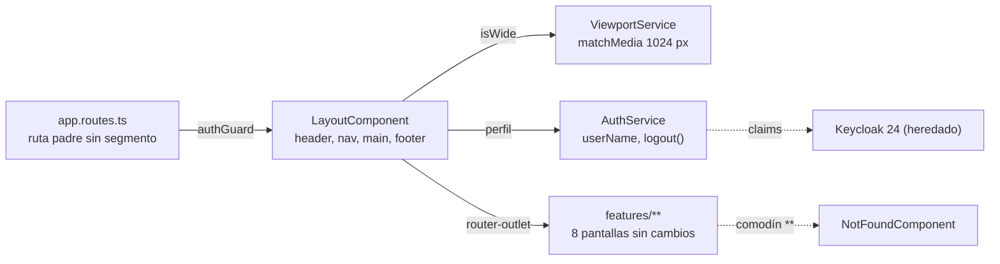
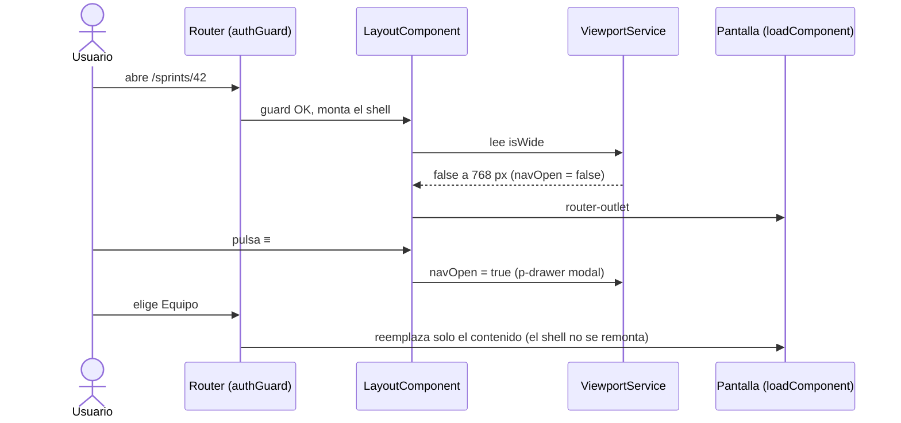
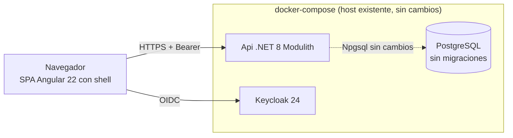

# TECH-DESIGN: Refactorización de Esqueleto UI — Layout de Aplicación y Tipografía Global (HU-035)

- **Fecha de Compilación:** 05-10-2026
- **Auditor y Consolidador:** Agente QT Senior BMAD
- **Fuente SDD:** `specs/035-HU_refactorizacion_esqueleto_ui/spec.md`, `plan.md`, `tasks.md`, `data-model.md` y `contracts/ui-shell-contract.md` (GitHub Spec Kit)
- **Modo de gobernanza:** Brownfield (`.specify/memory/constitution.md` prevalece)
- **Estado:** ✅ AUDITADO Y APROBADO (Auditoría Adversarial Exitosa: 0 hallazgos críticos, 8 advertencias vinculantes en la sección 7.4)

**Resultado de la auditoría adversarial (6 ejes):**

| Eje | Resultado |
|---|---|
| 1. DB vs API vs Spec Kit | ✅ La HU es solo frontend (FR-012): `db_035` dictamina cero cambios de persistencia y no existe `api_035` (no hay endpoints; `contracts/ui-shell-contract.md` es un contrato de rutas de UI). FR-001..FR-015 y SC-001..SC-008 de `spec.md` tienen tarea en `tasks.md` (T001–T032): FR-001..005 → T010–T017; FR-006 → T018–T021; FR-007 → T022–T024; FR-008/009 → T025–T027; FR-010/011 → T015, T026, T030, T032; FR-012 → T030; FR-013 → T028; FR-014 → T029; FR-015 → T016 (ruta padre). Verificado contra el código: `app.routes.ts` actual declara `canActivate: [authGuard]` por ruta y `**` redirige a `backlog/nuevo` (lo que FR-005 prohíbe y T016 reemplaza); `grep` de `font-family`, `::ng-deep`, `!important` y `ed-grid` en `app/frontend/src` da 0 coincidencias (línea base limpia para SC-006); `styles.css` solo importa Tailwind, `tailwindcss-primeui` y PrimeIcons. |
| 2. UI → Data | ✅ Los 9 estados de `ux_035` no muestran ningún dato persistible: textos (`LAYOUT_TEXTS`), nombre de perfil (claims del token en memoria), entradas de navegación (`NAV_ITEMS`) y estado `navOpen`/`isWide`/`activeModule` efímero. Cero campos huérfanos. |
| 3. Mentiras en ADR | 🟡 ADR-001/002 son `Aceptado (heredado)` sin alternativas inventadas. ADR-003..007 y 009 traen alternativas viables y trade-offs reales (riesgo de regresión de rutas, dos caminos de render, umbral de 1024 px vs 768 px, `logout` como capacidad nueva, deuda i18n). Alternativas débiles puntuales en ADR-008 y ADR-010: ver 7.4 (A-01, A-02). |
| 4. Lex Superior / Sycophancy | ✅ Ninguna tecnología ajena a la constitución (cero paquetes nuevos). La resolución humana "Opción B" es una regla de comportamiento de UI que no contradice la constitución. Tensión: Tailwind de tamaño (`max-w-7xl`, `w-64`, `min-h-screen`) frente a "solo grid, espaciado y flex"; proviene del mandato RT-02 de la HU (no del tracker), está acotada al contenedor del shell y se regulariza con una enmienda mínima (sección 7.4, A-03). |
| 5. Proporcionalidad | ✅ Un shell, un servicio de viewport, una página de ruta inexistente, una ampliación aditiva de `AuthService` y reglas de lint; sin backend, red, caché ni librerías nuevas. Rechazar `@angular/localize` en esta HU evita sobre-ingeniería (deuda registrada). |
| 6. Severidad | 🔴 0 · 🟡 8 (sección 7.4) · 🟢 3 |

---

## 1. Architecture Overview
Se crea el **shell de la aplicación** en `app/frontend/src/app/core/layout/`: `LayoutComponent` (standalone, `OnPush`, signals) con barra superior (`p-menubar`, perfil y acción "Cerrar sesión" a la derecha), navegación lateral colapsable (`p-menu` acoplado en `<aside>` desde 1024 px o dentro de `p-drawer` modal por debajo), área de contenido `max-w-7xl mx-auto p-6` y pie de página. Se monta como **ruta padre sin segmento de URL** con `canActivateChild: [authGuard]`; las rutas actuales pasan a hijas con los mismos `path`, `data`, `providers` y `loadComponent`, y el comodín `**` muestra `NotFoundComponent` dentro del shell en vez de redirigir. La tipografía y el margen del `body` se fijan en **una única regla** de `styles.css`, protegida por compuertas nuevas en `lint:primeng`.

Patrón principal: contenedor de presentación sin red. Estado efímero de cliente (`navOpen`, `activeModule`, `isWide`, `userName`), sin `localStorage` (Opción B). Backend, base de datos, API y `features/**` no cambian. Convive con HU-001 (Backlog), HU-003/004 (Sprints) y HU-012/015 (Equipo) sin alterar su contenido interno.

**Afirmaciones verificadas contra el código:** `app.routes.ts` coincide con la descripción de `plan.md` (3 módulos con `authGuard` individual, redirecciones `''` y `**` a `backlog/nuevo`); `tasks.md` T016 conserva primero la redirección de `''` y retira los `canActivate` individuales a favor de `canActivateChild`; el frontend no tiene infraestructura i18n (deuda reconocida por el SA).

---

## 2. Components

| Componente | Ruta física | Responsabilidad | Tareas |
|---|---|---|---|
| Textos del shell | `app/frontend/src/app/core/layout/layout.texts.ts` | `LAYOUT_TEXTS` tipado: app, entradas, `aria-label`, perfil, `Cerrar sesión`, pie, ruta inexistente | T003 |
| Modelo de navegación | `app/frontend/src/app/core/layout/layout-nav.ts` | `NAV_ITEMS` (3 entradas: `/backlog/nuevo`, `/sprints`, `/equipos`) y `resolveActiveModule(url)` | T004, T006 |
| Servicio de viewport | `app/frontend/src/app/core/layout/viewport.service.ts` | `isWide` (`matchMedia('(min-width: 1024px)')`) como signal, fallback `true`, limpieza con `DestroyRef` | T005, T007 |
| Shell | `app/frontend/src/app/core/layout/layout.component.{ts,html}` | Cuatro zonas, `navOpen`, `toggleNav()`, `closeNav()`, `p-drawer` / `aside`, contenedor de contenido | T011, T014, T015, T018–T020, T022–T023 |
| Ruta inexistente | `app/frontend/src/app/core/layout/not-found/` | `p-message` informativo sin acciones | T010, T013 |
| Rutas | `app/frontend/src/app/app.routes.ts` y `app.routes.spec.ts` | Ruta padre con `canActivateChild`, hijas originales, `**` | T012, T016 |
| Autenticación (aditivo) | `app/frontend/src/app/core/auth/auth.service.{ts,spec.ts}` | `userName` (`name` ⇒ `preferred_username` ⇒ `null`) y `logout()` | T008, T009 |
| Tipografía global | `app/frontend/src/styles.css` | `body { margin: 0; font-family: var(--font-sans); }` única | T025 |
| Compuertas de lint | `app/frontend/scripts/lint-primeng.mjs` | Reglas globales: una sola `font-family`/margen de `body`, sin `::ng-deep`/`!important`/`ed-grid`/`primeng/dropdown`/`primeng/calendar` | T026, T027 |
| Evidencia | `specs/035-HU_refactorizacion_esqueleto_ui/evidence/` | 6 capturas `{modulo}-{ancho}.png` | T029 |

**Restricción de alcance (T030):** no se tocan `app/backend/**`, `app/frontend/src/app/features/**` ni `app/template-primeng/**`; tampoco `auth.guard.ts`, `bearer-token.interceptor.ts`, `auth.config.ts` ni `app.config.ts`.

---

## 3. Data Model
*(Contenido íntegro de `db_035_refactorizacion_esqueleto_ui.md`: dictamen, MER y diccionario de datos con la validación de no-orfandad. Los ADR del DA se consolidan en 7.2.)*

> **Dictamen de alcance:** esta historia es **exclusivamente de frontend** y **no introduce, modifica ni elimina ninguna tabla, columna, índice, FK, schema ni migración**. `spec.md` FR-012 prohíbe cambios en reglas de negocio, API y contratos de datos; `data-model.md` confirma que todo el estado es efímero y en memoria; ninguna tarea de `tasks.md` (T001–T032) toca `app/backend/**`, y T030 lo verifica con `git diff --stat`.

### 2. MODELO ENTIDAD-RELACIÓN (MER)

Sin entidades persistentes nuevas. El diagrama muestra únicamente los orígenes de datos **externos y efímeros** que consume el esqueleto; ninguno es una tabla de la aplicación.



### 3. DICCIONARIO DE DATOS Y RESTRICCIONES

**Sin tablas nuevas ni modificadas.** Auditoría de trazabilidad UI/Spec Kit → Data (cero campos huérfanos):

| Elemento UI / contrato (origen) | Dato | ¿Requiere columna? | Fuente real |
|---|---|---|---|
| Barra superior: nombre de la app, textos, pie | Constantes `LAYOUT_TEXTS` | No | Código (`layout.texts.ts`) |
| Barra superior: perfil de usuario (FR-002) | `userName` | No | Claims del token Keycloak, en memoria |
| Acción "Cerrar sesión" | `AuthService.logout()` | No | Keycloak (redirección) |
| Navegación lateral: 3 entradas (FR-003) | `NAV_ITEMS` | No | Código (`layout-nav.ts`) |
| Entrada activa por URL | `activeModule` | No | `Router` (primer segmento de URL) |
| Colapso/apertura manual | `navOpen` | No | Señal en memoria (Opción B, sin persistencia) |
| Ancho de ventana (FR-006) | `isWide` | No | `matchMedia('(min-width: 1024px)')` |
| Ruta inexistente | Mensaje informativo | No | Código (`LAYOUT_TEXTS`) |
| Contenedor `max-w-7xl mx-auto p-6` y tipografía (FR-007/008) | Estilos | No | Clases Tailwind / `styles.css` |
| Evidencia de cierre: 6 capturas (FR-014) | Archivos `evidence/*.png` | No | Sistema de archivos del repositorio |

**Tablas heredadas sin modificar:** `backlog."BacklogItems"`, `sprints."Sprints"`, `sprints."SprintItems"` y las tablas de `application`/`teams`. Ninguna se altera.

### 4. RIESGOS DE INTEGRIDAD Y ESCALABILIDAD
- `⚠️ RIESGO:` Deriva de alcance: si durante la implementación se añadiera `localStorage`, una tabla de preferencias o un endpoint de perfil, se violarían FR-012 y la Opción B. Mitigación: T032 revisa `core/layout/` y T030 verifica que `app/backend/**` no cambie.
- `⚠️ RIESGO:` El nombre de perfil depende de que Keycloak emita `name` o `preferred_username`; si faltan ambos, la UI usa `LAYOUT_TEXTS.profileFallback`. Riesgo de presentación, no de integridad.
- Sin riesgos de concurrencia, volumen ni límites del motor: no hay lecturas ni escrituras nuevas contra PostgreSQL.

**Validación de no-orfandad (QT):** los 9 estados de `ux_035` y las 4 zonas de `spec.md` se cruzaron contra este diccionario; ningún elemento visual queda sin fuente.

---

## 4. Integrations
*(No existe `api_035_*.md`: la HU no define endpoints ni payloads. El DA y el SA dictaminan solo frontend; el QT lo confirma contra `spec.md` FR-012 y `tasks.md`.)*

**Contrato HTTP:** sin cambios. El shell no realiza llamadas de red; el interceptor Bearer, el `authGuard` y la renovación `401 ⇒ reauthenticate` conservan su comportamiento.

**Contrato de rutas de UI (`contracts/ui-shell-contract.md`) — convivencia con el sistema preexistente:**

| URL existente | Pantalla (sin cambios) | Entrada activa | Dentro del shell |
|---|---|---|---|
| `''` | Redirige a `/backlog/nuevo` (fuera del shell, declarada primero) | — | — |
| `/backlog/nuevo` | Registro de Elemento de Backlog | Backlog | Sí |
| `/sprints` | Listado de Sprints | Sprints | Sí |
| `/sprints/nuevo` | Formulario de Sprint | Sprints | Sí |
| `/sprints/:id/elementos` | Elementos asignados (declarada antes de `:id`) | Sprints | Sí |
| `/sprints/:id` | Detalle de Sprint | Sprints | Sí |
| `/equipos` | Página Equipo, pestaña Miembros (`data.tab`) | Equipo | Sí |
| `/equipos/roles` | Pestaña Roles | Equipo | Sí |
| `/equipos/responsables` | Pestaña Responsables, vista Por elemento | Equipo | Sí |
| `/equipos/responsables/miembro` | Pestaña Responsables, vista Por miembro | Equipo | Sí |
| `/zzz` (cualquier otra) | `NotFoundComponent` (URL sin reescribir) | Ninguna | Sí |

**Integración con autenticación existente:** `AuthService` se amplía de forma aditiva (`userName`, `logout()`); `isAuthenticated`, `token`, `login`, `reauthenticate` y `refreshToken` no cambian. `logout` usa `keycloak.logout({ redirectUri: window.location.origin })`.

---

## 5. DIAGRAMAS DE ARQUITECTURA (Componentes, Secuencia, Despliegue)

Skill `archify` disponible (Node.js v26): se aplica el **Escenario A (Modo Dual Enriquecido)**; los tres diagramas pasaron `deliver --quality showcase` (9/9 checks). Las especificaciones y los HTML residen en `documents/qa-tech/diagrams/`.

### 5.1. Componentes del esqueleto UI (`component`)
- 🌐 **Visor Interactivo HTML:** [`diagrams/hu035_componentes.html`](diagrams/hu035_componentes.html)
- 📄 **Especificación Fuente JSON:** [`diagrams/hu035_componentes.component.json`](diagrams/hu035_componentes.component.json)
- **Estado de Validación:** ✅ *Showcase Pass (9/9 checks)*



### 5.2. Secuencia de carga y navegación (`sequence`)
- 🌐 **Visor Interactivo HTML:** [`diagrams/hu035_secuencia_navegacion.html`](diagrams/hu035_secuencia_navegacion.html)
- 📄 **Especificación Fuente JSON:** [`diagrams/hu035_secuencia_navegacion.sequence.json`](diagrams/hu035_secuencia_navegacion.sequence.json)
- **Estado de Validación:** ✅ *Showcase Pass (9/9 checks)*



### 5.3. Despliegue sobre el sistema existente (`component`)
- 🌐 **Visor Interactivo HTML:** [`diagrams/hu035_despliegue.html`](diagrams/hu035_despliegue.html)
- 📄 **Especificación Fuente JSON:** [`diagrams/hu035_despliegue.component.json`](diagrams/hu035_despliegue.component.json)
- **Estado de Validación:** ✅ *Showcase Pass (9/9 checks)*



---

## 6. Technology Stack
- **Runtime / Framework:** Angular 22.2 Zoneless con Signals, TypeScript ~6.0 (heredado).
- **UI:** PrimeNG ^22.1.2 con tema Aura (`p-menubar`, `p-menu`, `p-drawer`, `p-message`, `p-button`); Tailwind CSS v4 + `tailwindcss-primeui`; PrimeIcons. Sin PrimeFlex.
- **Autenticación:** `keycloak-js` ^26.2.4 contra Keycloak 24 (heredado).
- **Persistencia:** No aplica (PostgreSQL sin cambios).
- **Pruebas y calidad:** Jest 30 + `jest-preset-angular` (zoneless), `RouterTestingHarness`; `npm run lint:primeng`, `npm run build`, `npm test`.
- **Dependencias nuevas:** ninguna (sin `@angular/cdk`, sin `@angular/localize`).

---

## 7. Architecture Decisions (ADRs - Matriz Consolidada MADR)

| ID | Título de la Decisión | Área | Estado | Trade-off / Costo Admitido |
|:---:|---|:---:|:---:|---|
| **ADR-001** | Frontend Angular 22 Zoneless con Signals | Arquitectura (SA) | Aceptado (heredado) | Todo cambio asíncrono debe escribirse en un signal |
| **ADR-002** | PrimeNG 22 neutral + Tailwind v4 acotado (Skeleton vs. Theme) | Arquitectura (SA) | Aceptado (heredado) | Utilidades de tamaño (`max-w-7xl`, `w-64`) más allá de grid/flex/espaciado |
| **ADR-003** | Shell como ruta padre sin segmento de URL | Arquitectura (SA) | Aceptado | Riesgo de regresión de rutas al editar `app.routes.ts` |
| **ADR-004** | Navegación dual: `p-menu` acoplado (≥ 1024 px) y `p-drawer` (< 1024 px) | Arquitectura (SA) | Aceptado | Dos caminos de render; `≡` no cierra la capa por la máscara modal |
| **ADR-005** | Estado de navegación en memoria; umbral de 1024 px | Arquitectura (SA) | Aceptado | Entre 768 y 1023 px también arranca colapsada |
| **ADR-006** | Tipografía y margen de `body` en una única regla de `styles.css` | Arquitectura (SA) | Aceptado | Regla posiblemente redundante con el preflight de Tailwind |
| **ADR-007** | Perfil y acción de usuario con ampliación aditiva de `AuthService` | Arquitectura (SA) | Aceptado | `logout` es capacidad de producto nueva, pendiente de confirmar |
| **ADR-008** | Ruta comodín dentro del shell con mensaje informativo | Arquitectura (SA) | Aceptado | Cambia el comportamiento de URL desconocidas (antes redirigían) |
| **ADR-009** | Textos del shell centralizados, sin librería i18n nueva | Arquitectura (SA) | Aceptado | i18n global sigue pendiente (deuda de plataforma) |
| **ADR-010** | Compuertas automáticas en `lint:primeng` | Calidad (SA) | Aceptado | Falsos positivos posibles por regex |
| **ADR-DA-01** | Sin cambios de persistencia | Datos (DA) | Aceptado (heredado) | Una futura preferencia persistente reabre la decisión |
| **ADR-DA-02** | Estado de navegación y perfil solo en memoria del cliente | Datos (DA) | Aceptado (heredado) | La preferencia manual se pierde al recargar |

*(No existen ADR del API Architect: la HU no tiene capa de API.)*

### 7.1. ADRs del Solutions Architect (resumen fiel de `documents/solutions-architect/035-HU_refactorizacion_esqueleto_ui.md`)

#### ADR-001: Frontend Angular 22 Zoneless con Signals
- **Estado:** Aceptado (heredado)
- **Contexto:** Constitución §1, Stack Frontend.
- **Decisión:** El shell usa componentes standalone, signals y `provideZonelessChangeDetection` ya configurado; sin `zone.js`.
- **Alternativas Evaluadas:** Ninguna (decisión impuesta por la constitución, sin alternativas inventadas).
- **Consecuencias (Beneficios y Costos Reales):** ✅ Estado del shell trivial de probar. ⚠️ Todo cambio asíncrono (`matchMedia`, `NavigationEnd`) debe escribirse en un signal.

#### ADR-002: PrimeNG 22 con tema neutral + Tailwind v4 acotado
- **Estado:** Aceptado (heredado)
- **Contexto:** Constitución §1, "Directiva Estricta de Maquetación" y "Patrón de Formularios".
- **Decisión:** `p-menubar` para la barra superior y utilidades Tailwind para la disposición; sin CSS propio de color, borde, sombra ni tipografía.
- **Alternativas Evaluadas:** Ninguna (heredado).
- **Consecuencias (Beneficios y Costos Reales):** ✅ Look and feel 100 % del tema. ⚠️ RT-02 exige `max-w-7xl` y `p-6` (tamaño/espaciado, no solo grid/flex); se acotan al contenedor del shell y se reducen al mínimo (`min-h-screen`, `flex-1`, `w-64`, `min-w-0`).

#### ADR-003: Shell como ruta padre sin segmento de URL
- **Estado:** Aceptado
- **Contexto:** FR-001 exige el esqueleto en todas las rutas existentes; FR-004, que las URL no cambien.
- **Decisión:** `{ path: '', canActivateChild: [authGuard], loadComponent: LayoutComponent, children: [...] }` con las rutas actuales como hijas (mismos `path`, `data`, `providers`, `loadComponent`); `''` redirige fuera del shell, declarada primero.
- **Alternativas Evaluadas:** (A) layout dentro de `AppComponent`: descartada porque se pintaría antes del guard y para usuarios sin sesión. (B) cada pantalla importa el layout: descartada porque toca las 8 pantallas, viola FR-004/FR-012 y contradice FR-015.
- **Consecuencias (Beneficios y Costos Reales):** ✅ Un solo punto de montaje; las pantallas futuras nacen dentro del shell; el shell no se remonta y conserva `navOpen`. ⚠️ Riesgo de regresión de rutas, mitigado por `app.routes.spec.ts`.

#### ADR-004: Navegación lateral dual `p-menu` acoplado y `p-drawer`
- **Estado:** Aceptado
- **Contexto:** RT-01 deja a Arquitectura fijar el componente; el UX exige modo acoplado en ancho amplio, capa a 768 px, control externo `≡` y exactamente tres entradas.
- **Decisión:** Un único `NAV_ITEMS: MenuItem[]` renderizado por `p-menu` en `<aside w-64>` (si `navOpen()` y `isWide()`) o dentro de `<p-drawer position="left" [modal]="true" [(visible)]="navOpen">` (si no `isWide()`).
- **Alternativas Evaluadas:** (A) solo `p-drawer`: exige CSS propio de márgenes para acoplarlo. (B) `<aside>` único con `hidden`/`md:block`: reimplementa capa, máscara, Escape y trampa de foco.
- **Consecuencias (Beneficios y Costos Reales):** ✅ Cero CSS propio; accesibilidad delegada a PrimeNG. ⚠️ Dos caminos de render; el control `≡` no cierra la capa modal (desviación del UX Estado 5, no afecta FR-006). Verificaciones obligatorias del desarrollador contra `primeng@22.1.2`: marcado de entrada activa en `p-menu` y manejo de foco de `p-drawer`.

#### ADR-005: Estado de navegación solo en memoria; umbral de 1024 px
- **Estado:** Aceptado (aplica la resolución humana, Opción B)
- **Contexto:** Expandida en anchos amplios, colapsada a 768 px, cambio manual solo durante la sesión.
- **Decisión:** `(min-width: 1024px)`; al cruzar el umbral `navOpen` se reinicia a `isWide`. Sin `localStorage`.
- **Alternativas Evaluadas:** (A) umbral `md` 768 px: `min-width: 768px` es verdadero en 768 px y la navegación arrancaría expandida. (B) `localStorage`: rechazada por el humano.
- **Consecuencias (Beneficios y Costos Reales):** ✅ Capturas deterministas. ⚠️ Entre 768 y 1023 px también arranca colapsada; es un solo valor en `ViewportService`.

#### ADR-006: Tipografía y margen del body en una única regla de `styles.css`
- **Estado:** Aceptado
- **Contexto:** FR-008/FR-009/SC-006.
- **Decisión:** `body { margin: 0; font-family: var(--font-sans); }` sin capa, única en `src/`.
- **Alternativas Evaluadas:** (A) dentro de `@layer base`: depende del orden de capas fijado por `providePrimeNG`. (B) preset de PrimeNG o `index.html`: duplicaría la declaración.
- **Consecuencias (Beneficios y Costos Reales):** ✅ Auditable por `grep`, sin descarga de fuentes. ⚠️ Puede ser redundante con el preflight de Tailwind; el desarrollador verifica herencia en barra, navegación, contenido, pie, `p-dialog` y `p-message`.

#### ADR-007: Perfil y acción de usuario con ampliación aditiva de `AuthService`
- **Estado:** Aceptado
- **Contexto:** FR-002; hoy `AuthService` no expone nombre ni cierre de sesión.
- **Decisión:** `userName` (signal) desde `keycloak.tokenParsed` (`name` ⇒ `preferred_username` ⇒ `null`) y `logout()`; la barra muestra el nombre y un `p-menu` emergente con "Cerrar sesión".
- **Alternativas Evaluadas:** (A) solo icono de perfil: incumple "perfil y acciones". (B) leer Keycloak desde el layout: rompe el aislamiento de `core/auth`.
- **Consecuencias (Beneficios y Costos Reales):** ✅ Cambio aditivo. ⚠️ `logout` es capacidad nueva de producto; punto abierto para el humano.

#### ADR-008: Ruta comodín dentro del shell con mensaje informativo
- **Estado:** Aceptado
- **Contexto:** FR-005; hoy `**` redirige a `backlog/nuevo`.
- **Decisión:** `{ path: '**', loadComponent: NotFoundComponent }` como última hija del shell con un `p-message` informativo sin acciones; la URL no se reescribe.
- **Alternativas Evaluadas:** (A) mantener la redirección: incumple FR-005. (B) centro vacío: ambiguo y no verificable.
- **Consecuencias (Beneficios y Costos Reales):** ✅ FR-005 verificable con prueba de ruta. ⚠️ Cambia el comportamiento de URL desconocidas; el diseño final de la página de error sigue "No documentado".

#### ADR-009: Textos del shell centralizados, sin librería i18n nueva
- **Estado:** Aceptado
- **Contexto:** La constitución pide i18n desde el inicio; el frontend no tiene infraestructura i18n.
- **Decisión:** `LAYOUT_TEXTS` tipado en `layout.texts.ts`.
- **Alternativas Evaluadas:** (A) atributos `i18n` de Angular: exige `@angular/localize` para toda la app. (B) literales en plantillas: dispersa los textos.
- **Consecuencias (Beneficios y Costos Reales):** ✅ Un solo archivo a migrar. ⚠️ i18n global sigue pendiente (deuda de plataforma).

#### ADR-010: Compuertas automáticas en `lint:primeng`
- **Estado:** Aceptado
- **Contexto:** CA-06.1 y RT-05..RT-07 se verificaban por búsqueda manual.
- **Decisión:** Reglas globales que fallan si hay más o menos de una `font-family` (excluyendo `*.spec.ts`), más de una regla de margen de `body`, `::ng-deep`, `!important`, `ed-grid`, `primeng/dropdown` o `primeng/calendar`.
- **Alternativas Evaluadas:** (A) verificación manual en revisión. (B) prueba Jest que lea el sistema de archivos: mezcla política con comportamiento.
- **Consecuencias (Beneficios y Costos Reales):** ✅ CB-04 reproducible en CI. ⚠️ Falsos positivos por regex (p. ej. `font-family` en comentarios).

### 7.2. ADRs del Data Architect (texto íntegro de `db_035_refactorizacion_esqueleto_ui.md`)

#### ADR-DA-01: Sin cambios de persistencia (motor, schemas y migraciones intactos)
- **Estado:** Aceptado (heredado)
- **Contexto:** La Constitución (§3) fija PostgreSQL/Npgsql con EF Core Code-First, un `DbContext` y un schema por módulo. La HU 035 solo reorganiza el esqueleto visual y no declara entidades de negocio ni datos persistentes.
- **Decisión:** No se crea ninguna tabla ni migración; los schemas `backlog`, `sprints`, `application` y los demás permanecen sin modificar.
- **Alternativas Evaluadas:** Ninguna (decisión impuesta por FR-012 y la constitución).
- **Consecuencias (Beneficios y Costos Reales):** ✅ Cero riesgo de regresión de datos; sin migraciones que coordinar. ⚠️ Si una HU derivada pidiera recordar la preferencia de navegación entre recargas, habría que reabrir la decisión.

#### ADR-DA-02: Estado de navegación y perfil de usuario solo en memoria del cliente
- **Estado:** Aceptado (heredado)
- **Contexto:** La resolución humana (Opción B) fija que la elección manual no se guarda tras recargar; el nombre de perfil proviene del token de Keycloak, no de la base de datos.
- **Decisión:** `navOpen`, `activeModule`, `userName` e `isWide` son señales en memoria; no existe tabla de preferencias ni caché persistente de perfil.
- **Alternativas Evaluadas:** Persistir en `localStorage` o en una tabla de preferencias: rechazada por el humano (Opción B).
- **Consecuencias (Beneficios y Costos Reales):** ✅ Sin datos personales nuevos almacenados. ⚠️ La preferencia manual se pierde al recargar; una futura persistencia requeriría tabla y contrato de API nuevos.

### 7.3. ADRs del API Architect
No aplica: la HU no define endpoints (FR-012). El DA dictaminó omitir la capa de API.

### 7.4. Advertencias Vinculantes para Fase D (Deuda Técnica)

| # | Nivel | Hallazgo | Obligación para Fase D |
|:---:|:---:|---|---|
| A-01 | 🟡 | ADR-008: la Alternativa A contradice FR-005 y la B es "no hacer nada"; no hay alternativa viable real documentada (p. ej. ruta `/404` fuera del shell). La decisión sigue siendo correcta porque FR-005 la impone. | Sin acción de código; el SA debe documentar una alternativa viable si el negocio redefine la página de error. |
| A-02 | 🟡 | ADR-010: la Alternativa A es "no hacer nada" (verificación manual); solo B es real. | Sin acción de código. |
| A-03 | 🟡 | ADR-002: `max-w-7xl`, `w-64`, `min-h-screen`, `flex-1` y `min-w-0` exceden "solo grid, espaciado y flex" sin Cláusula de Excepción. Origen: RT-02 de la HU, no el tracker. | Confinar esas utilidades a `LayoutComponent`; el QT las regulariza con una enmienda mínima en `constitution.md` (ver sección 8). |
| A-04 | 🟡 | ADR-009 difiere el i18n nativo que exige la constitución (frontend sin infraestructura i18n). | Todo texto desde `LAYOUT_TEXTS`; abrir una HU de plataforma para i18n. |
| A-05 | 🟡 | ADR-004: `≡` no cierra la capa modal (el UX Estado 5 lo dibujaba como cierre). No afecta FR-006. | Verificar contra `primeng@22.1.2` el marcado de entrada activa de `p-menu` y el foco de `p-drawer` (T002, T018, T020); si PrimeNG no lo ofrece, devolver el turno al SA y no escribir CSS propio. |
| A-06 | 🟡 | ADR-007: `logout` es una capacidad nueva; el umbral de 1024 px (ADR-005) no tiene valor numérico en la HU. | Pendientes de confirmación humana; ambos se revierten sin rediseño (quitar la acción / cambiar un valor en `ViewportService`). |
| A-07 | 🟡 | ADR-006/ADR-010: la regla de `body` puede ser redundante con el preflight; el lint por regex puede dar falsos positivos. | No escribir `font-family` en comentarios; comprobar en navegador que `p-dialog` y `p-message` heredan la fuente y reportar si no. |
| A-08 | 🟡 | Evidencia y calidad: T029 (6 capturas) y T031 (quickstart manual) dependen de la ejecución real de la app; las pantallas de Equipo ya traen título y migas propios (HU derivada). | Sin las 6 capturas y las tres verificaciones en verde la HU no pasa a ACTIVE (FR-014, FR-013). Si una pantalla de `features/**` declara su propio ancho, reportarlo; no editarla. |
| S-01 | 🟢 | ADR-003 dice `component: LayoutComponent`; `tasks.md` T016 usa `loadComponent` (prevalece `tasks.md`). | — |
| S-02 | 🟢 | La constitución cita PrimeNG v22.1.1; el proyecto usa ^22.1.2. | Actualizar la versión en la próxima enmienda. |
| S-03 | 🟢 | `spec.md` declara `Feature Branch: main`; la rama real es `feat/035-HU_refactorizacion_esqueleto_ui`. | Informativo. |

---

## 8. ORDEN DE DELEGACIÓN PARA EL TRACKER

El dictamen es `AUDITADO Y APROBADO` y `specs/README.md` pasa la HU-035 a `READY-FOR-DEV`. La HU es **estrictamente visual / solo frontend** (sin backend, API ni base de datos), por lo que se despacha directamente a la Fase D únicamente al desarrollador frontend, sin invocar a `@SPEC-KIT:` ni al `@HUMANO:`:

```markdown
@DEV-FRONT: La arquitectura técnica ha sido validada. Inicia la implementación del Frontend.
```

**Gestión de la constitución (destilación de contexto):** se inyecta en `constitution.md` una subsección mínima "Shell de aplicación (HU-035)" con las invariantes estructurales nuevas (ruta padre con `canActivateChild`, una sola declaración de `font-family`/margen de `body`, utilidades Tailwind de tamaño acotadas al shell). No se sobrescribe ningún contenido fundacional.
