# 🏗️ Reporte de Impacto y Code Review Vivo (`impact-analysis-report.md`)

**HU vigente:** 035-HU_refactorizacion_esqueleto_ui · **Rama:** `feat/035-HU_refactorizacion_esqueleto_ui`
**Fecha:** 05-10-2026 · **Dictamen (1.ª revisión de código HU-035):** ✅ **[APROBADO]** con deuda aceptada por el humano (05-10-2026): capturas restantes de T029, T021 y T031 exentas; código y suites conformes.
**HUs anteriores:** 015 ([APROBADO] con reservas), 012, 004, 003, 002 y 001; sus secciones se conservan abajo como histórico.

> Renderizado selectivo: solo se documenta lo alterado por la HU-035 (solo frontend, FR-012): `core/layout/*` (nuevo), `app.routes.ts`, `core/auth/auth.service.ts` (aditivo), `styles.css`, `scripts/lint-primeng.mjs`. `app/backend`, `features/**`, `app/template-primeng`: *Sin impacto en este PR/HU* (`git diff --stat` vacío).
---

## 1. AI Code Review Dashboard

### 1.00000 HU-035 — Refactorización del esqueleto UI (vigente)

```text
┌──────────────── CODE REVIEW HU-035 · [APROBADO c/ deuda] ─────────────────┐
│ Archivos analizados (lectura física)     : 9 prod .ts/.html/.css + 7 specs │
│ Violaciones arquitectónicas              : 0                              │
│ Problemas de seguridad/calidad           : 0 bloqueantes · 2 reservas     │
│ Deuda técnica                            : baja (i18n global pendiente)   │
│ Cobertura de tests faltante              : 0 en jsdom; 6 capturas y       │
│                                            medidas reales (1280 px) sin   │
│                                            evidencia                      │
└───────────────────────────────────────────────────────────────────────────┘
```

| Regla | Resultado |
|---|---|
| Standalone + OnPush + `@if`; sin NgModule ni zone.js | ✅ |
| Signals (`toSignal`, `computed`, `linkedSignal`); cero `.subscribe` manual | ✅ |
| XSS: sin `innerHTML` ni `bypassSecurityTrust*`; textos desde `LAYOUT_TEXTS` | ✅ |
| Seguridad: shell bajo `canActivateChild: [authGuard]`; `**` dentro del shell, sin redirección; sin credenciales ni `localStorage` | ✅ |
| Backend/BD/IDOR/CancellationToken/N+1: no aplica (FR-012, `git diff --stat` de `app/backend` vacío) | ✅ |
| Constitución (Shell de Aplicación): una sola `font-family` (`styles.css:7`), sin `::ng-deep`/`!important`/`ed-grid`, Tailwind de tamaño solo en `LayoutComponent` | ✅ |
| Jest ejecutado por Code Review: 23 suites, 212/212 | ✅ |
| `npm run lint:primeng` ejecutado por Code Review | ✅ sin violaciones |
| QA: suites no tautológicas (`layout.qa.spec.ts`, `hu035-contrato-estilos.qa.spec.ts`) | ✅ |
| FR-014/SC-008: 6 capturas en `specs/035-.../evidence/` | ❌ T029 sin ejecutar |

#### Hallazgos (exentos por decisión humana; deuda registrada)
1. `[CAPA:TASKS]` T029 (6 capturas), T021 (verificación manual 768/1920 px y diálogos) y T031 (quickstart §4) sin ejecutar en `tasks.md`; son criterio de aceptación (FR-014, SC-008) y la HU no puede pasar a ACTIVE sin ellos. T001 sin marcar (línea base; cubierta por T028).

#### Reservas (CORREGIDAS en esta HU por decisión humana, 05-10-2026)
1. `[CAPA:CODE]` `auth.service.ts` (`init`): `??` cambiado por `||`; pruebas añadidas (name vacío con y sin `preferred_username`).
2. `[CAPA:CODE]` `layout.component.ts`: `logout()` captura el rechazo y muestra `p-message` de error (`LAYOUT_TEXTS.logoutError`); prueba añadida. Jest 215/215, `lint:primeng` y `ng build` OK.

#### Hallazgo de entorno (sin cambio de código)
El `ng serve` en ejecución (iniciado 01:23) sirve rutas y estilos anteriores a la HU (sin `LayoutComponent` ni `--font-sans`): por eso la captura `backlog-1920.png` no muestra esqueleto y usa fuente serif. Un `ng build` limpio sí contiene el shell y `--font-sans`. Reiniciar `ng serve` y repetir las capturas.

### 1.0000 HU-015 — Relación personas, roles y elementos (histórico)

```text
┌──────────────── CODE REVIEW HU-015 · [APROBADO] ──────────────────────────┐
│ Archivos analizados (lectura física)     : 36 (.cs prod 25 + .ts/.html 11)│
│ Violaciones arquitectónicas              : 0                              │
│ Problemas de seguridad/calidad           : 0 bloqueantes · 3 reservas     │
│ Deuda técnica                            : baja (ver reservas)            │
│ Cobertura de tests faltante              : 0 (QA 100 % de CA; build OK)   │
└───────────────────────────────────────────────────────────────────────────┘
```

| Regla | Resultado |
|---|---|
| Carter `ICarterModule` + `.RequireAuthorization()` (3 endpoints Teams + 1 Backlog) | ✅ |
| Lógica en handlers MediatR; endpoints solo despachan | ✅ |
| `CancellationToken` propagado a EF/`ExistsAsync`/`GetItemsAsync` | ✅ |
| N+1: `GetItemsAsync` en lote; el `foreach` de `ListMemberItemsQueryHandler` solo lee un diccionario en memoria | ✅ |
| Cruce de schemas: Teams no consulta `backlog`; usa `IBacklogItemLookup` (ADR-002/003); sin FK a `backlog`, FK local a `teams.TeamMembers` | ✅ |
| IDOR: el recurso es compartido por el equipo (sin propietario por spec); la acción exige identidad (`ICurrentUser`) y el rol sale de BD, no del request | ✅ |
| Mass assignment: el body solo admite `memberId`; rol nunca viaja | ✅ |
| Angular: standalone, OnPush, Signals; sin `innerHTML`/`bypassSecurityTrust*`/NgModule/zone.js | ✅ |
| Build `ng build` ejecutado por Code Review (T062) | ✅ OK |

#### Reservas (no bloqueantes)
1. `[CAPA:SPEC]` `spec.md` (Edge Case y FR-015) aún dice "no documentado" para la asignación duplicada; vinculante el 200 idempotente (ADR-004). Pendiente del analista de negocio.
2. `[CAPA:CODE]` `assign-assignee-dialog.component.ts:136` conserva un `.subscribe` manual (patrón `exhaustMap` + `takeUntilDestroyed`, mismo precedente aprobado en HU-012); sin fuga. Migrar a `rxResource`/signal en una HU futura.
3. `[CAPA:TASKS]` T063 (quickstart manual) sin ejecutar; no hay evidencia de validación manual en navegador.

### 1.000 HU-012 — Miembros del equipo y roles técnicos (histórico)

```text
╔══════════════════════════════════════════════════════════════╗
║  AI CODE REVIEW DASHBOARD — HU 012   [APROBADO CON RESERVAS]║
╠══════════════════════════════════════════════════════════════╣
║  Archivos analizados (lectura física) ........... 33         ║
║  Violaciones arquitectónicas .................... 0          ║
║  Problemas de seguridad ......................... 0          ║
║  Fugas de rendimiento (CancellationToken / N+1) . 0 / 0      ║
║  Hallazgos zero-tolerance (stubs/hardcode) ...... 0          ║
║  Deuda técnica encontrada ....................... 4          ║
║  Cobertura de tests faltante .... Jest (22) sin ejecutar     ║
╚══════════════════════════════════════════════════════════════╝
```

Ejecución propia (Code Review): **Unit 27/27** e **Integración 38/38** (Testcontainers PostgreSQL) en verde. Frontend: **no ejecutable** (el equipo no tiene Node ni `node_modules`); auditado por lectura física.

| Ref. | Capa | Estado | Detalle | Responsable |
|---|---|---|---|---|
| R1 | [CAPA:TASKS] | 🟠 Abierto | `tasks.md` T058 (`npm test` + `npm run build`) y T061 (recorrido de los 10 escenarios del quickstart) sin `[X]`: el frontend nunca se compiló ni se probó con Jest (22 specs). Re-ejecutar en un entorno con Node >= 22.22.3 antes de promover. | @QA-AUTO / humano |
| R2 | [CAPA:CODE] | 🟡 Reserva | `register-member-dialog.component.ts` (constructor) mantiene un `.subscribe()` manual (`submit$` con `exhaustMap` + `takeUntilDestroyed`). Es un comando con efecto lateral, no estado derivable; mismo patrón aceptado en HU-001/003/004. Las lecturas sí usan `toSignal`. | @DEV-FRONT |
| R3 | [CAPA:CODE] | 🟡 Menor | `TeamsModule.cs:41` — el `<summary>` de `MigrateTeamsModuleAsync` dice "schema `sprints`" (copia de Sprints); el schema real es `teams`. Solo comentario. | @DEV-BACK |
| R4 | [CAPA:SPEC] | 🟡 Informativa | `CreatedBy`/`LastModifiedBy` quedan `text` (migración, `data-model.md`, T014) frente a `varchar(255)` de `db_012` (discrepancia ya señalada por QT). Los puntos abiertos 1-8 de la HU (unicidad, longitud, ciclo de vida) siguen sin definir: el código no los restringe y las pruebas lo documentan. | humano / PM |
| R5 | [CAPA:CODE] | 🟡 Reserva | Helpers de prueba `async` sin `CancellationToken` (`PostgresFixture.cs:24-26`, `RegisterTeamMemberFailureTests.cs:26-42`): ambigüedad ya registrada en HU-001/002 (la constitución no aclara si aplica a código de prueba); pendiente de enmienda con `/speckit-constitution`. | @QA-AUTO |
| R6 | — | 🟡 Proceso | Código de la HU sin commitear al momento de la revisión (lo consolida el watcher al fusionar). | Watcher |

### 1.00 HU-004 — Asignación de elementos del Backlog a un Sprint (histórico)

```text
╔══════════════════════════════════════════════════════════════╗
║  AI CODE REVIEW DASHBOARD — HU 004   [APROBADO CON RESERVAS]║
╠══════════════════════════════════════════════════════════════╣
║  Archivos analizados (lectura física) ........... 30         ║
║  Violaciones arquitectónicas .................... 0          ║
║  Problemas de seguridad ......................... 0          ║
║  Fugas de rendimiento (CancellationToken / N+1) . 0 / 0      ║
║  Hallazgos zero-tolerance (stubs/hardcode) ...... 0          ║
║  Deuda técnica encontrada ....................... 4          ║
║  Cobertura de tests faltante (CA) ............... 0 %        ║
║  Tests tautológicos / stubs ..................... 0 de 175   ║
╚══════════════════════════════════════════════════════════════╝
```

**Evidencia propia (no del resumen de QA):** `Sprints.UnitTests` **86/86**; `Sprints.IntegrationTests` **89/89** (PostgreSQL por Testcontainers, 2 m 14 s); Jest `features/sprints` **52/52** (6 suites); `ngc -p tsconfig.app.json --noEmit` con código de salida 0 (plantillas y tipos del frontend compilan). Backlog (93) y Jest completo (83) provienen del informe de QA; `Identity.IntegrationTests` no se ejecutó (QA reporta 19/19 caídas por Keycloak/Docker del entorno, ajeno a la HU). `ng build` sigue **bloqueado** por Node v22.20.0 (la CLI exige ≥ 22.22.3), ver R1.

Archivos leídos completos: 22 de backend (`ConflictException`, `CustomExceptionHandler`, `BacklogModuleApi`, `BacklogModule`, `Backlog.csproj`, `IBacklogModuleApi`, `SprintItem`, `SprintItemRules`, `SprintItemConfiguration`, `SprintsDbContext`, `ISprintsDbContext`, migración `AddSprintItems`, `AssignedItemResponse`, `SprintItemResponse`, comando, handler, endpoint y validador de asignación, consulta, handler y endpoint de listado) y 8 de frontend (`sprint.models.ts`, `sprint-api.service.ts`, `sprint-assigned-items` `.ts`/`.html`, `assign-item-dialog` `.ts`/`.html`, `sprint-detail.component.html`, ruta en `app.routes.ts`). Pruebas: `AssignItemToSprintCommandHandlerTests` (completa), `SprintItemsEstimationFidelityTests` (completa); el resto de las suites se verificó por ejecución propia, por recuento de aserciones (p. ej. `AssignItemToSprintTests` 6 pruebas y 29 aserciones) y por búsqueda de `Skip`, `Assert.True(true)`, `Task.CompletedTask`, `xit`, `fit`, `.skip`: 0 coincidencias.

#### Matriz de auditoría HU-004

| Control | Resultado |
|---|---|
| Arquitectura backend (`ICarterModule`, MediatR, sin `[ApiController]`) | ✅ `AssignItemToSprintEndpoint` y `ListSprintItemsEndpoint` son módulos Carter que solo delegan en `ISender`; la lógica vive en los handlers y en `SprintItem.Create`/`SprintItemRules`. Sin `using Microsoft.AspNetCore.Mvc` (el `ProblemDetails` del handler de excepciones es previo), sin AutoMapper. |
| Aislamiento de schemas | ✅ `SprintItems.ItemId` sin FK ni navegación a `backlog`; la existencia y los datos del elemento se leen por `IBacklogModuleApi` (una sola consulta de lote `ids.Contains`, `AsNoTracking`). Sin `.Include()`. La FK a `sprints."Sprints"` es intra-schema (`ON DELETE RESTRICT`). |
| Invariante "un elemento, un Sprint" | ✅ Índice único `UX_SprintItems_ItemId` (migración y configuración) como garantía real; el `AnyAsync` previo es solo optimización. El `catch` traduce a 409 únicamente `23505` con ese `ConstraintName`; cualquier otro `DbUpdateException` sigue siendo 500 (pruebas unitarias e integración lo demuestran). |
| `.RequireAuthorization()` | ✅ En el POST y en el GET. La identidad (`ICurrentUser.UserId`, 401 si falta) se resuelve **antes** de consultar Sprint o contrato (prueba: 0 llamadas al doble). |
| `CancellationToken` | ✅ Endpoint → `ISender.Send` → handler → `AnyAsync`, `ExistsAsync`, `SaveChangesAsync`, `ToListAsync`, `GetSummariesAsync` y `ToListAsync` del contrato. Prueba unitaria verifica que el token llega al contrato. |
| N+1 / `SaveChanges` en bucle | ✅ El único `foreach` (`ListSprintItemsQueryHandler`) proyecta en memoria sobre un diccionario; una sola llamada al contrato y un único `SaveChangesAsync` en la asignación. |
| IDOR / mass assignment | ➖ N/A razonado: no existe propietario por Sprint ni por elemento (catálogos globales por spec); la HU crea una relación, no actualiza ni borra. El 409 no revela a qué Sprint pertenece el elemento (mismo mensaje para el mismo y otro Sprint). `AssignItemRequest` solo admite `itemId`; `sprintId` sale de la ruta. |
| Fidelidad de estimaciones (DEF-01) | ✅ `decimal?` de extremo a extremo: `BacklogItemSummary`, `SprintItemResponse`, `SprintItem` TS (`number \| null`) y guion `—` solo para `null` (`formatPoints`); un 0 real se muestra `0`. Sin `ToWholePoints`. |
| Frontend: `standalone`, `OnPush`, Signals | ✅ Dos componentes `standalone` + `OnPush`; el estado de la vista usa `toSignal`, el diálogo usa `signal`/`model`/`input`/`output`; sin `NgModule` ni `zone.js`. Ver R2. |
| XSS | ✅ Sin `innerHTML` ni `DomSanitizer`; todo con `{{ }}`; `encodeURIComponent` en ambas llamadas HTTP. |
| Credenciales hardcodeadas / stubs | ✅ Ninguna. Sin `TODO`, `FIXME`, `NotImplementedException`. |
| Restricción de alcance (T053) | ✅ `git diff --stat` vacío sobre `Sprint`/`SprintRules`/`InitialSprintsSchema`, `Backlog/Domain`, `Backlog/Data`, `Modules/Application`, `core` y `features/backlog`. Cambios fuera de `Sprints` limitados a los permitidos. |
| Pruebas QA | ✅ Aserciones sobre comportamiento real: fila persistida con `CreatedBy`, mensajes idénticos del 409, conmutación 409/500 por restricción, concurrencia, 0 llamadas al contrato ante identidad ausente, 2.5 y `null` leídos del Backlog real. Sin pruebas vacías. |

#### Hallazgos HU-004 (ninguno bloqueante)

| Ref. | Capa | Estado | Detalle | Responsable |
|---|---|---|---|---|
| R1 | [CAPA:TASKS] | 🟠 Abierto | `tasks.md` T051 (`npm run build`) y T052 (quickstart manual) sin `[X]`: el build lo impide la versión de Node del equipo (no el código; `ngc --noEmit` y Jest en verde) y los escenarios del quickstart están cubiertos por las 89 pruebas de integración, sin recorrido manual con la SPA. Además T005, T015, T036 y T041 siguen en `[ ]` aunque T055–T059 ya corrigieron su contenido, y T060 cita `sprint-detail.component.html/.spec.ts` cuando el guion `—` vive en `sprint-assigned-items.component.ts:105` (el código es correcto; solo la trazabilidad de la tarea es inexacta). | humano / @DEV-BACK |
| R2 | [CAPA:CODE] | 🟡 Menor | `assign-item-dialog.component.ts:81` usa `submit$.pipe(exhaustMap…, takeUntilDestroyed()).subscribe(...)`. Es un flujo de eventos (envío con `exhaustMap` contra doble clic), con limpieza automática y el mismo patrón aceptado en `sprint-form` (HU-003) y `create-backlog-item` (HU-001); el estado visible va en `signal`. Se acepta por precedente; la constitución no distingue flujos de eventos de estado. | @DEV-FRONT |
| R3 | [CAPA:PLAN] | 🟡 Menor | `AssignItemToSprintCommandHandler.cs:3` importa `Npgsql` para leer `PostgresException`: el módulo de aplicación queda acoplado al proveedor de BD. Lo exige T022 (traducción por `SqlState` y nombre de índice) y es la forma segura de distinguir el 409 del 500; si el proveedor cambiara, habría que aislarlo tras una abstracción. | @DEV-BACK |
| R4 | [CAPA:PLAN] | 🟡 Menor | `assign-item-dialog.component.ts` distingue el 404 de Sprint del de elemento con `/sprint/i` sobre `problem.detail`: acoplamiento al texto en español del servidor (advertencia vinculante «404 distinguido solo por detail», sección 7.1 del Tech Design, ya aceptada). Un cambio de mensaje en `SprintItemRules` rompería el reconocimiento sin fallo de compilación. | @DEV-FRONT / @API |
| R5 | [CAPA:CODE] | 🟠 Abierto | La producción de la HU-004 (módulo `Sprints`, `BacklogModuleApi`, `ConflictException`, migración, `features/sprints`) figura sin commitear (`M`/`??` en `git status`). Mismo caso que R4 de HU-003: el watcher la consolida con su commit previo al cambio de rama. | humano / watcher |

**Criterio de capa:** nada obliga a reabrir spec ni plan. Los dos defectos de QA (DEF-01 `[CAPA:TASKS]`, DEF-02 `[CAPA:SPEC]`) están corregidos en código y spec (FR-017 y FR-018) y los revalidé con ejecución propia. R3 y R4 son decisiones de diseño aceptadas, no incumplimientos de la constitución.

### 1.0 HU-003 — histórico

### 1.0 HU-003 — Gestión de Sprint de dos semanas (crear y consultar)

```text
╔══════════════════════════════════════════════════════════════╗
║  AI CODE REVIEW DASHBOARD — HU 003   [APROBADO CON RESERVAS]║
╠══════════════════════════════════════════════════════════════╣
║  Archivos analizados (lectura física) ........... 40         ║
║  Violaciones arquitectónicas .................... 0          ║
║  Problemas de seguridad ......................... 0          ║
║  Fugas de rendimiento (CancellationToken / N+1) . 0 / 0      ║
║  Hallazgos zero-tolerance (stubs/hardcode) ...... 0          ║
║  Deuda técnica encontrada ....................... 4          ║
║  Cobertura de tests faltante (CA) ............... 0 %        ║
║  Tests tautológicos / stubs ..................... 0 de 115   ║
╚══════════════════════════════════════════════════════════════╝
```

**Evidencia propia (no del resumen de QA):** `Sprints.UnitTests` **43/43**; `Sprints.IntegrationTests` **46/46** (PostgreSQL por Testcontainers, 1 m 5 s); Jest `features/sprints` **26/26**; `tsc -p tsconfig.app.json --noEmit` sin errores. Total 115/115, 0 omitidas. `ng build` **no pudo ejecutarse**: la CLI exige Node ≥ 22.22.3 y el equipo tiene v22.20.0 (ver R1).

Archivos leídos: backend de producción (21 `.cs` de `Modules/Sprints` más la migración `InitialSprintsSchema`), `Program.cs`, `Api.csproj`, `TechWorkHub.sln`, `apply-migrations.ps1/.sh`; frontend (tres componentes `.ts`/`.html`, `sprint-api.service.ts`, modelos, `app.routes.ts`); pruebas (`CreateSprintCommandHandlerTests` y `CreateSprintTests` leídas completas; el resto inspeccionado con búsqueda de `Skip`, `Assert.True(true)`, `xit`, `fit`: 0 coincidencias en código fuente).

#### Matriz de auditoría HU-003

| Control | Resultado |
|---|---|
| Arquitectura backend (`ICarterModule`, MediatR, sin `[ApiController]`) | ✅ Tres endpoints Carter (`POST`, `GET` lista, `GET {id}`) delegan en handlers de MediatR; la regla vive en `SprintRules` + `Sprint.Create` + `CK_Sprints_Window` (ADR-005). Sin `using Microsoft.AspNetCore.Mvc`, sin AutoMapper. |
| Aislamiento de schemas | ✅ `HasDefaultSchema("sprints")`; sin `.Include()`, sin FK ni navegación a `backlog`/`application`. |
| `.RequireAuthorization()` | ✅ En los tres endpoints; `CreatedBy` sale de `ICurrentUser.UserId`, resuelto **antes** de tocar datos (FR-010); el `createdBy` del cuerpo se ignora (prueba de integración). |
| `CancellationToken` | ✅ Endpoint → `ISender.Send` → handler → `SaveChangesAsync` / `FirstOrDefaultAsync` / `ToListAsync`. |
| N+1 / `SaveChanges` en bucle | ✅ Ningún `foreach`/`for` en `src/Modules/Sprints`. Un único `SaveChangesAsync`. |
| IDOR / mass assignment | ➖ N/A: la HU solo crea y consulta; sin actualización ni borrado, y el catálogo de Sprints es global por spec (FR-013/014). `SprintResponse` no expone auditoría. |
| Frontend: `standalone`, `OnPush`, Signals | ✅ Tres componentes `standalone`; estado de lista y detalle con `toSignal`; sin `NgModule` ni `zone.js`. Ver R3 (`subscribe` en el formulario). |
| XSS | ✅ Sin `innerHTML` ni `DomSanitizer`; todo se interpola con `{{ }}`; `encodeURIComponent` en `getById`. |
| Credenciales hardcodeadas / stubs | ✅ Ninguna. Sin `TODO`, `FIXME` ni `NotImplementedException`. |
| Restricción de alcance (T054) | ✅ Cambios fuera del módulo limitados a los ficheros permitidos y a los scripts de migraciones (necesarios para desplegar el schema). |
| Pruebas QA | ✅ Aserciones sobre comportamiento real (persistencia, `CreatedBy` del claim, `CancellationToken` recibido, 400 por campo, `CK_Sprints_Window` en BD real). |

#### Hallazgos (todos no bloqueantes)

| Ref. | Capa | Estado | Detalle | Responsable |
|---|---|---|---|---|
| R1 | [CAPA:TASKS] | 🟠 Abierto | `tasks.md` T052 (`npm test && npm run build`) y T053 (escenarios 1–11 de `quickstart.md` contra API y UI en ejecución) siguen sin `[X]`. Evidencia propia de T052: Jest y `tsc` en verde; `ng build` bloqueado por la versión de Node del equipo (entorno, no código). T053 queda cubierta de forma automatizada por las 46 pruebas de integración, sin ejecución manual con la UI. | humano |
| R2 | [CAPA:CODE] | 🟡 Menor | La suite de integración `Identity` (HU-002) falla por contención de contenedores si corre en paralelo con el resto de la solución (reserva de QA); aislada pasa. Recomendado correr integración en serie. | @QA-AUTO |
| R3 | [CAPA:CODE] | 🟡 Menor | `sprint-form.component.ts:95` usa `subject.pipe(exhaustMap…, takeUntilDestroyed()).subscribe(...)`. Es un flujo de eventos (envío con `exhaustMap` contra doble clic), con limpieza automática y el mismo patrón aceptado en HU-001 (`create-backlog-item.component.ts:156`); el estado visible va en `signal`. Se acepta por precedente; la constitución no distingue flujos de eventos de estado. | @DEV-FRONT |
| R4 | [CAPA:CODE] | 🟠 Abierto | Todo el módulo `Sprints`, sus pruebas y `features/sprints` figuran como no versionados (`??`) en `git status`; los ficheros compartidos están modificados sin commit. La fusión de la rama no los llevaría si no se commitean antes. Mismo caso que R5 de HU-002. | humano / watcher |

**Criterio de capa:** nada obliga a reabrir spec ni plan; los puntos de negocio sin definir (duplicados, solapamiento, fecha pasada, roles) son decisiones explícitas de la spec (ADR-006, FR-013/014), no defectos.

### 1.A HU-002 — Pruebas de integración con Keycloak y catálogo reales

```text
╔══════════════════════════════════════════════════════════════╗
║  AI CODE REVIEW DASHBOARD — HU 002   [APROBADO CON RESERVAS]║
╠══════════════════════════════════════════════════════════════╣
║  Archivos analizados (lectura física) ........... 18         ║
║  Violaciones arquitectónicas .................... 0          ║
║  Problemas de seguridad ......................... 0 (1 menor)║
║  Fugas de rendimiento (CancellationToken) ....... 5 helpers  ║
║  Hallazgos zero-tolerance (stubs/hardcode) ...... 0          ║
║  Deuda técnica encontrada ....................... 5          ║
║  Cobertura de tests faltante (CA) ............... 0 %        ║
║  Tests tautológicos / stubs ..................... 0 de 19    ║
╚══════════════════════════════════════════════════════════════╝
```

**Evidencia propia (no del resumen de QA):** `dotnet test Identity.IntegrationTests.csproj` con Docker 28.4 activo: **19/19** correctas, 0 omitidas, 37 s (Keycloak 24.0 + PostgreSQL 16 reales). QA reporta además 62 unitarias + 31 Backlog sin fallos. Producción intacta (T027).

Archivos leídos: `Identity.IntegrationTests.csproj`; `Fixtures/` (`IdentityCollection`, `KeycloakFixture`, `PostgresFixture`, `RealApiFactory`); `Support/` (`CatalogSeeder`, `ItemPayload`, `TokenTamperer`); `ListApplicationsRealTests`, `CreateBacklogItemRealTests`, `InvalidCredentialsTests`, `ProductionConfigGuardTests`, `IdempotencyTests`; `Realm/techworkhub-test-realm.json`, `Realm/techworkhub-other-realm.json`; diff de `TechWorkHub.sln`.

#### Matriz de auditoría HU-002

| Control | Resultado |
|---|---|
| Arquitectura backend (`ICarterModule`, MediatR, schemas) | ✅ Sin código de producción nuevo; los tests ejercen el `Program` real. `RealApiFactory` solo lee `ApplicationDbContext` y `BacklogDbContext` como verificación de test, sin `.Include()` cruzado. |
| Anti-simulados (FR-012) | ✅ Sin `ConfigureTestServices`, `RemoveAll<`, handler de auth falso ni catálogo falso; lo vigila `ProductionConfigGuardTests`. |
| Audiencia y emisor de producción | ✅ `verify-token-audience`, `realm` y `resource` no se tocan. `UseEnvironment("Testing")` evita el `appsettings.Development.json` laxo (D-01 de QT cerrado). |
| Prueba anti-tautología | ✅ QA quitó el audience mapper y fallaron 5 de 6 casos de US1/US2; realm restaurado. |
| N+1 / `SaveChanges` en bucle | ✅ `CatalogSeeder`: un único `SaveChangesAsync` fuera del bucle. Ver reserva R2 (`.Add` dentro de `foreach`). |
| IDOR / mass assignment | ➖ N/A: sin endpoints ni handlers nuevos. `CreatedBy == sub` verificado contra la BD real. |
| XSS / NgModules | ➖ N/A: sin frontend. |
| Credenciales hardcodeadas | 🟡 `Qa-Pass-123!` en `KeycloakFixture.cs:28` y en ambos realms: credencial de un contenedor efímero que solo existe durante la prueba. Sin secretos reales. Ver reserva R4. |
| `CancellationToken` | 🟡 Ver reserva R1. |

#### Hallazgos (todos no bloqueantes; la regla de capa se aplica por la guía de etiquetado)

| Ref. | Capa | Estado | Detalle | Responsable |
|---|---|---|---|---|
| R1 | [CAPA:CODE] | 🟡 Reserva | Helpers `async` de soporte sin `CancellationToken`: `CatalogSeeder.cs:23` (`SaveChangesAsync()`), `RealApiFactory.cs:63` (`ToListAsync()`), `RealApiFactory.cs:71` (`CountAsync()`), `PostgresFixture.cs:37-40` (`OpenAsync`, `ExecuteNonQueryAsync`) y `KeycloakFixture.cs:86` (`GetTokenAsync` lo acepta, pero los tests no lo pasan). Leída literalmente, la política SecOps lo marca como rechazo; la constitución no dice si aplica a código de prueba y en HU-001 se aceptó el mismo patrón (`BacklogApiFactory.cs:158`, `PostgresFixture.cs:26`). Se trata como **ambigüedad de la constitución** que debe enmendarse con `/speckit-constitution`. | @QA-AUTO |
| R2 | [CAPA:CODE] | 🟡 Menor | `CatalogSeeder.cs:16-21` llama `.Add()` dentro de `foreach`. No hay ida y vuelta a la BD (el `SaveChangesAsync` es único y externo), pero la heurística pide `AddRange`. Corrección de una línea. | @QA-AUTO |
| R3 | [CAPA:TASKS] | 🟠 Abierto | `tasks.md:119` T028 sin `[X]`: no se probó el fallo explícito con el daemon de Docker detenido (solo el mensaje de timeout que nombra Keycloak/PostgreSQL). `tasks.md:122` T030 sin `[X]`: citar en el PR la excepción `ssl-required=none` (spike T008 confirmado en `RealApiFactory.cs:17-21`). | @QA-AUTO / humano |
| R4 | [CAPA:PLAN] | 🟡 Menor | `Qa-Pass-123!` repetida en tres lugares (fixture y dos realms). Mantener documentado que es solo de prueba; no reutilizar en ningún entorno real. | @QA-AUTO |
| R5 | [CAPA:CODE] | 🟠 Abierto | Los 16 archivos de `app/backend/tests/Integration/Identity/` siguen **sin commitear** (`git status`: `?? Integration/Identity/`) y `TechWorkHub.sln` está modificado. Una fusión de la rama no los llevaría. Además, `bin/` y `obj/` aparecen versionados y modificados, lo que ensucia el árbol. | humano |

**Criterio de capa:** nada obliga a reabrir spec o plan; R3 es una tarea sin cerrar y R1/R2/R4 viven en código de prueba.

#### Decisión humana (04-10-2026) y cierre

- **R1 y R2: aceptadas como NO bloqueantes.** No se devuelven a QA ni se abre otra iteración. Quedan registradas como **deuda técnica** para atender cuando se toque la suite Identity:

| Deuda | Ubicación | Corrección propuesta |
|---|---|---|
| Helpers de prueba sin `CancellationToken` | `CatalogSeeder.cs:23`, `RealApiFactory.cs:63` y `:71`, `PostgresFixture.cs:37-40` | Añadir `CancellationToken cancellationToken = default` a `SeedAsync`, `StoredItemsAsync`, `ApplicationCountAsync` y `CreateDatabaseAsync`, y propagarlo a `SaveChangesAsync`, `ToListAsync`, `CountAsync`, `OpenAsync` y `ExecuteNonQueryAsync`. |
| `.Add()` dentro de `foreach` | `CatalogSeeder.cs:16-21` | Construir la lista con `names.Select(n => RegisteredApplication.Create(Guid.NewGuid(), n)).ToList()` y llamar `db.Applications.AddRange(entities)` antes del único `SaveChangesAsync`. |

- **Constitución enmendada (cambio mínimo):** nueva subsección «Propagación de `CancellationToken`» en `.specify/memory/constitution.md`: obligatorio en código de producción; recomendado, y no bloqueante, en código de prueba y helpers de soporte. Con ella queda resuelta la ambigüedad de R1.
- **T030 citada y marcada `[X]`:** excepción acotada `Keycloak:ssl-required=none`. El spike T008 verificó que, con `external`, el host lanza «The MetadataAddress or Authority must use HTTPS» ante el Keycloak HTTP del contenedor (`RealApiFactory.cs:17-21`). Se limita al host de pruebas: `verify-token-audience`, `realm` y `resource` no se tocan, lo vigila `ProductionConfigGuardTests`, y `app/backend/src` queda sin cambios. Revisión de QA-Tech: pendiente en el PR. Se repite en el mensaje del commit de cierre.
- **T028 DIFERIDA:** sigue abierta, como ejecución manual (igual que T017 de HU-001): falta probar el fallo explícito con el daemon de Docker detenido.
- **R5:** resuelto con commits separados (suite Identity; `bin/` y `obj/` fuera del índice, que ya figuraban en `.gitignore`; documentos de HU-002; enmienda de la constitución; framework).

### 1.B HU-001 — histórico

```text
╔══════════════════════════════════════════════════════════════╗
║  AI CODE REVIEW DASHBOARD — HU 001            [RECHAZADO]    ║
╠══════════════════════════════════════════════════════════════╣
║  Archivos analizados (lectura física) ........... 16         ║
║  Violaciones arquitectónicas .................... 5          ║
║  Problemas de seguridad / rendimiento ........... 3          ║
║  Hallazgos zero-tolerance (stubs/hardcode) ...... 4          ║
║  Deuda técnica encontrada ....................... 4          ║
║  Cobertura de tests (lógica real) ............... 0 %        ║
║  Tests tautológicos / stubs ..................... 4 de 4     ║
╚══════════════════════════════════════════════════════════════╝
```

### Hallazgos bloqueantes

| # | Sev. | Archivo | Hallazgo | Responsable |
|---|------|---------|----------|-------------|
| 1 | 🔴 | `src/Modules/Backlog/Features/BacklogItems/CreateBacklogItem/CreateBacklogItemEndpoint.cs:13-15` | La lambda no recibe `CancellationToken` y llama `mediator.Send(command)` sin token. La cancelación nunca llega al handler ni a EF Core (Perf. Leak, rechazo inmediato). | @DEV-BACK |
| 2 | 🔴 | `.../CreateBacklogItemCommandHandler.cs:10-19` | `IBacklogDbContext` e `IApplicationModuleApi` se declaran dentro del archivo del handler y no existen implementaciones, `DbContext`, registro DI, `Program.cs` ni `.csproj` en el repo. El slice no compila ni ejecuta. `BacklogItemConfiguration` no tiene `DbContext` que la aplique. | @DEV-BACK |
| 3 | 🔴 | `src/Modules/Backlog/Data/AuditableEntityInterceptor.cs:16-17` | Implementación "conceptual" vacía: no inyecta `CreatedAt`/`CreatedBy`. Ambas columnas son `IsRequired` (`BacklogItemConfiguration.cs:44-49`), así que el primer insert falla. T018 está marcada `[X]` falsamente. Firma de alucinación. | @DEV-BACK |
| 4 | 🔴 | `CreateBacklogItemValidator.cs` / `...Handler.cs:41` | No existe pipeline `ValidationBehavior<,>` ni registro de validadores, por lo que el validador nunca se ejecuta. Cualquier `Type` inválido llega a `Enum.Parse` y lanza 500. El handler lanza `ValidationException`, pero no hay mapeo a HTTP 400 (T013). | @DEV-BACK |
| 5 | 🔴 | `app/frontend/.../create-backlog-item.component.ts:68,90` | Suscripciones manuales a RxJS (`valueChanges.subscribe`, `http.post().subscribe`) sin `takeUntilDestroyed`, donde corresponden `Signals` / `toSignal` / `rxResource`. Viola la regla 3. | @DEV-FRONT |
| 6 | 🔴 | `.../create-backlog-item.component.ts:60` | Datos hardcodeados: `applications = [{ value: 'app-id-101' }]`. No es un `Guid`, así que el backend rechaza cualquier selección (binding fallido o 400). Debe cargarse desde la API del módulo Application. | @DEV-FRONT |
| 7 | 🔴 | `.../create-backlog-item.component.ts:35` | `styleUrls: ['./create-backlog-item.component.scss']` apunta a un archivo inexistente, por lo que el build de Angular falla. | @DEV-FRONT |
| 8 | 🟠 | `.../create-backlog-item.component.ts:43-51` / `CreateBacklogItemCommand.cs:11` | Contrato roto: el front envía `priority: 'Medium'` (string) y el back espera el enum `BacklogItemPriority` (INT). No hay evidencia de `JsonStringEnumConverter`. Además `err.error?.message?.includes('aplicación')` no coincide con el mensaje en inglés del backend. | @DEV-FRONT / @DEV-BACK |
| 9 | 🔴 | `tests/Integration/Backlog/CreateBacklogItemTests.cs`, `tests/Unit/Backlog/CreateBacklogItemValidatorTests.cs` | QA Gate: `[Fact]` comentado, cuerpos `await Task.CompletedTask` o vacíos. Cobertura lógica 0 %. T009, T010 y T015 marcadas `[X]` falsamente. No hay `.spec.ts` del componente. | @QA-AUTO |

### Re-auditoría QA (03-10-2026, 2.ª iteración)
- **Hallazgo 9: ✅ RESUELTO.** Se leyeron `CreateBacklogItemTests.cs`, `BacklogApiFactory.cs`, `CreateBacklogItemCommandHandlerTests.cs`, `CreateBacklogItemValidatorTests.cs` y `BacklogItemDomainTests.cs`. Las pruebas ejecutan el endpoint real (TestServer + MediatR + handler), el validador y el dominio, con asserts sobre estado persistido. No son tautológicas.
- **Ejecución:** Unit 42/43 OK, Integration 5/10 OK. Los 6 fallos son defectos reales de producción y no se deben desactivar.

| Test fallido | Causa en producción | Hallazgo | Responsable |
|---|---|---|---|
| `Integration…ConTituloVacio`, `…ConTipoFueraDelCatalogo`, `…ConDevPointsNegativos` (esperan 400, reciben 201) | No hay `ValidationBehavior`, por lo que el validador nunca corre | #4 | @DEV-BACK |
| `Integration…ConApplicationIdInexistente` | `ValidationException` sin mapeo a HTTP 400 | #4 | @DEV-BACK |
| `Integration…ConPrioridadComoTextoSegunHU` | Sin `JsonStringEnumConverter` para `priority: "High"` | #8 | @DEV-BACK |
| `Unit…Validate_ConTipoNulo_DebeFallarEnType` | **Hallazgo nuevo #10:** `IsEnumName` acepta `null`; falta `.NotEmpty()` en `Type` (`CreateBacklogItemValidator.cs:14-16`), así que un JSON sin `type` llega a `Enum.Parse` y lanza 500 | #10 | @DEV-BACK |

Los hallazgos 1 (token en endpoint), 2, 3, 5, 6 y 7 siguen abiertos. Los tests de integración no cubren el endpoint con token cancelado ni el interceptor (se usa `FakeBacklogDb`).

### Re-auditoría Code Review (03-10-2026, 3.ª iteración)
Evidencia: `documents/qa-auto/qa-report.md` + lectura física de código y diff del working tree. No se ejecutaron tests en esta revisión.

| Ref. | Capa | Estado | Detalle | Responsable |
|---|---|---|---|---|
| DEF-02 / #10 | [CAPA:CODE] | 🟡 **Corregido en working tree, sin commit** | `CreateBacklogItemValidator.cs:14-17` ya incluye `.NotEmpty()` en `Type`. Pendiente: commit y re-ejecución de `Validate_ConTipoNulo_DebeFallarEnType` para cerrar. | @DEV-BACK / @QA-AUTO |
| DEF-01 (#4) | [CAPA:CODE] | 🔴 Abierto | Sin `ValidationBehavior<,>` ni registro de validadores. | @DEV-BACK |
| DEF-03 (#4) | [CAPA:CODE] | 🔴 Abierto | `ValidationException` sin mapeo a 400. | @DEV-BACK |
| DEF-04 (#3) | [CAPA:CODE] | 🔴 Abierto | `AuditableEntityInterceptor` no-op; `CreatedBy` requerido. | @DEV-BACK |
| DEF-05 | [CAPA:CODE] | 🔴 Abierto | Sin `DispatchDomainEventsInterceptor`. | @DEV-BACK |
| DEF-06 (#2) | [CAPA:PLAN] | 🔴 Abierto | Sin `Program`, `.csproj`, `DbContext` ni implementaciones; interfaces dentro del handler. | @DEV-BACK |
| DEF-07 (#6, #8) | [CAPA:CODE] | 🔴 Abierto | `app-id-101` no es `Guid`; falta `JsonStringEnumConverter`. | @DEV-FRONT / @DEV-BACK |
| DEF-08 (#7) | [CAPA:CODE] | 🔴 Abierto | `.scss` inexistente; sin `package.json`/`angular.json`/`jest.config`. | @DEV-FRONT |
| **#11 QAPoints (dominio)** | [CAPA:CODE] | 🔴 **Nuevo** | La regla "técnico ⇒ QAPoints null" vive solo en `Handler.cs:51-54`; `BacklogItem.Create` acepta `qaPoints` para un Spike, por lo que otro camino de creación/actualización viola el invariante. Moverla al agregado y quitar la duplicación FE/BE. | @DEV-BACK |
| **#12 QAPoints (front)** | [CAPA:CODE] | 🔴 **Nuevo** | `component.ts:49,94` envía `qaPoints: 0` por defecto para UserStory/Bug; un 0 "no estimado" se confunde con un 0 real. Enviar `null`. | @DEV-FRONT |
| **#13 QAPoints (política)** | [CAPA:SPEC] | 🟠 **Nuevo** | Un Spike con `qaPoints=8` devuelve 201 y se guarda `null` sin aviso. La spec/contrato no define si se descarta o se rechaza con 400. | @SA / @API |
| **#14 Contrato API** | [CAPA:SPEC] | 🟠 **Nuevo** | `contracts/api.md` omite `priority` y `acceptanceCriteria` (el comando los exige). El 400 documentado usa `errors{}`, pero el front lee `err.error?.message` y `includes('aplicación')` no coincide con el mensaje en inglés, así que siempre muestra "Datos inválidos". | @API / @DEV-BACK / @DEV-FRONT |
| **#15 Trazabilidad de tareas** | [CAPA:TASKS] | 🟠 **Nuevo** | T009, T010, T015 y T018 en `[X]` sin implementación real (T018 = interceptor vacío). Faltan tareas para ValidationBehavior, exception handler, DispatchDomainEventsInterceptor, Program/DbContext y config Angular/Jest. | @DEV-BACK |

**Hallazgo 1 (token en endpoint):** sigue abierto, `CreateBacklogItemEndpoint.cs:13-15`. **Menores añadidos:** `Enum.Parse` → `TryParse`; cambio `Type` string→int y schema `backlog` sin migración alineada con `data-model.md`.

**Dictamen 3.ª iteración:** ❌ **[RECHAZADO]**. Cerrado: hallazgo 9. Corregido sin verificar: DEF-02. Abiertos: todos los demás. Handoff: @DEV-BACK (servidor), @DEV-FRONT (interfaz), @QA-AUTO (INT-01..INT-10 + Jest tras las correcciones). Sin GITOPS-MERGE-CLOSE.

### Re-auditoría Code Review (03-10-2026, 5.ª iteración) — dictamen vigente
Sustituye al [APROBADO CON RESERVAS] de las 16:10:40. Los defectos DEF-01..DEF-08 y #1..#15 de las iteraciones anteriores se tratan como cerrados en código según esa revisión (61/61, 22/22, Jest 19/19). Esta iteración bloquea por #16..#19, que ninguna prueba actual detecta (SQLite, sin Keycloak, sin cliente real).

| Ref. | Capa | Estado | Detalle | Responsable |
|---|---|---|---|---|
| #16 | [CAPA:PLAN] | 🔴 Abierto | El front llama `GET /api/applications`; el endpoint no existe. `contracts/api.md` y `plan.md` no lo definen (solo `IApplicationModuleApi` interno). Definir contrato, plan y tarea; implementar con `.RequireAuthorization()` y `CancellationToken`. | @DEV-BACK |
| #17 | [CAPA:PLAN] | 🔴 Abierto | Sin interceptor Bearer ni ruta de login en el front; `plan.md` y `tasks.md` no contemplan la autenticación del cliente. Contra el backend real el POST devuelve 401 (FR-001, FR-009). | @DEV-FRONT |
| #18 | [CAPA:PLAN] | 🔴 Abierto | `ssl-required: none` y `verify-token-audience: false` en `appsettings.json` base, sin override por entorno; ningún paso de despliegue aplica migraciones; sin migración probada en PostgreSQL. | @DEV-BACK |
| #19 | [CAPA:CODE] | 🔴 Abierto | La identidad (`sub`) se resuelve en `SaveChanges`, tras consultar el catálogo de aplicaciones. FR-009 exige 401 antes de acceder a datos. | @DEV-BACK |
| INT / PostgreSQL | [CAPA:TASKS] | 🟠 Pendiente | T037 abierta: INT-01..INT-10 contra PostgreSQL (Testcontainers) y migraciones, cuando haya Docker. | @QA-AUTO |

**Criterio de capa:** #16, #17 y #18 pasan de CODE a PLAN porque el diseño no define la pieza que falta (regla 4: ante la duda, la capa superior). Decisión humana: no requerida. Sin GITOPS-MERGE-CLOSE.

### Re-auditoría Code Review (03-10-2026, 6.ª iteración) — dictamen vigente
Evidencia: `documents/qa-auto/qa-report.md` (cuarta ejecución, T043) más lectura física de 30 archivos y ejecución propia con Docker activo: unitarias **62/62**, integración **31/31** (PostgreSQL 16, Testcontainers), Jest **31/31**. Sustituye al [RECHAZADO] de la 5.ª iteración.

| Ref. | Capa | Estado | Evidencia leída |
|---|---|---|---|
| #16 | [CAPA:PLAN] | ✅ Cerrado | `ListApplicationsEndpoint.cs`: `GET /api/applications`, `.RequireAuthorization()`, `CancellationToken`; `ApplicationModuleApi.ListAsync` con `AsNoTracking`. Prueba: `ListApplicationsTests` (200 y 401). |
| #17 | [CAPA:PLAN] | ✅ Cerrado | `bearer-token.interceptor.ts` (Bearer + un reintento tras renovar), `auth.guard.ts`, `auth.service.ts` (PKCE S256, reautenticación), registro en `app.config.ts`. Jest: interceptor, guard y servicio. |
| #18 | [CAPA:PLAN] | ✅ Cerrado | `appsettings.json` base: `ssl-required: external`, `verify-token-audience: true`; solo Development relaja. `KeycloakConfigurationTests`, `MigrationsPostgresTests`, `scripts/apply-migrations.*`. |
| #19 | [CAPA:CODE] | ✅ Cerrado | `CreateBacklogItemCommandHandler.cs:22` resuelve `UserId` antes de `ExistsAsync`. Prueba: token sin `sub` ⇒ 401, catálogo sin llamadas y sin filas. |

**Reservas (no bloquean el código):**
1. [CAPA:TASKS] `tasks.md:91,135,145,164`: T018, T025, T032 y T043 siguen en `[ ]` pese a la evidencia; T017 (quickstart manual) sin ejecutar.
2. [CAPA:CODE] Producción de #16..#19 sin commitear (backend, `app/frontend`, `specs/`); solo está commiteado 296f906 (pruebas).
3. [CAPA:PLAN] Riesgo residual: `ApplicationModuleApi` y su endpoint reales no se ejercen en integración (catálogo simulado); Keycloak/JWT real sin prueba; sin semilla del catálogo.
4. Menores: `Application.csproj` → `Backlog` (el contrato vive en Backlog); con token sin `sub` y payload inválido responde 400 antes que 401.

**Dictamen 6.ª iteración:** ✅ **[APROBADO CON RESERVAS]**. Sin cierre de rama hasta decisión humana.

**Cierre (decisión humana, 03-10-2026):** reservas aceptadas. Commits de HU-001: 2cdddce, 9ece1e1, d33e442, d547d45; chores de framework: ac94a7d, f1ef452, 0da364f, bfdca01, 3ada20e. Tareas T018, T025, T032 y T043 en `[X]` con evidencia de `qa-report.md`. T017 diferida (manual). T037 queda **abierta**: `qa-report.md` no menciona de forma explícita la prueba con token cancelado y T037 exige re-marcar T017. Riesgo residual (Keycloak y catálogo reales) trasladado a la historia 002 del ledger.

**Confirmación (19:42):** la re-ejecución de QA (62/62, 31/31 PostgreSQL, Jest 31/31) coincide con la ejecución propia; no hay archivos modificados desde la auditoría, así que el dictamen no cambia. El 27/31 inicial de QA fue un fallo de conexión con Docker, no de producción.

### Hallazgos menores (corregir en la misma iteración)
- `CreateBacklogItemValidator`: sin límite de longitud para `Description` / `AcceptanceCriteria` (superficie de abuso / payloads gigantes).
- La lista de tipos técnicos está duplicada en handler y componente; centralizar.
- `BacklogItem.CreatedAt` / `CreatedBy` son `private set` sin inicializar; dependen al 100 % de un interceptor que hoy no existe.
- Botón "Cancelar" sin handler; `CommonModule` + `*ngIf` en lugar de control flow `@if`.
- `Aggregate.cs` importa `Backlog.Domain.BacklogItems.Events` sin usarlo.

### Cumplimiento SecOps
| Control | Resultado |
|---|---|
| `.RequireAuthorization()` en endpoint | ✅ Presente |
| `ICarterModule` (sin `[ApiController]`) | ✅ |
| `CancellationToken` en Handler → `AddAsync`/`SaveChangesAsync`/`ExistsAsync` | ✅ |
| `CancellationToken` en Endpoint → `mediator.Send` | ❌ Ausente |
| N+1 / queries en bucles | ✅ Sin bucles |
| IDOR | ➖ N/A (solo creación). Pendiente para HU de update/delete. |
| Mass assignment | ✅ El `Command` no expone `Status`, `CreatedBy` ni roles |
| Credenciales hardcodeadas | ✅ Ninguna |
| XSS (`innerHTML`, `bypassSecurityTrust*`) | ✅ Ninguno (solo interpolación `{{ }}`) |
| `NgModules` | ✅ Componente `standalone` |
| Cruce de schemas / `.Include()` | ✅ Ninguno; el acceso a Application va por `IApplicationModuleApi` |

---

## 2. Architecture Compliance & Traceability

### 2.00000 HU-035 — Flujo real implementado (solo lo alterado, vigente)

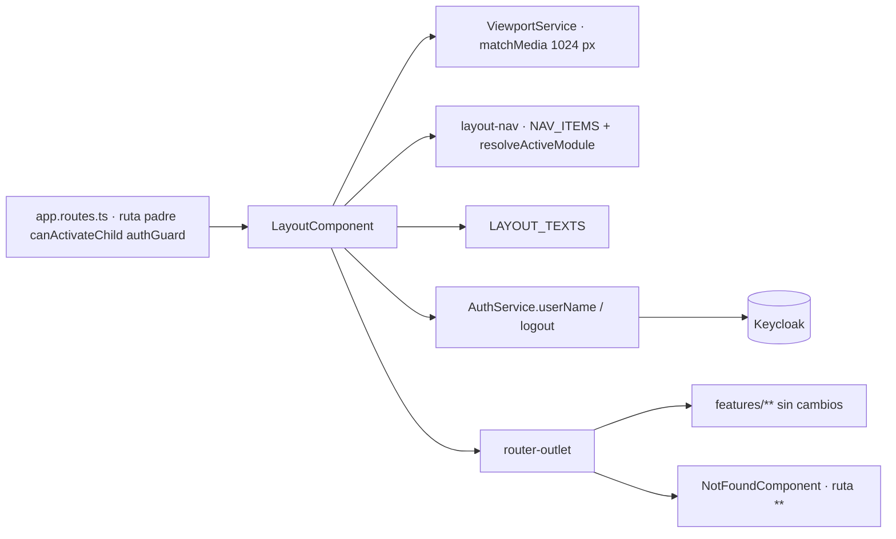

Sin saltos de capa: el shell solo consume servicios de `core`; las pantallas de `features/**` no se modificaron y el guard se aplica una vez en la ruta padre.

### 2.0000 HU-015 — Flujo real implementado (solo lo alterado, histórico)

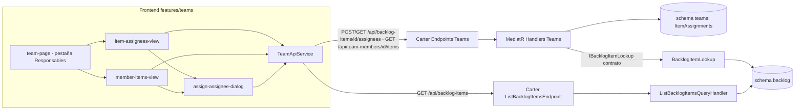

Sin saltos de capa ni cruce de schemas: Teams solo toca `backlog` vía contrato in-process.

### 2.000 HU-012 — Flujo real implementado (solo lo alterado, histórico)

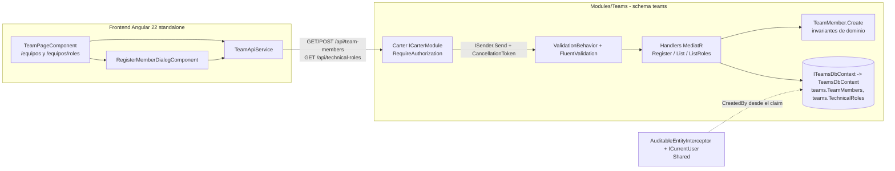

**Desviaciones de arquitectura: ninguna.** Sin salto de capa: endpoint → MediatR → handler → `ITeamsDbContext`; la lógica de negocio vive en handlers y dominio; ninguna consulta cruza de schema (FK local `RESTRICT` dentro de `teams`); sin `[ApiController]`, sin AutoMapper, sin `NgModules`, sin `innerHTML`/`DomSanitizer`.

### 2.00 HU-004 — Flujo real implementado (solo lo alterado, histórico)

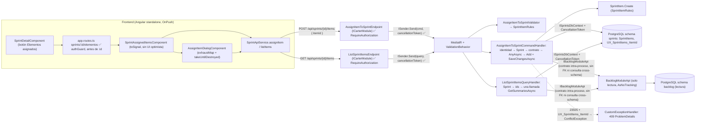

**Desviaciones señaladas:** ninguna de arquitectura; no hay salto de capa ni consulta cross-schema (el Sprint solo conoce el Backlog a través de `IBacklogModuleApi`). Notas de acoplamiento: el `subscribe` del diálogo (R2, flujo de eventos aceptado por precedente) y la importación de `Npgsql` en el handler (R3).

### 2.0 HU-003 — Flujo real implementado (solo lo alterado)

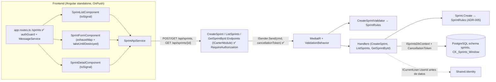

**Desviaciones señaladas:** ninguna de arquitectura; no hay salto de capa. Notas: el `subscribe` del formulario (R3, flujo de eventos aceptado por precedente) y la regla de la ventana de 2 semanas centralizada en `SprintRules` y repetida en la restricción de BD como defensa en profundidad (intencional, ADR-005).

### 2.A HU-002 — Flujo real implementado (solo lo alterado)

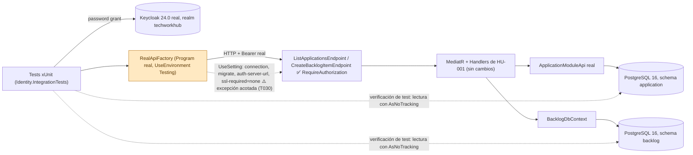

**Desviaciones señaladas:** ninguna de arquitectura. No hay salto de capa: la prueba entra por HTTP y recorre Endpoint → MediatR → módulo → BD sin sustituir servicios. Única relajación: `Keycloak:ssl-required=none` (Keycloak de contenedor sin HTTPS), documentada en `RealApiFactory.cs:17-21` y pendiente de citar en el PR (T030).

### 2.B HU-001 — Flujo real tras la 5.ª iteración (histórico: #16..#19)

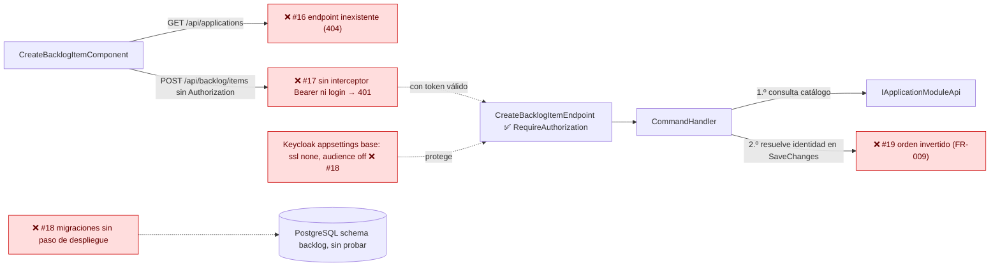

### 2.1 Histórico (3.ª iteración)

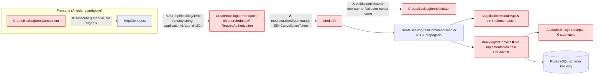

**Desviaciones señaladas:**
1. Salto de capa de cancelación: Endpoint → MediatR sin token.
2. Salto de capa de validación: Validator desconectado del pipeline.
3. Capa de persistencia inexistente: Handler → interfaz sin implementación.
4. Contrato UI ↔ API divergente (`priority` string vs INT, `applicationId` no-Guid).

---

## 3. Change Impact Diagram

### 3.00000 HU-035 — Impacto de los cambios y cobertura (vigente)

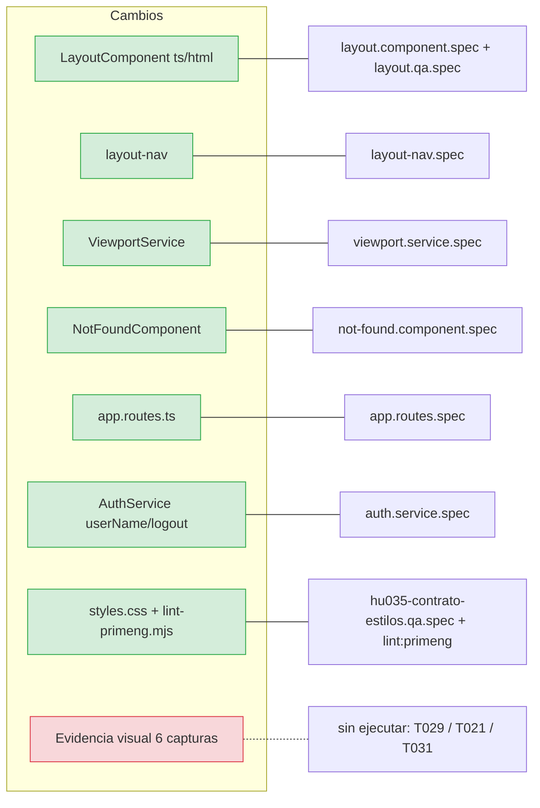

Todo componente alterado tiene pruebas Jest; el único nodo sin cobertura es la evidencia visual (medidas reales, desborde a 768 px).

### 3.0000 HU-015 — Impacto de los cambios y cobertura (histórico)

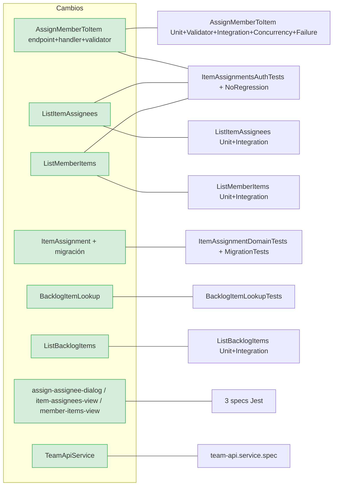

Todos los componentes alterados tienen pruebas; 0 nodos sin cobertura.

### 3.000 HU-012 — Impacto de los cambios y cobertura (histórico)

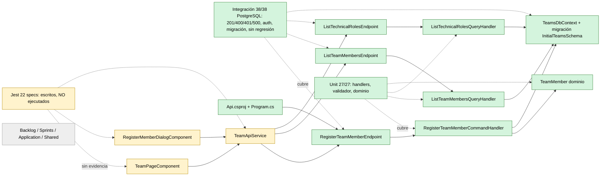

Verde: cubierto y ejecutado. Ámbar: pruebas escritas pero **no ejecutadas** (frontend, R1). Gris: sin impacto.

### 3.00 HU-004 — Impacto de los cambios y cobertura (histórico)

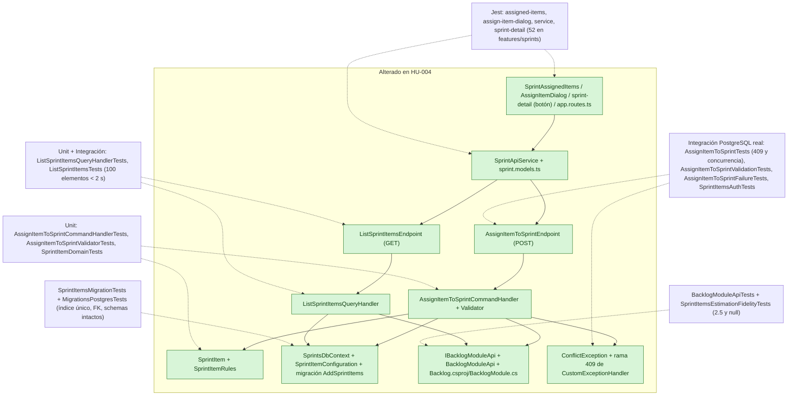

Componentes alterados con cobertura: 10 de 10, con ejecución propia en verde (86 + 89 + 52). Sin cobertura automática: el recorrido manual del quickstart con la SPA y el `ng build` (R1, ambos por entorno). Resto de la aplicación: *Sin impacto en este PR/HU*.

### 3.0 HU-003 — Impacto de los cambios y cobertura

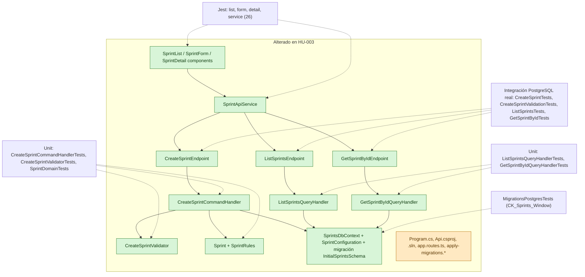

Componentes alterados con cobertura: 11 de 11; los ficheros compartidos (en ámbar) se cubren de forma indirecta con la integración sobre el `Program` real. Sin prueba de regla: los puntos de negocio sin definir en la HU. Resto de la aplicación: *Sin impacto en este PR/HU*.

### 3.A HU-002 — Impacto de los cambios y cobertura

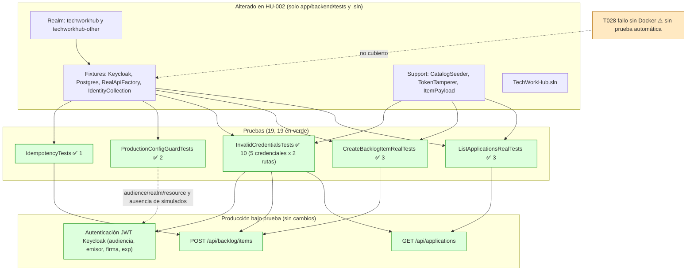

Componentes de producción alterados: **0**. Cobertura de CA: US1 3/3, US3 6/6, US2 3/3. Único hueco: el fallo explícito con el daemon de Docker detenido (T028), verificado solo por el texto del mensaje.

### 3.B HU-001 — histórico

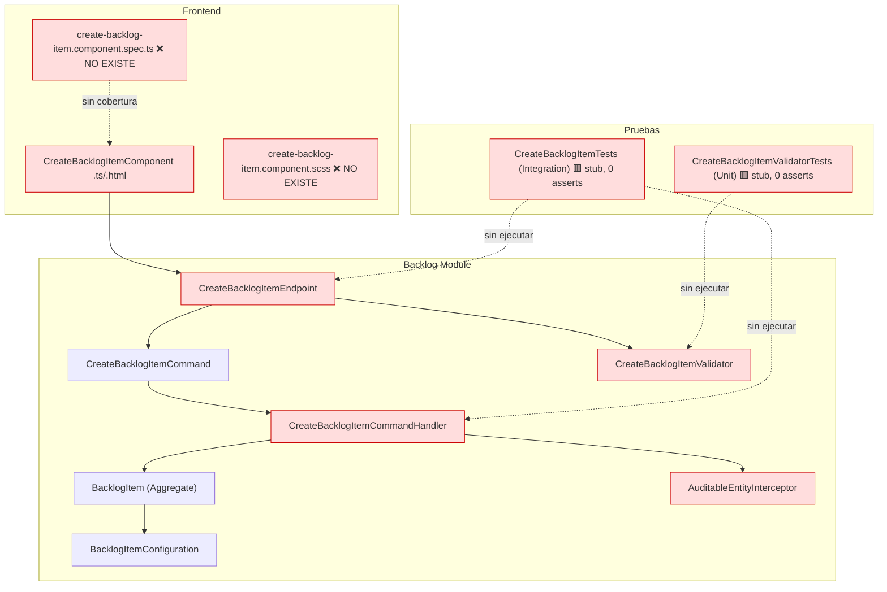

Todos los componentes alterados quedan **sin cobertura efectiva** (0 %).

### 3.1 Impacto de la 5.ª iteración (#16..#19)

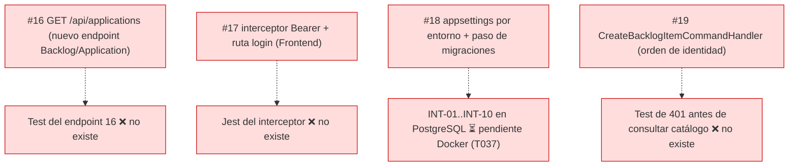

Componentes de #16..#19 sin cobertura: 4 de 4. Resto de la HU (cierre de DEF-01..DEF-08): *sin cambios en esta iteración*.

---

## 4. Dependency / Coupling Graph

### 4.00000 HU-035 (vigente)

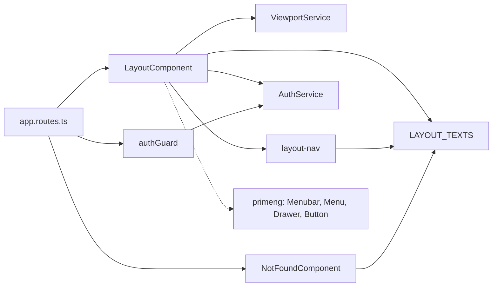

Sin ciclos. Acoplamiento acotado a `core/**` y PrimeNG; el shell no depende de `features/**`.

### 4.0000 HU-015 (histórico)

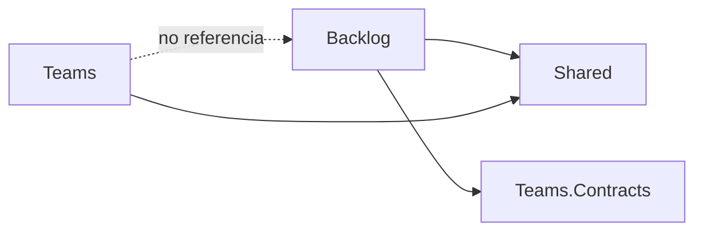

Dependencia unidireccional Backlog → Teams.Contracts (implementa `IBacklogItemLookup`); sin ciclo (Teams no referencia Backlog). Reserva: `Backlog.csproj` referencia el proyecto Teams completo, no un ensamblado de contratos aislado; aceptable, mismo patrón que `Sprints.Contracts`.

### 4.000 HU-012 (histórico)

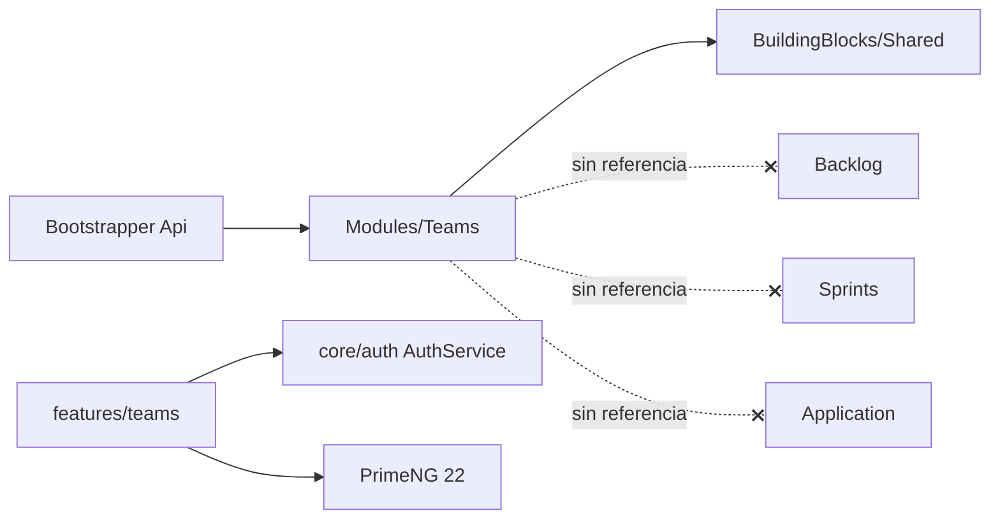

Acoplamiento: `Teams` depende solo de `Shared` (sin ciclos ni referencias a otros módulos; verificado en `Teams.csproj`). **Deuda técnica temprana:** (1) rol enviado por **nombre** sensible a mayúsculas en lugar de por Id (contrato propuesto); (2) sin unicidad/longitud de nombre ni idempotencia (puntos abiertos 1-8); (3) `TechnicalRole` hereda `Aggregate` completo aunque es de solo lectura; (4) cadena `Database` compartida con schema propio (patrón de la constitución, sin deuda adicional).

### 4.00 HU-004 (histórico)

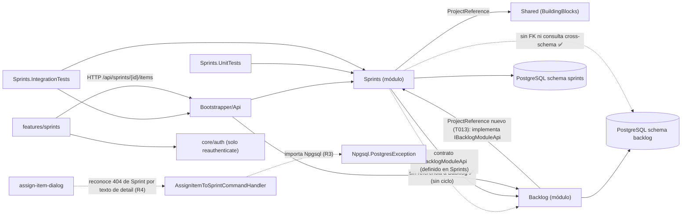

**Deuda técnica temprana:** (1) `Backlog` pasa a depender de `Sprints` solo para implementar el contrato (dirección invertida respecto a lo habitual, sin ciclo; mismo precedente que `Application` → `Backlog` en HU-001), de modo que cualquier consumidor futuro del Backlog desde otro módulo obligará a mover los contratos a un proyecto compartido; (2) acoplamiento del handler al proveedor Npgsql (R3); (3) acoplamiento del diálogo al texto del `detail` del 404 (R4); (4) el patrón `subscribe` se repite una tercera vez (R2). Sin ciclos entre módulos.

### 4.0 HU-003

```mermaid
flowchart LR
    SPR["Sprints (módulo)"] -->|"ProjectReference"| SHR["Shared (BuildingBlocks)"]
    API["Bootstrapper/Api"] -->|"ProjectReference + AddSprintsModule"| SPR
    API --> BLG["Backlog"]
    API --> APP["Application"]
    SPR -. "sin referencia ✅" .-> BLG
    SPR -. "sin referencia ✅" .-> APP
    SPR --> PG[("PostgreSQL schema sprints")]
    UT["Sprints.UnitTests"] --> SPR
    IT["Sprints.IntegrationTests"] --> SPR
    IT --> API
    FE["features/sprints"] -->|"HTTP /api/sprints"| API
    FE --> AUTHC["core/auth (solo AuthService.reauthenticate)"]
```

**Deuda técnica temprana:** (1) `PostgresFixture` y `SprintsApiFactory` duplican los de Backlog en lugar de compartirse; (2) el patrón `subscribe` del formulario se repite respecto a HU-001; (3) sin paginación ni pruebas de carga más allá de 100 registros (decisión explícita ADR-006); (4) `CreatedBy` es `varchar(255)` (T011 decía `varchar`), coherente con Backlog. Sin ciclos entre módulos.

### 4.A HU-002

```mermaid
flowchart LR
    IT["Identity.IntegrationTests"] -->|"ProjectReference"| API["Bootstrapper/Api (Program)"]
    IT -->|"Testcontainers 4.1.0"| DK[("Docker: keycloak:24.0 y postgres:16-alpine")]
    IT -->|"lee DbContext de test"| APPM["Application (ApplicationDbContext)"]
    IT -->|"lee DbContext de test"| BLGM["Backlog (BacklogDbContext)"]
    IT -. "sin referencia" .-> BIT["Backlog.IntegrationTests ✅ aislado (ADR-003)"]
    API --> APPM
    API --> BLGM
    BLGM -. "contrato IApplicationModuleApi" .-> APPM
```

**Deuda técnica temprana:** (1) el proyecto de pruebas referencia dos módulos de dominio para sembrar y leer, aceptable en test y sin tocar `src`; (2) `bin/` y `obj/` versionados; (3) credencial de prueba triplicada; (4) dependencia de Docker sin prueba automática del fallo sin daemon (T028); (5) la constitución no fija si el `CancellationToken` aplica a helpers de prueba.

### 4.B HU-001 — histórico

```mermaid
flowchart LR
    Handler["CreateBacklogItemCommandHandler"] -->|"define en el mismo archivo"| IDb["IBacklogDbContext"]
    Handler -->|"define en el mismo archivo"| IApp["IApplicationModuleApi"]
    Handler --> Domain["BacklogItem / Enums"]
    Handler -. "duplica regla tipos técnicos" .-> Front["CreateBacklogItemComponent"]
    Front -. "string enums + app-id hardcodeado" .-> Cmd["CreateBacklogItemCommand"]
    Interceptor["AuditableEntityInterceptor"] -. "CreatedAt/CreatedBy requeridos por Config, no cumplidos" .-> Config["BacklogItemConfiguration"]
    IApp -. "contrato cross-module sin dueño (módulo Application)" .-> AppModule["Application Module (fuera de la HU)"]
```

**Deuda técnica temprana:** interfaces de infraestructura definidas dentro de la capa de aplicación; regla de negocio "ítem técnico ⇒ QAPoints null" duplicada en FE y BE; dependencia cross-module sin implementación ni contrato publicado.

---

## Veredicto

```text
[APROBADO CON RESERVAS] - HU-012, 1.ª revisión de código (04-10-2026):
- Lectura física completada: 33 archivos auditados (24 backend de Teams, 6 frontend, 3 de integración: Api.csproj, Program.cs y app.routes.ts) más las pruebas clave; ejecución propia Unit 27/27 e Integración 38/38 (PostgreSQL). Jest no ejecutable (sin Node).
- Lex Superior y VSA: ICarterModule + MediatR, schema teams aislado, FK local, sin salto de capa, sin AutoMapper ni [ApiController], componentes standalone.
- SecOps y rendimiento: CancellationToken propagado hasta EF Core, cero N+1 (sin bucles en producción), sin IDOR (solo alta y lecturas de datos maestros; la auditoría sale del claim y no del cuerpo, probado), sin XSS, RequireAuthorization en los tres endpoints, 500 sin trazas.
- Pruebas QA: no tautológicas (efectos en BD verificados, token propagado, 401/400/500 reales).
- Reservas no bloqueantes: R1 (T058/T061 y Jest/build frontend sin ejecutar), R2 (subscribe del diálogo, precedente HU-001/003/004), R3 (comentario "sprints" en TeamsModule), R4 (puntos abiertos 1-8 y text vs varchar), R5 (helpers de prueba sin token), R6 (sin commitear).
```

```text
[APROBADO CON RESERVAS] - HU-004, 1.ª revisión de código tras retrabajo SDD 1/2 (04-10-2026):
- Lectura física completada: 30 archivos de producción auditados (22 backend, 8 frontend) más las pruebas clave; ejecución propia Unit 86/86, Integración 89/89 (PostgreSQL), Jest features/sprints 52/52, ngc --noEmit limpio.
- Lex Superior y VSA: ICarterModule + MediatR, schema sprints aislado, contrato IBacklogModuleApi sin FK ni consulta cross-schema, invariante un elemento un Sprint por índice único, sin salto de capa.
- SecOps y rendimiento: CancellationToken propagado hasta EF Core y el contrato, cero N+1, sin IDOR (la HU crea una relación sobre catálogos globales; el 409 no revela el Sprint dueño), sin XSS, RequireAuthorization en ambos endpoints.
- Pruebas QA: no tautológicas; DEF-01 (decimal nullable) y DEF-02 (FR-017/FR-018) verificados en código y spec.
- Reservas no bloqueantes: R1 (T051 build bloqueado por Node del equipo, T052 sin recorrido manual y casillas T005/T015/T036/T041 sin marcar), R2 (subscribe del diálogo, precedente HU-001/HU-003), R3 (Npgsql en el handler), R4 (404 por texto de detail), R5 (código sin commitear).
```

```text
[APROBADO CON RESERVAS] - HU-003, 1.ª iteración (04-10-2026):
- Lectura física completada: 40 archivos auditados; ejecución propia Unit 43/43, Integración 46/46 (PostgreSQL), Jest 26/26, tsc limpio.
- Lex Superior y VSA: ICarterModule + MediatR, schema sprints aislado, regla de ventana única (ADR-005), sin salto de capa.
- SecOps y rendimiento: CancellationToken propagado, cero N+1, sin IDOR (solo crear y consultar), sin XSS, RequireAuthorization en los tres endpoints.
- Pruebas QA: no tautológicas; cobertura lógica validada.
- Reservas no bloqueantes: R1 (T052 build bloqueado por Node del equipo y T053 sin ejecución manual), R2 (Identity en paralelo), R3 (subscribe del formulario, precedente HU-001), R4 (código sin commitear).
```

```text
[APROBADO CON RESERVAS] - HU-002, 1.ª iteración (03-10-2026):
- Lectura física completada: 18 archivos auditados; ejecución propia Identity 19/19 contra Keycloak y PostgreSQL reales.
- Lex Superior y VSA: sin código de producción tocado; sin simulados; audiencia y emisor de producción intactos.
- SecOps y rendimiento: sin N+1 real, sin IDOR (sin handlers nuevos), sin XSS. Reservas R1 (CancellationToken en helpers de prueba, constitución ambigua) y R2 (.Add en foreach).
- Pruebas QA: no tautológicas; el audience mapper quitado rompe 5 de 6 casos.
- Pendiente: T028, T030, commit de la suite (R5). Cierre de rama pendiente de decisión humana.
```

```text
[APROBADO CON RESERVAS] - HU-001, 6.ª iteración (03-10-2026, 19:39):
- Lectura física completada: 30 archivos auditados; ejecución propia 62/62 + 31/31 (PostgreSQL) + Jest 31/31.
- #16..#19 cerrados. CancellationToken propagado, cero N+1, cero IDOR (solo creación), sin XSS.
- Reservas: tareas T018/T025/T032/T043 sin marcar, producción sin commitear, riesgo residual Keycloak/catálogo real.
- Cierre de rama pendiente de decisión humana (ver tracker).
(Histórico: 5.ª iteración, 19:13, [RECHAZADO] por #16..#19.)
```


> **Cierre HU-035 (05-10-2026):** el humano autorizó cerrar con 1 de 6 capturas (`evidence/pantalla.png`) y aceptó enmendar la spec (altura completa de la navegación lateral, `[CAPA:SPEC]`). Jest 216/216, `lint:primeng` y `ng build` OK.
