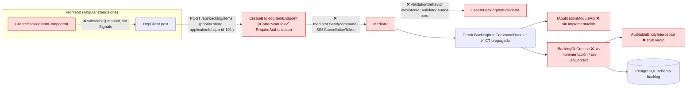
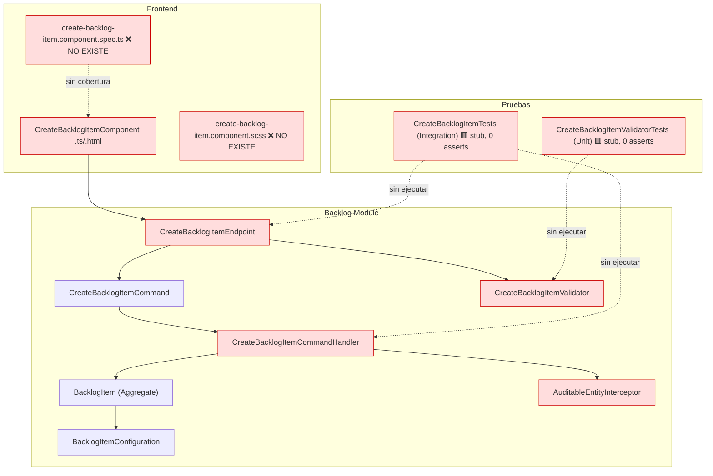
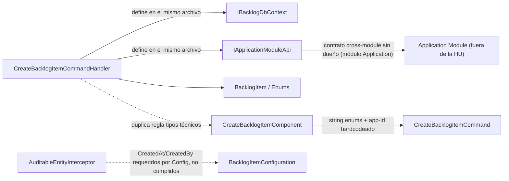

# 🏗️ Reporte de Impacto y Code Review Vivo (`impact-analysis-report.md`)

**HU:** 001-HU_registro_elementos_backlog_multitipo · **Rama:** `feat/001-HU_registro_elementos_backlog_multitipo`
**Fecha:** 03-10-2026 · **Dictamen:** ❌ **[RECHAZADO]**

> Renderizado selectivo: solo se documentan los componentes alterados por la HU 001. Resto del repositorio: *Sin impacto en este PR/HU*.

---

## 1. AI Code Review Dashboard

```text
╔══════════════════════════════════════════════════════════════╗
║  AI CODE REVIEW DASHBOARD — HU 001            [RECHAZADO]    ║
╠══════════════════════════════════════════════════════════════╣
║  Archivos analizados (lectura física) ........... 16         ║
║  Violaciones arquitectónicas .................... 5          ║
║  Problemas de seguridad / rendimiento ........... 3          ║
║  Hallazgos zero-tolerance (stubs/hardcode) ...... 4          ║
║  Deuda técnica encontrada ....................... 4          ║
║  Cobertura de tests (lógica real) ............... 0 %        ║
║  Tests tautológicos / stubs ..................... 4 de 4     ║
╚══════════════════════════════════════════════════════════════╝
```

### Hallazgos bloqueantes

| # | Sev. | Archivo | Hallazgo | Responsable |
|---|------|---------|----------|-------------|
| 1 | 🔴 | `src/Modules/Backlog/Features/BacklogItems/CreateBacklogItem/CreateBacklogItemEndpoint.cs:13-15` | La lambda no recibe `CancellationToken` y llama `mediator.Send(command)` sin token. La cancelación nunca llega al handler ni a EF Core (Perf. Leak, rechazo inmediato). | @DEV-BACK |
| 2 | 🔴 | `.../CreateBacklogItemCommandHandler.cs:10-19` | `IBacklogDbContext` e `IApplicationModuleApi` se declaran dentro del archivo del handler y no existen implementaciones, `DbContext`, registro DI, `Program.cs` ni `.csproj` en el repo. El slice no compila ni ejecuta. `BacklogItemConfiguration` no tiene `DbContext` que la aplique. | @DEV-BACK |
| 3 | 🔴 | `src/Modules/Backlog/Data/AuditableEntityInterceptor.cs:16-17` | Implementación "conceptual" vacía: no inyecta `CreatedAt`/`CreatedBy`. Ambas columnas son `IsRequired` (`BacklogItemConfiguration.cs:44-49`), así que el primer insert falla. T018 está marcada `[X]` falsamente. Firma de alucinación. | @DEV-BACK |
| 4 | 🔴 | `CreateBacklogItemValidator.cs` / `...Handler.cs:41` | No existe pipeline `ValidationBehavior<,>` ni registro de validadores, por lo que el validador nunca se ejecuta. Cualquier `Type` inválido llega a `Enum.Parse` y lanza 500. El handler lanza `ValidationException`, pero no hay mapeo a HTTP 400 (T013). | @DEV-BACK |
| 5 | 🔴 | `app/frontend/.../create-backlog-item.component.ts:68,90` | Suscripciones manuales a RxJS (`valueChanges.subscribe`, `http.post().subscribe`) sin `takeUntilDestroyed`, donde corresponden `Signals` / `toSignal` / `rxResource`. Viola la regla 3. | @DEV-FRONT |
| 6 | 🔴 | `.../create-backlog-item.component.ts:60` | Datos hardcodeados: `applications = [{ value: 'app-id-101' }]`. No es un `Guid`, así que el backend rechaza cualquier selección (binding fallido o 400). Debe cargarse desde la API del módulo Application. | @DEV-FRONT |
| 7 | 🔴 | `.../create-backlog-item.component.ts:35` | `styleUrls: ['./create-backlog-item.component.scss']` apunta a un archivo inexistente, por lo que el build de Angular falla. | @DEV-FRONT |
| 8 | 🟠 | `.../create-backlog-item.component.ts:43-51` / `CreateBacklogItemCommand.cs:11` | Contrato roto: el front envía `priority: 'Medium'` (string) y el back espera el enum `BacklogItemPriority` (INT). No hay evidencia de `JsonStringEnumConverter`. Además `err.error?.message?.includes('aplicación')` no coincide con el mensaje en inglés del backend. | @DEV-FRONT / @DEV-BACK |
| 9 | 🔴 | `tests/Integration/Backlog/CreateBacklogItemTests.cs`, `tests/Unit/Backlog/CreateBacklogItemValidatorTests.cs` | QA Gate: `[Fact]` comentado, cuerpos `await Task.CompletedTask` o vacíos. Cobertura lógica 0 %. T009, T010 y T015 marcadas `[X]` falsamente. No hay `.spec.ts` del componente. | @QA-AUTO |

### Re-auditoría QA (03-10-2026, 2.ª iteración)
- **Hallazgo 9: ✅ RESUELTO.** Se leyeron `CreateBacklogItemTests.cs`, `BacklogApiFactory.cs`, `CreateBacklogItemCommandHandlerTests.cs`, `CreateBacklogItemValidatorTests.cs` y `BacklogItemDomainTests.cs`. Las pruebas ejecutan el endpoint real (TestServer + MediatR + handler), el validador y el dominio, con asserts sobre estado persistido. No son tautológicas.
- **Ejecución:** Unit 42/43 OK, Integration 5/10 OK. Los 6 fallos son defectos reales de producción y no se deben desactivar.

| Test fallido | Causa en producción | Hallazgo | Responsable |
|---|---|---|---|
| `Integration…ConTituloVacio`, `…ConTipoFueraDelCatalogo`, `…ConDevPointsNegativos` (esperan 400, reciben 201) | No hay `ValidationBehavior`, por lo que el validador nunca corre | #4 | @DEV-BACK |
| `Integration…ConApplicationIdInexistente` | `ValidationException` sin mapeo a HTTP 400 | #4 | @DEV-BACK |
| `Integration…ConPrioridadComoTextoSegunHU` | Sin `JsonStringEnumConverter` para `priority: "High"` | #8 | @DEV-BACK |
| `Unit…Validate_ConTipoNulo_DebeFallarEnType` | **Hallazgo nuevo #10:** `IsEnumName` acepta `null`; falta `.NotEmpty()` en `Type` (`CreateBacklogItemValidator.cs:14-16`), así que un JSON sin `type` llega a `Enum.Parse` y lanza 500 | #10 | @DEV-BACK |

Los hallazgos 1 (token en endpoint), 2, 3, 5, 6 y 7 siguen abiertos. Los tests de integración no cubren el endpoint con token cancelado ni el interceptor (se usa `FakeBacklogDb`).

### Re-auditoría Code Review (03-10-2026, 3.ª iteración)
Evidencia: `documents/qa-auto/qa-report.md` + lectura física de código y diff del working tree. No se ejecutaron tests en esta revisión.

| Ref. | Capa | Estado | Detalle | Responsable |
|---|---|---|---|---|
| DEF-02 / #10 | [CAPA:CODE] | 🟡 **Corregido en working tree, sin commit** | `CreateBacklogItemValidator.cs:14-17` ya incluye `.NotEmpty()` en `Type`. Pendiente: commit y re-ejecución de `Validate_ConTipoNulo_DebeFallarEnType` para cerrar. | @DEV-BACK / @QA-AUTO |
| DEF-01 (#4) | [CAPA:CODE] | 🔴 Abierto | Sin `ValidationBehavior<,>` ni registro de validadores. | @DEV-BACK |
| DEF-03 (#4) | [CAPA:CODE] | 🔴 Abierto | `ValidationException` sin mapeo a 400. | @DEV-BACK |
| DEF-04 (#3) | [CAPA:CODE] | 🔴 Abierto | `AuditableEntityInterceptor` no-op; `CreatedBy` requerido. | @DEV-BACK |
| DEF-05 | [CAPA:CODE] | 🔴 Abierto | Sin `DispatchDomainEventsInterceptor`. | @DEV-BACK |
| DEF-06 (#2) | [CAPA:PLAN] | 🔴 Abierto | Sin `Program`, `.csproj`, `DbContext` ni implementaciones; interfaces dentro del handler. | @DEV-BACK |
| DEF-07 (#6, #8) | [CAPA:CODE] | 🔴 Abierto | `app-id-101` no es `Guid`; falta `JsonStringEnumConverter`. | @DEV-FRONT / @DEV-BACK |
| DEF-08 (#7) | [CAPA:CODE] | 🔴 Abierto | `.scss` inexistente; sin `package.json`/`angular.json`/`jest.config`. | @DEV-FRONT |
| **#11 QAPoints (dominio)** | [CAPA:CODE] | 🔴 **Nuevo** | La regla "técnico ⇒ QAPoints null" vive solo en `Handler.cs:51-54`; `BacklogItem.Create` acepta `qaPoints` para un Spike, por lo que otro camino de creación/actualización viola el invariante. Moverla al agregado y quitar la duplicación FE/BE. | @DEV-BACK |
| **#12 QAPoints (front)** | [CAPA:CODE] | 🔴 **Nuevo** | `component.ts:49,94` envía `qaPoints: 0` por defecto para UserStory/Bug; un 0 "no estimado" se confunde con un 0 real. Enviar `null`. | @DEV-FRONT |
| **#13 QAPoints (política)** | [CAPA:SPEC] | 🟠 **Nuevo** | Un Spike con `qaPoints=8` devuelve 201 y se guarda `null` sin aviso. La spec/contrato no define si se descarta o se rechaza con 400. | @SA / @API |
| **#14 Contrato API** | [CAPA:SPEC] | 🟠 **Nuevo** | `contracts/api.md` omite `priority` y `acceptanceCriteria` (el comando los exige). El 400 documentado usa `errors{}`, pero el front lee `err.error?.message` y `includes('aplicación')` no coincide con el mensaje en inglés, así que siempre muestra "Datos inválidos". | @API / @DEV-BACK / @DEV-FRONT |
| **#15 Trazabilidad de tareas** | [CAPA:TASKS] | 🟠 **Nuevo** | T009, T010, T015 y T018 en `[X]` sin implementación real (T018 = interceptor vacío). Faltan tareas para ValidationBehavior, exception handler, DispatchDomainEventsInterceptor, Program/DbContext y config Angular/Jest. | @DEV-BACK |

**Hallazgo 1 (token en endpoint):** sigue abierto, `CreateBacklogItemEndpoint.cs:13-15`. **Menores añadidos:** `Enum.Parse` → `TryParse`; cambio `Type` string→int y schema `backlog` sin migración alineada con `data-model.md`.

**Dictamen 3.ª iteración:** ❌ **[RECHAZADO]**. Cerrado: hallazgo 9. Corregido sin verificar: DEF-02. Abiertos: todos los demás. Handoff: @DEV-BACK (servidor), @DEV-FRONT (interfaz), @QA-AUTO (INT-01..INT-10 + Jest tras las correcciones). Sin GITOPS-MERGE-CLOSE.

### Hallazgos menores (corregir en la misma iteración)
- `CreateBacklogItemValidator`: sin límite de longitud para `Description` / `AcceptanceCriteria` (superficie de abuso / payloads gigantes).
- La lista de tipos técnicos está duplicada en handler y componente; centralizar.
- `BacklogItem.CreatedAt` / `CreatedBy` son `private set` sin inicializar; dependen al 100 % de un interceptor que hoy no existe.
- Botón "Cancelar" sin handler; `CommonModule` + `*ngIf` en lugar de control flow `@if`.
- `Aggregate.cs` importa `Backlog.Domain.BacklogItems.Events` sin usarlo.

### Cumplimiento SecOps
| Control | Resultado |
|---|---|
| `.RequireAuthorization()` en endpoint | ✅ Presente |
| `ICarterModule` (sin `[ApiController]`) | ✅ |
| `CancellationToken` en Handler → `AddAsync`/`SaveChangesAsync`/`ExistsAsync` | ✅ |
| `CancellationToken` en Endpoint → `mediator.Send` | ❌ Ausente |
| N+1 / queries en bucles | ✅ Sin bucles |
| IDOR | ➖ N/A (solo creación). Pendiente para HU de update/delete. |
| Mass assignment | ✅ El `Command` no expone `Status`, `CreatedBy` ni roles |
| Credenciales hardcodeadas | ✅ Ninguna |
| XSS (`innerHTML`, `bypassSecurityTrust*`) | ✅ Ninguno (solo interpolación `{{ }}`) |
| `NgModules` | ✅ Componente `standalone` |
| Cruce de schemas / `.Include()` | ✅ Ninguno; el acceso a Application va por `IApplicationModuleApi` |

---

## 2. Architecture Compliance & Traceability



**Desviaciones señaladas:**
1. Salto de capa de cancelación: Endpoint → MediatR sin token.
2. Salto de capa de validación: Validator desconectado del pipeline.
3. Capa de persistencia inexistente: Handler → interfaz sin implementación.
4. Contrato UI ↔ API divergente (`priority` string vs INT, `applicationId` no-Guid).

---

## 3. Change Impact Diagram



Todos los componentes alterados quedan **sin cobertura efectiva** (0 %).

---

## 4. Dependency / Coupling Graph



**Deuda técnica temprana:** interfaces de infraestructura definidas dentro de la capa de aplicación; regla de negocio "ítem técnico ⇒ QAPoints null" duplicada en FE y BE; dependencia cross-module sin implementación ni contrato publicado.

---

## Veredicto

```text
[RECHAZADO] - @DEV-BACK, @DEV-FRONT, @QA-AUTO:
Ver tabla de hallazgos bloqueantes #1 a #9. No se emite GITOPS-MERGE-CLOSE.
```
