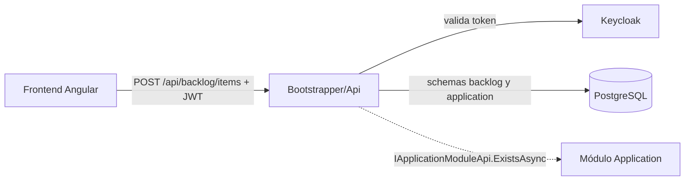
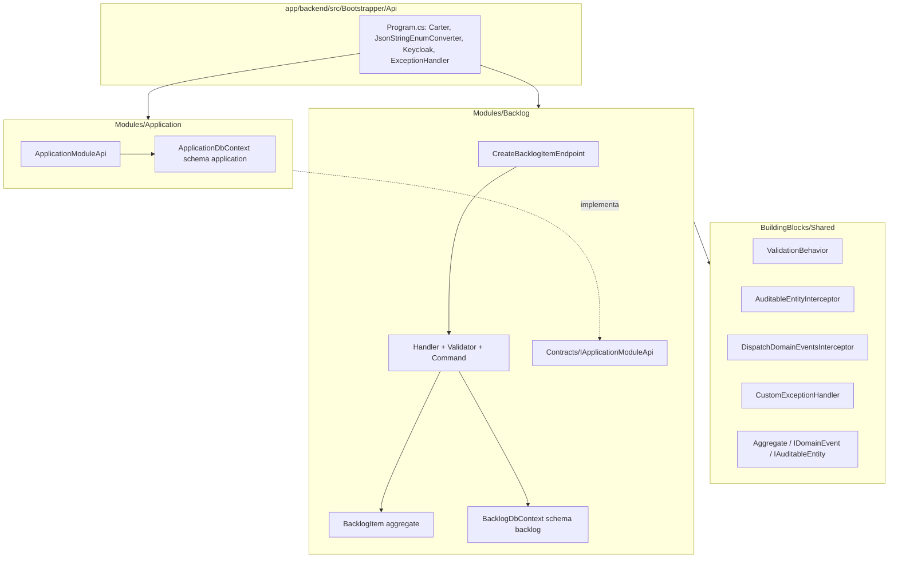
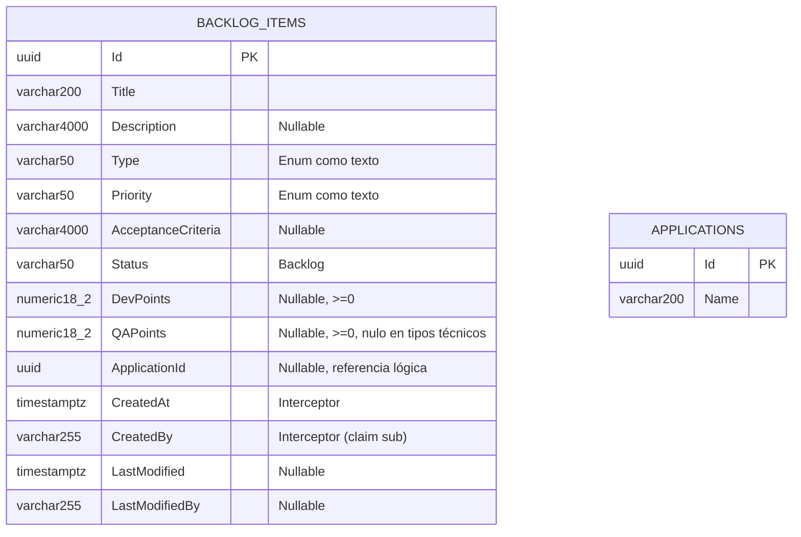
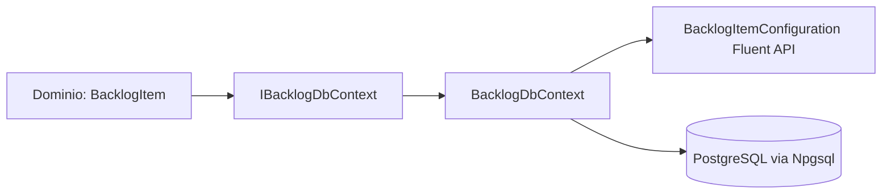

# 🏗️ ARQUITECTURA BACKEND VIVA

- **Sistema:** TechWorkHub (Modulith .NET 8, PostgreSQL)
- **Última actualización:** 2026-10-03 (retrabajo servidor, convergencia iteración 1/2)
- **HU vigente:** 001 – Registro de Elementos en Backlog Multitipo
- **Fuente de verdad:** `specs/001-registro-backlog-multitipo/` (`plan.md`, `data-model.md`, `contracts/api.md`) y `documents/qa-tech/tech-design_001_registro_elementos_backlog_multitipo.md`

> Renderizado selectivo: solo se documenta lo alterado en esta iteración (host, `Shared`, módulos `Backlog`/`Application`, persistencia, pipeline, errores). Lo no tocado queda como "sin cambios".

## 1. Contexto y Contenedores (C4)



Contenedores (ALTERADO: antes no existía host ni `Shared`; el código vivía en `src/Modules/Backlog` y ahora está bajo `app/backend/` según la constitución):



## 2. Arquitectura de Capas y Módulos

```text
app/backend/
├── TechWorkHub.sln
├── src/
│   ├── Bootstrapper/Api/            Program.cs, Api.csproj, appsettings*.json     (NUEVO)
│   ├── BuildingBlocks/Shared/       Aggregate<T>, IDomainEvent, IAuditableEntity, ICurrentUser,
│   │                                ValidationBehavior, AuditableEntityInterceptor,
│   │                                DispatchDomainEventsInterceptor, CustomExceptionHandler,
│   │                                BadRequest/NotFound exceptions                (NUEVO)
│   └── Modules/
│       ├── Backlog/                 (movido desde src/Modules/Backlog)
│       │   ├── BacklogModule.cs     AddBacklogModule + MigrateBacklogModuleAsync   (NUEVO)
│       │   ├── Contracts/IApplicationModuleApi.cs                                  (NUEVO)
│       │   ├── Domain/BacklogItems/ BacklogItem, Type(+IsTechnical), Priority, Status, BacklogItemRules, Events/
│       │   ├── Data/                BacklogDbContext, IBacklogDbContext, Configurations/, Migrations/  (NUEVO)
│       │   └── Features/BacklogItems/CreateBacklogItem/  Endpoint, Command, Handler, Validator
│       └── Application/             Módulo mínimo que implementa IApplicationModuleApi (NUEVO)
└── tests/
    ├── Unit/Backlog/                61 pruebas
    └── Integration/Backlog/         22 pruebas sobre el Program real (WebApplicationFactory)
```

Se eliminaron el `Aggregate` local y el `AuditableEntityInterceptor` vacío del módulo: ahora se reutiliza `Shared`.

## 3. Modelo de Datos y Persistencia



- Tabla `backlog."BacklogItems"` (schema `backlog` en minúscula) y `application."Applications"`; no hay FK ni joins entre schemas (`ApplicationId` es referencia lógica).
- **Alterado:** `Type` y `Priority` pasan de `int` a `varchar(50)` (texto, alineado con `data-model.md`); `Description`/`AcceptanceCriteria` ahora `varchar(4000)`.
- Migraciones Code-First: `Backlog/Data/Migrations/20261003204834_InitialBacklogSchema` y `Application/Data/Migrations/20261003204841_InitialApplicationSchema`, con historial `__EFMigrationsHistory` por schema.



## 4. Flujo de Petición y Secuencias Críticas

```mermaid
sequenceDiagram
    actor U as Cliente
    participant A as Auth (Keycloak JWT)
    participant E as CreateBacklogItemEndpoint
    participant V as ValidationBehavior + Validator
    participant H as Handler
    participant AP as IApplicationModuleApi
    participant D as BacklogItem.Create
    participant DB as BacklogDbContext
    participant X as CustomExceptionHandler
    U->>A: POST /api/backlog/items (Bearer)
    A-->>U: 401 sin token o inválido
    A->>E: (command, CancellationToken de la solicitud)
    E->>V: Send(command, ct)
    V-->>X: ValidationException (Title/Type/Priority/puntos/longitudes)
    V->>H: command válido
    H->>H: Enum.TryParse de Type
    opt ApplicationId informado
        H->>AP: ExistsAsync(id, ct)
        AP-->>H: false → ValidationException(ApplicationId)
    end
    H->>D: Create(...)
    D-->>X: BadRequestException(QAPoints) si tipo técnico con qaPoints
    H->>DB: Add + SaveChangesAsync(ct)
    DB->>DB: AuditableEntityInterceptor (CreatedAt/CreatedBy; sin claim → 401)
    DB->>DB: DispatchDomainEventsInterceptor publica BacklogItemCreatedDomainEvent
    DB-->>H: commit
    H-->>E: Guid
    E-->>U: 201 Created { id } + Location
    X-->>U: 400 ProblemDetails con errors{} / 401 / 500
```

Cambios de comportamiento: la regla "tipo técnico ⇒ `qaPoints` nulo" vive en el agregado y **rechaza** (400) en lugar de anular en silencio (FR-008); el endpoint propaga el `CancellationToken`; `priority` y `type` viajan como texto (`JsonStringEnumConverter` global).

## 5. Seguridad y Manejo de Errores

- `POST /api/backlog/items` exige `.RequireAuthorization()` con JWT Keycloak (`Keycloak.AuthServices.Authentication`). El claim `sub` (o `NameIdentifier`) alimenta `CreatedBy`; sin claim → 401.

| Excepción | HTTP | Cuerpo |
|---|---|---|
| `ValidationException` (FluentValidation, incluye `ApplicationId` inexistente) | 400 | `ValidationProblemDetails` con `errors{Propiedad:[mensajes]}` |
| `BadRequestException` (regla de dominio, p. ej. `QAPoints` en tipo técnico) | 400 | `errors{Campo:[mensaje]}` |
| `BadHttpRequestException` (JSON malformado) | 400 | `errors{Request:[mensaje]}` |
| `UnauthorizedAccessException` (sin claim de identidad) | 401 | `ProblemDetails` |
| `NotFoundException` | 404 | `ProblemDetails` |
| `OperationCanceledException` con solicitud abortada | 499 | sin cuerpo |
| Cualquier otra | 500 | `ProblemDetails` genérico (sin detalles internos) |

## 6. ADRs

- **ADR-05 (heredado):** puntos de esfuerzo como `decimal?` (`numeric(18,2)`, `>= 0`). Se mantiene `decimal` en vez del `int?` antiguo de `data-model.md`; el documento se alineó.
- **ADR-06 (esta iteración):** `Shared` no existía en el repositorio; se creó con el mínimo que exigen la constitución y el plan (ValidationBehavior, interceptores, ExceptionHandler, Aggregate). Consecuencia: si el starter kit oficial `backend-modulith-template` se incorpora, debe reemplazar este proyecto conservando los contratos.
- **ADR-07 (esta iteración):** `IApplicationModuleApi` vive en `Backlog.Contracts` y lo implementa un módulo `Application` mínimo con su propio schema; así Backlog nunca consulta tablas de otro schema. El módulo Application real, cuando exista, debe sustituir `ApplicationModuleApi`.
- **ADR-08 (esta iteración):** `applicationId` inexistente se resuelve con `ValidationException` (clave `ApplicationId`) en el handler, que el `CustomExceptionHandler` mapea a 400; `NotFoundException` queda reservada al 404 general.
- **ADR-09 (esta iteración):** `Type` y `Priority` se persisten como texto para legibilidad y para que reordenar el enum no corrompa datos.

## 7. Cambios de esta ejecución (2026-10-03, speckit-implement backend — retrabajo)

Tareas cerradas: T013, T014, T018, T019 (con evidencia de pruebas), T020–T031 (servidor). Hallazgos: DEF-01, DEF-02 (confirmado y commiteado), DEF-03, DEF-04, DEF-05, DEF-06, `CancellationToken`, `JsonStringEnumConverter`, regla QAPoints al dominio, límites de longitud, `TryParse`, migración y schema `backlog`.

Verificación: `dotnet test TechWorkHub.sln` → 61 unitarias + 22 de integración correctas.

## 8. Puntos abiertos

- Las pruebas de integración usan SQLite en memoria en lugar de PostgreSQL con Testcontainers (no hay Docker disponible en este entorno); T037 sigue abierta hasta ejecutarlas con Testcontainers.
- T017 (escenarios de `quickstart.md` por cURL contra un PostgreSQL y Keycloak reales) no se ejecutó.
- Las migraciones se generaron y compilaron pero no se aplicaron contra un PostgreSQL real.
- `appsettings.json` trae valores de desarrollo para Keycloak (`realm`, `resource`) que deben confirmarse con el entorno real; la cadena de conexión solo está en `appsettings.Development.json`.
- Tareas de interfaz T032–T036 fuera de este alcance.
