# 🏗️ ARQUITECTURA BACKEND VIVA

- **Sistema:** TechWorkHub (Modulith .NET 8, PostgreSQL)
- **Última actualización:** 2026-10-04 (HU-003: nuevo módulo `Sprints`; ver sección 11)
- **HU vigente:** 003 – Gestión de Sprint de Dos Semanas (Crear y Consultar), sobre 001 – Registro de Elementos en Backlog Multitipo y 002 – Pruebas de Integración contra Keycloak Real
- **Fuente de verdad:** `specs/003-HU_gestion_sprint_dos_semanas/` (`plan.md`, `data-model.md`, `contracts/sprints-api.openapi.yaml`, `tasks.md`), `documents/qa-tech/tech-design_003_gestion_sprint_dos_semanas.md`, `specs/002-pruebas-integracion-keycloak-catalogo/` y `specs/001-registro-backlog-multitipo/`

> Renderizado selectivo: solo se documenta lo alterado en esta iteración (host, `Shared`, módulos `Backlog`/`Application`, persistencia, pipeline, errores). Lo no tocado queda como "sin cambios".

## 1. Contexto y Contenedores (C4)

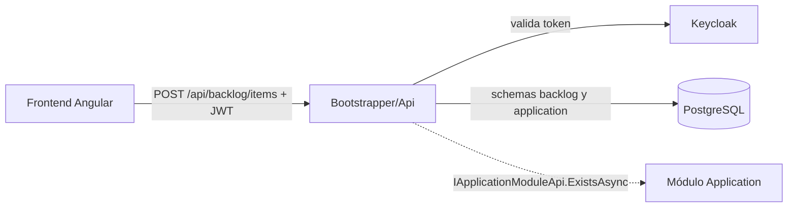

Contenedores (ALTERADO: antes no existía host ni `Shared`; el código vivía en `src/Modules/Backlog` y ahora está bajo `app/backend/` según la constitución):

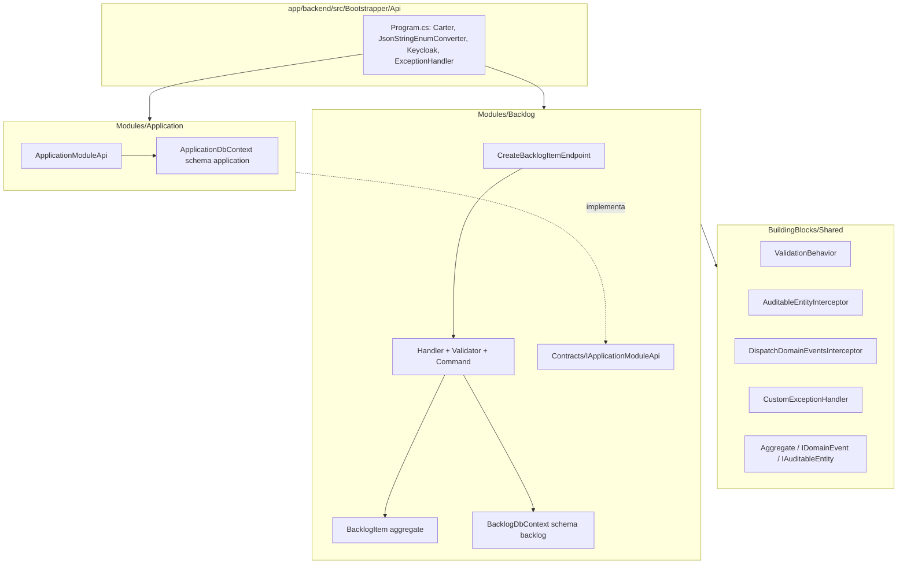

## 2. Arquitectura de Capas y Módulos

```text
app/backend/
├── TechWorkHub.sln
├── src/
│   ├── Bootstrapper/Api/            Program.cs, Api.csproj, appsettings*.json     (NUEVO)
│   ├── BuildingBlocks/Shared/       Aggregate<T>, IDomainEvent, IAuditableEntity, ICurrentUser,
│   │                                ValidationBehavior, AuditableEntityInterceptor,
│   │                                DispatchDomainEventsInterceptor, CustomExceptionHandler,
│   │                                BadRequest/NotFound exceptions                (NUEVO)
│   └── Modules/
│       ├── Backlog/                 (movido desde src/Modules/Backlog)
│       │   ├── BacklogModule.cs     AddBacklogModule + MigrateBacklogModuleAsync   (NUEVO)
│       │   ├── Contracts/IApplicationModuleApi.cs                                  (NUEVO)
│       │   ├── Domain/BacklogItems/ BacklogItem, Type(+IsTechnical), Priority, Status, BacklogItemRules, Events/
│       │   ├── Data/                BacklogDbContext, IBacklogDbContext, Configurations/, Migrations/  (NUEVO)
│       │   └── Features/BacklogItems/CreateBacklogItem/  Endpoint, Command, Handler, Validator
│       └── Application/             Módulo mínimo que implementa IApplicationModuleApi (NUEVO)
└── tests/
    ├── Unit/Backlog/                61 pruebas
    └── Integration/Backlog/         22 pruebas sobre el Program real (WebApplicationFactory)
```

Se eliminaron el `Aggregate` local y el `AuditableEntityInterceptor` vacío del módulo: ahora se reutiliza `Shared`.

## 3. Modelo de Datos y Persistencia

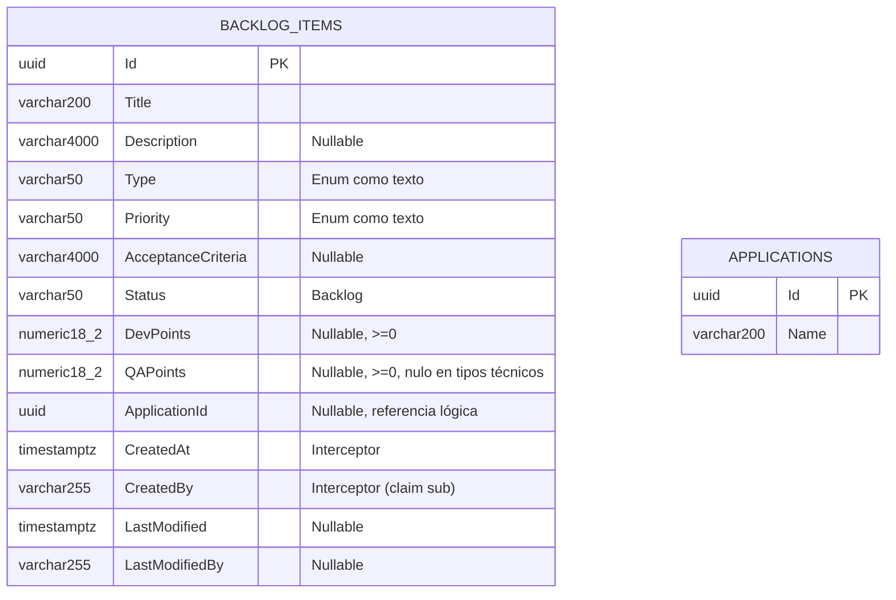

- Tabla `backlog."BacklogItems"` (schema `backlog` en minúscula) y `application."Applications"`; no hay FK ni joins entre schemas (`ApplicationId` es referencia lógica).
- **Alterado:** `Type` y `Priority` pasan de `int` a `varchar(50)` (texto, alineado con `data-model.md`); `Description`/`AcceptanceCriteria` ahora `varchar(4000)`.
- Migraciones Code-First: `Backlog/Data/Migrations/20261003204834_InitialBacklogSchema` y `Application/Data/Migrations/20261003204841_InitialApplicationSchema`, con historial `__EFMigrationsHistory` por schema.

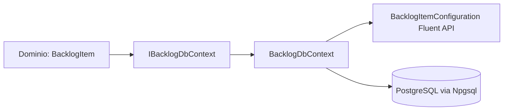

## 4. Flujo de Petición y Secuencias Críticas

```mermaid
sequenceDiagram
    actor U as Cliente
    participant A as Auth (Keycloak JWT)
    participant E as CreateBacklogItemEndpoint
    participant V as ValidationBehavior + Validator
    participant H as Handler
    participant AP as IApplicationModuleApi
    participant D as BacklogItem.Create
    participant DB as BacklogDbContext
    participant X as CustomExceptionHandler
    U->>A: POST /api/backlog/items (Bearer)
    A-->>U: 401 sin token o inválido
    A->>E: (command, CancellationToken de la solicitud)
    E->>V: Send(command, ct)
    V-->>X: ValidationException (Title/Type/Priority/puntos/longitudes)
    V->>H: command válido
    H->>H: Enum.TryParse de Type
    opt ApplicationId informado
        H->>AP: ExistsAsync(id, ct)
        AP-->>H: false → ValidationException(ApplicationId)
    end
    H->>D: Create(...)
    D-->>X: BadRequestException(QAPoints) si tipo técnico con qaPoints
    H->>DB: Add + SaveChangesAsync(ct)
    DB->>DB: AuditableEntityInterceptor (CreatedAt/CreatedBy; sin claim → 401)
    DB->>DB: DispatchDomainEventsInterceptor publica BacklogItemCreatedDomainEvent
    DB-->>H: commit
    H-->>E: Guid
    E-->>U: 201 Created { id } + Location
    X-->>U: 400 ProblemDetails con errors{} / 401 / 500
```

Cambios de comportamiento: la regla "tipo técnico ⇒ `qaPoints` nulo" vive en el agregado y **rechaza** (400) en lugar de anular en silencio (FR-008); el endpoint propaga el `CancellationToken`; `priority` y `type` viajan como texto (`JsonStringEnumConverter` global).

## 5. Seguridad y Manejo de Errores

- `POST /api/backlog/items` exige `.RequireAuthorization()` con JWT Keycloak (`Keycloak.AuthServices.Authentication`). El claim `sub` (o `NameIdentifier`) alimenta `CreatedBy`; sin claim → 401.

| Excepción | HTTP | Cuerpo |
|---|---|---|
| `ValidationException` (FluentValidation, incluye `ApplicationId` inexistente) | 400 | `ValidationProblemDetails` con `errors{Propiedad:[mensajes]}` |
| `BadRequestException` (regla de dominio, p. ej. `QAPoints` en tipo técnico) | 400 | `errors{Campo:[mensaje]}` |
| `BadHttpRequestException` (JSON malformado) | 400 | `errors{Request:[mensaje]}` |
| `UnauthorizedAccessException` (sin claim de identidad) | 401 | `ProblemDetails` |
| `NotFoundException` | 404 | `ProblemDetails` |
| `OperationCanceledException` con solicitud abortada | 499 | sin cuerpo |
| Cualquier otra | 500 | `ProblemDetails` genérico (sin detalles internos) |

## 6. ADRs

- **ADR-05 (heredado):** puntos de esfuerzo como `decimal?` (`numeric(18,2)`, `>= 0`). Se mantiene `decimal` en vez del `int?` antiguo de `data-model.md`; el documento se alineó.
- **ADR-06 (esta iteración):** `Shared` no existía en el repositorio; se creó con el mínimo que exigen la constitución y el plan (ValidationBehavior, interceptores, ExceptionHandler, Aggregate). Consecuencia: si el starter kit oficial `backend-modulith-template` se incorpora, debe reemplazar este proyecto conservando los contratos.
- **ADR-07 (esta iteración):** `IApplicationModuleApi` vive en `Backlog.Contracts` y lo implementa un módulo `Application` mínimo con su propio schema; así Backlog nunca consulta tablas de otro schema. El módulo Application real, cuando exista, debe sustituir `ApplicationModuleApi`.
- **ADR-08 (esta iteración):** `applicationId` inexistente se resuelve con `ValidationException` (clave `ApplicationId`) en el handler, que el `CustomExceptionHandler` mapea a 400; `NotFoundException` queda reservada al 404 general.
- **ADR-09 (esta iteración):** `Type` y `Priority` se persisten como texto para legibilidad y para que reordenar el enum no corrompa datos.

## 7. Cambios de esta ejecución (2026-10-03, speckit-implement backend — retrabajo)

Tareas cerradas: T013, T014, T018, T019 (con evidencia de pruebas), T020–T031 (servidor). Hallazgos: DEF-01, DEF-02 (confirmado y commiteado), DEF-03, DEF-04, DEF-05, DEF-06, `CancellationToken`, `JsonStringEnumConverter`, regla QAPoints al dominio, límites de longitud, `TryParse`, migración y schema `backlog`.

Verificación: `dotnet test TechWorkHub.sln` → 61 unitarias + 22 de integración correctas.

## 8. Cambios iteración 2/2 (hallazgos #16, #18, #19) — renderizado selectivo

Tareas cerradas (servidor): T038 (#16), T040 y T041 (#18), T042 (#19). Sin cambios: dominio, validadores, `Shared`, esquema de datos.

### 8.1 #16 — `GET /api/applications` (ALTERADO)

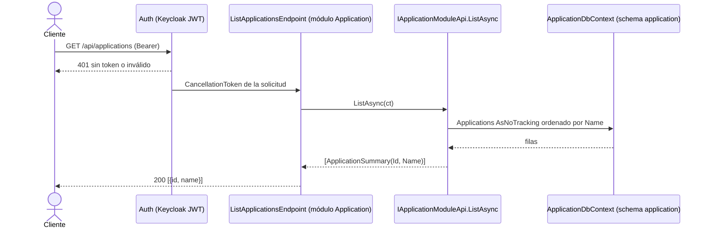

- Slice `Application/Features/Applications/ListApplications/ListApplicationsEndpoint.cs` (Carter, `.RequireAuthorization()`, `CancellationToken`).
- `IApplicationModuleApi` gana `ListAsync` y el record `ApplicationSummary(Guid Id, string Name)` (en `Backlog.Contracts`); `ApplicationModuleApi` lo implementa solo sobre el schema `application`.
- `Application.csproj` añade `FrameworkReference Microsoft.AspNetCore.App` y `Carter`; Carter descubre el endpoint entre ensamblados.

### 8.2 #19 — identidad antes del catálogo (ALTERADO)

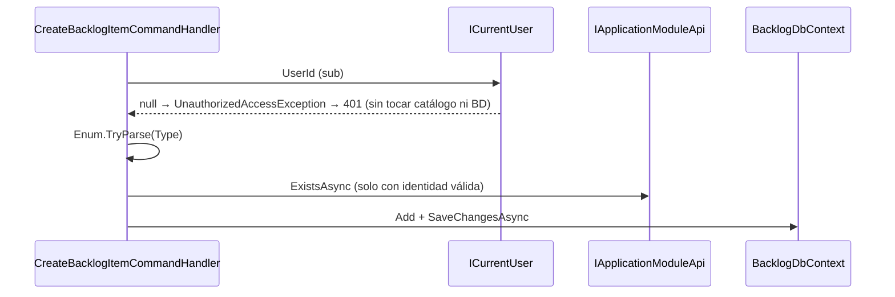

El interceptor de auditoría conserva su comprobación como defensa en profundidad.

### 8.3 #18 — Keycloak por entorno y migraciones (ALTERADO)

| Clave `Keycloak` | `appsettings.json` (base) | `appsettings.Development.json` |
|---|---|---|
| `ssl-required` | `external` | `none` |
| `verify-token-audience` | `true` (audiencia = `resource`) | `false` |
| `auth-server-url` | `https://keycloak.invalid/` (marcador; se inyecta `Keycloak__auth-server-url`) | `http://localhost:8080/` |

- Sin secretos versionados: URL real y credenciales llegan por variables de entorno.
- Migraciones: la API no migra fuera de Development (`Database:MigrateOnStartup=false` en la base). El despliegue ejecuta `app/backend/scripts/apply-migrations.sh|.ps1`, que generan y corren un bundle EF por módulo (`Application`, `Backlog`) con `ConnectionStrings__Database`.

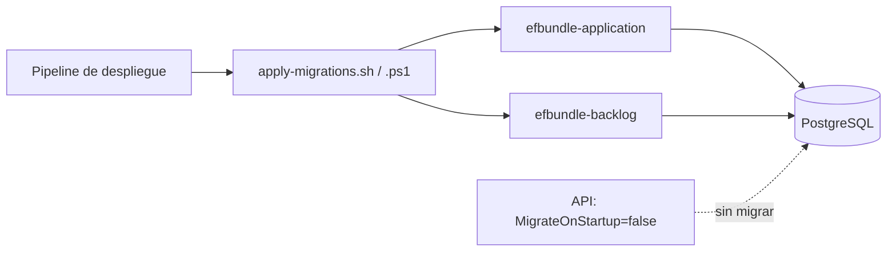

### 8.4 Verificación

`dotnet test TechWorkHub.sln`: 62 unitarias y 29 de integración correctas. Nuevas: `ListApplicationsTests` (200 con token, 401 sin token y sin consultar el catálogo, 401 sin `sub` sin consultar el catálogo), `KeycloakConfigurationTests` (la base falla si queda insegura) y `MigrationsPostgresTests` (migraciones sobre PostgreSQL 16 real con Testcontainers, incluida idempotencia).

## 10. HU-002 — Pruebas de integración con Keycloak y catálogo reales (renderizado selectivo)

Alterado: solo se añade el proyecto de pruebas `app/backend/tests/Integration/Identity` (`Identity.IntegrationTests`, registrado en `TechWorkHub.sln`) y `app/backend/README.md`. **Sin cambios** en `app/backend/src/**` (producción), en el esquema de datos ni en los contratos HTTP de HU-001.

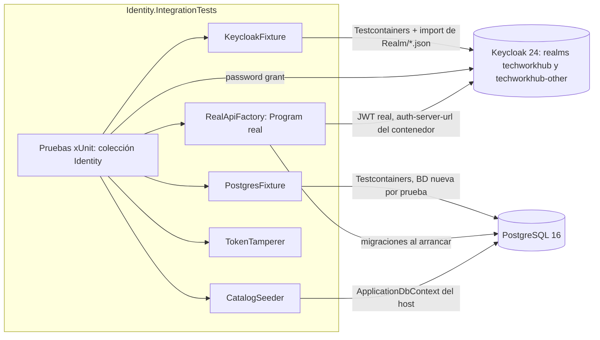

```mermaid
sequenceDiagram
    participant T as Prueba
    participant K as Keycloak real
    participant A as Program real (Api)
    participant C as ApplicationModuleApi real
    participant P as PostgreSQL real
    T->>P: CatalogSeeder crea aplicaciones (schema application)
    T->>K: password grant (cliente techworkhub-tests, audience techworkhub-api)
    K-->>T: access token
    T->>A: GET /api/applications o POST /api/backlog/items (Bearer)
    A->>K: metadata/claves (auth-server-url del contenedor)
    A->>C: ListAsync / ExistsAsync
    C->>P: consulta schema application
    A-->>T: 200/201 (token válido) o 401 (ausente, firma alterada, expirada, otro emisor, otra audiencia)
    T->>P: verifica filas (sin efectos en 401; CreatedBy == sub en 201)
```

| Pieza | Responsabilidad |
|---|---|
| `Fixtures/KeycloakFixture` | Keycloak real por suite, `BaseAddress` única, `GetTokenAsync(TokenVariant)`, primer token con reintento acotado, fallo explícito que nombra "Keycloak" |
| `Fixtures/PostgresFixture` | PostgreSQL por suite, BD nueva por prueba; fallo explícito que nombra "PostgreSQL/Docker" |
| `Fixtures/RealApiFactory` | Hospeda el `Program` real; solo inyecta cadena de conexión, `MigrateOnStartup`, `Keycloak:auth-server-url` y `Keycloak:ssl-required=none`; sin sustituir servicios |
| `Realm/*.json` | Realms `techworkhub` (clientes `techworkhub-tests`, `-noaud`, `-shortlived`) y `techworkhub-other`; usuario `qa.user` |
| `Support/CatalogSeeder`, `TokenTamperer`, `ItemPayload` | Siembra del catálogo real, alteración de firma, payload válido de HU-001 |

- **Resultado del spike T008 (excepción acotada, para revisión de QA-Tech / T030):** con `Keycloak:ssl-required=external` el host lanza "The MetadataAddress or Authority must use HTTPS" ante el Keycloak HTTP del contenedor. La única relajación es `ssl-required=none` en la fábrica de la suite; `verify-token-audience=true`, `realm=techworkhub` y `resource=techworkhub-api` se mantienen y los protege `ProductionConfigGuardTests`. El entorno de la fábrica es `Testing` para no cargar `appsettings.Development.json` (que desactiva la audiencia).
- **Cobertura:** 19 casos = US1 (3) + US2 (3) + US3 (10: 5 credenciales × 2 rutas) + guardias (2) + idempotencia (1).
- **Verificación (2026-10-03):** `dotnet test TechWorkHub.sln` → 62 unitarias, 31 de integración de Backlog y 19 de Identity, todas correctas. `git diff main -- app/backend/src` sin cambios de código fuente (solo artefactos `bin/obj` ya rastreados). Anti-tautología: sin el *audience mapper* en `techworkhub-tests`, las pruebas de camino feliz devuelven 401; el realm se restauró.
- Primera ejecución: descarga de imágenes; usar `IDENTITY_TESTS_STARTUP_TIMEOUT_SECONDS=400`.

## 11. HU-003 — Módulo `Sprints`: crear y consultar Sprints de 2 semanas (renderizado selectivo)

Alterado: nuevo módulo `Modules/Sprints` (schema `sprints`, `SprintsDbContext` propio), tres endpoints en Vertical Slice, migración `InitialSprintsSchema`, registro en `Api.csproj`/`Program.cs`/`TechWorkHub.sln` y en los scripts `apply-migrations`. **Sin cambios** en `Shared`, `Backlog` ni `Application`. El frontend (T005, T038–T048, T052) queda fuera de esta ejecución (alcance solo backend).

### 11.1 Contenedores y estructura

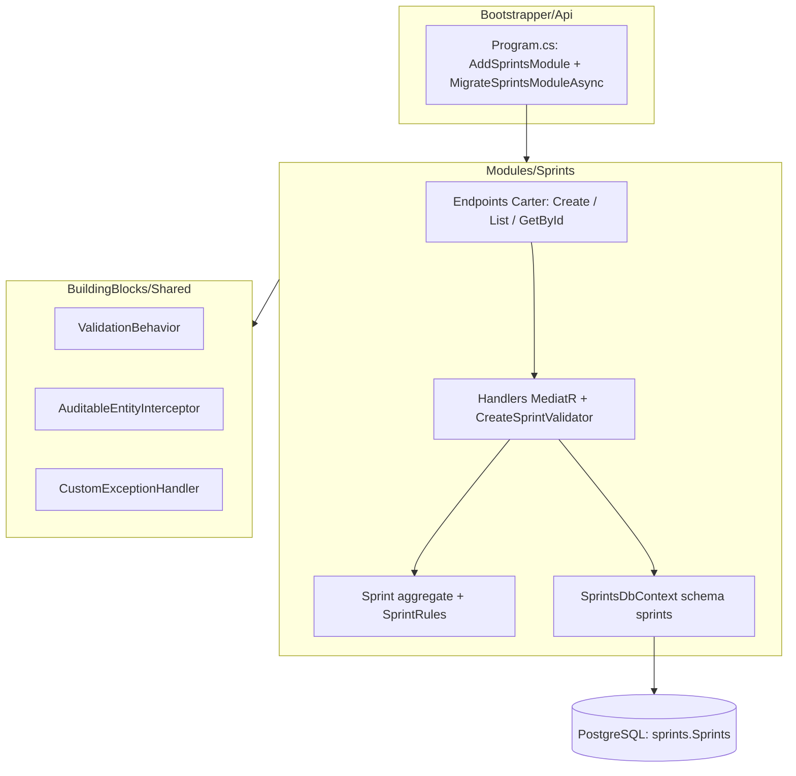

```text
app/backend/src/Modules/Sprints/
├── Sprints.csproj
├── SprintsModule.cs                          AddSprintsModule + MigrateSprintsModuleAsync (NUEVO)
├── Domain/Sprints/                           Sprint (Aggregate<Guid>, IAuditableEntity), SprintRules
├── Data/                                     ISprintsDbContext, SprintsDbContext, SprintsDbContextFactory,
│   │                                         Configurations/SprintConfiguration, Migrations/InitialSprintsSchema
└── Features/Sprints/
    ├── SprintResponse.cs                     Id, Identification, StartDate, EndDate (compartido)
    ├── CreateSprint/                         Command · Validator · Handler · Endpoint
    ├── ListSprints/                          Query · Handler · Endpoint
    └── GetSprintById/                        Query · Handler · Endpoint
tests/Unit/Sprints/                           43 pruebas (dominio, validador, handlers)
tests/Integration/Sprints/                    46 pruebas sobre el Program real y PostgreSQL real (Testcontainers)
```

### 11.2 Modelo de datos

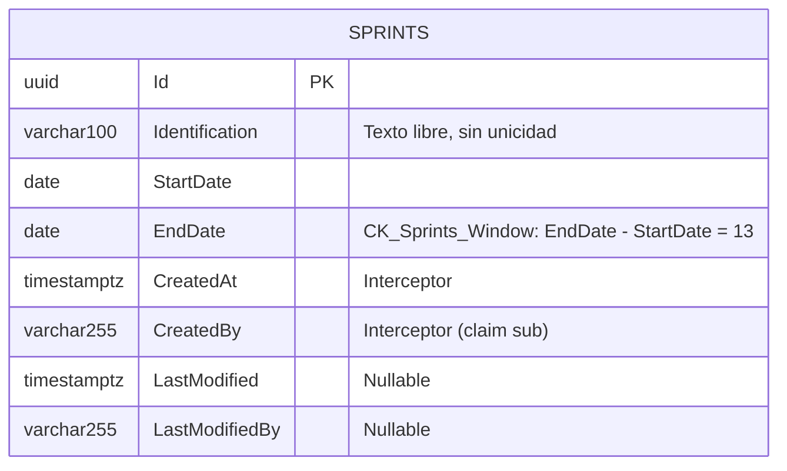

Tabla `sprints."Sprints"` sin FK ni navegación hacia `backlog`/`application`, sin estado y sin índice único. La regla de ventana (14 días calendario inclusivos, `fin = inicio + 13`) tiene fuente única `SprintRules.WindowDays` y se aplica en tres capas: validador (400 por campo), `Sprint.Create` (`BadRequestException`) y la restricción `CK_Sprints_Window`.

### 11.3 Contrato HTTP

| Método y ruta | Éxito | Errores |
|---|---|---|
| `POST /api/sprints` `{identification, startDate, endDate}` | 201 + `Location: /api/sprints/{id}` y `{id, identification, startDate, endDate}` | 400 (`errors` por campo camelCase), 401, 500 |
| `GET /api/sprints` | 200, arreglo ordenado por `startDate` y `id` | 401 |
| `GET /api/sprints/{id:guid}` | 200 `SprintResponse` | 401, 404 (un id que no es GUID no coincide con la ruta) |

Los tres exigen `.RequireAuthorization()` y propagan el `CancellationToken` hasta EF Core.

### 11.4 Secuencia: crear Sprint

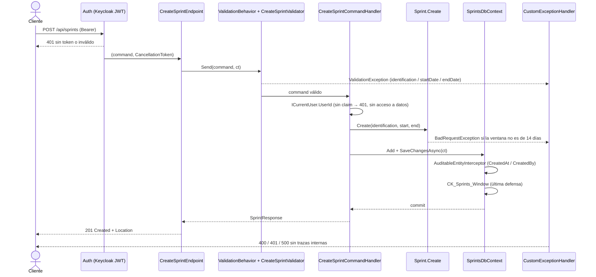

### 11.5 Errores específicos

| Origen | HTTP | Campo en `errors` |
|---|---|---|
| Identificación vacía o > 100 caracteres | 400 | `identification` |
| Fecha ausente o con formato distinto de `yyyy-MM-dd` | 400 | `startDate` / `endDate` |
| Fin ≤ inicio, o ventana ≠ 14 días | 400 | `endDate` |
| Sprint inexistente | 404 | — |
| Fallo de persistencia | 500 | `ProblemDetails` genérico |

### 11.6 Decisiones de esta iteración

- **ADR-10 — claves de error en camelCase:** el `CustomExceptionHandler` de `Shared` usa el nombre de propiedad tal cual (PascalCase en Backlog). El contrato OpenAPI de HU-003 exige camelCase, así que el validador usa `OverridePropertyName` y `BadRequestException` recibe constantes camelCase de `SprintRules`, sin modificar `Shared`. Consecuencia: Sprints y Backlog difieren en el casing de `errors`; unificarlo requiere tocar `Shared` y es decisión del equipo.
- **ADR-11 — sin Mapster en este módulo:** `tasks.md` (T001/T021) mencionaba Mapster, pero ningún módulo del repositorio lo referencia y `SprintResponse` es un record de cuatro campos. Se proyecta con el constructor del record (`Select(s => new SprintResponse(...))`), sin mapeadores ni librerías nuevas.
- **ADR-12 — scripts de despliegue:** `apply-migrations.sh|.ps1` solo migraban `Application` y `Backlog`; se añadió `Sprints` para que el schema se cree fuera de Development. Es un cambio fuera de la lista de ficheros permitidos de `tasks.md`, necesario para que el despliegue no omita el módulo.
- **ADR-13 — pruebas de lectura con proveedor en memoria:** los handlers de listado y detalle se prueban unitariamente sobre el `SprintsDbContext` real con `Microsoft.EntityFrameworkCore.InMemory` (solo en el proyecto de pruebas); la verificación contra PostgreSQL real la hacen las pruebas de integración.

### 11.7 Verificación

`dotnet test app/backend/TechWorkHub.sln` (2026-10-04): `Sprints.UnitTests` 43, `Sprints.IntegrationTests` 46, `Backlog.UnitTests` 62, `Backlog.IntegrationTests` 31 e `Identity.IntegrationTests` 19, todas correctas. Se instaló `dotnet-ef` 8.0.11 (global) para generar la migración; los scripts de bundle siguen sin ejecutarse.

## 9. Puntos abiertos

- HU-003: el frontend (páginas `sprint-form`, `sprint-list`, `sprint-detail`, rutas e i18n) y T052/T053 (escenario de UI del quickstart) no se ejecutaron en esta pasada, por alcance solo backend. El supuesto de ventana de 14 días inclusivos sigue pendiente de confirmación de negocio (punto abierto 3 de la HU).

- El resto de pruebas de integración sigue con SQLite en memoria; T037/T043 (INT-01..INT-10 sobre PostgreSQL) quedan para QA.
- Los scripts `apply-migrations` no se ejecutaron: `dotnet-ef` no está instalado en este entorno, así que la generación del bundle no está verificada (sí lo está la migración sobre PostgreSQL).
- `auth-server-url` base es un marcador: debe fijarse por entorno antes de desplegar.
- T017 (quickstart por cURL), T018, T025 y T032 siguen abiertas a la espera de evidencia de QA (T043). T039 y T032 son de interfaz, fuera de este alcance.
