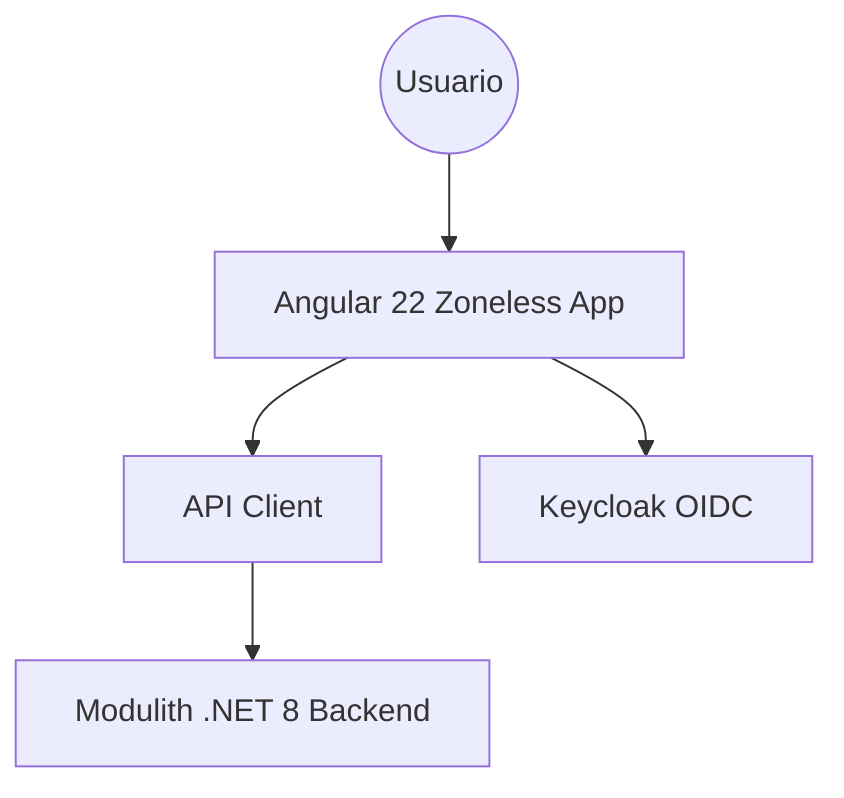
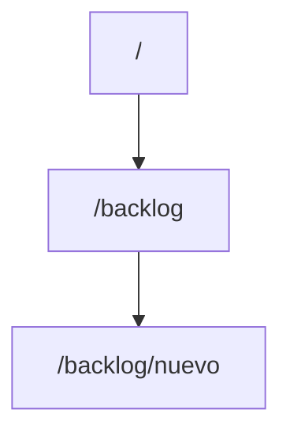
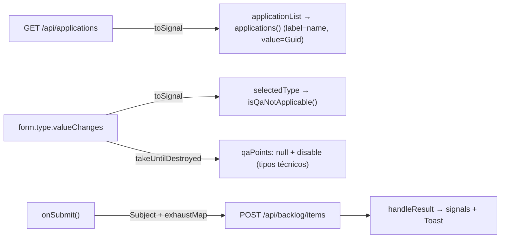
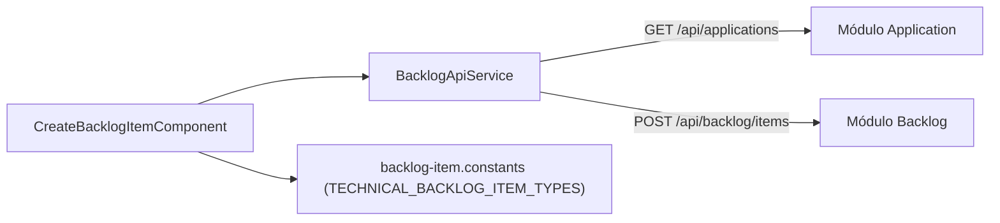
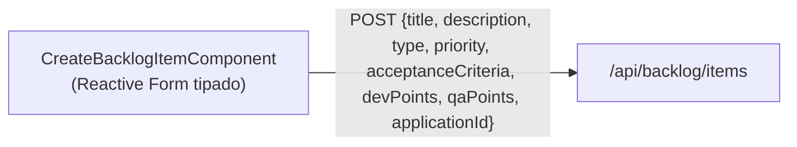
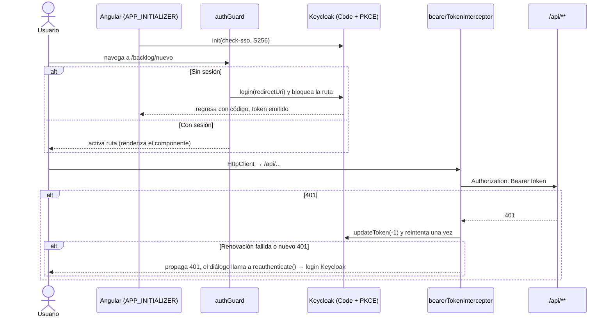

# 🏗️ ARQUITECTURA FRONTEND VIVA

## 1. Información General y Objetivo
- **Sistema:** TechWorkHub
- **Versión:** 1.0.0
- **Fecha de última actualización:** 2026-10-03
- **Equipo:** Frontend / SpecKit
- **Objetivo:** Plataforma modular basada en Angular 22 Zoneless con Signals para la gestión de proyectos y backlog multitipo.

## 2. Contexto y Arquitectura General


## 3. Estructura del Proyecto y Enrutamiento
- **Módulos (`app/frontend/src/app/`):**
  - `features/backlog/components/create-backlog-item/`: `CreateBacklogItemComponent` (`.ts`, `.html`, `.scss` sin reglas de maquetación, `.spec.ts`).
  - `features/backlog/models/`: `backlog-item.models.ts` (contratos tipados: request, response, `RegisteredApplication`, `ProblemDetails`) y `backlog-item.constants.ts` (catálogo de tipos y prioridades, y `TECHNICAL_BACKLOG_ITEM_TYPES` como única fuente de los tipos técnicos).
  - `features/backlog/services/backlog-api.service.ts`: `BacklogApiService` (`createItem`, `getApplications`).
  - Configuración del proyecto (HU-001, T033): `package.json`, `angular.json`, `tsconfig*.json`, `jest.config.ts`, `src/setup-jest.ts`, `src/styles.scss` (importa PrimeFlex), `src/main.ts`, `app.config.ts` (zoneless + `provideHttpClient` + tema Aura).
- **Rutas Principales:**


## 4. Gestión de Estado y Autenticación
- **Estado Local:** Manejado mediante Signals de Angular 22 (`isSubmitting`, `sessionExpired`, `serverError`, `applicationsLoadFailed`, `fieldErrors`). `selectedType`, `charsCount` y el catálogo de aplicaciones se derivan con `toSignal`/`computed` (sin `subscribe()` manual salvo los dos flujos con `takeUntilDestroyed`: activar/desactivar `qaPoints` y el envío `exhaustMap`).
- **Formulario:** `FormGroup<BacklogItemForm>` fuertemente tipado (`NonNullableFormBuilder`); `qaPoints` inicia en `null`.


- **Autenticación:** OIDC con Keycloak. Las llamadas fallidas (401) muestran un diálogo bloqueante para reautenticación forzada.

## 5. Comunicación con Backend y Manejo de Errores
- **Interacción de Registro de Elementos (CreateBacklogItemComponent):**
```mermaid
sequenceDiagram
    actor U as Usuario
    participant UI as CreateBacklogItemComponent
    participant API as Backend POST /api/backlog/items

    U->>UI: Llena Formulario y Envía
    UI->>UI: Valida campos requeridos (Angular Reactive Forms)
    UI->>API: HTTP POST Payload
    alt Éxito (201)
        API-->>UI: 201 Created (UUID)
        UI-->>U: Muestra Toast de Éxito y Resetea Formulario
    else Error Validación (400)
        API-->>UI: 400 ProblemDetails { errors: { Campo: [mensajes] } }
        UI-->>U: Asigna cada mensaje al campo (fieldErrors + setErrors server); errores sin campo (Request) van al Toast
    else Cancelar
        U->>UI: onCancel(): reset del formulario y limpieza de errores
    else Expira Sesión (401)
        API-->>UI: 401 Unauthorized
        UI-->>U: Muestra Diálogo Bloqueante de Reautenticación
    else Fallo Interno (500)
        API-->>UI: 500 Internal Server Error
        UI-->>U: Muestra Mensaje de Error (Mantiene estado)
    end
```

### Retrabajo de interfaz (speckit-implement, 2026-10-03, T032–T036)
- **T032 / DEF-07:** las aplicaciones se cargan con `BacklogApiService.getApplications()` (`GET /api/applications`, `{ id: Guid, name }[]`); se eliminó el valor `app-id-101`. Si la carga falla se informa y el campo sigue siendo opcional.
- **T033 / DEF-08:** se creó `create-backlog-item.component.scss` (sin maquetación) y la configuración `package.json`, `angular.json`, `tsconfig*.json`, `jest.config.ts`. Dependencias: Angular 22.2, PrimeNG 22.1, PrimeFlex 3, Jest 30 + `jest-preset-angular` 17 (modo zoneless), TypeScript 6.0 (exigido por `@angular/build` 22).
- **T034:** `qaPoints` inicia en `null` y se envía `null` en UserStory/Bug sin estimación y en todo tipo técnico; ya no se envía `0`.
- **T035:** el 400 se interpreta como `ProblemDetails`; `errors` (`Title`, `Type`, `Priority`, `DevPoints`, `QAPoints`, `ApplicationId`, `Description`, `AcceptanceCriteria`) se muestra por campo; las claves sin campo (`Request`) y `title` van al Toast.
- **T036:** `subscribe()` manuales sustituidos por `toSignal`/`takeUntilDestroyed`; plantilla con `@if`/`@else if` (sin `*ngIf` ni `CommonModule`); handler `onCancel()`; tipos técnicos centralizados en `TECHNICAL_BACKLOG_ITEM_TYPES`; `p-dropdown` → `p-select` y `p-inputnumber` según la API de PrimeNG 22.
- **Verificación:** Jest 19/19 en verde; `ngc -p tsconfig.app.json --noEmit` sin errores con `strictTemplates`. `ng build` no se ejecutó: el CLI exige Node ≥ 22.22.3 y el entorno tiene 22.20.0.
- **Puntos abiertos:** (1) el backend no expone aún `GET /api/applications` (solo `IApplicationModuleApi.ExistsAsync`) ni `contracts/api.md` lo documenta; el cliente asume `[{ id, name }]` y requiere una tarea de servidor. (2) T037 (integración servidor + QA) sigue abierta.





## 6. Registros de Decisiones de Arquitectura (ADRs)
### ADR-001: Angular 22 Zoneless + PrimeNG v22.1.1
- **Contexto:** Se requiere alta reactividad y performance sin las penalizaciones de zone.js.
- **Decisión:** Uso de `standalone components` y Signals, omitiendo zone.js.
- **Consecuencias:** Rendimiento superior, estado inmutable nativo, requiere conocimiento de Signals.

### ADR-002: Desacoplamiento de Estimaciones QA y Dev
- **Contexto:** Las tareas técnicas (Spikes, TechDebt) no requieren esfuerzo QA.
- **Decisión:** Inactivación reactiva del campo `qaPoints` con payload dinámico (`qaPoints: null`) basado en el selector de tipo.
- **Consecuencias:** Payload flexible alineado al FR-008.

### Retrabajo de interfaz (speckit-implement, 2026-10-03, T039 / [CAPA:PLAN] #17)
Autenticación del cliente (FR-001, FR-009): login Keycloak (Authorization Code + PKCE S256), `HttpInterceptorFn` con el Bearer, guard de ruta y reautenticación ante 401.

- **Archivos nuevos (`app/frontend/src/app/`):**
  - `core/auth/auth.config.ts`: tokens `KEYCLOAK_CONFIG` (url, realm `techworkhub`, clientId `techworkhub-web`) y `KEYCLOAK` (instancia de `keycloak-js`, sustituible en pruebas).
  - `core/auth/auth.service.ts`: `AuthService` (`init`, `token`, `login`, `reauthenticate`, `refreshToken`, signal `isAuthenticated`).
  - `core/auth/bearer-token.interceptor.ts`: `bearerTokenInterceptor` (solo `/api/**`).
  - `core/auth/auth.guard.ts`: `authGuard` (`CanActivateFn`).
  - `app.routes.ts`: `/backlog/nuevo` con `canActivate: [authGuard]` y `loadComponent`; `''` y `**` redirigen a esa ruta.
- **Modificados:** `app.config.ts` (`provideRouter`, `withInterceptors([bearerTokenInterceptor])`, `provideAppInitializer` → `AuthService.init()`), `app.component.ts` (ahora `<router-outlet />`), `CreateBacklogItemComponent.reauthenticate()` (delega en `AuthService.reauthenticate()`, ya no navega a `/auth/login`), `jest.config.ts` (transforma `keycloak-js` ESM) y `tsconfig.spec.json` (`allowJs`). Dependencia añadida: `keycloak-js`.


- **Verificación:** Jest 31/31 en verde (interceptor, guard, `AuthService`, más las pruebas previas); `ngc -p tsconfig.app.json --noEmit` sin errores. `ng build` no se ejecutó (Node 22.20.0 < 22.22.3 exigido por el CLI). La URL/realm/clientId de Keycloak son valores por defecto de desarrollo (`KEYCLOAK_CONFIG`); el cliente `techworkhub-web` debe existir como cliente público en el realm.
