# 🏗️ ARQUITECTURA FRONTEND VIVA

## 1. Información General y Objetivo
- **Sistema:** TechWorkHub
- **Versión:** 1.0.0
- **Fecha de última actualización:** 2026-10-05 (HU-035)
- **Equipo:** Frontend / SpecKit
- **Objetivo:** Plataforma modular basada en Angular 22 Zoneless con Signals para la gestión de proyectos y backlog multitipo.

## 2. Contexto y Arquitectura General
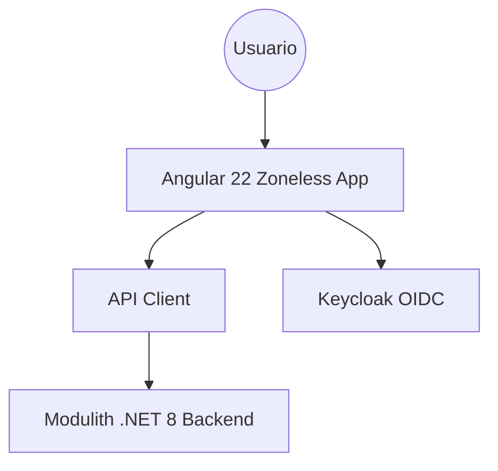

## 3. Estructura del Proyecto y Enrutamiento
- **Módulos (`app/frontend/src/app/`):**
  - `features/backlog/components/create-backlog-item/`: `CreateBacklogItemComponent` (`.ts`, `.html`, `.scss` sin reglas de maquetación, `.spec.ts`).
  - `features/backlog/models/`: `backlog-item.models.ts` (contratos tipados: request, response, `RegisteredApplication`, `ProblemDetails`) y `backlog-item.constants.ts` (catálogo de tipos y prioridades, y `TECHNICAL_BACKLOG_ITEM_TYPES` como única fuente de los tipos técnicos).
  - `features/backlog/services/backlog-api.service.ts`: `BacklogApiService` (`createItem`, `getApplications`).
  - Configuración del proyecto (HU-001, T033): `package.json`, `angular.json`, `tsconfig*.json`, `jest.config.ts`, `src/setup-jest.ts`, `src/styles.css` (importa Tailwind CSS v4, `tailwindcss-primeui` y PrimeIcons) y `.postcssrc.json` (`@tailwindcss/postcss`), `src/main.ts`, `app.config.ts` (zoneless + `provideHttpClient` + tema Aura).
- **Rutas Principales:**
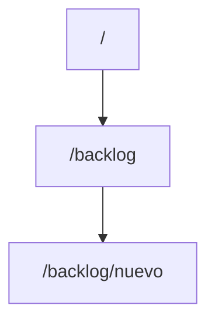

## 4. Gestión de Estado y Autenticación
- **Estado Local:** Manejado mediante Signals de Angular 22 (`isSubmitting`, `sessionExpired`, `serverError`, `applicationsLoadFailed`, `fieldErrors`). `selectedType`, `charsCount` y el catálogo de aplicaciones se derivan con `toSignal`/`computed` (sin `subscribe()` manual salvo los dos flujos con `takeUntilDestroyed`: activar/desactivar `qaPoints` y el envío `exhaustMap`).
- **Formulario:** `FormGroup<BacklogItemForm>` fuertemente tipado (`NonNullableFormBuilder`); `qaPoints` inicia en `null`.

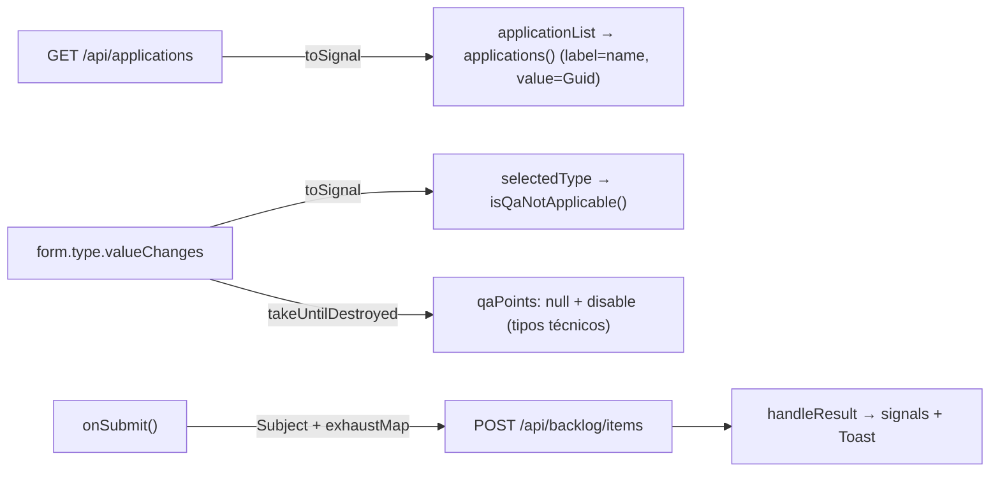
- **Autenticación:** OIDC con Keycloak. Las llamadas fallidas (401) muestran un diálogo bloqueante para reautenticación forzada.

## 5. Comunicación con Backend y Manejo de Errores
- **Interacción de Registro de Elementos (CreateBacklogItemComponent):**
```mermaid
sequenceDiagram
    actor U as Usuario
    participant UI as CreateBacklogItemComponent
    participant API as Backend POST /api/backlog/items

    U->>UI: Llena Formulario y Envía
    UI->>UI: Valida campos requeridos (Angular Reactive Forms)
    UI->>API: HTTP POST Payload
    alt Éxito (201)
        API-->>UI: 201 Created (UUID)
        UI-->>U: Muestra Toast de Éxito y Resetea Formulario
    else Error Validación (400)
        API-->>UI: 400 ProblemDetails { errors: { Campo: [mensajes] } }
        UI-->>U: Asigna cada mensaje al campo (fieldErrors + setErrors server); errores sin campo (Request) van al Toast
    else Cancelar
        U->>UI: onCancel(): reset del formulario y limpieza de errores
    else Expira Sesión (401)
        API-->>UI: 401 Unauthorized
        UI-->>U: Muestra Diálogo Bloqueante de Reautenticación
    else Fallo Interno (500)
        API-->>UI: 500 Internal Server Error
        UI-->>U: Muestra Mensaje de Error (Mantiene estado)
    end
```

### Retrabajo de interfaz (speckit-implement, 2026-10-03, T032–T036)
- **T032 / DEF-07:** las aplicaciones se cargan con `BacklogApiService.getApplications()` (`GET /api/applications`, `{ id: Guid, name }[]`); se eliminó el valor `app-id-101`. Si la carga falla se informa y el campo sigue siendo opcional.
- **T033 / DEF-08:** se creó `create-backlog-item.component.scss` (sin maquetación) y la configuración `package.json`, `angular.json`, `tsconfig*.json`, `jest.config.ts`. Dependencias: Angular 22.2, PrimeNG 22.1, PrimeFlex 3, Jest 30 + `jest-preset-angular` 17 (modo zoneless), TypeScript 6.0 (exigido por `@angular/build` 22).
- **T034:** `qaPoints` inicia en `null` y se envía `null` en UserStory/Bug sin estimación y en todo tipo técnico; ya no se envía `0`.
- **T035:** el 400 se interpreta como `ProblemDetails`; `errors` (`Title`, `Type`, `Priority`, `DevPoints`, `QAPoints`, `ApplicationId`, `Description`, `AcceptanceCriteria`) se muestra por campo; las claves sin campo (`Request`) y `title` van al Toast.
- **T036:** `subscribe()` manuales sustituidos por `toSignal`/`takeUntilDestroyed`; plantilla con `@if`/`@else if` (sin `*ngIf` ni `CommonModule`); handler `onCancel()`; tipos técnicos centralizados en `TECHNICAL_BACKLOG_ITEM_TYPES`; `p-dropdown` → `p-select` y `p-inputnumber` según la API de PrimeNG 22.
- **Verificación:** Jest 19/19 en verde; `ngc -p tsconfig.app.json --noEmit` sin errores con `strictTemplates`. `ng build` no se ejecutó: el CLI exige Node ≥ 22.22.3 y el entorno tiene 22.20.0.
- **Puntos abiertos:** (1) el backend no expone aún `GET /api/applications` (solo `IApplicationModuleApi.ExistsAsync`) ni `contracts/api.md` lo documenta; el cliente asume `[{ id, name }]` y requiere una tarea de servidor. (2) T037 (integración servidor + QA) sigue abierta.

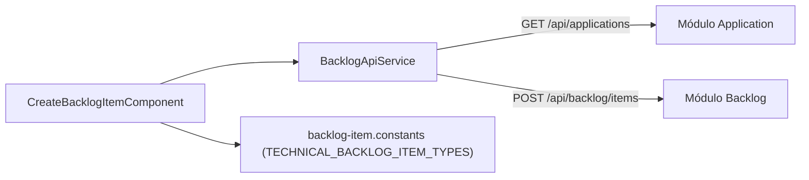

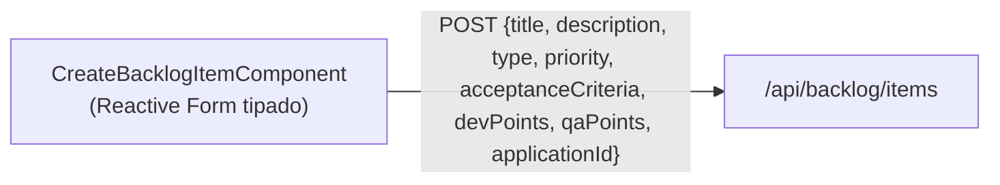

## 6. Registros de Decisiones de Arquitectura (ADRs)
### ADR-001: Angular 22 Zoneless + PrimeNG v22.1.1
- **Contexto:** Se requiere alta reactividad y performance sin las penalizaciones de zone.js.
- **Decisión:** Uso de `standalone components` y Signals, omitiendo zone.js.
- **Consecuencias:** Rendimiento superior, estado inmutable nativo, requiere conocimiento de Signals.

### ADR-002: Desacoplamiento de Estimaciones QA y Dev
- **Contexto:** Las tareas técnicas (Spikes, TechDebt) no requieren esfuerzo QA.
- **Decisión:** Inactivación reactiva del campo `qaPoints` con payload dinámico (`qaPoints: null`) basado en el selector de tipo.
- **Consecuencias:** Payload flexible alineado al FR-008.

### Retrabajo de interfaz (speckit-implement, 2026-10-03, T039 / [CAPA:PLAN] #17)
Autenticación del cliente (FR-001, FR-009): login Keycloak (Authorization Code + PKCE S256), `HttpInterceptorFn` con el Bearer, guard de ruta y reautenticación ante 401.

- **Archivos nuevos (`app/frontend/src/app/`):**
  - `core/auth/auth.config.ts`: tokens `KEYCLOAK_CONFIG` (url, realm `techworkhub`, clientId `techworkhub-web`) y `KEYCLOAK` (instancia de `keycloak-js`, sustituible en pruebas).
  - `core/auth/auth.service.ts`: `AuthService` (`init`, `token`, `login`, `reauthenticate`, `refreshToken`, signal `isAuthenticated`).
  - `core/auth/bearer-token.interceptor.ts`: `bearerTokenInterceptor` (solo `/api/**`).
  - `core/auth/auth.guard.ts`: `authGuard` (`CanActivateFn`).
  - `app.routes.ts`: `/backlog/nuevo` con `canActivate: [authGuard]` y `loadComponent`; `''` y `**` redirigen a esa ruta.
- **Modificados:** `app.config.ts` (`provideRouter`, `withInterceptors([bearerTokenInterceptor])`, `provideAppInitializer` → `AuthService.init()`), `app.component.ts` (ahora `<router-outlet />`), `CreateBacklogItemComponent.reauthenticate()` (delega en `AuthService.reauthenticate()`, ya no navega a `/auth/login`), `jest.config.ts` (transforma `keycloak-js` ESM) y `tsconfig.spec.json` (`allowJs`). Dependencia añadida: `keycloak-js`.

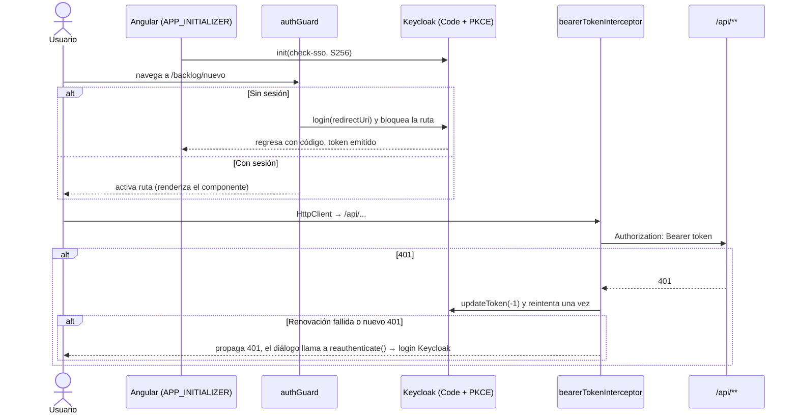
- **Verificación:** Jest 31/31 en verde (interceptor, guard, `AuthService`, más las pruebas previas); `ngc -p tsconfig.app.json --noEmit` sin errores. `ng build` no se ejecutó (Node 22.20.0 < 22.22.3 exigido por el CLI). La URL/realm/clientId de Keycloak son valores por defecto de desarrollo (`KEYCLOAK_CONFIG`); el cliente `techworkhub-web` debe existir como cliente público en el realm.

### Revisión de vigencia (speckit-implement, 2026-10-03, feature 002)
La feature 002 (`specs/002-pruebas-integracion-keycloak-catalogo`) es exclusivamente un proyecto de pruebas de integración de backend (`app/backend/tests/Integration/Identity/`); su `tasks.md` no contiene tareas de frontend. **No se modificó ningún archivo de `app/frontend/`**, por lo que rutas, componentes, flujos de estado y llamadas a la API documentados arriba siguen vigentes.

Relación con el cliente (sin cambios de código): las pruebas validan en el servidor el contrato que consume `BacklogApiService`.

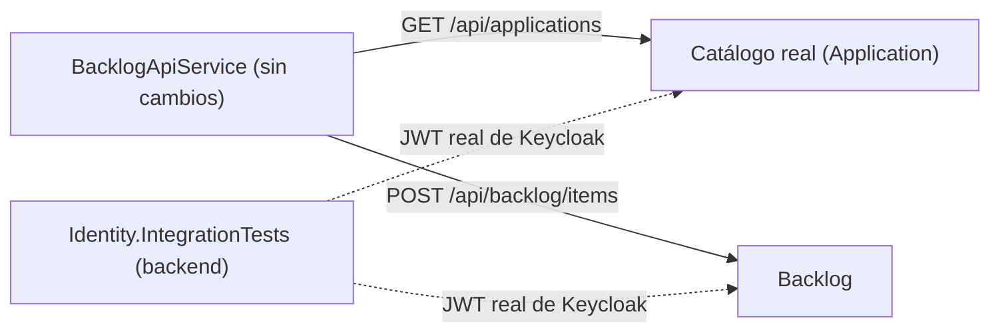

- **Nota:** el punto abierto (1) de T032–T036 queda cubierto en el servidor: `GET /api/applications` es ejercitado por `ListApplicationsRealTests` contra el catálogo real.

### HU-003 — Gestión de Sprint de Dos Semanas (speckit-implement, 2026-10-04, T005 y T038–T048)
Se añadió la feature `features/sprints/` (crear, listar y consultar Sprints). No se modificó `features/backlog`, `core/auth` ni `app.config.ts`; el único archivo existente alterado es `app.routes.ts`.

- **Archivos nuevos (`app/frontend/src/app/features/sprints/`):**
  - `models/sprint.models.ts`: `Sprint`, `CreateSprintRequest` y `ProblemDetails` (fechas como `yyyy-MM-dd`, igual que `SprintResponse` del contrato OpenAPI).
  - `models/sprint-date.ts`: `toIsoDate(Date)`, formatea con partes locales (evita corrimientos por UTC).
  - `services/sprint-api.service.ts`: `SprintApiService` (`create` → `POST /api/sprints`, `list` → `GET /api/sprints`, `getById` → `GET /api/sprints/{id}`).
  - `components/sprint-form/`: `SprintFormComponent` (formulario reactivo tipado, `p-datepicker` ×2, banner y errores por campo, diálogo 401).
  - `components/sprint-list/`: `SprintListComponent` (`p-table` con estados cargando/vacío/error/401, `p-toast`).
  - `components/sprint-detail/`: `SprintDetailComponent` (`p-card` de solo lectura, estados 404/error/401).
  - Cada componente es standalone con `ChangeDetectionStrategy.OnPush`, su `.scss` sin reglas de maquetación y su `.spec.ts`.
- **Modificado:** `app.routes.ts` — ruta padre `sprints` con `authGuard` y `providers: [MessageService]`, e hijas lazy `''` (listado), `nuevo` (formulario) y `:id` (detalle). `nuevo` va antes que `:id`.

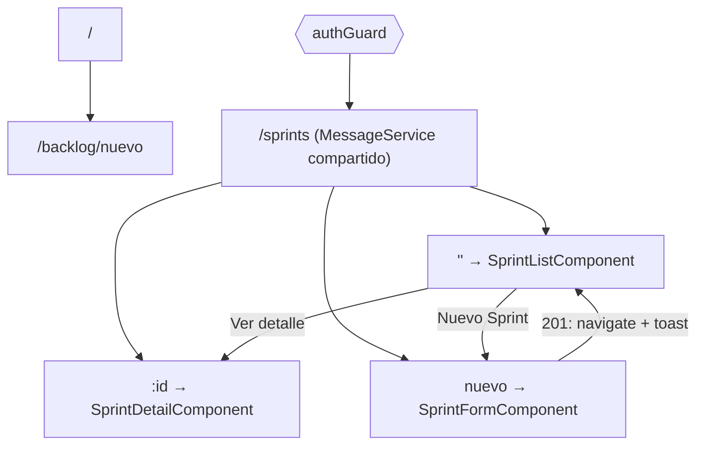

- **Estado:** el listado y el detalle exponen un único `state` (`toSignal` sobre un union discriminado `loading | ready | notFound | unauthorized | error`), sin `subscribe()` manual. El formulario usa Signals (`isSubmitting`, `sessionExpired`, `serverError`, `submitAttempted`, `fieldErrors`) y `computed` para el banner; el único `subscribe` es el flujo `Subject + exhaustMap` con `takeUntilDestroyed`, que evita el doble envío.
- **Regla de negocio:** la ventana de 14 días no se valida en el cliente (la fuente de verdad es el servidor, decisión D-05 del UX); el cliente solo exige identificación (≤ 100) y ambas fechas.

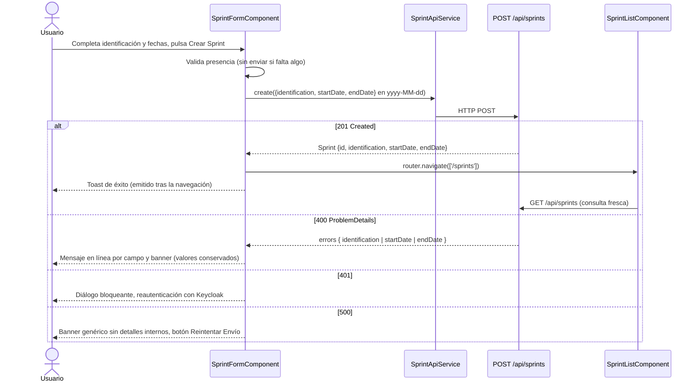

- **ADR-003: toast tras la navegación.** *Contexto:* `p-toast` solo recibe mensajes emitidos después de montarse y el listado se monta al navegar. *Decisión:* `MessageService` se provee en la ruta padre `sprints` y el formulario emite el mensaje en el `then` de `router.navigate`. *Consecuencias:* (+) el toast de éxito aparece en el listado sin estado global; (−) depende de que las tres páginas cuelguen de la misma ruta padre.
- **Verificación:** Jest 57/57 en verde (8 suites); `ngc -p tsconfig.app.json --noEmit` sin errores con `strictTemplates`. `ng build` no se ejecutó (el CLI exige Node ≥ 22.22.3 y el entorno tiene 22.20.0), por lo que T052 queda abierta; T053 (escenarios del quickstart contra API y UI en ejecución) tampoco se ejecutó.
- **Puntos abiertos:** (1) T048: el frontend no tiene mecanismo i18n (`$localize`/`i18n`); los textos de Sprints son literales en español, igual que `features/backlog`. (2) No hay shell (menú, sidebar, breadcrumb) en la SPA actual, por lo que el diseño UX de esos elementos no se implementó; las páginas se enlazan entre sí con botones. (3) `/sprints` no tiene entrada de navegación global. (4) No existe proxy de desarrollo para `/api`; las llamadas relativas requieren servir frontend y API bajo el mismo origen.

### HU-004 — Asignación de Elementos del Backlog a un Sprint (speckit-implement, 2026-10-04, T002 y T041–T049)
Se amplió `features/sprints/` con la vista "Elementos asignados" y el diálogo de asignación. Fuera de la feature solo se tocó `app.routes.ts` (ruta nueva) y el botón de `sprint-detail`; no se modificó `features/backlog`, `core/auth` ni `app.config.ts`.

- **Archivos nuevos (`app/frontend/src/app/features/sprints/`):**
  - `components/sprint-assigned-items/`: `SprintAssignedItemsComponent` (grilla `p-table` de solo lectura, estados cargando/vacío/404/ID inválido/error/401, `p-toast`).
  - `components/assign-item-dialog/`: `AssignItemDialogComponent` (`p-dialog` modal con un único campo `itemId`; `FormGroup<{ itemId: FormControl<string> }>` tipado).
  - Cada uno es standalone, `OnPush`, con `.scss` sin reglas de maquetación y su `.spec.ts`.
- **Modificados:** `models/sprint.models.ts` (`SprintItem`, `AssignItemRequest`, `AssignedItem`, `ProblemDetails.detail`), `services/sprint-api.service.ts` (`assignItem` → `POST /api/sprints/{id}/items`, `listItems` → `GET /api/sprints/{id}/items`), `app.routes.ts` (`sprints/:id/elementos`, declarada antes de `:id`) y `sprint-detail.component.html` (solo el botón `Elementos asignados`; los cuatro datos del Sprint no cambian).

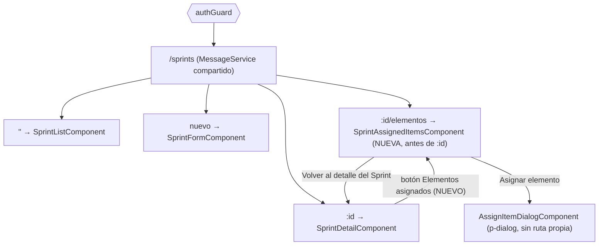

- **Estado:** `SprintAssignedItemsComponent.state` es un `toSignal` sobre un union discriminado `loading | ready | invalidId | notFound | unauthorized | error`; combina `GET sprint` y `GET items` con `forkJoin`. Un `BehaviorSubject<boolean>` dispara la consulta (`true` muestra la carga, `false` refresca sin parpadeo tras asignar): no hay UI optimista, la grilla siempre se renderiza desde el servidor. El diálogo usa Signals (`isSubmitting`, `banner`, `fieldError`, `sprintMissing`), el modelo `visible` y el flujo `Subject + exhaustMap + takeUntilDestroyed` (evita el doble envío).

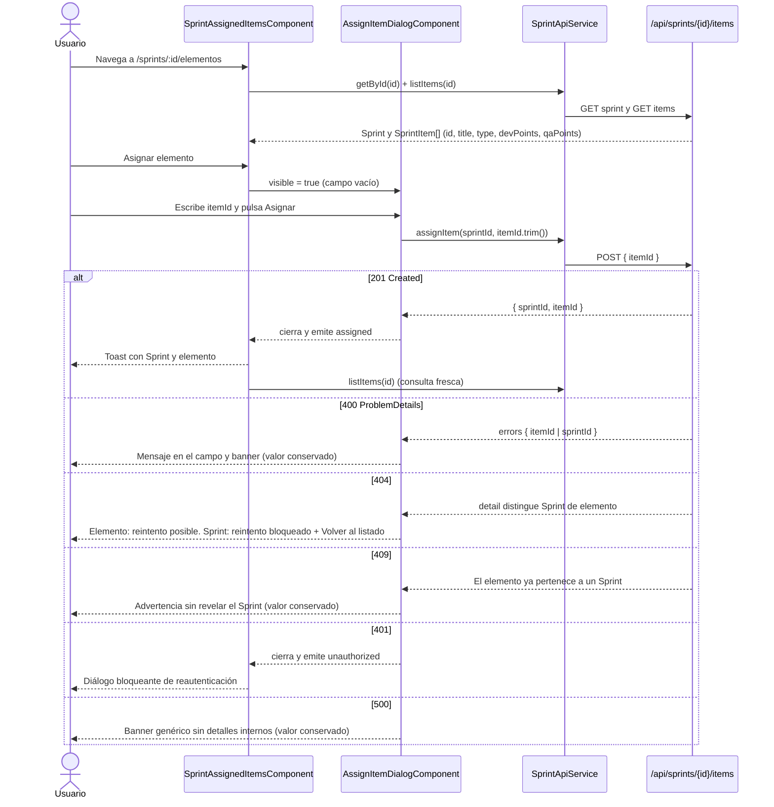

- **Decisiones (alineadas con el diseño UX 004):**
  - **ADR-004: el servidor es la fuente de verdad (D-05).** *Contexto:* FR-005..FR-007 son reglas del servidor. *Decisión:* el cliente no valida formato ni existencia; envía el `itemId` recortado, incluso vacío, y muestra el 400 por campo. *Consecuencias:* (+) sin reglas de negocio duplicadas; (−) un campo vacío cuesta una ida al servidor.
  - **ADR-005: el 404 se clasifica por el `detail`.** *Contexto:* el contrato devuelve el mismo 404 para Sprint y elemento y solo el `detail` los distingue. *Decisión:* si `detail` contiene "sprint" se bloquea el reintento (estado 6); en cualquier otro caso se trata como elemento inexistente (estado 7). *Consecuencias:* (+) mensajes distintos sin cambiar el contrato; (−) depende del texto del mensaje del backend (`SprintItemRules`).
  - **Estimación no informada (corregido por DEF-01, ver «Retrabajo DEF-01» abajo):** `formatPoints` ya no trata `0` como "sin estimación"; solo `null`/`undefined` se muestran como `—`.
- **Verificación:** Jest 83/83 en verde (10 suites; 21 pruebas nuevas de HU-004); `ngc -p tsconfig.app.json --noEmit` sin errores con `strictTemplates`. `ng build` no se ejecutó (el CLI exige Node ≥ 22.22.3 y el entorno tiene 22.20.0), por lo que T051 queda abierta; T052 (quickstart contra API y SPA en ejecución) tampoco se ejecutó.
- **Puntos abiertos:** (1) La acción `Ver elemento` del estado 1 no se implementó: el módulo Backlog no tiene ruta de detalle de elemento (solo `backlog/nuevo`); la grilla no tiene columna de acciones. (2) Igual que en HU-003: sin i18n, sin shell (menú/breadcrumb) y sin proxy de desarrollo para `/api`. (3) La grilla no muestra el estado del elemento ni del Sprint (FR-013, FR-014).

### Retrabajo DEF-01 — Estimaciones anulables (speckit-implement, 2026-10-04, T059 y T060)
Solo se alteró `features/sprints/`; rutas, estado y llamadas a la API no cambian. El backend (T055–T058) ya devuelve `devPoints`/`qaPoints` como `decimal?` sin convertir `null` a 0 (FR-018).

- **`models/sprint.models.ts`:** `SprintItem.devPoints` y `SprintItem.qaPoints` pasan de `number` a `number | null`.
- **`SprintAssignedItemsComponent.formatPoints`:** `null`/`undefined` → `—`; cualquier número, incluido `0` y decimales como `2.5`, se muestra tal cual. La plantilla de la grilla (`sprint-assigned-items.component.html`) no cambió porque ya delegaba en `formatPoints`.
- **Pruebas:** `sprint-assigned-items.component.spec.ts` (nulo → `—`, `0` → `0`, `2.5`) y `sprint-api.service.spec.ts` (respuesta con `qaPoints: null`).

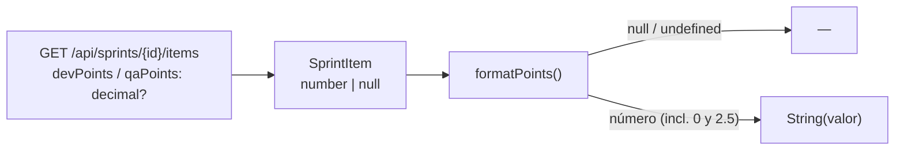

- **Verificación:** Jest `src/app/features/sprints` 52/52 en verde (6 suites); `ngc -p tsconfig.app.json --noEmit` sin errores.
- **Nota:** T060 nombra `sprint-detail.component.html`, pero las estimaciones se renderizan en `sprint-assigned-items.component.html`; allí se aplicó el cambio.

### HU-012 — Miembros del Equipo y Roles Técnicos (speckit-implement, 2026-10-04, tareas frontend T006, T023–T025, T029, T033, T037, T039, T042, T044, T047, T050, T051, T054, T056)
Se añadió la feature `features/teams/` (consultar miembros, registrar un miembro y consultar el catálogo de roles). El único archivo existente alterado es `app.routes.ts`; no se tocó `core/auth`, `features/backlog` ni `features/sprints`.

- **Archivos nuevos (`app/frontend/src/app/features/teams/`):**
  - `models/team.models.ts`: `TeamMember {id, name, role}`, `TechnicalRole {id, name}`, `RegisterTeamMemberRequest {name, role}` y `ProblemDetails`.
  - `services/team-api.service.ts`: `TeamApiService` (`listMembers` → `GET /api/team-members`, `listRoles` → `GET /api/technical-roles`, `registerMember` → `POST /api/team-members`).
  - `components/team-page/`: `TeamPageComponent` (`p-breadcrumb`, `p-tabs`, `p-table`, `p-toast`, estado vacío, error con `Reintentar`, diálogo 401). Un único `state` (`toSignal` sobre `combineLatest([route.data, reload$])`) consulta solo la pestaña activa.
  - `components/register-member-dialog/`: `RegisterMemberDialogComponent` (`FormGroup` tipado, `p-select` alimentado por `listRoles()`, `isSubmitting`, errores 400 por campo/`detail`, 500 genérico, 401 emitido al padre).
- **Modificado:** `app.routes.ts` — ruta padre `equipos` con `authGuard` y `MessageService`; hijas `''` (`data.tab = 'miembros'`) y `roles` (`data.tab = 'roles'`), ambas con `TeamPageComponent`.
- **Decisiones:** el cliente no valida reglas de negocio (UX D-05): envía lo tecleado y muestra los mensajes del servidor. Tras registrar se vuelve a consultar la lista (D-07). El diálogo se monta al abrirlo (`@if`), por lo que el catálogo se consulta en cada apertura y tras un 400 por rol inválido. Sin columna de acciones ni paginación (D-03, D-04).

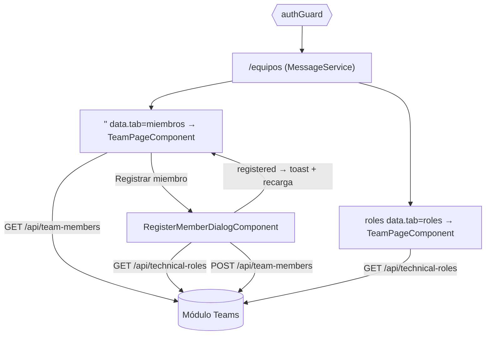

```mermaid
sequenceDiagram
    actor U as Usuario
    participant D as RegisterMemberDialogComponent
    participant P as TeamPageComponent
    participant API as /api/team-members

    U->>D: Escribe nombre, elige rol y pulsa Registrar
    D->>API: POST { name, role }
    alt 201
        API-->>D: { id, name, role }
        D-->>P: registered(member) y cierra
        P->>API: GET (lista fresca) y toast con datos del servidor
    else 400
        API-->>D: ProblemDetails (errors.name / errors.role / detail)
        D-->>U: Mensajes bajo el campo, conserva valores; si rol inválido refresca catálogo
    else 401
        D-->>P: unauthorized() → diálogo de reautenticación
    else 500
        D-->>U: Mensaje genérico sin cuerpo de respuesta, botón rehabilitado
    end
```

- **Verificación:** no ejecutada. El entorno de esta sesión no tiene Node/npm en el PATH, por lo que `npm test` y `npm run build` (T058) y el recorrido del quickstart (T061) quedan pendientes.

### HU-015 — Relación entre Personas, Roles y Elementos de Trabajo (speckit-implement, 2026-10-05, tareas frontend T004, T015, T021, T022, T031, T032, T037, T045, T048–T050, T053, T056–T058)
Se amplió `features/teams/` con la pestaña `Responsables`. Fuera de la feature solo se tocó `app.routes.ts` (dos rutas hijas nuevas); no se modificó `features/backlog`, `features/sprints` ni `core/auth`.

- **Archivos nuevos (`app/frontend/src/app/features/teams/components/`):**
  - `assign-assignee-dialog/`: `AssignAssigneeDialogComponent` (`p-dialog` con `FormGroup<{ itemId, memberId }>` tipado, dos `p-select` alimentados por `GET /api/backlog-items` y `GET /api/team-members`, rol técnico de solo lectura derivado del miembro, 201 vs 200 con toast distinto).
  - `item-assignees-view/`: `ItemAssigneesViewComponent` (vista `Por elemento`: selector de elemento, `p-table` identificador/nombre/rol, estados idle/cargando/datos/vacío/error).
  - `member-items-view/`: `MemberItemsViewComponent` (vista `Por miembro`: selector de miembro, `p-table` identificador/título/tipo, mismos estados).
- **Modificados:** `models/team.models.ts` (`ItemAssigneeResponse`, `AssigneeResponse`, `MemberItemResponse`, `BacklogItemSummary`, `AssignMemberRequest`), `services/team-api.service.ts` (`listBacklogItems`, `assignMember` con `observe: 'response'`, `listItemAssignees`, `listMemberItems`), `team-page.component.{ts,html}` (pestaña `Responsables`, `view`, `selectView`, estado `idle`) y `app.routes.ts`.
- **Rutas:** `equipos/responsables` (`data: { tab: 'responsables', view: 'elemento' }`) y `equipos/responsables/miembro` (`view: 'miembro'`); heredan `authGuard` y `MessageService` del bloque `equipos`.

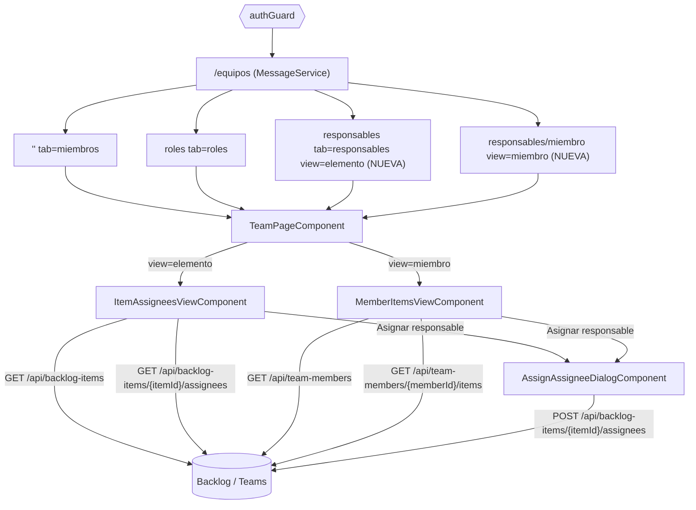

```mermaid
sequenceDiagram
    actor U as Usuario
    participant D as AssignAssigneeDialogComponent
    participant V as Vista (Por elemento / Por miembro)
    participant API as POST /api/backlog-items/{itemId}/assignees

    U->>D: Elige elemento y miembro (rol solo lectura) y pulsa Asignar
    D->>API: { memberId }
    alt 201 Created
        API-->>D: ItemAssigneeResponse
        D-->>U: Toast de éxito
        D-->>V: assigned(created=true) → consulta fresca y resalta la fila
    else 200 OK (ya existía, idempotente)
        API-->>D: ItemAssigneeResponse
        D-->>U: Toast informativo "ya era responsable"
        D-->>V: assigned(created=false) → consulta fresca
    else 400
        API-->>D: errors { itemId | memberId }
        D-->>U: Mensaje en línea bajo el campo; el diálogo sigue abierto
    else 404
        API-->>D: detail "miembro" o "elemento"
        D-->>U: Banner; vacía el campo culpable y recarga su lista
    else 401
        D-->>V: unauthorized() → diálogo de reautenticación de la página
    else 500
        D-->>U: Banner genérico sin cuerpo, botón Reintentar, campos conservados
    end
```

- **Decisiones:**
  - **ADR-006: las vistas se montan dentro de `TeamPageComponent`.** *Contexto:* el tasks.md pedía `loadComponent` de `ItemAssigneesViewComponent` en la ruta, pero las pestañas (`p-tabs`) viven en `TeamPageComponent` y desaparecerían al navegar. *Decisión:* ambas rutas cargan `TeamPageComponent`; con `tab = 'responsables'` el estado es `idle` (sin consulta propia) y `data.view` elige el componente hijo. *Consecuencias:* (+) pestañas y breadcrumb consistentes, 401 centralizado; (−) las vistas no se cargan de forma diferida.
  - **ADR-007: el rol nunca se envía.** El cuerpo es solo `{ memberId }`; el rol mostrado es el registrado del miembro (FR-005).
  - **El servidor es la fuente de verdad (D-05)** salvo un caso: sin `itemId` no existe URL a la que enviar, por lo que ese único campo se exige en el cliente; `memberId` vacío sí se envía y el 400 se muestra bajo el campo.
  - **Sin Optimistic UI:** tras 200/201 las vistas vuelven a consultar al servidor.
  - El selector `Por elemento`/`Por miembro` usa dos `p-button` (sin `ngModel`) en lugar de `p-selectbutton`.
- **Verificación:** NO ejecutada. El entorno de esta sesión no tiene Node/npm, por lo que `npm test`, `npm run build` y `npm run lint:primeng` (T062) y la validación manual del quickstart (T063) siguen pendientes; el cumplimiento de `lint:primeng` se revisó a mano sobre los `.html` nuevos.
- **Puntos abiertos:** (1) Sin i18n en el frontend (textos literales en español, como el resto). (2) La grilla no ofrece filtros, paginación ni acciones por fila (D-03, D-04). (3) El 404 se clasifica por el texto del `detail` ("miembro"), igual que ADR-005 de HU-004.

### ADR — Tailwind CSS v4 reemplaza a PrimeFlex (2026-10-05)
- **Contexto:** PrimeFlex v3 está en mantenimiento y sus utilidades (`col-12`, `justify-content-*`, `p-fluid`) se confundían con clases de PrimeNG ≤15 que ya no existen. PrimeNG 22 se integra oficialmente con Tailwind mediante el plugin `tailwindcss-primeui`.
- **Decisión:** `tailwindcss` 4.3, `@tailwindcss/postcss` 4.3 y `tailwindcss-primeui` 0.6 sustituyen a `primeflex`. `src/styles.css` importa `tailwindcss`, `tailwindcss-primeui` y `primeicons`; `.postcssrc.json` activa `@tailwindcss/postcss`; `providePrimeNG` declara `cssLayer: { name: 'primeng', order: 'theme, base, primeng' }` para que el reset de Tailwind no pise los estilos de PrimeNG.
- **Alcance de uso:** solo grid (`grid grid-cols-12 gap-4`, `col-span-*`), espaciado y flex, nunca para estilizar controles. Escala de espaciado de Tailwind (1 = 0.25rem): `mb-3` de PrimeFlex equivale a `mb-4`.
- **Migración:** las 11 plantillas `.html` existentes se migraron de forma mecánica (`col-12 md:col-6 lg:col-4` → `col-span-12 md:col-span-6 lg:col-span-4`, `justify-content-end` → `justify-end`, `align-items-center` → `items-center`, `text-secondary` → `text-muted-color`, `surface-100` → `bg-surface-100`). La reestructuración visual (layout, breadcrumbs, tipografía) queda para la HU 035.
- **Verificación:** `ng build`, `jest` (141 tests) y `npm run lint:primeng` en verde; el CSS generado contiene las utilidades usadas. El orden de capas CSS pendiente de validación visual en navegador.

### HU-035 — Esqueleto de aplicación (layout) y tipografía global (2026-10-05)
- **Alcance:** solo presentación. Sin cambios en backend, API, contratos de datos ni en `features/**`.
- **Contexto:** cada pantalla se renderizaba sola, sin barra superior, navegación ni pie, y sin tipografía base.
- **Decisión (ADR-003/004/005/006/008/009/010 del Tech Design):** el shell es una ruta padre sin segmento de URL (`LayoutComponent`, `canActivateChild: [authGuard]`) y las rutas existentes pasan a ser hijas con los mismos `path`, `data`, `providers` y `loadComponent`. La raíz redirige a `backlog/nuevo` antes del padre. `**` es la última hija y muestra `NotFoundComponent` sin redirigir.

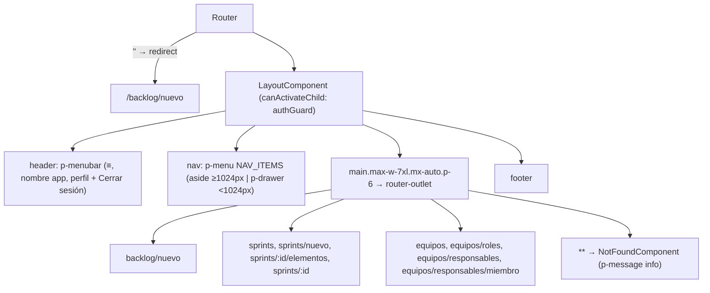

- **Estado del shell (signals, sin persistencia):** `ViewportService.isWide` (`matchMedia('(min-width: 1024px)')`, listener limpiado con `DestroyRef`, `true` si no hay `matchMedia`); `navOpen = linkedSignal(isWide)` se reinicia al cruzar el umbral; `activeModule = computed` sobre el primer segmento de la URL (`NavigationEnd` + `toSignal`); `AuthService.userName` (`name` ⇒ `preferred_username` ⇒ `null`) y `logout()` aditivos.

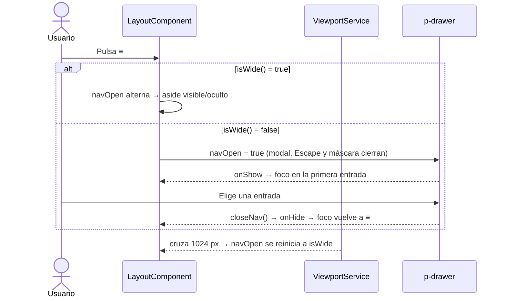

- **Archivos nuevos:** `core/layout/{layout.component.ts|html|spec.ts, layout.texts.ts, layout-nav.ts|spec.ts, viewport.service.ts|spec.ts, not-found/not-found.component.ts|html|spec.ts}`, `app.routes.spec.ts`. **Modificados:** `app.routes.ts`, `core/auth/auth.service.ts|spec.ts`, `styles.css` (única regla `body { margin: 0; font-family: var(--font-sans); }`), `scripts/lint-primeng.mjs` (reglas globales: una sola `font-family` y un solo margen de `body`, sin `::ng-deep`, `!important`, `ed-grid`, `primeng/dropdown`, `primeng/calendar`), `src/setup-jest.ts` (stub de `matchMedia` para jsdom).
- **Decisiones de implementación:** el control `≡` es un `<button pButton>` nativo (así `aria-label` y `aria-expanded` llegan al botón real, no al host de `p-button`); los textos viven solo en `LAYOUT_TEXTS`; la entrada activa se resalta con `styleClass: 'font-semibold'` además del `routerLinkActive` de `p-menu`; las utilidades Tailwind de tamaño (`max-w-7xl`, `p-6`, `w-64`, `min-h-screen`) quedan confinadas al shell (mandato RT-02).
- **Contrato de extensión (FR-015):** una pantalla nueva se agrega como hija del shell en `app.routes.ts` y, si es un módulo, como una entrada más de `NAV_ITEMS`; no declara `max-w-*`, `mx-auto` ni padding de página.
- **Verificación:** `npm test` 180/180 en verde (21 suites), `npm run build` correcto, `npm run lint:primeng` sin violaciones (y probado que una segunda `font-family` o un `::ng-deep` lo hacen fallar). **Pendiente (requiere app, backend y Keycloak en ejecución):** verificación manual a 768/1920 px (T021, T031), las 6 capturas de `specs/035-HU_refactorizacion_esqueleto_ui/evidence/` (T029) y la gestión real de foco del `p-drawer` (la implementación fuerza foco con `onShow`/`onHide`, sin prueba automatizada).
- **Puntos abiertos:** umbral de 1024 px sin confirmación del humano (un único valor en `ViewportService`); la regex del lint no distingue `font-family` dentro de cadenas.
