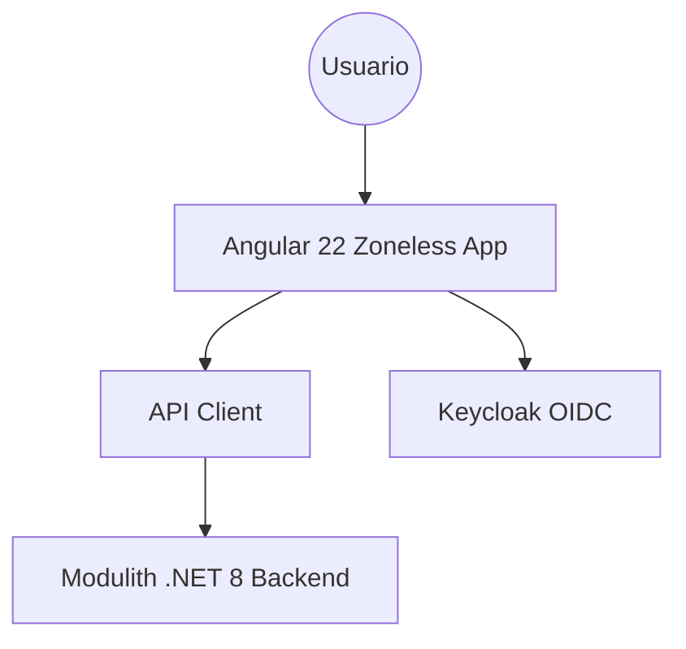
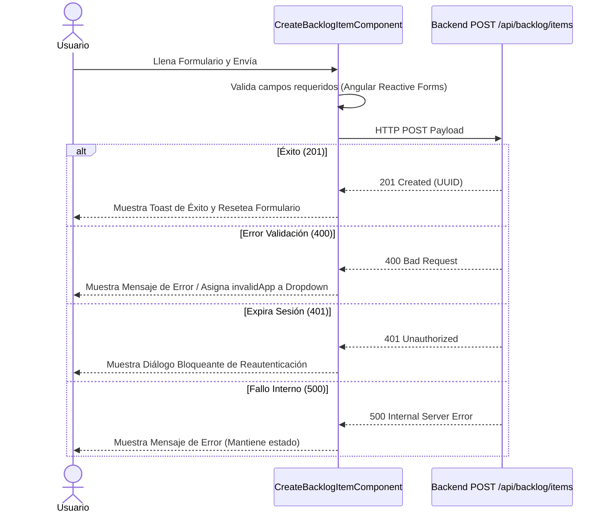

# 🏗️ ARQUITECTURA FRONTEND VIVA

## 1. Información General y Objetivo
- **Sistema:** TechWorkHub
- **Versión:** 1.0.0
- **Fecha de última actualización:** 2026-10-03
- **Equipo:** Frontend / SpecKit
- **Objetivo:** Plataforma modular basada en Angular 22 Zoneless con Signals para la gestión de proyectos y backlog multitipo.

## 2. Contexto y Arquitectura General


## 3. Estructura del Proyecto y Enrutamiento
- **Módulos:**
  - `features/backlog/components/`: Componentes específicos de gestión de backlog.
  - `core/`: Servicios base (API, Auth).
- **Rutas Principales:**
```mermaid
flowchart TD
    Inicio[/ / ] --> Backlog[/ /backlog ]
    Backlog --> NuevoItem[/ /backlog/nuevo ]
```

## 4. Gestión de Estado y Autenticación
- **Estado Local:** Manejado mediante Signals de Angular 22 (`isSubmitting`, `sessionExpired`, `serverError`).
- **Autenticación:** OIDC con Keycloak. Las llamadas fallidas (401) muestran un diálogo bloqueante para reautenticación forzada.

## 5. Comunicación con Backend y Manejo de Errores
- **Interacción de Registro de Elementos (CreateBacklogItemComponent):**


## 6. Registros de Decisiones de Arquitectura (ADRs)
### ADR-001: Angular 22 Zoneless + PrimeNG v22.1.1
- **Contexto:** Se requiere alta reactividad y performance sin las penalizaciones de zone.js.
- **Decisión:** Uso de `standalone components` y Signals, omitiendo zone.js.
- **Consecuencias:** Rendimiento superior, estado inmutable nativo, requiere conocimiento de Signals.

### ADR-002: Desacoplamiento de Estimaciones QA y Dev
- **Contexto:** Las tareas técnicas (Spikes, TechDebt) no requieren esfuerzo QA.
- **Decisión:** Inactivación reactiva del campo `qaPoints` con payload dinámico (`qaPoints: null`) basado en el selector de tipo.
- **Consecuencias:** Payload flexible alineado al FR-008.
