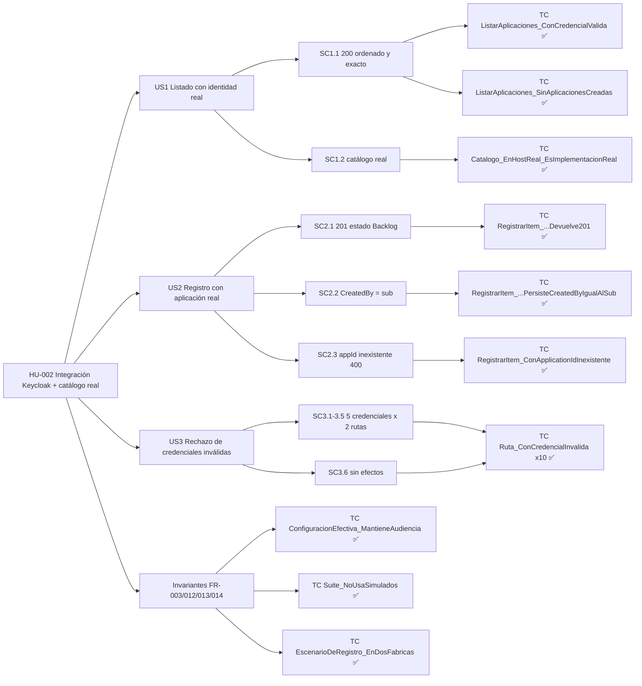
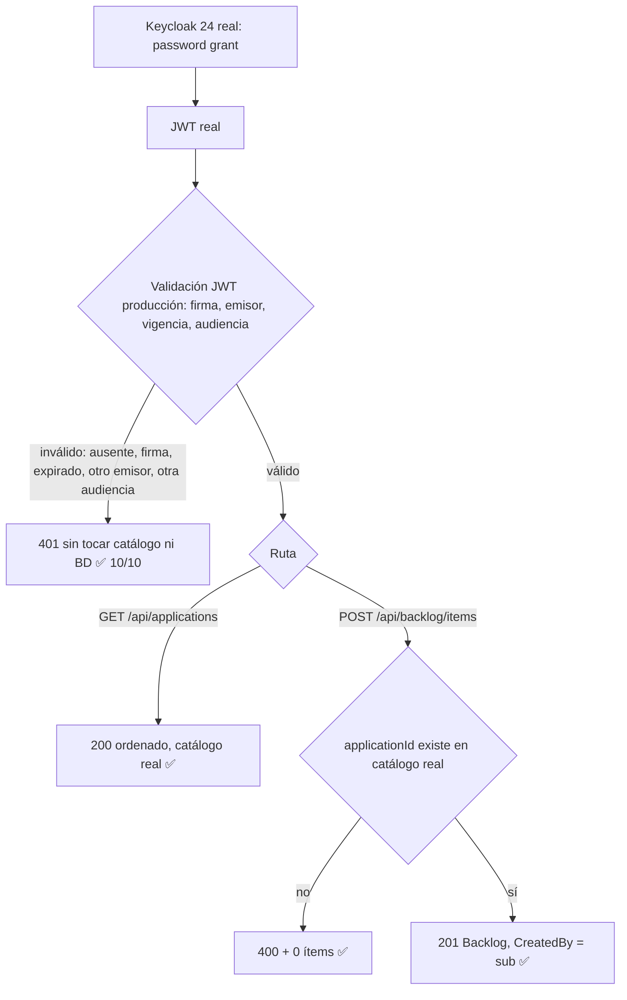
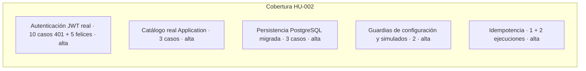
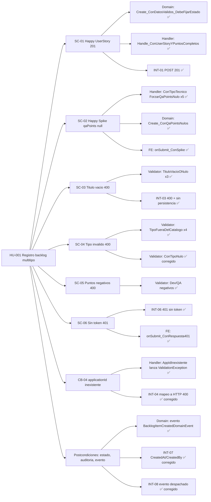
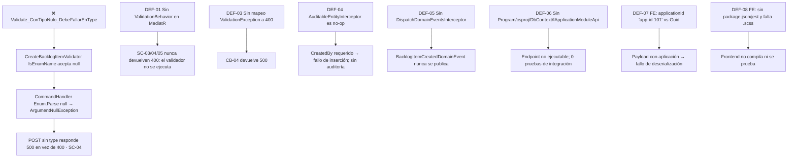
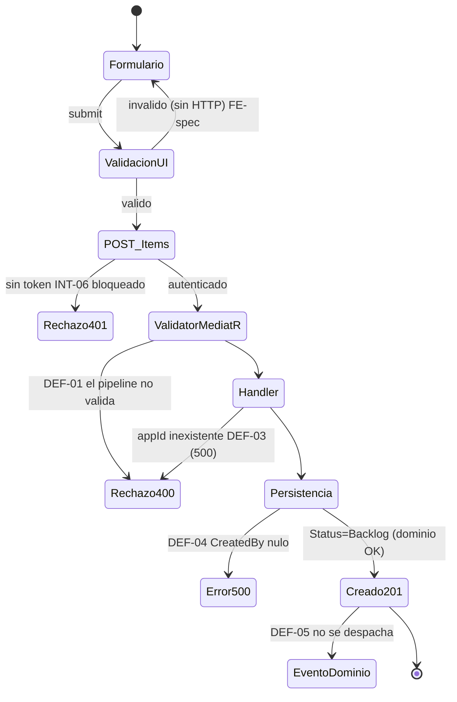
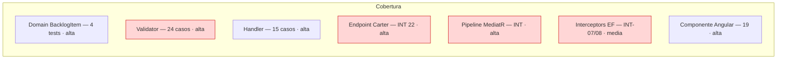

# QA Report — Calidad y Trazabilidad Viva

> Última actualización: 03-10-2026 · Iteración: **HU-002 Pruebas de Integración contra Keycloak Real y Catálogo Real** · Agente: QA-AUTO
> Áreas no afectadas por esta iteración: _Sin cambios en esta iteración_ (las secciones HU-001 de abajo se conservan sin modificar).

---

# ▶ Iteración actual: HU-002 (`specs/002-pruebas-integracion-keycloak-catalogo`)

La HU entrega una suite (`app/backend/tests/Integration/Identity`, 19 casos). QA-AUTO la auditó de forma adversarial, la ejecutó contra Keycloak 24.0 y PostgreSQL 16 reales (Testcontainers, un contenedor por suite, BD nueva por prueba) y verificó que puede fallar. No se escribió ni modificó código de producción (`git diff main -- app/backend/src` sin cambios fuente).

## 1. AI QA Review Dashboard (HU-002)

```
┌─────────────── HU-002 · DICTAMEN: [APROBADO CON RESERVAS MENORES] ───────────────────────┐
│ Capa                        Escritos  Ejecutados  Pasados  Fallados  Bloqueados          │
│ Backend · Identity (real)      19         19         19        0         0               │
│ Regresión · Unit Backlog       62         62         62        0         0               │
│ Regresión · Int. Backlog       31         31         31        0         0               │
│ ─────────────────────────────────────────────────────────────────────────────────────── │
│ Total solución backend        112        112        112        0         0               │
│ Cobertura funcional de CA: US1 3/3 · US2 3/3 · US3 6/6 · 100% con prueba real y en verde │
│ Ejecuciones consecutivas de Identity: 2 (19/19 ambas) · sin contenedores residuales      │
│ Nivel de riesgo: BAJO (Keycloak e identidad reales; T028 parcial, ver reservas)          │
└──────────────────────────────────────────────────────────────────────────────────────────┘
```

Comandos: `dotnet test app/backend/tests/Integration/Identity/Identity.IntegrationTests.csproj` (19/19, 2,2 min con descarga de imágenes) y `dotnet test app/backend/TechWorkHub.sln` (62 + 31 + 19, 23 s la suite Identity con imágenes en caché).

## 2. Requirements Traceability (HU-002)



| CA / FR | Casos de prueba | Estado |
|---|---|---|
| US1.1 / FR-005 / SC-001 | `ListApplicationsRealTests.ListarAplicaciones_ConCredencialValida_Devuelve200ConAplicacionesOrdenadas`; Sad: `…SinAplicacionesCreadas_Devuelve200ConListaVacia` | ✅ |
| US1.2 / FR-002 | `…Catalogo_EnHostReal_EsImplementacionRealDelModuloApplication` | ✅ |
| US2.1 / FR-006 | `CreateBacklogItemRealTests.RegistrarItem_ConCredencialRealYAplicacionExistente_Devuelve201` (Location + id) | ✅ |
| US2.2 / FR-007 / SC-004 | `…PersisteCreatedByIgualAlSub` (único ítem, `Status=Backlog`, `sub` leído del JWT real) | ✅ |
| US2.3 / FR-008 | `…ConApplicationIdInexistente_Devuelve400SinPersistir` (ProblemDetails con `ApplicationId`, 0 ítems) | ✅ |
| US3.1-3.5 / FR-009 / SC-003 | `InvalidCredentialsTests.Ruta_ConCredencialInvalida_Devuelve401SinEfectos` × 10 (Ausente, FirmaAlterada, Expirada, OtroEmisor, OtraAudiencia × GET/POST) | ✅ 10/10 |
| US3.6 / FR-010 / FR-011 | Mismo Theory: conteo de `application."Applications"` y de ítems sin cambios | ✅ (ver reserva R-2) |
| FR-003 | `ProductionConfigGuardTests.ConfiguracionEfectiva_MantieneAudienciaYEmisorDeProduccion` | ✅ |
| FR-012 / SC-002 | `…Suite_NoUsaSimuladosDeAutenticacionNiCatalogo` | ✅ |
| FR-013 | `git diff main -- app/backend/src` sin cambios fuente | ✅ |
| FR-014 / SC-005 | `IdempotencyTests…EnDosFabricas` + 2 ejecuciones consecutivas 19/19 | ✅ |

## 3. Failure Impact Diagram (HU-002)

**0 fallos críticos detectados.** No hay defectos abiertos `[CAPA:*]`.

## 4. State Transition / User Journey (HU-002)



Sin ruptura de flujo detectada.

## 5. Test Coverage & Hotspots (HU-002)



Hotspots de defectos: ninguno. Riesgo residual: roles no verificados (no documentados); rechazo 401 verificado por efecto (sin trazas), no por instrumentación.

## Pruebas adversariales propias (QA-AUTO)

| Prueba | Resultado |
|---|---|
| **Mutación de realm (T029 reproducida):** quitar el *audience mapper* de `techworkhub-tests` | 5 de 6 casos de US1/US2 fallan; el sexto (`Catalogo_EnHostReal…`) no depende de identidad y pasa. Realm restaurado y comparado byte a byte. |
| `src/**` solo lectura (FR-013) | `git diff --stat main -- app/backend/src` (excluyendo `bin/obj`) sin diferencias |
| Residuos Docker tras 2 ejecuciones | Solo el reaper `ryuk` de Testcontainers |
| Credencial expirada vs `ClockSkew` (D-02 de QA-Tech) | El caso `Expirada` devuelve 401 en ambas rutas tras esperar `exp`: no se observa aceptación por el skew en este host |

## Reservas (no bloqueantes)

- **R-1 (T028 abierta):** no se probó el fallo explícito con el daemon de Docker detenido; QA-AUTO no detuvo el Docker del usuario. Verificado solo el mensaje de timeout que nombra "Keycloak".
- **R-2:** el criterio "sin efectos" (US3.6/FR-010) se comprueba por conteos antes/después, no por instrumentación del acceso al catálogo. Es suficiente para FR-011 (sin mutación) pero no demuestra la ausencia de lecturas.
- **R-3 (T030 abierta):** falta citar en el PR la excepción `ssl-required=none` confirmada por el spike T008. Es una tarea de proceso, no de código.
- **R-4:** los archivos de `app/backend/tests/Integration/Identity/**` y el realm figuran sin commitear (`??`) en el árbol de trabajo; los commitea quien los generó (DEV-BACK).

---

# Histórico: HU-001

## 1. AI QA Review Dashboard

```
┌─────────────── HU-001 · DICTAMEN: [APROBADO] (PostgreSQL/Testcontainers) ────────────────┐
│ Capa                    Escritos  Ejecutados  Pasados  Fallados  Bloqueados             │
│ Backend · Unitarias        62         62        62        0         0                  │
│ Backend · Integración      31         31        31        0         0  (Program+PostgreSQL)│
│ Frontend · Jest            31         31        31        0         0                  │
│ ─────────────────────────────────────────────────────────────────────────────────────── │
│ Cobertura funcional de CA (SC-01..SC-06): 6/6 con prueba real · 6/6 en verde            │
│ Nivel de riesgo: BAJO  (BD real PostgreSQL 16; Keycloak y catálogo siguen simulados)     │
└──────────────────────────────────────────────────────────────────────────────────────────┘
```

Re-ejecución 03-10-2026 tras `afda58a` y los cambios del componente Angular: `dotnet test TechWorkHub.sln` (61 + 22) y `npx jest` en `app/frontend` (19, antes 14: el spec fue ampliado).

Segunda re-ejecución (misma fecha): `dotnet test app/backend/TechWorkHub.sln` 61/61 + 22/22 y Jest 19/19, sin cambios de resultado; `Validate_ConTipoNulo_DebeFallarEnType` en verde. Docker sigue inactivo: T037 permanece abierta (Testcontainers pendiente). El código de interfaz (`app/frontend`) está probado pero **sin commitear** en el árbol de trabajo.

Tercera re-ejecución (retrabajo 1/2): mismos resultados (61/61, 22/22, Jest 19/19); no hay commits nuevos de producción desde `afda58a`. Docker sigue inactivo.

**Cuarta ejecución (03-10-2026, Docker 28.4.0 activo, T043):** INT-01..INT-10 y los casos #16..#19 corren sobre `WebApplicationFactory<Program>` con **PostgreSQL 16 (Testcontainers)**: un único contenedor por suite (`PostgresFixture` + `ICollectionFixture`), una base de datos nueva por prueba y las migraciones Code-First aplicadas por el arranque real (`Database:MigrateOnStartup=true`). SQLite se eliminó de la solución de pruebas. Cobertura: #16 `ListApplicationsTests` (catálogo autenticado, 401 sin token); #17 Jest (interceptor, guard, reautenticación); #18 `KeycloakConfigurationTests` y `MigrationsPostgresTests` (schemas/tablas e idempotencia sobre PostgreSQL); #19 `ListApplicationsTests`/`CreateBacklogItemTests` (401 sin claim de identidad sin tocar catálogo ni BD). Resultado: unitarias 62/62, integración 31/31, Jest 31/31. Reserva residual: Keycloak/JWT se sustituye por un esquema de prueba y el catálogo del módulo Application es un doble; no se probó concurrencia.

Ejecución: `dotnet test` en `tests/Unit/Backlog/Backlog.UnitTests.csproj` (net8.0, xUnit 2.9.2, NSubstitute 5.3, FluentAssertions 6.12.2).

## 2. Requirements Traceability



| CA | Pruebas automatizadas | Estado |
|---|---|---|
| SC-01 | `BacklogItemDomainTests.Create_ConDatosValidos_*`, `Handler.Handle_ConUserStoryYPuntosCompletos_*`; INT-01 | ✅ Unit + HTTP 201 + persistencia |
| SC-02 | `Handler.Handle_ConTipoTecnico..._DebeForzarQaPointsNulo` (5 tipos), `Domain.Create_ConQaPointsNulos_*`; INT-02 | ✅ |
| SC-03 | `Validator.Validate_ConTituloVacioONulo_*` (3), título 200/201 (CB-01); INT-03 | ✅ (400 HTTP, sin fila) |
| SC-04 | `Validator.Validate_ConTipoFueraDelCatalogo_*` (4), `ConTipoNulo`; INT `SinTipo` | ✅ (DEF-02 confirmado) |
| SC-05 | `Validator.Validate_Con{Dev,Qa}PointsNegativos_*`; INT-05 | ✅ (400 HTTP) |
| SC-06 / CB-06 | INT-06, `FE.onSubmit_ConRespuesta401_*` | ✅ |
| CB-04 | `Handler.Handle_ConApplicationIdInexistente_*`; INT-04 | ✅ mapeo a 400 |
| CB-05 | `Handler.Handle_CuandoSaveChangesFalla_*` | Propagación ✅ · rollback no verificado con PostgreSQL |

**Estado tras la re-ejecución (22/22 ✅):** `app/backend/tests/Integration/Backlog` corre sobre `WebApplicationFactory<Program>`; SC-01..SC-06, CB-04 y las postcondiciones pasan. `Validate_ConTipoNulo_DebeFallarEnType` pasa (DEF-02 confirmado corregido) y el caso HTTP `CreateBacklogItem_SinTipo_DebeResponder400SinPersistir` también. Correspondencia INT-01..INT-10: INT-01 `ConPayloadNumericoValido…201`; INT-02 `ConSpike…`/`ConTipoTecnicoSinQaPoints…`; INT-03 `ConTituloVacio…400`; INT-04 `ConApplicationIdInexistente…400`; INT-05 `ConDevPointsNegativos…400`; INT-06 `SinTokenOConTokenInvalido…401` y `ConTokenSinClaimDeIdentidad…401`; INT-07 `…AuditarCreatedAtYCreatedBy`; INT-08 `…PublicarBacklogItemCreatedDomainEvent`; INT-09 `ConPrioridadComoTextoSegunHU…201`; INT-10 `ConTextoEnElLimite…201` y `ConTextoMasLargoQueElLimite…400`. Pendiente: Testcontainers PostgreSQL (la BD actual es SQLite). Histórico de la ejecución anterior: 5 ✅ y 5 ❌ (DEF-01, DEF-03, DEF-07). Diseño original: INT-01 201 completo; INT-02 Spike con qaPoints null; INT-03 título vacío 400 sin fila; INT-04 appId inexistente 400; INT-05 puntos negativos sin evento; INT-06 sin token 401; INT-07 auditoría; INT-08 evento; INT-09 enums como string en JSON; INT-10 título de 201 caracteres.

## 3. Failure Impact Diagram



> **Re-ejecución 03-10-2026:** el diagrama y la tabla son el **histórico** de la ejecución rechazada. DEF-01..DEF-08 están verificados como **CORREGIDOS** (todas las pruebas asociadas en verde). DEF-06 queda cerrado en lo funcional; la migración a Testcontainers sigue pendiente (reserva del dashboard).

| ID | Severidad | Hallazgo (original) | Responsable |
|---|---|---|---|
| DEF-01 | Crítica | No existe `ValidationBehavior<,>` ni registro de validadores: los validadores no se invocan. | DEV-BACK |
| DEF-02 | Alta | `Type = null` pasa el validador (`IsEnumName`) y revienta en el handler (test rojo). Añadir `NotEmpty()`. | DEV-BACK |
| DEF-03 | Alta | El handler lanza `FluentValidation.ValidationException` y no hay exception handler que la mapee a 400 (CB-04). | DEV-BACK |
| DEF-04 | Crítica | `AuditableEntityInterceptor` no asigna `CreatedAt`/`CreatedBy`; `CreatedBy` es `IsRequired`. | DEV-BACK |
| DEF-05 | Alta | No hay `DispatchDomainEventsInterceptor`; el handler tampoco despacha ni limpia eventos. | DEV-BACK |
| DEF-06 | Crítica | Sin `Program`, `.csproj` de módulo, DbContext ni implementaciones de `IBacklogDbContext`/`IApplicationModuleApi`. | DEV-BACK |
| DEF-07 | Alta | La UI envía `applicationId = "app-id-101"` y el comando exige `Guid?`. Tampoco hay evidencia de `JsonStringEnumConverter` para `priority`. | DEV-FRONT / DEV-BACK |
| DEF-08 | Alta | `styleUrls` apunta a un `.scss` inexistente; no hay `package.json`, `angular.json` ni `jest.config`. | DEV-FRONT |

## 4. State Transition / User Journey



## 5. Test Coverage & Hotspots



Hotspots: sin defectos abiertos; la BD de integración ya es PostgreSQL real. Riesgo residual: Keycloak real (no hay prueba contra un IdP).

## Hallazgo 9 (Code Review) — stubs reemplazados

| Tarea | Antes | Ahora |
|---|---|---|
| T009 | `[Fact]` comentado + `Task.CompletedTask` | 201 con persistencia y 401 (token ausente/inválido) contra el endpoint real |
| T010 | Cuerpo vacío | 24 casos de `AbstractValidator` con `TestValidate` |
| T015 | `[Fact]` comentado | Spike con `qaPoints=8` persiste `QAPoints == null` vía HTTP |

## Dictamen

**[APROBADO]** — 124/124 pruebas en verde (62 unitarias, 31 de integración sobre PostgreSQL/Testcontainers, 31 Jest); DEF-01..DEF-08 corregidos, SC-01..SC-06 y los casos #16..#19 cubiertos. Reserva menor: Keycloak/JWT simulado. Se devuelve el turno a `@CODE-REVIEW`.

_Histórico: el dictamen previo fue **[RECHAZADO]** (47/53 en verde, 6 defectos de producción)._

## Notas de gobernanza

- No se modificó código de producción. El stub de validador (T010) era una tautología y fue reemplazado. El stub de integración (T009/T015) también fue reemplazado por pruebas reales.
- Las tareas T009, T010 y T015 de `tasks.md` están marcadas `[X]` sin pruebas reales detrás.
