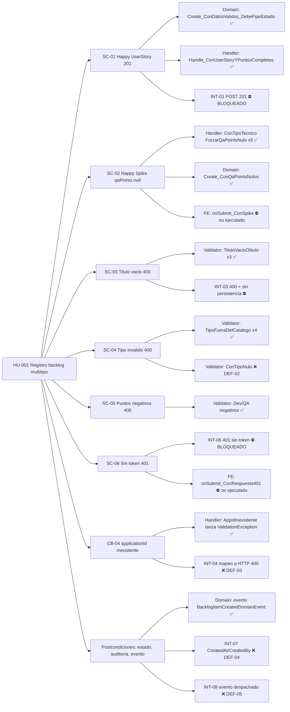
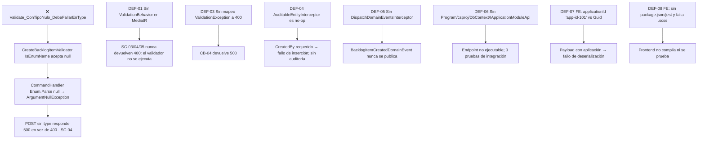
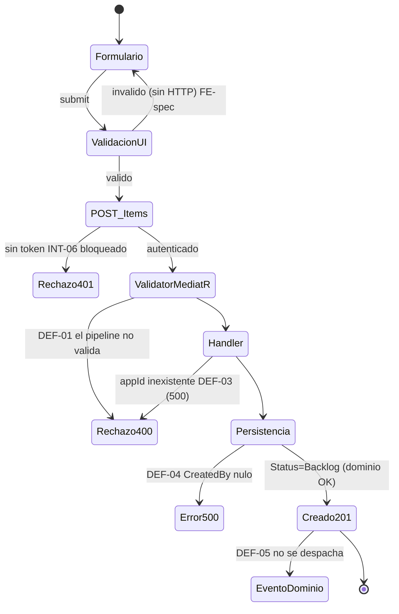
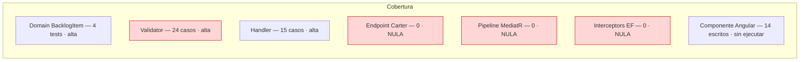

# QA Report — Calidad y Trazabilidad Viva

> Última actualización: 03-10-2026 · Iteración: **HU-001 Registro de Elementos en Backlog Multitipo** · Agente: QA-AUTO
> Áreas no afectadas por esta iteración: _Sin cambios en esta iteración_.

## 1. AI QA Review Dashboard

```
┌──────────────────────────── HU-001 · DICTAMEN: [RECHAZADO] ────────────────────────────┐
│ Capa                    Escritos  Ejecutados  Pasados  Fallados  Bloqueados             │
│ Backend · Unitarias        43         43        42        1         0                  │
│ Backend · Integración       0*         0         0        0        10 (diseñados)       │
│ Frontend · Jest            14          0         0        0        14 (sin workspace)   │
│ ─────────────────────────────────────────────────────────────────────────────────────── │
│ Cobertura funcional de CA (SC-01..SC-06): 2/6 verificados end-to-end · 6/6 diseñados     │
│ Nivel de riesgo: ALTO  (pipeline de validación, auditoría y eventos no existen)          │
└──────────────────────────────────────────────────────────────────────────────────────────┘
* No se puede escribir un test de integración compilable: no existe `Program`, `.csproj` del módulo ni DbContext.
```

Ejecución: `dotnet test` en `tests/Unit/Backlog/Backlog.UnitTests.csproj` (net8.0, xUnit 2.9.2, NSubstitute 5.3, FluentAssertions 6.12.2).

## 2. Requirements Traceability



| CA | Pruebas automatizadas | Estado |
|---|---|---|
| SC-01 | `BacklogItemDomainTests.Create_ConDatosValidos_*`, `Handler.Handle_ConUserStoryYPuntosCompletos_*`; INT-01 | Unit ✅ · HTTP 201 / persistencia ⛔ |
| SC-02 | `Handler.Handle_ConTipoTecnico..._DebeForzarQaPointsNulo` (5 tipos), `Domain.Create_ConQaPointsNulos_*` | ✅ |
| SC-03 | `Validator.Validate_ConTituloVacioONulo_*` (3), título 200/201 (CB-01) | ✅ (400 HTTP ⛔, depende de DEF-01) |
| SC-04 | `Validator.Validate_ConTipoFueraDelCatalogo_*` (4), `ConTipoNulo` | 4 ✅ · 1 ❌ (DEF-02) |
| SC-05 | `Validator.Validate_Con{Dev,Qa}PointsNegativos_*` | ✅ (400 HTTP ⛔, DEF-01) |
| SC-06 / CB-06 | INT-06, `FE.onSubmit_ConRespuesta401_*` | ⛔ Bloqueado |
| CB-04 | `Handler.Handle_ConApplicationIdInexistente_*` | Unit ✅ · mapeo 400 ❌ (DEF-03) |
| CB-05 | `Handler.Handle_CuandoSaveChangesFalla_*` | Propagación ✅ · rollback ⛔ |

Integración diseñada y pendiente de host (`WebApplicationFactory<Program>` + Testcontainers PostgreSQL con `ICollectionFixture`): INT-01 201 completo; INT-02 Spike con qaPoints null; INT-03 título vacío 400 sin fila; INT-04 appId inexistente 400; INT-05 puntos negativos sin evento; INT-06 sin token 401; INT-07 auditoría; INT-08 evento; INT-09 enums como string en JSON; INT-10 título de 201 caracteres.

## 3. Failure Impact Diagram



| ID | Severidad | Hallazgo | Responsable |
|---|---|---|---|
| DEF-01 | Crítica | No existe `ValidationBehavior<,>` ni registro de validadores: los validadores no se invocan. | DEV-BACK |
| DEF-02 | Alta | `Type = null` pasa el validador (`IsEnumName`) y revienta en el handler (test rojo). Añadir `NotEmpty()`. | DEV-BACK |
| DEF-03 | Alta | El handler lanza `FluentValidation.ValidationException` y no hay exception handler que la mapee a 400 (CB-04). | DEV-BACK |
| DEF-04 | Crítica | `AuditableEntityInterceptor` no asigna `CreatedAt`/`CreatedBy`; `CreatedBy` es `IsRequired`. | DEV-BACK |
| DEF-05 | Alta | No hay `DispatchDomainEventsInterceptor`; el handler tampoco despacha ni limpia eventos. | DEV-BACK |
| DEF-06 | Crítica | Sin `Program`, `.csproj` de módulo, DbContext ni implementaciones de `IBacklogDbContext`/`IApplicationModuleApi`. | DEV-BACK |
| DEF-07 | Alta | La UI envía `applicationId = "app-id-101"` y el comando exige `Guid?`. Tampoco hay evidencia de `JsonStringEnumConverter` para `priority`. | DEV-FRONT / DEV-BACK |
| DEF-08 | Alta | `styleUrls` apunta a un `.scss` inexistente; no hay `package.json`, `angular.json` ni `jest.config`. | DEV-FRONT |

## 4. State Transition / User Journey



## 5. Test Coverage & Hotspots



Hotspots de defectos: pipeline/infra del módulo Backlog (DEF-01, 03, 04, 05, 06) y contrato FE↔BE (DEF-07). La lógica pura (dominio, handler, validador) está sólida salvo DEF-02.

## Dictamen

**[RECHAZADO]** — Se devuelve el turno a `@DEV-BACK` y `@DEV-FRONT`. Los criterios SC-03/04/05/06 y las postcondiciones (auditoría, evento) no pueden cumplirse con la implementación actual. Al corregirse, QA-AUTO debe añadir y ejecutar INT-01..INT-10.

## Notas de gobernanza

- No se modificó código de producción. El stub de validador (T010) era una tautología y fue reemplazado. El stub `tests/Integration/Backlog/CreateBacklogItemTests.cs` (T009/T015: `[Fact]` comentado y `Task.CompletedTask`) se deja intacto hasta que exista host.
- Las tareas T009, T010 y T015 de `tasks.md` están marcadas `[X]` sin pruebas reales detrás.
